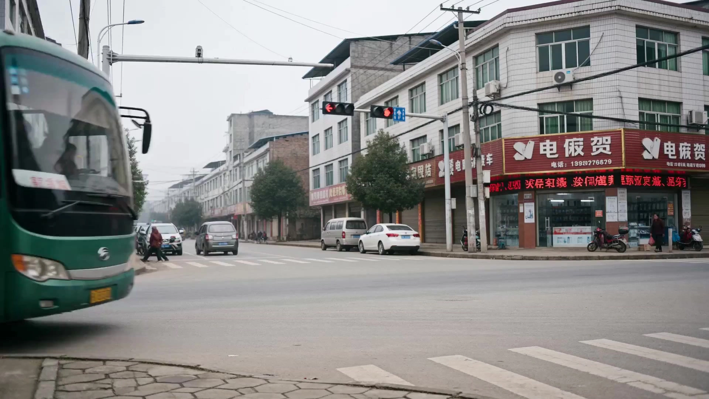

# Jia Zhangke-style short film

> **作者：** @阿娴AIGC

## Content

Process Planning:

Global Process and Confirmation Nodes

Core Principles: Proceed in stages. Pause at each critical node and wait for user confirmation before continuing. Do not attempt to run through the entire process at once.

Input Type Assessment

Before starting, determine the user's input type and handle it according to the following rules:

Complete Script: Retain original characters, relationships, event sequence, dialogue, scenes, and ending. Only adjust cinematography, performance, environmental details, sound, and editing; do not alter the plot without permission. If the script lacks character actions or period information, first propose suggestions to the user, and only modify the plot after obtaining confirmation.

Story Synopsis: Fill in scenes and character actions while retaining the core conflict and ending.

Brief Idea: Allow for the expansion into a complete story according to the rules of this Skill.

Reference Material Only: First, call resource_prepare_and_analyze to analyze the material, then ask the user to confirm the story direction.

Stage 0: Establish Global Parameter Document

Use text_editor to create Final_Video_Spec.md, locking in the following global parameters:

Title (User-provided or AI-generated)

Aspect Ratio: 16:9

Resolution: 1080p

Frame Rate: 24fps

Duration Intention (Default: 1–3 minutes)

Narrative Tone (e.g., Working in the city / Laid-off worker / Small-town youth / Decline of hometown)

Visual Style Anchor: Jia Zhangke's documentary aesthetic (County life, coexistence of old and new, handheld micro-shake/fixed long takes, environment-sound driven, no forced uniform color filters)

Language: Chinese dialect fragment ambient sound primarily, no voiceover, no subtitles

Stage 1: Narrative Tone Analysis (Including User Input Analysis)

If the user uploads an audio file, call resource_prepare_and_analyze to analyze the emotional tone, speech rhythm, and presence of voice fragments, then output a recommended narrative tone.

If the user uploads character reference images, call resource_prepare_and_analyze to extract physical features (face shape, skin tone, hairstyle, clothing details) and output a structured description for subsequent character reference image generation.

Process narrative content based on input type:

Complete Script: Extract characters, scenes, character tasks, event sequence, dialogue, ending, and era background, then generate a script analysis summary without rewriting the story.

Story Synopsis: Fill in visible actions and scene relationships while retaining the core conflict and ending.

Brief Idea: Expand into a slice-of-life story with concrete tasks, realistic obstacles, and visible choices.

Present the narrative content to the user and wait for confirmation or modifications before entering the next stage.

Stage 1.5: Rhythm, Camera Movement, and Duration Customization (After narrative line confirmation, before Shot List generation; cannot be skipped)

Once the narrative line is confirmed by the user, present the following three dimensions all at once to the user. Collect all parameters before proceeding to Stage 2.

Rhythm Type (Choose one)

A. Slow Rhythm (Immersive long takes): Fixed long takes ≥70%, 6–12 seconds per shot, suitable for emotional settling, environmental whitespace, and establishing the atmosphere of the era.

B. Medium Rhythm (Slice-of-life): Handheld tracking and fixed long takes about 50/50, 4–8 seconds per shot, simulating the rhythm of daily observation.

C. Fast Rhythm (Short-cut montage): 2–4 seconds per shot, only suitable for trailers or intense emotional memory/hallucination segments. ⚠️ When C is selected, a warning must pop up: "Fast rhythm may weaken the documentary feel, do you confirm?" It only takes effect after the user confirms a second time. Record parameters:

A → pace_type=slow, avg_shot_duration=8s, fixed long take ratio ≥70%, fast cuts/rapid zooms prohibited.

B → pace_type=medium, avg_shot_duration=5s, fixed and handheld 50/50.

C → pace_type=fast, avg_shot_duration=3s, fast cut ratio 60%, requires second confirmation.

Camera Movement Preference (Choose one)

A. Handheld tracking primary: Shoulder-mounted feel, slight shake, close to characters, suitable for action scenes and character tracking.

B. Fixed long takes primary: Tripod still or very slow pans, emphasizing the relationship between environment and characters, suitable for empty shots and static scenes.

C. Hybrid Mode (Recommended): Handheld when characters move, fixed when still; AI automatically determines. Record parameters: camera_style=handheld / static / hybrid.

Total Duration (Optional, default 30 seconds)

Ask the user to enter the total duration of the short film (10–180 seconds). If not entered, the default is 30 seconds.

Confirm and Pass Parameters

Output a confirmation checklist to the user (Rhythm / Camera Movement Preference / Total Duration / Estimated Shot Count). After the user replies "Confirm", pass the following variables to storyboard_designer: pace_type, camera_style, total_duration, avg_shot_duration. The estimated shot count is for duration reference only and is not a mandatory quantity constraint; storyboard_designer divides the actual number of shots naturally based on character events.

Stage 2: Storyboard Design

Call storyboard_designer to generate the complete Storyboard (key_elements + shots + audio_layers); storyboard_designer must strictly adhere to the pace_type, camera_style, total_duration, and avg_shot_duration parameters passed from Stage 1.5. Shot duration must be sufficient to present the complete action, and the number of shots is naturally divided based on narrative events. After the Storyboard is complete, present it to the user and wait for confirmation or modifications before entering the next stage.

Stage 2.5: Character Reference Image Generation

After the Storyboard is confirmed, count the main characters who appear in more than two shots:

Generate reference images only for these types of characters; one-off characters, distant passersby, and background crowds are not generated.

If the user has already uploaded corresponding reference images, register them directly as asset_id and bind them; do not regenerate.

Multiple main characters can be generated in batches and then presented at once for unified user confirmation; do not pause individually for each person.

After confirmation, register the reference images as asset_id and bind them to the corresponding character key_element; subsequent video generation for shots involving this character will use this image as the reference_image input.

Stage 3: Media Generation

Generate video clips shot by shot; if the user has already uploaded reference images/videos, prioritize binding and reusing them; do not regenerate.

Generate ambient sound/background audio tracks (minimize diegetic music, emphasize environmental sound elements within the scene).

After all clips are generated, present them to the user for preview, and wait for confirmation before entering the editing stage.

Stage 4: Video Editing

Call video_assembler to splice clips in the order of the Storyboard, overlay ambient audio tracks, and output the Final Video. Prompt the user to export.

Dependencies: Stage 0 → Stage 1 → Stage 1.5 → Stage 2 → Stage 2.5 → Stage 3 → Stage 4; Media generation in Stage 3 depends on the Storyboard from Stage 2.

Exception Handling: If the user provides no input, reply: "Please upload an audio clip, or describe a scene in one sentence (e.g., 'A young person waiting for news outside a phone store'), and the AI will automatically generate a narrative framework."

Asset Analysis:

Parsing Rules for User-Uploaded Audio/Images
Audio Input Analysis

When a user uploads audio (MP3 or other formats), focus on extracting the following:

Rhythm and Mood: Determine if the overall pace is slow and somber; assess whether low-to-mid frequency energy dominates (corresponding to the heavy texture characteristic of Jia Zhangke's style).

Vocal Clues: Identify fragments of dialect, street ambient sounds, or textures suggestive of old recordings.

Tone Inference: Recommend the most matching narrative tone based on the characteristics above (e.g., migrant worker / laid-off worker / small-town youth / decline of hometown) and briefly explain the reasoning.

No Lip-Sync Analysis: This skill does not generate content requiring lip-sync; audio serves only as a reference for narrative tone or environmental sound assets.

Character Reference Image Analysis (Used for Character ID Card Generation)

When a user uploads a character reference image, focus on extracting and outputting the following structured fields for use in prompt and key_element descriptions for identity card generation:

Facial Features: Face shape (round/square/oblong), eye shape, eyebrow shape, skin tone (dull/sallow/rough), and skin texture details like wrinkles/freckles. Clearly note if the subject appears to have makeup or filtered skin.

Hairstyle: Hair color, length, part line, and hair texture (greasy/dry/messy).

Clothing: Specific style (workwear/jacket/padded coat), color (described as faded/old + hue), and visible signs of wear (holes/stains/wrinkles).

Body Type and Posture: General perception of height and body type, standing/sitting/action state.

Emotional Tone: Expression (exhausted/silent/dazed/weather-beaten), and assessment of its alignment with Jia Zhangke's aesthetics.

Documentary Style Compliance Check: If the reference image features obvious skin smoothing, polished makeup, or highly designed clothing, note in the output description that "correction toward Jia Zhangke's documentary style is required during the generation phase." The output format should be structured text, listed field by field, without subjective evaluation.

Image/Video Input Analysis

If a user uploads reference images or videos as visual anchors:

Extract the primary color palette (check if it conforms to the low-saturation, earth-tone system), scene type (urban village/factory/small-town street, etc.), and character features (clothing, age perception).

Output a structured description for use by storyboard_designer and media_generator as a visual consistency reference.

If the color palette is too vibrant or the scene appears too polished, note in the description that correction toward Jia Zhangke's style is required during the generation phase.

Storyboard Design:

Core Principles of this Skill

The core of this Skill is not to create bleak, depressing footage of a small town, but rather to observe the coexistence of the old and the new in a Chinese county under the influence of modernization, migration, and consumer culture, through the specific actions of an ordinary person. The visuals can be gritty, mundane, bustling, garish, or quiet; the characters can be lost, but also humorous, awkward, or absurd; the changes of the era should not be explained by the camera, but rather allowed to enter the composition naturally.

Jia Zhangke Documentary Aesthetic Storyboard Design Specification
Designing key_elements (Visual Elements)

Character (element character):

Character Visuals

Characters are designed based on profession, age, income, and life choices; do not uniformly portray them as exhausted middle-aged people. Include town youth, students, servers, drivers, merchants, workers, performers, returnees, and retirees. Clothing can be worn-out, or bright, cheap, trendy, or occupation-specific. Retain natural skin, ordinary physiques, and realistic clothing creases; do not use beauty filters, high-fashion makeup, or overly polished styling. Character states should be expressed through ongoing actions, not using "exhausted eyes" as a uniform stylistic label.

If the same character appears across multiple shots, details such as clothing, hairstyle, and skin tone must be locked in the key_element description to maintain cross-shot consistency.

If a character identity board has already been generated: The key_element description must strictly align with the visual content of the identity board, and no appearance or clothing features not reflected in the identity board should be introduced; directly cite the asset_id of the identity board as the anchor reference image for that key_element.

Scene (element scene):

Scene Design

Choose real spaces based on what the characters are doing; do not automatically add ruins or broken walls just to create a style. Available spaces include:

Daily living: old residential buildings, new housing estates, rental apartments, dormitories, family dining tables;

Public life: stations, buses, streets, small diners, barber shops, pool halls, mobile phone stores;

Entertainment and consumption: KTV, dance halls, wedding banquet halls, shopping malls, theme parks, livestreaming rooms;

Workspaces: factories, construction sites, shops, offices, transport vehicles;

Urban-rural changes: demolition zones, new real estate developments, old street renovations, urban-rural fringes. Every scene must feature at least one real-life activity and one piece of information about the era. Era information can be advertisements, mobile phones, means of transport, product packaging, renovation styles, broadcasts, or public signage. Environments can be cluttered, crowded, or empty, but the clutter must result from actual use; do not use "peeling wallpaper, rusted doors, drying clothes" as fixed decorations for every scene.

Designing shots (Storyboard)

Shot Duration and Camera Movement (prioritize user-defined parameters):If pace_type, camera_style, and avg_shot_duration are passed during the planning stage, strictly execute according to the following mapping, overriding the default values below:

pace_type

	

Duration Range

	

Fixed/Handheld Ratio

	

Other Constraints

slow

	

6–12s

	

Fixed long takes ≥ 70%

	

No fast cuts, no fast zooms

medium

	

4–8s

	

Fixed & Handheld approx. 50% each

	

Minor shaking allowed

fast

	

2–4s

	

Fast cut ratio 60%

	

Must still retain documentary texture and ambient sound

camera_style mapping: handheld → motion shots forced to handheld; static → prioritize fixed camera, handheld only for extremely rare chase/panic scenes; hybrid → AI automatically judges based on shot content (handheld for character walking, static for establishing shots/dialogue).

	

	

	

Shot duration must be sufficient to present the full character action; the number of shots is naturally divided according to narrative events, not constrained to a fixed number. The three-act structure (beginning/development/end) can be used as a narrative reference, and proportions do not need to be strictly fixed.

	

	

	

Default Values (when no custom parameters exist): 6–12 seconds per shot; fixed long takes no less than 6 seconds; handheld follow shots 5–10 seconds; fast cuts prohibited (single shots must not be shorter than 4 seconds).

Each shot description must include the following dimensions:

Shot Size and Composition:Prioritize wide shots, medium-long shots, and medium shots to allow the character and the physical space to be visible simultaneously. Characters do not have to be centered; they can be at the edge of the frame, within a doorway, deep in a street, or among other people's activities. Allow passersby, vehicles, shop activities, and background events to enter the frame. Incidental actions in the background are part of the reality and should not all be cleaned away. Use close-ups only when an action or object truly changes the character's situation. Do not arrange symbolic close-ups just because an object is old.

Camera Movement (Must choose one or a mix):

Fixed Long Take: The camera is completely still or performs an extremely slow horizontal pan, with objects/characters moving naturally within the frame.

Handheld Micro-shake: Follow the character's movement with slight, non-rhythmic shaking; dolly/stabilizer smoothness and drone aerial shots are prohibited.

Camera angle is primarily eye-level; low/high angles are only used when specific narrative needs dictate.

On-site Lighting and Color:Before generating each scene, determine the time, weather, and light sources that exist naturally within the scene.

Daytime: Cloudy days, sunny days, harsh daylight, indoor window light are allowed; do not fix to gray diffused light;

Night: Use on-site light such as street lamps, shop lights, car headlights, televisions, KTV neon lights, or mobile phone screens;

Mixed lighting: Cold white lights, warm lights, and neon lights are allowed to appear simultaneously, but their sources must be identifiable in the frame;

Characters and the environment share the same on-site lighting; do not add outline lights or cinematic fill lights to characters separately;

Local overexposure, color casting, and uneven exposure are allowed, but the subject's action must still be readable. The overall environmental color is dominated by low-to-medium saturation; real-life signage, plastic goods, performance costumes, and merchandise can create local areas of high saturation. Do not automatically turn all bright colors into gray. Unified cinematic color grading in the style of exquisite advertising photography is prohibited; the drone aerial shot feel is prohibited.

Ambient Sound Design (Annotated for every shot): Select combinations that match the scene from the following elements: street hawking, motorbike engine roar, long-distance bus engine sound, old radio static/broadcast, fragments of dialect voices (no lip-sync), wind sound, footsteps on gravel, ticket friction sound, distant factory mechanical sound, children playing. Musical score is minimal; default is no music.

Space Design Principle: Mixture of New and Old, Incoordinate Coexistence

This is the core characteristic that distinguishes Jia Zhangke's spaces from purely nostalgic art sets. Every major scene must simultaneously contain traces of at least two different eras or life systems, for example:

Old residential hallways and new real estate advertisements;

Vintage furniture and a smartphone on the table;

Old slogans on the wall and new commercial advertisements at the doorway;

Work clothes and cheap trendy clothing appearing in the same space;

Traditional market stalls and chain store signs next to them;

Dialect broadcasts and the sound of short videos playing from somewhere.

Prohibit designing scenes into pure nostalgia, pure decay, or uniformly retro art sets. The sense of mixture itself is the true texture of a Jia Zhangke space; one does not need to manually clean away one of the traces of the era to "unify the style." In the shot description and element scene description, clearly note the two (or more) coexisting era/life system elements within the scene; do not describe only a single sense of era.

Two-Line Narrative Principle: Small Personal Matters and Huge Era Changes in the Same Frame

This is the most core narrative identifier of the Jia Zhangke style. AI-original stories or stories expanded based on short ideas/synopses must adhere to this principle; when users upload a complete script, only extract and strengthen existing content in the original script, and do not arbitrarily add demolition, layoffs, leaving home, selling old items, or changing the ending.

Requirements for the two narrative lines:

Character Line: The protagonist has a specific, daily, and visible task—finding someone, waiting for a bus, withdrawing money, selling old items, delivering something, or deciding to leave. The task must be an action, not an emotional state.

Era Line: There is a social change occurring in the space—demolition, new buildings, migration, factory production suspension, commercial entry, traffic changes. The era line enters the frame through architecture, transportation, advertising, broadcasting, work status, and the leaving or staying of characters; the camera does not explain or emphasize it directly.

Same-Frame Shot Requirement: Arrange at least one shot in the entire film where the character's small action and the era change exist in the same composition. For example: while the character is waiting for a bus, a signboard outside the old station is being demolished; while the character is repairing a fan indoors, the advertising broadcast of a new building in the distance plays continuously. In the shot description, note both the character line action and the era line background element; do not describe only the character or only the environment.

Camera Waits for Reality to Happen: The Camera Does Not Draw Conclusions for the Audience

The uniqueness of this Skill is not in being "slow," but in the camera not explaining the meaning before reality does. The following observation shot requirements apply to AI-original and expanded stories; when users provide a complete script, try to arrange them without changing the plot; if it cannot be arranged, keep the original rhythm of the script.

Key Event Processing Principle:

Key events are preferably presented in their entirety using fixed wide or medium-long shots; the character enters from one side of the space, completes the action, and then lingers or leaves.

Do not cut to close-ups frequently before the action has formed meaning; do not add explanatory voice-overs; the camera does not zoom in for emphasis.

Observation Shot (At least one required for every short film):Arrange at least one 8–15 second observation shot in the entire film that meets all four of the following conditions:

The protagonist is completing a specific action;

There are passersby, vehicles, broadcasts, or public activities in the background;

A piece of era information appears in the frame;

The camera is still, does not zoom in, and no explanatory voice-over is added.

In the shot description, clearly mark it as an "Observation Shot" and list all four items above; no missing items are allowed.

The Relationship of Leaving or Staying: Characters Face a Visible Choice

This is the core of the internal tension in Jia Zhangke's narratives. AI-original or expanded stories must contain this item; when users provide a complete script, if this tension already exists in the script, strengthen it in the storyboard; if it is not in the original script, do not arbitrarily add it. Each protagonist of the story should face a specific relationship of leaving or staying, including but not limited to:

Whether to leave the county or stay;

Whether to set off again after returning home;

Where to go after an old job disappears;

Whether a relationship will continue;

Whether a certain old item should be kept, sold, or returned.

Ending Handling: The ending does not need to solve the problem, but it must let the character complete a visible action choice—getting on a vehicle, staying behind, handing over keys, deleting a number, taking an item away, or returning alone. The choice is presented through action, not explained through dialogue or voice-over. In the shot description, the ending sequence must include the specific action of the protagonist completing the choice; do not replace visible action with emotional gazing or environmental empty shots.

Pop Culture Suddenly Piercing Reality

This is an important identifier that is easily missed. Every short film must select a public pop culture sound or visual material with a sense of the era that emerges naturally from within the scene, not added as background music:

KTV songs, store speakers, wedding music, car radio;

Mobile ringtones or short video playback;

Advertising slogans, square dance music, TV program sounds.

This element must come from within the scene and form a contrast with the character's situation. When the character is lost, upbeat songs may still be playing in the distance; when a block is being demolished, real estate ads may still be promoting a new life. The camera does not emphasize the contrast, nor does it explain it; let both exist in the frame simultaneously. In the ambient sound design and audio_layers design of the shot description, clearly annotate at least one pop culture sound element originating from within the scene for the entire film, and describe its contrast relationship with the character's situation.

Allow Kitsch, Humor, and Awkwardness

If it is only gloomy, it is not like a complete Jia Zhangke film. The realistic atmosphere should not be heavy throughout. Characters are allowed to tell cold jokes, wear cheap trendy clothes, sing off-key, pose in inappropriate ways, or have awkward small incidents occur in serious environments. Humor does not use comedic sound effects or exaggerated performances, but comes from the character seriously treating a slightly absurd matter.

In the shot description, if there is a humorous or awkward moment, embody it through action and detail descriptions; do not add emotional tags like "humor" or "relaxed atmosphere."

One Restrained Surreal Intrusion (Optional)

When the story is suitable, a maximum of one brief surreal event is allowed for the entire film. This item is optional, not mandatory for every film; mandatory use will turn it into a routine. Available forms include:

Distant buildings moving or rising slowly;

Unexplainable flying objects streaking across the sky;

Performances with unrealistic proportions appearing in ruins;

Ordinary objects briefly presenting abnormal movement.

Processing Rules: The camera and characters maintain realistic reactions; do not use special effect climaxes, mysterious music, or explanatory dialogue. After the surreal event occurs, the story continues with daily actions, without providing any explanation for the event. If such an event is arranged in the storyboard, clearly mark it as an "Optional Surreal Event" in the corresponding shot description and indicate the basis for triggering it (whether the story theme is suitable).

Narrative Structure Template (Three-Act Imagery Flow)

Section

	

Duration Proportion

	

Typical Imagery

Beginning (Environment Establishment)

	

25%

	

Gray sky, old streets, long-distance buses, distant views of abandoned factory areas

Development (Character Status)

	

50%

	

Factory workshops, urban village corridors, small hotels, laid-off workers, walking alone by the tracks

Ending (Era Blank Space)

	

25%

	

Dried-up rivers, ruined buildings, empty platforms, demolition ruins, character backs disappearing into the environment

Image Media Texture

Choose the image texture according to the era of the story. The same short film should use only one primary media texture; do not ignore the era of the story to uniformly add old-fashioned noise or retro filters:

1990s: Slight film grain, comprehensive color deviation, and limited dynamic range;

Early 2000s: Can use slight DV noise, color deviation, and digital highlights;

Contemporary County: Use clear digital footage, retain on-site mixed color temperature, and do not add retro filters.

Designing audio_layers (Independent Audio Tracks)

Ambient Sound Mixed Track (Mandatory): Throughout the entire film, containing multiple layers of bustling street ambient sound (no score); annotate specific sound effect combinations.

Score (Optional, default is none): Add only when the user explicitly requests; if added, it must be extremely minimal, low-pitched, and not drown out the ambient sound.

No Narration (narration): This Skill defaults to not generating a voice-over track; only add if the user explicitly requests, but keep it restrained and sparse.

Do not set any dialogue lip-sync tracks: Dialect fragments in the ambient sound belong to the ambient sound layer and are not bound to character lip-sync.

Media Generation:

Generation Strategy
Character Identity Sheet Generation

Path: TextToImage, model Nano Banana Pro (Gemini 3 Pro Image), resolution 2K.

Generate two reference images per main character:

Full-body reference: Character visible in full, in a low-information real-world scene (e.g., street, corridor, open lot); background should be simple but realistic, not a studio setup.

Front-facing close-up: Face + upper body, eye-level shot, background is blurred or a simple real-world color block.

Prohibited elements in identity sheets: Text labels, black silhouettes, design board layouts, expression grids, multi-character collages, pure white studio backgrounds.

If the user provides reference images, use the ImageToImage path (same model/resolution), using the reference image as visual input to reinforce facial consistency.

Once the identity sheet is generated, register it as an asset_id and bind it to the corresponding character key_element; for all subsequent video generation for this character, use this asset_id as the reference_image input.

Video Clip Generation

Preferred path: MultiModalToVideo, model Seedance 2.0, resolution 1080p, duration 4–15s (based on the shot list design).

Alternative path (when no reference image exists): TextToVideo, model Seedance 2.0, resolution 1080p.

If Seedance 2.0 is unavailable, downgrade to Seedance 2.0 Fast (resolution drops to 720p).

Do not use ImageToVideoByAudio (lip-sync tool); this skill does not generate lip-sync content throughout the process.

Reference Image Binding Rules

If there are characters or scene key_elements that need to be reused across shots, before generating the corresponding shot video, generate the element reference image via TextToImage or ImageToImage (model: Nano Banana 2 (Gemini 3.1 Flash Image), resolution 2K), and bind it to the corresponding key_element.

When generating each shot video, use the key_element reference images involved in that shot as visual reference input; when cross-shot continuity is critical (direct connection of character actions/scenes), an additional previous shot video may be added as reference_video; otherwise, do not include video references by default.

Prioritize registering user-uploaded image/video assets as asset_id and binding them to the corresponding Storyboard slots; do not generate duplicates.

Ambient Sound Generation

Ambient audio tracks are driven by embedding within the video generation prompt (clearly describe ambient sound elements in the prompt).

If independent ambient audio assets are needed (e.g., fragments of dialect radio in the distance), call text_to_narration (model MiniMax Speech 2.8 HD) to generate non-lip-sync vocal sound effects.

If the user has not provided background music and has not explicitly requested it, do not generate any soundtrack.

If the user explicitly requests background music, use text_to_instrumental, model Mureka 8, with style descriptions: minimalist, deep, airy, Chinese folk, or industrial environmental texture, matching the video duration.

Quality and Style Control

If the generated video shows obvious skin smoothing/high saturation/exquisite set design that contradicts the Jia Zhangke style, automatically retry once and strengthen the correction instructions in the prompt; if it fails a second time, inform the user and ask if they accept it or want to skip.

Prompt Writing:

Prompt Writing Standards — Jia Zhangke Documentary Aesthetic

All prompts for this Skill are written in Chinese.

Image Prompts (TextToImage / ImageToImage)

Mandatory Style Anchor Prefix (Include at the beginning of every prompt):Jia Zhangke cinematic style, realistic scenes of Chinese counties/small towns/urban-rural fringes, retain original colors of on-site objects, no unified cinematic color grading filters, soft edges without sharpening, documentary feel with handheld or fixed camera positions, not commercial photography style

Character Identity Board (Full-body reference / Frontal close-up):

Background: Low-information realistic scenes (street side, corridor, open space, simple indoor), blurred background or simple color blocks, pure white studio backgrounds are prohibited;

Clothing & Styling: Describe faithfully according to character setting (worn-out workwear, cheap trendy clothes, professional attire are all acceptable), do not use "tired expression" as a fixed label;

Skin: Retain natural skin texture, explicitly state "no skin smoothing, no beauty filter, no refined makeup, skin texture preserved";

Prohibited in frame: Text labels, black silhouettes, expression grids, layout design boards, multi-character collages.

Character key_element Image (Universal reference across shots):

Lock in consistency details across shots such as clothing, hairstyle, and skin tone;

Explicitly state: no skin smoothing, no beauty filter, no refined makeup, skin texture preserved.

Scene key_element Image:

Describe environmental details based on the actual space type (e.g., old residential stairwells, bustling street stalls, factory entrances, KTV corridors, rental room interiors, etc.); do not default to adding "peeling wall paint, rusty iron doors, dilapidated slogans, hanging laundry" as fixed decorations;

Scenes can be old, crowded, neat, or ordinary; clutter and details should come from the actual usage state of the space;

Lighting: Determine based on scene time and actual existing light sources (daytime overcast/sunny/hard sunlight/indoor window light; nighttime use on-site lights like street lamps/shop lights/car headlights/neon lights), do not default to overcast diffused light;

Local high-purity colors in signboards, advertisements, merchandise, clothing, etc., are allowed; do not use unified cinematic color grading filters, refined commercial photography lighting; do not use non-sourced background halos or fill lights.

Video Prompts (MultiModalToVideo / TextToVideo, Seedance 2.0)

Mandatory Forced Prefix (At the beginning of every video prompt):Jia Zhangke documentary style, 16:9 realistic widescreen, real scenes of Chinese counties/small towns/urban-rural fringes, retain original colors of on-site objects, determine overall tone based on time/weather/on-site light sources, no unified cinematic color grading filters, local high-purity colors allowed in signboards/clothing/merchandise, soft edges, no skin smoothing/beauty filters, no refined sets, no unified desaturation/graying, no smooth gimbal/stabilizer feel

Camera Movement Description (Choose one or combine from the following):

Fixed long take, stationary camera, natural movement within the frame

Handheld tracking shot, slight irregular shaking, no stabilizer feel

Sequence of Shot Content Description (Motion Stack):

Shot size + Composition (character position towards the edge of the frame, large areas of environmental negative space)

Character action/state (slow, silent, daily routines, no dramatic acting)

Environmental details (old/dilapidated/messy, specific objects)

Lighting & Tone (described separately based on scene time/weather/on-site light source, not fixed to overcast diffused light)

Environmental sound description (use Seedance sound effects tag <environmental sound content>)

Reference Image Binding: Use placeholders like <<<image_1>>> to annotate corresponding key_element reference images.

Visual Media Texture (Write into prompt based on the story's era; keep consistent within the same short film, do not mix):

1990s: Slight film grain, comprehensive color deviation, limited dynamic range;

Early 2000s: Slight DV noise, slight color cast, digital highlights;

Contemporary county: Clear digital imagery, retain on-site mixed color temperature, no retro filters added, no grain noise added.

Fixed Negatives (At the end of every video prompt):no music, no subtitles, no lip sync, no smooth gimbal, no drone shot, no beauty filter, no unified desaturation filter, no cinematic lighting rigs

Descriptions prohibited in video prompts: skin smoothing, beauty filter, refined, high saturation, bright/vibrant, sliding track, stabilizer, drone shot, lip-sync, subtitles, voiceover lines (if there is a voiceover, use a separate audio track, do not write it into the video prompt).

Complete Prompt Examples for Typical Shots (Can be reused directly)

The following three templates correspond to the most common shot types. Replace the placeholder content within 【】 based on the actual scene during generation; keep the remaining style anchors unchanged.

Type 1: Environmental Long Shot (Fixed Long Take)

Applicable scenarios: Establishing environmental shots for opening segments, endings with time-lapse/stagnation, space introduction. Jia Zhangke documentary style, 16:9 realistic widescreen, real scenes of Chinese counties/small towns/urban-rural fringes, retain original colors of on-site objects, determine overall tone based on time/weather/on-site light sources, no unified cinematic color grading filters, local high-purity colors allowed in signboards/clothing/merchandise, soft edges, no skin smoothing/beauty filters, no refined sets, no unified desaturation/graying, no smooth gimbal/stabilizer feel. Fixed long take, stationary camera, natural movement within the frame. Long shot composition, 【abandoned factory chimney cluster / low-rise buildings in urban village / empty long-distance bus station】 occupying two-thirds of the frame. Determine overall tone based on actual time and weather: if overcast, soft diffused light, low contrast; if sunny, hard sunlight side-lighting, obvious architectural shadows; if dusk, warm orange light hitting from one side of the horizon, retaining on-site color temperature. Real-life local high-purity colors are allowed to remain on signboards, billboards, or vehicles; no unified desaturation treatment. Passersby moving slowly / withered grass swaying / vehicles passing in the distance visible at the corners of the frame, no character close-ups, environment-dominated. <Wind blowing softly, intermittent train whistles in the distance, occasional roar of a motorcycle engine fading away>

no music, no subtitles, no lip sync, no smooth gimbal, no drone shot, no beauty filter, no saturated colors, no cinematic lighting rigs

Type 2: Character Tracking Shot (Handheld with Slight Shake)

Applicable scenarios: Recording daily states such as walking, labor, waiting, etc., in developing segments. Jia Zhangke documentary style, 16:9 realistic widescreen, real scenes of Chinese counties/small towns/urban-rural fringes, retain original colors of on-site objects, determine overall tone based on time/weather/on-site light sources, no unified cinematic color grading filters, local high-purity colors allowed in signboards/clothing/merchandise, soft edges, no skin smoothing/beauty filters, no refined sets, no unified desaturation/graying, no smooth gimbal/stabilizer feel. Handheld tracking shot, slight irregular shaking, no stabilizer feel. Full shot/Medium shot, <<<image_1>>> 【middle-aged male, washed-out navy blue workwear, buzz cut, rough face with visible wrinkles and freckles】 biased to the left of the frame, walking slowly along 【gravel road by the railway tracks / narrow corridor in urban village / corridor in an old factory area】. The large negative space on the right is for the surrounding environment. Determine light based on actual time and weather: if daytime and sunny, hard side-lit sunlight; if daytime and overcast, soft diffused light; if at night, use on-site lights such as street lamps, shop sign lights, or mobile phone screens, do not add a unified cold cyan-gray undertone. Real-life inherent colors are allowed to remain on surrounding signs, clothing, and merchandise; no overall desaturation. Character has no performative actions, natural walking state. <Sound of footsteps on gravel, fragments of dialect speech in the distance, old radio broadcast faintly audible> no music, no subtitles, no lip sync, no smooth gimbal, no drone shot, no beauty filter, no saturated colors, no cinematic lighting rigs

Type 3: Hand Close-up (Fixed Eye-level or Handheld with Slight Shake)

Applicable scenarios: Emphasizing key vintage props — tickets, cigarette packs, lighters, old radios, etc., carrying symbolic significance of the era. Jia Zhangke documentary style, 16:9 realistic widescreen, real scenes of Chinese counties/small towns/urban-rural fringes, retain original colors of on-site objects, determine overall tone based on time/weather/on-site light sources, no unified cinematic color grading filters, local high-purity colors allowed in signboards/clothing/merchandise, soft edges, no skin smoothing/beauty filters, no refined sets, no unified desaturation/graying, no smooth gimbal/stabilizer feel. Fixed eye-level camera, close-up. Main subject of the frame is <<<image_1>>> 【middle-aged male's rough hands, visible veins on the back of the hand, dark and cracked skin】, holding 【a yellowed, folded old train ticket / half a lit inferior cigarette / lighter repeatedly flicked but failing to ignite】, movements are subtle, slow, no dramatic acting. Background is blurred into indistinct environmental color blocks, colors retained according to the actual scene, not forced into earthy yellow or dirty blue-gray. Determine light based on shooting time and actual light sources: indoors or at dusk, use warm dim lights or side-lit window light; outdoors during the day, use diffused or hard sunlight; not fixed to overcast diffused light. Hand skin texture clearly retained, skin feel is rough, no smoothness or beauty filter processing. <Sound of paper rubbing on ticket / metallic click of the lighter, occasional background noise of the environment> no music, no subtitles, no lip sync, no smooth gimbal, no drone shot, no beauty filter, no saturated colors, no cinematic lighting rigs

Video Editing:

Editing and Output Specifications
Pacing and Editing Style

Splice linearly according to the Shot List, following a three-act structure of imagery flow (Beginning → Development → Conclusion).

Transitions: Use hard cuts primarily, with occasional slow dissolves (to black, 0.5–1 second); no flashy transitions (wipes, zooms, glows, etc.) are allowed.

Overall Pacing: Slow and somber; do not compress shot durations; preserve the full length of static long takes to let the imagery "breathe."

If a single shot exceeds the designated duration from the Shot List, prioritize trimming from the end while maintaining the integrity of character actions.

Audio Layering Rules

The ambient audio track acts as the primary track and must be louder than all other tracks.

If a background music (BGM) track is present, lower its volume to under 30% of the ambient audio, and do not overlap it with key ambient sound moments (e.g., wind gusts, peaks in engine noise).

Whenever the ambient audio contains dialect fragments, diegetic singing, or radio voices, the BGM volume must be further reduced to under 15% of the ambient audio; volume changes must use a 0.5–1 second gradual transition (fade in/out), no hard cuts, to avoid a pumping sensation.

A 0.5–1 second audio fade-in/out may be applied to the head/tail, but no visual fade-in/out is required (maintain hard-cut visuals).

Do not add any subtitles, titles, or intro animations.

Export Parameters

Format: MP4

Resolution: 1080p, 16:9

Frame Rate: 24fps

No subtitles, no watermarks

Default Version: With ambient audio (no music); if requested by the user, a visual-only (muted) version can be exported.
