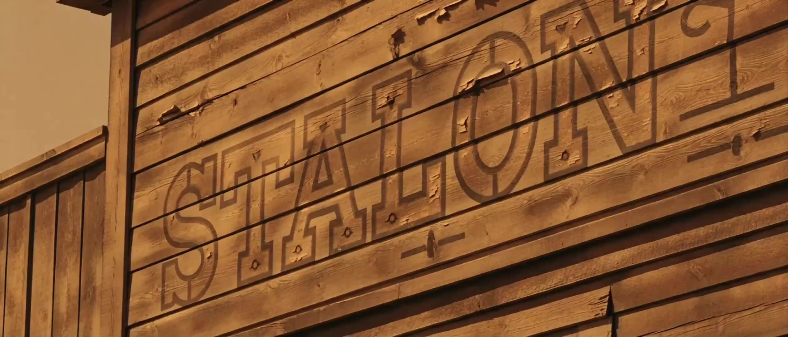

# John Ford-inspired style

> **作者：** @Aplus影像

## Content

Process Planning:

John Ford Western Short Film Generator

Suitable for: 2–10 minute narrative short films; cinematic language based on John Ford Western Cinema Language

Core Visual Keywords: Monument Valley, American Frontier, Epic Landscape, Natural Light, Dust, Horse, Silhouette, Deep Focus, Western Town, Campfire, Heroism, Moral Conflict, Classic Hollywood, VistaVision, 35mm Technicolor

Communication Rules (Global)

Do not mention any internal step numbers when communicating with the user. Use functional descriptions instead.

Incorrect: Entering step 5 / Starting step 7 / After step 6 is complete

Correct: Next, we will begin designing visual specifications / Next, we will generate character and scene elements / Start video generation after all shot lists are confirmed / Start sound design / Start final composition

Step 1: Collect User Creation Information
A Creative Assets

Supports any combination of: Story Ideas, full scripts, novels, screenplays, historical events, photos, video references, character settings, world-building, reference films.

B Basic Parameters

Film Title

Target Duration: 2 minutes / 3 minutes / 5 minutes / 8 minutes / 10 minutes

Aspect Ratio: Default 2.39:1 CinemaScope; options include 16:9, 4:3 (suitable for classic B&W Westerns); or let Flova determine automatically

Video Generation Model: Seedance 2.0 (default) / Kling 3.0 Omni / Others

Film Language: Chinese / English / Other. Keep the entire film consistent—narration, subtitles, title cards, and text props must all match

Need Narration: Yes / No

Use Classic Western Film Score: Default "Yes", can be disabled

C Chapter Planning

Decide whether to use a chapter structure. Default is no more than four chapters. Recommended: Chapter 1 "Frontier Established", Chapter 2 "Character Conflict", Chapter 3 "Duel of Destiny", Chapter 4 "Hero's Departure".

Overall Process

Collect user input

Analyze assets (Analyze characters, era background, space, historical authenticity, completeness of Western elements)

Generate Final_Video_Spec.md → Pause and wait for confirmation

Western film visual style consultation → Pause and wait for confirmation

Visual specification conversion: Character element images → Scene element images → Key prop images → Fused keyframes → Pause and wait for confirmation

Generate all chapter shot lists (if the story is incomplete, perform automatic plot expansion). Generation method: A Generate all / B Generate chapter by chapter / C Generate character three-view and horse settings first → Pause and wait for confirmation

Generate video clips (must wait for user confirmation)

Generate narration (can be parallelized)

Generate sound effects (can be parallelized)

Generate BGM (can be parallelized)

Final editing and composition Dependencies: 3←1+2; 4←3; 5←4; 6←5; 7←6; 8←7; 9←7; 10←7; 11←7+8+9+10

Western Film Style Consultation
Main Question
A Let Flova Decide

Automatically design John Ford cinematic language based on the script.

B Reference Classic John Ford Films

Display film selection:

Stagecoach—Yellow desert, wooden town, blue sky, long-distance cavalry

My Darling Clementine—Gray-blue sky, frontier church, wooden saloon, simple life

The Searchers—Monument Valley, giant red canyon, sunset backlight, lonely hero

Fort Apache—Military fort, yellow earth, military green uniforms, frontier war

She Wore a Yellow Ribbon—Golden prairie, cavalry patrol, vast landscapes

The Man Who Shot Liberty Valance—Classic B&W, high contrast, law vs. violence

Other

C Chapter Color Palette Variation

Example: Warm yellow for youth → Earth gray for wartime → Golden red for sunset → Blue-gray for the end of the legend. Supports independent color design for each chapter.

Allow user input: Custom era, custom region, custom cinematography style, custom historical background. After the plan is generated, it must display: "Confirm current plan" or "Continue modifying plan", looping until confirmed.

Shot Count Reference

Duration and shot count reference:

Target Duration

	

Recommended Shot Count

2 minutes

	

8–18

3 minutes

	

12–28

5 minutes

	

20–45

8 minutes

	

35–70

10 minutes

	

50–90

Chapter Title Card: 3–5 seconds, not included in shot count

Standard Shot: 5–8 seconds

Epic Wide Shot: 8–15 seconds

Duel Shot: Can be extended to 20 seconds

Asset Analysis:

Western Film Asset Analysis Rules

The entire analysis phase follows the narrative principles of John Ford's classic Western films: analyze the world first, then the characters, and finally the story. Characters always belong to the land, and the land determines their fate.

A Script/Story Text Analysis

Extract the following information:

1. Era Background

Determine the era of the story. Examples: 1830s American Westward Expansion; 1861–1865 American Civil War; 1865–1890 Frontier Development Period; post-1890 End of the Western Civilization Era. If the user does not specify, Flova will automatically infer the most reasonable era based on the story.

2. Location Analysis

Identify key spaces: frontier town, railroad, desert, canyon, prairie, ranch, mining area, Indian reservation, cavalry fort, sheriff's office, jail, saloon, church, cemetery, train station, stable, river valley, canyon pass, mountains, mesa, farm, cabin.

For each space, look for: historical authenticity, architectural style, environmental features, topographical characteristics, weather conditions, and natural light conditions.

3. Character Analysis

Extract characters: name, identity, age, profession, faction, clothing, weapons, horses, means of transport, and relationships. Create a character profile. Examples: sheriff, rancher, cowboy, cavalry officer, bounty hunter, fugitive, outlaw, railroad worker, Indian warrior, saloon owner, preacher, doctor, judge, railroad merchant, gunfighter, herdsman, railroad guard, immigrant family, children, elderly.

4. Clothing Analysis

Extract: hats, cloaks, cowboy hats, boots, spurs, scarves, leather jackets, belts, holsters, uniforms, shawls, dresses, capes, colors, materials, wear and tear, and identity markers.

5. Weapon Analysis

Extract: revolvers, rifles, shotguns, bows and arrows, sabers, daggers, lassos, dynamite, whips. Analyze: historical authenticity, usage, and character attribution.

6. Transportation

Horses, stagecoaches, trains, ox carts, cavalry transport wagons, freight wagons, canoes, rafts.

7. Horse Analysis

Create a profile for each horse: color, breed, height, equipment, saddle, temperament, purpose, owner, and historical status. Examples: gray horse, chestnut horse, black horse, white horse, war horse, cow pony, draft horse, old horse, young spirited horse.

8. Natural Environment Analysis

Weather, sun angle, time of day, wind speed, cloud cover, vegetation, rock color, topographical layering, dust/sand level, river water level, forest density, wildlife. Examples: vultures, wolves, coyotes, bison, deer, herds of horses, eagles.

9. Spatial Mood

Analyze the "mood of the land," not the characters' emotions. Examples: civilization encroaching, civilization disappearing, war ending, frontier desolation, birth of hope, establishment of order, onset of rule of law, hero departing, end of an old era.

B Visual Reference Analysis

If images or movie screenshots are uploaded, extract the following information:

Lighting

Natural light direction, backlight, morning light, sunset, overcast, firelight, candlelight, moonlight.

Cinematography

Extreme long shot, long shot, wide shot, medium shot, close-up, extreme close-up, low angle, high angle, hero angle, deep focus, telephoto ratio, camera movement.

Landscape Elements

Monument Valley, canyons, deserts, prairies, forests, frontier towns, cabins, railroads, saloons, churches, cemeteries, stables.

Color

Ocher, sandy yellow, dark brown, iron gray, denim blue, olive green, leather brown, sunset orange, dusty gray, cold night blue.

Materials

Weathered wood, rust, leather, rough cloth, stone, dirt, dust, smoke, old brick, wooden fences, saddles, ropes.

C Analysis Limitations

Does not analyze real-life identities. Does not replicate real actors' likenesses. Does not copy specific movie shots. Learns only from: film language, cinematography techniques, lighting principles, composition logic, art direction, era characteristics, and spatial organization.

D Script Completeness Assessment

Ready for Visual Design (requires the following: major characters, major spaces, advancing events, and the ability to infer a complete story arc → no extension needed).

Requires Story Extension (if the following occur: only a creative pitch, only a theme, only characters, only locations, no conflict, no ending, no era background, no spatial transitions, no character relationships → automatically marked as "Requires Story Extension").

Output format: Completeness Assessment (Requires Story Extension / No Extension Needed) + Missing Content (Era Background, Character Relationships, Spatial Information, Conflict, Climax, Ending, Historical Authenticity, Horse Settings, Weapon Settings, Architectural Settings).

Storyboard Design:

Storyboard Design Rules

Sections 1–6: Execute after visual specifications are confirmed. If the script analysis stage determines "story expansion is needed," the Western movie plot expansion is executed automatically at the end.

I. Western Set Design Specifications
1. Land as a Character (Core Principle)

In John Ford films, the true protagonist is never the person, but the land. Every scene must answer: What kind of people live here? Why do they stay? Why do they leave? Therefore, all spaces must show complete traces of life.

Examples: Wear on doorframes, horseshoe prints, wind-blown sand, aging wood, chimney soot, barrel cracks, bullet holes on tavern walls, worn church pews, tilted tombstones, rusted railways, fence repairs, stable hay, leather tools, blacksmith soot. Traces of life must be part of the narrative.

2. Landscape Before Character

Characters cannot exist apart from nature. All outdoor shots must prioritize establishing: sky, mountains, canyons, prairies, rivers, forests, deserts, before the characters appear. Establish the classic John Ford rhythm: Landscape→Human→Conflict→Landscape. Characters ultimately belong to the land.

3. Monument Valley Principle

If the story permits, prioritize: massive canyons, towering rock formations, red sandstone, vast horizons, distant skies to create heroic scale. If the story takes place in forests, snow, valleys, or borders, maintain: vast nature, tiny humans. Nature is always greater than man.

4. Architectural Authenticity

Buildings must use 19th-century American Western style. Examples: wooden taverns, railway stations, sheriff's offices, courthouses, banks, churches, blacksmiths, general stores, stables, ranch houses, cavalry forts, miner camps, wooden bridges, granaries. Forbidden: modern architecture, glass curtain walls, concrete skyscrapers, modern streets, modern advertising, modern transport facilities.

5. Material Rules

All objects must reflect true age:

Wood: Weathered, cracked, splintered, paint peeling

Iron: Oxidized, rusted, worn

Leather: Aged, creased, greasy

Dirt: Footprints, windblown sand, soot

Fabric: Coarse cloth, wool, cotton, linen Forbidden: Plastic feel, mirrored metal, modern spray paint, digital textures, CG-like quality.

6. Horse System

Horses are not just transportation; they are part of the character. Each main character has a fixed horse, consistent throughout the film. Horses have: color, age, personality, gait, gear. Examples: Old Sheriff—Grey; Young Cowboy—Chestnut fast horse; Outlaw—Black; Cavalry—Uniform army horse. Maintain continuity between shots.

7. Weather Rules

Weather belongs to the narrative. Examples: Scorching sun represents order; sunset represents the aging hero; sandstorms represent danger; heavy rain represents civilization conflict; night campfires represent human moments. Forbidden: Random weather changes.

II. Classic Western Narrative Structure

Adopt the classic John Ford structure: Establishing the world→Establishing the community→External conflict enters→Character choice→Heroic action→Final showdown→Order restored→Hero leaves→Story ends.

Every shot must advance one of these: character, space, or order. Forbidden: Repeating information. Forbidden: Empty shots with no narrative purpose.

III. Chapter Design

Default to four chapters:

Chapter 1: Establishing the Frontier: Establish the era, space, community, and character relationships. Key shots: Extreme long shots, wide shots, life details, slow pace.

Chapter 2: Conflict Arrives: Enemy enters, railroad arrives, war starts, crime occurs, family breaks, character choice. Rhythm gradually accelerates.

Chapter 3: Hero's Action: Character leaves home, enters the wilderness, long rides, crossing canyons, campfire talks, searching for enemies, duel impending.

Chapter 4: Legend Ends: Duel, victory, defeat, farewell, burial, sunset, hero rides away. Shots return to the land, sky, and distance. Story ends. Chapter titles use formal literary style. Examples: "The Frontier," "The Stranger," "The Long Road," "The Return," "The Last Shot," "Dust," "The Distance," "Before Dawn," "Twilight," "The Last Rider." User can modify titles.

Chapter title cards use: wooden signs, railway signs, tavern signs, court notices, wanted posters, old maps, parchment, railway schedules, ranch brands as background. Suggested title font: 19th-century American Western serif font. Color: Dark brown, black, old paper yellow.

IV. Shot Design Principles

John Ford's shots are not for show; they must serve the relationship between character, land, fate, and order. Camera movement should be restrained. Use extensively: Static shots, slow pans, long takes, realistic space blocking. Forbidden: Fast zooms, frequent cuts, handheld shaky cam, MV-style editing, exaggerated lens language.

Each shot must include

Spatial goal, character goal, emotional goal, visual focus, main light source, camera movement, shot duration, audio source, shot end state.

Example: Space—Tavern; Character—Sheriff; Goal—Waiting for enemies; Emotion—Oppressive; Light—Afternoon natural light; Shot—Slow Dolly Forward; Duration—8s; End—Enemy enters frame.

V. John Ford Camera Movement System

All shots use the F-series:

F-00 Static Master: Static wide shot, establishes full space, character moves freely, most used.

F-01 Slow Pan Left: Slow left pan, shows vast landscape, suitable for canyons, prairies, railways, ranches.

F-02 Slow Pan Right: Slow right pan, shows character travel, passage of time.

F-03 Slow Dolly Forward: Slow push in, character psychology becomes clear, for entering taverns, churches, duel prep.

F-04 Slow Dolly Back: Slow pull out, emphasizes character smallness, character returns to nature.

F-05 Horse Tracking: Follow horse, steady speed, camera speed <= horse speed, no violent shaking.

F-06 Hero Reveal: Hero appearance, show environment first, character enters frame last, no direct close-up.

F-07 Landscape Reveal: Landscape reveal, hide space first, then slowly show canyon, valley, mountain, town, build epic feel.

F-08 Campfire Circle: Campfire shot, slow movement around character, highlight communication, show trust or loneliness.

F-09 Duel Lockdown: Duel shot, static position, character moves, camera stays still, tension comes from character, not camera.

F-10 Crane Rise: Slow rise, show hero leaving, war ending, graveyard, sunset.

F-11 Sunset Hold: Sunset hold, camera stays still, character moves away, leave land, sky, wind.

VI. Classic Shot Combinations

Adopt classic John Ford combinations:

Combination 1: Landscape→Character enters→Character stops→Environment hold→Cut to next shot

Combination 2: Wide shot→Long shot→Medium shot→Close-up→Back to wide shot (form spatial loop)

Combination 3: Exterior→Interior→Interaction→Exterior (keep space complete)

Combination 4: Long shot riding→Medium shot riding→Hoof close-up→Character close-up→Wide shot (form journey rhythm)

Combination 5: Tavern→Doorway→Interior→Character→Weapon→Duel

Combination 6: Campfire→Sitting around→Dialogue→Night sky→Fire goes out

Combination 7: Duel→Both sides established→Waiting→Draw gun→End→Land restores quiet

VII. Deep Focus Photography Principles

John Ford uses deep focus photography extensively. Requirement: Foreground, midground, and background all clear. Example: Foreground—Barrel, Midground—Character, Background—Church. Three layers narrate simultaneously. Forbidden: Background blur (bokeh). Forbidden: Over-emphasizing subject. Space is more important than the character.

VIII. Character Blocking

Character movement follows real life. Example: Enter on horse→Dismount→Lead horse→Enter tavern→Drink water→Observe→Sit down→Communicate→Leave. Forbidden: Characters appearing suddenly. Forbidden: Meaningless walking.

IX. Duel Rules

Duels must follow classic Western rhythm: Establish space→Establish both sides→Establish distance→Establish silence→Wind blows→Character observes→Draw gun→End. Minimize editing throughout; tension comes from the waiting.

X. Cross-Shot Continuity

All shots must remain consistent, including: Character costume, hat, weapons, horses, weather, sun direction, dust level, building position, background mountains, horizon, character position, light direction, camera axis. Unless the plot clearly shows changes in time, weather, or location, maintain continuity across chapters.

XI. Shot Pacing

Establish world: 8–15s

Character interaction: 6–10s

Riding: 8–12s

Campfire: 10–15s

Duel prep: 8–20s

Gunfight: 3–6s

War: 4–8s

Hero leaves: 10–20s

Ending wide shot: ~15s Always maintain a slow, natural rhythm and real breath.

Media Generation:

Western Film Visual Asset Generator

Goal: Establish a unified set of visual assets for the entire film. All characters, scenes, and props must be designed and approved before generating any keyframes. Modifying settings while generating video is strictly prohibited.

Generation Order

Character Design → Horse Design → Clothing Design → Weapon Design → Prop Design → Architecture Design → Scene Design → Keyframe Integration → Confirmation → Proceed to Shot List.

1. Character Element Sheet

Establish unified assets for each character. Output: Front, side, back views, standing, walking, riding, holding gun, sitting, silhouette, and facial expression references.

Fixed Content: Name, identity, age, occupation, faction, height, build, skin tone, hair color, facial hair, hat, clothing, holster, belt, boots, cape, accessories, weapon, horse.

Character Style: Must fit the 19th-century American West. Clothing must show realistic wear, dust, creases, and aged leather. Prohibited: Modern hairstyles, shoes, fabrics, accessories, or tactical gear.

Character Photography: Use Eye Level, Natural Light, 85mm Portrait, 35mm Film, Deep Focus, Golden Hour, and realistic skin texture. Commercial photography styles are prohibited.

2. Horse Element Sheet

Create separate assets for each horse. Includes: Standing, slow walk, running, side, front, back, mounted state, saddle close-up. Record: Color, breed, age, height, muscle definition, equipment, and owner. Maintain consistency throughout the film.

3. Weapon Assets

Create for each weapon: Front view, side view, holding state, stored state, and wear state. Includes: Colt revolver, Winchester rifle, double-barreled shotgun, cavalry saber, dagger, lasso, torch, dynamite. Modern firearms are prohibited.

4. Clothing Assets

Establish unified clothing references. Includes: Hats, jackets, shirts, scarves, pants, belts, holsters, boots, shawls, ponchos, uniforms. Record for each item: Color, material, wear level, and associated character.

5. Architecture Assets

Create: Saloon, sheriff's office, bank, courthouse, church, train station, blacksmith shop, ranch, stable, farmhouse, cavalry fort, wooden bridge, graveyard. Record: Building scale, wood color, roof material, windows, house signs, signs of life. Modern decor is prohibited.

6. Prop Assets

Create: Barrels, saddles, ropes, oil lamps, kerosene lamps, whiskey bottles, playing cards, shovels, railroad tracks, wagon wheels, hay, wooden crates, water buckets, wanted posters, crosses, nails, wagons. All props must be period-accurate.

7. Scene Assets

Establish unified references for each scene. Examples: Monument Valley, desert, prairie, canyon, forest, frontier town, saloon, railroad, church, ranch, river, cavalry fort. Output for each: Wide shot, medium shot, close-up, ground-level view, high-angle view, golden hour, overcast, night campfire. Maintain a consistent color palette.

8. Keyframe Integration

Generate keyframes after all assets are complete. Each keyframe must integrate: Character, clothing, horse, weapon, architecture, weather, era, lighting, and spatial relationships.

Keyframe Requirements: Cinematic composition, realistic space, scale, perspective, natural light, weather, dust, and period accuracy. Output for each keyframe: Purpose, Chapter, Shot Number, Character, Location, Time, Weather, Photography Style, Camera Movement, Prompt, Negative Prompt.

9. Consistency Check

Before proceeding to the Shot List, automatically verify: Character, horse, weapon, clothing, architecture, weather, sun direction, lighting, terrain, color, and period consistency. If conflicts are found, automatically regenerate the corresponding assets. Upon completion, output Visual_Assets.md and pause for user confirmation. Do not proceed to the next stage without confirmation.

Prompt Writing:

John Ford Prompt Engine

This module is responsible for generating standard Prompts for the entire project.

Principle: All Prompts must originate from Visual_Assets.md and cannot deviate from confirmed visual assets. Prompts are not allowed to add characters, change clothing, or change the time period on the fly.

Overall Prompt Structure

Unified sequence: Subject → Identity → Action → Environment → Time Period → Composition → Photography → Lighting → Color → Film Language → Quality → Style → Negative Prompt.

Standard Format: Subject, Character, Action, Environment, Time, Composition, Camera, Lighting, Color, Film Language, Quality, Style, Negative Prompt.

I. Global Film Style Prompt

Fixed for the entire project: John Ford western cinema, classic Hollywood western, American frontier, Monument Valley, epic landscape, deep focus, natural light, golden hour, 35mm Technicolor, VistaVision, cinematic realism, weathered textures, dust in the air, wide cinematic composition, heroic scale, practical effects, historically accurate, authentic western costume, 1930s–1960s western film language, timeless American West. No modifications allowed throughout the film.

II. Character Prompt

Unified format: Character Name, Identity, Age, Body Type, Costume, Horse, Weapon, Action, Expression, Location, Lighting, Camera, Film Style.

Example: Old Sheriff, experienced western sheriff, aged around sixty, weathered face, grey beard, brown leather coat, cowboy hat, revolver holster, standing beside a grey horse, looking toward the distant desert, golden sunset, natural light, deep focus, epic western landscape, John Ford western cinema, 35mm Technicolor, high cinematic realism.

Fixed character information comes from Visual Assets and must not be changed.

III. Horse Prompt

Unified format: Horse, Breed, Color, Equipment, Action, Environment, Lighting.

Example: dark bay horse, western saddle, dust covered, walking slowly, desert landscape, golden hour, natural sunlight, John Ford western, deep focus, cinematic realism. Consistency must be maintained for every horse.

IV. Architecture Prompt

Example: wooden western saloon, aged timber walls, weathered wooden sign, dusty entrance, broken fence, horse hitching rail, late afternoon sunlight, classic western town, John Ford cinema, epic realism. Applicable to: Saloon, bank, courthouse, railway station, church, ranch, stable, fort.

V. Scene Prompt

Unified format: Location, Weather, Time, Landscape, Foreground, Middle Ground, Background, Camera, Lighting, Film Language.

Example: Monument Valley, vast red sandstone cliffs, desert plain, long shadows, foreground dry grass, cowboy riding in the middle distance, towering mesas in background, wide cinematic framing, deep focus, natural sunlight, golden hour, John Ford western, 35mm Technicolor, epic landscape. Always use Landscape First.

VI. Action Prompt

Actions must remain realistic. Examples: mounting horse, dismounting, walking through dust, opening saloon door, lighting campfire, cleaning revolver, watching distant riders, crossing river, slow horse ride, standing silently, looking across valley. Exaggerated movements are prohibited.

VII. Camera/Shot Prompt

Unified mapping: F-00 Static Master Shot/F-01 Slow Pan Left/F-02 Slow Pan Right/F-03 Slow Dolly Forward/F-04 Slow Dolly Back/F-05 Horse Tracking/F-06 Hero Reveal/F-07 Landscape Reveal/F-08 Campfire Circle/F-09 Duel Lockdown/F-10 Crane Rise/F-11 Sunset Hold.

Example: Hero Reveal, slow reveal, wide shot, hero enters frame from distance, vast landscape dominates composition, deep focus, natural lighting, John Ford western.

VIII. Photography Prompt

Fixed parameters: deep focus, natural light, golden hour, wide shot, long shot, eye level, low angle hero shot, slow camera movement, 35mm film, VistaVision, Technicolor, classic Hollywood lens language, cinematic realism. Prohibited: fisheye, ultra wide distortion, selfie, drone FPV, GoPro, action cam, handheld shaky cam.

IX. Quality Prompt

masterpiece, best quality, film still, cinematic frame, high dynamic range, realistic texture, subtle film grain, sharp details, accurate anatomy, historically accurate, professional color grading. Prohibited: CG look, plastic skin, over sharpen, HDR exaggeration, video game style, anime, cartoon, illustration, low resolution, watermark, text, logo.

X. Negative Prompt

Unified usage: modern clothing, modern buildings, cars, electric lights, plastic, digital interface, phones, concrete road, glass skyscraper, science fiction, cyberpunk, anime, cartoon, comic, low quality, blurry, oversaturated, duplicate character, extra limbs, incorrect anatomy, bad hands, floating objects, low detail, text, logo, watermark.

XI. Automatic Prompt Combining Rules

The system automatically combines in a fixed order: Global Style → Character Prompt → Scene Prompt → Action Prompt → Camera/Shot Prompt → Photography Prompt → Quality Prompt → Negative Prompt.

Output format: Output Image Prompt, Video Prompt, and Negative Prompt separately; do not mix them.

XII. Unified Inspection

After generating the Prompt, automatic checks are performed: character consistency, clothing consistency, horse consistency, building consistency, weapon consistency, weather consistency, era consistency, camera/shot consistency, photography consistency, color consistency. If conflicts exist, regenerate the Prompt. Output the file Prompt_Bible.md, and proceed to the video generation stage after confirmation.

XIII. Color Script

John Ford's color usage is not for aesthetics; colors serve the era, the land, the characters, and their fate.

Base Colors for the Film:

Primary Color: Desert Ochre, Sand Yellow, Burnt Sienna, Leather Brown, Dust Gray, Warm White, Sky Blue, Olive Green, Charcoal Black, Rust Iron

Accent Color: Sunset Orange, Campfire Amber, Blood Red, Weathered Blue, Military Green, Church White Color Variation Rules: Establishing the world → Warm yellow, sand yellow, sky blue; Conflict begins → Earth gray, military green, iron gray; War escalates → Deep brown, smoke gray, dark red; Duel → High contrast, deep black, ochre; Ending → Sunset orange, blue-gray, earth yellow. Prohibited: Neon colors, high-saturation candy colors, cyberpunk colors, modern commercial advertising colors.

XIV. Lighting Bible

John Ford's style is almost entirely built on natural light.

Priority Light Sources: Sun, sunset, dawn, overcast diffused light, campfire, oil lamp, kerosene lamp, candle, moonlight. Prohibited: Neon lights, LED, modern photography lights, RGB lights, stage lights.

Lighting Direction: Morning — Side-backlighting; Noon — Overhead natural light; Afternoon — Golden light; Sunset — Backlit silhouettes; Night — Campfire, oil lamp. All shots must record: light source position, lighting direction, shadow direction, sun altitude.

XV. Composition Bible

John Ford's composition principle: Landscape Dominates Character.

Ratio Recommendation: Sky 40%, Land 50%, Character 10%. Characters should not fill the frame; they must belong to the space.

Common Compositions: Extreme long shot, wide master shot, door frame framing, window frame framing, canyon framing, cavalry depth framing, railway perspective framing, saloon entrance framing, graveyard cross framing, campfire circular framing.

Classic Composition Ratios: Characters in the bottom third; horizon in the upper third; hero enters from the edge of the frame. Prohibited: Characters centered at all times.

XVI. Character Continuity Bible

Create a fixed visual profile for every character. Includes: Hat, hairstyle, beard, clothing, holster, weapons, belt, horse, shoes, colors, level of wear and tear. Characters cannot change hats, guns, or horses across chapters unless the plot explicitly states otherwise.

Allowed Character Evolution: Increased clothing wear, increased dust, beard growth, injuries, bloodstains, fatigue. Maintain consistency for everything else.

XVII. Horse Continuity Bible

Each major character is assigned a fixed horse. Record: Color, mane, tail, gait, saddle, reins, equipment. Example: Sheriff—Grey Horse; Cowboy—Chestnut Horse; Outlaw—Black Horse. It is prohibited for a character to switch horses in the next shot.

XVIII. Environment Continuity

Maintain: Topography, mountains, rivers, forests, saloon location, railway location, church orientation, road orientation, sun orientation. Weather changes must have a plot reason. Time changes must involve a transition.

XIX. Prop Continuity

All important props are assigned a fixed ID. Example: R-01 Sheriff Revolver, R-02 Winchester Rifle, R-03 Campfire Lantern, R-04 Bible, R-05 Wanted Poster. All shots must reference these unified IDs.

XX. Visual Continuity Check

Before video generation, automatic checks are performed: characters, horses, buildings, firearms, props, weather, time, colors, camera direction, camera height, composition, sun direction. If any conflict is found, regenerate the Prompt.

XXI. Scene Prompt Template

Each shot outputs a unified format: Scene ID, Chapter, Shot Number, Duration, Location, Time, Weather, Characters, Horse, Props, Camera, Composition, Lighting, Color Palette, Image Prompt, Video Prompt, Negative Prompt, Sound Design, BGM Style, Narration.

This forms a cinema-grade shot database. Outputs: Director_Bible.md, Prompt_Bible.md, Color_Script.md, Lighting_Bible.md, Continuity_Check.md. Proceed to video generation after final confirmation.

Video Editing:

John Ford Western Video Assembler

This module is responsible for: Shot Generation → Sound Design → Music Scoring → Subtitles → Color Grading → Film Look → Final Output

Video Generation Principles

All video content must derive from: Storyboard.md, Prompt_Bible.md, Director_Bible.md, and Visual_Assets.md. Do not reinterpret the script, modify characters, or change the era.

I. Shot Generation

Generation Order: Chapter 01 → Chapter 02 → Chapter 03 → Chapter 04. Each shot must output: Shot ID, Duration, Image Prompt, Video Prompt, Negative Prompt, Camera Motion, Transition, and Audio Layer.

Shot numbering example: C01-S001, C01-S002, C01-S003... Maintain unique numbering across the entire film.

II. Video Prompt

Unified Format: Scene → Character → Horse → Action → Landscape → Camera Motion → Lighting → Atmosphere → Film Style → Quality.

Example: Old sheriff standing beside his grey horse, vast Monument Valley landscape, slow wind blowing through dry grass, golden hour, deep focus, wide cinematic framing, slow dolly forward, John Ford western cinema, 35mm Technicolor, natural sunlight, epic landscape, dust floating in air, high cinematic realism. Do not add plot points or new characters.

III. Camera Motion Limits

Allowed: Static, Slow Dolly, Slow Pan, Slow Tracking, Crane Rise, Landscape Reveal, Hero Reveal. Prohibited: FPV, Handheld, Fast Zoom, Crash Zoom, Hyperlapse, Whip Pan, Drone Racing. Shots must convey realistic camera weight.

IV. Transitions

Default: Cut. Allowed: Fade In, Fade Out, Dissolve, Cross Dissolve, Fade To Black, Fade To White. Between chapters, allowed: Maps, railroads, sunsets, campfires, or black screens. Modern MG animations are prohibited.

V. Environmental Sound Design

Environmental sounds must be generated independently.

Level 1 (Ambient): Wind, dust/sand, bird calls, eagles, wolves, coyotes, rivers, forests.

Level 2 (Objects): Horse hooves, leather, saddles, metal tools, floorboards, door hinges, train tracks, steam trains.

Level 3 (Settings): Saloons, churches, blacksmith shops, markets, campfires, rain, thunder. Each shot must have at least one layer of ambient background noise.

VI. Character Action Sounds

Examples: Footsteps, mounting/dismounting horses, drawing/holstering guns, reloading, drinking, turning book pages, wooden doors, chairs, torches. Modern sound effects are prohibited.

VII. Weapon Sounds

Create separate sound assets for different weapons, e.g., Colt Revolver, Winchester Rifle, Shotgun, Army Saber. Video game-style gunfire is prohibited.

VIII. Music Scoring

John Ford style: Grand orchestra → Folk → Harmonica → Acoustic guitar → Banjo → Brass → Strings → Drums. Music should vary by chapter:

World Building: Light acoustic guitar, harmonica

Journey: Strings, brass

Conflict: Drums, brass

Duel: Silence, low-frequency percussion

Finale: Harmonica, strings, sunset theme Prohibited: Electronic music, EDM, Techno, Trap, Synthwave.

IX. Narration

Narration must follow classical literary language. Short sentences, restrained, and meaningful pauses. Example: "That year, the wind blew across the frontier. No one knew who would be the last to leave." Internet slang and modern pop vernacular are prohibited.

X. Subtitles

Disabled by default. If enabled: Use 19th-century Western serif fonts, color Warm White/Old Paper, positioned in the lower third of the screen.

XI. Color Grading

John Ford grading objective: Authentic film look. Increase: Warm tones, earth tones, leather tones, sky blue. Decrease: Greens, purples, neon colors. Film grain: Subtle. Black levels: Slightly lifted. Highlights: Natural. Avoid over-processed HDR.

XII. Film Simulation

Apply uniformly: 35mm Film Grain, Technicolor Simulation, Soft Highlight Roll-off, Natural Contrast, Classic Hollywood Tone. Digital sharpening is prohibited.

XIII. Final Check

Before output, automatically verify: Character consistency, costume, hats, weapons, horses, architecture, weather, sun direction, lighting, terrain, shot numbering, and prompt alignment. If conflicts exist, return to the corresponding chapter to regenerate.

XIV. Final Output

Output files: Final_Video_Spec.md, Storyboard.md, Director_Bible.md, Prompt_Bible.md, Color_Script.md, Lighting_Bible.md, Visual_Assets.md, Sound_Design.md, Music_Design.md, Narration.md, Subtitle.md, Final_Render.md.

Output format: Markdown, UTF-8, fully editable. Once generation is complete, wait for user confirmation.
