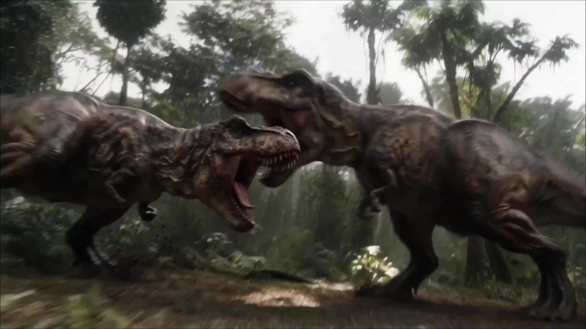

# Jurassic Park Style Short Film

> **作者：** @芒果炒肉

## Content

Process Planning:

Full Production Stages and Dependencies:

Create Final_Video_Spec.md to lock global parameters: 16:9 aspect ratio, intended duration, visual style (1993 Spielberg's "Jurassic Park," 35mm retro film look), and output language → text_editor.

Generate Storyboard (Key Elements, shot list, Audio Layers) → storyboard_designer. After the Storyboard is complete, scan the context and bind user-provided assets to the corresponding Storyboard slots → media_generator.

Establish Key Elements (characters, scenes, props):

If the user has uploaded element assets, bind them directly; otherwise, generate images → media_generator.

Generate final videos shot by shot; default to referencing the corresponding element image; only attach the previous shot as reference_video when continuity with the previous shot is critical → media_generator.

Generate all Audio Layers (BGM, narrative VO, ambient sound design intent) → media_generator.

Complete final video assembly and guide the user to export → video_assembler.

Dependency Order: 2→1; 3→2; 4→3; 5→2; 6→3,4,5.

Milestone Confirmation: Pause after each major stage (spec locked, Storyboard complete, elements complete, shot videos complete, audio complete) and wait for user confirmation before proceeding to the next stage.

Asset Analysis:

User-Uploaded Asset Processing Principles:

If a user provides reference images (stills, concept art, scene photos), extract and structure the following signals for downstream use:

Color Grading Characteristics: Color temperature, dominant hues, saturation range, shadow/highlight tonal tendencies.

Film Texture: Grain density, film exposure feel, contrast curve characteristics.

Lighting & Shadow Structure: Key light direction, light quality (hard/soft), ambient light ratio.

Composition & Lens Language: Perceived focal length, depth of field range, framing/aspect ratio cues.

Extracted results must align with this skill's visual style anchor (1993 Jurassic Park 35mm realistic color grading) and must not contradict it.

Storyboard Design:

Visual Style Anchors (Globally injected into all shots and elements)

Period Feel: 1993 Steven Spielberg's Jurassic Park (the first film); 35mm vintage film photography; 16:9 aspect ratio.

Film Texture: Heavy, warm film grain, 8K restored film quality, soft vintage cinematic color grading, slight vignette.

Color Grading: 90s Hollywood blockbuster realistic grading; desaturated vintage green as the dominant hue; natural realistic colors, no modern high-contrast HDR feel.

Lighting: Naturalistic, physical lighting; clear light source motivation (driven by tangible sources like sunlight, lamps, etc.); avoid digital render feel or AI over-sharpening.

Designing Key Elements

Covers main characters, core scenes (e.g., jungle, Visitor Center, fence area, etc.), and key props (Jeeps, night-vision goggles, etc.).

Character descriptions must include: appearance, clothing (consistent with 90s realistic style), and specific anchoring for skin tone/hair; if there are multiple looks, list them one by one.

Scene descriptions must include: topography/environmental composition, lighting conditions (time of day, weather), and spatial relationships of main props; descriptions must be compatible with 35mm film texture.

Exclusive Description Norms for Dinosaur Key ElementsDinosaurs are special element characters. You must lock in the following four dimensions in the description to ensure the generated result is consistent with the 1993 film's visual presentation and does not slide into modern CGI style or cartoonish looks:

Skin Texture: Specify the specific texture of the skin surface—arrangement of reptile scales (e.g., overlapping large scales, fine texture, wrinkle distribution), dry or moist state, local color zoning (e.g., light underbelly, dark stripes or patches on the back); do not describe as smooth or overly reflective surfaces.

Body Proportions: Anchor the body size to realistic paleontological standards—specify body length/shoulder height estimates, proportional relationship between head, neck, torso, and limbs, muscle mass (thick realistic muscles rather than slim cartoonish outlines); reference existing scene elements or human height for comparison.

Movement Style: Describe typical movement characteristics for the species in this Skill—gait rhythm (e.g., alternate bipedal strides, tail balance swing), body tilt angle during bursts/sprints, neck exploration behavior or head rotation inertia; movement descriptions must connect to the photographic language of downstream shots (e.g., emphasize leg impact when shooting from a low angle).

1993 Film Visual Calibration: Clearly specify that the dinosaur references the comprehensive visual presentation of Stan Winston Studio's practical effects and ILM's CGI from the 1993 Jurassic Park; avoid using visual versions from the modern Jurassic World series (e.g., write out specific differences like featherless Raptors, darker T-Rex tones, etc.).

Typical Dinosaur Key Element Preset TemplatesThe following three templates can be directly used for filling in the key_element of the Storyboard to lock in appearances according to species standards, eliminating the need for re-description during downstream generation.

[Element_TRex] Tyrannosaurus rex

Skin Texture: Large overlapping horny scales covering the torso and neck, with fine wrinkles around the snout and eyes; belly scales are smaller and lighter sandy-gray; back and legs are dark olive-brown with irregular dark patches; skin is dry and rough overall, with slight moist sheen in local areas (snout, neck folds); do not describe as smooth or glass-like reflective surfaces.

Body Proportions: Body length about 12m, shoulder height about 4m; huge skull relative to torso, thick neck with short forelimbs; legs are thick and muscular with prominent inner thigh muscles; tail is thick and extends horizontally for balance; overall mass is thick and solid; reference human height (approx. 1.75m) in the scene for scale; head can easily clear the eaves of a single-story building.

Movement Style: Alternate bipedal gait, center of gravity sways slightly left and right with each step; tail swings slightly laterally during normal walking; torso tilts forward about 30° during sprints with the tail held horizontally high; head performs slow scanning for smell, nostrils visible; low-angle shots should emphasize the impact of legs hitting the ground and surface vibration.

1993 Film Visual Calibration: Refer to the comprehensive presentation of Stan Winston Studio's practical effects and ILM CGI; body color is olive-brown/dark brown, not the light gray-white version of the Jurassic World series; skin has no feathers or feather-like structures; eyes have amber-yellow irises with vertical pupils; two fingers clearly visible on forelimbs; avoid modern versions with "scar tissue" or overly tattooed details.

[Element_Raptor] Velociraptor

Skin Texture: Fine scales covering the entire body, with slightly larger scales on the back; body color is sandy-brown base with irregular dark brown vertical stripes, belly is off-white; skin is dry and matte, with fine wrinkles on the neck and joints; strictly prohibit any description of feathers, proto-feathers, or down; no smooth or moist sheen.

Body Proportions: Body length about 1.8m (excluding tail), standing shoulder height about 0.9m, reaching an adult's waist; head is narrow and long with a pointed snout and large eye sockets; neck is slender and flexible; hind limbs are strong, sickle claw (second toe) is lifted off the ground; forelimbs have three sharp claws; tail is thin and stiff as a balance rod; overall body is lean and agile, avoiding rounded, cartoonish contours.

Movement Style: Bipedal high-speed running, body tilted forward nearly horizontal, tail extended straight back; agile turning, claw strikes to the ground are crisp; group coordination involves flanking maneuvers; neck bends in an arc when sniffing the ground; typical behavioral beat of brief stillness and gaze before a strike; close-up shots should emphasize the sickle claw lifting and eye focus details.

1993 Film Visual Calibration: Refer to the Stan Winston Studio practical effect version; no feathers (including head crests or dorsal proto-feathers); body color is striped brown, not the blue-gray metallic sheen of the Jurassic World Blue series; eyes have orange-yellow irises; claws are brownish-dark; avoid describing any modern skin patterns or body color changes.

[Element_Brachio] Brachiosaurus

Skin Texture: Large polygonal scales covering the entire body, with particularly wide and regularly arranged scales on the neck; body color is warm olive-green/gray-green, with a lighter yellowish-beige belly; dorsal line is slightly darker; skin is dry and thick, with loose skin folds visible on the neck of older individuals; do not describe as smooth leather texture or overly reflective.

Body Proportions: Body length about 26m, shoulder height about 9m, head height about 13m; forelimbs are significantly longer than hind limbs, resulting in a forward-sloping back line; neck is extremely long, accounting for about 1/3 of the total length; head is small relative to body, nostrils located on top of the head; limbs are thick like pillars, feet are wide; compared to an adult, one forelimb height is about 3 human heights; suitable for wide shots or very low-angle up-shots to emphasize scale.

Movement Style: Quadrupedal slow walking, steps are heavy, each step has obvious ground vibration; neck swings in a slow arc for grazing, movements are fluid and calm; hind legs can separate slightly for support while raising the forebody to eat; quick head-raising and backward steps when startled; overall movement frequency is low and amplitude is high, emphasizing sense of weight; suitable for slow push-in shots with a wide aspect ratio to emphasize its grand scale.

1993 Film Visual Calibration: Refer to the initial ILM CGI version; body color is olive-green/gray, not the blue-gray cool-toned version of subsequent series; skin has no feathers; eyes are deep brown with a gentle expression; avoid any modern textural changes or color adjustments; the debut shot (wide shot with characters looking up) is the iconic composition reference for this Skill.

Typical Scene Key Element Preset TemplatesThe following three templates can be directly used for filling in the key_element of the Storyboard to lock in scene appearance and lighting conditions, eliminating the need for re-description during downstream generation.

[Element_Scene_Jungle] Tropical Island Jungle

Topography/Environmental Composition: Dense tropical rainforest; multi-layered canopy cover, thick trunks, buttress roots extending on the ground; ground covered with ferns, moss, wet soil, and fallen leaves; dappled sunlight penetrates the canopy gaps; vines hanging and low shrubs visible.

Lighting Conditions: Primarily filtered diffused light (canopy blocking direct sunlight), with a few Tyndall light columns piercing through leaf gaps; overall light contrast is soft, shadow edges are blurry; light is dark greenish-cool before dusk or storms, emphasizing a sense of oppression; occasional strong backlight from the top of the canopy on sunny afternoons, creating silhouettes.

Atmosphere & Prop Relations: No large man-made structures in the scene; occasional broken fences or warning signs as traces of human presence; primarily serves for dinosaur sneaking, chasing, and discovery sequences; low-angle up-shots with foreground fern leaves blocking the view help create suspense.

35mm Film Compatibility: Desaturated vintage green fits naturally in this scene; grain is highly visible in dark areas; avoid describing as high-saturation postcard tropical green.

[Element_Scene_VisitorCenter] Visitor Center

Topography/Environmental Composition: Large tropical architectural complex; main hall has a high vaulted atrium with a full-size dinosaur skeleton (Brachiosaurus/Apatosaurus) displayed in the center; light-colored stone flooring; wooden display stands, information kiosks, and viewing plants indoors; facade is off-white concrete with large floor-to-ceiling glass curtain walls, surrounded by tropical vegetation.

Lighting Conditions: Indoors: primarily natural light diffused through skylights, supplemented by warm tungsten lamps; specific spotlighting in the skeleton exhibition area, casting clear shadows; overall lighting is warm, 90s commercial building lighting texture. Outdoors: strong tropical sunlight, building casts hard-edged shadows; orange-red warm sidelight illuminates the facade at dusk.

Atmosphere & Prop Relations: Key props—central dinosaur skeleton exhibit, electronic map kiosk, glass curtain wall reflections; suitable for character dialogue, information exposition, and the late-stage dinosaur intrusion sequence; wide-angle lenses can emphasize the height of the dome and the smallness of the characters.

35mm Film Compatibility: The mixed light ratio of indoor warm tungsten light and natural skylight matches 90s film exposure characteristics; glass reflections can be used as natural light-splitting effects; avoid describing as modern cool-white LED lighting texture.

[Element_Scene_FenceZone] High-Voltage Fence Zone

Topography/Environmental Composition: Open grassland/forest edge boundary; main structure is an 8m-high metal mesh high-voltage electric fence with evenly spaced columns and visible insulators; outside the fence is tropical grass and dwarf forest; inside the fence is a wider field of view with dirt roads and warning signs; muddy puddles and tire tracks on the ground.

Lighting Conditions: Fully outdoor environment; strong sidelight (morning or afternoon) on sunny days projects regular geometric shadows on fence columns and mesh; dark clouds, diffused cold light, and rain wetting all surfaces during storm sequences; at night, insulators emit faint blue-white arc light, with other areas relying on moonlight or flashlight for local illumination.

Atmosphere & Prop Relations: Key props—high-voltage electric fence (visible on/off state changes), warning signs, Jeep parking position; core scene for T-Rex breakout sequence; low-angle shots of the fence mesh can emphasize the feeling of entrapment/standoff; rainy night sequence is the iconic visual moment for this Skill.

35mm Film Compatibility: The high-contrast local lighting of the rainy night scene (flashlight circle vs. surrounding darkness) is the scenario where 35mm film's dark area grain is most prominent; metal fence appears matte cool-gray rather than chrome-high-reflective under film texture; avoid describing as digital night-vision green or overexposed flash effects.

Designing Shots

Shot Duration: Prioritize designing longer takes of 8–15s, containing internal cuts (e.g., push-in + cut to close-up); a single shot should not exceed 15s.

Each shot description must include:

Scene: Reference the corresponding element scene ID.

Story Beat: Character actions and emotional arcs; if there is dialogue, write the exact lines and reference the character element ID.

Photographic Language: Shot size (wide/medium/close/close-up/extreme close-up), camera movement (see glossary below, select and note specific movement parameters as needed), composition (rule of thirds/low-angle up-shot to emphasize biological pressure/foreground obstruction to create suspense).

Camera Movement Glossary (Reference as needed when designing shots)

Movement Type

	

Typical Use

Steady dolly push

	

Building tension; long wait before character discovers creature

Low-level ground tracking

	

Emphasizing dinosaur leg impact and ground vibration

Aerial establishing shot

	

Opening or transition, establishing island topography macro layout

Fast handheld shake

	

Chase/fright sequences, quickly increasing tension

ECU (Extreme Close-Up) dinosaur head

	

Emphasizing eye contact, nostril flaring, skin texture details

Overhead aerial jungle canopy

	

Showcasing tropical jungle scale; creating vastness and mystery

Telephoto wide shot

	

Compressing depth, making background dinosaurs look closer and larger

Slow lateral pan, long take

	

Following character movement or scanning the full scene

Overcrank slow motion

	

Emphasizing key action details (dinosaur sprint/fall/impact); preserving film grain

Lighting Notes: Time of day, main light direction, ambient light atmosphere (e.g., evening side-backlight to create silhouette tension).

Spielberg Composition Preferences: Extensive use of low-angle up-shots to emphasize dinosaur scale; foreground obstruction to create suspense; slow push-ins to build tension; cross-cutting between protagonist reaction shots and creature shots.

Designing Cross-Shot Audio Layers

BGM: Reference John Williams orchestral style, grandiose realistic symphonic feel; design in sections based on narrative rhythm.

Ambience/SFX: Note key natural ambient sounds in the shot description (jungle insect sounds, rain, footsteps, etc.) for reference during generation.

VO Narration: If there is a voice-over, define narration_speaker_profile (e.g., [Calm male voice, magnetic, documentary narration style]) and the script content.

Media Generation:

Element Asset Generation

Use TextToImage to generate scene/prop element images; prioritize ImageToImage for different poses of the same character to maintain cross-pose consistency.

Strictly use GPT Image 2 for image generation models, with a recommended resolution of 2K; style prompts must include visual anchors such as 35mm film grain, realistic natural lighting, and low-saturation vintage green tones.

Character Images: Generate a horizontally stitched reference image—left side: head-and-shoulder close-up (for facial feature anchoring), right side: full-body (for clothing/physique).

Shot Video Generation

Use MultiModalToVideo, strictly using the Seedance 2.0 model with a resolution of 720p.

Reference inputs for each shot:

Element Images: All element images of characters, scenes, and props involved in the shot (mandatory binding by default).

Previous Shot Video (reference_video): Only use when there is extremely strong continuity with the previous shot; skip in standard cases to avoid introducing unnecessary motion constraints.

Aspect Ratio: Confirm as 16:9 during the video_assembler stage.

Audio Generation

BGM: Use text_to_instrumental, with style descriptions emphasizing orchestral, realistic symphonic, and 90s Hollywood adventure film textures.

VO Narration: Use text to narration, setting the tone according to the narration_speaker_profile defined in the Storyboard.

Prompt Writing:

Highest Priority (Global): When users interact in Chinese, prompt text must be written in Chinese; dialogue/narration in the video must follow the output language specified in Final_Video_Spec.md.

Visual Style Fixed Phrases (Must be included in every image/video prompt; wording can be fine-tuned but core semantics cannot be removed):

35mm film grain, 1993 Hollywood realism, 16:9 aspect ratio, desaturated vintage green tones, natural physical lighting, warm heavy film grain, soft vintage cinematic color grading, 8K film restoration quality, low saturation, practical light sources, Spielberg cinematography

Tropical Jungle Scene Fixed Environmental Phrases (For any image/video prompt involving [Element_Scene_Jungle] or outdoor jungle scenes, select and incorporate from the following phrases as needed; do not conflict with visual style fixed phrases):

outdoor tropical rainforest, diffused overcast sky light, Tyndall light beams through jungle canopy, dappled light filtering through leaf gaps, humid rainforest haze and water vapor, wet foliage specular highlights, moist earth and moss-covered ground, ancient towering trees with buttress roots, primeval jungle terrain, tropical island natural landscape

Visitor Center Scene Fixed Environmental Phrases (For any image/video prompt involving [Element_Scene_VisitorCenter] or indoor visitor center scenes, select and incorporate from the following phrases as needed; do not conflict with visual style fixed phrases):

indoor atrium with skylight diffused natural light, warm tungsten practical light fill, dinosaur skeleton spotlight casting sharp bone shadows, large glass curtain wall reflections, high vaulted ceiling interior, warm mixed light from skylights and tungsten lamps, 1990s commercial building interior lighting, stone floor with soft reflected light, tropical foliage inside lobby, deep shadow contrast under display spotlights

Image Prompt (TextToImage / ImageToImage)

Structure: Subject + Action/Pose → Environment/Background → Lighting Conditions → Visual Style Fixed Phrases → Composition/Shot Type.

Dinosaur-Specific Prompt Standards: Skin texture must explicitly state scale type and distribution (e.g., "overlapping keratinous scales, dry leathery hide, pale underbelly"); body type must include volume terms (e.g., "massive muscular haunches, thick neck, heavy torso"); color versions must align with the 1993 Stan Winston version (not the Jurassic World revisions), add "1993 Stan Winston practical effects reference" if necessary; forbidden terms include "feathered", "sleek smooth skin", "vibrant saturated scales", or other words deviating from the original.

Do not use modern cinematic style terms (e.g., "cinematic HDR", "neon color", "hyper-sharp 4K").

key_element image: Lock in appearance, clothing, and material state; avoid unrelated text in the frame.

Video Prompt (MultiModalToVideo / Seedance 2.0)

Reference image placeholders: <<<image_1>>>, <<<image_2>>>…, label each character/scene independently.

Motion Description Stack: Camera (movement type/speed) → Subject (action beat/facial reaction) → Space (environmental change/occlusion relationship) → Audio Cue (ambient sound/SFX; indicate here if no separate VO track).

Spielberg Cinematic Vocabulary (use as needed): slow dolly push, low angle upshot, foreground obstruction, rack focus, wide establishing then cut to reaction, handheld slight shake for tension, low-level ground tracking shot, aerial establishing wide shot, fast handheld shake, ECU (extreme close-up) dinosaur head, overhead aerial jungle canopy shot, telephoto wide shot, slow lateral pan long take, overcrank slow motion.

Seedance 2.0 Audio Tags: SFX <...>, dialogue {...} (indicate language before brackets if not the project language), title/subtitles 【...】.

Fixed Negative Prompts: no subtitles, no music (BGM is handled in a separate audio layer); if there is a separate VO track, no voiceover in video.

Video Editing:

Aspect Ratio & Pacing

Final output aspect ratio: 16:9; if generated assets do not match, prioritize cropping over compression/stretching.

Edit pacing should mimic 90s Hollywood narrative films: extend shot duration during tension to build suspense, tighten rhythm during action/chase sequences; avoid modern fast-cut styles.

Transitions

Default to hard cuts; use fade-in/out or dissolves for emotional transitions or time jumps; avoid flashy digital transition effects.

Audio Mixing

BGM layer at the base; keep volume low enough not to mask dialogue or key SFX.

Ambient/SFX layers must sync with on-screen action (e.g., dinosaur footsteps aligned with visuals).

VO (voiceover) has priority over BGM to ensure clarity.

When mixing built-in shot audio (from MultiModalToVideo) with independent audio layers, avoid overlap with dialogue/VO.
