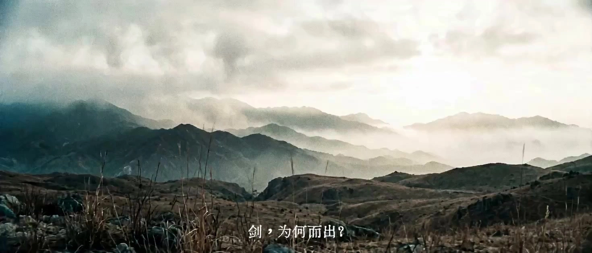

# King Hu Wuxia Aesthetic

> **作者：** @羊羊Vincent

## Content

Process Planning:

Process Planning and Execution Steps:

Establish Global Specifications: At the start of the project, first ask the user for the video aspect ratio via reply_to_user, providing the following options (must be presented as a card or list; 16:9 is recommended):

16:9 (Recommended) — Widescreen cinematic aspect ratio, best fits the aesthetics of King Hu's landscape scrolls.

21:9 — Ultrawide, for an ultimate cinematic feel.

4:3 — Vintage square ratio, provides an authentic early martial arts film aesthetic.

3:4 — Vertical portrait, suitable for mobile/short-form vertical video.

1:1 — Square ratio, suitable for social media sharing.

After obtaining confirmation from the user, call text_editor to write the Final_Video_Spec.md, recording the aspect ratio and other global parameters (duration, core visual style, output language, etc.) as the anchor for subsequent design and generation.

Design Storyboard: Call storyboard_designer to plan the Storyboard. This includes defining Key Elements (characters, scenes, props), the Shot List (shots), and individual Audio Layers (audio_layers).

Process and Analyze Reference Assets:

Check and extract any reference assets provided by the user (images, videos, text, or music). Call resource_prepare_and_analyze to perform a multimodal analysis.

Use the asset management capabilities of media_generator to register the extracted media as stable asset_ids and bind them to the corresponding Key Elements (such as character appearances or key_element_audio voice references) or shots within the Storyboard.

Establish Key Elements Visuals:

For Key Elements without pre-bound assets, call media_generator to use TextToImage or ImageToImage to batch generate high-quality static element images, focusing on maintaining visual consistency for Ming Dynasty clothing, makeup, and iconic props (e.g., bamboo hats, flying fish suits, long swords).

Generate Shot List (Shots):

For every shot in the Storyboard, call the video generation path of media_generator (the MultiModalToVideo path is preferred). Bind the generated static Key Element images as visual references and combine them with camera motion prompts to generate dynamic video.

Generate Audio Layers:

Call media_generator sequentially to generate individual Audio Layers: music (call text_to_instrumental / lyrics_to_song to generate traditional folk BGM) and narration (call text to narration). For characters with spoken dialogue, use their bound key_element_audio to maintain consistent vocal timbre.

Timeline Assembly and Editing:

Call video_assembler to load all generated shot videos and audio assets (music, narration, ambient sound), and synthesize the final video timeline strictly according to the rhythm design, audio-visual alignment rules, and fade-in/fade-out requirements defined in the Storyboard.

Dependencies:

2 -> 1 (Storyboard design depends on the global Spec)

3 -> 2 (Asset analysis and binding are based on the Storyboard structure)

4 -> 3 (Static image generation for elements depends on the binding status of existing assets)

5 -> 4 (Video shot generation strongly depends on established Key Element visual references)

6 -> 2 (Audio generation must strictly correspond to the Audio Layers defined in the Storyboard)

7 -> 5, 6 (Timeline assembly must only occur after all audio-visual assets are prepared)

Pause and Confirmation Mechanism:During execution, do not attempt to run through the entire process at once. You must pause at the following key nodes and use reply_to_user to present the progress to the user, obtaining confirmation before proceeding to the next stage:

After Final_Video_Spec.md is established, confirm the overall aesthetic, theme, and tonal duration.

After the Storyboard design is complete, confirm the shot sequence, narrative pacing, and planned use of negative space.

After the visual/character images for core Key Elements are generated, confirm the visual style, period clothing, and color temperature.

After the draft video shots and Audio Layers are generated, confirm the dynamic tension and auditory layers.

Asset Analysis:

Multimodal In-depth Analysis Specifications for Input Assets (Images, Videos, Audios, Text):

Image Analysis:

Analyze scene types (e.g., bamboo forest, wilderness, inn interior, ancient temple, distant landscape) to determine if they align with King Hu's aesthetic geographic environments.

Identify compositional features: Prioritize finding "negative space" (percentage of sky/fog), "frame-within-a-frame" (using doorways, windows, or tree branches as occluders), "horizontal scroll" feel, or "three-layer deep perspective" compositions.

Extract color and lighting: Record whether it is ink-wash grey, warm ancient yellow, or blue-green landscape. Analyze for backlit silhouettes, volumetric fog lighting, or soft diffused light.

Identify characters and props: Parse character clothing dynasty (must be calibrated to Ming Dynasty features such as bamboo hats, pleated skirts, or flying-fish robes), posture/expression, and weapons held; structure and output these findings.

Video Analysis:

Extract camera movement patterns: Analyze whether it is a slow pan, fixed gaze, or slow push-in for depth. If the footage contains violent shaking or modern rapid zooming, point this out in the analysis report and suggest corrections.

Identify editing rhythm and transitions: Record the average shot duration, and note if it features traditional editing characteristics like hard cuts or fade-to-blacks.

Keyframe extraction: Perform frame-by-frame analysis on long videos to distill the visual features of core characters and environmental color tones.

Document/Script Analysis:

Scene breakdown: Refine the script into a structured list of scenes, detailing time, location, characters, and mood for each.

Mood mapping: Identify sections of the script suitable for King Hu's aesthetic expression. For example, map "traveler on the road" to long tracking pans; map "eve of a duel" to static gazes, frame-within-a-frame composition, and silent negative space.

Audio Analysis:

Identify traditional instrument components: Such as the guqin, xiao, bamboo flute, and percussion (Peking Opera gongs and drums).

Record tempo changes: Mark beats as slow/calm (tranquil segments) or rapid (combat segments) to provide rhythm anchor points for subsequent Video Editing (gong and drum synchronization).

Storyboard Design:

Storyboard Creative Design Guidelines:

Key Elements Design Standards:

element character: Must meticulously describe the character's Ming Dynasty attire. Example: A lone swordsman wearing a plain cotton/linen robe, a conical hat (douli), straw sandals, and carrying an iron sword (conforming to King Hu’s "landscape figure" style—the figure should not be overly ostentatious, blending into the landscape).

element scene: Detail the spatial layers. The inn space must feature dark wooden beams, paper lanterns, and staircase pillars to facilitate depth-oriented composition; landscape scenes must specify "mist-shrouded" or "deep bamboo forests," ensuring at least 40% negative space in the frame.

Consistency Constraint: If the user provides reference images or a script, the text description of key_elements must strictly align with them. Do not fabricate sci-fi or modern elements that deviate from the Ming Dynasty background.

Shots Design Standards:

Advocate for long takes and internal cuts: Avoid overly fragmented modern micro-cuts. Design each shot to last between 5s and 15s (not exceeding the model's 15s limit). Specify in the shot description: "Complete the character's movement from distance to proximity and the slow camera push within a single take."

Classic lens sequence (Slow-Fast-Slow) design:

Opening (Introduction): Design wide landscape shots or extreme long shots, with the figure as a detail within the landscape to establish an ethereal, minimalist tone.

Pacing (Development): Design long, tracking shots that follow the character walking or looking around, showcasing the vastness and depth of the environment.

Climax (Twist): Conflict/Action shot. The frequency of lens cuts increases, but the frame itself remains steady, using door frames or window lattices to form "frame-within-a-frame" confrontation compositions. Specify the exact rhythm of Peking Opera gongs and drums and the character's dramatic poses (liangxiang).

Combat Segment Shot Duration Hierarchy:

Standoff/Buildup Stage (posing, staring, drawing the sword): Single shot duration 3–6s, providing ample space for tension accumulation.

Action Burst Stage (clash, agile movements/flips): Single shot duration compressed to 1–3s, creating a sharp rhythm with high-frequency hard cuts; the burst segment must have at least 3 hard cuts, with each cut aligned to the heavy beat of the gongs and drums.

Recovery/Final Pose Stage (landing, holding a pose): Single shot duration 2–4s, using stillness to control movement, accompanied by the lingering reverberation of the gongs and drums ending.

Gong and Drum Beat Alignment Rules: Annotate the type of gong/drum rhythm in the shot description, for example: [Gongs and Drums: Rapid Wind] (continuous fast rhythm for chases/combos), [Gongs and Drums: Single Heavy Strike] (single heavy hit for climax freeze-frame), [Gongs and Drums: Decrescendo Ending] (drum beats becoming sparse for ending a sequence). Edit points must precisely fall on the starting beat of the corresponding gong/drum heavy hit.

Ending (Resolution): Cut back to an extreme long shot, an empty shot, or the sky, accompanied by a fade to black, leaving a lingering, distant aftertaste.

Realistic Visuals and Lens Grammar: Every shot must clearly specify: Visual Description (including action details and expressions), Composition Method (e.g., long shot, frame-within-a-frame, three-layer depth), Camera Movement (e.g., tracking shot, fixed/static gaze, slow push), and Audio Design.

Style Lock (Cross-Shot Consistency Constraint): Every shot description must explicitly inherit and reiterate the unified aesthetic markers of the film, including: low-saturation earth tones, cyan-leaning shadows, film grain texture, and ink-wash negative space composition tone. Do not introduce descriptions contrary to the established color temperature or texture (such as "bright neon," "high-saturation warm orange," "modern lighting") due to scene changes (e.g., from bamboo forest to inn). The visual style of every shot must strictly match the hue and texture of the first confirmed key_element image.

Audio Layers Design Standards:

Music Track: Design at least one global traditional Chinese style BGM track, based on the auditory aesthetics of King Hu's martial arts films—Guqin (seven-string zither) as the main melody, supported by Dongxiao/flute, with Zhongruan/Pipa plucking as accents. The rhythm skeleton is formed by sparse, restrained Peking Opera gongs and drums, presenting an overall solemn, distant, and profoundly atmospheric ancient mood. Modern electronic sound effects, Western orchestral, or pop instrumentation are strictly prohibited. Design BGM tension according to plot segments: tranquil segments maintain an airy feel with faint Guqin notes; confrontation/combat segments use building gongs and drums to advance the rhythm.

Ambient Sound Track: Design independent ambient sound layers as the audio foundation for the entire film. Each ambient track must clearly label the covered shot range, sound source type, and spatial description, with specific presets as follows:

Bamboo Wind: Appears in bamboo forest scenes, described as "breeze through the forest, rustling bamboo leaves, occasional light clacking of bamboo branches, clear depth of field," creating a deep, tranquil feeling.

Pine Roar: Appears in mountain ridge and high platform scenes, described as "low, roaring wind in high pines, occasionally accompanied by distant bird calls, creating a sense of vast openness and depth."

Running Water: Appears in mountain stream and creek scenes, described as "gentle, murmuring flow, occasional sound of water drops on stone, clear and crisp."

Temple Bell: Can appear as an accent sound effect or as an auditory marker for spatial-temporal transitions across scenes; described as "low-frequency, long-reverberating copper bell sound, lingering for several seconds after a strike, zen-like."

Inn/Market Ambience: Appears in indoor inn scenes, described as "low chatter, soft clinking of bowls and dishes, footsteps on wooden boards, very low volume, used only to fill the space."

Ambient Sound Generation Standards: The Flova platform does not currently provide an independent ambient sound generation tool; ambient sounds should be implemented as follows:

In the video shot prompt for MultiModalToVideo, use angle brackets to mark <Bamboo wind, rustling leaves, distant temple bell chime> to have the model synthesize it within the video clip, or

Provided by the user as pre-recorded ambient material to be uploaded and bound, then mixed into the timeline by video_assembler.

Silence Layer Design: In specific shot segments such as tense standoffs or moments of enlightenment in nature, a [Silence] auditory channel with "no music, only faint ambient sound" must be explicitly designed to convey the ultimate zen state through "soundlessness."

Media Generation:

Media Generation and Reference Binding Strategy:

Static Image Generation (TextToImage / ImageToImage):

Recommended Model: Prioritize Nano Banana Pro (Gemini 3 Pro Image) with a recommended resolution of 2K to ensure high precision in prompt adherence and text/detail representation.

Reference Image Generation Strategy: When generating key_element character images, you must use a "side-by-side character sheet" prompt structure. The left side should feature a half-body close-up (locking in facial features, hairstyle, and bamboo hat), and the right side a full-body standing pose (locking in Ming dynasty attire, posture, and iconic props) to provide comprehensive static visual references for subsequent video generation.

Dynamic Video Generation (MultiModalToVideo):

Recommended Model: Prioritize the MultiModalToVideo path, using the member-exclusive Seedance 2.0 (or Seedance 2.0 Fast), with a default resolution of 720p (upgradable to 1080p for premium members).

Visual Reference Binding:

When generating each shot, you must bind the key_elements static reference images involved in that shot (including character sheets, scene boards, and prop boards) within the input.

Handling Extreme Continuity: Only when the motion continuity between adjacent shots is extremely high (e.g., continuous fighting movements, continuous scene switching for the same positioning) should the final_shot video of the previous shot be introduced as an additional reference. General travel or static shots do not require binding the previous shot's video to prevent generation pollution.

Motion Magnitude Control: Strictly limit the motion value to low-to-medium levels; do not use overly drastic 3D rotations, rapid focal adjustments, or handheld camera shaking.

Style and Color Tone Locking (Cross-Shot Consistency): When generating each shot, the first generated and confirmed key_element image (usually the main character element sheet) must be introduced into the reference input as a visual style anchor. This is used to force the lock-in of the film's low-saturation earth tones, cyan-leaning shadows, and film texture, preventing the model from drifting in color temperature or rendering style between different shots.

Audio, Music, and Narration Generation:

Music: Use the text_to_instrumental path, prioritizing the Suno 5 model (with Mureka 8 as an alternative). Prompts must precisely integrate King Hu-style ancient Chinese BGM characteristics: Chinese ancient style instrumental BGM, King Hu wuxia film aesthetic, guqin solo melody, atmospheric dizi/xiao flute, zhongruan plucking, sparse Peking opera percussion (luo gu), mountain ink-wash ambience, meditative and austere, slow-burning tension, cinematic ancient Chinese orchestration, no modern instruments, no electronic elements, no vocals. Avoid mentioning any specific modern artist or band names in the prompts.

Narration: Use the text to narration path, with the default recommendation being MiniMax Speech 2.8 HD (strong multi-language support) or ElevenLabs v3. Specify the narration_speaker_profile in the description (e.g., [Deep, weather-beaten male voice, full of worldly experience and Zen]).

Dialogue: Dialogue lines included in a shot must have the corresponding character's key_element_audio (Timbre reference) bound during generation to ensure voice consistency across multiple shots.

Prompt Writing:

Prompt Engineering Guidelines:

Global Language Adaptation:

If the user is using Chinese or the software is in a Chinese interface, prioritize using Chinese for the main body of media prompts (as it captures the nuance of traditional Chinese landscape painting aesthetics more precisely). However, the output language for narration/dialogue specified in storyboards and specs must strictly adhere to the Output Language setting in the Final_Video_Spec.

Text-to-Image / Image-to-Image Prompt Writing Formula:

Formula: [King Hu Style Aesthetic Prefix] + [Scene Environment Description] + [Subject's Body Language and Ming Dynasty Attire] + [Composition and Lighting Instructions]

Aesthetic Prefix (Must be included; all keywords below must be written in every prompt): King Hu film aesthetics, traditional Chinese "landscape painting" composition structure, layered composition, cinematic spatial depth, vertical composition lines, 1970s vintage film still, backlit atmosphere, Tyndall effect, heavy atmospheric fog, coarse film grain, desaturated earth tones, cyan-tinted shadows, high-contrast chiaroscuro, Technicolor aesthetics, highlight bloom, soft color palette, simulated film gate jitter, deep depth of field, matte/non-glossy finish, borderless, visual coverage across the entire frame, Ming Dynasty era, 35mm film texture, 1.85:1 widescreen aspect ratio.

Lighting and Composition: Use specific cinematic lens language. Do not use modern, high-saturation words such as modern, vibrant, neon, saturated, HDR, etc. Strictly follow the color system defined by the aesthetic prefix above: desaturated earth tones + cyan-tinted shadows + highlight bloom; do not introduce modern color grading tendencies like cool blues or warm oranges.

Cross-Shot Style Freeze Principle: For all generated images and videos in the entire project, the keywords for tone, texture, and grain must remain completely consistent. Do not replace or delete any terms from the aesthetic prefix due to scene transitions (e.g., from an indoor inn to an outdoor mountain forest). If a certain shot's scene differs significantly from others, you may overlay the environment description words for that scene onto the prefix, but you must never replace the style anchor words with environmental words.

MultiModalToVideo Prompt Writing Formula:

Formula: [Reference Image Placeholder] + [Camera Movement Instruction] + [Subject Movement and Airflow]

Placeholder Specification: Explicitly use <<<image_1>>> to bind the character and <<<image_2>>> to bind the scene, and specify in the prompt: "Maintain the Ming Dynasty face and bamboo hat/attire of <<<image_1>>>."

Motion Stack: Write in the order of Camera Movement -> Subject Movement -> Micro-movement of Space. For example: Slow pan, left to right; the swordsman in <<<image_1>>> walks forward steadily; bamboo branches and leaves sway slightly in the breeze, morning mist dissipates slowly.

Seedance 2.0 Special Tag Wrappers (Important):

Use parentheses () for background music to be synthesized simultaneously (e.g., slow duet of Guqin and flute).

Use angle brackets <> for ambient sounds and physical special effects (e.g., <breeze blowing through bamboo forest, sound of rustling fallen leaves, distant temple bell ringing>).

Use curly braces {} for character dialogue (e.g., {Master, the disciple has been waiting here for a long time}) (dialogue must be identical to the dialogue text in the storyboard).

Negative Prompt Control: Unless explicit sound effects are required, video prompts must specify "no music" (when using a separate music track) and "no subtitles" (subtitles are handled in the editing stage).

Example Prompts for Landscape Static Images (TextToImage · Nano Banana Pro):

The following three examples correspond to the three typical types of landscape shots: Opening Wide Shot, Introductory Establishing Shot, and Closing Shot. Each example overlays scene descriptions onto the aesthetic prefix; color tone keywords must not be deleted, but scene detail words within brackets can be replaced according to actual narrative needs.

[Opening Wide Shot] — Used for the first shot of the film to establish spatial tone and style declaration

King Hu film aesthetics, traditional Chinese "landscape painting" composition structure, layered composition, cinematic spatial depth, vertical composition lines, 1970s vintage film still, backlit atmosphere, Tyndall effect, heavy atmospheric fog, coarse film grain, desaturated earth tones, cyan-tinted shadows, high-contrast chiaroscuro, Technicolor aesthetics, highlight bloom, soft color palette, simulated film gate jitter, deep depth of field, matte/non-glossy finish, borderless, visual coverage across the entire frame, Ming Dynasty era, 35mm film texture, 1.85:1 widescreen aspect ratio. Majestic mountains stretch to the horizon, three layers of mountain ridges fade into the distance from near to far, creating three layers of ink wash depth; the sky occupies more than 50% of the frame, clouds and mist provide extensive negative space, with only the outlines of distant peaks rendered in light ink; a winding ancient road appears vaguely on the mountainside, a solitary figure small as a mustard seed is in the far distance, blending into the landscape as a scenic element without focusing on facial features; morning light spills from behind the ridge on the left, creating a strong backlit silhouette with intense halo diffusion at the edges of the mountains; the overall color tone is based on cyan-grey cold tones, with distant mountains tinged with pale ochre warmth, presenting the far-reaching artistic conception of an ink wash scroll between heaven and earth.

[Introductory Establishing Shot] — Used at the beginning of a narrative segment to establish the environment and set the atmosphere

King Hu film aesthetics, traditional Chinese "landscape painting" composition structure, layered composition, cinematic spatial depth, vertical composition lines, 1970s vintage film still, backlit atmosphere, Tyndall effect, heavy atmospheric fog, coarse film grain, desaturated earth tones, cyan-tinted shadows, high-contrast chiaroscuro, Technicolor aesthetics, highlight bloom, soft color palette, simulated film gate jitter, deep depth of field, matte/non-glossy finish, borderless, visual coverage across the entire frame, Ming Dynasty era, 35mm film texture, 1.85:1 widescreen aspect ratio. (The following is a replaceable scene detail - Bamboo Forest example) Deep bamboo forest interior, dense vertical bamboo poles form a natural "frame within a frame", distant bamboo tips converge toward a vanishing point, forming a strong perspective depth; morning mist spreads along the ground, submerging the roots of the bamboo in white fog, creating a floating sensation like riding the clouds; the top 40% of the frame is a green-grey canopy of interwoven bamboo leaves, sunlight pierces through obliquely in Tyndall beams, falling on the fog to form visible pillars of light; no characters, pure environmental narrative; overall color temperature is cyan-cold, with bamboo poles and light pillars forming a high-contrast rhythm of light and shadow stripes.

[Closing Shot] — Used for the end of a film or segment, leaving room for contemplation and returning to the landscape

King Hu film aesthetics, traditional Chinese "landscape painting" composition structure, layered composition, cinematic spatial depth, vertical composition lines, 1970s vintage film still, backlit atmosphere, Tyndall effect, heavy atmospheric fog, coarse film grain, desaturated earth tones, cyan-tinted shadows, high-contrast chiaroscuro, Technicolor aesthetics, highlight bloom, soft color palette, simulated film gate jitter, deep depth of field, matte/non-glossy finish, borderless, visual coverage across the entire frame, Ming Dynasty era, 35mm film texture, 1.85:1 widescreen aspect ratio. A view of mountains and rivers at dusk or twilight, the sky occupies more than 60% of the frame, low-hanging clouds are diffuse, presenting a large area of matte silver-grey negative space; the outlines of distant mountains are sketched with only extremely light brushstrokes, almost dissolving into the mist at the junction of heaven and earth; the foreground of the frame is framed by a vigorous withered tree or a part of a giant rock, leading the eye to the distant mid-ground; if a character is present, it is a lonely back figure in the far distance, facing the mountains and wilderness, with a volume not exceeding 5% of the frame height, conveying the final chapter of the story with an atmosphere of "people are gone, the building is empty"; the overall color tone is darker than the opening, dominated by deep grey-cyan, with only a wisp of amber afterglow remaining on the skyline, "words have an end, but the meaning is infinite".

Example Prompts for Three-Stage Fight Video (MultiModalToVideo · Seedance 2.0):

The following three examples demonstrate the complete prompt writing for "Standoff & Power-up → Action Explosion → Ending & Freeze". Each example follows the writing order of Reference Image Placeholder -> Camera Movement -> Subject Body Movement -> Micro-movement of Space -> Sound Effect Tags, as well as the cross-shot style locking principle. In actual use, replace the placeholders with the key_element image actually bound to the current shot.

[Stage 1: Standoff & Power-up] [Gong and Drum: Single Strike Appearance] Reference duration 3–6s

<<<image_1>>> Keep the Ming Dynasty swordsman's face, bamboo hat, and plain robe unchanged; <<<image_2>>> Keep the bamboo forest deep depth-of-field scene tone unchanged. Fixed staring long take, camera locked and motionless; the swordsman in <<<image_1>>> slowly turns in the center of the bamboo forest, appearing head-on, eyes slightly squinted looking directly at the camera, right thumb gently pushing the sword hilt to unsheathe three inches of the blade, robes fluttered slowly by the mountain breeze; bamboo leaves tremble on both sides, morning mist flows low, the air is heavy and still; <silent bamboo forest, a deep crow call in the distance, the faint sound of stepping on dry leaves> no music, no subtitles

[Stage 2: Action Explosion] [Gong and Drum: Rapid Tempo] Reference duration 1–3s × consecutive hard cuts

<<<image_1>>> Keep the Ming Dynasty swordsman's face and flying fish uniform unchanged; <<<image_2>>> Keep the inn wooden beam and pillar frame-in-frame scene unchanged. Rapid tracking shot, camera pans rapidly to the right to track the subject; the swordsman in <<<image_1>>> suddenly lifts his leg to kick away the opponent's bench, while his right arm slashes horizontally with the sword, the sword tip leaving a trail in the air, body posture instantly changes from crouch to upright, robes and sleeves flutter violently; wood chips and dust splash in the airflow of the sharp sword, the pillar background blurs rapidly; <crisp metallic sound of swords clashing, sound of wood breaking, sound of heavy footsteps> no music, no subtitles

[Stage 3: Ending & Freeze] [Gong and Drum: Gradual Crescendo to Stop] Reference duration 2–4s

<<<image_1>>> Keep the Ming Dynasty swordsman's face, bamboo hat, and plain robe unchanged; <<<image_2>>> Keep the bamboo forest distant view desaturated earth tones and cyan-tinted shadows unchanged. Camera changes from slight follow to locked, slowly pulling back to a medium-long full shot composition; the swordsman in <<<image_1>>> suddenly stops after completing the last move, one leg slightly bowed, sword tip pointing diagonally to the ground, right hand slowly wiping the sword blade with a cloth, expressionless; the fallen opponent is out of focus in the left foreground, the three-layer depth of the bamboo forest background is clearly distinguishable, morning mist drifts gently around the character's outline, forming a backlit silhouette; <dull sound of bamboo branches being moved by the wind, crow calls fading into the distance, the earth is silent> no music, no subtitles

Video Editing:

Timeline Editing and Audiovisual Synthesis Guidelines:

Peking Opera Percussion Editing Rhythm (Peking Opera Rhythm):

Balance of Motion and Stillness: The editing rhythm follows the "slow-fast-slow" alternating pattern. Soothing shots for travel, contemplation, etc., are kept at 8–15s, with calm edit points.

Alignment with Percussion and Precise Regulation of Combat Sequences:

Edit Points Locked to Downbeats: The entry and exit points of all confrontation/combat shots must precisely align with the downbeat of the percussion instruments in the BGM track. Hard cuts during weak beats between drum hits are strictly prohibited to prevent rhythm desynchronization.

Three-Stage Duration Compression Strategy:

Confrontation/Preparation Stage (Gaze, pose, drawing the blade): Shot duration 3–6s, rhythmic pacing is relaxed, corresponding to the slow percussion beat [Peking Opera Percussion · Slow Three Beats];

Action Burst Stage (Clash, acrobatic movement): Shot duration compressed to 1–3s; continuous burst sequences must have at least 3 consecutive hard cuts, each aligned with a percussion downbeat, corresponding to [Peking Opera Percussion · Rapid Wind/Jiji Feng];

Conclusion/Stillness Stage (Landing, holding a pose): Shot duration rebounds to 2–4s, with sparse drum beats to conclude, corresponding to [Peking Opera Percussion · Gradual Strong Conclusion]; after the concluding shot, retain 0.5–1s of natural reverberation before entering the next sequence.

Hard Cut Frequency Cap: During the burst stage, do not exceed 8 consecutive hard cuts. After this, a "breathing" shot of at least 3s (fixed gaze or empty environmental shot) must be inserted to prevent viewer visual fatigue, which also aligns with King Hu's editing philosophy of "using stillness to set off motion."

Consistency Between Video Shot Duration and Edit Points: When designing shot durations in storyboard_designer, the corresponding percussion beat type must be simultaneously annotated. video_assembler must use this annotation as the basis for precisely trimming the entry/exit points of the shots; do not arbitrarily extend or shorten them.

Transitions and Visual Alternation:

Primary Use of Hard Cuts: Over 95% of transitions should be direct hard cuts. Fancy 3D flips, slides, or modern effect transitions are strictly prohibited.

Natural Exit Transitions: Use the subject walking out of frame, clouds completely obscuring the lens, or the camera panning to the sky as natural exit points for cuts.

Black Fade Transitions: Use 1–2 seconds of fade to black for transitions between major segments, time jumps, or shifts in life-or-death outcomes.

Audio-Leading and Multi-Layer Mixing:

Audio-Leading (L-Cut / J-Cut): During transitions between segments, allow the iconic sound of the next shot (e.g., ancient temple bell, horse hooves, rustling bamboo leaves) to play 0.5–1 second early at the end of the current shot to guide the visual switch.

Multi-Track Mixing Hierarchy:

Narration: Positioned at the highest layer, audio should be clearest.

Dialogue: Synchronized with on-screen action.

Music: Moderate volume during walking/lyrical segments; increased volume and faster rhythm during combat segments; completely faded to zero during silent segments.

Ambient: Continuously played at the lowest level at low volume (e.g., -20dB) to ensure "airiness" and environmental spatial sense, even when the music stops; there should never be absolute silence. Mixing recommendations for each ambient type are as follows:

Bamboo Forest Wind: Continuous base layer, volume approx. -22dB, rhythm fluctuates slightly with the plot (volume can be slightly increased to -18dB during tense moments to enhance the atmosphere).

Pine Forest Sound: Only activated in mountain/high terrace scenes, volume approx. -20dB, primarily low-frequency breathy texture; avoid masking the main musical melody.

Flowing Water: Only activated in stream scenes, volume approx. -24dB, focusing on crisp, trickling textures, avoid being too heavy.

Temple Bell: Used as an ornamental sound effect (non-continuous track), triggered once at scene changes or segment endings; allow 2-3 seconds of natural decay after triggering, while slightly lowering the music volume (approx. -3dB) to highlight the Zen quality of the bell.

Inn/Marketplace Ambient: Only activated in indoor inn scenes, volume approx. -26dB, mixed very low, solely for filling the space; it must not overpower the main audio.

Ambient Sound Transitions between Scenes: Fade out the ambient sound of the previous scene over 0.5-1 seconds after the hard cut, and synchronously fade in the ambient sound of the next scene to avoid an "abrupt ambient cut."

Opening and Closing Fade-ins/Fade-outs:

Design the video opening with a 2-second fade-in from black and audio fade-in.

Design the video ending with a 3-second fade-out to black, with audio (music and lingering sounds) fading out synchronously, leaving a sense of "words have an end, but the meaning is infinite."
