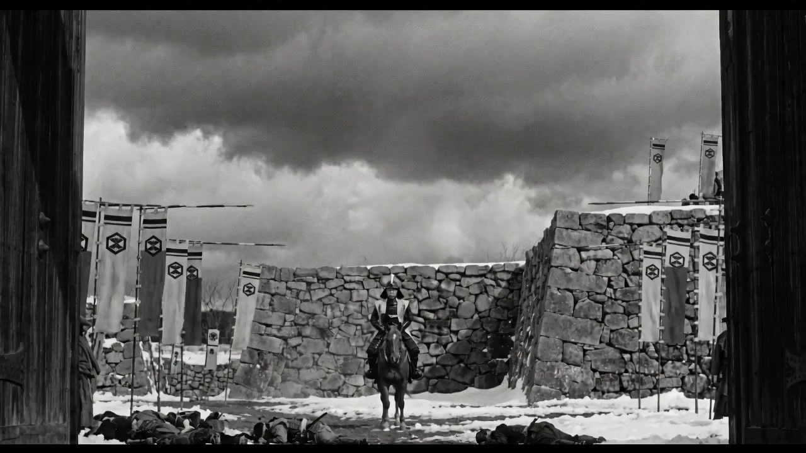

# Kurosawa-Style Short Film

> **作者：** @Seast Zhu

## Content

Process Planning:

Workflow

Step 1: Collect Creation Info (see parameter list below) → ★Pause & Confirm Step 2: Narrative Spec Design (text_editor) → ★Pause & Confirm Step 3: Character Design + Scene Color Design + Character Front View + Scene Keyframes (storyboard_designer + media_generator) → ★Pause & Confirm Step 4: Shot List Design (storyboard_designer) → ★Pause & Confirm Step 5: Shot Drawing (media_generator) → Execute in batches by narrative chapter, Flova automatically manages batches → ★Pause & Confirm

Step 5 Execution Rules: Shot drawing must be executed in batches by narrative chapter; do not enter all shot prompts at once. Flova pauses after each batch to show results and awaits: ✅ Confirm this batch of shots, proceed to the next chapter ✏️ Modify a shot in this batch (please describe)

Flova automatically determines the number of shots per batch based on execution; no manual selection needed.

Step 6: Video Clip Generation (media_generator) → Execute in batches by narrative chapter, Flova automatically manages batches → ★Pause & Confirm Step 6 Execution Rules: Video clip generation must be executed in batches by narrative chapter; do not submit all shots at once. Flova pauses after each batch to show results and awaits:

✅ Confirm this batch of video clips, proceed to the next chapter ✏️ Regenerate a shot in this batch (please describe)

Flova automatically determines the number of shots per batch based on execution; no manual selection needed.

Step 7: Cover Generation (media_generator, parallel to Step 6) Step 8: Music/Sound Effects (media_generator, parallel to Step 6) Step 9: Assembly (video_assembler)

Dependencies: 2→1; 3→1,2; 4→3; 5→4; 6→5; 7→3; 8→1,2; 9→6,7,8

Communication Rules (Global)

Every pause for confirmation must be displayed as options; users must not manually type "Confirm":✅ Confirm, proceed to the next step ✏️ Modify current content

When "Modify" is selected: Ask for adjustment direction → Regenerate → Display options again, loop until confirmed.

Step 1: Collect Creation Info

Visual style is fixed: Fixed camera position · Focal length allocated by scene · Natural light · Matte surface · Atmospheric haze · Costume color/brightness allocated by narrative position. Do not ask for or collect visual style preferences in this step. User-provided story content and style keywords are only for narrative inference. A. Story Content (Required)

Story theme/scenario description (1–3 sentences) B. Basic Parameters

Color Mode

Black & White Short (Default; brightness drives visual hierarchy, dark areas retain surface texture, atmosphere creates mid-grey)

Color Short (Costume color fixed by narrative position, costume vs. background color temperature contrast drives visual hierarchy)

Aspect Ratio

16:9 (Default)

2.39:1 (Widescreen)

4:3 (Classic film ratio)

Target Duration

Under 1 minute (Refined short chapter, single emotional impact)

1–2 minutes (Complete narrative, introduction, development, twist, conclusion)

2–4 minutes (Multi-layered, space for lingering thoughts)

Video Generation Model

Seedance 2.0 · 720P (Default, fast speed, excellent quality)

Seedance 2.0 · 1080P (HD quality, requires membership)

Kling 3.0 · 1080P (Kling native HD, suitable for users who prefer Kling style)

Narration/Dialogue

Add narration (Read epigraphs or extended literary narration as monologue)

Pure video, no dialogue/narration (Use images and music to convey loneliness, no voice required)

Design dialogue for me (Skill automatically generates character lines based on the story) After collection, show summary and wait:

✅ Confirm, start narrative spec design ✏️ Modify parameters

Step 2: Narrative Spec Design (text_editor generates Final_Video_Spec.md)

Skill automatically infers the following, no questions for the user:

Story theme (1 sentence)

Emotional arc (Inferred from story flow: Order established → Tension accumulation/Power shift → Disorder collapse/Aftermath)

Scene list (Scene name + Time period + Narrative function)

Color stage allocation (Each scene corresponds to: Order phase/Conflict phase/Destruction phase)

Aspect ratio/Duration/Model (From Step 1 selections)

Color Mode Phase Rules (Only for Color Short):

Order phase = High saturation balanced colors (Gold+Blue+White side-by-side) + Symmetrical composition

Conflict phase = Strong contrast colors + Fragmented/Diagonal composition

Destruction/Aftermath = Faded low saturation costumes + Large negative space or pure landscape terminator

B&W Mode Phase Rules (Only for B&W Short):

Order phase = Even mid-tones, multi-level layout, architecture & characters have independent brightness ranges

Conflict phase = High contrast light/dark (very bright subject vs. very dark background) + Fragmented/Diagonal composition

Destruction/Aftermath = Overall darkening, reduced mid-tones, background tends toward deep dark, characters tend to blend with environment

Display complete content after generation, wait: ✅ Confirm, proceed to character and scene visual design ✏️ Modify (please describe what you want to change)

Asset Analysis:

If the user uploads a reference image/video: Color Reference Image:

Extract: Scene type (e.g., Natural landscape / Ritual architecture / Twilight highlands), character clothing colors, emotional phase.

Identify: Current color phase (Orderly / Conflict / Destruction).

Black & White Reference Image:

Extract: Scene type, luminance distribution of characters (which elements are in the brightest/mid-tone/darkest areas).

Identify: Current luminance phase (Uniform mid-tones = Orderly / High-contrast, extreme light-dark = Conflict / Predominantly dark = Destruction).

Common to both types:

No modification: Character relationships and narrative direction specified by the user. Video breakdown: Each segment ≤ 15s, recording: character position/clothing color or luminance/background tone/shot size/composition type.

Storyboard Design:

⚠️ Global Visual Grammar Lock (Cannot be overridden, prioritizes over all user input)

This Skill's visual grammar is fixed to the Kurosawa cinematic system. Regardless of the story, situation, theme, or style reference words entered by the user, the following visual rules cannot be replaced, mixed, or drifted:

Image Texture: 35mm film, focal lengths assigned by scene type (Standard-Medium for interior / Medium-Long for outdoor / Ultra-telephoto for battlefield), matte material feel, film grain, atmospheric haze

Color/Brightness (by mode):

Color Mode: Environment base desaturated, character clothing high-saturation, clothing and background form warm-cold contrast, color distribution fixed by narrative position

Black & White Mode: Shadows retain surface texture without crushing to pure black, atmosphere/fog/rain forced to introduce mid-tones, brightness levels correspond to narrative weight

Lighting: High-contrast with directional natural light, strong side-light/backlight, artificial fill-light prohibited, mid-tones preserved in shadow areas

Composition: Fixed camera, 18 rules of composition (C-01 to C-18, see IV. Composition Rules)

Camera Movement: Primarily absolutely static, tracking shots only for chase peaks, handheld shaking is prohibited

If user input contains other director/painter/style references, handle as follows:

Extract the emotion/atmosphere/narrative feeling the user wants to express

Implement using this Skill's color system, composition rules, scene system, and physical specifications, rather than adopting the visual language of the referenced style

Only present the result to the user, no need to explain the substitution process

Example: User says "dreamlike grain, floating halos, Tarkovsky gaze" → Extract meaning: loneliness, sense of time, smallness of character, fragility of existence → Implementation: Extreme wide shot C-03 (landscape engulfs character) + ENV-01 mist/distant mountains + Fixed high-angle shot + Low-saturation character color + Large area of negative space

Operational Principles

Users do not manually fill in any visual fields after the initial input. The Skill extracts narrative type, scene list, and character functions from the user's story/script/idea—then automatically matches colors/brightness, clothing form, scene base color, and composition type according to this document's rule set, displaying them for confirmation or modification once completed.

Step 3: Character and Scene Visual Design

⚠️ Visual Physical Transformation (Scene-level, Step 3 must be executed before clothing/color inference)Step 3 generates scene-level fixed physical conditions (LENS/R1/R2/R5/R6), acting as baseline values for all shots in the scene. Shot-level fields in Step 4 (R3/R4/R7-R16) are assigned independently based on specific framing and composition using these as a foundation. Not shown to the user, must be executed for every generation.

LENS · Focal Length (Scene-level, highest priority, inherited by all shots after Step 3)

Focal length determines spatial structure, automatically inferred by scene type, not asked of the user. Scene TypeFocal Length PromptInterior / Close-up Ensemble / Village AlleywayStandard-Medium50-75mm equivalent lens, moderate perspective, space reads as natural and presentOutdoor Panoramic / Army Array / Mountain March / Multi-person Exterior SceneMedium-Long75mm equivalent lens, mild telephoto compression, landscape and figures readable together, oil-painting spatial balanceBattlefield Charge / Isolated Character / Peep-shot / Rout SceneUltra-Telephoto200mm+ equivalent lens, extreme telephoto compression, space flattened, figures and background pushed into same plane, dense and oppressive

Inference Rules:

Interior spaces with wall/roof/building obstruction → Standard-Medium

Outdoors but with multiple people distributed, needing to read the relationship between people and environment simultaneously → Medium-Long (Default outdoor focal length)

Large-scale movement/charge/loneliness of a single person in a vast space → Ultra-Telephoto

R1 · Light Source (Scene-level, inherited by all shots after Step 3)

Light Source TypePhysical OutputDay Interior · Cool Diffusedsoft cool daylight fills interior from off-camera opening, no visible light source in frame, no hard shadow direction — figures and surfaces evenly lit, slight brightness toward one side, cool grey-white ambient throughout, room reads as naturally lit without strong contrastDay Interior · Lattice Warm Side-lightwarm daylight filtered through lattice screen visible on one side, directional but diffused — soft light stripes on floor, figures lit from one side with gentle shadow, warm amber cast on near surfaces, opposite side in cool shade, no hard-edge shadowsMatte Gold Wall · Interior Diffusedmatte warm-gold lacquered wall surface, subtle tonal variation across surface; ambient light softly diffused throughout space — low saturation, no dominant direction; corners and upper zones slightly darker; no specular, no reflective highlight on figures; figure costume colours clearly readable against the gold backgroundDay Outdoor Diffusedovercast flat illumination, no shadow direction, stone and fabric textures most legible, no specular anywhereDay Outdoor Directharsh direct sunlight, hard shadow edges, pale ground reflects upward removing chin/arm shadow, ground brighter than skyTwilight Backlightstrong backlight from low horizon, warm rim light 2-3px at figure edges, figure core 2 stops darker than sky, costume color only in rimNight Single Candle-lightsingle iron candlestick sole source, warm amber pool ~1m radius, hard pool edge into darkness, shadow 65-75% of frame, zero ambient fillNight Multi-point Candle-lightmultiple warm amber light sources at left and right zones of frame, each casting independent warm pool, overlapping spill at center creates slightly lifted midground, darkness fills corners and ceiling — no single dominant directionNight Campfirelow center orange firelight, near figures orange-lit on near face/shoulder, far figures cold blue-black from sky ambient, 2200K core / 6000K periphery

Interior Lighting Inference: Set dominated by plain wood/grey walls → Cool Diffused; Set includes matte gold lacquer/gold screen → Matte Gold Wall · Interior Diffused; Set includes visible lattice/shoji doors with directional warm light → Lattice Warm Side-light.

R2 · Sky and Background Texture (Scene-level, mandatory for outdoor)

Sky must always have physical layers, flat colors or simple gradients are prohibited. Sky TypePhysical OutputTwilight Three-Zone Layeringthree temperature zones: warm orange-amber at horizon / rose-magenta cloud bands mid-sky / cool purple-grey at zenith — distinct layers not gradientTwilight Horizontal Cloud Bandslayered horizontal cloud bands warm ochre and muted rose, each band distinct upper and lower edge, darker toward zenithCumulus Suppressionbillowing vertical cumulus, dark grey-blue underside, bright white upper edge, occupies upper 60-70% of frameMist-covered Distant Mountainsaerial perspective: near ridge dark green / mid ridge blue-green / far ridge grey-white, each step ~15-20% saturation lossOvercast Cool Toneuniform pale grey overcast, no cloud texture, sky and architecture nearly same valueUpward Sunny Viewpale blue-grey sky, high cumulus with grey undersides and bright tops, solid pale field between cloud massesNight Campdeep blue-black night, no stars, cold ambient fills upper frame, firelight warmth confined to ground zone onlyPure Sky Terminator100% of frame, single diffused sun disc at center-upper, no ground no figures

R5 · Material Description (Scene-level, select corresponding entry for both Architecture + Clothing)

Architectural MaterialMaterialPhysical OutputJapanese Stone Wall (Fieldstone)irregular rough-hewn granite blocks in varied sizes — natural stone faces not dressed flat, wide and uneven mortar joints, occasional moss in crevices, scattered grass and weed tufts growing at stone base and between lower courses, completely matte cool blue-grey, stone surface texture clearly readable at medium distanceJapanese Castle Tower structuremulti-tiered Japanese castle tower rising above stone base wall — black lacquered timber frame structure, white lime plaster wall panels, layered ornamental hip-and-gable rooflines with upturned eaves at each tier, dark tile roofing, deep shadow under each roof overhang, stone base wall of rough-hewn irregular granite blocks below timber structureLarge Stone Wall Blocksrough-hewn granite blocks, irregular mortar joints, occasional moss in crevices, completely matte, cool blue-greyWooden Lattice Wallhorizontal wooden slats 3-4cm intervals, parallel shadow bands across surfaces in raking light, dark brown mattePower Hall Gold Wallmatte warm-gold lacquered panel, diffuse amber reflection, no specular, even warm toneHeavy Timber Castle Gateheavy dark timber weathered near-black, large iron hardware at joints, aged weight, matte grainWhite Tower Exterior Wallwhite lime plaster, slightly textured, cool grey-white, dark timber frame visible at joints and rooflinesGravel Courtyard Groundfine grey gravel, slight ambient upward fill, shadow falls as soft-edged dark formWhite Sand/Gravel Groundhigh-brightness pale ground, brighter than sky in direct sun, strong upward reflection eliminates underside shadow

Clothing MaterialClothing Color TypePhysical OutputPower Core Holder Gold Robeheavy woven silk, warm amber-gold, large medallion embroidery visible at medium distance, weight-drape fold lines, no sheenFemale Kimonoivory-white heavy silk, [PATTERN] motifs on white ground, deep red underskirt at hem, pools at floor when seated, brocade collar panel at necklineDark Navy Patterned Robedeep navy-black with small geometric pattern visible 2-3m, heavy woven, formal stiffnessWhite Fine Pattern Wide Robeivory-white all-over small wave/diamond weave, subtle texture in raking light, completely matte, slight cool undertoneBattle Armor/War Gearmatte lacquered or leather plate, use marks visible, cord lacing at joints, zero specularVariegated Transgressor Clothingwide horizontal color bands 8-12cm, hard edges between colors, varied saturation — some vivid some pale, sash at waist, rough woven, no refinement

R6 · Atmospheric Conditions (Scene-level, mandatory for outdoor, pure clean air prohibited)

Atmospheric TypePhysical OutputStandard Atmospheric Perspectivehaze desaturates and lightens distant elements ~15-20% per depth zoneBattlefield Smoke/Dustsmoke/dust haze in mid-ground, reduces contrast at 10m distance, cool grey particulate visibleMist Mountainouslow moisture haze, near elements crisp, mid softened, far near-monochrome blue-greyTwilight Warm Hazewarm golden haze ground to 2m height, shadow areas warm undertone, backlit figures have warm glow

Based on the confirmed narrative specifications, the Skill automatically completes visual translation, outputting character styling archives, scene color archives, and key props in one go.

Character Styling Archive (Skill automatic inference rules, internal use)

Extract characters from narrative specifications, choose corresponding rules based on color mode:

Color Mode Branch (Selected in Step 1):

Select "Color Short Film" → Execute color inference mapping below, skip section 1-B entirely

Select "B&W Short Film" → Skip color inference mapping below, jump to section 1-B "Brightness Narrative Mapping" to execute ⚠️ Color Mode: Color Inference MappingNarrative TypeRecommended ColorColor LogicPower Core Holder (Protagonist/Ruler)Deep Amber Gold #8B6914Gold carries the weight of power; degrades to brown at night = decay signalPower Vacating (Abdicated/Lost everything)Milky White/IvoryColor is emptiest = narrative is most fragile, surrounded by high-saturation colorsAmbition Inheritor (Legit on surface, desire inside)Warm Yellow #C8961ESame color as power symbol = individual disappears into the systemRadical Actor (Conflict/Violence/Revolution)Vermilion/Bright RedConflicts with any background, the most restless colorSober Dissident (Sees through everything, destined for isolation)High-saturation Cyan/Peacock Blue #2A8A9AColor temperature furthest from any warm background = most visually independentAbsurd Transgressor (Jester/Prophet/Undefined)Multi-color patchwork (Red+Blue+Yellow+White)Belongs to no system, always a visual foreign objectConspirator/Double AgentDeep Purple/Black with White PatternClose to dark backgrounds = skilled at hidingSilent Witness (Old Official/Observer)Deep Purple-GreyTends to fade away, does not actively create contrastFading/Marginalized (Exiting/Marginalized)Light Silver-Grey/Mint-GreyPresence close to zero, passively blends into backgroundNatural Belonger (Subordinate/Neutral)Ochre Brown/Earth YellowBelongs to the environment rather than the crowdFemale Protagonist (Any narrative function)White/Ivory Base + Pattern + Bright Red SkirtKimono base structure fixed, pattern theme inferred based on character personality (see Step D)

Default assignment rules when uncategorizable:

Character actively promotes narrative, fights for or maintains power → Warm colors (Gold/Warm Yellow/Vermilion)

Character observes, questions, or exists outside power → Cool Blue/Low saturation

Character passively endures or is exiting → Low-saturation Grey-White

Character function uncertain or spans multiple positions → Multi-color horizontal stripes

Clothing Inference: Automatically infer clothing form and texture from user-inputted story background/era/culture. If the story background is vague, infer as "generic fictional formal wear".

Set Inference: Extract visual landmarks from scene descriptions; if no clear description, automatically infer reasonable set anchor points based on spatial prototypes.

Characters Appearing: Inferred from the narrative content of each scene.

Output Format (Presented to user for confirmation):

【Character Styling Archive】 \n> ⚠️ **Chinese display field filling rules**：The following fields are for user confirmation only and must not be injected into the image generation Prompt.

**Only allowed to fill in content that can be directly captured by the camera**：\n>

✅ Number of people, position, orientation (sitting/standing/approx. Xm distance)\n> - ✅ Action status (stationary/turning head/holding weapon)\n> - ✅ Clothing appearance (color + form + texture)\n> - ✅ Physical description of props/accessories

**Not allowed to fill in**：Content that the camera cannot capture, i.e.: narrative interpretation/emotional feelings/spatial relationship metaphors/atmosphere descriptions. Judgment method: Ask "Does this sentence describe an object visible in the frame?"——If not, delete it.

Character: [Name/Function] Narrative Type: [Inferred Result] Color: [Inferred Color] — [One-sentence color logic, describing color relationship only, not presence or narrative status] Outdoor/Action Styling: [Clothing form + texture, Chinese] Interior/Formal Styling: [Clothing form + texture, Chinese] Pattern: [Pattern scale + pattern theme, Chinese] Lining: [Lining secondary color + position, Chinese]

[Internal field, not shown to user] OUTDOOR_FIGURE_PROMPT: [Outdoor styling complete English Prompt = Narrative color+clothing form+texture+pattern description+lining secondary color+background relationship] INDOOR_FIGURE_PROMPT: [Indoor styling complete English Prompt = Same structure] PATTERN_PROMPT: [Pattern English description, stored separately, for Step 5 image generation injection] LINING_PROMPT: [Lining English description, stored separately]

(List all characters)

【Scene Color Archive】

Scene N: [Scene Name] Spatial Prototype: [Inferred] Time/Light Quality: [Inferred] Environment Base Color: [Inferred] Emotional Phase: [Inferred] Character Color Configuration: [Warm/Cool relationship between appearing character colors and environment base color] Set Anchor Point: [Inferred] Characters Appearing: [Inferred]

[Internal field, not shown to user] ENV_PROMPT: [Environment base color English description, take from write_the_prompt color palette] PROP_PROMPT: [Set anchor point English description, take from write_the_prompt set archive] LENS_PROMPT: [Scene-level focal length, check Step 3 LENS table, highest priority, inherited by all shots; Interior → Standard-Medium / Outdoor Panoramic → Medium-Long / Battlefield Charge Isolated → Ultra-Telephoto] R1_LIGHT: [Scene-level light source, check Step 3 R1 table, fixed until scene ends; this field also handles light quality description, no separate LIGHTING_PROMPT stored] R2_SKY: [Scene-level sky texture, check Step 3 R2 table, mandatory for outdoor] R5_SURFACE: [Scene-level material, check Step 3 R5 table, choose corresponding entries for building+clothing] R6_ATMOSPHERE: [Scene-level atmospheric conditions, check Step 3 R6 table, mandatory for outdoor]

(List all scenes)

【Key Props】 Power Props: [Inferred] Narrative Foreground Objects: [Inferred, if none marked "None"] Faction Insignia: [Inferred, if none marked "None"]

After display is complete, immediately execute the following generation tasks (no re-confirmation needed):

Automatic Generation (Embedded in Step 3):

Tool: TextToImage → Nano Banana 2, 2K

Characters: Generate Front View × 2 sets for each character (Outdoor/Action Styling + Interior/Formal Styling). Front view only, do not generate three-view drawings

Scene: Generate 1–2 keyframes for each scene, referencing corresponding character front view and scene color archive

After generation, display design text archive together with element images, waiting for the following options: 1️⃣ Directly enter storyboarding 2️⃣ First supplement character side and back view images, then enter storyboarding 3️⃣ Need to adjust characters, scenes, or props Select 1 → Directly enter Step 4 storyboarding Select 2 → Supplement generation of side and back views for each character (store in character archive, alongside front view), then directly enter Step 4 storyboarding Select 3 → Ask for adjustment direction → Re-generate corresponding element images → Display three options again, loop until confirmed

Step 4: Storyboard Design

Skill automatically completes all storyboards, based on confirmed narrative specifications, character archives, and scene archives.

Shot Quantity Reference: Target DurationRecommended Shot CountShot Duration RangeUnder 1 minute6–12 shots5–10s1–2 minutes10–20 shots5–10s2–4 minutes16–30 shots5–12s

Execution Constraints: Flova single-run limit is about 4 minutes (tested to stably complete about 24-27 shots). Total duration of shots is determined by the actual duration of each shot—if long shots (10-12s) are used more, the number of shots corresponding to the same total film length is fewer, making single-run execution safer. When exceeding the limit, Step 5 will automatically prompt for batch execution.

The first time slot of each shot is fixed starting from 00.0s, the end time equals the allocated duration for that shot (inherited from Step 2 narrative specification scene duration allocation, not re-inferred). Paragraph terminators (pure sky/pure landscape), shots with narration over 8s take the upper limit of the duration range.

Core Principle: First determine what narrative transformation each narrative sub-section needs to accomplish, then select the corresponding shot combination to achieve it.

⚠️ Empty Landscape System (Storyboard structure rules, prioritizes over specific shot content selection)

Function 1: Narrative structure marking. Kurosawa uses empty landscape shots to handle segmentation/sectioning/scene establishment/narrative stage declarations, not relying on subtitles or hard cuts. Function 2: Technical connection buffering. This Skill's video generation is not frame-level continuous—each segment is generated independently, character position/status cannot be inherited from the end frame of the previous segment. Empty landscape shots naturally have no character continuity requirements; inserting them between two segments allows the audience's gaze to reset naturally, eliminating disjointedness.

Execution Rules: Narrative SceneEmpty Landscape Type Selection StandardLarge paragraph beginning/scene changeScene establishment symbol (building/site panorama)Select S-ENV-07 or S-ENV-08 according to target sceneBetween narrative sub-sectionsNarrative phase symbol (astronomy/terrain)Check astronomy correspondence table below for current narrative stageEmpty residual symbol after character departure (grassland/pure landscape)S-ENV-06Narrative symbols needing separate statementSymbol empty landscape (props/sacred objects)No number, use inline Prompt below directly

Symbol Empty Landscape inline Prompt: shrine interior or sacred object as sole subject, warm amber light emanating from within, dark architectural frame surrounding, no human figures

Astronomy and Narrative Stage Correspondence (Must be selected according to this, no free interpretation): Narrative StageAstronomy FormEmpty Landscape NumberStability PeriodWhite full cumulus cloud · surgingS-ENV-01Turning Point · ConsequencesFuture cumulus cloud pressing downS-ENV-02Fateful MomentDivine light through cloudsS-ENV-03Battlefield/Destruction PeriodExtremely dark bottom clouds insideS-ENV-04Narrative Suspension · Sense of Time StoppedDiffuse burning sun diskS-ENV-05Character Departure · AftertasteGrassland distant mountains duskS-ENV-06

Prompt: Take corresponding S-ENV number from write_the_prompt·★Empty Landscape Shot Prompt Library, no need to inject FIGURE_PROMPT. ⚠️ Black & White Mode: After taking the Prompt, replace the first line "film still" with "black and white film still", then use it.

Paragraph Start/End Design (S-type · Narrative Transformation Type)

Each narrative paragraph must have a clear opening state and closing state. The middle shots are the process of character actions, reactions, or environmental changes; every shot is pushing the paragraph from opening to closing, not a list of independent scenes.

Usage: First use S-type to determine what the opening shot and closing shot of this paragraph look like, then select specific shot combinations from the SYN toolbox below to fill the paragraph content. TypeOpening ShotClosing ShotCamera/Framing AnchorChange OccurringS-1 Flip TypeSubject facing camera / Crowd sittingSubject back to camera / Crowd standingCamera/Framing/spatial layout unchangedOrientation or posture flipsS-2 Present/Absent TypeCenter empty, surrounding people waitingCenter filled, subject in placeCamera/Framing/surrounding people unchangedSpace goes from empty to solidS-3 Outside-to-Inside TypePanorama, subject small in environmentMedium close-up or close-up, only subject face/statusSubject is always the coreFraming pushes from panorama to close-upS-4 Cause-and-Effect Chain TypeProp/Foreground object close-up, no subjectSubject appears and takes actionFraming similar, screen subject switches from object to personS-5 Four-stage Expansion ArcClose-up establishes subject back-turned leaving, finally connects to pure landscape unmanned shotNarrative direction unchangedClose-up → Extreme long shot → Close-up → Aftertaste empty landscape

S-type Selection Rules:

Subject posture or orientation undergoes obvious change → S-1

A location goes from occupied to vacant, or vacant to occupied → S-2

From global environment zoomed into subject's single internal state → S-3

Show prop or foreground object first, then cut to the person taking action → S-4

Subject needs large-scale movement, chasing, or leaving the scene → S-5

When multiple rules are met simultaneously, select the S-type with the most obvious structural change. Select the type independently for each paragraph, avoid repeating adjacent paragraphs as much as possible.

⚠️ Step 4 Visual Physical Transformation (Must be executed for every shot)Step 3 has already determined scene-level LENS/R1/R2/R5/R6. Step 4 assigns the following shot-level fields (R3/R4/R7-R16) independently for each shot based on this. Inheritance Rules: LENS/R1/R2/R5/R6 inherited from Step 3, identical for all shots within the same scene. LENS has highest priority, cannot be overridden by single shots. R3/R4/R7-R16 assigned independently for each shot, not inherited from scenes or adjacent shots.

R3 · Frame Segmentation Ratio (Shot-level)

Each shot must specify the proportion of sky/character/ground, and the percentage of frame height occupied by the character. Scene TypeSky:Character Area:GroundCharacter % HeightExtreme Long Shot Landscape10:5:85<2%Twilight Cliff Top (Full Silhouette)65:20:1520-25%Twilight Cliff Top (Clothing Color Visible)58:22:2030-35%Outdoor Castle Gate Medium Shot18:62:2040-60%Outdoor Castle Courtyard Wide Shot12:28:60<5%Low Angle Upward Building92:8:0<5%Interior Medium Shot0:100:050-70%Pure Sky100:0:00

R4 · Clothing Color/Brightness Visibility (Shot-level, determined by this shot's light source)

Color Mode: Describe the saturation and visibility of clothing color under the current light source. R1 Light SourceClothing VisibilityInterior Diffused (Cool/Matte Gold/Lattice)full costume color visible, textile pattern legible, colour accuracy at maximumOutdoor Diffusedfull costume color at accurate saturation, most legible conditionOutdoor Direct+Bright Groundmaximum saturation, upward ground fill removes underside shadow, figure lit from all directions simultaneouslyTwilight Backlight (Semi-silhouette)costume color 20-30% saturation visible in ambient fill, rim highlight glows warm at edges, face in shadow but features suggestedTwilight Backlight (Full silhouette)no costume color visible, silhouette only with 1-2px warm atmospheric glow at edge — not a hard cut-outNight Candle-light (Single/Multi-point)costume color accurate within 1m light pool only, beyond pool: deep amber-brown regardless of actual colorNight Campfire Close-upcostume color overridden by orange firelight on near face/shoulder, actual color only on shadow side as cool ambient

B&W Mode: R4 changed to describe fabric brightness readability under current light source, refer to W1 brightness mapping, do not describe color.

R1 Light SourceBrightness VisibilityInterior Side-window/Diffusedfull surface texture and weave pattern legible, fold shadows visible as mid-greyOutdoor Diffusedfull tonal range visible, maximum pattern legibilityOutdoor Directhighlight zones near-white, shadow zones deep grey — maximum contrast, pattern visible in both zonesTwilight Backlight (Semi-silhouette)overall mid-grey, texture partially legible, rim highlight slightly brighter at fabric edgeTwilight Backlight (Full silhouette)near-black overall, surface texture at threshold — not pure black, retain minimal fabric edge detailNight Candle-lightwithin light pool: tonal range readable; beyond pool: deep grey, surface texture at minimum visibility — not pure black

R7 · Backlight Silhouette Type (Mandatory if containing backlight)

⚠️ "Full Silhouette" prohibited in B&W mode—B&W foundation requires shadows to retain surface texture, full silhouette would override this rule. B&W mode scenes with backlight uniformly use "Semi-silhouette" or "Rim light". TypeApplicable ModeJudgment ConditionPhysical OutputFull Silhouette⚠️ Color Mode ExclusiveDeep Twilight/Strong Backlightbacklit figure, outer silhouette readable, surface detail reduced to near-zero, 1-2px warm atmospheric soft glow at edge — shadow retains faint cloth texture, not pure black fillSemi-silhouetteColor/B&W BothTwilight/Has Ambient Lightbacklit, ambient fill partially illuminates figure, fabric texture visible in raking light, face shadowed but features suggested, deep shadow retains surface layerRim LightColor/B&W BothNear Sunset/Strong Side Backlightstrong rim light 2-3px at figure edges, shadow core deep but texture present at surface fold highlights, not flat black fill

R8 · Foreground Grass Behavior (Mandatory for extreme low angle/natural terrain)

Foreground StatePhysical OutputExtreme Low Angle · Slow Subjectforeground grass blades sharp and fully saturated in focus at bottom 20-25% of frame, subject visible through and above grass at mid-ground, three depth layers maintained: grass / subject / sky — subject boundary receives natural atmospheric softening from haze, not hard-cut silhouette against backgroundExtreme Low Angle · Extreme Speed Flybyforeground grass sharp at bottom edge, subject as near-total horizontal motion blur above, single warm color streak visible as only identity through full blur — grass is the only sharp element in frameMedium Shot Grass Slopegrass texture visible as directional surface, light rakes across blade tips creating highlight-shadow rhythm, color varies from shadow-green to highlight-yellow-greenTall Grass Obstructiontall grass at chest height of subjects, reed-like vertical lines in foreground partially obscure figures, subjects emerge through grass rather than standing above it

R9 · Cumulus Dynamics Type (Mandatory if containing cumulus)

Cumulus StatePhysical OutputNeutral Surgingmassive cumulus tower rising upper-right, warm-white to light grey lit top — muted not brilliant, grey-blue base, strong upward movement, no backlit glow, no light rays breaking through cloudCumulus Pressing Downdark heavy cumulus mass, grey-blue base near-black, minimal bright top, oppressive downward weight — sky carries threat not indifferenceCumulus Suppressing Charactersbillowing vertical cumulus occupies upper 60-70% of frame, figures in lower zone suppressed by sky mass, dark undersides

R10 · Multi-person Slope Layered Scheduling (Mandatory for multi-person outdoor slopes)

Scheduling TypePhysical OutputSlope Multi-person Layeringopen rolling hillside as background, figures at distinct elevation bands across the slope, no overlapping silhouettes, each figure fully visible regardless of distance — war-painting flatness, no Western perspective compression; figures face the same direction of travel not toward camera, natural variation in individual posture and body angle — NOT uniform parade-ground alignmentSlope Background Colorslope provides gradient background: lower figures against mid-green, upper figures against sky or mountain haze, each figure reads against different value and saturationForeground Back-turned Crowddark-robed attendants fill foreground with backs to camera, forming human visual floor, their uniform dark color grounds the frame before the colorful principals above

R11 · Tracking Shot Background Blur (Mandatory for tracking shots)

Background TypePhysical OutputGrassland Trackingbackground grass field becomes horizontal linear streaks, warm golden-amber color, streak direction matches camera movement, near-ground streaks more dense than upper-frameHillside Trackinggreen slope becomes soft horizontal wash, color retained but texture dissolved, vertical elements blur into horizontal bandsSubject Stabilitysubject maintains relative stability in frame center despite camera movement, subject in focus against blurred background

R12 · Mist Color Desaturation Gradient (Mandatory for misty mountains)

LayerPhysical OutputForeground Charactercostume colors at near-full saturation, vivid and distinct, warm blue / red / yellow clearly readableMid-ground Grassgreen grass slightly desaturated, pale yellow-green rather than vivid emeraldDistant Mountainmassmountain mass reduced to low-saturation blue-grey, nearly monochrome, aerial perspective maximumOverall Effecthaze creates strong color saturation gradient: near = vivid / mid = pale / far = grey-blue monochrome — figures read as the only saturated color elements in a progressively desaturated world

R13 · Subject Speed Layering in Motion (Mandatory for co-existing multi-speed subjects)

Scene TypePhysical OutputForeground Fast Ride+Background Slow Walkforeground mounted figures as heavy motion blur, background infantry sharp or lightly blurred, speed differential creates natural depth without focus pullSand/Dust Kick-upground-level dust or sand kicked up by fast-moving subjects, pale dust cloud forms at ankle-to-knee height, catches side light as thin luminous layerFlags Lateral Swayingbattle standards at mid-ground, fabric in lateral motion with gentle blur, pole sharp, flag surface soft — wind-driven movement distinct from subject motion blur

R14 · Fire/Building Light Overlay (Mandatory for burning scenes)

Light Overlay TypePhysical OutputBuilding Burning Exteriorstone structure and tile rooflines as cold blue-grey dominant mass — building surfaces desaturated, no warm tone spreading across facade; dense dark grey-black smoke fills upper frame and merges with sky into unified cold ceiling — smoke volume is the primary visual, not fire; fire visible only at window openings and roof breaks as isolated high-saturation orange-yellow points; sky and background may carry their own warm or cold tone independently — architecture reads as cold against whatever sky is present; NO large open flames on exterior surface, NO warm glow diffused across building wallsInterior Burning+External Cold Lightcold blue-grey ambient fills the space as base tone — all structural surfaces, floor, and ceiling read as desaturated dark grey; fire exists as isolated warm island: high-saturation orange-yellow at flame core only; smoke surrounding fire absorbs and diffuses orange light — warm glow transitions through low-saturation amber-grey haze before reaching cold zone; no hard geometric boundary between warm and cold — transition is atmospheric not spatial; overall scene saturation low throughout — only flame core reads as vivid color, fire's visual weight comes from saturation contrast against desaturated surroundings not from areaArrow/Projectile+Firelightprojectile visible as streak motion blur crossing frame, fire source behind it creates backlit silhouette of streak, fast horizontal streak vs slow vertical smokeForeground Subject Full Saturation+Background Fire Compressiontelephoto compression brings near-full-detail foreground subject and distant fire-lit crowd into same frame, near subject color fully accurate, distant fire appears as warm glow band

R15 · Extreme Low-Saturation Scene Color Anchor (Mandatory for destruction period/extreme low saturation)

⚠️ Shots containing dark red liquid mark descriptions may trigger AI content restrictions. If generation fails, prompt the user to replace that shot or use other anchor types. Anchor TypePhysical OutputDeep Dark Tone+White Flagoverall scene near-monochrome dark blue-grey, single white or pale flag/textile reads as highest brightness point, eye drawn immediately to white as compositional anchorSmoke Grey+Red Clothing Pointgrey-white smoke dominant, isolated warm red figure or flag reads as sole warm anchor in cold field, red appears more saturated than its actual value due to surrounding desaturationCharcoal Black Ruins+Single Fire Pointnear-black charred structure, single fire point provides only warm source, amber light pool strictly limited to immediate proximity of flameCold Grey Silver Base+Deep Red Marks (Anchor Type)near-zero saturation cold grey-silver ground, bright vermillion-red vertical streaks on surface — deep crimson liquid marks, 2-3 stops more saturated than surrounding field, sole warm element in monochrome sceneWarm Base+Same-tone Dark Red (Blending Type)warm ochre-brown ground, dark rust-red marks blending with warm tone — same color temperature as ground, lower saturation than figures, marks read as part of scene texture

R16 · Destruction Period Sky (Mandatory for post-war/destruction period)

Sky TypePhysical OutputTurbid Yellow-Brown Smoke Haze Skysky uniformly tainted amber-yellow-brown, no clean blue zone visible anywhere, smoke particulate diffuses all light, no cloud structure visible, flat oppressive warmthCastle Tower Burning Background Skysky directly above fire orange-lit from below, transitioning to dark smoke-brown at zenith, fire glow creates false warm zone in otherwise cold skySilhouette+Yellow-Brown Skyall structures and terrain read as pure black silhouette against amber sky, no surface detail on ground objects, figure tiny at silhouette edge, sky is the only value that matters

Shot Combination (SYN Type · Scheduling Grammar)

Camera Angle Number Quick Lookup (CAM-A to CAM-G): NumberPosition/AngleNarrative FunctionCAM-A远离场景, 水平全景建立场景, 开场/收尾CAM-B跟随主体, 中景/中近景主体状态与意志CAM-C对准反应方, 水平对话/回应的另一侧CAM-D侧面记录运动/行动移动、行动、过渡CAM-E极高位，向下俯视哲学性收束，去英雄化CAM-F贴近地面/地形，向上仰建筑压迫感，崇高/渺小对比CAM-G草地/地面高度，水平大地视角，速度感，人物从环境中穿越 S-type determined the opening and closing shots of the paragraph, the SYN toolbox provides specific shot combination schemes to fill the entire content of the paragraph (including opening, middle process, closing). Each SYN represents a fixed multi-shot scheduling mode, selected according to narrative scene type.

SYN-01 Panorama establishment → Local confirmation (2-3 shots)

SYN-02 Sign先行 → Subject appears (2-3 shots)

SYN-03 Medium shot → Long shot exit → Extreme long shot dissolution (3 shots)

SYN-04 Fixed panorama × subject tracking/passing through (1 long shot)

SYN-05 Space establishment → Channel traversal → Internal confirmation (3 shots)

SYN-06 High-angle establishment → Low-angle close-in → High-angle conclusion (3-4 shots)

SYN-07 Interior full scene → Single-person confirmation → Opposite side response (3 shots)

SYN-08 Subject close-up × environment gradually occupies → Negative space completion (3 shots)

SYN-09 Extreme low angle × subject traverses foreground ground (1-2 shots)

SYN-10 Static panorama × observer in corner → Observed event unfolds (1-2 shots)

SYN-11 Foreground obstruction → Looking through obstruction at subject (1 shot)

SYN-12 Back-turned + forward readable target · low-level eye-level single shot (1 shot)

SYN-13 Extreme low-angle triangle terrain → Three subjects layered (1 shot)

SYN-14 Single person + prop close-up × interior isolation (2 shots)

Each shot output (All filled by Skill): Shot N:\n- Scene: [Scene Name]\n- Emotional Phase: [Inferred]\n- Framing: [Inferred]\n- Composition Rule: [Inferred, selected from C-01 to C-18]\n- Camera Movement: [Inferred, selected from CAM-A to CAM-G + 8 types of camera movement]\n- Character and Clothing Color: [Inferred, Chinese description]\n- Story Content: [Inferred, Chinese description]\n- Duration: [Inferred]s\n- Time Slot Planning: [Subject action nodes within frame, e.g.: 00.0s standing still / 02.0s start turning / 06.5s finish turning / 08.0s ending; static shots only write one node]

[Internal field, not shown to user]\n- LENS_PROMPT: [Inherited from Step 3 scene-level value, highest priority, cannot be overridden; place after bottom layer, before scene description when injecting Prompt]\n- R1_LIGHT: [Inherited from Step 3 scene-level value, or override if this shot has special light source]\n- R2_SKY: [Mandatory for outdoor, inherited from Step 3; skip for interior]\n- R3_RATIO: [Independently assigned for this shot, check R3 table above]\n- R4_COLOR_VIS: [Independently assigned for this shot, determined by R1 of this shot; for Color Mode check R4·Color table above; for B&W Mode check R4·B&W table above (describe brightness readability, do not describe color)]\n- R5_SURFACE: [Inherited from Step 3 scene-level value]\n- R6_ATMOSPHERE: [Mandatory for outdoor, inherited from Step 3; skip for interior]\n- R7_SILHOUETTE: [Fill if backlight included, skip otherwise; ⚠️ B&W mode forbidden to select "Full Silhouette", can only select "Semi-silhouette" or "Rim Light"]\n- R8_FOREGROUND_GRASS: [Fill if extreme low angle/natural terrain foreground, skip otherwise]\n- R9_CLOUD_TYPE: [Fill if cumulus visible, skip otherwise]\n- R10_SLOPE_LAYOUT: [Fill if multi-person outdoor slope, skip otherwise]\n- R11_TRACKING_BLUR: [Fill if tracking shot, skip otherwise]\n- R12_HAZE_GRADIENT: [Fill if misty mountains, skip otherwise]\n- R13_SPEED_LAYERS: [Fill if multi-speed subjects co-exist, skip otherwise]\n- R14_FIRE_LIGHT: [Fill if burning/flame included, skip otherwise]\n- R15_LOW_SAT_ANCHOR: [Fill if destruction period/extreme low saturation, skip otherwise]\n- R16_DESTRUCTION_SKY: [Fill if post-war/destruction period sky, skip otherwise]\n- ENV_PROMPT(Take ENV number for Color Mode; use W2 corresponding scene base color for B&W mode)\n- FIGURE_PROMPT(Take narrative color+clothing for Color Mode; use W1 corresponding brightness description for B&W mode)\n- COMPOSITION_PROMPT: [Composition rule English keyword, take from C-01 to C-18]\n- SHOT_PROMPT: [Framing English keyword]\n- CAMERA_PROMPT: [Camera movement English description, take from CAM-A to CAM-G]\n- CROWD_PROMPT: [If crowds exist, supplement according to crowd rule principles 1-5 below; ⚠️ Circular/semi-circular arrangements forbidden, must use horizontal line layers; skip if no crowds]

Storyboard Rules: Forced execution (must not violate):

Handheld shaking forbidden

Sequential framing progression forbidden, medium close-up → extreme long shot jumps are allowed

Last shot unmanned, BGM fades to natural ambient sound

Forced limits:

Close-ups max 1-2 times for the entire film, used only at narrative turning points, not for character introductions or emotional rendering

Forced structure:

Each narrative sub-section end must have an empty landscape shot (narrative phase symbol/scene establishment symbol/aftertaste symbol, one of them), lasting 3-6s, astronomy type selected according to narrative phase correspondence table

When changing scenes for large paragraphs, empty landscape shot is a scene establishment symbol (building/site panorama), placed at the first shot of the new paragraph

The last shot must be unmanned (aftertaste symbol preferred)

Prompt supplement rules for shots containing crowds (Must execute when scenes have multiple people):

⚠️ Core Prohibition: Crowds absolutely forbidden to circle or semi-circle the protagonist. Kurosawa's multi-person scenes are always organized with horizontal line layers—crowds divided into multiple parallel horizontal lines based on depth of field, not distributed in circular arcs.

Principle 1 (Mandatory) Horizontal Line Layers: Crowds organized into 2-3 independent horizontal lines based on depth, with spatial distance between different layers. figures organized in [N] horizontal depth layers — foreground layer / mid-ground layer / background layer, distinct depth between each, NO circular arrangement, NO semicircle — horizontal line structure only; figures face the same direction of travel not toward camera, natural variation in individual posture — NOT uniform parade-ground alignment

Principle 2 (Fill if flags/weapons present) Vertical Rhythm of Flags: Flags or vertical props rise vertically from the horizontal crowd, forming an orthogonal rhythm with the horizontal crowd flow. vertical standards or weapons rising from crowd at regular intervals, cutting perpendicular through horizontal layers — vertical rhythm against horizontal mass

Principle 3 (Fill if protagonist + crowds present) Protagonist Layering: Protagonist clearly separated from crowds through height difference or independent depth-of-field layer, visually identifiable separately. principal figure at separate depth plane or elevation from crowd — visually distinct and readable against surrounding mass

Audio Planning (Skill automatically generates):

BGM: 1 track, automatically selected based on narrative phase (see write_the_prompt music Prompt library):

Version A Static Pressure Type → No action, still, power display segments

Version B Contrapuntal Pressure Type → Intense action, conflict, large-scale movement segments (music inverse to picture)

Version C Extremely Sparse Type → Isolated, empty, long shot, transition segments

Version D Disintegration Type → Destruction, loss of control, after irreversible turning points

General Base → No clear phase or default

Sound Effects: Weather sounds as a narrative layer equal to BGM (wind/rain/thunder), not background fill

Silence is part of the structure—the most powerful moments of music often follow the longest silence

Display after storyboarding is complete, waiting for: ✅ Confirm storyboard, start drawing storyboard images ✏️ Edit (Please describe which shot or paragraph you want to modify)

After confirmation enter Step 5, Flova executes automatically in batches according to narrative chapters, pause for confirmation after each batch is completed before continuing.

Media Generation:

⚠️ Mandatory Rules for Prompt Assembly (Applies to all image/video generation; executed internally, not shown to user)

Before every call to TextToImage or MultiModalToVideo, a complete English Prompt must be assembled internally in the following order. Skipping this or using Chinese descriptions is prohibited.

⚠️ Color Mode Forced Branching: Must be selected at Step 1 and strictly maintained throughout; no mid-process switching. **Monochrome Mode (User selects "B&W Short Film"): Reference ★Unified Visual Foundation - B&W Version → W1 Luminance Mapping + W2 Scene Background + W3 Pattern + W4 Atmosphere → R1-R16 (Use W4 instead of R6; R7 bans pure silhouettes) → W5 Negative Append **Reference to color foundation or ENV color palette is prohibited. Narrative color output is prohibited.**Color Mode (User selects "Color Short Film"): Reference ★Unified Visual Foundation - Color Version → I. ENV Palette → Step 3 Color Inference Mapping → R1-R16 **Reference to B&W foundation or W1-W5 fields is prohibited.

All other steps (Composition C-01 to C-18 / Shot Scale / Camera Movement / PHYSICS_BLOCK triggers) are shared between both modes.

Image Prompt Assembly Order

Color Mode:[★Unified Visual Foundation - Color Version] (from write_the_prompt section)\n- [Scene/Environment Prompt] (from Scene Archive ENV_PROMPT, corresponds to I. ENV ID)\n- [Character Clothing/Color Prompt] (from Character Archive: Narrative Color + Clothing Style + Texture + Pattern)\n- [PHYSICS_BLOCK] (assembled from Shots R1-R16, R1 includes light quality info)\n- [Prop Anchor Prompt] (from Scene Archive PROP_PROMPT)\n- [Composition Keywords] (from C-01 to C-18)\n- [Shot Scale Keywords] (from Shot Scale Grammar Table)\n- [★Unified Negative Prompt - Image Version]

Monochrome Mode:[★Unified Visual Foundation - B&W Version] (from write_the_prompt section)\n- [Scene Luminance Prompt] (from I-B, W2 B&W Scene Background Table, corresponds to scene type)\n- [Character Luminance Prompt] (from I-B, W1 Luminance Narrative Mapping, replaces color descriptions)\n- [PHYSICS_BLOCK] (R1-R16 rules apply; R6 uses W4; R7 bans pure silhouettes in B&W mode, use partial silhouettes/rim lighting instead)\n- [Prop Anchor Prompt]\n- [Composition Keywords]\n- [Shot Scale Keywords]\n- [★Unified Negative Prompt - Image Version] + [W5 B&W Append] (W5 appended at the end of negative prompt; S-ENV B&W handling see Empty Scene Prompt library, independent of this)

Video Prompt Assembly Order

Before generating each shot, assemble a complete English Prompt internally using this format:

Shot N · [Scene Name] · [Shot Scale] · [CAM-X]

fixed camera position — single continuous take, no automatic cuts, no within-shot transitions [00.0s - Xs] [Opening State: Subject Position + Clothing + Composition Keywords] [Xs - Ys] [Action Change: Physical movement of subject in frame, precise to the second] [Ys - Zs] [Closing State, final timestamp = total shot duration]

[★Unified Visual Foundation] (Must be included fully)\n- [LENS_PROMPT] (Scene-level focal length, highest priority, immediately follows foundation)\n- [Scene/Environment Prompt] (ENV_PROMPT)\n- [Character Clothing/Color Prompt] (including patterns, FIGURE_PROMPT)\n- [PHYSICS_BLOCK] (R1-R16, physical sensation driver; R1 includes light quality)\n- [Camera Movement Description] (from VI. Camera Movement Table)\n- [★Unified Negative Prompt - Video Version] (Must be included fully)

Time Slot Filling Rules:

First slot is fixed at 00.0s, last slot time = total allocated duration for that shot.

Each slot describes the physical state change of the subject in frame, not cuts.

For static shots (no character movement), write only one time slot: [00.0s - Xs] figure stationary, [Composition State]

For shots with action, split by movement nodes; 2-3 slots are usually sufficient.

Example (8s static shot, character standing then turning): Shot 3 · Hall of Power · Medium Shot · CAM-B fixed camera position — single continuous take, no automatic cuts, no within-shot transitions [00.0s - 02.0s] solitary figure back-turned, center frame, ivory-white robe motionless, dark navy backdrop, gold symbol centered behind [02.0s - 06.5s] figure begins slow turn toward camera, robe drape shifts with body weight, face remains partially shadowed, turn completes at 06.5s [06.5s - 08.0s] figure facing camera, standing still, gaze directed off-frame right

(Insert full text of ★Unified Visual Foundation here) warm amber light diffused inside room from side opening, no visible light shaft, shadow occupies far side 50-60% of frame ivory-white wide outer robe, sparse fine gold thread botanical motifs 1-2cm scattered, matte warm-gold lacquered panel, diffuse amber reflection, no specular large vertical ceremonial hanging centered on back wall — never obscured medium shot, figure occupies 50-60% frame height static camera, no movement whatsoever, all motion comes from figures within the frame (Insert full text of ★Unified Negative Prompt - Image Version here)

Prompt assembly is an internal step, invisible to the user, but must be executed by the Skill.

Generation Specifications
Character Front View + Scene Keyframes (Embedded in Step 3, auto-executed)

Tool: TextToImage → Nano Banana 2, 2K

Character: Generate a front view for each character; separate generations for outdoor/action outfits vs. indoor/formal outfits, 1 per set.

No Three-View/Turnarounds (Side/Back generated upon user request later).

Scene: Generate 1–2 keyframes per scene, referencing the corresponding character front view and scene color profile.

⚠️ Do not mix two outfits for the same character.

Character Side/Back View (Triggered when user selects 2 during Step 3 confirmation)

Tool: TextToImage → Nano Banana 2, 2K

Generate one side view and one back view based on the confirmed character front view.

Storyboard Drawing (Step 5)

Execution Method: Execute in batches by narrative chapter; Flova manages batch quantity automatically. Pause for confirmation after each batch before continuing. Do not input all shot prompts at once.

Tool: TextToImage → Nano Banana 2, 2K

Generate storyboards shot-by-shot based on each shot description confirmed in Step 4.

Reference for each storyboard: Corresponding Character Front View (Step 3) + Corresponding Scene Keyframe (Step 3) + The specific composition/scale/character position for that shot.

⚠️ Reference images must be cited using the <<<image_1>>> format.

After each batch generation, display:✅ Confirm this storyboard batch, continue to next chapter ✏️ Modify a specific one in this batch (please describe)

Video Clips (Step 6)

Execution Method: Execute in batches by narrative chapter; Flova manages batch quantity automatically. Pause for confirmation after each batch. Do not submit all shots at once.

MultiModalToVideo, resolution determined by user model selection:

Seedance 2.0 · 720P (Default)

Seedance 2.0 · 1080P

Kling 3.0 · 1080P (When using Kling 3.0 Omni, specify reference mode via refer_type: "base" for video modification, "feature" for video referencing)

⚠️ Reference images must be cited using the <<<image_1>>> format.

Clip duration: Determined by duration field in Step 4 storyboards, not specified separately.

Cover Generation (Step 7, parallel with Step 6)

Tool: TextToImage → Nano Banana 2, 2K, 16:9 Landscape

Automatically generate two options, do not prompt the user.

Inferred based on Step 2 narrative specs (Theme/Mood/Main Color) + Step 3 Character Profiles.

Option A · "Ran" Opening Title StyleVisual Grammar: Pure black background + Monochrome + Title text merged with character/symbol. Text is not an overlay—the text is the image.

Execution Rules:

Background: Pure black, no texture, no gradients.

Main Color: Extract one high-saturation color from the short film's palette (usually Power Color or Turning Point Color), convert to monochrome fill.

Main Visual: Title characters (Chinese characters preferred) have core character silhouettes or iconic prop outlines embedded inside—the silhouette is part of the glyph structure.

Divider: Fine horizontal line, same color, below the main visual.

Subtitle: Latin capital letters, Serif font, same width as divider, centered.

Prompt Structure: pure black background, no texture no gradient, single-color [Main Color English Description] ink-wash calligraphy title character, silhouette of [Core Character/Prop Description] integrated into character strokes — figure is part of the glyph, horizontal rule in same color below main character, subtitle text "[Short Film English Title]" in bold serif capitals below rule, zero ambient light, zero depth, flat graphic plane, high contrast single-color against absolute black, no photographic elements, no environment — pure graphic symbol

Option B · Narrative Evolution StyleVisual Grammar: Start from the most narratively powerful single frame generated, extract core visual elements for recomposition. Not a realistic scene; abstract/symbolize the element into a shareable cover image. Execution Rules:

Base Frame: Select key shot before/after an irreversible narrative point from Step 5 storyboards.

Processing: Retain core composition skeleton, reduce colors to 2–3, sharpen contours and silhouette edges.

Text: Minimalist, small font, restrained placement (bottom right or bottom left), does not compete with main subject.

Aspect Ratio: Maintain original ratio.

Prompt Structure: [Core composition description from selected storyboard], color reduced to [2-3 colors description], high contrast silhouette, graphic treatment — not photorealistic, not cinematic still, poster-graphic language: shapes and colors over detail, [Text position and style], [★Unified Negative Prompt (Image Version)]

After generation, display: ✅ Use Option A (Wait for music in Step 8, then proceed to editing in Step 9) ✅ Use Option B (Wait for music in Step 8, then proceed to editing in Step 9) ✏️ Modify cover (please describe direction) 🔄 Regenerate both options

Music (Step 8, parallel with Step 6)

lyrics_to_song → Suno 5

Select version based on narrative stage (see write_the_prompt music library):

Version A (Static Tension): Opening, Display of Power, Waiting/Idle

Version B (Counterpoint/Pressure): Intense action, conflict, large-scale movement

Version C (Sparse): Isolated character, wide shot, empty space, transitional

Version D (Collapse): Destruction, loss of control, irreversible turning point

Default: Use universal foundation prompt

Narration (If needed)

text to narration → ElevenLabs v3

Tone: Low and restrained—the narrator is an observer, not an emotional amplifier

Prompt Writing:

★ Prerequisites: Visual Physical Specification Conversion (Mandatory before generating any image/video)

Assemble R1-R16 internal fields from Step 3/Step 4 into PHYSICS_BLOCK and insert into the Prompt.

⚠️ R-field completion principle: Only fill fields whose triggers are met; skip all others. Do not include placeholders.Mandatory: R1_LIGHT all shots (inherit same-scene Step 3 unless overridden; still write each shot), R3_RATIO, R4_COLOR_VIS (by R1), R5_SURFACE. Conditional: R2 outdoor sky; R6 outdoor atmosphere; R7 dusk/strong side/backlight; R8 extreme low angle/natural foreground; R9 cumulus; R10 multi-person outdoor slope; R11 lateral tracking; R12 misty mountain; R13 multiple speeds; R14 fire/burning; R15 destruction/extreme low saturation; R16 post-war/destruction sky. Typical indoor power/formal scene (R3/R4/R5 mandatory, skip others): PHYSICS_BLOCK = [R1_LIGHT] [R3_RATIO] [R4_COLOR_VIS] [R5_SURFACE]

Typical outdoor battlefield scene (R7-R13 optional based on conditions): PHYSICS_BLOCK = [R1_LIGHT] [R2_SKY] [R3_RATIO] [R4_COLOR_VIS] [R5_SURFACE] [R6_ATMOSPHERE] [R13_SPEED_LAYERS] (if multiple speed subjects exist)

For full Prompt order, see VII. Prompt Construction Formula. Only fill R1-R16 fields whose triggers are met.

★ Prompt Construction Formula
Image Prompt Assembly Order (Color mode; use W1/W2 for color/ENV in B&W mode, add W5)

[★Unified Visual Base·Color Version]

[LENS_PROMPT] (Scene-level focal length, highest priority, injected immediately after base)

[Scene Description] (Selected from I. ENV Color Palette)

[Character Costume Color] (Generated from Character Color Profile + Costume Deduction Rules)

[PHYSICS_BLOCK] (R1-R16, R1 includes light quality)

[Set Anchor] (Selected from III. Set Archive)

[Composition Rule Keywords] (Select 1-2 from IV. C-01 to C-18)

[Shot Size Keywords] (Selected from V. Shot Size Grammar)

[★Unified Negative Prompt·Image Version]

Video Prompt Structure

Shot N · [Scene Name] · [Shot Size] · [CAM-X] fixed camera position — single continuous take, no automatic cuts, no within-shot transitions [00.0s - Xs] [Opening State] [Xs - Ys] [Action Change] (Fill if action exists; static shots only need one time slot) [Ys - Zs] [Closing State, last slot time = total shot duration]

[★Unified Visual Base]

[LENS_PROMPT] (Scene focal length, highest priority)

[Scene Description] (ENV palette from I. Scene A/B)

[Character Costume Color] (Character Profile + Pattern Rules)

[PHYSICS_BLOCK] (shot R1-R16 fields; R1 includes light quality)

[Camera Movement Description] (VI. Camera Movement Table)

[★Negative Prompt·Video Version]

★ Unified Visual Base

⚠️ Mandatory Branch Execution: The user-selected mode in Step 1 remains constant.

User selects "Black & White Short Film" → Use only B&W base; skip Color base entirely

User selects "Color Short Film" → Use only Color base; skip B&W base entirely

Never mix or cross-reference both versions in one generation.

Color Version Base (⚠️ Reference only if "Color Short Film" is selected; never reference in B&W mode)

film still, Akira Kurosawa visual grammar, 35mm film, photoreal film photography — not illustration/animation/2D art, Toho film print look, scene-level lens focal length via LENS_PROMPT, high contrast directional natural light, strong side/backlight, no artificial fill, deep textured shadows, no crushed blacks, matte surfaces: rough stone, heavy fabric, lacquer, leather, no CGI sheen, gloss, or digital smoothness, all non-human env low saturation: sky, ground, water, vegetation, flowers, architecture; human costumes are the only high-sat elements, isolated against muted world, no HDR, no oversaturated sky or vegetation, medium grain, consistent across frames, atmospheric haze/smoke/dust/moisture; light passes through matter, sky retains color/cloud detail, never overexposed white, no pink/rose/magenta sky; sunset only deep orange/dark amber-brown, fixed camera position, tableau composition, figures placed within env

Color base guarantee: all shots share film materiality, focal-length language, desaturated env/costume isolation, and picture-scroll texture.

B&W Version Base (⚠️ Reference only if "Black & White Short Film" is selected; never reference in Color mode)

black and white film still, Akira Kurosawa visual grammar, 35mm film, photoreal B&W film photography — not illustration/animation/2D art, Toho film print look, lens focal length via LENS_PROMPT, full tonal range; darkest shadows textured, no pure black, matte surfaces: fabric weave, wood grain, readable lacquer/leather, directional natural light, hard shadow edge; shadow side keeps mid-grey detail, atmospheric haze/moisture creates mid-grey tones, medium grain across tonal zones, fixed camera position, tableau composition, figures placed within env, figures always mid-grey to near-black, never pure black

B&W base ensures shadow texture, haze mid-greys, and fabric patterns through luminosity contrast.

I. Color System: Color Mode (⚠️ Triggered only if "Color Short Film" is selected)
Scene A · Natural Landscape Color System

Base Color Principle: Natural landscapes use cold blue-green for Order/Conflict. Destruction/special light uses warm/neutral ENV-08/15-17 by phase. More costume/base temperature contrast = more isolation; closer values = more blending.

Environment Palette (Overlay after base)

ID | State | Prompt | Description ENV-01 | Misty Mountain | misty mountain ridges, low-sat blue-green haze, near-mono, atmospheric depth, cool grey-green tone ENV-02 | Sunny Grass Slope | muted green grassland, direct sunlight, naturalistic not vivid, crisp shadow edges ENV-03 | Cumulus Sky | muted deep blue-teal/blue-grey sky, large cumulus with warm-white/light-grey top and grey base, moderate contrast, film-stock color ENV-04 | Layered Mountains | layered ridges: deep green foreground, mid blue-green, distant blue-grey, aerial perspective ENV-05 | Deep Saturation Monochrome | deep saturated teal-green bg, near-mono cold tone, no landscape detail ENV-06 | Telephoto Green | telephoto-compressed green bg, distance-softened surface, subject isolated by focal compression ENV-07 | Dusk Deep Blue | deep blue-green dusk, near-dark, cold dense atmosphere, emotional peak light ENV-08 | Withered Grass (Destruction) | dry ochre-brown withered grass, muted warm tone, no green, desolation ENV-09 | Courtyard Stone Wall+Gravel | cold blue-grey irregular stone wall upper two-thirds, fine grey gravel base slightly brighter, pale upward reflection, matte, no warm tones

Architecture · Power Space SeriesID | Scene | State | Prompt | Description ENV-10 | Power Hall | Daytime | matte warm-gold aged lacquer wall, uneven tone, darker corners/upper edges, lit only from side opening ENV-11 | Power Hall | Night | near-black interior, single/paired candlestick warm pool, shadow 65-75% of frame ENV-12 | Outdoor Ritual Curtain | deep-navy vertical fabric panels as ceremonial boundary, repeated warm-gold circular/crescent clan emblems, flat graphic contrast ENV-13 | Indoor Burning | near-black interior, dark timber barely visible, orange-yellow flames both sides as primary light, center figure firelit near side/cold shadow far side, no ambient fill ENV-14 | Indoor Timber | dark weathered timber, horiz. slat shadows, warm side light only ENV-20 | Castle Tower Exterior | multi-tiered castle tower: black timber, white plaster, layered shadowed tile rooflines, pale grey sky, near-mono no warm tones ENV-21 | Gate Perspective | massive dark timber gate as near-black frame, pale gravel courtyard through opening, cool stone far wall, extreme depth value contrast ENV-22 | Stone Wall (Wide) | rough granite wall stretching horizontally, varied stones/mortar, cool blue-grey with moss, pale sky above, dark ground below, figures as color points

Special Lighting SeriesID | State | Prompt | Description ENV-15 | Dusk Orange Sky | deep orange horizon to dark amber-brown mid-sky, upper dark blue-grey; NO pink/rose/magenta; dark grey-brown clouds with orange undersides; ground near-silhouette ENV-16 | Dusk Yellow-Amber (Post-Destruction) | dirty yellow-amber smoke-tainted sky, no clean blue, end-state atmosphere ENV-17 | Castle Tower Exterior · Burning | cool blue-grey stone/castle dominant, orange fire only as small window points, dense dark smoke column from roof, cold grey-white sky ENV-18 | Divine Light | dark storm cloud mass, single dramatic golden beam, theatrical divine light ENV-19 | Pure Black Void | near-pure black void, figure suspended in darkness, no spatial reference

Battlefield Dedicated Color CombinationsBattlefield State | Prompt | Description Before Battle | cold overcast sky, deep green hill, armies as dark mass at base, figure armor readable in saturation In Battle (Smoke) | cold blue-grey smoke fills mid-ground, contrast reduced, red armor as only warm element In Battle (Rain) | rain-dark cold atmosphere, water reflects pale sky, figures as dark silhouettes Castle Siege | dark stone architecture with orange fire bursts, smoke rising, yellow/red faction standards visible Post-War Ruins | charred dark structure, fading orange embers, grey ash haze, no living color

Destruction Phase DedicatedScenario | Prompt | Description Siege War | grey-white smoke sky, dark stone architecture with orange fire at windows, near-black armored mass, vivid red standards as only warm accent Castle Burning | dirty yellow-amber smoke sky, charred near-black tower, orange fire bursts at multiple levels Post-War Wilderness | uniform dirty amber-grey sky, withered ochre-brown grass, isolated figure in low-sat pale [COSTUME], no vivid color

Character Costume Contrast Axis (Relationship with cold blue-green base)

Narrative colors are fixed; costume style is inferred automatically by the Skill based on story bg. Narrative/Base Relationship | Prompt | Description (Color+Narrative logic, costume style completed by Skill) Orange-Red Warm Gold | Strong cold-warm complementary | orange-red warm high-sat [COSTUME], maximum warm-cool saturation contrast against cold bg | Active isolated will, fighting the heavens alone Ochre-Brown/Earth Yellow | Same temp weak contrast | dark ochre-brown muted warm [COSTUME], partially merged with landscape | Half-melted into nature, subordinate Deep Blue-Grey | Same color family zero contrast | matte dark blue-grey low-chroma [COSTUME], blends with cool bg | Integrated, accepted Matte Black | Luminosity contrast only | matte black near-zero saturation [COSTUME], silhouette only, no color identity | Remaining silhouette Ivory-White/High Brightness Accents | Brightness jump-out | ivory-white high-brightness [COSTUME or ACCENT], single-point contrast | Fragile, unexpected visibility

[COSTUME] is automatically replaced by the Skill with battle garment/formal robe/field uniform/travel cloak, etc.

Scene A Key Pairings (Prompt reference block, [COSTUME] auto-replaced by Skill)

P-A1 · Orange-Red × Deep Saturated Blue-Green Background (Strongest cold-warm opposition)lone figure in orange-red warm high-sat [COSTUME], deep saturated teal-green mountain slope, near-mono cold bg, maximum warm-cool saturation contrast between figure and bg

P-A2 · Orange-Red × Blurred Green Halo (Will purification)figure in orange-red [COSTUME], telephoto-compressed green bg, distance-softened surface, figure reads as isolated color against a receding world

P-A3 · Motion Blur × Warm Anchor (Speed annihilating the individual)extreme low ground angle, mounted figures as near-total horiz. motion blur, single orange-red streak as only costume identity, grass sharp in bottom 20-25%, only sharp element, pale sky above, physical form replaced by directional color blur

P-A4 · Deep Gold × Dusk Deep Blue (Ultimate isolation)solitary figure in deep amber gold [COSTUME], cold blue-green dusk surrounding, same temperature, strong saturation contrast — figure barely visible against deep dark bg

Scene B · Architecture · Power Space Color System

Base Color Principle: Artificial architecture (deep dark blue-black + high-sat gold strip) defines color more strongly than nature. Architecture amplifies conflict; nature absorbs it.

Background Palette (Overlay after base)

ID | State | Prompt | Description F-01 | Deep Dark Architectural | dark deep-navy architectural backdrop, matte dark blue-black surface, large oppressive area F-02 | Gold Geometric Symbol Strip | large gold geometric family crest stripe across midframe, high-sat warm yellow, bold graphic pattern F-03 | Matte Warm-Gold Curtain (No pattern) | matte aged warm-gold fabric, subtle folds, darker edges/corners, no pattern/specular/flat fill, amber-ochre cloth weight visible F-04 | Near-Pure Black Void | near-pure black void, no texture/detail, figure suspended in darkness F-05 | Distant Mountain Leak (Top) | dark green mountain ridges above roofline, nature leaking into power space F-06 | Matte Blue-Grey Sky (Exterior) | flat matte blue-grey sky, no cloud movement, uniform low saturation, dreamlike suspension

F-04 R Field Note: F-04 is indoor fully enclosed space. Skip R2_SKY; fill R6_ATMOSPHERE: enclosed interior space, no atmosphere; darkness is absence, not shadow.

⚠️ Character Color Function Profile (Color mode only, Formal scene state)

Narrative Type | Costume Color | Prompt | Description Highest Authority (Abdication/Power Empty) | Ivory-white/Ivory | ivory-white wide [COSTUME], very low saturation, highest brightness, faint gold thread Ambitious Successor (Surface Legitimate, Inner Desire) | High-saturation Warm Gold (#C8961E) | rich warm-gold full-length [COSTUME], matches gold symbol band | Individual merges into power Radical Actor (Conflict/Violence/Revolution) | High-saturation Vermillion | vivid vermillion-red full-length [COSTUME], aggressive, neither merges nor stands apart Sober Dissident (Sees Through Everything, Destined Isolation) | High-saturation Cyan/Peacock Blue (#2A8A9A) | vivid cyan-turquoise full-length [COSTUME], cold hue, resists absorption | Body in system, spirit outside Performer/Transgressor | Multi-color horiz. stripes | wide horiz. red/orange/blue/green/yellow/white bands, 8-12cm, hard edge, varied saturation, rough woven, waist sash Female Protagonist | White/Ivory Base + Pattern + Deep Red Hem | ivory-white [COSTUME] with [PATTERN] on white ground, deep red underskirt at hem Silent Witness (Elder/Observer) | Deep Purple-Grey Pattern | muted dark purple-grey patterned [COSTUME], low saturation cool tone, recedes into dark bg Vanishing (Exiting/Marginalized) | Pale Mint Green/Pale Silver-Grey | pale mint-grey/silver-grey [COSTUME], near-zero saturation, visible but near-neutral

⚠️ Three-Color Allocation Rule (Color mode, Skill automatic execution)

Ambitious Successor = Warm Gold, same value as power bg → merges into power Radical Actor = Vermillion, conflicts with any bg temperature → most prominent Sober Dissident = Cold Blue, furthest from warm bg → independent Power Empty = Ivory/Low Saturation, highest brightness/lowest saturation → surrounded by three colors

When these three types coexist, allocate colors automatically; do not ask the user.

Scene B Key Pairings (Directly usable Prompt blocks)

P-B1 · Power Empty (Ivory) × Deep Dark Backgroundcentral figure in ivory-white wide [COSTUME], lowest saturation, dark navy backdrop with gold geometric symbol flanking both sides, ivory-white figure is brightest element

P-B2 · Ambitious Successor (Warm Gold) × Gold Symbol Strip (Individual vanishes into power)figure in rich warm-gold [COSTUME], exactly matching gold symbol stripe, figure and stripe share value — figure visually merges with pattern

P-B3 · Three Narrative Types Coexisting × Deep Dark Background (Power structure overall score)three figures in row: left vivid cyan-turquoise [COSTUME], center ivory-white [COSTUME], right vivid vermillion-red [COSTUME], dark navy backdrop with gold symbol stripe, three distinct costume colors against uniform dark bg

P-B4 · Power Empty × Near-Pure Black Void (Will dissolution)solitary ivory-white [COSTUME] figure against near-pure black void, single thin gold stripe at very top, figure alone, no other figures or spatial reference

P-B5 · Power Core (Deep Gold) × Dusk Orange Sky (Saturation peak)figure in deep amber gold [COSTUME], deep orange/burnt sienna sky upper 60%, gold costume and orange sky near-identical temperature — maximum saturation

IB. Color System: B&W Mode (⚠️ Triggered only if "Black & White Short Film" is selected; skip all content in this section for Color mode)

B&W mode uses luminosity, not color. Bright areas carry highest visual weight; dark areas recede. Costume color inference becomes costume luminosity; ENV palettes become W-field bases. Field naming rule: B&W-specific fields use W prefix (W1-W5), fully separate from Color R fields. Step 4 shot templates replace corresponding R fields with W fields in B&W mode.

W1 · Luminosity Narrative Mapping (B&W mode replacement for color inference)

Narrative Type | Luminosity Allocation | Physical Description Divine/Supernatural | Highest brightness, near-pure white | white-robed figure as brightest point, fabric weave visible in highlights Power Core (Stable) | High brightness, textured | light-toned garment with woven pattern, near-white diffuse light, mid-grey fold shadows Power Core (Declining) | Mid-high brightness, pattern fading | pale garment, faint pattern, fading presence, texture retained Radical Actor | Mid-dark, armor dominant | dark lacquered armor, scale pattern readable mid-grey, lighter lacing Sober Dissident | Mid-tone, similar to bg | mid-grey garment, low contrast, visible figure, legible textile surface Subordinate Crowd | Near-shot layered grey; far-shot convergence | near armor mid-dark G4-G5, plate edges G2-G3, grooves G6; mid-ground two tones; bg dark grey mass, never pure black Transgressor | Strong contrast horiz. stripes | alternating near-white/dark grey bands, maximum value contrast Background/Vanishing | Extremely dark, towards env | deep grey garment, very low contrast, visible outline, subdued texture, not pure black

W2 · B&W Scene Base (Replacement for Color ENV ID)

Scene Type | Luminosity Characteristic | Prompt Indoor Power Space (Daytime) | Mid-dark tone, side light | dark weathered timber with grain in raking light, mid-dark reflective plank floor; optional mid-grey outline cloud-band motifs on near-black wall Indoor Night · Mysterious Light | Extremely dark base + bright figure | near-black interior, near-white robed figure as sole bright point, mid-grey ground mist Outdoor Architecture (Daytime) | Pale grey sky + dark roof | pale grey textured sky, dark tile rooflines crisp against lighter sky Outdoor Battlefield · Foggy | White fog base + silhouette | dense near-white fog, figures as deep grey silhouettes, haze dissolves mid-ground detail Armor Close-up | Multi-layer mid-dark grey | deep grey armor body, lighter scale plates, lightest lacing cords Night Firelight | Bright flame + dark night | near-white flame, bright-grey firelit faces with detail, deep-grey night bg, not pure black Outdoor Mist · Distant Mountain | Near detail → far grey-white | detailed foreground, haze-softened mid-ground, pale grey far distance, form only Outdoor Snow/White Plain | Bright white base + mid-grey figure | high-brightness snow field, figures mid-dark against white, texture/folds visible, no pure black compression Outdoor Woodland/Trees (Mid-shot) | Near-dark → far-light gradient | near trunks G5-G6, mid foliage G3-G4, far bg G1-G2; depth by tonal recession, principal figure darkest readable

W3 · B&W Textile Pattern Rules (Replacement for color pattern system)

Light pattern on dark ground: pale grey geometric/floral motif on deep grey fabric, legible close-medium, dissolves to one grey tone at distance, weave visible in raking light Dark pattern on light ground: deep grey motif on near-white/light grey fabric, readable close, disappears mid-range, fold valleys darker, peaks lighter — drape readable

W4 · B&W Atmospheric Rules (Replacement for color R6 atmospheric conditions)

Atmospheric grey layers: near foreground: full detail, maximum tonal range mid-ground: haze lowers local contrast, textures softened far distance: near-mono pale grey, form only rain if present: thin diagonal grey streaks across tonal zones fog if present: near-white bg, subjects deep grey silhouettes — not pure black

W5 · B&W Mode Negative Addition

Append to ★Unified Negative Prompt·Image Version: no color tinting, no warm/cool bias — pure neutral greyscale, no colour grading, no sepia, no blue-toned black and white, no pure black fill on figures; all shadows retain texture, no absolute-black compression regardless of bg brightness

B&W Mode Field Mapping

In B&W mode, Step 4 shot fields are replaced as follows: Color Field | B&W Replacement | Note ENV_PROMPT (ENV ID) | W2 | Select scene base by scene type FIGURE_PROMPT (Narrative Color) | W1 | Select luminosity by narrative type PATTERN_PROMPT (Pattern Color) | W3 | Color contrast → luminosity contrast R6_ATMOSPHERE | W4 | Color desaturation → grayscale compression R7_SILHOUETTE (Pure silhouette disabled) | Semi-silhouette or contour light | See R7 revised rules Negative Prompt | Append W5 to end | Prevent pure black fill

II. Character Costume Deduction Rules (Skill internal execution, not shown to user)

Skill automatically generates complete costume Prompt from narrative type color (Section I) and story bg.

Step A: Determine narrative color (Completed in Step 3)

⚠️ Step B0: Japanese Armor Pre-judgment (Highest priority, if hit, Steps B/C/D are skipped)

Trigger Condition (Any keyword appears in story bg/worldview):

Sengoku, Japan, Samurai, Bushi, Shogunate, Castle Lord, Daimyo, Battle, Armor, Ashigaru, Mounted Warrior, Ninja, Oda, Toyotomi, Tokugawa, Kurosawa, Seven Samurai, Ran, War-torn era AND: User has not specified costume form AND: Character narrative type is Warrior function (Power Core/Radical Actor/Sober Dissident/Silent Witness/Conspirator/Ambitious Successor/Subordinate Retainer) ⚠️ B0 Exemption (Go directly to Steps B/C/D/E):

Absurdist Transgressor/Performer → Step D Horizontal Stripe Path

Female Protagonist → Female Kimono Independent Path

User explicitly described costume

When Hit: Lookup one of three armor anchors by narrative position, output complete English Prompt, replace Steps B/C/D/E, and forbid free armor inference.

Global Color Rule (Applicable to all three levels):

Armor body always near-black, independent of narrative color

[NARRATIVE_COLOR] only for Jinbaori OUTER_LAYER; without Jinbaori, faction color only via Sashimono flag

Color mode: Power Core→deep amber-gold / Radical Actor→vivid vermillion-red / Sober Dissident→vivid cyan-turquoise / Others by color mapping

B&W mode: Power Core→light-toned / Radical Actor→mid-dark / Sober Dissident→mid-grey / Subordinate/Soldier→dark; color words become luminosity, append level B&W line

🔴 General Level Armor (Power Core / Radical Actor / Sober Dissident)

near-black iron lacquer battle armor — armor body always near-black, chest do with over 18 dense horiz. kozane rows, overlapping edge-up plates — fish-scale layered surface, voluminous odoshi cord lacing, three-dimensional bulk, horiz. relief across full torso, large rectangular osode shoulder guards suspended independently, same kozane construction, odoshi fringe hanging at lower edge, high nodawa throat collar rising to chin, continuous with chest armor, kote arm guards in articulated dark plates, leather binding 1-2cm at elbow/wrist, warm brown leather against dark plates

Formal/Confrontation Scene Addition (OUTER_LAYER): sleeveless jinbaori over armor — [NARRATIVE_COLOR] matte ground, no textile pattern, open sides, mid-thigh drape, large geometric emblem centered on back, 40-50% back width, clean edge

Helmet (Select one based on narrative phase):

Power/Formal Scene: kabuto with prominent maedate projecting upward from brow; distinctive rank marker; hoshi-kabuto rounded bowl, shikoro neck guard in 3-4 outward/downward plates

Battle/Action Scene: hoshi-kabuto rounded helmet, vertical rivet ridges stem to brim, shikoro 3-4 outward/downward plates, no maedate

🟡 Vice-General Level Armor (Silent Witness / Conspirator / Ambitious Successor)

near-black iron lacquer tosei gusoku — armor body always near-black, chest do with 12-15 horiz. kozane rows, wider plates, fewer tiers than general, thinner odoshi lacing, shallower relief, matte near-black surface, legible horiz. banding, medium ko-sode shoulder guards, 3-4 plates wide, functional, minimal fringe, kote arm guards with 1-2cm leather binding at elbow/wrist

Formal/Confrontation Scene Addition (OUTER_LAYER, optional): sleeveless jinbaori over armor — [NARRATIVE_COLOR] matte ground, no textile pattern, open sides, no or minimal back emblem

Helmet: hoshi-kabuto with small single-piece brow ornament or no maedate; minimal rank crest; layered shikoro neck guard

⚫ Soldier Level Armor (Subordinate Retainer / Natural Belonger / Crowd Soldier)

near-black simplified do-maru armor — armor body always near-black, chest in broad horiz. bands, each band approx 3-4cm, wider than kozane, band edges create horiz. torso grooves, reads as uniform dark mass at distance, no shoulder guards or minimal single-plate ko-sode, jingasa shallow wide-brim conical hat, dark lacquer, no crest

Crowd Scene Mandatory Addition (Sashimono flag) — Soldiers have no jinbaori, color only through flag: rectangular sashimono back-flag at upper back, bold geometric mon emblem on [Faction Color] field, projects 40-60cm above shoulders — sole faction identifier in crowd

⚠️ B&W Mode Luminosity Specs (Skip this table in Color mode)Level | Chest Armor | Kozane/Horizontal Band Highlight | Lacing Groove | Others General | G4 | G2-G3 | G5-G6 | shikoro G4-G5 / Leather binding G4 Vice-General | G4 | G2-G3 | G5-G6 | Leather binding G4 Soldier | G5-G6 | — | Horizontal Band Groove G6 | jingasa G6 (darkest element) All levels append at end: no pure black fill — matte grain retained

When not hit: Execute Step B → Step C → Step D → Step E.

Step B0 Execution Protocol (When B0 is hit)

OUTDOOR_FIGURE_PROMPT: Fill with full anchor Prompt (Outdoor/Battlefield)

INDOOR_FIGURE_PROMPT: Anchor Prompt + OUTER_LAYER (Indoor Formal/Confrontation)

PATTERN_PROMPT / LINING_PROMPT: Leave empty

Step D/E skipped; Step 4 FIGURE_PROMPT uses full anchor text

Crowd scene: Soldier Sashimono mandatory if faction identifier exists

B&W mode: skip W1 mapping, use B0 B&W additions; values already contain G markers

Step B: Infer costume form based on story bgStory Background | Outdoor/Action | Indoor/Formal Ancient/Fictional (inc. Japanese/East Asian/Medieval) | layered outer garment, heavy fabric | wide-sleeved formal robe, ceremonial garment Modern/Near-Future | field jacket, functional coat | structured suit, uniform Other/Unclear | heavy layered outer garment | formal layered costume

Step C: Infer texture: closer to power = refined silk/embroidery/metal; margins = coarse cloth/leather/no decoration. Radical actors use durable leather; Sober dissidents use plain fabrics.

Step D: Infer pattern (Default execution, automatically called when not specified by user)

Match pattern rules by narrative type: Narrative Type | Pattern Scale | Pattern Theme | Density | Lining/Secondary Color Power Core (Stable) | Large 10-15cm | Circular flower/geometric circular, evenly filled | 12-15cm intervals | White wide collar 5-8cm Power Core (Action) | Near-plain, lining focus | Weak/no outer pattern | minimal motif | Dark contrast lining + small linked patterns Power Empty | Extremely fine 1-2cm | Sparse fine gold thread plants/waves | sparse, large plain areas | Same color family, slight exposure, no contrast Ambitious Successor | Medium 6-8cm | Circular chrysanthemum/flower, 1 level darker than base | 10cm intervals | Light color slightly exposed Radical Actor | Large 8cm | Hard-edge rhombus/angular, near-black/dark | dense repeating grid | White sharp contrast Sober Dissident | Fine-dense 3-4cm | Scrolling grass/line plants | delicate all-over repeat | Light color thin edge Conspirator/Calculator | Dense 2-3cm scales/triangles | Cold artificial geometry | continuous full coverage | Cold contrast lining Subordinate Retainer | Small 1.5-2cm | Dot grid/fish-scale small repeat, low contrast | all-over low contrast | White or orange-brown slight exposure Transgressor/Undefined/Performer | No unit pattern | Multi-color horiz. bands 8-12cm, red/orange/blue/green/yellow/white, varied saturation | wide hard-edge zone blocking | No lining, waist belt Female Protagonist (Lively/Gentle/Extroverted) | Mixed botanical scattered | clusters with orange-red/orange-yellow bloom + blue-green leaves/stems, varied size | asymmetric clusters, ample white space | Brick-red brocade collar 6cm, deep red hem Female Protagonist (Intellectual/Introverted/Calm) | Botanical line-drawing scattered | bamboo/iris/pine, blue-purple or dark green, delicate isolated lines | asymmetric independent motifs | Brick-red brocade collar 6cm, deep red hem Female Protagonist (Strong/Calculating/Dangerous) | Geometric all-over | triangles/rhombus/scales, gold-brown or silver-blue, hard-edge, no organic shapes | dense coverage, no white space | Dark contrast lining, dark blue/black hem Vanishing/Mourning | No pattern | Completely plain | — | Same color family, no contrast

Female Protagonist Note: All three types are white/ivory base kimono; lock one type per character. Infer by personality; default to lively/gentle when unspecified.

When user specifies: Take user specification as final, skip this step.

Step E: Generate final Prompt

Step E outputs character costume color for the [Character Costume Color] slot, not the full Prompt. Also write to independent character archive fields:

PATTERN_PROMPT: pattern description from layers ①②③④

LINING_PROMPT: lining overlay from layer ⑤

OUTDOOR/INDOOR_FIGURE_PROMPT: Narrative Color + Costume Form + Texture + PATTERN + LINING + Background Relationship

Pattern description must contain five refinement levels; missing any makes patterns flat: ① Process: embroidered thread raised above ground fabric, visible in raking light ② Relationship: motifs in [color], one stop more saturated than ground, soft feathered thread edge, NOT printed hard cut ③ Density: asymmetrically scattered, generous plain ground between clusters ④ Form (Female Kimono Lively): each botanical cluster has full-petal bloom + leaf/stem details in contrasting color; multi-element, varied size/orientation ④ Form (Other Patterns): each [motif]: [specific outline] approx Xcm, [internal structure], [edge characteristic] ⑤ Overlay: inner collar visible at neckline Xcm width in [color+pattern], creating [cold-warm/bright-dark] contrast

[Narrative Color Prompt]

[Costume Form] + [Texture: heavy matte silk / brocade / woven textile]

① Process word

② Pattern color/base relationship

③ Density description

④ Pattern unit form

⑤ Lining overlay description

[Background relationship explanation]

III. Set Color Archive (Prompt Description)

Set Element | Color Value | Prompt Description Power Hall Gold Wall | #C8A84B | matte warm-gold lacquer wall, aged tonal variation, no specular, darker edges/corners, absorbs not emits light Vertical Power Symbol (Scroll/Flag/Mural/Badge) | — | large centered vertical ceremonial hanging, bold emblem/symbol, compositional anchor, never obscured Indoor Wooden Floor | #2A1E14 | dark polished horiz. planks, fine grain, slight upward reflection, one tone lighter than lower walls Indoor Wall Decorative Strip | — | dark wall with horiz. cloud-band motif, outline-only mid-grey forms against near-black, subtle texture Castle Wall Stone | #7A8A7E | rough-hewn irregular mossy blue-grey stone wall, matte Wooden Grille/Corridor Pillar | #4A3728 | horiz. dark wooden slats creating parallel shadow stripes Castle Tower White Wall | #D8D5D0 | cold grey-white plaster wall, figures read as color silhouettes Gate Opening Interior Wall | — | massive dark gate as rectangular black frame, three-layer depth: gate / courtyard / stone wall Dusk Orange Sky | #C4581A | deep orange to burnt sienna gradient, upper 60%, extreme low horizon White Sand/Gravel Ground | #E0DDD8 | bright pale grey-white ground, brighter than sky, exposes figure colors without shadow relief Faction Flag/Identifier Color | #E8C020 | tall standards, warm-gold field with geometric emblem, faction color appears before individual identity Candlelight | #E8882A | single iron candlestick, warm amber light pool, vast darkness, sole source Night Sky/Camp Background | #1A2035 | deep blue-black night, absorbs color; only saturated gold/red survive Framed Architectural Element (Deep base white line) | #0A1408 | deep near-black surface, sparse 15-20cm white outline floral motif, line drawing not filled

IV. Composition Rules (C-01 to C-18) → Prompt Keywords
C-01 · Horizon Rule of Thirds

horizon at one-third or two-third height, sky / action zone / ground in equal bands, figures readable at middle zone

C-02 · Architectural Frame Nesting (Multi-layer rectangle)

nested rectangular frames: outer gate / courtyard / far wall, subject centered at innermost layer, three-layer depth mandatory, not two

C-03 · High-Low Hierarchy (Vertical positioning relationship)

dominant figure elevated on platform, steps, or terrain, subordinate at base, looking up or prostrating, clear vertical distance; upper figure visible against sky/bg

C-04 · Slope Multi-subject Lateral Layering

open rolling hillside bg, figures on distinct elevation bands, no overlapping silhouettes; each readable at distance, tableau arrangement, anti-perspective flatness

C-05 · Dual-subject Opposition (Side standing · Space in middle)

figures on both sides, central anchor/principal exact center, left/right similar but not identical distance, balanced not mirrored, deliberate center void if no anchor

C-06 · Back to Camera · Background as Atmosphere (Subject dominant)

back-turned subject(s), 40-60% of frame, bg atmospheric: smoke, haze, sky, abstract architecture silhouette, no readable destination; orientation/posture is the statement

C-07 · Negative Space Minimization (Subject <10%)

subject under 10% of frame, env fills 90% and dominates, figure smallest readable element, env extends all directions

C-07A · Central Isolation (Figure surrounded by env on all sides)

subject center/near-center, surrounded by env, figure 1-3%, darkest readable element against vast light field, surface/fabric detail retained, deep grey not pure black, no edge proximity; env extends equally, ground and sky continuous field, figure interrupts nothing

C-07B · Edge/Horizon Standing (Figure located at spatial boundary)

subject at edge zone: ridgeline, cliff edge, or architectural corner, figure 2-5% at boundary between envs, darkest readable element, not pure black, surface texture retained, env extends away in one primary direction

C-08 · Vertical Anchor Centered (Authority Symbol)

large vertical symbol centered on back wall, figures arranged before it without obscuring, anchor never moves; figures relate to it

C-09 · High-angle Aerial (De-heroizing perspective)

high aerial fixed angle, subjects as abstract pattern elements, terrain/architecture dominant, humans reduced to color specks

C-10 · Flame/Broken Structure Frame (Out-of-control phase)

burning/broken structure creates irregular frame around subject, subject visible through gaps, frame made of chaos not architecture

Variant: Architectural Element Frame: Flanking architectural/structural elements (door frames/pillars/partitions/wall openings) frame the central area, surfaces with decorative patterns/textures:

two flanking elements frame central zone, decorative/textural surfaces contrast central content, subjects contained within flanking visual frame

⚠️ If this frame fails in high-tension scenes, suggest adjusting central description.

C-11 · Subject Offset · Background with Readable Target

subject offset to corner/side, 20-35%, bg contains readable group/structure/landmark, subject faces bg content, bg is the statement; subject witnesses or approaches

C-12 · Extreme Low Angle · Triangular Terrain Composition

camera at extreme low angle near terrain base, foreground subject large in lower frame, mid-ground subject on slope, mid-size, third subject tiny on ridgeline against sky, triangle composition through terrain height difference

C-13 · Observation from Inside Window

camera inside structure, looking outward through window, frame/architectural edge occupies one or more sides, exterior event visible through opening, observer at window edge as secondary element

C-14 · Foreground Obstacle Occlusion

foreground obstacle partially obscures midground subject, subject 40-70% visible through/around obstacle, creates observing-through rather than direct view

C-15 · Silhouette Isolated on Horizon

figure(s) silhouetted on elevated edge against dusk sky, sky fills 55-65% in warm amber-grey, figure(s) silhouette/near-silhouette, not grandeur — presence at an ending edge

C-16 · Minimalist Interior (Single person + Prop)

single seated interior figure, 30-40% of frame, one/two significant objects nearby, rest empty floor, neutral architectural bg, intimacy through emptiness

C-17 · Foreground Low Position × Background Stare (Indoor dual-person depth)

seated/prone figure in lower foreground, standing figure in upper bg, farther from camera, standing figure faces seated figure; line of sight crosses depth, slight horiz. offset, no full overlap, wooden slats/plain wall/dark panel bg, both figures legible without cutting

C-18 · Crowd Lateral Crossing · Monochrome Background

fixed camera, subjects move laterally across middle band, bg single flat tone — water, sky, or field — no depth structure, env fills above/below, subjects motion-blurred, bg sharp

V. Shot Size Grammar → Prompt + Color Behavior

Shot Size | Figure % | Color Mode: Color Behavior | B&W Mode: Luminosity Behavior | Prompt Keywords Extreme Wide Shot | <2% | Costume color degrades to dark noise, identity disappears | Figure/terrain luminosity converge, outline faint | extreme wide shot, aerial angle, human figures as negligible dark specks Wide Shot | 5–15% | Hue identifiable, details disappear | Figure outline discernible, texture disappears | wide shot, figures small but identifiable against landscape Medium-Long Shot | 20–40% | Costume contour clear, group relationship readable | Luminosity hierarchy readable | medium-long shot, figures and env balanced Medium Shot | 40–60% | Full costume, cold-warm relationship clear | Full costume luminosity hierarchy, patterns begin readable | medium shot, figures and costume fully readable Medium Close-up | 60–80% | Full spectrum identifiable, bg compressed into color blocks | Armor/fabric luminosity layers fully readable | medium close-up, bg reduced to flat tone Close-up | 80%+ | Super-telephoto softens bg, materials readable, face replaces costume color | Background deep dark, face becomes subject | close-up portrait, face fills frame, telephoto-compressed soft bg, texture visible, edges dissolved

Shot Skipping Rule: Prohibit sequential progression. Medium close-up → extreme wide shot direct switch; larger skip = stronger narrative contrast.

VI. Camera Movement → Video Prompt

Camera Movement | Video Prompt Absolutely Fixed | static camera, no movement; all motion from figures in frame Figure Charging Toward Lens | fixed camera, mounted figures charge toward lens, subject-speed blur intensifies as distance closes Extreme Low Angle Fly-by | fixed ground-level low angle, grass sharp, figures heavy horiz. blur overhead; camera anchored High Aerial Aerial | high aerial/bird's-eye angle, tiny humans against dominant terrain Fixed Low Angle | low angle, figure silhouette cuts upward into sky; pair with high angle Slow Horizontal Pan | slow horiz. pan revealing architecture/landscape, no tilt Slow Push-in | slow push-in over two shots: medium close-up → face fills frame, bg recedes soft; texture present, detail dissolved Tracking Shot | camera tracks alongside galloping figure, bg becomes horiz. streaks, subject stable; only camera movement in system Prohibited | no unmotivated handheld shake, zoom, or emotional camera — camera is a cosmic observer

Motion Blur Note: Fixed camera can still show subject-speed blur. "Motion blur intensifying" describes subject velocity, not camera movement.

VII. Core Execution Rules

⚠️ Common to both modes, mandatory check when generating images/videos for every shot

Color/Luminosity locked in Step 3, not re-inferred: costume color/luminosity comes from Step 3 character archive and never changes by scene/composition.

Backlit scenes prohibit featureless silhouettes: dusk/strong side backlight must retain costume texture, 1-2px contour light/reflection, no pure black silhouettes. Applies to B&W.

Crowd shots must check horiz. lines: no circular/semi-circular crowds; organize into 2-3 horiz. depth layers.

No solid color fill: costume/armor dark areas always retain texture and mid-layers; B&W must not crush to pure black.

★ Unified Negative Prompt

Image Version (Append to end of all image Prompts): no modern clothing, no contemporary elements, no subtitles, no watermark, no lens flare, no chromatic aberration, no digital vignette, no teal-orange color grading, no Instagram filter, no overexposed sky, no neon, no rack focus, no artificial bokeh, no portrait-style depth of field blur, no anime, animation, illustration, cel shading, or 2D art style, no ukiyo-e, woodblock print, manga, hand-drawn look, or flat illustration, no CGI sheen, plastic surfaces, or Wes Anderson symmetrical pastel style, no letterbox/black bars, full frame image, no visible light shaft, god rays, dust-lit beam, or spotlight cone

Video Version (Append to end of all video Prompts): no camera movement unless specified, no unmotivated zoom, no slow motion unless specified, no within-shot transitions, no text overlay, no subtitles, no visible light shaft, god rays, dust-lit beam, or spotlight cone

★ Music Prompt Library (Suno 5)

Tool: lyrics_to_song → Suno 5Specification: Style (professional term) + Content Description + Structural Characteristics (professional term) + Emotional Words Principle: Describe physical sound structure/behavior, not scene content or cultural labels

General Base (Default for all scenes)

orchestral, slow harmonic rhythm, no melodic resolution, low/mid string sustains as continuous pressure field, thin unsupported woodwind line above strings, brass enters once then withdraws — event not texture, percussion as punctuation not pulse, silence equals/exceeds phrase length, harmony moves sideways, no tonal destination, builds by accumulation, not acceleration, cuts without resolution — phrase abandoned, not completed

Version A · Static Pressure Type (Slow advance, no explosion)

Applicable: Opening establishment, power display, waiting without action orchestral sustain, very slow harmonic movement, low strings hold one chord for long duration, mid strings half-step shift — compression not release, no melody, only texture and weight, sparse brass chord separated from strings; the gap is tension, no pulse or acceleration, each phrase a separate sound block

Version B · Counterpoint Suppression Type (Music and action opposite)

Applicable: Intense action segments, conflict, large-scale movement orchestral, slow tempo against fast visuals, lower strings unmoving pressure beneath chaos, cold woodwind line floats independently above, two unsynchronized layers coexist, not unite, no heroic fanfare or rhythmic propulsion, brass enters at violence apex then withdraws, music precedes and outlasts action, cold observation, not participation

Version C · Ultra-sparse Type (Sound focused on space)

Applicable: Isolated characters, wide shots, empty scenes, segment transitions orchestral, near-silence as primary material, breathy woodwind tone sustains then disappears, string drone almost below perception, each note surrounded by silence, 2-4 seconds sound, 8-12 seconds silence, no progression, one unresolved pitch center, space between notes carries weight, melancholy through distance, not expression

Version D · Disintegration Type (Structure collapse, no termination)

Applicable: Destruction segments, loss of control, irreversible turns orchestral, structural collapse as composition, phrases begin but cut before completion, no cadence, resolution, or return, string texture fragments into isolated notes, brass enters displaced, not coordinated, harmony abandons tonal center, music enacts, not describes, destruction, ends without ending — silence not peaceful

Weather Sound Effects (Coordinated with music, not as BGM)

environmental sound as equal narrative layer, wind pressure increases in intervals, rain on stone/wood/metal distinct, thunder as low-frequency event, not atmosphere, no artificial reverb, raw physical sound, sound design and score coexist without hierarchy, natural sound is world, not bg

Usage Rules:

Default to General Base; stack/replace with version by narrative segment

BGM + Sound Effects + Narration must not all be full volume

Intense action: BGM may drop to 10% or mute, keep physical sounds

Empty shots: mute/very weak BGM, keep natural env sound, no narration

★ Empty Shot Prompt Library (S-ENV Series)

Usage: Selected in Step 4 shot list design, injected directly into Prompt, no FIGURE_PROMPT or PHYSICS_BLOCK required ⚠️ Color mode mandatory branch:

Color mode: Use following Prompt original text directly

B&W mode: Insert B&W base at the very front of each S-ENV Prompt: black and white film still, Akira Kurosawa visual grammar, 35mm film, replacing the original first line, S-ENV Prompt does not auto-convert to grayscale; manually replace first line. ⚠️ S-ENV Focal Length: Empty shots are all wide-shot outdoor scenes, fixed medium-telephoto (75mm equivalent), no LENS inference.

S-ENV-01 · White Surging Cumulus (Order period·Section interval)

film still, Kurosawa visual grammar, 35mm, telephoto lens, fixed low-angle upward shot, massive cumulus tower rising upper-right, light grey-white top, grey-blue base, strong upward movement fills 70%, cloud continues beyond frame, no ground, figures, or architecture, medium grain

S-ENV-02 · Cumulus Pressing Down (Turning point·Consequences future)

film still, Kurosawa visual grammar, 35mm, telephoto lens, fixed low-angle upward shot, dark heavy cumulus fills 85%, grey-blue base near-black, minimal bright top edge, flat dark underside presses downward, turbulent irregular upper edges, mass has weight, no ground, no figures, medium grain

S-ENV-03 · Divine Light Through Clouds (Fateful moment)

film still, Kurosawa visual grammar, 35mm, telephoto lens, fixed low-angle upward shot, dark storm cloud dominates, dense grey-black volume with torn edges, diffused warm light filters through multiple cloud gaps, fan-shaped spill, not single beam, broad luminous zones between cloud layers, no distinct ray edges, no ground, no figures, medium grain

S-ENV-04 · Extremely Dark Cloud Base (Inside destruction phase)

film still, Kurosawa visual grammar, 35mm, telephoto lens, fixed low-angle upward shot, near-black cloud base fills lower 60%, bright cloud mass only at top edge, light almost extinguished — narrow bright band remains, no figures, no ground, medium grain

S-ENV-05 · Diffuse Burning Sun (Narrative suspension·Time sensation stopped)

film still, Kurosawa visual grammar, 35mm, telephoto lens, fixed camera, slight upward or direct shot, diffuse pale sun disc centered in flat hazy sky, fully soft undefined edge, uniform grey-white field, no cloud texture or shadow direction, neither warm nor cold — absolute suspension, no ground, no figures, medium grain

S-ENV-06 · Grassland Distant Mountain Dusk (Figure exit·Aftertone)

film still, Kurosawa visual grammar, 35mm, telephoto lens, fixed camera, medium low angle, warm golden tall grass sharp in foreground, lower 30%, layered ridges: near dark green / mid blue-green / far grey-blue, no sky, no figures, no architecture, landscape persists after human drama, medium grain

S-ENV-07 · Architecture Establishment (Sunny·New segment opening)

film still, Kurosawa visual grammar, 35mm, telephoto lens, fixed low-angle upward shot, multi-tiered castle/power structure fills 70% against blue-white cloudy sky, dark timber frame, white plaster panels, layered ornamental rooflines, no human figures, medium grain

S-ENV-08 · Architecture Establishment (In fog·Status foreshadowing)

film still, Kurosawa visual grammar, 35mm, telephoto lens, fixed camera, medium or slight upward shot, tower/castle structure partially dissolved in pale fog, architecture visible but edges soft and indistinct, no figures, location declared but condition uncertain — suspended between states, medium grain

Video Editing:

Editing and Composition Rules
Transition Syntax

Usage Scenario

	

Forbidden Scenario

	

Transition Type

The moment a character completes an action (sword drawn/door closed/turn finished); emotional turning points between consecutive action shots; before/after BGM shots.

	

	

Hard Cut

Time jumps (same location, different time periods); passage of time between chapters; lens switching within the same scene.

	

	

Wipe

Between shots that are temporally discontinuous but emotionally continuous; used to represent slow state transitions.

	

Action segments; battle scenes.

	

Dissolve

Immediately following intense action segments to absorb viewer kinetic energy.

	

	

Cut to Full Static Shot

Pacing Rules

B-Roll/Establishing Shot Handling: Insert 3-6s of establishing shots at the end of every narrative segment; during these shots, BGM drops below 10% or mutes, keeping only wind/environmental sounds; establishing shots also serve as character state reset frames between video clips.

Ending Handling: The final shot must be an empty landscape (S-ENV series); BGM fades out at the start of this shot, with the last 3 seconds muted, keeping only natural environmental sounds.

Audio-Video Alignment

Final 5 Seconds: BGM muted, keeping only natural environmental sounds (wind/distant birds/flowing water).

Battle/Conflict Segments: BGM reduced to 10% or muted entirely; retain physical sounds like sword clashing/footsteps/fire; BGM fades back in after the battle ends.

Narration (if applicable): BGM reduces to 30% before narration begins; after narration ends, pause for 1 second before fading back in.

Editing Taboos

Do not change speed within the same shot (slow motion must be a separate shot).

Do not fill all silence with BGM—BGM must drop to very low levels or mute during establishing shots and static character shots.

BGM/Sound Effects/Narration tracks must not all be at full volume simultaneously; at least one track must be below 50% at any given time.

Absolutely no narration during segment termination markers (establishing shots).
