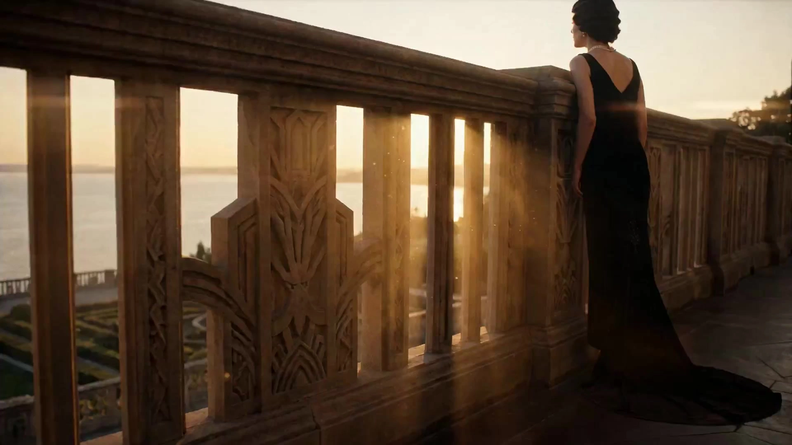

# Lana Del Rey × The Great Gatsby

> **作者：** @黄炜炜

## Content

Process Planning:

Task Phases and Dependencies:

Confirm core parameters with the user and write them to Final_Video_Spec.md (subject type, video duration, output language, aspect ratio locked to 2.39:1 or 16:9, visual style locked to "Lana × Gatsby Golden Nostalgia") → text_editor.

Generate the Shot List (Key Elements, Shot List, Audio Layers) → storyboard_designer. Upon completion, scan the context and bind user-uploaded or generated assets to the corresponding Storyboard slots → media_generator.

Establish visual elements:

If the user has uploaded character/scene reference images, bind them directly as assets for the corresponding Key Elements.

Otherwise, generate images for all Key Elements → media_generator.

For all characters with dialogue, process the key_element_audio immediately after the element image is completed: if the user has provided reference audio for the voice, bind it directly; otherwise, use text-to-narration to generate a short sample based on the voice style described in the element and bind it. This step must be completed before generating any shot videos that include dialogue.

Generate videos shot by shot; use the element image as the primary visual reference; append the reference_video of the previous shot only when the visual continuity with the previous shot is extremely strong → media_generator.

Generate all Audio Layers (BGM, VO narration) → media_generator.

After all media is completed, perform timeline synthesis and guide the user to export → video_assembler.

Dependencies: 2→1; 3→2; 4→3; 5→2; 6→3,4,5.

Milestone Confirmation: Do not execute the entire process at once. Pause after each major stage (Spec locked / Shot List completed / Element images completed / Shot videos completed / Audio completed) and wait for user confirmation before proceeding.

Subject Routing: Based on the subject type in Final_Video_Spec.md, pass the corresponding subject-specific pacing preferences to the storyboard_designer (see the Storyboard Designer section for details). Routing priority rules are as follows:

Cross-Subject Priority: If the user's description contains both "Road Movie" and "Suspense" (or their synonymous expressions, such as car chase, night road tracking, desert disappearance, road thriller, etc.), prioritize routing to the "Suspense × Road Movie" crossover template, regardless of the individual subject tags, instead of routing to the Suspense or Road Movie templates separately.

Single Subject Routing: When only a single subject keyword appears, route according to the corresponding template for Historical Drama / Food Drama / Sports Drama / Romance / Suspense / Music MV / Fantasy Dream / Road Movie.

Ambiguity Handling: If the subject signal is unclear, ask the user to clarify during the Spec confirmation stage; do not default to any single template.

User Uploaded Asset Handling: If the user uploads images, videos, or audio, prioritize binding them to the corresponding Storyboard slots to avoid regenerating existing assets.

Asset Analysis:

Reference Asset Analysis Key Points:

Color Alignment: Extract the dominant color tones of the uploaded images/videos to determine if they are close to the "Golden Nostalgia" palette (champagne gold, vintage brown, emerald green, pearl white, sunset madder red); output a description of the deviation from the target palette for use in subsequent prompt correction.

Lighting & Style Recognition: Identify if the footage possesses cinematic characteristics such as Golden Hour backlighting, volumetric lighting (Tyndall effect/dust), anamorphic horizontal lens flares, or shallow depth of field; if missing, list the elements that need to be supplemented during the generation phase in the analysis report.

Camera Language Recognition: Extract aspect ratio, shot size (wide/medium/close-up/extreme close-up/macro), and camera movement (static/dolly/pan/jib); provide a baseline reference for subsequent Storyboard Design.

Character/Scene Element Extraction: Identify the main character appearances (clothing, hairstyle, makeup), key scenes (architectural style, vintage set dressing), and iconic props; output these as structured descriptions to be used directly in key_element definitions.

Nostalgic Period Verification: Check for modern elements that disrupt the 1920s–1950s/nostalgic aesthetic (smartphones, LED screens, modern architectural facades, contemporary vehicle models); if present, flag them and suggest excluding them in prompts or pushing them into a blurred background.

Americana Road Element Recognition: If the asset involves road scenes, identify and extract the following cues for Storyboard reference: road type (two-lane asphalt/dirt road/highway), horizon vanishing point position and frame percentage, iconic Americana elements along the way (road signs/gas stations/billboards/diners), vehicle era and chrome texture, angle of light incidence (dusk backlight/noon hard light/nighttime headlights); output as structured descriptions for use directly in road-related element scene definitions.

Storyboard Design:

Aesthetic Tone (Global Lock)

Fusion Color Palette: Champagne Gold + Tobacco Brown + Emerald Green + Ivory White + Sunset Crimson. Teal & Orange grading and Arri Alexa tones are not global defaults; use them per shot only when specific themes require it, and do not write them into the global aesthetic tone.

Aspect Ratio: Priority 2.39:1 Anamorphic widescreen (Old Hollywood screen ratio), secondary 16:9.

Lighting & Shadow Tone: Golden Hour backlight / Volumetric lighting (visible dust particles) / Anamorphic horizontal oval flares / Candlelight or amber tungsten point sources (indoor).

Film Texture (Scene Grading): For mansion, banquet, and stage scenes, use delicate 35mm film grain, stable exposure, deep blacks while retaining clothing texture; for flashback, road trip, motel, and private video segments, switch to 16mm grain with slight exposure drift, occasional frame jumps, and vertical scratches. Do not mix the two grain standards within the same scene type.

Core Emotion: The disillusionment and obsession of the American Dream · Phantoms of Old Hollywood glamour · 1920s–1950s Americana extravagance and melancholy · Poetic loneliness at the end of the road. Emotions must be expressed through visible results, not abstract atmospheric descriptions: Empty wine glasses and scattered sequins left after a banquet; characters standing alone at the edge of a vast room in a mansion; lovers in the same frame but not making eye contact; characters looking at each other through car windows, door frames, water surfaces, or crowds; distant lights or characters that can never truly get close.

Dual Visual Grammar (Global Lock)

Two sets of visual languages must alternate within the same video, never maintaining a single state throughout:

Public Occasions (Banquets, Mansions, Stages, High Society Spaces): Stable or slowly moving shots; Art Deco symmetrical composition; black and ivory white as the base, champagne gold used only as partial highlight accents, not covering the whole screen; restrained character expressions and movements; 35mm delicate grain, no handheld shaking.

Private Moments (Flashbacks, Road Trips, Motels, Solitary Scenes): Slight handheld or off-center composition; faded warm white and tobacco brown as the main tone; natural exposure drift allowed; 16mm grain emphasized, occasional frame jumps and vertical scratches retained to evoke a home-movie feel.

Mandatory Contrast Rhythm: After every scene involving banquets, mansions, jewelry, or luxury cars, it must be immediately followed by a shot of a character alone, an empty seat, a half-empty glass, an extinguished light, or an empty road—carrying the theme of disillusionment through visual contrast. Do not let the glamorous state permeate the entire segment.

Key Elements Design Specification

Character Element (element character): Contains costume, makeup, and prop details (hairstyle, makeup, clothing material) + emotional baseline; if a character has multiple looks/age stages, list them one by one (Look A: ...; Look B: ...).

Voice Binding (key_element_audio): For any character with lines in a shot, you must define key_element_audio for their element character—bind a reference audio clip of the character's voice to maintain consistent timbre across shots; specify the vocal style in the element description, or cite the preset templates below directly. Sample Quality Requirements: Samples must be 8–12 seconds long and must cover the character's typical emotional range (e.g., calm narrative + emotional fluctuation sentence + ending low point), rather than a single-emotion reading; single-emotion samples will cause unstable timbre in TTS across shots with different emotions. If the user-uploaded reference audio has only one emotion, note it in the description so that voice samples covering multiple emotional ranges can be supplemented in the subsequent generation stage.

Voice Style Preset Templates

The following presets are divided into two categories: Character Voice Presets (for key_element_audio, binding character dialogue timbre) and Narration Voice Presets (for narration_speaker_profile, written into audio_layer description to drive VO generation). Select by usage when creating and cite in the description; if customization is needed, adjust parameters based on the corresponding template.

Character Voice Presets (key_element_audio — must be bound for any element character with lines)

Preset NameVoice DescriptionApplicable Character TypeGatsby-style Male[Deep magnetic male voice · slightly raspy · slow and restrained pace · 1920s American gentleman tone · with a slight reverberation feel]Upper-class male lead, mysterious tycoonDaisy-style Light Female[Crisp sweet female voice · slightly naive feel · fast-paced · occasional rising intonation · 1920s high-society female tone]Bright supporting female, socialite, party heroineTom-style Tough Male[Thick and powerful male voice · strong tone · tight rhythm · with an arrogant texture · occasional volume spikes]Antagonistic supporting male, powerful villain, intense emotional scenesArt Deco Young Girl[Clear young girl voice · thin and bright · with a touch of theatrical tone · rich in intonation fluctuation · suitable for short exclamations or poetic monologues]Youthful supporting female, best friend character, dream scene charactersJazz Bar Singer[Lazy smoky female voice · full breathiness · slightly raspy tone like vintage microphone recording texture · pace fluctuates with the melody · with 1940s nightclub singer tone]Jazz singer, nightclub heroine, emotional monologue scenes

Narration Voice Presets (narration_speaker_profile — written into audio_layer description to drive VO TTS generation)

Preset NameNarration_speaker_profile DescriptionApplicable Narration TypeLana-style Melancholy Female[Lazy and gentle female voice · high breath-to-voice ratio · slightly sinking intonation · with a dreamlike feel · mainly English with occasional soft Chinese]MV narration, stream-of-consciousness monologue, sad narrativeJazz Male Narrator[Warm and weathered male voice · steady pace · with a touch of melancholy · mellow like radio broadcasting · suitable for long VO narrations]Full film voice-over, documentary-style narration, flashback narrativeSouthern Gentleman Narrator[Mellow and deep male voice · with a soft American Southern accent · slow pace like a summer chat · slightly elongated word endings · carries an innate lazy nobility]Southern estate narrator, warm narration, nostalgic flashback segments1950s Radio Broadcaster[Mellow and clear male voice · standard and restrained pronunciation · with a slight metallic resonance like early broadcasting equipment · uniform pace · suitable for news-style or announcement-style lines]Voice-over, vintage announcement scenes, documentary-style narrationDreamy Ethereal Female[Ethereal soft female voice · extremely high breath-to-voice ratio · very slow pace with intentional pauses between words · slightly rising intonation as if coming from afar · tail ends dissipate naturally without closing · with misty reverberation · like dreamlike monologue]Fantasy dream scene narration, stream-of-consciousness monologue, transitions between reality and dream, deep inner voice of a characterDreamy Whispering Male[Extremely deep whispering male voice · almost no volume · breath-dominant · very slow pace · with faint reverberation like the echo of an empty hall · word endings drag and dissipate · gives a texture of emerging from the depths of memory]Mysterious guide in a dream, male character stream-of-consciousness monologue, segments where hallucinations and memories overlap

Scene Element (element scene): Describe architectural style (1920s–1950s American Art Deco mansion / Old Hollywood set / Jazz Age nightclub / Long Island bay dock), or Americana road imagery scenes (end of Route 66 two-way road / desert highway backlight / 1950s roadside gas station / faded billboard by the road / roadside Diner restaurant / motel neon sign night view); specify main light source position and color temperature, as well as iconic Americana road details: heat haze distortion on asphalt, road shoulder weeds swaying in the wind, distant horizon vanishing point composition, rusty signs and faded neon letters, rotating counters, and vintage jukeboxes. Road scenes must specify camera perspective—driver's POV from inside the car (windshield frame composition) or low-angle chase shot from outside the car (road texture + tires).

Prop Elements: Items for plot-critical props should be listed individually for easy reference in close-up shots. Indoor/party type: Gatsby-style champagne tower, vintage RCA phonograph, faded old photos and love letters, Bohemian crystal candelabra, vintage white telephone. Road/Americana type: 1950s Cadillac chrome nose ornament, steering wheel and glove box vintage dashboard, rusty Route 66 road sign, faded billboard along the way, roadside Diner neon sign, road map and leather suitcase, gas station rotating wind vane.

User-Uploaded Assets: If the user has provided reference images, the element description must be consistent with the visible content in the images; do not contradict them.

Shot Design Specification

Duration & Rhythm: Ordinary narrative shots are recommended to be 4–8 seconds; only extend to 8–15 seconds when actions like full dances, continuous walking, or multi-turn dialogues cannot be interrupted—do not default to generating long shots just because the model supports 15 seconds. One shot should only carry one main character action or relationship change; if it contains multiple different camera scales, subjects, or action results, it must be split into independent shots.

Every shot description must include:

Scene: Cite the corresponding element scene ID.

Story Beat: Character actions, performance details, dialogue lines (marked with {lines}, retain the original text; lines must be attached with emotional beat markers, see "Dialogue Emotional Beat Annotation Specification" below).

Camera Language: Camera scale (Wide/Medium/Close-up/Macro) + Camera angle (Low angle up-shot/Eye-level/Dutch angle) + Camera movement (Locked/Slow push/Jib up/Dolly zoom/Rack focus).

Lighting Beat: Light source type + Tone stage (High saturation golden backlight / Candlelight warm tone / Image gradually turning yellow and fading).

Dialogue Emotional Beat Annotation Specification

Whenever {lines} appear in the shot description, they must be followed by emotional beat annotations outside the text itself, otherwise, the downstream model will generate them in a flat reading tone, losing performance layering. Annotations are written outside the dialogue brackets, formatted as follows:

Emotional State: Add in parentheses before or after {lines}, e.g., (voice tight, forcing calm) (whisper, breath weakening) (tone suddenly hardening, volume rising)

Rhythmic Pauses: Use "——" for medium pauses in lines, "… …" for longer emotional gaps; line breaks between sentences represent natural phrasing breaks

Emphasis & Breathiness: E.g., (stressing this word) (whole sentence breathy, almost a whisper) (tailing off deliberately, with resentment)

Whole Sentence Emotional Arc: Indicate the trend before the line, e.g., 【From nonchalant → suddenly choking halfway】

Binding with Micro-expression Beats: Dialogue annotations must correspond to micro-expression descriptions in the same story beat, e.g., "corners of the mouth lift slightly but eyes look desolate (understated, tailing off downward) {You know, this was never my home.}"

Example:

【From forcing composure → voice cracking halfway → final sentence almost silent】 Nick leans against the car door, his gaze not landing on Gatsby's face——(pause) (tone restrained, enunciating slowly) {You've waited five years.} (long pause) (voice tight, breathiness increasing) {She……she's not coming, Jay.} (tail ends drop to near whisper)

Difference from narration emotional annotation: Narration emotional annotations act on the generation prompts for independent audio_layers; dialogue emotional annotations act on performance beat descriptions within the shot, co-driving Seedance 2.0 character performance generation via key_element_audio voice reference + emotional instructions; the two annotation systems run in parallel and do not replace each other.

Slow Motion Beat: Mark "120fps slow motion" only for emotional climaxes or narrative-significant actions (sweat, steam, character looking back); ordinary movement, dialogue, and transitional actions must not be marked as slow motion. Empty shots with lingering mood can be marked "12fps slight frame-jump feel," but do not exceed 20% of that shot's duration.

Special Effects Restraint Principle: All visual effects must serve the narrative and not be for decorative purposes. Anamorphic flares appear naturally only when strong backlight sources are directly in the shot; do not design them as independent events that "cross the screen"; volumetric lighting must have realistic light source basis (window cracks, door gaps, stage lights); film scratches and frame jumps are for embellishment and should not cover major narrative segments.

Genre Shot Rhythm Preferences

Template Usage Instructions: The following genre templates provide a candidate shot library, not a fixed shot order. The Storyboard Designer selects 3–5 types of shots from the corresponding genre's candidate library based on the current plot; do not add prop close-ups, freezes, flares, or head-turns just to fit the template if they are irrelevant to the plot. Each shot must fulfill a clear function: establish space, push action, change character relationships, reveal information, or complete emotional reactions—beautiful shots without a clear function must not be kept.

Historical Drama / Period Drama

Key: Costume/makeup/prop detail close-up → Protagonist's profile projection on window lattice → Back view walking away in a corridor/old street (Crane shot up and pull back) → Time passing empty shot with subtitles. Color tone gradually turns yellow and fades.

Food Drama

Key: Sunset street corner dust/light empty shot (volumetric lighting frame composition) → Macro Rack focus on hands cooking → Overhead rotation downward on dish → Empty bowl at sunset with Art Deco geometric lighting finish.

Sports Drama

Key: Low-angle start backlight silhouette (slow motion, organic Anamorphic point flares can appear when the sun is directly facing the camera) → Macro close-up of sweat/breathing → Finish line freeze (organic Anamorphic point flares can appear when backlight source is directly facing the camera, only one, not crossing/sweeping) → Post-race empty field slow-shake lingering mood. Golden backlight is only used for two narrative nodes: start and finish line; other shots are described realistically according to actual light and do not run through the whole scene.

Romance Drama

Key: Two-person composition establishing distance (Wide shot → gradually pushing in) → Macro close-up of eye contact/physical contact (Rack focus back and forth between the two) → Emotional climax slow-motion freeze (If there is a strong backlight source facing the camera, organic Anamorphic point flares can appear, not crossing/sweeping the screen) → Separation/looking back back-view empty shot finish. Throughout, the main light source is candlelight warm tone or Golden Hour soft light; color tone gradually changes from cold emerald green to warm champagne gold, symbolizing emotional heating up. Dialogue is wrapped in {lines}, paired with actor's micro-expression close-up beats.

Suspense Drama

Key: Low-angle up-shot establishing oppressive feeling → Local detail close-up (prop/hand/eyes, Rack focus) → Perspective switch (over-the-shoulder shot + Dutch angle emphasizing psychological distortion) → Key clue freeze (image saturation suddenly drops to cold blue-gray, only retaining golden highlights on single prop) → Empty field lingering slow-shake (dust floating in volumetric lighting). Color tone is mainly emerald green + cold brown, deliberately lowering highlights and retaining deep shadows. Avoid large areas of golden backlight, use side-backlighting or bottom lighting to create anxiety.

Music MV

Key: Black and white empty shot (heavy film grain) opening → Color gradually recovers from near black and white to low-saturation champagne gold and emerald green (progressing with the music drop beat, not a sudden burst; if there is a strong point light source facing the camera, organic Anamorphic point flares can appear, without sweeping treatment) → Singer subject slow-motion close-up sequence (camera scale from far to near) → Symbolic prop/scene montage (0.5–1 second/shot, matching drum beats) → Emotional climax freeze + image slight overexposure → Fading to near black and white in the lingering segment. Presented in 2.39:1 widescreen throughout; singing lines are wrapped in {lines}; BGM is strictly aligned with the visual beat points.

Fantasy / Dream Drama

Key: Realistic scene normal color opening → Transition frames use Rack focus + slight exposure drift to blur boundaries → Dream inner tone gradually transitions from near black and white to low-saturation champagne gold and emerald green, image edges with slight soft-focus halo → Character floating motion (slow motion, clothes/hair floating in light) → Dream ending with image grain emphasis + slight overexposure fade-in-out back to reality (do not use rapid white flashes). Dream feel is expressed through slight soft focus, exposure drift, and action speed changes; volumetric lighting must still have clear light source and air medium basis, do not use high-saturation colors or strong flashes to mark reality/dream switching.

Special Sound Design Specification:

BGM Segmented Design: Reality segments and dream segments must use two independent audio_layers, assigned different audio_ids and bound to corresponding shot intervals in the layout_instruction. Reality segment BGM is mainly 1940s–1950s jazz piano or strings, with clear rhythm; dream segment BGM switches to beatless ambient pads, mainly misty strings or piano overtones, without drum beats or strong beats—the two BGM segments are connected via crossfade at the transition frames, not hard cuts.

Narration Voice Switching: Reality segment narration cites the "Lana-style Melancholy Female" or "Jazz Male Narrator" preset; dream segment narration is forcibly switched to the "Dreamy Ethereal Female" or "Dreamy Whispering Male" preset, with different narration_speaker_profiles bound segmentally via layout_instruction in the same audio_layer, marking the reality/dream boundary with the sound itself.

Sound Effect Design Suggestions: At the dream segment entry transition, slight bell-tone overtones or water ripple sounds can be added (written in the shot's sound effect annotation <...>), and a short reverse reverberation tail sound corresponding to the exit white flash; reality segments do not use such sound effects to maintain restrained realism.

Dream Drama Special Narration Emotional Annotation Requirements: Each narration line in the dream segment must be additionally annotated with "floating sensation" and "dissipating sensation" (see dream special in narration emotional annotation examples), and the use of strong closing pauses (period-style endings) is prohibited—the voice must evaporate naturally in the air without landing.

Suspense Drama × Road Movie (Cross-genre)

Applicable to desert highway car chases, night road tracking, missing persons on the side of the road, etc., mixed scenes that have both road spatiality and suspense psychological oppression.

Color Tone Rules (Overriding global golden baseline):

Daytime desert segment: Highlights pressed to mid-gray, do not use champagne gold backlight; main tone switches to bleached sand-yellow + cold emerald green; shadows shift toward cold gray / deep tobacco brown to create the faded uneasiness after desert sun exposure.

Night road segment: Main light source retains only the white beam of headlights + distant red and blue scattered points of chasing cars; environment base color is near pure black, no amber streetlamp warm tone—create threat with darkness itself; retain faint golden highlights only on key props or character eyes.

Shot Rhythm Key Points:

Desert wide shot establishing isolation (8–12 seconds): 2.39:1 wide shot, the vehicle is extremely small in the frame, desert without cover on both sides of the road; fixed camera, heat haze distortion visible on the distant horizon; no character close-ups, using spatial oppression instead of character emotion.

In-car subjective oppression cut (4–6 seconds/shot, faster than normal road movie rhythm): Over-the-shoulder shot + rearview mirror close-up alternating, Dutch angle slight tilt; Rack focus switches between the object reflected in the rearview mirror and the driver's hands, implying tracking threat; windshield frame composition, external threats left in the blurry area outside the glass.

Key clue freeze (Same as suspense drama rules): Prop / license plate / hand partial freeze, image saturation drops sharply to cold gray, retaining only golden or chrome highlights of that detail; Rack focus blurs the background into a flare shape.

Car chase climax segment (8–15 seconds, Seedance 2.0 multi-beat design): Low-angle outside-car perspective, road texture + tire close-up; multiple inside/outside car perspectives switched through internal cuts within the same shot; camera movement is mainly locked camera + slight handheld shake, no smooth jib (jib feel destroys tense beats); slow motion appears briefly only at narrative nodes like collisions or emergency braking (no more than 2 seconds).

Lingering empty field (6–10 seconds): Desert road empty shot after the chase ends, no characters; car lights or tire marks as the only narrative residue; image grain emphasized, trending toward cold gray, not fading toward black and white (distinguished from the pure lingering processing of the ED).

Dialogue / Conversation Handling:

Prioritize arrangement in rearview mirror close-ups or windshield frame shots; dialogue must be attached with emotional beats (see Dialogue Emotional Beat Annotation Specification); lines in tense segments are fragmented, mainly short sentences (no more than 5 characters/sentence).

Prohibited Items (Supplementing Suspense × Road specific constraints):

Prohibition on large-area Golden Hour golden backlight (will destroy desert cold-color crisis feeling).

Prohibition on Anamorphic flares crossing the screen (retained for very few emotional release moments, and must be very low intensity).

Prohibition on Jib up / Crane shot up (up-shot/overhead view will leak spatial pressure).

Prohibition on amber streetlamp warm tone as main light in night road segments—the existence of streetlamps must be handled as distant point light sources, not entered as main light.

Road Movie

Key: Wide aspect ratio long shot establishing road loneliness (characters are extremely small in the frame, road extends to the vanishing point) → In-car subjective perspective close-up (windshield frame composition, road overlaid in glass reflections) → Americana landmarks flashed by along the way (slow pan across road signs / gas stations / abandoned billboards, 0.5–1 second/shot) → Macro close-up of driving hands and rearview mirror (Rack focus switches between hands and background in mirror) → Pulling over at the shoulder, Golden Hour backlight shot (characters back to the camera gazing at the horizon, slow motion, Anamorphic flares crossing) → Night driving car light trails finish (locked camera, only car light trajectory flows, 16mm grain emphasized). Color tone uses champagne gold + sunset crimson throughout the daytime segment; night segment pressed to tobacco brown + amber streetlamp warm tone. Dialogue wrapped in {lines}, prioritized for arrangement in windshield frame or rearview mirror close-up shots.

OP / ED Audio and Cross-Shot Audio Tracks

BGM: Plan at least one global background music track; long videos (over 3 minutes) can be split into multiple segments according to paragraph emotion, each assigned an audio_id and time interval.

OP Music Tone: Energetic entry, high rhythm density, matching fast montage beats (0.5–1 second/shot).

ED Music Tone: Melancholic lingering, slow rhythm, matching image fading and film grain emphasis.

VO Narration: If there is narrative narration, narration_speaker_profile must be written in the audio_layer's description, and bound to the corresponding shot interval in the layout_instruction. Default narration voice baseline as follows, choose one of two according to narrative tone:

Lyrical Melancholy Tone (Default First Choice): Cites "Lana-style Melancholy Female" preset → narration_speaker_profile: [Lazy and gentle female voice · high breath-to-voice ratio · slightly sinking intonation · with a dreamlike feel · mainly English with occasional soft Chinese]; suitable for MV-style, stream-of-consciousness, poetic monologue narration.

Narrative Documentary Tone (Secondary Choice): Cites "Jazz Male Narrator" preset → narration_speaker_profile: [Warm and weathered male voice · steady pace · with a touch of melancholy · mellow like radio broadcasting · suitable for long VO narrations]; suitable for story-driven, flashback narrative, multi-segment long narration.

If customization is needed, adjust parameters based on the corresponding preset and note the adjustment reason in the audio_layer description.

Fantasy / Dream Drama Special Baseline: Dream drama narration prioritizes citing the "Dreamy Ethereal Female" preset; if the narrator is male or the scene is a dream guide type character, cite the "Dreamy Whispering Male" preset. Narration for dream segments and reality segments must use different narration_speaker_profiles, bound segmentally via layout_instruction in the same audio_layer, using the sound itself to mark the reality/dream boundary switch.

Narration Emotional Annotation (Required): Narration scripts must not just contain plain text; every segment of narration must have emotional delivery instructions attached next to the text, otherwise the TTS model will generate emotionless flat reading tone. Annotation format as follows, written in parentheses for the corresponding sentence or paragraph:

Emotional State: E.g., (slightly choked), (tone restrained but suppressed inside), (light and playful, tailing off upward)

Rhythmic Pauses: Use "——" to mark medium pauses, "… …" for longer emotional gaps, line breaks between sentences represent natural phrasing breaks

Emphasis & Breathiness: E.g., (stressing this word), (breathiness increasing to the end of the sentence), (whisper, volume reduced to minimum)

Whole Paragraph Emotional Arc: Mark the emotional trend at the beginning of the paragraph, e.g., 【Entire paragraph: From restrained calm → emotion gradually welling up → final sentence softly falling】

Example: 「【Entire paragraph: Detached observation, slow pace, suddenly tightening at the final sentence】 That summer——(pause) everyone was laughing. (breathiness weakening) Only he, knew what……(long pause) was inside that laugh.」

Dream Drama Special Emotional Annotation Example: Dream segment narration must be additionally annotated with "floating sensation" and "dissipating sensation" to prevent TTS from generating overly realistic narrative tone. Format reference: 「【Entire paragraph: Voice as if coming from under the water, extremely slow pace, intentional gaps between words; final sentence volume dissipates naturally, without closing】 I saw——(long pause) that door. (breathiness, almost no volume) It had always been……(pause, tail ends drifting without landing) waiting for me.」——Annotation emphasis: (extremely slow pace, leaving breath gaps between every word) (tail ends rising, not landing) (whole sentence breathy, volume reduced to almost disappearing) (do not use period-style closing, let the sound evaporate naturally in the air).

OP / ED Shot Structure Templates

ED (15 seconds):

00:00–00:03 Episode climax freeze → slow motion playback, golden backlight + Anamorphic flares

00:03–00:08 Empty shot/back-view/prop close-up, 16mm film grain emphasized, occasional frame jumps

00:08–00:12 Image gradually fades→yellows→trends toward black and white, Rack focus gradually blurs

00:12–00:15 Black screen + pearl white serif font subtitle fade-in

ED (30 seconds):

00:00–00:06 Climax segment slow playback (freeze→slow motion→freeze), golden backlight runs through

00:06–00:15 Empty shot with no characters slow-shake, light/shadow/wind/steam movement as main body

00:15–00:22 Prop/back-view close-up, Rack focus gradually blurs, image fades and yellows

00:22–00:28 Near black and white, only faint golden highlights retained

00:28–00:30 Black screen + pearl white serif subtitle fade-in/fade-out

OP (30 seconds):

00:00–00:05 Black and white/yellowed empty shot (heavy film grain) → sudden full color burst

00:05–00:15 Fast montage (0.5–1 second/shot, subject close-up sequence, matching music beat)

00:15–00:25 Heroic main scene, protagonist front/side face, Golden Hour, slow motion

00:25–00:30 Freeze + title card (Art Deco geometric golden border)

Media Generation:

Element Image Generation

Tool: TextToImage or ImageToImage (when a reference image is available).

Default Model: Nano Banana Pro (Gemini 3 Pro Image), resolution 2K.

Character Reference Image: Generate one horizontal side-by-side reference image for each character—left side: close-up of head and shoulders (locking facial features, skin tone, hairline) + right side: full body (outfit, hairstyle, makeup, footwear silhouette).

Multiple Looks for One Character: Use ImageToImage, referencing the first version of the character design, with Nano Banana Pro to maintain identity consistency.

Shot Video Generation

Tool: MultiModalToVideo; default model: Seedance 2.0, resolution 720p.

Reference inputs for each shot:

Element Image (Required): All character element images appearing in the frame + relevant scene/prop element images.

key_element_audio (Required when there is dialogue): Whenever a shot has character dialogue, the corresponding key_element_audio must be passed in via audio_infos to ensure consistent voice timbre across shots; the same character must always reference the same voice sample in all shots.

Previous Shot reference_video (Optional): Only append this if the visual continuity with the previous shot is extremely strong; usually omitted.

Continuity Criteria: "Extremely strong continuity" is defined only when the same character is in the same location with no time jumps + actions connecting directly; scene changes, time jumps, and emotional shifts do not require reference_video.

Realism Restraint Principle: Prioritize natural realism with a film-like texture over visual spectacle when generating videos. If the Storyboard description contains exaggerated special effects language (e.g., "lens flare fills the frame," "particle explosion"), tone it down into a restrained version before passing it into the prompt—keep the effect but reduce the intensity.

Audio Generation

BGM (text_to_instrumental): Default model Suno 5 (avoid using real names of famous artists in prompts); alternative Mureka 8.

VO Narration (text to narration): Default model MiniMax Speech 2.8 HD (supports mixed Chinese and English); use the voice profile defined in the Storyboard's narration_speaker_profile. The generated prompt must include two parts: ① the complete narration_speaker_profile description; ② the emotional delivery instructions from the script (extracted directly from the Storyboard audio_layer emotional annotations)—if either is missing, the model will revert to a flat, monotonous reading style. Emotional delivery instructions are the key input to solving rigid, robotic speech.

key_element_audio Sample Generation Guidelines (Character Voice Consistency):

Sample duration should be 8–12 seconds, and the content must cover the character's typical emotional range (e.g., calm narrative segment + emotional fluctuations + soft trailing notes), rather than just reading a single sentence monotonously; a single-emotion sample will cause TTS to drift in timbre across different emotional shots.

When generating the sample, also include the complete narration_speaker_profile + emotional annotations to ensure the sample itself has sufficient vocal characteristic density for subsequent shot voice locking references.

The same character must reference the same key_element_audio resource_id in all shots throughout the entire video; if you are unsatisfied with the voice, you must regenerate it and update the binding—do not reference different versions of the voice sample in different shots.

After generating the sample, it is recommended to play and verify it before binding: check if the timbre matches the vocal style preset in the element character description. If there is a significant discrepancy, regenerate; do not bind samples with significant discrepancies to the key_element.

Super-Resolution Post-Processing

If the user explicitly requests higher image quality: for images, use super_resolution + Jimeng SR (4K); for videos, use MediaKit (1080p).

Prompt Writing:

Highest Priority: When users interact in Chinese, the prompt body should be written in Chinese; dialogue/voiceover content must retain the original language as specified in Final_Video_Spec.md.

Core Aesthetic Keyword Library (Candidate Pool—select per shot based on actual content; do not write the entire library into every prompt)

Color Grading (Select 1 main color scheme per prompt): old Hollywood gold, tobacco brown, emerald green, ivory white, sunset crimson, Teal & Orange Hollywood grade, Arri Alexa film tone, faded Kodachrome palette

Lighting (Select 1 main light source per prompt): Golden Hour backlight, volumetric light shafts (must have a clear light source—window slit/door gap/stage light), floating dust motes (must have medium like smoke/dust/stage haze), tungsten amber practical light (indoor scenes), diffused overcast soft light (overcast/indoor diffusion)

Optical Effects (Select at most 1 per prompt): organic Anamorphic horizontal lens flare (only use when a strong point light source is directly facing the lens, low intensity, organic feel), shallow depth of field, rack focus, atmospheric haze in midground (must have aerial perspective layering)

Film Texture (Select based on scene type, do not mix in the same shot): Mansion/Banquet/Stage → fine-grain 35mm film texture, stable exposure, deep blacks with preserved fabric detail; Memories/Road Trip/Private segments → 16mm film texture, slight exposure drift, occasional splice flicker and vertical scratch; General options: silver-halide emulsion tone, 2.39:1 Anamorphic widescreen, cinematic letterbox

Style Tags (Select 1–2 based on theme): 1920s–1950s American Art Deco, Gatsby-era opulence, Lana Del Rey Americana melancholy, old Hollywood glamour, American Dream disillusionment

Single-Shot Selection Rules (Priority higher than all supplemental libraries below):

For each prompt, select only 1 most relevant item from each category above; do not stack multiple terms from the same category.

If there is no clear backlight source (sun/strong stage light directly facing the lens), do not write Anamorphic flare.

If there is no smoke, dust, haze, or stage fog as an aerial medium, do not write volumetric light shafts or floating dust motes.

For standard close-ups of people (dialogue, static characters, facial close-ups), do not add light dust, halos, or golden rim lighting by default—only describe light sources actually visible in the shot.

If a shot's scene lighting is flat (night interior, overcast, no backlight conditions), describe the actual lighting honestly; do not force-fit golden backlight terminology.

Color Grading & Atmosphere Control (Core Atmosphere Rules)

Atmosphere comes from precise control of shadow density and color separation, not filter intensity—every prompt must follow these rules without omission:

Shadow Handling: crushed blacks with lifted shadow floor (slightly lift shadows to preserve detail, but do not truncate to pure black); shift shadow regions towards cool green/deep tobacco brown to create depth.

Highlight Handling: warm highlight roll-off (gentle transition of highlights to champagne gold/amber, avoid overexposure clipping); skin highlights should be dominated by golden rim light, specular highlights should not be harsh.

Color Separation: warm highlights (champagne gold/amber) + cool shadows (emerald green/tobacco brown) create complementary color separation; moderately lower mid-tone saturation to avoid boosting overall full-spectrum saturation.

Aerial Layering: slight atmospheric haze in midground (not foreground smoke effects); light dust particles must look like real, on-set dust, not digital particles.

Reference Color Anchor: When writing prompts, you may cite "Kodak Vision3 500T color science" (night/indoor) or "Kodak Vision3 250D color science" (daylight/Golden Hour) as a color science benchmark to give downstream models a clearer reference for the target film tone.

FX Restraint Principle (Anti-Over-Effect Rules)

All visual effects must serve the narrative emotion; they must not exist independently for decorative purposes. Criterion: If the shot's narrative remains complete without the effect, delete it or reduce its intensity.

Anamorphic Flare: Appears naturally only when a strong backlight source is directly in the frame; low intensity, organic horizontal diffusion; prohibited from being described with exaggerated terms like "burst/sweeping across/filling the frame."

Slow Motion: Used only for emotional beats or action climaxes; do not label standard walking, talking, or transition actions as slow motion.

Film Scratches/Frame Jumps: Limited to "occasional" and "ornamental" use; must not cover more than 20% of the shot duration.

Volumetric Light/Light Dust: Must be supported by realistic light sources (window slits, door gaps, stage lights); do not describe "floating dust filling the entire frame" in open outdoor scenes without justification.

Tonal Extremes: Avoid sudden saturation spikes/drops, sudden overexposure, color inversion, or other digitally heavy transitions; tonal changes must be completed progressively across multiple shots.

Forbidden Words: Prompts must not include terms like neon glow, electric color, oversaturated, HDR tone-mapped, digital color grade, VFX particle burst, etc. Such terms will push the generated results toward a modern, digital aesthetic.

Image Prompt Structure (TextToImage / ImageToImage)

Unfold in the following order, written as a natural language paragraph; do not output section headings:

[Subject + Action + Scene Environment] → [Lighting & Tone: select matching terms from the core library] → [Lens Language: Shot size + Camera movement + Composition technique (framing/symmetry/Dutch angle)] → [Aspect Ratio & Quality: 2.39:1, cinematic, 4K] → [Style Tags: select from the core library]

Describe only what is visible in the shot; do not write internal thoughts or off-screen information.

Character Style: Realistic cinematic (not anime style), unless explicitly requested by the user.

When involving sheer/revealing clothing, use non-sensitive expressions like "sheer gauzy gown."

When text appears in the frame, write out the renderable full string in quotation marks.

Video Prompt Structure (MultiModalToVideo + Seedance 2.0)

Reference Image Placeholder: Each character corresponds to <<<image_1>>>, <<<image_2>>>, etc.; clearly label their character identity at the beginning of the prompt or in the main subject description.

Motion Stack Order: Camera movement (push/pan/jib/Dolly zoom) → Subject action and performance beat → Spatial/environmental changes → Audio annotations.

Seedance Packaging Syntax (Use as needed):

Music: (...); Sound Effects: <...>; Dialogue: {Original dialogue text} (note the language before the bracket if it is not the project language); Title/Subtitles: [...]

Inside {...}, write only the dialogue itself without descriptions.

Fixed Negative Prompts: If there is an independent VO track, add "no narration voice over" at the end of the prompt; always add "no music" (music is handled by a separate BGM track); always add "no subtitles" (subtitles are handled in post-production).

Slow Motion Beats: Write "slow motion 120fps" or "slow motion" within the action description; do not cut by wall-clock time segments (avoid "0–3s / 3–6s" syntax).

Specialized Template for Character Styling Reference Images (Period Characters)

When generating element character reference images for 1920s–1950s style characters, the following specific regulations must be superimposed on the general image prompt structure:

Structure Requirements (Reference image is fixed as a horizontal side-by-side dual view):

Left: Head-and-shoulders close-up—lock in facial features (facial contours, brow shape, eye makeup, lipstick shade, hairline curve, earring details); Right: Full-body standing—complete presentation of clothing tailoring, fabric texture, accessory layers, shoe style and heel height, and overall hairstyle. Both views must be the same character in the same outfit, background is a neutral color (cream white or deep tobacco), do not introduce narrative scene elements.

Period Styling Detail Library (Select corresponding groups based on character type and superimpose onto prompts):Character Type Clothing/Props Core Term Groups 1920s Party Girl (Gatsby Girl) bias-cut silk charmeuse slip dress, dropped waist flapper silhouette, Art Deco beaded fringe hem, pearl rope necklace layered, feathered headband or jeweled bandeau, finger-wave bob hair, kohl-rimmed eyes, Cupid's bow red lip, T-strap Mary Jane heels, long cigarette holder prop 1920s Socialite (Daisy Type) ivory chiffon tea gown, lace overlay bodice, soft pastel palette (blush rose / pale mint), wide-brim cloche hat with satin ribbon, single-strand pearl choker, elbow-length white gloves, Louis heel pumps, loose finger-wave updo with side-swept curl 1930s–1940s Old Hollywood Star bias-cut satin evening gown, deep V back, draped cowl neckline, champagne gold or midnight navy satin, sculpted shoulder pad, Hollywood wave hairstyle (deep side part), ruby-red lip, diamond clip earrings, mink stole drape, platform evening sandals 1940s Jazz Nightclub Singer form-fitting velvet or sequined sheath dress, sweetheart neckline, hip-slit skirt (subtle), smoke-grey or deep crimson, gardenia flower hair pin, victory-roll updo, smoky eye with sepia shadow, open-toe slingback heels, microphone prop optional 1950s Road Drifter (Female) high-waist cigarette trousers or pedal pushers, sleeveless chambray or gingham blouse, knotted at waist, cat-eye sunglasses, silk headscarf tied under chin (road style), saddle shoes or white canvas sneakers, ponytail or half-up victory curl, minimal makeup (freckled bridge of nose), small leather weekend bag prop 1950s Road Drifter (Male) classic Levi's straight-leg denim jeans (faded indigo), plain white ribbed undershirt or slim-cut chambray shirt, rolled sleeves, leather garrison belt, vintage brown leather jacket (optional drape over shoulder), slicked-back pompadour or loose quiff, Ray-Ban Wayfarer sunglasses, crepe-sole biker boots, Lucky Strike cigarette prop optional 1920s–1930s Tycoon (Gatsby Type) white double-breasted linen suit with chalk stripe, gold pocket watch chain, cream silk tie with Art Deco pin, two-tone oxford shoes (white and caramel), white boutonniere, slicked-back side-parted hair, strong jaw clean shave, signet ring, champagne coupe glass prop optional 1940s–1950s Powerful Elite (Tom Type) charcoal grey three-piece wool suit, spread collar dress shirt, regimental stripe tie, broad padded shoulders, signet ring and cufflinks, short military-cut hair, strong brow, polished oxford brogues, no accessories excess—severity through tailoring

Universal Period Styling Add-on Words (Must be appended to all historical character reference images):

period-accurate wardrobe, no modern fabric or silhouette, no visible brand logo, no contemporary accessories, analog film reference quality, Kodachrome-era skin tone rendering, shallow depth of field on costume details, 2.39:1 crop if full-body, neutral cream or deep tobacco background

Genre-Specific Keyword Supplements

Genre Supplemental Terms Historical / Period Drama period wardrobe detail close-up, dust motes drifting in light shafts, window lattice geometric shadow projection, faded sepia color drift, Kodachrome-era color fade, aged vignette Food Drama steam rising in backlight, food glistening amber gold, doorframe / windowframe architectural composition, overhead rotating descent, diner counter warm tungsten glow Action Drama sweat catching backlight, silhouette against blazing sky, low-angle heroic upshot, post-finish stillness, champagne gold accent highlight (only at start/finish line nodes), compressed midtone saturation Empty Establishing Shots empty Americana landscape, drifting light and shadow, heavy film grain, occasional splice flicker, desaturating to near monochrome, faded billboard in distance Romance Drama two-shot framing with spatial distance, Rack focus shifting between pair, fingertip / eye-line macro, soft halo bokeh, cool jade-to-warm champagne color arc, Anamorphic flare streak across freeze frame Suspense / Thriller Dutch angle pressure framing, underlighting / side-backlight, preserved deep shadow, cool jade-green + cold umber dual key, suppressed highlights, prop accent gold glint, suspended dust atmosphere Music MV black-and-white heavy grain open, sudden full-color burst, Anamorphic flare explosion, beat-sync cuts, artist slow-motion close-up sequence, symbolic prop montage, subtle overexposed freeze Fantasy / Dream Sequence hypersaturated dream gold, ivory mist veil, edge-softened halo vignette, fabric and hair drifting in light, doubled volumetric density, floating dust particles, rapid white flash cut, sudden grain surge Road Movie two-lane blacktop vanishing point, road shimmer heat haze, windshield frame composition with highway reflection overlay, rearview mirror close-up Rack focus, roadside Americana landmark flash cuts, Route 66 vintage signage and rusted chrome, sun-bleached billboard in distance, golden hour backlit figure at roadside, Anamorphic flare streak across asphalt, night driving headlight trail lock-off, dusty shoulder grass swaying in draft, champagne gold daylight + tobacco amber night Suspense × Road Movie bleached sand-yellow + cold jade-green dual key (desert day), near-pure-black environment + white headlight beam cone (night road), crushed blacks with minimal shadow detail, suppressed highlights — no champagne gold spill, Dutch angle windshield frame composition (mild tilt to create psychological distortion), rearview mirror anxiety framing, heat shimmer distortion on distant pursuing vehicle, tire track close-up with Rack focus to blurred horizon, roadside prop gold accent glint (rusty signs / partial metal highlight on license plate), atmospheric haze thickened for visibility threat, no Anamorphic flare sweep (keep only very weak organic point light sources), Kodak Vision3 500T color science (night road segment), Kodak Vision3 250D desaturated pull (desert day segment), fine-grain 16mm film texture, 2.39:1 cinematic letterbox, no warm golden backlight, no neon

Video Editing:

Aspect Ratio and Output

Timeline aspect ratio priority is 2.39:1; if platform restrictions require 16:9, use letterboxing at the top and bottom to maintain a cinematic feel.

Pacing and Editing Tone

ED: Generally relaxed; empty shots (b-roll) should account for over 60% of the total ED duration; image brightness and color saturation should follow a gradual decline curve on the timeline (Golden → Yellowish → Tending towards B&W); the closing black screen with subtitles must be at least 5 seconds long.

OP: The first 5 seconds feature a slow-paced setup (B&W or heavy grain), followed by a quick montage (0.5–1 second per shot), with cuts aligned to BGM drum beats; end with a freeze frame + title card.

Main Feature: Shot transitions should prioritize dissolves or straight cuts; slow-push dissolves can be used for emotional turning points; avoid flashy transition effects.

Audio Mixing

BGM should fade out continuously during the ED section, dropping to 0 in the last 3 seconds; BGM should fade in during the OP section.

VO narration priority is higher than BGM; BGM should be automatically lowered to approximately -12dB when VO is speaking.

In-shot generated sound effects/dialogue (from paths like FirstFrameToVideo or VideoInterp that include audio generation) should be staggered with VO narration to avoid overlapping.

Film Texture Post-processing Recommendations

If video asset resolution is 720p, it is recommended to use super_resolution (MediaKit, 1080p) after compositing to improve overall output quality.

Overlay a consistent, light film grain layer on the final timeline (achieved via the video_assembler overlay parameter or backend rendering service) to maintain consistent texture throughout the film.
