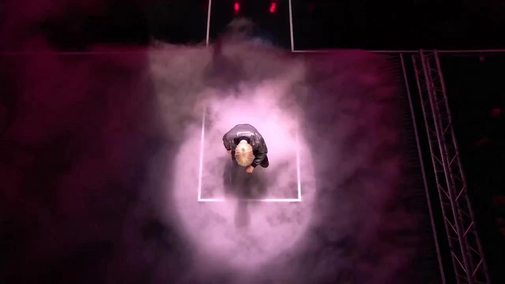

# M Countdown Stage Workshop

> **作者：** @阿娴AIGC

## Content

Process Planning:

Workflow Planning
Phase 1: Information Collection & Spec Confirmation

Users can start by entering character descriptions, ability types, scene types, and climax structures; no need to upload reference videos.

This Skill defaults to dual-character videos. If the user provides only one, ask for or propose a second original opponent/partner; do not default to single-character ability displays.

Before starting, use text_editor to create Final_Video_Spec.md and lock the following global parameters:

Number of videos: Default to 1 video, 15 seconds long.

Duration: Default to 15 seconds; each 15-second video corresponds to 1 shot in the Storyboard.

Dual-character setup: Character A, Character B, abilities of both, stage positioning, and conflict relationship.

Aspect Ratio: User specifies 9:16 vertical or 16:9 horizontal; if not specified, must ask via <cards> first.

Resolution: User specifies 720p or 1080p; if not specified, must ask via <cards> first.

Visual Style: Cinematic realistic outdoor live stage show, audience POV. The camera is the audience's eyes or a phone lens; the recording device itself is not shown. Default is an outdoor theme park theater, open-air plaza stage, festival stage, anime convention outdoor area, or night stage, unless the user specifies an indoor venue.

Voiceover language: Default to short Japanese phrases.

If the user provides famous anime/game character names, use them only as inspiration. Do not include official character names, titles, or move names in the Storyboard or generated prompts.

Phase 2: Storyboard Design (Pause for Confirmation)

Call storyboard_designer to design the complete Storyboard, including:

key_element for each video: Outdoor stage/theater space, Character A, Character B, key stage props, or supernatural effect sources. The audience POV is a shot-level constraint and is not created as a separate key_element.

Create only 1 shot for each 15-second video. If there is internal pacing escalation in a single video, use narrative beats like Beat 1 → Beat 2 → Beat 3 → Final beat within the shot description. Do not use wall-clock timestamps or split into multiple shots.

Plan independent Audio_BGM_* and Audio_VO_* audio layers for each video.

Force a pause after the Storyboard is complete, show the structure to the user, and wait for confirmation.

If the user requests changes, call storyboard_designer to update and pause again for confirmation; do not proceed to the next phase until the user explicitly says "Confirmed" or "Start generating key elements."

Phase 3: Key Element Asset Generation (Pause for Confirmation)

After the user confirms the Storyboard, call media_generator to generate or bind key element assets. Do not generate shot videos directly.

If the user has provided reference images, register and bind them to the corresponding key_element first; if no reference image, generate and bind a reference image for the key element based on the Storyboard description.

Force a pause after key elements are finished, show the assets (Character A, Character B, stage/scene) to the user, and wait for confirmation. Do not generate shot videos until confirmed.

Phase 4: Shot Video Generation (Pause for Confirmation)

After the user confirms key element assets, call media_generator to generate the final_shot for each video.

Shot video generation must reference the confirmed key element assets: Character A, Character B, stage/scene, and necessary props or effect sources.

Do not generate VO or BGM at this stage. First, have the user confirm the visuals: audience POV, dual-character stage dynamic, outdoor stage realism, foreground audience depth, long-shot continuity, and supernatural climax.

Force a pause after shot video generation and wait for user preview and confirmation. If the user requests changes to visuals, prioritize returning to storyboard_designer or updating the video generation prompt before retrying.

Phase 5: Generate VO and BGM (Pause for Confirmation)

After the user confirms the visuals, call media_generator to generate VO and BGM at once, based on the confirmed video rhythm and Storyboard audio layers.

VO should only cover short phrases like openings and closings; do not retell the full visual action. BGM should primarily be instrumental/sound-effect-based to serve the stage spectacle and audience reactions.

Pause after audio generation and wait for user confirmation on audio tone, rhythm, and sync.

Phase 6: Timeline Assembly

After the user confirms video and audio, call video_assembler.

Each 15-second finished video serves as an independent clip with clear boundaries, making it easy to select and export individually.

Default BGM volume is 0.7, default VO volume is 1.0; fade out for the last 2 seconds of each clip.

Dependencies

1 → 2 → 3 → 4 → 5 → 6. Do not run all phases at once; wait for explicit user confirmation at every pause point before proceeding.

IP Character Conversion Strategy

When a user-described character belongs to a popular IP (e.g., famous characters from existing anime/games), actively mitigate this during the Storyboard stage by following these steps:

Do not include character names, titles, move names, organization names, village names, or iconic dialogue.

Keep only 2-3 prominent appearance traits, and intentionally alter at least 1 of them:

Example: Original character "White hair + Six Eyes + Black turtleneck + Blue-purple technique" becomes "Silver-gray short wig + Tinted goggles + Deep sea blue turtleneck performance outfit + Hexagonal LED light screen."

Alteration direction: Change hair color, change clothing color/material, replace iconic accessories, remove iconic patterns/badges/symbols.

Transfer character recognition to abilities and stage performance style:

Skill visuals: Light effect color, shape, movement, diffusion path, shockwave form.

Combat or performance rhythm: Defensive counter, high-speed dash, area burst, smoke summoning, etc.

Body movement: Stance, gestures, power-exerting points, movement paths, pause poses.

Stage translation: Translate skills into light screens, spotlights, light pillars, smoke jets, fire rings, flashes, stage mechanics, and other visible live performance languages.

IP Risk Handling

When video generation returns an OutputVideoSensitiveContentDetected or similar sensitive content intercept, do not automatically switch models.

Inform the user that the character's appearance might be identified as a copyrighted IP pattern, and provide two directions: further weaken the appearance traits and strengthen the skill lighting effect description, or change the design and update the Storyboard before retrying.

Asset Analysis:

Reference Asset Analysis Rules

When users provide reference videos, test footage, or stage assets, prioritize extracting the following signals for use in Storyboard and prompt generation:

POV and Camera Movement: Determine if it's a first-person viewer POV. Record mobile-style filming reactions within a long take, such as quick digital zooms, focus pans, looking up at smoke/light pillars, or pull-backs to re-establish the full stage. These movements are focus shifts within a long take, not cuts.

Realistic Texture: Note whether characters resemble real stage performers/stunt actors. Check if clothing shows authentic fabric, leather, metal, armor, prop weight, and skin lighting. If the reference is realistic, subsequent outputs must not be stylized as cartoons, anime, game CG, or puppets.

VFX Integration: Record how special effects interact with the physical stage, including smoke being pushed aside, flowing floor fog, lighting of rigs/architecture, overexposure on audience faces, stage shadow shifts, and the occlusion relationships of fire/sparks/black smoke. Simply noting that it "looks cool" is insufficient.

Impact Feedback: Record the target's physical reaction to being hit or suppressed, such as shifting center of gravity, staggering, bracing on the ground, shielding the face, being pushed by shockwaves/smoke, sliding, brief pauses, or regaining balance. Do not just record the visual effects themselves.

Audience/Faction Reaction: Record whether the crowd clearly supports a specific side, and capture reactions during highlights for the dominant side, such as cheering, standing up, raising hands, holding up phones, leaning forward, or camera bumps.

Storyboard Design:

Core Shot Definition

This Skill's Storyboard is not a character showcase list, but rather "the audience's first-person perspective on a supernatural performance/confrontation on an outdoor stage." The camera acts as the audience's eyes or smartphone lens; the recording device itself is never visible. By default, the camera stands in the audience or below the stage, recording the action. It must not switch to individual character close-ups, professional stage camera angles, drone perspectives, or third-person cinematic shots.

Shot Granularity Rules

Each target video clip defaults to 1 shot, meaning 1 video generation task. Do not split the same video clip into multiple shots.

The maximum duration for a single shot is 15 seconds (the generation limit for Seedance 2.0).

If a segment has clear internal rhythmic progression or scene advancement, list them within the same shot description using narrative beats (Beat 1 → Beat 2 → Beat 3 → Final beat). These beats are escalation points within a long take, not separate shots.

Do not use wall-clock timestamps to describe internal beats. Seedance 2.0 cannot precisely execute timestamp-based commands; timestamps will lead to unpredictable behavior or be ignored.

Only create multiple shots if the user explicitly requests multi-shot editing, total video duration exceeding 15 seconds, or batch generation of independent clips. For multiple clips, each 15-second video still corresponds to 1 shot.

Avoid describing "internal edits" as hard cuts. More accurate phrasing would be "internal beats, performance choreography, explosion escalation, and brief reactions within the same first-person POV long take."

Stage Coordinate System and Three-Layer Composition

Every shot must first establish a unified stage coordinate system before describing characters and explosive events. Do not start by writing from the individual perspective of Character A or Character B.

Foreground: Audience heads, shoulders, arms, and a few phones held by people in the front row. Partially obscure the bottom of the stage to provide a sense of reality. Phones must be small, peripheral environmental props; do not center them to block the stage, do not require the screen to replicate stage actions, and do not create "screen-in-screen" compositions or show recording UIs.

Midground: Two characters on the same stage platform, props, smoke, and ability trigger points. Both characters must share the same midground stage space.

Background: Outdoor theater architecture, theme park walls/steps/lighting rigs/flags/sky/nightscape/smoke layers.

Camera Movement: Subtle handheld breathing, slight hand tremors, or small backward tilts/tilts/pans driven by strong light or shockwaves. 1-2 brief digital zooms or pans triggered by stage events are allowed (e.g., zoom in on the attacker, then pan/pull back to reveal the victim/counter-attacker). Movement must be driven by stage events or audience reactions; avoid meaningless constant drift or extreme whips.

Dual-Character Default Structure

The default video unit for this Skill is "two-character confrontation/clash/cooperative performance." The Storyboard must design two element characters, A and B. Unless explicitly requested by the user, do not generate single-character ability showcases.

If the user only provides one character, the Storyboard must not jump into a solo show. Let the Planner complete the second original opponent/partner, or propose a Character B that strongly contrasts with Character A if the user allows for creative freedom.

Each shot must clearly establish the initial positions of Character A and Character B in the same stage coordinate system, e.g., left/right, front/back, on stairs/center stage, distant/close side.

Each internal beat must contain four elements: Character A's action, Character B's reaction/counter, visible explosions between the two or at center stage, and the audience's first-person reactions.

Even if one party is unleashing a skill, the other must exist as the victim, defender, reactor, or spatial anchor. Never let the other party disappear into a "solo ability show."

Characters are default real-life stage actors/stunt performers, not cartoons, anime, game CG, or mascot suits. Actions should feel like stage combat: having weight, inertia, points of contact, and body protection techniques.

Hit feedback must be specific: taking a half-step back, lowering the center of gravity, shoulders being deflected by impact, arm guards up, knees bending, sliding, bracing against the stage, regaining balance from smoke, etc. Do not just write "hit" or "takes damage," and do not just let effects cover the body.

Visual climaxes prioritize events between the two, at center stage, or in a shared space, e.g., black smoke sweeping vs. blue lightning, fire ring surrounding a light shield, ice crystal pillar blocking a rush, shockwave spreading from the center line.

Explosion Event Priority

Default to a structure of "gradual escalation of a major stage event" rather than continuous, high-density brawling. Character actions are usually small and clear, while effects are massive; characters trigger events, but the event is the subject. The "viral" feel comes from smoke, light pillars, energy orbs, fire rings, shockwaves, and audience/phone reactions. Effects must look like real stage pyrotechnics, lighting, projections, smoke, and post-production enhancements, not clean, floating game skill stickers.

Write descriptions within the same shot following these narrative beats (no seconds):

Beat 1: Establish first-person POV, outdoor stage space, and character placement. Characters at opposite ends or foreground/background. Foreground has heads, arms, and few phones for realism; audience can be split into supporters of A and B. One triggers the first energy sign; the other shows a clear reaction/defense.

Beat 2: First clash. Abilities spread as stage lights or mechanical effects (e.g., black smoke sweeps from the left, right character blocks with blue lightning/shield). Climax happens between them or at center stage. Brief digital zoom to the attacker, then pan back to center line.

Beat 3: Peak. Energies collide at the center. The pressured side must show clear physical impact feedback (recoil, slide, guard, brace, or blown back by smoke). Shockwave pushes smoke; the winning side's fans cheer, stand, or raise phones. Light illuminates audience faces/arms/phones, camera shakes/recoils from the energy.

Beat 4: Reversal or second spectacle. The pressured side counter-attacks from smoke, flanks, above, or behind stage props. The other party shows realistic physical reactions (defense, recoil, turn, or re-stabilizing). Audience reactions shift with the momentum; the other side cheers or surges forward.

Final beat: Posed conclusion. Both stop at opposite ends, center energy fading, or one in attack pose/one in defense. Smoke/light effects disperse. Short VO outro reserved for audio generation.

Key Elements Design Rules

Each project must contain at least one element scene, Element_Character_A, and Element_Character_B. The dual-character structure is default, not optional.

Do not create "audience POV images" or "audience perspective reference images" as key elements. The first-person POV is a shot constraint. Foreground audience/arms/phones can be in shot or element scene composition, but do not make them an asset with a centered phone screen.

element scene must describe the full stage space, not just a background for one character. Default to outdoor/open-air: theme park theater, Japanese-style ninja theater, festival stage, open expo plaza, night market temple stage, or outdoor plaza. Include audience seating, stage platform, sky/nightscape, smoke, lighting rigs, or architecture.

Element_Character_A and Element_Character_B define appearance, abilities, performance style, and original traits (IP-avoidant). The Storyboard shot must put them in the same coordinate system. Character appearance uses live-action stage actor language: real fabric, leather, metal, armor, wigs, masks, goggles, props, and light effects. Avoid anime IP combinations, cartoon proportions, plastic textures, or game CG armor.

Ability design prioritizes translation into visible stage events: light shields, follow spots, light pillars, fireworks, smoke jets, fire rings, LED curtains, shockwaves, floating particles, ground fog.

Audio Layer Planning

Plan two independent audio layers per video, generated only after the user confirms the storyboard visuals:

Audio_BGM_*: Instrumental/sound effect soundtrack only. Keywords: Taiko drum, bass rumble, whoosh, lightning, fire, smoke impact, crowd gasps. No vocals or lyrics.

Audio_VO_*: Short voiceover. Script contains only opening and closing lines, default to short Japanese sentences. Specify narration_speaker_profile (e.g., deep mysterious male, ethereal cool female, passionate male).

If multiple videos share a BGM, use the same audio_id in the shot description; do not repeatedly create the same type of audio layer.

Media Generation:

Key Element Asset Generation

After the Storyboard is confirmed, only generate or bind Key Elements in the first round. Do not generate shot videos, VO, or BGM.

Process Element_Character_A and Element_Character_B first. If the user provides reference images, register and bind them to the corresponding key_element. If not, use TextToImage to generate character references. Focus on: live-stage performer textures, original designs, realistic clothing/prop materials, body silhouettes, visual origins of abilities, and IP-safe feature combinations. Character references must not be cartoon, anime, game CG, doll suits, or plastic-looking armor.

Process element scene. Stage/scene references must present a complete outdoor performance space: audience direction, stage platform, side/center standing areas, background architecture/stairs/light rigs/banners, fog layers, key light tones, and realistic crowd density. Do not generate isolated backgrounds that only serve a single character.

Do not generate or bind any "audience POV image" assets. If audience realism is needed, write audience head/shoulders, arms, and a few peripheral phones into the scene or video prompt. Scene references must not show centered large phones, recording interfaces, or in-screen displays.

Generate or bind key props or effect sources as Key Elements if they impact visual consistency in the Storyboard. Pure temporary fog, light trails, and one-off shockwaves can be left for video prompt descriptions.

Pause for user confirmation once Key Element assets are complete. Do not proceed to shot video generation until confirmed.

Shot Video Generation

Only generate the final_shot for each video after the user confirms Key Element assets. Do not generate VO or BGM.

Default to Seedance 2.0 original for image stability. Do not use Fast mode unless the user explicitly requests a quick preview.

Each 15-second video corresponds to 1 shot in the Storyboard. Cover the complete internal narrative beat in a single video generation; do not split into multiple generations based on internal beats like Beat 1/2/3.

Shot videos must reference confirmed Key Elements (Character A, Character B, stage/scene). If necessary props or effect assets exist, bind them as reference_image to the corresponding shot.

Prioritize: audience first-person POV, camera equipment not in frame, foreground audience layers/peripheral phone realism, mid-to-long shot stage, live performer texture, realistic hit feedback, factional audience reactions, realistic outdoor space, long-take continuity, and supernatural stage event scale.

Pause for user preview and confirmation once the video is complete. Do not generate VO or BGM until confirmed.

VO Narration Generation

Generate VO only after the user confirms the shot video visuals.

Use MiniMax Speech 2.8 HD. Generate based on Audio_VO_* in the Storyboard and confirmed video pacing.

Each VO script should only contain opening and closing lines to avoid covering mid-scene events. Language must follow Final_Video_Spec.

Select voice styles based on visual tone: deep mysterious male, ethereal cold female, powerful male, energetic male, etc.

BGM Generation

Generate BGM only after the user confirms the shot video visuals.

Use Suno to generate pure instrumental/sound effect soundtracks. No vocals, no lyrics.

Prompts must clearly include: emotional keywords + core sound effect types + rhythm characteristics + crowd reaction atmosphere. Examples: Taiko drums, low-frequency hums, whoosh, lightning crackles, roaring flames, audience gasps.

IP Risk Mitigation

Character visual descriptions must use stage prop and lighting terminology to prevent high-risk combinations from being identified by the model as copyrighted characters.

If generation fails and returns OutputVideoSensitiveContentDetected, do not auto-switch models; report to Planner for handling.

Prompt Writing:

Global Writing Language

The prompt body should be written in Chinese; model names, parameter tags, and negative constraint words can remain in English.

VO or dialogue content should follow the narration language of the Final_Video_Spec; Japanese short sentences are the default.

Video Prompt Structure

Organize in the following order: Camera perspective and long-take declaration → Three-layer composition and outdoor stage space → Two-character stage positioning and relative relationship → Live-action character appearance and ability trigger method → Realistic hit feedback → 15-second internal pacing → Faction-based audience reaction and realistic foreground props → Audio exclusion instructions → Avoid block.

Mandatory Audience POV Sentence Structure

Every video prompt must start with the following or similar content:

First-person audience POV from inside the crowd, camera equals the viewer's eyes / phone lens, no visible phone body, no recording interface, no screen-in-screen; continuous 15-second handheld long take with occasional event-driven digital zoom and short attention pan, foreground lower edge has audience heads, shoulders, raised arms, and occasional small edge phones as live-event atmosphere, stage remains the clear subject; raw phone-recorded live show realism, slight handheld breathing shake, imperfect exposure, cinematic realistic outdoor live stage show.

Follow this with specific scene details in Chinese: outdoor theme park theater, Japanese-style ninja theater, open-air festival stage, convention outdoor area, or night stage; clearly describe the sky/night scene, buildings, steps, vertical flags, light rigs, smoke layers, and audience density.

Video Prompt Internal Segmentation

The 15-second video must be written as a single, continuous audience first-person POV long take. The camera equals the audience's eyes or phone lens, and the filming device itself should not be in the frame.

When describing multiple rhythmic segments within the same shot, use narrative beat sequences (Beat 1 / Beat 2 / Beat 3 / Final beat) or the "→" arrow. Each segment must clearly belong to the same continuous long take and must not be written as separate shots, hard cuts, or scene transitions.

Do not use wall-clock timestamps or second-range labels. Seedance 2.0 cannot precisely execute timestamp instructions in seconds; timestamp usage leads to unpredictable behavior or causes the instructions to be ignored. Narrative beat writing allows the model to correctly understand them as progressive events within the same long take.

Avoid using words that trigger editing, such as camera cuts, cut to, new shot, or switch angle. If "internal rhythm changes" are needed, write them as slight camera pans, tilts, tilts up, short digital zooms, pull-backs, or temporary obstructions by foreground audience arms or small-scale edge phones, followed by recovery. Digital zooms must be triggered by stage events, such as zooming in on the attacker when an explosion occurs, then panning to find the defender or the one being hit.

Live-Action Character Texture

Characters must be written as live-action stage performers / stunt performers: realistic human proportions, realistic skin lighting, realistic fabric wrinkles, leather/metal/armor materials, props with weight, and details like stage sweat/dust.

Character costumes can be exaggerated but must look like stage wear worn by real actors, not cartoon characters, anime figures, game CG models, plastic toys, or mascot suits.

When describing character movements, anchor the body's center of gravity and contact surfaces, for example: "right foot planted on the stage floor, knees bent to stabilize the body, shoulders pushed off-balance by the impact, cloak lifted by smoke."

Three-Layer Composition

Foreground: Audience heads, shoulders, raised arms, and a small number of edge/lower-edge phones from front-row audience members. These phones only serve as props for live-event realism, can be illuminated by strong stage lights, or create blurry reflections. They are not required to reproduce the main characters or explosive effects and must not become the center of the frame.

Midground: Stage platform, characters, props, smoke, and ability trigger points. Character actions should be clear but do not need to be close-ups.

Background: Outdoor theater architecture, themed landscaping, steps, vertical flags, light rigs, sky/night scene, smoke layers.

During strong explosive moments, you must write: "audience faces, arms, and edge phones are illuminated by strong light," "audience arms briefly raise or lean back," "camera shakes slightly but the stage remains readable."

Two-Character Stage Interaction

The prompt must contain both Character A and Character B by default. If the input only mentions one, you should supplement or propose a second original opponent/partner; do not write it as a single-character ability showcase.

Both characters must share the same stage coordinate system, specifying the relative positions of Character A and Character B (e.g., left/right side of the stage, foreground/background, on steps, or center platform).

Do not write it as two separate showcase segments. Every time segment should retain the other character as a target, defender, reactor, or spatial anchor, and describe changes in their relative positioning.

Explosive points should prioritize being placed between the two or at the center of the stage, for example: "black smoke on the left sweeps to the center line, blue light screen on the right resists the smoke, a strong light shockwave forms in the center of the stage."

Hit Feedback

Every ability suppression, hit, or counter-attack must clearly state the physical feedback of the target: taking half a step back, sliding, center of gravity lowering, arms guarding the face, shoulders pushed off-balance, knees bending, bracing against the stage, regaining stance from the smoke.

Special effects cannot replace physical reactions. Do not just write "blue lightning hits Character B"; instead, write "blue lightning and smoke rush in front of Character B, who guards their face with their arms, slides half a step with their back foot, knees bend to stabilize, and their cloak and smoke are pushed to the right by the shockwave."

Maintain a sense of stage performance safety in hit feedback; do not write gore, real injuries, or painful details.

Faction-Based Audience Reaction

By default, the audience is not a uniform background but live viewers with supported objects. You can write that certain clusters of the audience on the left or in the front row support Character A, while the other side supports Character B.

When one side performs a skill well or completes a counter-attack, supporters of that side should show visible feedback: cheering, standing up, raising hands, holding up phones, leaning forward, camera being slightly bumped by neighboring audience members, or momentary screen jitter.

Audience reactions must follow the changes in the battle: when A is winning, A's audience cheers first; when B counter-attacks, the other side erupts. Do not just write generic "audience gasps."

Supernatural Stage Event Writing

Character movements should be small and precise, while effects should be large and visible. Do not just write "intense fighting"; clearly describe how abilities are staged:

Semi-transparent hexagonal LED light curtains diffuse from the palms.

Blue vertical spotlights rise from the stage floor.

Black smoke sweeps across the audience's view like stage fog jets.

Orange flame rings swirl in the center of the stage, but retain the texture of real smoke and stage lighting.

Shockwaves push away ground fog; foreground audience faces and edge phones flash white instantly.

Special effects must be grounded within the real stage space: have visible occlusion, projection, reflection, overexposure, and lighting interactions with the stage floor, smoke, light rigs, architectural background, actor bodies, and audience faces. Avoid effects that look like stickers floating on a pure CG background.

IP Character Evasion Strategy

When users are creating content based on popular IP characters:

Absolutely forbid writing official character names, work titles, move names, organization names, village names, or signature lines.

Retain only 2-3 appearance characteristics, with at least one intentionally deviated from the original character. Use descriptions of visible items like wig color, costume material, goggles, masks, gloves, or props.

Skills/fighting styles must be detailed and sufficient: light effect color, shape, movement pattern, attack action, counter-logic, and translation into stage lighting effects.

Example: For an "Naruto-style" character, do not write the character name or move name; instead, write: spiky copper-gold short wig (not blonde), orange-and-charcoal athletic stage combat outfit, no headband, no symbols, cyan wrist guards. Combat style: three-directional rush with two semi-transparent gold-orange afterimage performers flanking simultaneously; the main performer charges a spinning cyan-blue circular light disc with gold energy flowing along both arms before a straight-line dash; afterimages execute ground-level feints while the main performer flips from above.

Audio and Subtitle Constraints

Do not write a full VO script in the video generation prompt; VO will be generated separately after the user confirms the storyboard video footage.

Default to adding no music, no subtitles to the video prompt to prevent the video model from generating its own music or subtitles.

You may write visual and lightweight SFX cues for live audience reactions, such as "audience gasps, arms raised, camera shakes, sound of smoke impact," but final VO and BGM are subject to independent audio layers.

Avoid block

Each video prompt must include the avoid block at the end, fixed to include:

official anime/franchise character names, copyrighted logos, emblems, headbands, face marks, readable subtitles, text overlay, watermark, UI, cartoon, anime style, illustration, cel-shaded, toy-like character, plastic mascot suit, game CG character, floating VFX sticker, clean CGI arena, stiff motionless crowd, missing hit reaction, stiff hit reaction, large foreground smartphone, centered phone screen, phone recording interface, screen-in-screen composition, visible camera app UI, giant hand holding phone blocking the stage, gore, injury, horror, third-person cinematic camera, drone shot, stage broadcast camera, hard cuts, switch angle, new shot, extreme shaky camera, camera spinning, morphing, smearing, deformed hands.

Note: Do not broadly prohibit all text. Blurry stage vertical flags, plaques, lightboxes, or decorative logos are allowed, but clearly readable subtitles, watermarks, UI, official logos, and random text overlays are forbidden.

Video Editing:

Timeline Assembly Specifications
Append Mode

Append new clips only to the end of the current timeline. Do not reassemble existing clips or merge clips across different batches.

Each 15-second clip is treated as an independent segment with clear boundaries for easy selection and export.

Audio Mixing

Video footage, VO, and BGM are assembled only after user confirmation.

Default volumes: BGM at 0.7, VO at 1.0. If the source video contains significant ambient sound, preserve an appropriate amount of it while lowering the BGM to avoid masking.

Apply a 2-second fade-out at the end of each clip. Ensure VO is not cut off by the fade-out; BGM may fade out with the clip.

Synchronization & Quality Control

Align the opening VO sentence with the setup section of Beat 1, and the closing sentence with the finalized ending at the Final Beat.

The peak energy of the BGM should align with the main climax at Beat 3. Avoid reaching full energy too early at the beginning.

Pre-assembly checks: Ensure retention of the audience POV, avoid showing filming equipment, maintain depth of foreground audience, include a slight 'realistic' feel with peripheral mobile phones, preserve outdoor stage realism, and ensure long-take continuity. If the video looks like a third-person cinematic shot, a centered mobile screen recording, or pure CG footage, return to the video generation phase for correction.

Export Range Labeling

After assembly, report the actual timeline range for each clip (e.g., 90s-105s) to the user, instructing them to select the corresponding range in the export interface for individual export.
