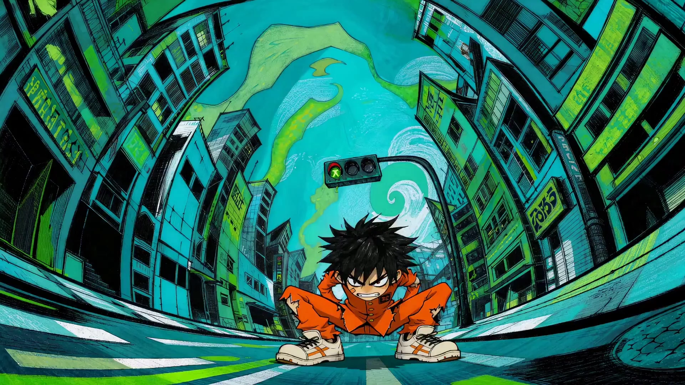

# Masaaki Yuasa-Style Animated Short

> **作者：** @Damon

## Content

Process Planning:

Task Orchestration and Coordination Logic:🚨 Visual Generation Model Exclusive Red Line:

It is strictly prohibited to mix, call, or automatically downgrade to any other visual generation model at any stage.

Image generation is restricted to GPT Image 2 (recommended resolution: 2K); video generation is restricted to Seedance 2.0 (default resolution: 720p; duration: 4s-15s).

Establish Global Spec: The Planner must first use the text_editor tool to create or update Final_Video_Spec.md, locking the aspect_ratio to 16:9 and setting the video resolution to 720p. The output language allows the user to choose between "Japanese" or "Chinese" (if not specified, default to "Japanese" to achieve the most authentic and expressive theatrical tension characteristic of Masaaki Yuasa style, avoiding lip-sync mismatches). The visual style must be established as "Masaaki Yuasa Style Expressionist Animation".

Director and Screenwriter Coordination (Inspiration Incubation and Design):

When the user provides only rough inspiration or an outline: The Planner must exercise its guidance and creative ability as a "Director and Screenwriter." Never directly apply templates or crudely jump into storyboarding. Instead, focusing on the "psychedelic, manic, and childlike" aesthetic of Masaaki Yuasa, first engage in collaborative scriptwriting:

Concept Expansion: Prioritize applying or blending classic narrative structures defined in the Storyboard Design, such as the "Dream Loop" or "Road Run" templates, to brainstorm 2-3 highly personalized, evocative creative solutions for the main characters, core conflicts, and expressive key scenes, significantly lowering the barrier to entry.

Pause Checkpoint (Interactive Confirmation): Present these creative solutions—integrated with classic narrative templates (including story arcs, template structures, character settings, and fantastical visual designs)—to the user for selection and fine-tuning before proceeding.

When the user has provided a complete script or specific concept: Strictly follow the user's concept and proceed directly to the next step.

Build Storyboard: Call storyboard_designer to plan the storyboard.

Must convert script ideas into highly detailed blueprints (specifying scene attribution, specific four-panel perspectives, exaggerated emotion-driven actions, camera movement tension, etc.).

Shot duration must be between 4s - 15s (the physical hard limit of Seedance 2.0), and dynamic timing plans for long vs. short shots must be made based on narrative fluctuations (serene, flowing long shots vs. manic, energetic short shots).

Pause Checkpoint: After generating the storyboard, must pause and present it to the user for confirmation before proceeding to subsequent asset generation.

Key Elements Preparation:

Character and Scene Image Assets (Rigid aspect ratio isolation rules and upscaling enhancement):

Image Generation Aspect Ratio Control: Full-body three-view character sheets must be generated using a 16:9 aspect ratio; scene four-panel reference images must be generated using a 4:3 aspect ratio. Since image generation tools (TextToImage / ImageToImage) do not support the aspect_ratio parameter, you must enforce the aspect ratio through composition descriptions in the prompt (for character three-views, specify "16:9 wide-screen, full-body three-view horizontal layout"; for scene four-panels, specify "4:3 aspect ratio, 2×2 four-panel layout"). It is strictly prohibited to apply or inherit the global video aspect ratio for scene images.

Prioritize and Adapt User Assets: First check if the user has provided full-body three-view reference images (front, side, back; not just busts) or scene reference images for the core characters. If provided and stylistically consistent, register and bind them directly via media_generator. If specifications are incomplete (e.g., only a single angle or bust) or the style is mismatched (e.g., realistic style), it is automatically deemed non-compliant. You must then call the ImageToImage capability of media_generator (Model: GPT Image 2, Resolution: 2K), using the original image's identity features as a reference, specifying the aspect ratio in the prompt to control the layout, and redraw them into full-body three-view character sheets and multi-angle four-panel scene images that fit the Yuasa style, then register and bind the new assets.

System Supplemental Generation (requires step-by-step confirmation): If the user has not provided any images, call the TextToImage capability of media_generator (Model: GPT Image 2, Resolution: 2K) after pausing for user confirmation, specifying the aspect ratio in the prompt, to supplementally generate key_element images that fit the Yuasa style.

Advanced Image Upscaling Enhancement (Jimeng SR, optional): After all character full-body three-view (16:9) and scene four-panel (4:3) image assets are generated or redrawn, you must pause and present all generated images to the user in their entirety, and initiate a confirmation inquiry with the following wording: "The image assets are all ready. Do you need to perform 4K upscaling? Upscaling can refine messy hand-drawn lines, crayon/charcoal grain, and paper-cut collage edge textures, making the handmade texture more full and three-dimensional. If not needed, you can skip this step and proceed." If the user confirms, call super_resolution (Model: Jimeng SR, Resolution: 4K, scale parameter: 50) via media_generator for reconstruction. If the user skips, proceed directly to the next step using the current image assets.

Character Voice Assets (key_element_audio): For characters with dialogue, check and bind exclusive key_element_audio (voice reference assets) to ensure vocal consistency.

Asset Completeness and Binding Check (Core blocking red line): After preparing images and audio elements, the Planner must check one by one all key_elements planned in the storyboard to ensure every single one is bound to an asset_id. It is strictly prohibited to proceed to the next step (shot video generation) if any element asset is missing, ungenerated, or unbound. If any are missing, you must notify the user and complete all element assets.

Shots Video Generation (requires confirmation per shot):

Pre-generation Comparison Check (Prompt and reference completeness): Before generating each shot, the Planner must perform an in-depth comparison of the proposed prompt, reference resources, and the storyboard script, focusing on:

Visual Reference Check: Check if any character or scene reference images involved in that shot were missed. You must ensure every storyboard shot is explicitly bound to its corresponding scene four-panel reference image and anchored to a specific Panel perspective to prevent background flickering and severe drift.

Dialogue Check: Check if the prompt completely and accurately includes the planned dialogue text, speaking character, and exclusive voice (key_element_audio).

If omissions are found, corrections and additions must be made first.

Pause for Confirmation After Checking: After verification, you must pause and present the shot's prompt, associated reference images, dialogue script, etc., to the user. Only after obtaining explicit user confirmation can you call the MultiModalToVideo capability of media_generator (Model: Seedance 2.0, Resolution: 720p).

Chained Video References (Use as needed, not mandatory for every shot): When generating Shot N (N ≥ 2) in a continuous scene, only when there is a strong need for continuity between two consecutive shots (e.g., seamless character body movement between shots, passage of time from the same camera position, transitional scene morphing) should the final_shot video of the previous shot be passed as a reference_video. For camera angle switches, emotional jump cuts, scene transitions, etc., do not pass the previous shot video to avoid the model excessively imitating the previous shot's visuals, which leads to high similarity. When a reference_video is passed, you must explicitly note the core differences in the prompt (e.g., new camera perspective, new character movement stage, different emotional beats) to clearly guide the model to generate content with sufficient visual freshness while maintaining continuity.

Advanced Shot Upscaling and Frame Interpolation (Post-processing Enhancement, optional):

After all shot videos are generated, you must pause and present all generated video shots to the user in their entirety, and initiate a confirmation inquiry with the following wording: "All shots have been generated. Do you need to perform 1080p upscaling and high-frame-rate interpolation enhancement (Member Exclusive)? Upscaling can improve image quality from 720p to 1080p, and frame interpolation can boost frame rate to 60fps (or 30fps), making high-speed group dances and damped sliding movements smoother and more fluid, without stuttering. If not needed, you can skip this step and proceed." If the user confirms, call super_resolution (Model: MediaKit, Resolution: 1080p, fps: 60 or 30) via media_generator for enhancement. If the user skips, maintain the 720p original video and proceed directly to the next step.

Audio and Song/Dance Production (requires confirmation):

After all audio layers are planned, you must pause and present the audio plan to the user in its entirety (including BGM style description, draft lyrics for climax song/dance, narration script, and voice settings), and initiate a confirmation inquiry with the following wording: "The audio plan is now ready. This includes: ① Grotesque/psychedelic background music (BGM); ② Original song for the climax dance segment (including lyrics and vocal style); ③ Character voiceovers (exclusive voice bound). Please confirm if this plan meets your expectations, or let me know if any parts need adjustment. Audio generation will officially begin after confirmation." Only after obtaining explicit user confirmation can you use media_generator to produce each independent audio layer sequentially. For the climax dance segment, use the lyrics_to_song tool (Model: Suno 5) to generate the confirmed lyrics into a full original song. Dialogue voiceovers must be locked to the character's vocal profile via the bound key_element_audio to maintain consistency.

Video Assembly and Rendering: Call video_assembler to perform a high-intensity, quick-cut montage assembly of the final confirmed shots (720p original or 1080p high-frame-rate version if confirmed by the user) with all audio tracks (BGM, voiceover, generated song, etc.), ensuring audio-visual synchronization and highlighting the explosive force characteristic of the Yuasa style, then guide the user to the final export.

Dependencies: 2 -> 1; 3 -> 2; 4 -> 3; 5 -> 4; 6 -> 5; 7 -> 3,4; 8 -> 6,7.

Asset Analysis:

Multimodal Analysis Standards for Reference Assets:

Extraction of Line Work and Hand-Crafted Texture: When users upload hand-drawn sketches, crayon doodles, watercolors, paper cut-outs, or reference illustrations, the tool must accurately identify irregular lines, jittery textures, uneven stroke thickness, paper textures (e.g., watercolor paper, edges and seams of mottled paper cut-outs), and distill them into structured feature descriptions reusable in the storyboard and prompts (e.g., minimalist hand-drawn lines, rough charcoal strokes, crayon smudge particles, watercolor paper grain, layered paper cut-out color blocks, and collage seams).

Analysis of Expression and Dynamic Expressiveness: For input portraits or characters, analyze facial features and potential for expression, outputting facial exaggeration schemes for different emotional states (e.g., wide-open eyes, exaggerated laughing mouths, and other naive or humorous facial changes) to facilitate expression and motion rhythm design in storyboard_designer. Character limb and body proportions should remain consistent; no body deformation analysis is required.

Analysis of Color and Spatial Distortion: If the input reference image contains flat color blocks or perspective distortion, analyze the dominant tones (distribution of 2-3 flat primary colors) and spatial perspective characteristics (the spectrum ranging from slight deformation to extreme distortion) to ensure that downstream character design and scene generation accurately capture the visual tension.

Determination and Reconstruction Analysis for Style and Specification Adaptation: Evaluate the completeness, specifications, and style compatibility of user-provided character three-view drawings or scene reference images. It is mandatory to strictly verify whether character images are complete full-body three-view drawings (full-body front, side, and back views; half-body portraits or single-view images are not acceptable). If the character image is not a complete full-body three-view drawing, or if the style deviates from the Yuasa style (e.g., too realistic, overly neat, or industrial lines), deeply analyze and extract key identity features (e.g., hairstyle, iconic clothing, geometric subjects in the scene). Then, output structured conversion descriptions as a reference for downstream Image-to-Image redrawing and reconstruction, ensuring consistency of character and scene subjects while "Yuasa-fying" the style (converting it to an irregular hand-drawn style) and reconstructing it into complete full-body three-view drawings.

Verification of Multi-Angle and Character-Free Scene Reference Images: Identify whether the scene reference image provided by the user is a "multi-angle, character-free, 4-grid" structure. If not, carefully analyze the core visual elements such as landmarks, perspective, and atmosphere in the user's scene image. Extract them into structured prompts needed for downstream scene reconstruction, and clearly instruct the generator to perform multi-angle character-free reconstruction design according to the "4-grid standard allocation (panoramic establishing shot / close-up of furnishings / depth perspective / atmospheric lighting effects)."}

Storyboard Design:

Masaaki Yuasa Style Storyboard Design Guidelines (Scriptwriting and Directorial Blueprint):

Directorial Thinking: Non-Natural Movement and Perspective Distortion Design

Real-Life Grounding: Scenes must be anchored in recognizable real-life spaces—streets, stations, classrooms, izakayas, rental apartments, seaside towns, shopping streets, etc. The essence of the Yuasa style is not "every frame is a fluorescent neon dream," but rather "real-life spaces gradually spiraling out of control, driven by character emotions." Ordinary segments should present recognizable, lived-in daily scenes; spatial deformation only emerges gradually when emotions escalate. Architecture can bend like paper or rubber, and perspectives can warp, but the reality of the scene must not be lost. Background lines should have a hand-drawn, jittery feel, incorporating collage textures, photographic grain, rough color blocks, and watercolor washes—not limited to neon high saturation; daily segments can use softer, cleaner, watercolor tones.

Camera and Perspective (Progressive Distortion Rules): The degree of distortion must progress stepwise with emotional intensity, rather than applying extreme distortion to every shot:

Ordinary Segments (Calm, Daily, Setup): Use mild deformation—slightly tilted horizons, slightly exaggerated proportions, natural perspective—to maintain image readability and narrative breathing room.

Emotionally Elevated Segments (Conflict Escalation, Faster Pacing): Gradually increase fisheye distortion and screen tilt; building proportions begin to become noticeably unbalanced, and horizon distortion intensifies.

Climax Segments (Explosion, Ecstasy, Dream Collapse): This is when to use extreme fisheye distortion, drastically tilted horizons, teetering asymmetrical building proportions, and irregular geometric structures to release spatial oppression and surreal tension to the maximum. Avoid any mediocre, rigid, neat, or symmetrical traditional perspective and composition—but the distortion intensity is always driven by emotion, naturally escalating from low to high.

Expression & Energy (Not Physical Deformation): Character limbs and body proportions always remain normal—no rubber-hose stretching, infinite limb elongation, body liquification, or fragmentation. The kinetic energy of the Yuasa style comes from a combination of these elements: ① Vividly exaggerated facial expressions (rich cartoonish facial changes—wide eyes, exaggerated laughing mouths, vivid micro-expressions, full of innocence and absurdity); ② Elastic contrast in movement speed and rhythm (rapid burst → sudden stop → air suspension); ③ Twisting and deformation of space and environment (bending architecture, perspective distortion, sudden color changes); ④ Intrusive and rhythmic camera work (swooping, spiraling rotation, close-up tracking); ⑤ Manic flickering with a handmade feel (line-art jitter, alternating brushstrokes). Exaggerated but not terrifying, grotesque but playful.

Switching Between 2D and 3D: Scenes can suddenly switch from deep-perspective spaces to completely flat 2D hand-drawn illustrations at specific emotional climaxes, using this visual shift to reinforce emotional tension.

Energetic Group Dance: In song-and-dance scenes, the group dancers maintain normal limb and body proportions, releasing frenzied energy through highly synchronized, explosive choreography. The visual tension of the group dance comes from: the neatness and staggered alternation of multiple character movements, the rhythmic contrast of high-speed acceleration and deceleration, high-speed camera shuttling and rotation, and the high-frequency flickering of colors and hand-drawn textures (Line-art flashing). At the moment of the highest emotional climax, the screen can switch entirely to a flat 2D hand-drawn style or let the environmental colors burst and splatter, but the characters' bodies themselves do not liquify, fragment, or stretch. Camera Directives must be highly intrusive and rhythmic, forcefully tearing apart traditional static spatial distances:

POV fly-through: The camera swoops rapidly, piercing directly through the visual channels and geometric gaps formed by the character choreography formations.

Helical Spinning Pan: The camera stays close to the dance group, spiraling upward/downward with high-speed 360-degree vertical or horizontal rotation, maximizing the release of the manic dance's kinetic centrifugal force.

Dynamic Action Tracking: The camera locks onto a character's rapid movement trajectory or facial expression afterimage, following their swift, abrupt, and reciprocating displacement across the screen.

Scriptwriting Thinking: Dynamic Rhythm and Emotional Explosion Structure

Temporal and Rhythmic Dynamic Planning: Shot duration must be adjusted dynamically based on plot and emotion. Shot duration is strictly limited to 4s - 15s (Seedance 2.0 limitation).

Quiet/Flowing Segments: Plan for 8s - 15s long takes, allowing character movements to wander slowly in a fluid, expressive manner, showcasing a dreamlike and psychedelic feeling.

Manic/Explosive Segments: Plan for 4s - 6s high-frequency action shots, with explosive zigzag or projectile movements, instantaneous acceleration/deceleration, and drastic sudden changes in environmental colors within the shot.

Ultimate Emotional Expression: Dialogue, voice-overs, and action design should be extremely externalized (ecstasy, rage, sobbing), avoiding subtlety or restraint.

Core Visual Motif Thread (Narrative Cohesion Red Line): The entire film must establish 1-2 core visual motifs (such as a recurring object, shape, color symbol, or action gesture) and continue to vary them throughout the storyboard. All surreal changes—scene deformation, spatial collapse, color explosions—must naturally evolve from movements, objects, or visual elements already present in the previous shot. Strictly forbidden to cut suddenly to surreal imagery with no visual or narrative connection to the previous shot—no sudden, unmotivated appearances of random fish, monsters, space, black holes, or explosive color blocks. Every grotesque deformation must stem from the character's current emotion, action, or an object that has appeared before; it should be the result of the "natural extension of the previous screen stretched to an absurd degree," rather than inserted out of thin air.

Classic Narrative Structure Template (Yuasa-style Scripting Structure): When users only provide scattered inspiration or rough ideas, prioritize applying the following classic structures to guide script and shot planning:

'Dream Loop Template': Suitable for stream-of-consciousness, self-awakening, or infinite loop psychedelic themes.

Structural Ups and Downs & Visual Hints: Innocent Dream (8s-15s expressive long take, 2-3 soft flat primary colors, subtle deformation echoes of the core visual motif appear at the beginning and end of the shot as visual hints of a fated closed loop) → Line Liquefaction and Deformation (8s-12s, scene space begins to tilt and wriggle, architecture bends and deforms, naturally led by a movement or object from the previous shot) → Conscious Sprint and Fragmentation (4s-6s high-frequency action shot, spatial folding, explosive zooming, color palette upgraded to high-saturation contrasting colors here) → Fated Closed Loop (Return to First Shot): Color palette explodes in high-saturation contrasting colors, and must be accompanied by extreme visual anomalies naturally evolved from the previous shot's actions:

Comical and Exaggerated Character Facial Expressions: Vividly cartoonish, exaggerated changes in facial features—wide, shining eyes, funny laughing faces with wide-open mouths, or surprised O-shapes—the expressions are full of innocent and absurd vitality, not horror.

Disruptive Folding and Reorganization of Spatial Geometry: Gravity fails and recovers like a spring, 3D buildings and scene objects flip and fold like playing cards, perspective grid lines twist and tangle before reassembling into new, comical geometries; the space eventually dissolves from the corners toward the center in a spiral of flowing hand-painted pigment drips, announcing the complete awakening of the dream loop with the most shocking audiovisual and structural collapse.

'Road Run Template': Suitable for high-speed climax segments showing the protagonist pursuing freedom, breaking through shackles, and venting emotions.

Structural Ups and Downs: Extreme Suppression (4s-6s extremely low-angle shot, close-up of gritted teeth or sweating face, color palette primarily 2-3 low-saturation flat colors) → Ejection Start (4s-6s, using powerful action acceleration and deceleration timing control to show highly elastic dynamic rhythm: in the 1st-2nd second, the character crouches in a tightly coiled struggle like a tense spring, and in the 3rd second, releases instantly to produce an explosive ejection acceleration rushing forward, followed in the 4th-6th second by an abrupt damping deceleration slide, leaving dynamic afterimages, showing the grotesque elasticity of the Yuasa-style "sprint-start to sudden-stop slide") → Manic Breakthrough (4s-6s, continuous multi-shot N≥2 strongly bound reference_video chain progression, buildings twist, melt, and reorganize as the protagonist runs, color palette upgraded to high-saturation contrasting colors in this climax segment, and the rhythm of 'rapid burst 1-2s -> slow-motion suspension in air 2s -> landing and instantly re-applying force to eject 1-2s' must be implemented within each shot, completely avoiding uniform, rigid running movements) → Final Sublimation (8s-15s expressive slow-motion shot, the screen instantly flattens into a completely flat 2D hand-drawn doodle style, or environmental colors explode and splatter like paint, emotion and grotesque BGM reach a perfect, explosive convergence at this moment).

Three-Part Entity Construction Specification for Storyboards:

elements (Core Element Design):

element character: Must define the character's visual features (hairstyle, clothing colors, unique face), plans for exaggerated facial expression changes under different emotions, and linked voice descriptions. The character's clothing colors must maintain a recognizable contrast with the 2-3 flat primary colors of the scene they are in (no need for forced complementary color collisions, as long as the character is clearly discernible against the background). Clothing should be primarily everyday wear—school uniforms, loose jackets, old sneakers, raincoats, pajamas, sweatshirts, wrinkled shirts, scarves, ordinary backpacks, etc.; avoid functional combat suits, cyberpunk armor, trendy idol outfits, or overly polished ACG-style character designs. The charm of Yuasa-style characters comes from the contrast between ordinary daily life and absurd expressiveness, not from the gorgeous clothing itself. For characters with dialogue, a key_element_audio slot must be reserved, specifying "voice acting traits with great dramatic tension and exaggerated ups and downs."

element scene: Scenes must be anchored in recognizable real-life spaces (streets, stations, classrooms, izakayas, rental apartments, seaside towns, shopping streets, etc.). Perspectives can be skewed, and buildings can bend like paper or rubber, but the grounding in reality must not be lost. Must be designed as a 4-grid scene reference image with multiple angles, no characters, and high information density. Each scene uses 2-3 flat primary colors to build the color field base (reserve high-saturation contrast only for climax segments; daily segments can use softer watercolor tones). Background lines should have a hand-drawn jitter; incorporate collage textures, photographic grain, and rough color blocks. The 4-grid content is mandatorily fixed: Panel 1 — Panoramic Establishing Shot, Panel 2 — Prop Close-up, Panel 3 — Depth Perspective, Panel 4 — Atmosphere Lighting Effects.

shots (Shot Planning):

Each shot must explicitly state its associated scene ID: "Scene Association: [Element_Scene_ID]".

Each shot must be forced to specify which specific sub-grid (Panel 1 / 2 / 3 / 4) of the scene 4-grid it is anchored to, written in a separate labeled field format: "Panel Lock: Panel [Number] — [Sub-grid Name, e.g., Panoramic Establishing Shot / Prop Close-up / Depth Perspective / Atmosphere Lighting Effects]". Omitting, using vague descriptions, or letting the model randomize is strictly prohibited.

Panel Cross-Shot Consistency Planning: When planning adjacent shots, one must actively review the rationality of Panel allocation—switching shots should prioritize using a Panel different from the previous shot to ensure visual freshness; if a continuation shot deliberately keeps the same Panel, it must explicitly state the "Same Panel Continuation" intent in the shot description so that downstream generators can clearly distinguish between "deliberately same" and "accidental jump cut." It is strictly prohibited to assign the same Panel to adjacent switching-type shots without explanation.

Shots containing character entrances must list the referenced element character ID.

📋 Standard Shot Description Template (Switching Type vs. Continuation Type)All shot descriptions must strictly follow the corresponding template below, without omitting any fields: 【Switching Type Shot Template】 (Suitable for camera cuts / emotional jump cuts / scene transitions) Shot Type: Switching Type Duration: [Xs] Scene Association: [Element_Scene_ID] Panel Lock: Panel [Number] — [Sub-grid Name, e.g., Depth Perspective] (Completely different from previous shot's Panel [Previous Shot Number], ensuring visual freshness) Featured Characters: [Element_Character_ID, ...] Emotional Tone: [New emotional beat, e.g., Extremely Manic / Quietly Suppressed] Color Palette Configuration: [2-3 flat primary colors; climax segments can upgrade to high-saturation contrasting colors] (Switching type should be distinct from the previous shot's color tone) Story Beats: [Detailed description of actions and dialogue, including limb deformation plans, emotional tone tags, dialogue text] Dialogue (if any): {[Emotional Tone Tag] Dialogue content} Cinematography: [Shot scale + Camera angle + Movement trajectory, e.g., Extremely low-angle fisheye wide shot, camera swoops rapidly and rotates 45°]

【Continuation Type Shot Template】 (Suitable for seamless action continuity / same-camera passage of time / scene deformation transitions) Shot Type: Continuation Type Duration: [Xs] Scene Association: [Element_Scene_ID] Panel Lock: Panel [Number] — [Sub-grid Name] (Same Panel continuation / or different from previous shot's Panel [Previous Shot Number], Reason: [Explanation]) Featured Characters: [Element_Character_ID, ...] Emotional Tone: [Emotion inherited from previous shot + Progression direction of this shot] Color Palette Configuration: [2-3 flat primary colors; climax segments can upgrade to high-saturation contrasting colors] Inherited State: [Clearly describe the specific visual/action state inherited from the previous shot, e.g., Character is still in the ejection coiled-crouch stage, same fisheye camera position] Evolving Into: [Clearly describe the new evolution in this shot compared to the previous one, e.g., Coil released instantly, ejects and rushes out at high speed, motion afterimages fill the screen] Dialogue (if any): {[Emotional Tone Tag] Dialogue content} Cinematography: [Camera movement trajectory, must indicate the inheritance relationship or evolutionary difference from the previous shot]

📌 Filling Example (Switching Type)Shot Type: Switching Type Duration: 5s Scene Association: Element_Scene_SubwayStation Panel Lock: Panel 3 — Depth Perspective (Completely different from previous shot's Panel 1, ensuring visual freshness) Featured Characters: Element_Character_Hana Emotional Tone: Extremely Manic (Complete reversal from previous shot's "Quietly Suppressed") Color Palette Configuration: Fluorescent pink and fluorescent green high-saturation contrast (Climax segment upgrade, creating a contrast with the previous shot's low-saturation tone) Story Beats: Hana suddenly exerts force on her legs to eject, sprinting at high speed into the depth of the tunnel, her facial expression vividly exaggerated, full of mania and excitement, leaving layered dynamic afterimages; the tunnel light pillars in the background instantly twist and melt into pink fluid to the rhythm of her running and splatter/reassemble to the sides. Dialogue (if any): {[Extremely Manic Shout] I don't care anymore—!} Cinematography: Extremely low-angle fisheye wide shot (Panel 3 Depth Perspective), the camera advances rapidly along the tunnel's depth axis with a rapid swooping motion, accompanied by a 30° clockwise tilted rotation, maximizing the release of spatial oppression and running momentum.

📌 Filling Example (Continuation Type)Shot Type: Continuation Type Duration: 8s Scene Association: Element_Scene_SubwayStation Panel Lock: Panel 3 — Depth Perspective (Same Panel continuation, Reason: Inheriting the running depth axis from the previous shot, seamless action connection) Featured Characters: Element_Character_Hana Emotional Tone: Inherited manic running → Evolving into a psychedelic tension of brief weightless suspension Color Palette Configuration: Fluorescent pink and fluorescent green high-saturation contrast (Consistent with the previous shot, deliberately continuing the climax color scheme's cohesion) Inherited State: Continuing the extremely low-angle fisheye camera position from the previous shot, Hana is still in a high-speed sprint state, with dynamic afterimages of her legs crossing the screen's depth. Evolving Into: Hana's feet suddenly lift off the ground at 2s, her body floating in the air in slow motion, her expression shifting from manic excitement to wide-eyed surprise mixed with fear; then at 5s, gravity suddenly restores, she falls to the ground with explosive speed and bounces, leaving circular crayon pigment splatter marks at the landing point, then immediately ejects and accelerates out of the screen. Dialogue (if any): {[Trembling, surprised and happy] I... I'm flying?!} Cinematography: Inheriting the extremely low-angle fisheye camera position from the previous shot, Evolutionary difference: During Hana's suspension phase, the camera turns to an ultra-slow-motion push-in gaze, filling the frame with the floating Hana; the moment she hits the ground, it cuts back abruptly to the swooping acceleration.

Action descriptions (story beats) must detail the character's movement speed and elastic rhythm (e.g., "rapidly coiled and crouched then instantly ejected and rushed out, leaving layered afterimages"), facial expression changes, and camera movement trajectory.

Shots containing dialogue must have clear emotional tone tags embedded in the text, and stretched long vowels must be spelled out with extensions. Tone tags and long vowel writing follow two sets of standards based on the output language:

Chinese Dialogue Tone Tag Standards:

Emotional tone tag format: [Extremely Manic Shout], [Trembling, Sobbing], [Low-pitched Neurotic Muttering], [Surprised and Fearful]

Long vowel spelling extension example: {Run—aaah!} {I don't care—!}, {You lie—!}

Japanese Dialogue Tone Tag Standards:

Emotional tone tag format: [絶叫] (Scream), [震え、狂喜] (Trembling, Ecstasy), [低くぶつぶつと自語] (Low, Muttering to self), [息を切らす、狂ったような笑い] (Gasping, Manic laughter), [声が裂ける、絶望的な叫び] (Voice cracking, Desperate scream), [神経質にぼそぼそ] (Nervously mumbling)

Long vowel and interjection spelling extension example: {やめてーーー！}, {うそだろーーーっ！}, {走れーーっ、はやくーーー！}, {うわあああっ！}

Tags must use Japanese descriptions (mixed Chinese-Japanese is prohibited), and be passed to downstream TTS along with the original text to ensure the TTS engine identifies them one by one and performs pitch jumps, long vowel stretches, and voice cracking treatments at the corresponding positions.

audio_layers (Audio Layer Design):

BGM (Background Music): Design an experimental music track full of variations, dissonant chords, neurotic electronica, or quirky instruments.

Song / Musical Climax (Song/Dance Climax Track): Specially designed for classic Yuasa-style manic song-and-dance climaxes. Write lyrics full of innocence, grotesquery, poetry, or stream-of-consciousness directly into this audio layer, and specify their musical style characteristics (e.g., folk with irregular beats, psychedelic rock, avant-garde synth-pop, etc.) to match the characters' exaggerated facial expressions and frenzied group dance in the storyboard.

Narration (Voice-over/VO): The script should be like "stream-of-consciousness prose," with alternating long and short sentences, full of dramatic pauses, avoiding long, flat, narrative monologues.

SFX (Sound Effects): Plan highly elastic, uniquely textured sound effects for the screen's explosive points (ejections, explosions, color splashes, comical facial expression changes). For comical facial changes or ejection scenes, specify the use of highly elastic rubber friction and air explosion sound effects (e.g., the tearing sound of elastic energy release, comical air-pop explosion sounds).

Media Generation:

Masaaki Yuasa Style Image and Video Generation Strategy:🚨 Strict Visual Model Exclusivity Constraints (Highest Priority Red Line):

Image Generation: All tasks involving image generation (including key_element supplemental generation, ImageToImage style redraw, full-body 3-view character turnarounds, and 4-panel grid scene generation, etc.) must exclusively use the GPT Image 2 model throughout the process (resolution standardized to 2K). It is strictly prohibited to switch to any other image models, including Seedream 4.5 or Nano Banana.

Video Generation: All shot generation tasks must exclusively use the Seedance 2.0 model throughout the process (resolution standardized to 720p, with duration controlled between 4s-15s). It is strictly prohibited to switch to any other video models, including Kling, Vidu, or Google Veo.

Key Element Generation & Registration (Key Elements & References):

Strict Aspect Ratio Isolation Rule (Preventing image stretching/distortion): Image generation tools (TextToImage / ImageToImage) do not support the aspect_ratio parameter. The aspect ratio must be strictly controlled via composition descriptions in the prompt:

Full-body 3-view character turnarounds: Whether using ImageToImage for redrawing or TextToImage for supplemental generation, the prompt must explicitly state: "16:9 widescreen, full-body 3-view turnaround laid out horizontally". It is strictly prohibited to apply or inherit the aspect ratio selected globally for the video.

4-panel grid scene reference image: Whether using ImageToImage for redrawing or TextToImage for supplemental generation, the prompt must explicitly state: "4:3 aspect ratio, 2×2 grid layout". 4:3 is the optimal aspect ratio for displaying 4-panel scene references that are multi-angle and without characters. It is strictly prohibited to apply or inherit the aspect ratio selected globally for the video to completely avoid collage/layout errors caused by stretching.

User Asset Verification, Reshaping, and Binding: First, detect and verify whether the user has provided full-body character turnarounds (must include front, side, and back full-body designs, not busts) or scene reference images.

If provided and specifications match: Directly register as an asset_id via media_generator and bind it to the corresponding key_element; no need for redundant generation. (Note: Character images must be complete full-body 3-view turnarounds; scene reference images must be 4-panel grid scene references that are character-free, multi-angle, and standard-aligned. If they are ordinary images containing characters or single-angle scenes, or if the character images do not contain full-body 3-view turnarounds, even if the style fits, they should be judged as non-compliant and proceed to the redrawing/reconstruction path below).

If provided but specifications or style do not match: They must not be bound directly. You must call ImageToImage (specified model: GPT Image 2, resolution: 2K), using the user's original image as a base reference, combined with Masaaki Yuasa style prompts (rough hand-drawn strokes, irregular doodle lines, crayon scribbles, mottled handmade collage cutouts, watercolor paper textures, freehand perspective, etc.) for redrawing:

Character Redrawing: Reshape user-provided non-3-view character images into full-body character 3-view turnarounds that fit the film's style (front full-body, side full-body, back full-body; absolutely no busts, exhibiting irregular lines and elastic forms). The prompt must explicitly state "16:9 widescreen, full-body 3-view turnaround laid out horizontally" to control the aspect ratio.

Scene Redrawing: Based on the user's original scene, reconstruct it into a multi-angle, character-free, high-information-density 4-panel grid scene reference image, incorporating a color gamut built from 2-3 flat primary colors (high-saturation contrasting colors are only for climax sequences). The 4-panel content must strictly follow the standard allocation: 1. Establishing Shot, 2. Prop/Decor Close-up, 3. Depth Perspective, 4. Lighting & Atmosphere. The prompt must explicitly state "4:3 aspect ratio, 2×2 grid layout" to control the aspect ratio.

System Full Supplemental Generation: Only call the TextToImage tool to generate supplemental content if the user has provided no reference assets. Specify the model as GPT Image 2 and set the resolution to 2K.

Character 3-View/Concept Art Generation: When generating the character key_element, the prompt must include rough hand-drawn lines, irregular doodle styles, textures of rough watercolor paper, and handmade cutouts with visible clipping edges. The hair or clothing colors must maintain a recognizable contrast with the 2-3 flat primary colors of the corresponding scene. The single image must display the character's standard full-body 3-view turnaround (front, side, back; not just a bust) to ensure high visual recognizability. The prompt must explicitly state "16:9 widescreen, full-body 3-view turnaround laid out horizontally" to control the aspect ratio.

Scene Concept Art Generation: Scenes must be anchored in recognizable real-life spaces (streets, stations, classrooms, izakayas, rented apartments, seaside towns, shopping streets, etc.)—do not make every scene a fluorescent neon dream. Ordinary segments should be more grounded, with clear spatial distortion only during emotional outbursts. Buildings can bend like paper or rubber, and perspectives can be skewed, but the foundation in reality must not be lost. Prompts must emphasize skewed, tilted, and disproportionate asymmetrical exaggerated architectural proportions and diagonal compositions (the degree of distortion depends on the scene's emotional positioning: slight distortion for daily scenes, extreme distortion for climax scenes), incorporating collage paper seams, photo grain, and heavy crayon textures, filled with rough watercolor paper grain. Each scene must use 2-3 flat primary colors to build a color gamut (high-saturation contrasting colors are only for climax segments; daily segments can use softer washed-out tones). It must be a character-free, multi-angle standard 4-panel grid scene reference (1. Establishing Shot, 2. Prop/Decor Close-up, 3. Depth Perspective, 4. Lighting & Atmosphere). The prompt must explicitly state "4:3 aspect ratio, 2×2 grid layout" to control the aspect ratio.

Advanced Image Upscaling (Jimeng SR, optional): Whether it is fully supplemental generation or style-redrawn character 3-views (16:9) and multi-angle scene images (4:3), once assets are confirmed and bound, you must show the generated images to the user and ask if they need upscaling enhancement. If the user confirms, call the super_resolution function (model Jimeng SR), specifying the reconstruction resolution as 4k, and set the detail generation scale parameter to 50. This helps aggregate edges and supplement details for the rough hand-drawn lines, paper noise, crayon grains, watercolor paper texture, and collage seam details output by GPT Image 2, enhancing the rough, explosive feel of the original paper drawings and collages. If the user skips this, continue using the original assets.

Character Voice Registration (key_element_audio): If the character has lines:

If the user has provided voice samples (voice samples) for the character, register them via media_generator as an asset_id and bind them as the key_element_audio for that character.

If not provided, call generate_audio_resource to generate a short, clean vocal sample that matches the Storyboard voice setting, then register and bind it as that character's key_element_audio. In the generation parameters, you must explicitly demand extreme emotional expressiveness, exaggerated personality traits, and dramatic conflict (e.g., "hand-drawn animation style dubbing full of insane dramatic tension and wildly fluctuating emotions"), to reject any flat, mechanical, or stiff generic AI voice from the source.

Shot Video Generation:

Two-way Shot List Script Verification (Field-by-field structured check): Before initiating MultiModalToVideo generation, you must perform a field-by-field comparison between the drafted prompt and the Storyboard shot list script, not just a general impression judgment. The checklist is as follows, and each item must clearly state "Covered / Missing, needs to be added":

Shot Type Opening Declaration: Does the first line of the prompt have a Full cut / Continuing from declaration that matches the Storyboard shot type?

Panel Lock Anti-Error Locking: Does the prompt clearly state the Panel number and 4-panel grid anti-drift declaration that is exactly consistent with the Storyboard "scene sub-grid anchor"?

Character Reference Integrity: Do all character IDs listed in the Storyboard "On-screen Characters" field have corresponding <<<image_X>>> image bindings, with no omissions?

Scene Reference Binding: Has the 4-panel scene image asset been explicitly bound? It is strictly prohibited to bind only characters while omitting the scene image.

Story Beats Coverage: Does the action description in the prompt fully encompass every stage of the Storyboard Story Beats (including limb deformation plans, elastic timing key nodes)?

Dialogue and Tone Tags: Does every line of dialogue from the Storyboard appear in full using the format {\ [Tone Tag\ ] Dialogue Content}? Tone tags must not be simplified or deleted.

Camera Trajectory: Does the camera movement description in the prompt correspond exactly to the Storyboard "Cinematography" field? Generalized descriptions are not allowed.

Primary Color Configuration: Does the final paragraph of the prompt declare a color configuration consistent with the Storyboard (2-3 flat primary colors or climax contrasting colors)?

If any fields are missing, they must be written out completely before submitting for generation; skipping or leaving blanks is strictly prohibited.

Call the MultiModalToVideo tool, specify Seedance 2.0, default resolution 720p, and strictly control the duration within the 4s - 15s range.

Visual and Audio Reference Binding Rules (Core of cross-shot consistency):

Visual Reference and Sub-grid Perspective Locking (Scene reference strong binding red line): Every generated shot must accurately and simultaneously bind the asset_id of the characters involved in the shot and their corresponding element scene from the Storyboard (prioritize the asset_id registered from user-provided 3-views/scene images; use system-generated assets via GPT Image 2 when no user material is available). It is strictly prohibited to bind only characters and omit the scene 4-panel grid image asset binding. At the same time, when initiating generation, you must forcibly read and align the specific scene 4-panel grid sub-grid perspective (Panel) specified in the Storyboard for that shot, ensuring that the background and camera position in the generated video are fully anchored to a specific single sub-image perspective, preventing random perspective jumps between different shots due to the multi-angle nature of the 4-panel grid.

Chained Video References (Use on demand, not mandatory for every shot): When generating Shot N ($N \ge 2$) in a continuous scene, only if there is a strong need for continuity between the two shots (such as seamless action, time passing in the same position, scene deformation transitions), pass the final_shot of the previous shot as a reference_video, and explicitly state the core differences between this shot and the previous one (new camera position, new action stage, new emotional beat) in the prompt, guiding the model to inherit the transitional state while generating content with sufficient visual freshness. For camera cuts, emotional jumps, or scene changes, do not pass the previous shot's video, to avoid the model excessively imitating the previous shot's frame, causing the new shot to look highly similar to the previous one.

Lip Sync and Voice Alignment (Voice Consistency): If the character in the current shot has dialogue, you must pass the key_element_audio bound to that character into the audio_infos parameter of MultiModalToVideo. Seedance 2.0 will use this to generate a shot video with correct lip-sync and voice that perfectly matches the reference.

Shot Video Upscaling and Frame Interpolation (MediaKit, optional): After the shot generation is completed, you must show the generated video to the user and ask if they need upscaling and frame interpolation enhancement. If the user confirms, call the super_resolution function (model MediaKit), specify the output resolution as 1080p (premium high-quality exclusive), and force the fps parameter to 60 (or 30), performing AI frame interpolation to elevate the fluid liquid quality of high dynamic deformation to cinematic dynamic feel. If the user skips this, continue with the original 720p video.

Audio and Climax Song Generation:

Song & Dance Climax Song Generation (Lyrics-to-Song): For song and dance climax segments planned in the Storyboard, call the lyrics_to_song tool, specify the Suno 5 model, and convert the bizarre lyrics written in the Storyboard into a complete original sung song (including vocals and accompaniment). The prompt must specify Yuasa-style irregular rhythms, and a hand-drawn animation style vocal performance that is frantically high-pitched or childlike and expressive. It is strictly prohibited to include the names of any famous musical artists in the prompt (Suno 5 sensitive keyword red line) to avoid generation failure.

Background Music Generation (Text-to-Instrumental): Call text_to_instrumental (supports Suno 5) to generate instrumental music tracks full of variations, quirky rhythms, and psychedelic electronic styles.

Independent Voiceover Consistency and Emotional Outburst Assurance: If an independent voiceover (VO) track needs to be generated, when calling text to narration (specify MiniMax Speech 2.8 HD or ElevenLabs v3), you must forcibly load the key_element_audio bound to that character as the voice cloning/reference source.

Extreme Performance and Emotional Intensity Lock: To ensure the voiceover highly aligns with the "manic, childlike, psychedelic" nature of the Masaaki Yuasa style, you must add dramatic performance style prompts for voice speed and tone intensity in the parameters or pre-text description.

Japanese Voiceover Grotesque Performance Rules (No Standard Broadcasting Tone Red Line): When the voiceover language is Japanese, it is strictly prohibited to generate standard, restrained, or steady NHK broadcasting, narration, or gentle character voice tones. You must forcibly inject the following extremely exaggerated dramatic performance traits into the pre-generation prompt:

Extreme Fluctuations in Pitch and Vocal Range: Instruct the voice speed to fluctuate between manic speed-talking and sudden, silent pauses; design pitch to jump abruptly, sometimes extremely sharp and high (e.g., roaring, uncontrollably high laughter "Ahahahaha!", desperate long notes "Usodaro--o--!"), sometimes extremely low, paranoid murmuring; fully utilize the distinct Japanese tone particles at the end of sentences that rise or fall sharply (e.g., "Daro?", "Dayo!", "Desho?!") to create extremely unstable emotional tension.

Realistic Breathing and Vocal Control Loss: Forcibly prompt the inclusion of unstable emotional trembling, panting, voice cracking, or interwoven uncontrollable laughter or sobbing, so the Japanese performance presents the grotesque, expressive, non-standard, and ultimate vocal texture found in hand-drawn animation.

Physical Stretching of Long Notes and Interjections: All stretched long notes (e.g., "Yamete--!", "Hashire--!") and interjections (e.g., "Eh!?", "Uwaaa!") in the dialogue must be passed as-is to the TTS, guiding the engine to perform extreme prolonged tail-note stretching, pitch jumps, or cracking at the corresponding positions, restoring the iconic exaggerated arcs of Yuasa-style Japanese dubbing.

Chinese Voiceover Grotesque Performance Rules (No Broadcasting Tone Red Line): When the voiceover language is Chinese, it is strictly prohibited to generate conventional, articulate, gentle, or steady traditional broadcasting, reading, or customer service tones. You must forcibly inject extreme hysterical drama, manic neurosis, or childlike expressiveness into the pre-generation prompt:

Dramatic Pitch and Tone Shifts: Instruct the speed to fluctuate between hyper-speed talking and sudden stagnation or stuttering; design the pitch to jump drastically and abruptly, sometimes sharp and high (e.g., laughing, screaming, fanatical shouting), sometimes extremely low, paranoid whispering.

Realistic Breathing and Vocal Texture Loss: Forcibly prompt the inclusion of unstable emotional trembling, panting, voice cracking, or uncontrollable laughter or sobbing, so the Chinese performance presents the grotesque, expressive, non-standard animation voice texture.

Perfect Transmission of Tone Tags (Core Red Line): The text input to the TTS tool must fully retain and transmit all tone/action instruction tags planned in the Storyboard (e.g., [Shouting], [Panting, trembling], [Extremely fanatical shouting], [Trembling, surprised and happy]). It is strictly prohibited to simplify, delete, merge, or replace tone tags before passing them to the TTS—every tag is a direct behavioral instruction for the voice synthesis engine; omitting any will directly cause the emotion to collapse into a flat broadcasting tone. At the same time, stretched long-note spellings in the dialogue (e.g., "I don't care anymore--!", "Run--aaahhh!") must also be retained and passed as-is, to guide the TTS engine to stretch tail notes and raise or crack the pitch at the corresponding positions, presenting the iconic exaggerated dramatic arcs of the Yuasa style. The final output of every line of dialogue must exceed the emotional intensity of "normal human speech" and reach the level of "a stage actor's moment of outburst."

Prompt Writing:

Prompt Writing Guidelines for Yuasa-Style:Highest Priority (Global): When the user writes in Chinese or uses a Chinese interface, the main body of the prompt must also be written in Chinese. However, output languages such as lines and voiceover dialogue must strictly adhere to Final_Video_Spec.md.

Image Prompts (GPT Image 2)

Character Full-Body 3-View Specification (16:9):

The aspect ratio and composition layout must be explicitly specified in the prompt: "16:9 aspect ratio, full-body character sheet, standard 3-view turnaround laid out horizontally, front view, side view, back view, solid minimalist background".

Yuasa-Style Brushwork: "irregular sketchy hand-drawn lines, crayon and charcoal graffiti contours, incorporating textured watercolor paper grain and mottled handcrafted papercut collage textures with raw uneven scissor-cut edges, no complex digital details, highlighting raw, primal handmade vitality with tactile warmth and minimalist hand-drawn charm".

Clothing and Color: Specify distinct, highly saturated color blocks (e.g., "bright yellow coat and bright red scarf"). Hair or clothing colors must maintain a recognizable contrast with the 2-3 dominant flat colors of the corresponding scene to firmly anchor the character's visual recognition amidst dynamic, deforming backgrounds and prevent the character from being swallowed by large color blocks in the background. Clothing must be limited to everyday attire (school uniforms, loose jackets, old sneakers, raincoats, pajamas, sweatshirts, crumpled shirts, scarves, ordinary backpacks). Functional combat gear, cyber armor, trendy idol costumes, or overly refined anime-style outfits are strictly prohibited—the character recognizability in Yuasa style comes from the contrast between ordinary daily life and absurd deformation.

Scene Multi-Angle 4-Grid Specification (4:3):

The prompt must enforce a "4-grid" composition layout and explicitly specify the content of each Panel to prevent screen confusion:

"4:3 aspect ratio, a 4-grid multi-angle character-free scene reference sheet".

Panel 1 (top-left) — Establishing wide landscape view.

Panel 2 (top-right) — Close-up of signature props/decor.

Panel 3 (bottom-left) — Distorted deep perspective view.

Panel 4 (bottom-right) — Dramatic lighting and moody color palette.

Yuasa-Style Background Aesthetics: Scenes must be grounded in recognizable real-life spaces (streets, stations, classrooms, izakayas, cramped apartments, seaside towns, shopping arcades) — do not make every scene a neon dreamscape. Ordinary sequences should feel slice-of-life, with spatial distortion emerging only as emotion escalates: "wildly crooked, tilted, and asymmetrical warped buildings that bend like paper or rubber. The degree of perspective distortion scales with emotional intensity: mild deformation for everyday scenes, extreme fisheye and wide-angle distortion reserved for climactic moments. Background lines carry hand-drawn jitter, incorporating collage texture, photo grit, and rough color blocks, expressionist color blocking combined with mottled handcrafted papercut collage textures, featuring raw layered paper edges, rough watercolor paper grain and heavy crayon stroke textures under the paint. Use 2-3 flat dominant colors per scene, with high-saturation clashing colors reserved exclusively for climax sequences; everyday scenes may use softer washed-out watercolor tones".

Video Prompts (Seedance 2.0 / MultiModalToVideo)

Mandatory Storyboard Field Mapping Checklist (Must be checked item-by-item before submission): Before final submission, every video prompt must be cross-checked against the storyboard script for this shot to ensure all fields have a clear corresponding expression in the prompt. Missing fields must be filled before submission; it is prohibited to substitute missing fields with "the model will improvise":

Storyboard Field

	

Corresponding Position in Prompt

Camera Type (Switching / Continuing)

	

Full cut / Continuing from at the beginning of the prompt

Scene Panel Anchor (Panel Lock)

	

4-grid anti-error lock phrase, clearly stating Panel number and view name

Characters Present

	

<<<image_X>>> character full-body 3-view binding, mapped to character ID

Emotional Tone

	

Emotional tone label in the "Subject Action" layer (e.g., "extremely manic", "quietly repressed")

Primary Color Configuration (2-3 flat dominant colors / Clashing climax colors)

	

Tone declaration at the end of the prompt; switching shots should differ from the previous one

Story Beats

	

Complete action sequence in the "Subject Action" layer (including facial expression changes and elastic timing)

Dialogue (if any)

	

Encapsulated in {\ [Tone Label] Dialogue Content} format; tone labels must not be omitted

Cinematography

	

Complete trajectory description in the "Camera Movement" layer (camera scale, angle, movement path)

Handmade Texture Dynamics

	

Control keywords for watercolor paper textures and papercut color blocks stretching along the direction of motion and deformation

Sound Effects (if any)

	

Encapsulated in <...> format, precisely aligned with Story Beats dynamic points

Prompt Length and Priority Control: When the shot content is extremely rich and leads to an overly long prompt, adhere strictly to the following priority if cuts are necessary (low-priority content can be appropriately condensed but not completely omitted):

Panel Lock anti-error declaration (Highest, omission leads to background jumping)

Character reference binding <<<image_X>>> (Omission leads to character consistency collapse)

Camera type opening declaration (Full cut / Continuing from, omission leads to adjacent shots becoming similar)

Camera movement trajectory (Omission leads to failed cinematic language)

Subject action and elastic timing (Omission leads to loss of dynamic rhythm characteristics)

Dialogue and sound effects (Omission leads to out-of-control dialogue tracks)

Primary color configuration (Can be condensed into a brief statement)

Handmade texture control keywords (Can be condensed, but at least one set of core keywords must be retained)

Scene Multi-Grid Anti-Error Locking (Core Red Line for avoiding multi-grid videos):

When citing a 4-grid scene image <<<image_X>>> as a reference, the prompt must automatically append a natural language explanation to force-lock the viewpoint, preventing the model from rendering a split-screen video:

"This reference is a 4-grid multi-angle environment sheet. You must strictly focus on and match ONLY the camera angle, perspective, and architectural geometry of [Specified Panel, e.g.: Panel 1 - top-left establishing view] of <<<image_X>>>. Do not generate a split-screen or multi-grid video; generate one continuous, unified single-camera scene. Do NOT drift to, blend with, or switch to any other panel within this shot."

Panel Number and Storyboard Mandatory Correspondence: The Panel number declared in the prompt must strictly match the "Scene Panel Anchor (Panel Lock)" field of the storyboard for that shot. It is strictly prohibited to fill in different numbers. When adjacent switching shots use different Panels, the scene reference declarations for the two prompts must be updated independently; it is strictly prohibited to directly copy the scene reference description paragraph from the previous shot.

Character Reference Binding: Use <<<image_Y>>> to bind the corresponding character full-body 3-view.

Motion Stack Structure: Write in the order of Camera Movement -> Subject Action -> Spatial/Background Liquid Transformation -> Handmade Texture Kinetic Flow:

Camera Movement: e.g., "camera rapidly pitches down with tilted rotation".

Subject Action: Describe vivid, exaggerated emotional facial expressions and powerful action speed/elastic rhythm control, such as "subject's actions possess extreme velocity elasticity, crouching to compress for 1-2s then instantly catapulting forward, or inserting brief slow-mo suspended floats mid-dash". Character limb and body proportions must remain normal at all times; rubber-hose stretching, infinite limb elongation, or bodily liquefaction/shattering are strictly prohibited.

Background Change: Describe non-natural movement, e.g., "surrounding buildings warp, melt and reassemble".

Handmade Texture Kinetic Flow: Must explicitly constrain that when the background undergoes intense deformation or the character moves at high speed, the hand-drawn paper textures and collage color blocks on their surface must show physical stretching and texture flickering to prevent the image from appearing stiff or displaying generic, cold digital smooth transitions. The prompt needs to append specific control keyword pairs describing: "watercolor paper textures and mottled papercut collage color blocks exhibit viscous, irregular continuous stretching along the direction of motion and deformation, seamlessly blending with high-frequency alternating flashing of local brushstrokes and sketchy line-art, expressing manic handcrafted kinetic textures".

Group Dance Camera and Action Stack (Group Dance Stack): When the prompt is used for a "manic group dance" at the climax of a song-and-dance sequence, it must integrate highly synchronized explosive choreography, paint splattering as environmental colors at the moment of emotional peak, extreme dynamic camera movement, and high-frequency flickering manic hand-drawn textures. Character limb and body proportions must remain normal.

Description and Control Keywords: "multiple characters maintain normal body proportions, releasing manic energy through highly synchronized explosive choreography, alternating between extreme speed and sudden stops, with exaggerated facial expressions; at the peak of emotional climax, environmental colors and the entire frame burst with high-impact explosive force and splatter into abstract ink-wash streaks and raw paint particles with fibrous, rough-textured deckled paper edges, showcasing highly saturated bleeding color gradients across the splashing droplets before the frame instantly recovers, violently shifting between 2D flat style and 3D forms, featuring high-frequency local brushstroke flickering and vibrating sketchy line-art flashing to express manic texture changes; helical spinning POV pan, camera flying directly through the gaps of their choreography formations and splattering paint, extreme dynamic rhythm".

Specific Visual Hints (Destiny Opening/Closing Shots): When writing prompt for the opening or closing shots of a 'dream loop', explicit color instructions for high-saturation clashing colors must be added to the background or the full frame; for the destiny-closing shot, instructions for comically exaggerated deformation and spatial folding/reassembly, naturally evolving from the actions of the previous shot, must also be explicitly added (e.g., "character shows vivid cartoon-style exaggerated expressions — eyes wide and bright, mouth stretched into a comically big grin; gravity fails like a released spring, 3D buildings flip and fold like playing cards, perspective lines bend and tangle before reassembling into whimsical new geometry, space dissolves and drips like melting paint"), accompanied by color instructions: "the frame flashes momentarily between high-saturation clashing colors at the climax". All deformations must evolve naturally from actions or objects present in the previous shot; inserting unrelated imagery out of thin air is prohibited.

Camera Type Differentiation Control Keywords (Switching vs. Continuing): Every storyboard prompt must explicitly declare the camera type at the beginning of the text and apply the corresponding control keyword structure to block content convergence between adjacent shots from the source:

Switching Shots (Camera Switch / Emotional Jump Cut / Scene Transition):

Force-inject "Full cut" declaration at the beginning of the prompt: "Full cut — completely new camera angle and position. New [scene/emotional beat/character action phase]. No visual continuity or compositional inheritance from the previous shot."

Immediately following this, explicitly describe the new shot's unique visual anchor: new scene Panel number, new character posture and action phase, new emotional tone, and primary color configuration; do not use the same composition description words or color block ratio phrasing as the previous shot to maximize visual difference signals.

Continuing Shots (Seamless Action Link / Time Passage in Same Angle / Deformation Transition):

Force-inject a "Inherit + Evolve" dual declaration at the beginning of the prompt, inheriting first, then differentiating: "Continuing directly from previous shot — [Specific inherited state, e.g.: same low-angle fisheye camera, character still in crouching launch-ready stance]. NOW EVOLVING INTO: [New evolving phase of this shot, e.g.: the character instantly catapults forward with explosive acceleration]."

Do not write only the inheritance declaration while omitting the evolution description—without evolution instructions, the model will tend to perfectly replicate the previous frame, causing the image to stall.

📌 Filling Example (Switching Shot Prompt)

Full cut — completely new camera angle and position. New emotional beat: manic euphoria. No visual continuity or compositional inheritance from the previous shot.

<<<image_1>>> (Element_Scene_SubwayStation Scene 4-grid image) This reference is a 4-grid multi-angle environment sheet. You must strictly focus on and match ONLY the camera angle, perspective, and architectural geometry of Panel 3 - bottom-left distorted deep perspective view of <<<image_1>>>. Do not generate a split-screen or multi-grid video; generate one continuous, unified single-camera scene. Do NOT drift to, blend with, or switch to any other panel within this shot.

<<<image_2>>> (Element_Character_Hana character full-body 3-view)

Extreme low-angle fish-eye wide shot (Panel 3 distorted deep perspective), camera rapidly pitches down and zooms deep along the tunnel axis, accompanied by a 30° clockwise tilted rotation. Hana's legs explode with force, catapulting her forward in a wild sprint deep into the tunnel, facial expression vivid, exaggerated, full of mania and excitement, leaving layered dynamic afterimages; background tunnel pillars instantly warp and melt into pink fluid following her running rhythm, splashing and reassembling on both sides; watercolor paper textures and mottled papercut collage color blocks exhibit viscous, irregular continuous stretching along the direction of motion and deformation, seamlessly blending with high-frequency alternating flashing of local brushstrokes and sketchy line-art. Primary color tone: fluorescent pink and fluorescent green high-saturation clashing colors (climax sequence). {[Extremely manic shout] I don't care anymore—!} <Elastic accumulation and release tearing sound, followed by air bounce explosion sound> no subtitles no music

📌 Filling Example (Continuing Shot Prompt)

Continuing directly from previous shot — same low-angle fisheye camera locked to Panel 3 deep perspective axis, Hana still sprinting at extreme speed with motion trails across the frame. NOW EVOLVING INTO: at 2s her feet suddenly leave the ground; body floats upward in ultra-slow motion suspended in air; at 5s gravity snaps back, she impacts the ground with explosive force and catapults out of frame.

<<<image_1>>> (Element_Scene_SubwayStation Scene 4-grid image) This reference is a 4-grid multi-angle environment sheet. You must strictly focus on and match ONLY the camera angle, perspective, and architectural geometry of Panel 3 - bottom-left distorted deep perspective view of <<<image_1>>>. Do not generate a split-screen or multi-grid video; generate one continuous, unified single-camera scene. Do NOT drift to, blend with, or switch to any other panel within this shot.

<<<image_2>>> (Element_Character_Hana character full-body 3-view)

Inheriting the previous shot's extreme low-angle fish-eye position. At 2s, camera shifts to an ultra-slow zoom-in, filling the frame with floating Hana, expression changing from manic excitement to eyes wide with both surprise and fear; at 5s, gravity suddenly recovers, camera instantly cuts back to diving acceleration—impacts ground with explosive speed and bounces, leaving a circular mark of crayon paint splatter at the point of impact, then catapults out of frame; watercolor paper textures and mottled papercut collage color blocks exhibit viscous, irregular continuous stretching along the direction of motion and deformation, blending with high-frequency flickering of sketchy line-art, expressing manic handmade kinetic textures. Primary color tone: fluorescent pink and fluorescent green high-saturation clashing colors (consistent with previous shot, deliberately continuing the climax color tone consistency). {[Trembling, both surprised and happy] I... am I flying?!} <Short air weightless floating sound, followed by sudden plummeting explosive rubber bouncing sound> no subtitles no music

Dialogue and Sound Effect Encapsulation (Seedance format):

Music (...), sound effects <...>, dialogue {...}.

Example: {Shout: Run—ahhh!} <Highly elastic accumulation release and explosive sound effect>.

Restriction: If there is a separate narration track off-screen, it is strictly prohibited to regenerate voiceover in the video prompt. "no subtitles" is the default negative prompt.

Video Editing:

Yuasa-Style Post-Production Editing and Assembly Guidelines:

Montage & Pacing:

The core of the Yuasa style lies in high-speed editing and intense rhythmic fluctuation. For action climaxes or segments of emotional outbursts, you must use extremely short, rapid-fire montages (8-12 frames per cut, or 0.3-0.5s), combined with high-saturation, clashing color blocks during climactic segments to create an intensely manic sensory impact.

Create an extreme contrast between quiet segments and manic segments; the editing pace should never be gentle or moderate.

Transitions:

Avoid standard fades (in/out) or basic hard cuts. Instead, design transitions using flowing colors, melting backgrounds, or seamless zoom transitions that switch between 2D/3D styles.

Hand-drawn Flowing Zoom Transitions:

Standard Duration: Strictly controlled within 6–12 frames (approx. 0.24s–0.48s), compressing the transition time significantly to ensure that scene cuts carry an extreme sense of mania and instantaneous tearing.

Asymmetric Elastic Timing:

Launch (1–2 frames / approx. 0.04s–0.08s): Instant zoom or color burst. Scene lines and color blocks deform and stretch at explosive, super-high speeds, covering at least 80% of the screen within a very short time to provide visual occlusion.

Flow (3–6 frames / approx. 0.1s–0.2s) (previously 4–12 frames): A rapidly compressed viscous phase. The image shifts to a flat, melting state of flowing color, accompanied by Line-art flashing and high-frequency pen-stroke jitter, creating a very short, spring-like 'instantaneous damping effect' that is immediately torn away by the next shot.

Cut-out (7–10 frames / approx. 0.12s–0.2s): Instant explosion and release. The flowing colors recoil radially or spirally like a released powerful spring, instantaneously cutting out and transitioning into the spatial geometry of the next shot.

Audio-Visual Sync & Ducking:

Tightly align the generated variations in background music with the short film's edit points. Whenever an explosive action (e.g., ejection, burst) occurs on screen or there is a large-scale color change, you must precisely align elastic sound effects (SFX) or rapid musical downbeats on the timeline to reinforce the energy of 'unnatural movement.' For comical facial changes or ejection scenes, assembly must precisely specify and align highly elastic rubber friction and air burst sound effects (e.g., the tearing sound of elastic potential release, air popping sounds) to tightly lock dynamic visuals with comical, damped acoustic feedback, enhancing the exaggerated expression of the Yuasa-style audiovisual experience.

Specialized Audio-Visual Alignment for Road Running, Dream Loops, and Musical Climaxes: During timeline assembly, you must intelligently identify the following specific action feature frames, deformation points, or timestamps, and automatically align sound effects (SFX) and musical downbeats with frame-level precision:

Road Run: At the moment of the 'ejection acceleration' in the 3rd second of the shot list, you must precisely align high-tension, rapid 'catapult whoosh' or elastic potential release sound effects; during the 'damping deceleration' curve interval between seconds 4-6, automatically align liquid friction with sticky trails and screeching stop slide sounds, perfectly rendering the grotesque elasticity of the Yuasa-style 'sprint-to-sudden-stop'.

Dream Loop End Shot: At the moment the screen triggers 'comical exaggerated facial expressions and spatial folding/reorganization,' precisely align elastic rubber sound effects with comical facial SFX; simultaneously, at the physical structural mutation point of the 'gravity-spring failure and geometric space dissolution/reorganization,' align wide-range bass booms, collapses (glitch collapse), or shattered detuned impact sound effects to achieve maximum acoustic impact.

Musical Climax Group Dance: You must precisely identify Dynamic Points such as highly synchronized choreography rhythm bursts, moments where environmental colors splash into abstract pigment particles, high-frequency flashing of hand-drawn line art, and transitions between flat and 3D textures in the group dance shots. Force-align these visual mutation/tremor frames with the Heavy Beats, strong rhythmic percussion, or variation beats of the song generated by Suno 5 with millisecond-level precision. Overlay high-frequency flashing shatter or water-drop bursting sound effects at the moment of pigment splashing to create a strong audiovisual resonance between the flickering art style, the dynamics of the choreography, and the song's melody.

Vocal & SFX Ducking: Implement fine-tuned level ducking on the timeline when character dialogue or narration occurs. You must instantaneously and automatically lower (duck) the volume of background music and noisy ambient sound effects (to clear the channel for the human voice), and then quickly raise them back after the lines/narration end. This ensures that subtle and realistic emotional details of the voice (tremolo, gasps, faint laughter) are not drowned out by complex experimental electronic music and manic dynamic sound effects, greatly enhancing the vocal presence and rhythmic realism.

Aspect Ratio & Export:

Strictly maintain the 16:9 aspect ratio specified in Final_Video_Spec.md, and deliver the audio/video track information of the final timeline to the backend renderer in the actual video specification (720p, or 1080p if upscaling has been confirmed by the user).
