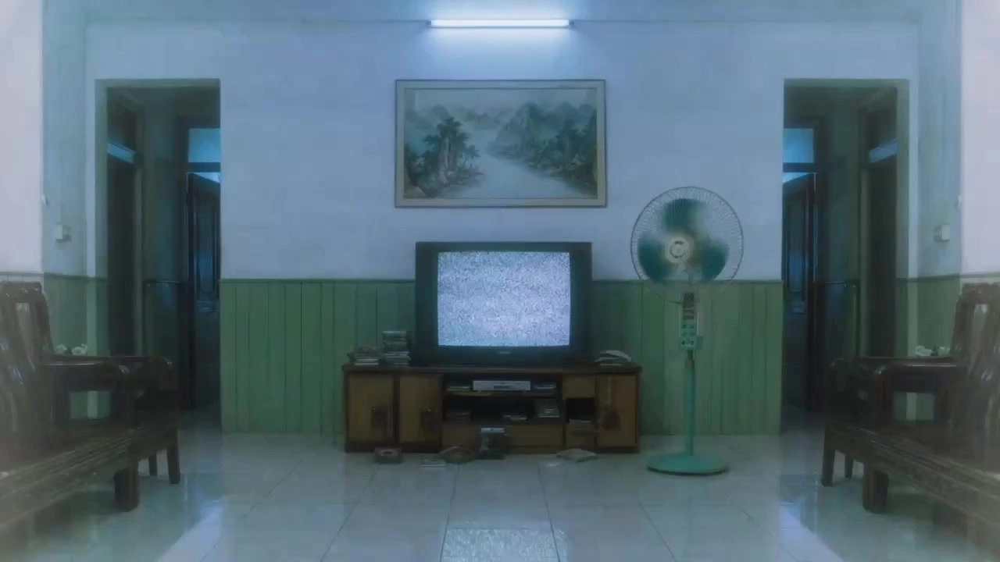

# Millennial Chinese Dreamcore

> **作者：** @张世杰

## Content

Process Planning:

Overall Workflow (Executed in stages; pause after each stage to request user confirmation):

Aspect Ratio and Narrative Perspective Confirmation Stage

Use a card to ask the user: Select aspect ratio 16:9 (Horizontal) or 9:16 (Vertical).

Use a card to ask the user: Select narrative perspective First-person or Third-person.

Record the user's choices into the subsequent Final_Video_Spec.md as global locked parameters.

Script Confirmation Stage

Use a card to ask the user: Is the script provided by the user or generated by AI?

If AI generated → Default to a style resembling Chinese childhood around the year 2000. Select 1–3 scenes from the "Dream-core Scene Pool" (see Storyboard Design). Weave a short story without grand narratives, where each space feels like it holds a childhood video. Do not use narration (VO) in the script. All human voices should be現場 (live) dialogue and background laughter/play, generated synchronously with the video by Seedance 2.0.

If generating an AI script, first ask the user: Do you need characters in the script?

If Yes → Generate a script with characters, design specific roles and interactions, using live dialogue and off-screen background noise.

If No → Focus on showing the Y2K environment, emphasizing spatial texture and period-specific objects to create an empty, liminal space atmosphere. Do not generate character Key Elements; human voices should only be ambient off-screen sounds (distant laughter, neighbor's TV, etc.).

Pause after script generation, waiting for user confirmation or edits before proceeding.

Asset Source Confirmation Stage

Use a card to ask the user: Are scene assets provided by the user or AI-generated? If "Yes" was selected for characters in Stage 2, also ask for the source of character assets.

If user-provided → Call resource_prepare_and_analyze to understand uploaded assets, then align descriptions with assets in the Storyboard.

If AI-generated → Generate Key Elements images according to the rules below.

Global Parameter Locking

Create Final_Video_Spec.md using text_editor, and write in: Title, Type (Y2K dream-core nostalgic short), Aspect Ratio (user selection from Stage 1), Narrative Perspective (user selection from Stage 1), Character presence, Duration intent, Visual Style (teal-green/burnt-yellow, film grain, cold fluorescent light, slight overexposure), and Output language.

Pause and wait for user confirmation of global parameters.

Storyboard Design → storyboard_designer

Design Key Elements (scenes + props; plus characters if the "Yes" script was selected) and the Shot List, as well as separate Audio Layers.

If the user selected a first-person perspective, the camera work in the shot list must include a slight handheld breathing sensation—minor shakes to simulate natural breathing rhythm, avoiding intense motion (see Storyboard Design for details).

Pause and wait for user confirmation of the Storyboard.

Key Element Image Generation → media_generator

Use GPT Image 2 to generate Key Elements images for scenes (and props); if the "Yes" script was selected in Stage 2, also generate Key Elements images for characters.

If the user provided assets in Stage 3, bind them to the corresponding element and fill in any missing parts.

Pause and wait for user confirmation of assets.

Shot Video Generation → media_generator

Use Seedance 2.0 (via MultiModalToVideo) to generate videos shot-by-shot with synchronized audio, referencing the corresponding character and scene element images for each shot.

Pause and wait for user confirmation of shot assets.

Audio Layer Generation → media_generator

Default to no BGM. All audio should be based on the live audio tracks generated synchronously with the video by Seedance 2.0 (ambient sounds, live dialogue, off-screen laughter, etc.). This Skill does not use narration (VO).

Only if the user explicitly requests BGM before assembly, use text_to_instrumental to generate a dream-core electronic BGM track. Style should be lo-fi psychedelic/ethereal/detached; avoid upbeat melodies.

Final Assembly → video_assembler

Assemble the timeline and guide the user to export.

Dependencies: 4→1, 2, 3; 5→4; 6→5; 7→6; 8→5; 9→6, 7, 8

Pause Rules: You must pause after completing each numbered stage. Use a card or reply_to_user to invite user confirmation before moving to the next stage. Do not execute the entire process at once.

Asset Analysis:

When a user uploads reference images or videos, focus on extracting the following information and outputting it as structured text:

Era Identifiers: Millennium-era objects such as CRT monitors, floppy disks, MP3 players, flip phones, old advertising lightboxes, white tile walls, light blue glass, etc.

Color and Tone: Cyan-green tones, burnt-yellow tones, fluorescent cold tones, slight overexposure, and film grain texture.

Composition Characteristics: Symmetrical/centered composition, low-angle voyeuristic feel, minimalist accents (1–2 strong memorable symbols in the frame).

Space Type: Identify which type of millennium public space the scene belongs to (computer lab, park, mall, bookstore, internet cafe entrance, etc.).

Align the analysis results with the element descriptions in the Storyboard: If the uploaded material conflicts with the established description, correct the Storyboard based on the user's material.

Storyboard Design:

Dreamcore Scene Pool (AI selects 1–3 when generating scripts):
Computer lab, bumper cars at the People's Park, fast food restaurant birthday party, revolving restaurant at height, old county shopping mall, children's clothing floor, computer city, Xinhua Bookstore, outside an internet cafe, newsstand, tube building corridor/stairwell (voice-activated lights, green wall skirt), roadside food stall/Cantonese stir-fry, school playground/after-school, old-fashioned barbershop, public bathhouse, watching TV at the dining table at home, newspaper kiosk/notice board, living room (waking up from an afternoon nap), street (asphalt road on the way home from school), aquarium, roadside arcade, swimming pool, corner shop/kiosk.

Design Key Elements:

Characters (if the script includes people): If a character has multiple outfits, describe them separately (Outfit 1: ...; Outfit 2: ...).

Scenes: Describe the position and orientation of important objects in the scene—especially props or areas where main actions occur. Incorporate period-accurate objects (white tiled walls, light blue glass, old advertising light boxes, plastic greenery, glass counters, CRT monitors, blue plastic chairs, etc.).

Props: Set iconic Y2K props (MP3 players, digital pets, CCD cameras, floppy disks, game discs, etc.) as independent elements as needed.

User Assets: If the user has provided reference assets, the description must be consistent with the assets and not contradict them.

Design Shots:

Duration: 10–15s preferred; minimum 5s, maximum 15s (Seedance 2.0 limit).

Each shot description must include:

Scene: Use the scene element ID to reference the location/scene.

Story beats: Actions and dynamics of characters and key objects; dialogue and performance. Specify exact dialogue (spoken conversations) and reference characters using element IDs. If "No one" is selected for the script, describe dynamic changes in the environment here (light movement, object sounds, etc.).

Cinematography: Shot size (long shot, medium shot, close-up), camera angle, and camera movement.

First-person perspective handling: If Final_Video_Spec is locked to first-person, mark the camera movement as "First-person POV." Focus on a slight handheld breathing sensation—only simulate the very subtle fluctuation of natural breathing rhythm. Avoid violent shaking; keep the amplitude restrained and soft. Pair with a low angle (child's height) and line-of-sight guidance (looking in through door cracks, window lattices, or screens). This avoids stabilizer-like perfect smoothness while also preventing exaggerated shaking that would ruin the quiet, dreamy atmosphere.

Third-person perspective handling: Focus on "fixed camera," "slow push-in," and "subtle sway" to emphasize a sense of observational distance and spatial emptiness.

Composition code: Symmetrical/center composition to create an unnatural sense of order; low angles/peeping sensation to add narrative pressure; minimalist accents—keep only 1–2 strong mnemonic symbols per frame (e.g., "summer vacation homework," "Fu" character).

Design Cross-Shot Audio:

No BGM by default: All sounds should be based on the ambient audio track generated synchronously by Seedance 2.0. Only design a dream-core electronic BGM to be written into an independent audio layer if the user explicitly requests it.

No narration (VO): This skill has no independent narration layer.

On-site dialogue: Written in the shot's Story beats; this is spoken dialogue for characters within the frame.

Off-screen voices: Sounds from off-screen spaces, such as laughter, distant calls, or neighbors' TV sounds, should be written in the Cinematography or audio description section to create a sense of realism that "others are living nearby." If "No one" is selected for the script, only keep off-screen voices.

Media Generation:

Key Element Image Generation:

Use TextToImage with the GPT Image 2 model at 2K resolution.

Character Key Element Image: Generate a composite landscape image including a three-view shot (front, side, back) + close-up. Use a 16:9 or 4:3 aspect ratio (supported by GPT Image 2). Prompts must begin with "Generate a [Character Description] figure from around the year 2000 in China," describing period-specific clothing, hairstyles, and accessories based on the script.

Scene Key Element Image: Generate overall environment images for each scene at a 16:9 aspect ratio. Prompts should include period-specific objects and color tones (e.g., cyan-green/sepia/cold fluorescent lighting/film grain/slight overexposure).

Multiple Looks for Same Character: Use ImageToImage (with the same GPT Image 2 model), referencing the previously generated base character image to maintain identity consistency.

If the user provides assets in Phase 3, analyze them via resource_prepare_and_analyze first, bind the asset_id to the corresponding element, and then fill in any missing elements.

Shot Video Generation:

Use MultiModalToVideo with the Seedance 2.0 model.

Reference Binding: For each shot, pass the character, scene, and prop element images involved in that shot via image_infos (≤9 images) as visual references. Use placeholders like <<<image_1>>>, <<<image_2>>> in the prompt to specify the reference order and content (e.g., character appearance, scene environment). For tighter control, first synthesize a keyframe composition reference image using ImageToImage and include it in image_infos.

Resolution: 720p (default), 1080p also supported; Aspect Ratio: 16:9 / 9:16 / 4:3 / 3:4 / 1:1 / 21:9 (must match Final_Video_Spec.md); Duration: Preferably 10–15s, minimum 5s (do not exceed 15s, Seedance 2.0 limit).

Prompt Character Limit: 2300 characters (including <<<image_X>>> placeholders). Describe both visual movement and audio elements (ambient sound, dialogue, SFX).

Audio Reference (Optional): To maintain consistent character voice across shots, pass the character's key_element_audio via audio_infos (≤3 clips); omit if not bound.

Audio Layers Generation:

No Default BGM: All audio should originate from the synchronized live track generated by Seedance 2.0 with the video. Only generate BGM via text_to_instrumental if explicitly requested by the user, using a dream-core electronic style (lo-fi, ethereal, detached, avoiding cheerful melodies).

No Narration/VO: This Skill does not use text to narration to generate independent voiceover layers. All vocal content (live dialogue, off-screen laughter, etc.) is generated synchronously with the video by Seedance 2.0.

Model Failure Handling:

If GPT Image 2 fails, switch to other models within the same tool (e.g., Nano Banana Pro).

If Seedance 2.0 fails, prioritize switching to Kling 3.0 Omni (the best model in the MultiModalToVideo tool); if Kling 3.0 Omni also fails, try Seedance 2.0 Fast.

If all models within the tool fail, stop the step and inform the user.

Prompt Writing:

Language Rules: When interacting in Chinese, use Chinese for the prompt body. Text appearing within the visuals (e.g., posters, screen interfaces) should be rendered in the language specified in Final_Video_Spec.md.

Image Prompt (TextToImage / ImageToImage · GPT Image 2):

Write from the perspective of a director/art director: Describe the subject + action + environment in natural language, and use short phrases for style/color/lighting/composition.

Character Key Elements Required: Start with "Generate a [character role] from China around the year 2000", then describe attire (e.g., school uniform, low-rise jeans), hairstyle, accessories (MP3 headphones, Tamagotchi), and expression/vibe.

Three-view + Close-up Composite: Explicitly request in the prompt: "Arranged horizontally: left, front full-body; center, side full-body; right, back full-body; far right, head close-up," ensuring all four parts are in the same image.

Scene Key Elements: Must incorporate period-specific object keywords (white tiled walls, light blue glass, CRT monitors, old advertising light boxes, glass counters, etc.) and lighting/tone keywords (teal/green tint, sepia tone, cold fluorescent light, heavy film grain, slight overexposure).

Composition Instructions: Include composition cues in the prompt such as "centered symmetric composition," "low-angle voyeuristic feel," or "keep only 1–2 mnemonic symbols in the frame."

If text needs to appear (e.g., "Y2K bug detection," "OICQ," "Year 2000 countdown"), cite the exact renderable string.

Video Prompt (MultiModalToVideo · Seedance 2.0):

Structure: Camera movement (e.g., slow push, static, subtle pan) → Subject action & expression → Changes in environmental details → Audio description (ambient sound/SFX/dialogue).

Reference Image Placeholders: Use <<<image_1>>>, <<<image_2>>>, etc., in the prompt to mark what each reference image is used for (e.g., <<<image_1>>> for character appearance reference). Placeholders count towards the character limit.

First-Person View Movement: If Final_Video_Spec.md specifies a first-person perspective, include instructions like "handheld shot, slight breathing motion, gentle and restrained, no violent shaking." Combine this with subjective view descriptions (e.g., "looking through the door crack," "looking down at the Tamagotchi in hand") to avoid both stabilizer-like smoothness and exaggerated shakiness.

Third-Person View Movement: If third-person, prioritize "static shot," "slow push," and "subtle pan" to emphasize the observer's distance and sense of spaciousness.

Specific Audio Description: Explicitly state ambient sounds (e.g., "creaking sound of an old ceiling fan, distant cicadas"), SFX (e.g., "QQ cough notification sound"), and dialogue (if present, use quotation marks and specify the language).

Vocals in Video Prompt: This skill does not use a separate voiceover layer. All on-site dialogue and off-screen voices (giggles, distant calls, etc.) must be written in the audio description section of the video prompt to be generated synchronously by Seedance 2.0.

Character Count Control: The total length of the prompt + placeholders must not exceed 2300 characters. Keep descriptions concise.

Tone Reminder: Append style tags to the end of the prompt, such as "film grain texture, teal/cold tone, slight overexposure, nostalgic dreamcore vibe," to ensure the model maintains the visual style.

Video Editing:

Audio Synchronization: By default, there is no BGM layer on the timeline. Only the original audio tracks (ambient sound, live dialogue, voice-overs) generated by Seedance 2.0 for each shot are kept. This skill does not include a separate narration layer.

If BGM is requested: Overlay Dreamcore-style electronic BGM as a background track, ensuring the volume does not overpower the live dialogue.

Pacing and Transitions: Use slow dissolves or hard cuts between shots to preserve the detachment and sense of suspended time characteristic of Dreamcore. Avoid fast cuts or flashy transitions.

Export Guidance: Once assembly is complete, guide the user to export.
