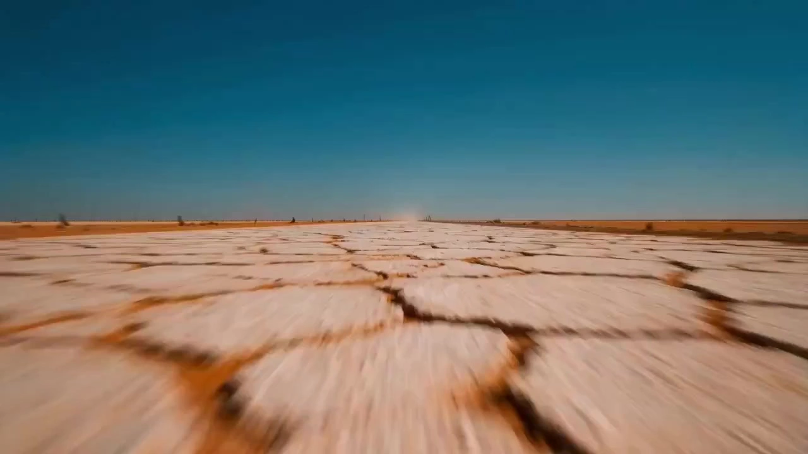

# Miller-esque Wasteland Punk Style

> **作者：** @Damon

## Content

Process Planning:

Global Video Parameter Establishment and Execution Logic:

Establish Global Specifications: First, call text_editor to create Final_Video_Spec.md. Lock the aspect ratio to "16:9" and the resolution to "720p". Write the Miller-esque wasteland aesthetic (Mad Max, high-saturation cyan-orange tone, heavy modified combat vehicles, primal wilderness, de-digitized) into the video style specifications.

Design Storyboard: Call storyboard_designer to plan the storyboard. The plot, character relationships, and core concepts of the storyboard must strictly follow the plot outline and concepts provided by the user. Based on this, design the core elements in detail (modified trucks, various types of combat vehicles, wasteland wanderers, or customizable wasteland tribe characters and base scenes), as well as specific shot lists and audio layer tracks. Each shot must explicitly reference and link to a specific scene element (element scene); leaving it blank or without a scene association is strictly prohibited.

Establish and Verify Core Element Assets (Characters and Scenes):

If the user proactively provides reference images (e.g., user-uploaded character full-body three-view drawings, character sketches, or specific scene/combat vehicle reference images):

First, call resource_prepare_and_analyze to parse these images. Evaluate whether the visual style complies with the "Miller-esque live-action wasteland aesthetic: realistic heavy machinery, gritty handmade assembled materials, extreme desert sunlight, clear separation between ocher-orange ground and deep cyan-blue sky; the image maintains high contrast and high legibility, but character skin tones, rust, fire, and sand dust must not be uniformly covered by a cyan-orange filter." Conduct a special verification of character reference images (must be unobstructed full-body three-view drawings, i.e., front, side, and back views are all in standing full-body angles; half-body photos are strictly prohibited). Conduct a special compliance verification for scene reference images (whether they are four-grid scene images without characters, with multiple angles, and content standardly distributed into four quadrants).

If both style and format comply: Extract physical details and common perspective characteristics to write into the storyboard description, and call media_generator to bind the asset_id directly.

If style or format does not comply (e.g., flat realism, cyber-neon, or the uploaded character image is not a standing full-body three-view drawing/belongs to a half-body shot/lacks angles, or the uploaded scene image is not a standard four-grid layout or contains characters): Do not bind directly. Use the original image provided by the user as a reference for visual and structural features. Call the ImageToImage path of media_generator (using GPT Image 2, aspect ratio 16:9, resolution 2K), forcibly inject the "high-saturation cyan-orange golden formula" and wasteland assembly details to generate a set of full-body three-view drawings (must not be half-body shots) that include front/side/back standing angles and conform to the film's aesthetic, or reshape it into a scene four-grid image without characters where the four quadrants are standardly distributed (wide shot / furnishing close-up / depth perspective / atmospheric lighting). After user confirmation, register and bind it as a stable asset_id.

If the user does not provide reference images: Call the image generation function of media_generator. It is recommended to use TextToImage with the GPT Image 2 model to generate 2K, 16:9 high-definition element reference images: For characters, force the generation of full-body three-view drawings (front, side, and back are all full-body; generating half-body photos is strictly prohibited); for scenes, force the generation of four-grid scene reference images with fixed content distribution (wide shot / furnishing close-up / depth perspective / atmospheric lighting) and without any characters, and register these as stable asset_ids.

Asset Integrity Check: After the above steps are completed, the system must actively check against all core elements planned in the storyboard (character element, scene element, prop element, etc.) to ensure that each item has successfully generated a corresponding image and that each asset_id has been correctly bound to the storyboard slot. At the same time, it is mandatory to deeply check whether every shot has explicitly indicated a scene element ID. "Unowned background shots" that are not bound to scene reference images, or backgrounds that are inconsistent with adjacent shots, are strictly prohibited. If any elements are missing or shots are not bound to scene assets, it is strictly prohibited to proceed directly to the next video shot generation stage.

Video Shot Generation and Prompt Alignment Verification: Call the MultiModalToVideo path of media_generator. It is mandatory to select only the Seedance 2.0 model to generate 720p video clips. It is strictly prohibited to select any other video generation model (such as Seedance 2.0 Fast, Sora-2, Kling 3.0 Omni, Vidu(Q3), etc.). Before performing video generation and prompt writing, the system must force a deep comparison and verification between the generated video prompts and the corresponding storyboard scripts to confirm that no information such as scene references, character/prop references, lines, or dialogue is missing. If it is detected that a certain shot is not specified or not bound to a scene reference image, or if there is an illogical scene jump, video generation must be terminated immediately and the scene binding must be automatically completed. During generation, strict multi-dimensional logic verification and strong binding rules for the three sets of consistent assets must be executed:

Consistency Logical Constraints Check: The maximum visual asset input limit for a single shot is strictly restricted to 4 items, and a fixed slot mapping is enforced (image_1 binds to the scene four-grid, image_2 binds to the main character full-body three-view, image_3 and image_4 bind to combat vehicles/props or secondary characters); execute a non-conflict attribute check (eliminate contradictions in environment, clothing, and equipment between semantics and image assets; if inconsistent, refuse generation and trigger a redraw); perform spatiotemporal continuity alignment verification for reference_video. If a cross-scene switch occurs between front and back shots (e.g., from a highway road into an internal corridor of a base), it is strictly prohibited to bind reference_video references to prevent background image deformation or collapse.

Audio Consistency: If there is dialogue for a character in the shot and that character is bound to a voice reference, strongly bind its key_element_audio voice reference asset. The visual full-body image must be in place in the image_2/image_4 slots at the same time to ensure Lip-sync and high consistency of dialogue voice across multiple shots; if the user chooses to "Skip" during the audio asset stage, the system can directly call the default high-quality wasteland tone model for voice synthesis when generating the video, without hindering or hanging the generation pipeline.

Sequential Generation Dependency: If it is determined that the preceding and following shots have a high degree of continuity (requiring the introduction of the final_shot video of the previous shot as the reference_video input for the current shot), the system must abandon parallel (Batch) multi-channel shot generation and force the execution of serial generation logic: It must wait for the rendering task of the previous shot to be 100% completed, generate and register a stable final_shot physical asset, and only then pass it as a reference_video parameter to start the generation of the current shot. This establishes a strict serial dependency (Shot N-1 → Shot N) in the timeline and rendering pipeline, preventing generation failure due to the absence of preceding assets.

Audio Generation: Call media_generator to generate independent audio tracks. For the voice-over (VO) throughout the film, use the fixed narration_speaker_profile description and call MiniMax Speech 2.8 HD or ElevenLabs v3 to uniformly generate an independent VO track to maintain global narrative voice consistency; for background music, use Suno 5 or Mureka 8 to generate industrial heavy metal rock containing hard-core spliced Foley sounds such as heavy iron buckets, old electric drills, and heavy air pumps.

Image and Video Super Resolution (super_resolution) Enhancement (Optional): To pursue cinematic image quality and smoothness, the super_resolution tool can be called:

Image Super Resolution: Before confirming the locked character/scene element reference image, call the Jimeng SR model to upscale the image to 4k, with the scale factor fixed at 50, making textures like rust and desert sand extremely realistic.

Video Super Resolution and Frame Interpolation: After shot video generation, for high-tension dynamic shots such as highway chases and explosion fights, call the MediaKit model to upscale the 720p shot to 1080p and increase the frame rate (fps) to 60, presenting an extremely silky cinematic smoothness.

Timeline Assembly and Rendering: Call video_assembler to perform fast cuts and Speed-Ramping in the Miller-esque editing style, achieving freeze-frames, extreme slow-motion, frame-skipping stutters, and precise alignment of audio and video tracks.

Strict Confirmation Checkpoints:This Skill implements an extremely strict "confirm first, generate later" strategy. Before generating any new physical assets (images, videos, audio, etc.), it is mandatory to pause and obtain the user's explicit confirmation before executing the next step. Specific pause nodes are as follows:

Pause after Storyboard Design: After step 2 (storyboard and global parameter locking) is completed, pause immediately. Show the user the complete storyboard, element planning, and audio track design. Only proceed after the user is satisfied and confirms.

Pause before Character and Scene Asset Generation: In step 3, if media_generator (GPT Image 2) needs to be called to generate full-body three-view drawings, combat vehicles, or scene reference images from scratch, it is mandatory to show the prompt design to the user and obtain confirmation before starting generation. After generation, the user must also approve before locking as a stable asset_id.

Pause for Element Asset Integrity Check and Locking: After completing step 3 "Establish and Verify Core Element Assets" and before entering step 4 video generation, the system must pause and submit the list of all generated and bound element assets (clearly presenting the asset_id of each core element and its corresponding reference image) to the user. Only proceed when the user has reviewed, confirmed no omissions, fully aligned, and agreed to lock.

Pause before Shot Video Generation: Before calling MultiModalToVideo in step 4 to generate video clips, it is mandatory to show the user the video prompts, bound reference images, and shot planning, and only start generation after the user confirms and agrees. When showing the user, the system must provide a clear "Storyboard Alignment Verification Report", listing the items compared: whether the included scene references, character/prop references, lines/dialogue, etc., are completely consistent with the storyboard script and whether there are any omissions, so that the user can see them at a glance.

Pause before Audio Generation: Before generating voice-overs and background music in step 5, it is mandatory to first show the user the VO copy, voice timbre, and music prompt plan, and start generation only after confirmation.

Pause before Super Resolution/Frame Interpolation Enhancement: Before performing image 4k super resolution or video 1080p/60fps frame interpolation enhancement in step 6, it is mandatory to report the super resolution/frame interpolation optimization plan to the user and obtain approval before submitting the task.

Pause before Timeline Assembly Rendering: Conduct a comprehensive confirmation before performing the final timeline assembly and rendering output in step 7; proceed only after confirming that everything is correct.

Membership & Permissions Note:

Although the Seedance 2.0 video generation model and 1080p super resolution are membership-exclusive features, the system must not actively reject user requests for models and parameters due to membership permission restrictions during planning. It should pass the set parameters downward directly and leave specific permission verification and downgrade smoothing to be handled by the Flova backend execution module.

Asset Analysis:

I. Scene Reference Compliance Audit:

Format and Subject Verification: Evaluate whether the scene reference image uploaded by the user is a collage formatted as a "2x2 four-quadrant grid, containing no characters and showing multiple angles."

If the image contains any obvious characters, futuristic neon that is not in a wasteland style, or is a single-perspective widescreen image, it is deemed non-compliant.

Standard Four-Quadrant Content Check: Check if the four quadrants of the grid align with the following content allocation standards:

Establishing Shot: Displays the grand, overall landscape of the wasteland, the horizon, and the overall morphology of the settlement.

Props & Close-up: Displays iconic details such as scrap steel, rivets, rusted iron spikes, or makeshift machinery.

Depth & Perspective: Displays layouts with strong perspective and depth, such as settlement corridors or overlapping ruins.

Atmospheric Lighting: Displays strong emotional and color tones, such as teal-orange contrast, dust-filled air, or backlit silhouettes.

Feature and Structure Extraction: If the format and style are compliant, extract the structural proportions, wasteland material characteristics, and lighting/texture qualities from the four quadrants above, outputting them to the storyboard_designer to assist in detailed rendering, and return a "style consistent and format compliant" signal to the planner. If non-compliant, evaluate the usable outlines and general layout of the settlement in the original image, and output a regeneration guide stating: "Must use GPT Image 2 to reshape into a standard, character-free wasteland 2x2 grid."

II. Full-Body Character Three-View & Other Asset Verification:

Full-Body Character Three-View Compliance Verification: Evaluate whether the character reference image uploaded by the user is a standard, unobstructed upright full-body three-view (front, side, and back views must be full-body standing poses; half-body shots are strictly prohibited).

If it is a half-body shot, missing any core angle (front/side/back), or contains obstructions, it is deemed non-compliant. The system must extract the clothing style, color scheme, and facial features, and output a regeneration guide stating: "Must use GPT Image 2 to redraw into a three-view containing front, side, and back full-body upright angles," and return a non-compliant signal.

If fully compliant, evaluate whether it contains wasteland-punk visual traits (such as unevenly distributed worn leather, patched metal fasteners, or specific tribal makeup, totems, and exclusive features specified in the user's plot outline), and extract these features for output to the storyboard_designer and media_generator.

Audio Asset Assessment: Evaluate whether the character voice sample matches their corresponding wasteland character identity or specific tone style.

III. Video Reference & Motion Analysis:

Format and Motion Extraction: When the user uploads/provides video reference clips (such as real-life road chases or explosive fight footage), call resource_prepare_and_analyze to perform multi-dimensional analysis of physical motion, editing rhythm, etc.

Parameter Evaluation: Deeply extract the subject's motion trajectory, average cut frequency (rhythm), and camera motion patterns (e.g., rapid panning, shaky cam, fast zooms, etc.).

Aesthetics and Atmosphere Evaluation: Analyze color saturation, teal-orange light/shadow ratio, and specific physical characteristics (e.g., density of sandstorms, concentration of smoke trails from vehicle exhausts, etc.), converting them into high-density text feature signals. These are output directly to the storyboard_designer for refining dynamic storyboard design and serve as a basis for fine-tuning prompts in the write_the_prompt video motion stack.

Storyboard Design:

I. Wasteland Four-Act Opera Narrative Flow (Setup-Confrontation-Turn-Resolution):

Act 1: Desolate Setup & Tyranny Established: Showcase the deathly silence of the endless desert or heavy industrial strongholds. Establish a grim, oppressive tone through shots of the leader overlooking the wasteland and lone drifters wandering the expanse.

Act 2: Mobilization & Ritual: The frenzied atmosphere heats up! War Boys paint themselves with white grease, assemble modified beasts of war, engines roar to a deafening volume, and the war party stands ready.

Act 3: Pursuit & Collision: Enter the core highway battle. High-speed crashes, flame-throwing raids—the movement and emotional rhythm reach a boiling point.

Act 4: Fiery Climax & Sacrifice: The climax explodes! Arrange for a War Boy to shout "Witness me!" and collide with an enemy vehicle in a blinding fireball, ending with a bleak finish amidst the contrast of golden desert sands and cyan twilight.

II. Optional Wasteland Tribal Archetypes and Faith Interaction Logic (Not mandatory to copy, support deep customization based on plot outlines):

Diverse Wasteland Tribal Prototypes (Optional Prototypes): This design uses the classic Mad Max: Fury Road "Immortal Leader and Fanatical Warriors" as an optional prototype, but the system must support and encourage the generation of entirely new tribal systems, facial and body makeup (e.g., yellow clay paint, industrial grease, tribal totems, cracked skin, scars, wasteland prosthetics, etc.), exclusive survival gear, and unique "resource worship systems" (e.g., godhood worship built around pure water, gasoline, bullets, metal, or even rare greenery) based on the user's outline. Copying a single movie style is strictly prohibited.

Godhood Worship and Vow Ritual Interaction (e.g., the classic War Boy "Witness me!" suicide assault): When executing suicide assaults or extreme highlight moves, characters can trigger ritualistic interactions with strong physiological tension:

Manic Trembling Eyes Close-up: Tight close-ups capturing the manic trembling eyes and rapidly vibrating dilated pupils caused by extreme excitement, terror, or near-death faith, with filthy tears mixed with black engine oil, sweat, and sand streaming from the corners of the eyes.

Ritual Painting/Spraying: Characters use worn-out canisters to violently spray shimmering silver paint or pigments onto their mouths or faces, covering lips, tongues, or foreheads, with their teeth reflecting a sinister, fanatical glint.

Frenzied Vows and Responses: In close-ups of rapid, gasping breath, they shout totem vows syllable by syllable (e.g., the classic "Witness me!"), while the leader or companions offer arrogant, cold responses (e.g., "Mediocre!" or "Go to Valhalla!"), establishing a fated, tragic sense of drama.

Audiovisual Composition Reinforcing Class Gaps and Spatial Contrast:

Height Difference Cut: The leader or priest stands on a stronghold platform or giant war machine top, using extreme low-angle shots to render authority, cut against high-angle overhead shots looking down at the tribal commoners/believers below who are looking up and chanting like a tide.

Harsh Sunbeam Contrast: Inside the dimly lit stronghold, the power core is always bathed in blinding desert light slanting down from roof ventilation shafts, while common believers crowd in the gloomy, back-lit shadows filled with floating dust particles, using silhouettes and faint facial highlights to underscore the fatalistic contrast between the divine and the lowly.

Wasteland Leader Physiology & Gear Close-Ups (Optional Reference):

Violently Vibrating Breathing Tubes: Close-up of the terrifying skull protective mask on the leader's face and the thick rubber bellows on both sides, undergoing violently vibrating and trembling bellows tubes with ragged breaths as they breathe like broken bellows with deep, gritty, phlegmy rasps.

Rotten Teeth and Rusted Mask: Behind the semi-transparent or hollow metal mask, feature close-ups of yellow rotten decaying teeth visible behind rusted metal muzzle, shaking violently with every word and roar.

Heavy Chains and Armor Collision: Over the transparent chest armor made of thick organic glass, wrap several loops of massive rusted steel chains. With every rapid breath, heave, or war machine jolt, the chains produce heavy clanking, scraping, and raw metal vibrations against the armor, using iron restraints to accentuate the texture of the diseased iron hegemony.

III. Miller-Style Modified Vehicle "Personification" and Defensive Wear-and-Tear Framework (Strictly adhering to usage, contour differentiation, and force distribution logic):When planning modified war machines and defensive equipment, you must refine from the following five heavy industrial, battle-damage, and high-energy collision directions. Strictly follow the fundamental principles: "Limit each subject to only 2-3 core features," "Material damage distributed unevenly based on stress points," and "Maintain physical restraint during normal driving, concentrating and enhancing only one major effect at collision points (sparks, black smoke, sandstorms, explosions, or molten iron)." The overall goal is to shape a wild, wasteland visual with authentic spliced machinery, clear physical stress, and highly readable action, resolutely avoiding high-saturation, plastic-feeling video game CG effects.

Vehicle Usage and Unique Visual Silhouette Differentiation: Each core modified vehicle must first define its tactical purpose (e.g., heavy truck for clearing paths, off-road pursuit, light reconnaissance/harassment, artillery fire, etc.) and physical volume/weight. Based on its purpose, design a unique frontal silhouette that is highly readable even in long shots and shadows (e.g., towering sharp triangles, wide-flat trapezoids, irregular mechanical crane booms), body height differences, distinct tire structures (e.g., dual-axle high-pattern tires, crawler-hybrid, staggered crawler-hubs, giant exposed shock absorbers), and motion posture forms (e.g., clumsy but fierce rigid shaking, high-frequency bouncing, smooth sliding hugging the sand). Strictly prohibit stacking steel spikes, exhaust pipes, or skull decorations equally on every vehicle. Each vehicle should retain only 2-3 core identification features for high-recognition differentiation (e.g., "Heavy Truck: Tall inverted triangle silhouette + exposed giant supercharger + dual exhaust pipe array," or "Motorcycle: Low long silhouette + giant crawler drive wheel + scissor-cut steel spikes"; ensure vehicles do not look identical).

Armor Shields (element prop): Weld overlapping rusty steel plates, thick railway sleepers, or peeling I-beams as physical bulletproof shields on flanks, front, and around tires, depending on vehicle usage. The high-density impact craters, warped and crumpled contours, rough oxy-cutting burrs, and raw slag weld beads on their surfaces must not cover the entire surface. They must be distributed in a targeted, dense manner according to collision and blocking functional locations (e.g., front bumpers, flank impact surfaces, lower wheel cover edges), while non-stress surfaces should remain relatively flat with only slight wear.

Anti-Climbing Spikes (element prop): Densely weld sharpened scrap rebar, rusty iron shovels, or barbed wire stripped from ruins on the vehicle flanks, wheel hubs, and hood edges. Steel spikes should not be uniform; their bent, twisted, and skewed shapes, half-snapped and jagged broken ends, and surfaces covered in a mixture of crusted engine oil and dark blood-rust must be strictly limited to friction edge zones prone to physical squeezing or climbing combat (e.g., outer wheel hubs, boarding steps), while spikes in wind-shielded areas or on the hood must remain largely intact and upright to create a strong sense of physical wear-and-tear contrast and realistic stress logic.

Exhaust & Flame Systems (element prop): Vehicle-mounted high-pressure flamethrowers, flame-spitting guitar stages (Doof Wagon style), and giant tongues of flame erupting with engine RPMs. Focus on towering, thick, multi-vertical chrome exhaust stacks and quad-exhaust banks. Requirements: Show scorched soot-stained patina and carbon-caked crusts on exhaust ports due to high-temperature baking, accompanied by backfire flame pulses and incandescent sparks generated by the engine's limit roaring, and dense rolling black diesel smoke and carbon soot vortices that swirl and twine in the air as the convoy speeds along.

High-Energy Collision & Steel Tearing (element prop): When two vehicles collide at high speed, rub violently, or squeeze together, the vehicle armor shields and chassis steel frames must create destructive textures with intense physiological impact:

Metal Cracking & Peeling: Upon impact, steel armor undergoes explosive tearing. The rough, curled edges must reveal an exposed gleaming silver steel base, creating a strong color contrast with the surrounding mottled dark red rust and black oil patches. Overlapping multi-layer armor, under violent squeezing, crumpled and peeled-back like paper; industrial rivets and heavy bolts are sheared-off bolts and heavy rivets blasting outwards under intense shear force.

High-Density Spark Explosion & Molten Rain: At the instant of violent side-impacts or head-on grinding, the contact surface between the two vehicles must spray high-density white-hot metal sparks with strong contrast and directionality, presenting cascading multi-branched spark arrays branching in mid-air. The spark storm must contain a large number of glowing red-hot molten steel droplets melted instantly by friction heat and falling steel debris, drawing bright golden streaks of light in the air, resembling a high-energy magma eruption, providing an extreme retinal physiological burning sensation.

Friction Trenches & Burned Rubber: Plow deep, jagged friction trenches on friction surfaces, with edges featuring torn molten slag. Giant off-road tires explode instantly during collisions and lateral drifting, leaving scorched rubber skid marks and wisps of toxic heavy oil fumes on the sand and the scraped vehicle body.

IV. Cinematography and Camera Movement Style (Miller Cinematography Style):

High-speed Chase Tracking: Extreme high-speed racing in parallel or at oblique angles, creating a sense of near-death speed through frantic movement and swirling sand.

Extreme Ground-level Grazing: The camera stays below 1 meter, almost grazing the salt flats or quicksand, intensifying the suffocating pressure of grinding sand and stones.

Aggressive Snap/Crash Zoom: Rapidly zoom in at the moment of impact, explosion, or roar, instantly "locking" the focus to provide strong physical impact tension.

High-Frequency Lateral Panning & Parallax Tension: The camera moves in high-frequency, sudden speed bursts between two modified war machines racing in parallel. Requirements: Must emphasize the Parallax Shift between the foreground vehicle edge, the mid-ground pursuit subject (e.g., a War Boy waving a thunderstick or two vehicles colliding), and the background horizon of flying sand. The lateral sliding speed needs to be exponentially intense to create a sense of suffocation, claustrophobia, and pressure as if clamped between the two vehicles.

Bumpy Camera Shake & Mechanical Vibration (strictly limited to collision explosion points; maintain restraint in normal shots): To protect action readability, maintain basic stability in normal driving or non-collision shots (only smooth, powerful pans, tilts, or dynamic tracking; resolutely avoid unbridled, constant, random shaking). Only trigger violent, irregular Bumpy Shake at the instant of extreme road bumps or collision explosion points (e.g., side-swiping, explosion shockwaves, or head-on collisions), with a momentary, explosive tilt/polarization on the 1st frame of the collision, followed by rapid, strong-damped mechanical reset within the next 3-5 frames to achieve a perfect balance between action clarity and the physiological impact of a heavy hit.

Kinetic Leap-and-Thrust Shot: Showcase a War Boy holding an explosive spear/thunderstick, climbing frantically along the edges, flanks, and anti-climbing spikes of a speeding modified vehicle, then leaping into the air to launch a specific high-light kinetic assault on the enemy vehicle. Requirements:

Climbing and Take-off Kinetic: Before leaping, show a close-up of bare feet or dirty bandage-boots forcefully pushing off the violently shaking rusty steel edges and shield grooves, causing the area to vibrate intensely and dislodge fine rusty iron flakes and flying sand.

Mid-Air Suspended Climax: At the apex of the flight while thrusting the thunderstick, use an Extreme Low-Angle Heroic Close-up to capture their facial expression, twisted with extreme excitement, and streaking sweat/tear marks, forming a "War Boy Operatic Heroic Frozen Moment" against the sky.

Thrust-Impact Snap Zoom: On the 1st frame where the thunderstick fuse strikes the enemy steel armor and triggers the explosion, perform a Snap/Crash Zoom to lock onto the point of explosion, perfectly bridging to subsequent speed changes and sound effects.

**V. Narration & Vocal Tone Specification:

narration_speaker_profile: Defined as "the voice of a hoarse, gritty wasteland survivor, seasoned by sand and diesel fumes." The vocal timbre must have an intense, sandpaper-like texture, as if dry sand is mixed into the throat; never use a clean, warm, broadcast-style perfect tone.

Desolate & Detached Tone: The narration tone needs to appear numb, weary, cold, ruthless, and devoid of emotion—like a cold observer who has witnessed countless destructions in the wasteland. Every word is filled with cold acceptance of fate, refusing to sensationalize, using the contrast of deathly silence to highlight the rage of the highway race.

Organic Breath & Heavy Sighs: Design extremely realistic physiological textures. Between the lines, there must be heavy inhales, weary sighs, and throat tremors, mimicking the dry, raspy breathing caused by lack of water, extreme fatigue, or wearing a dust mask. Let inhaling and exhaling become part of the narrative rhythm.

Measured Pacing & Void Pauses: The narration speed must be extremely slow, leaving large physical silences (2-3 second gaps) between short sentences. This acoustic "void" grants the words a weight as heavy as a tombstone and provides excellent conflict-clearing space in the video_assembler for the heavy industrial BGM and engine roars.

**VI. Wasteland Improvised Cold Weapon & Explosive Prop "Spliced Texture" Specification (element prop):

Explosive Lances / Boomsticks:

Physical Spliced Texture: Use old rusty steel pipes, rusty rebar, or sawed-off vertical exhaust pipes from modified vehicles as the lance shaft. The front end must present rough, violent "microscopic manual assembly traces": multiple coils of tightly wrapped oxidized copper wire, black electrical tape with sticky residue leaking out, and coarse, frayed hemp rope, tightly binding rusty vintage artillery shells, anti-tank mines, or bundled sticks of yellow dynamite.

Micro-manual & Weld Traces: The connection points must reveal rugged hand-weld seams, dripping molten metal slag beads irregularly stacked and dripping on the metal surface, and coarse grinding scratches and rough weld spots left by crude manual grinding wheel work.

Visual Doomsday Details: The shaft can hang torn black tarpaulin strips, bloody cloth strips, or coarse iron plates engraved with fanatical totems, which shake violently in the wind as the convoy speeds, full of mania and despair.

Improvised Cold Weapons:

Physical Spliced Texture: Blade and axe parts must be forcedly拼焊 (spliced/welded) from heavy industrial waste circular saw blades, lawnmower blades, truck leaf springs, or ground-down gears. The back of the blade and the splicing surface must retain extremely rough irregular thick weld beads, welded overlay layers, rivet holes, and conspicuous, coarse manual grinding scratches.

Slag & Grinding Traces: The junction of the blade body is covered with jagged slag nodules from oxy-cutting and hammer marks, highlighting the collage texture in an extreme environment.

Handle Survival Details: Handles must never be left bare or use clean materials. They must be wrapped in multiple layers of old bandages soaked in black engine oil, dirty grease, and gritty sand, peeling black old leather strips, or rough hemp ropes soaked in sweat and mud, providing the authentic texture of survival friction.

Heavy Shields & Scrap Crossbows:

Shield Splicing Design: Constructed from rusted, deformed road sign steel plates, scrap car hood plates, or overlapping layers of rusty steel armor plates, spliced and riveted with manual, thick rivets of varying sizes, irregular bolts, and crude, rough weld seams with dripping weld slag.

Crossbow Splicing Design: The crossbow arm uses a modified truck suspension leaf spring as the main powerful bow arm, firing large steel Rebar bolts roughly ground from rusty steel bars, accompanied by a rusty steel manual winch and multi-strand twisted steel cable.

**VII. Wasteland Stronghold Heavy Industrial Structure & Mechanical Equipment Specification (element scene / element prop):

Heavy Cranes & Hoists (element prop):

Physical Spliced Structure: The crane boom and hoist arm are forcedly spliced and welded from rusty I-beams, heavy lattice trusses, and salvaged container frames. The main body must be wrapped with multiple strands of rusty, frayed multi-strand steel cables and thick industrial heavy-duty hoist chains.

Pulleys, Hydraulics & Exposed Lines: Close-ups of crane joints and bases must reveal giant exposed greasy slewing gears covered in black grease and sand, trembling hydraulic cylinders operating with high energy, and meshes of tangled high-pressure rubber hoses dripping black engine oil.

Collaged Counterweights & Balance Details: Behind the lifting arm, there must be cobbled counterweights bound by heavy steel chains, consisting of multiple scrap heavy truck engine blocks, rusty locomotive wheels, or cement blocks crudely stacked and tightly bound.

Scrap Metal Scaffolding & High Platforms (element scene):

Physical Facade Structure: The stronghold scaffolding facade must present irregular crooked geometric frames that appear wobbly and extremely tilted. Built from rusty seamless steel pipes, twisted angle steel, and multiple strands of twisted oxidized wire binding. The platform surface is paved with perforated anti-slip steel plates, cracked, thick, rotten wooden boards, or welded modified car hood plates, with edges filled with uneven, rough hand-welded rusty sheet metal guardrails.

Connection Fasteners & Weld Slag: Pipe intersection joints are covered with corroded scaffolding clamps or large, stacked, unground, black-gray weld seams, with dripping molten metal slag beads distributed along the edges.

Media Generation:

I. Image Asset Generation and Reference Image Processing (Exclusive to GPT Image 2):

Input Routing:

If the user provides reference images (3-view/sketch/scene):

If style and format are compliant (determined by resource_prepare_and_analyze, and the scene image is a standard, no-people, 4-grid collage): Directly register and bind it as an asset_id via media_generator; no regeneration needed.

If the style is non-compliant, or if the uploaded portrait is not a standard upright full-body 3-view (e.g., it's a half-body shot, or missing front/side/back angles), or if the scene reference image does not meet the "no-people, multi-angle 4-grid (Establishing Shot / Props & Close-up / Depth / Atmospheric Lighting)" standard: Must not bind directly. You must invoke the ImageToImage path (using GPT Image 2, resolution 2K, aspect ratio 16:9), using the user's original image as the contour and spatial reference (Image Reference). Write inpainting prompts to inject the "golden formula for high-saturation cyan and orange," wasteland collage details, and "full-body upright, multi-angle 3-view (front, side, and back are all full-body)" or "4-grid reorganization, no people, 4-grid standard distribution (Establishing Shot, Props & Close-up, Depth, Atmospheric Lighting)" to regenerate a set of character full-body 3-view or scene 4-grid reference images that perfectly meet the standards. The generation plan must be approved by the user before it can be registered as a stable asset_id.

If the user does not provide reference images: Invoke the TextToImage path to have the system generate them from scratch.

Character Sheet (character sheet): Prompts must forcibly include "character sheet, full-body multi-angle view showing front, side, and back profiles of the same character, full-body model sheet, consistent details, standing pose" to ensure the generation of a single character reference image with complete 3-view angles (front, side, and back must all be upright full-body; absolutely no half-body shots allowed) and highly consistent features. Must use GPT Image 2, resolution 2K, aspect ratio maintained at 16:9.

Scene Reference Image (4-grid scene collage): Forcibly generate a 4-grid collage with no people and fixed content allocation. Use GPT Image 2 (2K, 16:9), and prompts must forcibly include "quad-split, 2x2 grid collage, multi-angle scene reference, no people, no characters," etc. The 4-grid content should be generated and declared as: top-left Establishing Panorama, top-right Props Close-up, bottom-left Deep Perspective Corridor, bottom-right Atmospheric Lighting matching the scene context (e.g., hard daylight, sandstorm, cobalt-blue night, or interior steam light, rather than fixed sunset).

Vehicle Design Sheet: Use GPT Image 2 (2K, 16:9) to generate a reference sheet for a heavy combat vehicle showcasing brutal machinery, flamethrowers, and rusted rivets.

Consistency Fine-tuning Control: For subsequent derived image production (e.g., changing scenes, minor pose adjustments), uniformly use the ImageToImage path, using the previously established and locked stylistic key_element image (whether provided directly by the user or version regenerated/generated by the system, including 4-grid scene images) as the primary reference source to keep core visual features and details perfectly aligned.

II. Video Shot Generation (Exclusive to Seedance 2.0):

Generation Path: All shot video generation should preferentially use the MultiModalToVideo path (fallback to TextToVideo if absolutely no physical reference exists; use and only use the Seedance 2.0 video generation model, no other video models). Overlap Path Priority Explanation: When tasks simultaneously support multiple overlapping paths like ImagesToVideo, FirstFrameToVideo, VideoInterp, and MultiModalToVideo, you must absolutely prioritize MultiModalToVideo. It is currently the most advanced path with the best compatibility for multi-source image references and provides the best final footage quality.

Recommended Model and Parameters: Must and only use the Seedance 2.0 model. It is strictly forbidden to use any other video generation model such as Seedance 2.0 Fast, Sora-2, Kling 3.0 Omni, or Vidu(Q3). Resolution is forced to 720p. Single shot duration must be dynamically planned according to the storyboard pacing, strictly controlled between 4s - 15s (Hard constraint: limited by the Seedance 2.0 model, the minimum duration per shot must absolutely not be less than 4s).

Consistency and Continuity Control Strategy:

Visual Element and Scene Binding Logic Validation and Hard Restrictions (Core to Preventing Glitches): To ensure Seedance 2.0 maintains high consistency when running MultiModalToVideo, and never produces multi-pane splitting, picture-in-picture, or feature drift, you must strictly enforce the following five logical checks and hard constraints:

Reference Count Cap: The number of reference images (reference_image) mounted in a single shot video generation task must absolutely not exceed 4. Excess non-core assets must be automatically culled by the system during the pre-generation phase to prevent model input channel overload, which could lead to image feature confusion, visual collapse, or Split Grid Layouts.

Rigid Slot-to-Role Mapping: All reference images input as prior conditions must establish a fixed and unchangeable physical index mapping in the image_infos slots:

image_1 (Slot 1): Must be locked and bound to the 4-grid reference image of the element scene clearly associated with this shot. This supplies a stable physical background sheet to Seedance 2.0, locking the background texture and strictly preventing generation without a background. If a shot lacks scene binding, automatically backtrack and inherit the scene assets from the most recent shot.

image_2 (Slot 2): Must be locked and bound to the full-body 3-view of the primary element character appearing in this shot. This serves as the highest-weight visual prior for character identity, paint, and clothing.

image_3 (Slot 3): Locked and bound to the design sheet of the core element prop/vehicle appearing in the shot.

image_4 (Slot 4): Spare slot; if secondary characters or core cold weapons/explosive spears appear, bind their corresponding design sheets; if not, leave idle to reduce noise interference. Note: This slot mapping must maintain absolute physical coherence with the marking rules where <<<image_1>>> corresponds to the background and <<<image_2>>> corresponds to the character in write_the_prompt.

Semantic-to-Visual Non-Contradiction Check: Before submitting for video generation, the system must automatically align the description of the shot in the storyboard with the bound visual assets. For example: If the shot script requires the character to perform "spitting silver paint, white paint cracking, eyes trembling in rage" or an undead leader's "breathing tubes trembling, chest armor chains clashing violently," verify if the bound image_2 (primary character reference image) contains the corresponding visual features. If an asset image (e.g., standard clean-featured portrait) is detected as having a physical conflict with the storyboard description, submission for generation is strictly forbidden. You must interrupt the process and guide the user to use the GPT Image 2 model in ImageToImage to regenerate a reference image containing the specific action/facial detail variants and register it as a specific asset_id before proceeding.

Reference Video Spatial-Temporal Validation: When a previous final_shot video is bound as a reference_video (i.e., video_1) for serial continuity generation, the system must automatically cross-check: Is the environment/background of Shot N-1 in the same physical space as the scene 4-grid asset (image_1) of the current Shot N in the same element scene?

Hard-Isolation Rule: If there is a massive switch in scene space between consecutive shots (e.g., Shot N-1 is a high-speed highway chase [element_scene_highway], and Shot N switches to a dark corridor deep within a stronghold [element_scene_corridor]), it is absolutely forbidden to pass the reference_video for inertial guidance. Even if the plot is continuous, the system must force isolation of the video reference, reset via the scene 4-grid first frame, and use hard cuts, sandstorm transitions, or overexposure transitions to strictly prevent the Seedance 2.0 model from confusing two extremely incompatible backgrounds, which would lead to severe visual distortion and contamination.

Lip-Sync Co-occurrence Constraints: If a character's dialogue attribute is planned in the storyboard shot, the system must verify: (1) image_2 (full-body 3-view of the speaking character, face must be clear and unobstructed); (2) whether the character's key_element_audio (voice reference asset) is bound. If (1) the image asset is missing, video generation must pause and prompt; if (2) the voice asset is missing (i.e., the user skipped it because they have no audio source), the system must not hang the generation but should directly call the default high-quality wasteland voice model for audio and lip-sync synthesis, ensuring the project can be completed smoothly even without voice cloning material.

Character Voice Consistency (key_element_audio binding): If the current shot contains character dialogue, the system must bind the character's key_element_audio voice reference asset to the audio_infos parameter for generation. This drives Seedance 2.0 to automatically generate lip-sync and highly consistent character dialogue, solving the issue of fragmented dialogue audio across multiple shots.

Multi-Shot Video Reference Continuity Constraints: In extremely continuous shot sequences such as high-speed chases, continuous sideswiping, or high-energy character stunts (e.g., climbing/leaping), to establish top-tier dynamic continuity, the final_shot video rendered from the previous shot can be used as the reference_video input for the current shot. To ensure the Seedance 2.0 model does not experience image quality collapse, visual drift, or positioning errors during execution, the following four constraints must be locked:

Activation Threshold & Scene Scope: Only allowed between adjacent shots with strong physical inertia, such as "continuous convoy speeding," "vehicle physical collision/squeezing/chassis tearing," "war boy leap/jump or explosive spear stabbing action continuation," or "matched-cut with continuous movement in the same direction at the same parallax angle."

Generation Cycle / Loop Limit: To prevent resolution decay, image degradation, and accumulation of physical distortion caused by recursive generation (multi-generational video recursive contamination), the continuous chain of reference_video bindings must not exceed 3 consecutive shots. The 4th shot must be reset via high-precision reference_image (character/scene assets) and physical motion descriptions as the first frame, breaking the video recursion chain.

Anti-Split Grid & Multi-Source Alignment: When Seedance 2.0 receives multiple reference_images (e.g., scene 4-grid, vehicle design sheet, character 3-view) and one reference_video as input, it is extremely prone to confusion and outputting split-screen, multi-pane, or picture-in-picture videos. During generation, these assets must be explicitly separated in the background parameters into two different weights of prior conditions: physical structure (reference_image) and motion trajectory (reference_video). At the same time, combined with exclusive instructions in write_the_prompt, outputting videos with any grids, black bars, or screen segmentation is absolutely forbidden.

Motion Vector Prompt Alignment: When a previous reference_video is bound, the Video Prompt for the current shot must explicitly describe its physical connection relationship with the end frame of the previous shot regarding main subject action and camera movement. For example: If the previous shot ends with "vehicle whipping its tail to the left at high speed," the current shot must state in the first sentence of the prompt "continuing the leftward high-speed drifting motion of <<<video_1>>> at identical velocity" to achieve a perfectly smooth inertial cross-cut. Physical tearing caused by abrupt changes in camera movement speed and direction is strictly forbidden.

III. Audio Asset Generation:

Character Voice Sample (key_element_audio) Establishment: For characters with dialogue, if the user provides their original audio (1s-15s clean voice), directly register it as the character's key_element_audio voice reference via manage_item_assets; if not, the user can just select "Skip" on the interface. The system will automatically call the default high-quality wasteland-appropriate voice model for voice and lip-sync synthesis during subsequent video shot or dialogue generation, without the need to force cloning or dynamically generate voice assets during the character configuration stage.

Global Narrative Narration (VO) Generation: In the narration track planned in the storyboard, use a fixed narration_speaker_profile voice setting (e.g., "hoarse, weathered, weary wasteland male voice"). Invoke the text to narration path (recommended MiniMax Speech 2.8 HD or ElevenLabs v3) to uniformly generate independent long narration audio, and align it on the timeline with the visuals track by track in the video_assembler.

Voiceover Parameters and Acoustic Processing Refinement (Weathered, Breathing, and Cold Desolation):

Gravelly Texture: Voice description tags must include and emphasize gravelly male voice, sand-worn raspy timber, dry gravelly throat, weary desert survivor, seasoned and hardened, eliminating any mellow or warm/clean vocal characteristics.

Realistic Breath & Heavy Sighs:

For MiniMax Speech 2.8 HD: Explicitly insert [whispered dry gasps, heavy and exhausting breathing, gravelly pause] into the voice parameters to stimulate micro-lip movements.

For ElevenLabs v3: In the narration text or voiceover input command (Prompt), use action instruction tags with specific brackets (e.g., inserting *heavy weary sigh* or *inhales deeply* tags at transitions in short text sentences) to guide the model to autonomously generate realistic heavy fatigued gasps, sighs, and hoarse inhalation emphasis, adding a strong sense of wasteland survival exhaustion.

EQ & Dynamics Modeling:

High-Pass Filter: In acoustic post-processing, force an 80Hz High-Pass Filter on the narration track to eliminate low-frequency noise and studio room rumble, focusing the sound on the mid-frequency vocal texture area.

EQ Boost for Mid-High Sibilance & Breathing: Apply a +3dB EQ Boost in the 2.5kHz - 3.5kHz frequency band to greatly enhance lip-teeth sounds, throat hoarseness, and micro-details of physiological gasps, creating a sense of close-mic intimacy and desolate oppression.

De-warming (Mid-Range Reduction): Apply a -2dB gentle attenuation in the 300Hz - 500Hz frequency band to eliminate the warm, full "greenhouse resonance" in the voice, making it sound dry, cold, dehydrated, and eroded by wind and sand.

Dynamic Compression: Set a compression ratio of 4:1, Attack 10ms, Release 50ms, combined with Makeup Gain to lift weak inhalation sounds, vocal cord tremors, and dry hoarse sighs to the same loudness level as the main dialogue, ensuring physiological breathing details are peeled out word by word.

Cold & Desolate Tone: Set to low speaking speed, slow delivery. The tone should adopt a de-emotionalized minimalism (cold, detached, monotone desolation, lifeless acceptance of fate), like a cold observer who has witnessed countless extinctions, absolutely devoid of sensationalist or high-pitched broadcast delivery styles.

Music Generation: Use the text_to_instrumental path, recommended models are Suno 5 or Mureka 8. Generate Industrial Concrete Foley & Heavy Metal Metal-clanging Music.

Industrial Metal & Foley Synthesis Guide:

Prompts must densely stack industrial noise, Foley, and violent metal percussion descriptions; generating mediocre, gentle conventional rock is strictly forbidden. BGM must strictly execute layered planning on voice textures and physical frequency bands, injecting underlying acoustic properties into Suno / Mureka:

Sub-Bass & Heavy Drums (30Hz - 100Hz): Densely stack low-frequency heavy drum beats and tribal war drums. Solidify the acoustic lower limit with "apocalyptic tribal war drums, colossal thudding floor toms, massive sub-bass drone" to provide a powerful heavy bass foundation for vehicle wheel impacts.

Low-Mid Grid & Distorted Riffs (100Hz - 400Hz): Use heavily distorted down-tuned 8-string guitars or heavy-duty synthesizer sawtooth waves, stacking "heavy-distorted down-tuned 8-string guitar riffs, aggressive crushing low-end chugs, buzzing hyper-saturated fuzz bass," to resonate and overlap with the acoustic space of roaring vehicle engines.

Mid-High Foley & Percussion (1kHz - 4kHz): Stack gritty physical Foley percussion in high frequencies, using "deafening iron anvil beats, clashing rusted sheets of scrap metal, high-pitch iron pipe bashing" to pierce the mid-frequencies, reserving high-energy alignment nodes for the visual bumps and metal cross-cuts in the editing.

High-End Air Sibilance (6kHz - 12kHz): Incorporate high-frequency hissing of high-pressure fire, exhaust, or pressure relief, using "screeching scrap power drills, high-pressure pneumatic air valve hiss, incandescent metallic spark sizzling" to create a suffocating atmosphere of air being torn and wind howling.

Core Vocabulary (for prompt generation):

Metal Clanging & Scrap Percussion: heavy iron oil drum clangs, metallic rust pipe bashing, clashing sheets of scrap metal, anvil sledgehammer strikes, deafening industrial anvil beats.

Mechanical Foley & Tools: screeching scrap power drills, high-pressure heavy pneumatic air pumps hissing and thumping, rhythmic mechanical grinding gears, hydraulic piston rhythmic stamps.

Genre & Tempo: industrial metallic rock, aggressive wasteland drums, roaring distorted electric guitar riffs, pounding tribal war beats, extreme high-speed chase tempo, 140 BPM, apocalyptic cinematic soundtrack.

Reverb & Space Modeling Parameters:

Prompts and mixing schemes must forcibly blend two diametrically opposed spatial qualities: "Bone-dry grit" and "Vast concrete-warehouse resonance."

Bone-dry Foley Layer: Engine operation, drill, and air leak Foley must be locked in a dry space with extremely low reverb (reverb mix 0%-10%) to produce a realistic, in-your-face sharpness and gritty detail.

Vast Percussion Layer: Heavy metal hammer strikes, heavy drum beats, and electric guitar Riffs must be injected with large reverb (reverb mix 45%-60%, decay time 2.5s-3.5s, pre-delay 30ms-50ms) to simulate the epic wasteland sound field reflected by giant wasteland steel cranes, container clusters, and wilderness outposts, containing metallic flutter echo.

Recommended Classic Template: "industrial metallic rock, apocalyptic cinematic soundtrack, heavy iron oil drum clangs, screeching scrap power drills, high-pressure pneumatic air pumps hissing, rhythmic mechanical grinding gears, roaring distorted electric guitar riffs, aggressive wasteland tribal war drums, 140 BPM, high-speed chase tempo, vast concrete warehouse reverb mixed with bone-dry mechanical grit, heavy-distorted down-tuned 8-string guitar chugs, high-contrast dynamic drops, wide industrial soundstage."

Compliance Safety Red Line: Suno 5 models easily report generation errors when famous music artist names are included in prompts. It is strictly forbidden to include the names of any real singers, bands, or musicians in prompts; only describe styles using genre terms, percussion Foley, and instrument characteristics.

Wasteland Collision Physical Sound Profiles:

Vehicle Scraping Acoustic Characteristics: When generating/acquiring this sound effect, focus on mid-high frequency friction details and the sense of metal extension and tearing. Acoustic descriptions must stack: piercing high-frequency metallic screech, razor-sharp iron friction, high-pitch raw steel grinding, forcibly producing sharp friction sounds with high energy in the 1kHz - 4kHz frequency band, providing a core rendering source for the teeth-grinding physical sensation of scraping.

Chassis Tearing Acoustic Characteristics: Focus on low-frequency rumbling, structural snapping, and heavy industrial skeleton twisting. Acoustic descriptions must stack: bone-shaking chassis-tearing roar, massive low-end metal ripping, heavy chassis fracturing and low-frequency steel crunching, ensuring the provision of heavy sub-bass tearing signals with strong oppression below 150Hz.

Explosion Shockwave Acoustic Characteristics: Pursue multi-phase transition high-pressure instantaneous explosion, low-frequency vacuum collapse, and airflow sweeping. Acoustic descriptions must stack: deafening shockwave blast, multi-phase heavy explosion roar with sweeping air-shear, high-pressure stereo shockwave panning, low-frequency atmospheric vacuum, forming explosive audio with an extremely wide frequency band and high dynamic range, leaving sufficient room for subsequent full-frequency ducking and acoustic tinnitus.

IV. Image and Video Super Resolution (super_resolution) Enhancement (Optional):

Image Super Resolution (Jimeng SR): After establishing or reshaping critical image assets such as character full-body 3-views, scene 4-grids, and vehicle design sheets, to improve the realistic fineness of physical and spliced material textures (such as sand, rust, metal weld points), it is recommended to call the super_resolution tool, select the Jimeng SR model to upscale image resolution to 4k, with the detail scale factor fixed at 50.

Video Super Resolution and Interpolation (MediaKit): After video shot generation, especially for shots involving intense motion such as high-speed chases on highways or explosive fights, before performing timeline assembly, you can call the super_resolution tool, select the MediaKit model to upscale the 720p video resolution to 1080p (enhancing wasteland wild image quality), and apply AI interpolation to set the frame rate fps to 60. This not only greatly eliminates jagged edges in high-speed motion but also gives speeding vehicles and rolling explosive dust a silky-smooth, theater-grade cinematic dynamic feel.

Prompt Writing:

Global Language Priority Rules:

When the user inputs in Chinese or the system is set to a Chinese interface language, the main prompt (scene, characters, visual details, etc.) must be written in Chinese. However, the character dialogue and narration subtitles/audio content wrapped in the prompt must strictly follow the "Output Language" specified in Final_Video_Spec.md (usually English, e.g., {Witness me!}) to ensure correct audio-visual synchronization and dialogue output.

1. Global Visuals & Color (Teal & Orange Standard):

Golden Color Formula: Prompts must force the injection of a high-saturation Teal and Orange style.

Main Color Tone (60%+): "high-saturation desert orange, copper rust, incandescent fireballs, golden yellow heatwave".

Contrast Color Tone (30%+): "teal sky, deep cyan metallic shadows, cold steel gray".

Accent Colors: "blinding silver body paint, glaring red flares, sparking metal dust".

Dull, flat, low-saturation realistic descriptions are strictly prohibited; every frame prompt must convey the texture of a burning, intense oil painting.

Visual Layering & Depth Rules: To prevent deserts, outposts, and vehicles from blending into one due to the same orange-teal high contrast, prompts must enforce clear three-level visual layering and depth contrast to ensure distinct visual hierarchy:

Foreground: Highlight rough, mottled heavy machinery, armored vehicle edges, or prop close-ups. Magnify the micro-textures of rust, grease, rusty spikes, and hardcore spliced materials as a strong visual guide.

Midground: Maintain as the action subject (e.g., high-speed vehicles, War Boys leaping into attack, performing or roaring characters). Provide clear, full lighting and medium contrast to ensure the action subject's contours and dynamic trajectory are the absolute visual focus with maximum readability.

Background: Significantly reduce contrast, saturation, and edge sharpness to create Atmospheric Perspective. The distant wasteland, hills, sky, flying sand, or outpost building clusters should have faded colors and soft contours. It is strictly forbidden to overlay the same high-saturation orange-teal contrast as in the mid/foreground to create a deep, vast, and layered post-apocalyptic space.

Scene-Specific Color Rules—Do not use teal-orange as a global filter for the entire film; apply it according to scene type:

Desert Day: Surface features are mainly sun-bleached sand, ocher orange, and rust red. The sky remains deep but natural cyan-blue. Sunlight is near-white or slightly warm; do not cover the whole scene with orange light. Shadows are neutral deep brown or slightly cold gray. Character skin retains natural tones and sand textures.

Sandstorm: Dust uses yellow-brown, ocher orange, and dark reddish-brown. Background contrast is reduced; vehicle contours fade layer by layer. Foreground metal and characters remain clear; do not let orange mist cover all details.

Dusk: Scorching orange-red near the sun; backlight areas turn to deep brown and dark teal. High-saturation warm colors are only allowed in the sky and on object edges; characters' fronts are not overly dyed yellow.

Night: Environment is primarily deep cobalt blue, blue-black, and cold gray. Flames, headlights, and tungsten lamps provide localized orange highlights. Do not brighten night scenes to look like blue daylight; purple neon is forbidden.

Outpost Interior: Primarily rust-red, oil-black, dirty gray, and dark brown. Hard white sunlight enters from overhead openings, creating clear beams; equipment warning lights use only low-brightness red or amber.

Lighting Rules (Replacing generic "dramatic highlights, teal/orange contrast"):

Desert Day: Use unshielded hard top-side lighting. Character nose bridges, cheekbones, and vehicle steel plates produce clear shadows; metal highlights are short and piercing but must not be overexposed in large areas.

Backlighting: Use only when the sun is actually behind the character or vehicle. Sand particles show grain depth when backlit; do not automatically add volumetric light to other areas.

Outpost Interior Light Beams: Must originate from roof gaps, ventilation shafts, or broken walls. Light beams illuminate real dust and steam; do not use "god rays" without a source.

Fire Lighting: Must illuminate nearby steel plates, character skin, and smoke; the farther from the fire source, the weaker the orange reflection. It is forbidden for fires to exist without affecting the environment lighting.

Material Rules (Core Feature Control & Stress Distribution):

Each subject (including characters, vehicles, scenes) should retain only 2–3 core identifying features; strictly forbid piling on random elements like rust, steel spikes, welding slag, oil, and wounds simultaneously.

Material texture and physical damage must be distributed based on function, movement, stress, and physiological logic (e.g., wear only on impact/friction points, burnt carbon at heat/exhaust sources, character wounds corresponding to specific battle-damaged body parts), avoiding covering the entire body with the same elements.

All vehicles and equipment must present recognizable, realistic materials: oxidized steel plates, exposed aluminum, old rubber, cracked leather, oil-stained cloth, coarse hemp rope, and transparent protective shields.

Metal surfaces should retain both old and new damage: Old damage consists of dark red rust, oxidation spots, oil sludge, and carbon buildup; new damage consists of bright bare steel cuts, fresh scratches, bent steel plates, and peeling paint.

Environmental Particle Rules (Sand, Smoke & Particles):

When a vehicle starts, sand is ejected from the rear of the drive wheels at a low position; at high speeds, it forms a long, low dust tail; high-density sand walls appear only during sharp turns or collisions.

Black diesel smoke is ejected only from exhaust pipes and extends in the opposite direction of the vehicle's movement. Fire smoke rolls upward from specific combustion points.

Sand and dust must not constantly cover the subject. Main characters, vehicle centerlines, weapon impact points, and collision positions must remain clear.

Collision Effects Rules (Sparks, Explosions & Collisions):

Principle of Restraint (Normal driving vs. FX diversion): In normal driving or non-collision shots, the scene must maintain absolute physical restraint; it is strictly forbidden to have intense sparks, black smoke, sandstorms, explosions, or molten iron rain without reason. Only at clear physical collision/explosion nodes can effects be enhanced. Each shot should focus on and highlight only one major effect to prevent blurred action due to multiple high-energy effects coexisting.

Cause & Effect Presentation: Clearly describe the cause of the collision (e.g., war spear piercing, vehicle forceful crushing) and the specific resulting structural failure (e.g., inward buckling of steel plates, door flipping, bolts flying off), ensuring every act of destruction follows rigorous dynamics and physics, ensuring complex collision actions have maximum visual readability.

Light Sideswipe: Short, directional metal sparks and tiny paint chips appear at the contact point; steel plates show scratches, no explosion.

Heavy Sideswipe: Steel plates buckle or curl in the direction of force, rivets pop off, sparks spray along the relative movement direction of the vehicle; flames appear only when fuel or explosives are hit.

Tire Blowout: Tire sidewall suddenly ruptures, rubber fragments fly out in the direction of rotation, the vehicle sinks and veers to one side; no automatic fireball explosion.

Fuel Explosion: First see fuel leakage, container damage, or fuse hit, then a rapidly expanding orange-red fireball, followed by deep gray and black smoke columns. Uncaused explosions are forbidden.

Optical Effects Rules:

Use 24fps cinematic motion feel and appropriate motion blur. When panning at high speed, the background forms clear directional streaks; character faces, vehicle cockpits, and collision points remain recognizable.

Lens occasionally allows sand, oil spots, or tiny debris to graze it, but it must not be covered for long.

Digital glitches, cyber-neon, full-screen halos, frequent lens flares, HDR over-sharpening, video game-style speed lines, and constant camera shake are forbidden.

2. Mechanical & Character Texture Sculpting (GPT Image 2 Prompt Writing):

Modified Aesthetic Details: Must use nouns to stack heavy industrial splice sensations and mechanical monster features. English prompt design vocabulary:

Modified War Rig Volume, Use & Unique Visual Silhouette:

Large/Heavy (e.g., Heavy Truck): Emphasize towering volume and massive silhouette. Vocabulary: "colossal vertical triangle front silhouette, towering high-clearance heavy chassis, massive armor-plated war rig cab, heavy industrial scrap-metal welding, giant multi-axle knobby tire tread setup, massive steel bumpers, heavily caked in rust and soot".

Medium (e.g., Muscle Car/Medium Off-road): Emphasize wide, flat, low-slung stance and speed silhouette. Vocabulary: "wide low-slung wedge-shaped front silhouette, medium-sized rugged armored muscle car body, exposed custom front-bumper steel bull bar, wide off-road sport wheels and massive rubber tires, scorched metal body panels with asymmetrical collision dents".

Light/Recon & Harassment (e.g., Buggy/Wasteland Motorcycle): Emphasize narrow, low, lightweight frame and high-frequency jumping. Vocabulary: "narrow low-profile agile frame, custom-welded skeletal buggy frame or motorcycle chassis, single massive knobby rear tire or high-exposure spoked wheels, long exposed shock-absorber setup".

Defensive Shields & Damaged Steel Spikes: "battered customized weld-on armor shields, heavy scrap-metal shields layered with deep collision craters and impact dents, hammer-beaten warped steel plating, jagged raw oxy-cut armor edges, lethal rusted anti-climbing spikes, bent and twisted rebar spikes welded on chassis, jagged half-snapped iron spears with sharp broken ends, crusted dirty grease and dark blood-rust mixture on spikes, peeling rusted armor plates exposing raw gleaming silver steel underneath, ripped-open metal armor plates showing jagged fractured steel edges, sheared-off industrial bolts and heavy rivets blasting outwards under intense shear force, violently twisted and crumpled armor shields curled backward like paper".

Engine & Mechanical Supercharging: "massive hood-mounted twin-supercharger vibrating with raw power, exposed chromed engine plumbing, wiring harness, and high-pressure hydraulic cylinders".

Flame-Throwing Exhaust Pipes & Exhaust Details: "towering multi-vertical chrome exhaust stacks and quad-exhaust pipe banks, thick soot-stained and scorched metal exhaust manifolds heavily caked with carbon crust, aggressive high-velocity backfire pulsations with popping orange backfires and violent tailpipe sputtering, spewing roaring massive orange fireballs and dramatic hyper-velocity flame plumes, billowing turbulent jet-black greasy diesel smoke and dense carbon soot plumes spiraling with high-density physical dynamics".

Collision Sparks & Explosion Smoke Particles (Sparks, Embers & Particle Smoke): "exploding showers of blinding white-hot metallic sparks spraying from harsh metal-grinding friction, cascading curtains of incandescent liquid fire embers, glowing red-hot raw steel splinters and shattered iron shards bursting in mid-air, shattered mechanical gear fragments, snapped steel bolts, and exploding engine components blasting outwards, violently flying torn metal armor plates, shrapnel-like sheared steel splinters, and twisted bodywork shreds screaming through the air, pitch-black scorched tire rubber skid marks and jagged black friction scratches burned onto parched dry flat sand, churning turbulent billows of toxic orange-red fireball plumes, voluminous thick black diesel grease soot billowing towards the sky, swirling dense vortices of gritty sand dust and airborne gray fuel ash, high-density choking particle smoke haze, blinding volcanic eruption of high-density white-hot sparks spraying from extreme friction, cascading multi-branched spark arrays branching in mid-air, glowing streaks of molten incandescent iron rain pouring down, flying sharp splinters of shattered armored plating screaming across the frame, explosive decompression blowout of giant tires spinning frantically, shredding and disintegrating heavy tread rubber fragments flying violently into the camera".

Outpost Heavy Industry & Crane Details: Must use phrases to stack the massive, rusted, hand-welded mechanical structure of the fierce outpost base. English prompt design vocabulary:

Heavy Cranes & Booms: "looming post-apocalyptic salvage crane, towering rusty lattice booms welded from salvaged train-track steel and corroded construction truss, heavy weathered I-beams bound with massive industrial steel rivets, thick frayed multi-strand steel hoist cables with sharp broken wire spurs, oversized corroded iron block-and-tackle sheaves, massive hanging cobbled counterweights bound by heavy steel chains".

Exposed Hydraulics & Transmission: "exposed greasy gears dripping thick black machine oil, trembling heavy hydraulic cylinder shafts shimmering with oily film, tangled mesh of weathered high-pressure rubber hoses with violent steam and pressurized vapor leaks".

Scrap Metal Scaffolding Platforms: "rickety scrap-metal scaffolding frames towering unevenly, irregular crooked steel pipes tightly bound with multi-strand rusty wire ties, floor platforms laid with corrugated metal sheets, warped rotten wood boards, and welded car hoods, jagged raw oxy-cut platform edges and uneven hand-welded steel sheet safety railings".

Wasteland Improvised Weapons & Explosives Details: Use high-density heavy industrial splice terminology to describe weapons, explosives, and shields. English design vocabulary:

Explosive Lances / Boomsticks: "lethal explosive boomsticks, weathered steel spear shaft wrapped in dirty electrical tape and sticky duct tape residue, heavy vintage anti-tank grenade strapped on front tip with thick copper wires, multiple dynamite sticks bound with frayed hemp rope, tattered black grease-stained ribbons fluttering at high speed, highly rugged weld beads and thick dripping black weld slag, coarse grinding scratches and rust-covered solder joints, raw post-apocalyptic handcrafted textures".

Improvised Cold Weapons: "improvised custom-welded metal blade, blade welded from rusted circular industrial saw discs and jagged vehicle leaf springs with uneven raw welding seams, coarse heavy iron axes with rough grinding marks and messy overlapping weld lines, hilt wrapped in oil-stained ragged bandages, dirty black leather bindings, and peeling electrical tape, jagged slag nodules from oxy-cutting, raw rugged post-apocalyptic textures, dripping molten metal slag drops and jagged hand-hewn imperfections".

Heavy Shields: "post-apocalyptic heavy combat shield, welded from old weathered highway stop-sign and reinforced vehicle armor plates with massive industrial rivets, dripping weld slag, messy overlapping weld beads, covered in deep bullet impact craters, jagged steel spikes on rim, oxidized rust".

Character Image & Tribal Makeup Sculpting (Supports customization; classic optional prototypes provided below; allowed to customize different tribal appearances and faith ornaments based on user storyline):

Classic War Boy Prototype: "shaved head, pale chalky white body paint cracked and peeling, face heavily smeared with grimy black engine grease, sweat-streaked charcoal, and thick orange sand-dust, black charcoal greasepaint raccoon eyes, manic trembling bloodshot eyes with rapidly vibrating dilated pupils, shiny wet chrome silver paint sprayed messily all over open mouth and teeth with silver droplets splattered on dry lips, dirty tear streaks washing through black soot from corners of eyes, bloody fresh cuts and jagged battlefield scratches on cheeks, holding a crude metal spear".

Classic Wanderer Prototype: "weary hardened desert survivor, sun-bleached gritty skin caked in a thick grimy layer of dirty engine oil, sweat, and coarse orange sand-dust, bleeding fresh cuts, swollen scars, and raw battle-damaged lacerations across cheekbones, dry chapped lips caked with alkali desert dust, menacing rusted iron bars mouth muzzle cage, tactical utility belt with rusted steel canteens and worn leather duster coat".

Classic Warlord Prototype: "manic intimidating warlord, wild unkempt long white hair, terrifying skull-shaped respirator mask with heavy ribbed breathing bellows tubes vibrating violently with his deep ragged breaths, transparent plexiglass chestplate armor bound with massive rusted steel chains clanking heavily against his torso, yellow rotten decaying teeth visible behind the rusted metal muzzle".

Prompt Adaptation: If the plot includes other distinctive tribes (e.g., sand-mud totems, iron masks, leather gear, sand-proof cloaks, totem tattoos, or mechanical prosthetics, etc.), the system should extract the unique visual appearance from the outline to replace the above prototype descriptions, achieving precise visual feature customization. Forcing the repetition of a single image is strictly prohibited.

Full-Body Character Sheet Prompt Design:

Must include mandatory format constraints: "character sheet, full-body multi-angle view showing front, side, and back profiles of the same character, full-body model sheet, consistent details, standing pose, single image, solid background".

Must explicitly constrain all views to "full-body standing pose" in the prompt: "showing front full-body view, side full-body view, and back full-body view in a standing pose. No half-body, no close-ups, no cropped poses".

If re-drawing uploaded images: The prompt should inherit the clothing colors, facial features, and core wasteland materials from the original image, and instruct the model to fuse them into an all-around standing full-body template of front, side, and back views.

4-Grid Scene Collage Prompt Design:

Must include puzzle structure description: "quad-split, 2x2 grid, multi-angle scene reference, no people, no characters, solid black partition lines, high information density".

Must specify the content of the four grids in detail and with high density, while incorporating the following Miller-esque aesthetic keywords:

Top-Left Establishing Shot: Must be written as "top-left quadrant is a spectacular wide panorama establishing shot of a massive post-apocalyptic desert citadel outpost built from piled rusted scrap metal, heavy industrial scaffolding, towering rusty lattice cranes and hoists with colossal steel booms extending outwards, towering rusty ventilation stacks, and brutalist concrete bastions. The fortress features colossal spinning exhaust fan vents billowing thick black smoke, jagged steel lookout towers, and heavy chains draped across the metallic facade, situated amidst cracked dry salt flats with parched white alkali crusts, sheer rust-red canyons and towering wind-swept sand dunes, low horizon line, cinematic composition".

Top-Right Close-up Display: Must be written as "top-right quadrant is an extreme close-up of high-density scrap metal textures, showing jagged heavily rusted iron spikes welded onto thick armor plates, industrial rivets, leaking oil stains, and rugged mechanical joints".

Bottom-Left Depth Perspective: Must be written as "bottom-left quadrant is a dramatic deep vertical perspective of a cavernous corridor inside the outpost, featuring brutalist concrete rib arches and steel scaffolding, lined with thick interlocking oxidized industrial pipes with violent localized gas leaks. Highly pressurized, screeching steam vents hiss aggressively from rusted pipe joints, jetting out plumes of hot white steam and toxic vapor that spray across dripping black grease and sludge. Vibrating valve wheels and corroded metal junctions tremble with mechanical tension, with heavy steel chains hanging from above. Sharp blinding shafts of harsh desert sunlight pierce down from overhead ceiling metal grates, illuminating thick swirling golden dust particles and the swirling vapor haze in the dark, damp air".

Bottom-Right Atmospheric Lighting: This grid must flexibly choose hard sunbeam, engulfing sandstorm, cobalt-blue night scene, or outpost industrial interior as the real background light effect according to the actual shot scene; fixing it to teal-orange sunset is strictly prohibited. For example:

If daytime, write as "bottom-right quadrant is a high-contrast cinematic desert scene under blazing hot overhead sun, casting sharp dark shadows over rolling dunes, capturing the raw blinding intensity of daylight, no people";

If night, write as "bottom-right quadrant is a dark cobalt-blue night scene with deep cyan metallic shadows, illuminated by sharp flickering orange tungsten light from a skeletal structure, high contrast, no people";

If sandstorm, write as "bottom-right quadrant is a chaotic dense sandstorm with thick brown dust enveloping the horizon, creating a high-density swirling atmosphere of airborne grit and low visibility, no people";

If interior, write as "bottom-right quadrant is a dark industrial interior with localized steam vents and sharp shafts of white sunlight piercing through ceiling metal grates, casting high-contrast industrial light-and-shadow, no people".

Negative Prompts: At the end of the GPT Image 2 prompt, add: soft lighting, futuristic neon, digital holograms, clean polished surface, smooth streamlined car, cybernetic, high tech, half-body, headshot, close-up, cropped portrait.

3. Video Dynamics & Seedance 2.0 Exclusive Syntax Writing (write_media_prompt):

Motion Stack Syntax: Write video prompts in the order of "Camera Perspective -> Subject Action -> Environmental Response -> Audio Encapsulation".

Camera: "Low-angle dynamic tracking shot, hyper-speed highway chase..."

Subject: "the spiked war rig speeding forward, wheels ripping through dunes, exhaust pipes roaring and spewing bright orange fire..."

Space: "huge violent sandstorm approaching from background, lightning flashing inside golden dust clouds..."

Miller Action Cinematography Vocabulary:

High-Speed Pursuit: dynamic kinetic chasing shot, hyper-velocity tracking, furious high-speed dolly parallel to wheels, whiplash camera panning across racing armada, speeding camera weaving through vehicles.

Extreme Ground-Level Grazing: extreme low-angle ground-scraping shot, dirt-kick tire-level camera sweep, grazing the alkali flat at blistering speed, sub-one-meter proximity camera gliding over sand, ultra-low perspective skimming the sand dunes.

Crash/Snap Zoom: violent crash zoom on screaming driver, sudden kinetic snap-zoom into engine supercharger, aggressive step-zoom tracking impacts, instantaneous frame-ramping focal snap, furious instant camera zoom focusing on impact points.

High-Frequency Lateral Panning: furious lateral tracking shot, hyper-speed parallel dolly panning, whiplash side-to-side sweeping camera, dynamic parallax shift showing background sand dunes and foreground armor, ultra-fast lateral glide between moving vehicles.

Kinetic Vibration & Shutter Effects: gritty high-speed hand-held camera vibration, violent vertical bumper-cam jitter, mechanical engine-vibration shutter look, bone-jarring chassis-mounted shaky cam, extreme sudden impact tilt-shift with sharp spring-back rebound, choppy fast-shutter kinetic motion, whiplash whip pan transitions.

Kinetic Leap-and-Thrust: desperate mid-air leap and thrust, wild war boy leaping from spiked vehicle bumper, heroically diving forward clutching an explosive boomstick, intense gravity-defying dynamic jump, extreme low-angle heroic perspective, suspended in mid-air against cyan sky backdrop, frantic and ecstatic facial expression, hair-raising kinetic impact thrust.

Anti-Split Grid Control:

When video generation is bound to a 4-grid scene collage asset (e.g., <<<image_X>>>), the prompt must structurally explain this image to prevent the video generation model from producing a split-screen or multi-grid video.

Must include explanation: Clearly state that <<<image_X>>> is a style reference collage consisting of four parts (top-left panorama, top-right close-up, bottom-left depth, bottom-right atmospheric lighting), and combined with the current shot requirements, instruct the model to extract only the grid most fitting (e.g., panorama or close-up) or merge it into the visual features of a single scene.

Must use strong exclusive modifiers: "The reference image <<<image_X>>> is a 2x2 collage for style reference. The output video MUST be a single, cohesive cinematic shot from a single camera angle. Do NOT output a split-screen, grid layout, or multi-panel video."

Seedance 2.0 Exclusive Tagging & SFX Library:

Packaging Syntax Rules:

Use (...) to wrap BGM prompts, e.g., (heavy distorted electric guitar riff, accelerating industrial drums).

Use <...> to wrap live sound effect (SFX) prompt tags.

Use {...} to wrap character live roars or oaths, e.g., {Witness me!}.

Road Action Point SFX Tag Library (Must be written inside <...>):

Violent Vehicle Collisions:

Strong Impact: <deafening metal crunch, explosive frame-buckling metal impact, thunderous vehicle collision>

Sideswipe Tearing: <high-speed iron scraping, violent chassis tearing, screeching metal ripping, raw metal friction>

Chain Fragmentation: <shattering bulletproof glass, splintering heavy armor plates, flying scrap metal debris>

Tire Drift: <screaming tire friction, burning rubber drift, high-velocity tire blowout>

High-Pressure Flame Throwing & Exhaust:

Flame Burst: <roaring pressurized flamethrower hiss, violent aggressive gasoline ignition, whooshing thermal explosion>

Exhaust Backfire: <violent exhaust flame bursts, high-frequency tailpipe sputtering, backfire crackling, sputtering pipes>

Engine Roar: <supercharger screech, monstrous V8 engine roar, deafening twin-turbo whine, mechanical valves clatter>

Sandstorms & Swirling Sand:

Sand Whipping: <howling desert windstorm, gritty sand whipping against metal armor, scraping sand grains, wind shear whistle>

Airflow Vortex: <low-frequency rumble of approaching sandstorm, swirling dust devil roar, whistling wind gusts>

Weapons & Close Combat:

Harpoon Shot: <cracking harpoon launcher firing, metallic clanging of steel hooks snapping, heavy iron chains rattling>

Boomstick Detonation: <heavy boomsticks detonation, thunderous shockwave explosion, ground-shaking fireblast>

Outpost & Industrial Facility Acoustics:

Fan Roar: <deafening mechanical hum of colossal spinning fan, deep low-frequency industrial ventilation drone, heavy metallic vibration>

High-Pressure Leak: <high-pressure screaming steam vent hiss, sharp screeching pressurized pipe gas leak, violent toxic vapor release>

Visual Negative Specifications: When writing video prompts, be sure to include no subtitles and no digital elements, split-screen, grid layout, collage.

4. Pre-generation Prompt & Storyboard Alignment Audit:Before formally submitting any video generation task, the system must initiate a special audit, comparing the generated video prompt with the corresponding storyboard shot script item by item, and strictly pass the following compliance checks (if they do not match, the prompt must be corrected before generation):

Scene Reference & Anti-Jump-Cut Validation (Core Anti-Jump-Cut): Before video generation, the system must force a check on whether the current shot in the storyboard has correctly bound the scene reference image asset. If it detects a missing scene binding, or if the bound scene asset_id conflicts with adjacent shots in the context, generation must be interrupted and a scene continuity warning issued. Generation can only proceed after checking. At the same time, check whether the scene/outpost mentioned in the shot has a clear geographical style and environmental detail echo in the prompt, and whether the cited scene asset_id and features are exactly identical to the 4-grid scene asset.

Character & Prop Reference Audit: Audit all wasteland characters (element character) and modified war rigs/props (element prop/vehicle) appearing in the current shot, checking whether their appearance, paint, specific accessories, modification attributes (e.g., flame-throwing exhaust, rusty spikes, etc.) are all accurately written into the Subject's actions and visual descriptions of the prompt, ensuring no core element is missed.

Dialogue Audit: Audit the character dialogue, live oaths, or roars planned in the shot, ensuring the exact lines are completely, word-for-word wrapped in the {...} tags dedicated to Seedance 2.0. If there is dialogue in the shot but no dialogue is written using {...} in the prompt, or if the dialogue text does not match the shot description, it will be judged as non-compliant and generation will be refused.

SFX Audit: Audit the key physical sounds marked in the shot (e.g., vehicle collision, explosion, rust friction, etc.), ensuring they have been written into the <...> dedicated sound effect tags in the prompt to achieve perfect audio-visual unity.

Video Editing:

Miller-esque Wasteland Editing Timeline Assembly Rules (video_assembler):

Rapid Centered Cuts & Kinetic Pacing Scales:

Centering Rule: Fully utilize the "centered composition" feature locked in the storyboard. For the final edit, the core visual focus of the frame (e.g., character's eyes, vehicle centerline, engine vibration core, or weapon tip) must be strictly anchored within the central 15% alignment zone of the 16:9 composition. This ensures "zero-drift physical focus" for the viewer's eyes during rapid cuts, maintaining intense retinal tension without causing physical dizziness even during high-frequency switching.

Pacing Intervals:

Transition Beats: During fleet movement, formation alignment, or standoff sequences, control shot duration strictly between 1.0s – 1.5s to showcase the grand scale of the wasteland desert, billowing smoke, and the oppressive presence of the fleet.

Flash-Cut Bursts: In moments of vehicular collision, flamethrower bursts, spear throws, or character outbursts like {Witness me!}, force the shot duration to compress into extreme ultra-short frame jumps of 0.4s – 0.8s.

Kinetic Pacing Curve: Avoid illogical uniform cutting. Must follow a rhythmic wave scale: "Accumulation/Transition (1.2s-1.5s x 3 shots) -> Conflict Progression (0.8s x 2 shots) -> Flash-Cut Burst (0.4s-0.6s x 4 shots rapid hard cuts) -> Tension Release after ultimate overexposure/sandstorm transition (single shot dwell 2.5s-3.0s, long-lens pull-back/slow-motion tracking)." Use editing rhythm to shape the audiovisual heart rate.

Shot-Scale Ratio 1:2:1: During a complete high-octane highway battle sequence, the system must force a 1:2:1 golden shot ratio when assembling the timeline to avoid viewer fatigue from stacked identical shot sizes:

25% (1 part) Establishing Wide-Shot: Used to establish the tactical position of the war armada, the vastness of the battlefield with blowing sand/rocks, and horizon scale.

50% (2 parts) Medium Action-Tracking: Tires kicking up sand, violent side-swiping, high-pressure flamethrowers on war machines, and medium character close-ups as the core for narrative and action progression.

25% (1 part) Extreme Snap-Zooms & Close-Ups: War Boy's bloodshot eyes, wildly vibrating supercharger exhausts, tearing iron rivets, providing direct, face-to-face physical pressure.

Camera Movement & Edit Alignment Sync:

Lateral Parallax Snap-Cut: When editing **Lateral Panning & Parallax Tension** shots, the edit point must be precisely selected at the instant frame where lateral motion speed reaches absolute peak (strongest visual pull, fastest screen flow). Hard-cut to the next shot containing opposite motion direction or sudden extreme ground-level speed. Utilize retinal inertia residue from misaligned vehicles and reverse parallax to instantly shatter spatial continuity in the mind, creating extreme lateral tension.

Vibration Peak Wave-Cutting: When editing **Bumpy Camera Shake & Mechanical Vibration** shots, do not cut randomly. You must physically align the peak/trough frame (point of maximum lens displacement) of every violent vertical oscillation on the timeline with the hard-cut edit point (forming 1-2 frame micro-jumps), translating high-speed mechanical collision texture into punchy audiovisual impacts at the assembly level.

Impact Freeze-Frame Audio-Visual Sync:

Freeze-Frame Sync Peak: At the very 1st frame of executing a "Physical Impact Freeze-Frame," heavy industrial metal clangs, anvil strikes, and the strong downbeat (Downbeat) of industrial BGM must be synced with microsecond (millisecond) physical precision. Use this lightning-fast freeze to create an instantaneous, intense collision between visual stagnation and the Audio Peak.

Audio Vacuum & Release: During the 0.1s – 0.3s of the freeze frame, except for the primary on-site impact sound effects (e.g., vehicle crash shattering, high-pressure flame hiss <...>) which maintain high-energy output, volume of the BGM track and other background noise must instantly dynamically duck (lower by 15dB or more) to artificially create an asphyxiating "half-vacuum energy storage zone"; subsequently, at the instant the freeze ends and the next frame resumes normal speed or extreme slow motion, the guitar accents and heavy drum beats of the BGM explode with maximum energy (Full Release), detonating an energy catharsis through audiovisual release.

Basic Audio-Visual Alignment: Precisely align visual nodes like vehicle crashes, fireball explosions, exhaust pipe fire bursts, and character screams on the timeline with heavy metal BGM drum beats and guitar accent notes. Use beat-matching to reinforce the sense of speed and adrenaline pumping in car chases.

Transitions:

Strictly Forbidden: Any dissolve, page-turn, wipe, light leaks, or high-tech digital transitions. Maintain a raw, wild, physical collage aesthetic.

Dust Sweep Transition:

Visual Detail: When the scene features billowing yellow sand, flying grit, or whistling sandstorms, use this as a transition opportunity. Use the moment sand fills the frame (when the screen is 100% covered by yellow sand) as the cut point, seamlessly hard-cutting into the next group of vehicles or scenes similarly engulfed in sand.

Edit Point: Complete the switch within the 3-5 frames where the dust sweeps across the entire screen.

Flash Overexposure Transition:

Visual Detail: Coordinate with impact points of violent vehicle collisions, high-pressure flame jets, or giant fireball explosions. At the brightest moment of the impact or flare, force the frame to undergo instantaneous, 100% brightness overexposure (white balance saturation spill, extreme bright orange-red or scorching white light), then hard-cut to the next shot at this peak brightness point.

Edit Point: Complete the hard cut at the instant of peak brightness after the flare-up (within 2-4 frames), with the next shot recovering to normal exposure as the glare fades, achieving a physical discharge of energy.

Extreme Whip Pan Transition:

Visual Detail: At the end of the current shot, actively add a rapid lateral whip (left/right, up/down) creating strong Motion Blur. The next shot must start with a whip-in from the opposite or same direction.

Edit Point: Perform the hard cut at the transition frame where both shots' whip speed is at its maximum and the motion-blurred screen lines are 100% aligned, creating seamless visual movement and a space transfer full of dynamic tension and chase crisis.

Audio-Visual Sync: Dust sweeps must be bound to howling wind or engine drones; flash overexposures must be synced to metallic cracks or heavy metal BGM strong beats; extreme whip pans must perfectly sync with tire screeches and airflow (SFX <whip-whoosh>) sound effects.

Audio Ducking & Physical Impact Linkage:

Audio Ducking: To prevent mixing character on-set shouting/dialogue {...}, wild environmental SFX (e.g., mechanical collisions, engine roar <...>), and independent narrative voice-over (VO) with heavy industrial BGM, the system must trigger dynamic ducking in the JSON timeline configuration during the timeline assembler phase.

Voice-Over Priority Control: When an independent voice-over track is in an active span, the corresponding video's ambient SFX track and BGM track volumes must be dynamically lowered (reduced by 15dB or attenuated to 20% of original volume) and smoothly faded-in back to original volume within 1 second after the VO ends, establishing the narrative's primary audio.

Dialogue Alignment Ducking: When character dialogue {...} occurs in a shot, the independent voice-over (VO) must be physically offset. Fine-tune/offset the VO on the timeline so it plays only in the pure "breathing gaps" between two character lines, preventing conflict between two strong voices and ensuring physical clarity.

Vehicle Scraping & High-Frequency Ducking Linkage: In frame intervals where vehicle scrapes or large-scale metal scraping occur (bound to tags like SFX <high-speed iron scraping, violent chassis tearing>), the 1kHz - 4kHz mid-high frequency band of the BGM track (core band for electric guitars, high-pitched synths, and heavy metal percussion) must trigger dynamic compression or ducking, instantaneously attenuating volume by 8dB – 12dB, while dynamically boosting the scraping physical friction sounds in the ambient SFX track by 4dB. This prevents the BGM from drowning out the tearing, neurotic, sharp, high-frequency metal texture of the scraping, maximizing the teeth-grinding physical pressure.

Chassis Tearing & Sub-Bass High-Pass Cut Linkage: On impact frames where modified war machine chassis break, keels twist, or heavy armor plating is torn (bound to tags like SFX <violent chassis tearing, massive low-end metal ripping>), the sub-bass frequencies below 150Hz in the BGM track must trigger an instantaneous, extremely steep 12dB – 15dB cut (or apply a 150Hz High-Pass Filter sweep to the BGM track) for 0.3s – 0.5s. Utilize this acoustic cavity to provide absolute, clean physical headroom for the violent impact and skeletal shattering that contain sub-bass infrasound, creating a physical impact that shatters the chest.

Explosion Shockwave Stereo-Polarization & Concussion Ducking Linkage:

Visual-Acoustic Polarization Pull: Must perfectly align the camera's "Vibration Peak Wave" and "Instantaneous Polarization Displacement" during the explosion shockwave impact. In the split second where visuals are extremely skewed accompanied by 3-5 frames of strong damping mechanical rebound, the explosion shockwave sound effect on the SFX track (SFX <thunderous shockwave explosion, ground-shaking fireblast>) must execute an Extreme Stereo Panning Sweep (L ↔ R rapid interchange), with volume oppositely phased in the left and right channels to create the acoustic reality of airflow instantly squeezing and tearing the ears.

Concussion Low-Pass Sweep & Muffling Effect: The instant the explosion fireball swallows the frame, the total volume of all-frequency BGM, background noise, and voice-over (VO) must instantly plummet by 20dB – 25dB (down to 5% - 10% of original volume). Simultaneously, apply a steep Low-Pass Filter at 300Hz on the BGM track, accompanied by a separately triggered, high-energy, high-frequency tinnitus whistle (SFX <high-frequency ear-ringing whistle>) to simulate physiological barotrauma/deafness. Over the subsequent 0.5s – 1.5s, as the blinding overexposure glare fades, the Low-Pass Filter cutoff frequency will logarithmically rise, releasing back to the full spectrum, and volume will smoothly recover to normal, extremely realistically reproducing the temporary ear-ringing and auditory suffocation caused by a battlefield explosion.

Exhaust Fan Rumbling & Low-Frequency Environment Linkage: When video showcases exterior shots or massive exhaust fans spinning (bound to tags like SFX <deafening mechanical hum of colossal spinning fan, deep low-frequency industrial ventilation drone>), to highlight the enormous, suffocating mechanical heartbeat while ensuring no mixing with BGM and VO, the 80Hz – 250Hz band of the BGM track (low-mid frequencies, core for bass guitar and basic percussion) must trigger dynamic ducking, with volume momentarily attenuated by 6dB – 10dB. Simultaneously, dynamically boost the infrasound and low-frequency resonance of the exhaust fan in the ambient SFX track by 3dB. This allows the massive industrial heartbeat to pierce the auditory field while ensuring physical separation and clarity for the VO narrative track and high-frequency BGM accent notes.

High-Pressure Gas Leak & Mid-High Frequency Ducking Linkage: In shots of high-pressure gas leaks in corridors, shrill steam releases (bound to tags like SFX <high-pressure screaming steam vent hiss, sharp screeching pressurized pipe gas leak>), to ensure the high-frequency hissing full of survival panic pierces the auditory barrier, the 2kHz – 6kHz band of the BGM track (high-pitched electric guitar, high-frequency synths, and cymbal strikes) must undergo 8dB – 12dB of severe dynamic compression or attenuation, while simultaneously dynamically boosting the high-pressure gas leak SFX track by 3dB. This forces the sharp, neurotic hissing directly into the ears, crafting an extremely oppressive, imminent, claustrophobic mechanical atmosphere.

Speed-Ramping & Frame-Rate Modulation:

Choppy Fast-Shutter Frame Look Intervals (Key Slots):

Applicable Periods: Strictly limited to pre-charge standoffs (e.g., leader overlooking, engine revving showdown in the first 1.5s), close-ups of War Boys painting white and silver, and the startup phase of extreme supercharger vibrations.

Frame Extraction Algorithm & Execution: In timeline assembly, disable AI frame interpolation and motion smoothing for these segments, manually down-grade output frame rate to 12–18 fps (by dropping 1 frame every 2 frames or hard-holding frames).

Forbidden Zones: Once vehicles enter extreme collisions, explosion tumbles, War Boys leaping mid-air, or post-production interpolation areas where the super-resolution MediaKit performs 60fps upscaling, you must completely disconnect the choppy look and fully release high-frame-rate smoothness to prevent image tearing.

Impact Freeze-Frames Fine-Tuning/Locking:

Freeze Anchor Frame: Precisely locate the instant the detonator spear fuse contacts enemy vehicle armor, the first spark extruded from steel plate side-impact, or the peak articulation point (1st frame of burst) of the War Boy shouting {Witness me!}.

Freeze Duration Lock: Execute an absolute freeze frame of 0.1s – 0.25s (locked to 3–6 frames on a 24fps timeline). During this period, video volume is compressed, but impact/burst SFX maintain full energy release, visually creating an emotional peak of holding breath.

Speed-Ramping Timeline Mapping (Five-Step Curve):

To push the impact tension of highway battles to the limit, a single collision/leap shot (or shot group) must have the following "Five-Step Stepped Speed-Ramping Curve" locked on the timeline; strictly forbid single constant speed:

Normal Kinetic Chase: Open at normal 1.0x speed, maintaining a high-speed wind-and-sand rush (duration 1.0s – 1.5s).

Pre-Impact Snap Accel: 0.3s – 0.5s before collision/impact, instantly ramp speed to 1.5x – 1.8x, simulating an unstoppable, face-tearing violent acceleration.

Impact Freeze-Frame: At the instant of collision/detonation, speed drops sharply to 0.0x (freeze), lasting 0.15s (approx. 4 frames), syncing with strong accent SFX and heavy industrial metal BGM drum downbeats.

Post-Impact Opera Slow-Mo: After the freeze ends, cut the footage into an extreme 0.1x – 0.2x extreme slow-motion along a steep parabolic curve, lasting 1.5s – 2.0s, showcasing epic details like splashing mechanical gears, flying shards of bulletproof shields, rolling explosion fire clouds, and churning black diesel smoke.

Logarithmic Ramp-Up Recovery: In the tail end of the slow-mo, ramp footage speed logarithmically over 0.5s – 0.8s, accelerating back to normal 1.0x constant speed, powering up for the next sprint, closing the cycle of speed fluctuation.
