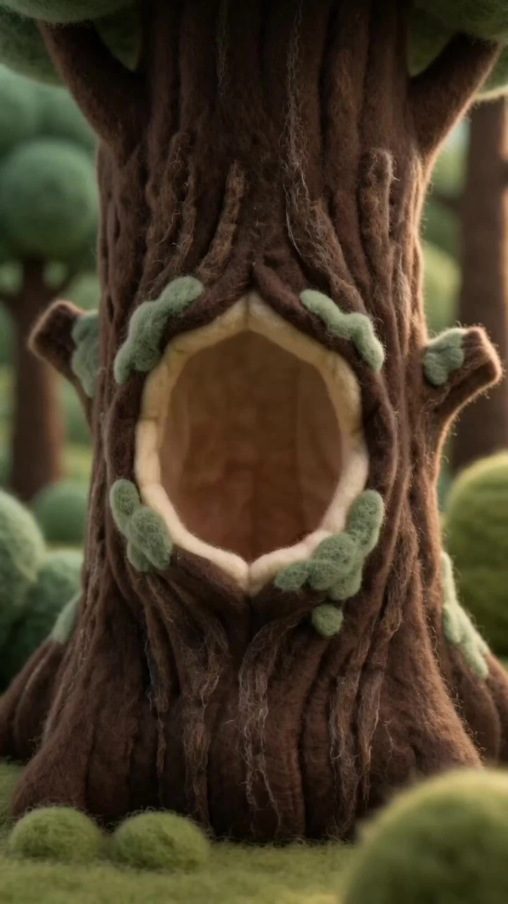

# Million-View Viral Wool Felt Animation Skill

> **作者：** Ai创意研习社

## Content

**Process Planning:**

**Workflow Sequence:** Receive Copy → Confirm Specs → Storyboard Design → Generate Character/Scene Elements → Generate Shot-by-Shot Video → Generate BGM → Final Composite and Export

**Step Dependencies:**

- Final_Video_Spec.md (Base Info) depends on the copy content provided by the user. The aspect ratio is fixed at 9:16. The style baseline uses built-in wool felt standards (no need for user to upload reference videos) → planner 
- Storyboard generation depends on the built-in style baseline in Final_Video_Spec.md + the user-uploaded script (if any) → storyboard_designer 
- Element image generation depends on the storyboard (which defines the characters/scenes for this project) → media_generator 
- Shot video generation refers to the element images from the previous step → media_generator 
- BGM generation (optional) depends on confirmation that all video clips are finished + user request → media_generator 
- Narration/Voiceover (optional) depends on the narration/voiceover text in the storyboard's audio layers + user request → media_generator 
- Final compositing depends on all video clips + confirmed optional audio (BGM / Narration) → video_assembler 

**Copy Reception:** After the user sends the copy, read the content (text script/narration) directly. No reference videos are needed. The **text_editor** writes the project specs (title, 9:16 aspect ratio, estimated duration, theme mood, etc.) into Final_Video_Spec.md.

**Interaction Rhythm (Pause Points):**

1. After spec writing → Confirm duration/project theme/narration language
2. After storyboard completion → Present shot list structure, cross-check against narration
3. After character/scene element image generation → Confirm wool felt style consistency
4. **For each shot video generated (Shot 1, Shot 2...)** → Confirm felt texture/character consistency/SFX/pacing
5. After all video clips are confirmed → Ask if BGM or narration voiceover is needed; generate separately after user confirmation for each, confirming after each generation
6. After final compositing → Guide to export

***You must pause at each node and proceed only after user confirmation for each stage.***

**Storyboard Design:**

**Structure:**

- **Key Elements** (Definitions of characters/scenes/props for this video)

  - Each element includes: Text description (appearance/texture/color) + asset_id of the reference image generated for subsequent binding
  - Character descriptions must include: Body features, clothing color, wool felt styling style (see style levels below)
  - Scene/prop descriptions must include: Main color scheme, prop composition, lighting type; scenes and props should be presented at real-world scale (e.g., normal-sized restaurants, streets, rooms). The overall visual feel should be "the real world recreated with wool felt material," rather than a miniature model or a doll stage.

**Character Styling Levels (Determined by the designer based on content context, not one-size-fits-all):**

- **Realistic Cute (Default, suitable for main characters)**: Proportions close to a normal human (head-to-body ratio about 1:3 to 1:4), facial features round and warm, but with normal proportions for limbs and body. Use the handmade feel of felt to convey warmth, rather than relying on exaggerated Q-style features to create cuteness.
- **Moderate Q-Style (Suitable for secondary characters, background extras)**: Head-to-body ratio about 1:2, body shape rounded, facial features slightly exaggerated, maintaining recognizability.
- **Highly Q-Style (Suitable for crowd scenes, symbolic groups, emotional illustration shots)**: Highly generalized, large head and small body, simplified facial features. Can be used when presenting multiple people or symbolizing a "crowd" to keep the scene from looking crowded.

**Core Principles:** Non-human elements like scenes, props, buildings, and food must be presented at real-world scale and covered with wool felt material (e.g., a dumpling should have the shape of a dumpling, without cartoon deformation; a restaurant should be a normal-sized restaurant, not a miniature model). The visual sense is "the real world rebuilt with wool felt material," not crafting a doll stage. Character styling should match the narrative and emotional tone of the current shot; it is not mandatory to keep the same style throughout the entire film.

- **Shot List** (List of shots arranged in narrative order)

  - Each shot is named sequentially as "Shot 1, Shot 2, Shot 3..."
  - Each shot includes: Duration, description of main action, scene atmosphere, camera movement
  - **Strong correlation between visual and narration**: The main action and compositional focus of each shot must directly correspond to the narration planned for that shot—if the narration says "the dumplings are out of the pot," the visual must show the action of the dumplings coming out of the pot; if the narration describes an emotion, the subject must convey that same emotion through expression/posture. Do not allow the narration and the visuals to be "out of sync" (e.g., narration describes a twist, but the visual is still showing the static atmosphere of the previous scene).

- **Audio Layers** (Cross-shot audio, usually just BGM)

  - In-video sound effects (SFX) are automatically baked by Seedance and are not defined separately in audio_layers

**Shot Splitting Principles (Shot segmentation):**

- **Standard Duration: Each shot should be controlled within 10–15 seconds.** This is the basic unit for post-production voiceover editing; shots with too little text (empty visuals) or too much text (voiceover won't fit) are not allowed.
- **Splitting criteria based on three dimensions, judged comprehensively, not mechanically divided:**
  1. **Story Pacing**: Natural breaks at emotional shifts, scene changes, and dramatic nodes to keep the narrative arc complete within each shot.
  2. **Information Density**: Each shot carries a complete segment of narrative content (can include multiple continuous actions and emotional changes). Do not stack multiple independent, unrelated information points in one shot.
  3. **Copy Volume**: Estimate based on normal reading speed (approx. 5–6 characters/second) whether the narration copy for that shot can be read naturally within 10–15 seconds; split if there is too much text, combine adjacent information points if there is too little.
- **Rhythm awareness precedes mechanical cutting**: Splitting boundaries are determined by narrative tension and emotional rhythm—high-density conflicts/turning points can be given longer duration and closer framing; light atmospheric setup can move quickly; decide based on visual storytelling logic, not even distribution.

**Intra-Shot Visual Splitting (Segments within a shot):**

- Each shot (10–15 seconds) must be divided into **time-segmented descriptions** according to the copy's rhythm, clearly stating the time interval, visual content, and camera movement for each segment, rather than using one sentence to describe the whole shot.
- **Format Example:**
  - 0–4s: Grandma stands in front of the stove, gently kneading the dough with both hands, slow push-in to a medium shot;
  - 4–10s: Close-up on hands, flour puffs up, camera tilts slightly down;
  - 10–14s: Slowly push into Grandma's face, capturing the focused and gentle expression, freeze-frame to finish.
- **Segmentation Basis**: Each segment corresponds to an action beat or emotional beat, strongly associated with the narration copy; transitions between segments can be intra-shot cuts (continuous narrative with different framing/angles) or emotional progression.
- **Density Requirement**: Each shot must have no less than 2 and no more than 4 segments; avoid one segment spanning the entire duration (thin information), and avoid segments that are too fragmented (beyond the model's effective control range).

**Wool Felt Style Shot Design Points:**

- Composition should be simple, subject prominent, background depth no more than 2-3 layers
- Camera movement should be natural and smooth; design slow push-ins, pans, gentle follows, etc., avoiding abrupt jump cuts
- Character actions should be soft and fluid, allowing for moderate natural movement (e.g., reaching, turning, walking), but maintaining the soft texture of felt dolls; do not pursue "micro-movement" stutters
- Use spotlight composition for key narrative nodes to strengthen the dramatic feel
- When switching scenes, use "sudden change in visual style" instead of transitions (e.g., switching from a warm restaurant to a cold digital space)

**Media Generation:**

**Element Images (Key Elements):**

- Model: Nano Banana Pro (TextToImage / ImageToImage)
- Reference Input: Character/scene reference images provided by the user (if any); if not provided, generated entirely based on storyboard text descriptions + built-in wool felt style baseline
- Output Settings: **16:9 white background three-view** (front + side + 3/4 back, arranged left to right), 2K resolution, one image per element
- If the user has already uploaded element images, bind them directly, do not regenerate

**Video Clips (Each shot):**

- Model: Seedance 2.0
- Path: MultiModalToVideo (Preferred)
- Reference Input: Generated element images (combination of character front view + scene panoramic view)
- Generation Strategy: **Generate only one shot at a time (Shot 1, Shot 2... proceed sequentially), pause for confirmation after generation, then proceed to the next**
- Resolution: 720p (Default)
- Duration: Aligned with the duration set in the storyboard for that shot (range 4s–15s)

**BGM (Optional):**

- After all video clips are confirmed, **ask the user if BGM is needed**; generate only after user confirmation
- Model: Suno 5 / Mureka 8 (text_to_instrumental)
- Duration: Aligned with total video duration

**Narration (Optional):**

- After all video clips are confirmed, **ask the user if narration voiceover is needed**; generate only after user confirmation
- Model: ElevenLabs v3 / Doubao (text to narration)
- Script Source: [Narration Copy Reference] marked for each shot in the storyboard, generate segment by segment and bind to the corresponding shot

**Sound Effects (SFX):**

- Baked automatically by Seedance 2.0 during video generation, no need to generate separately, not included in audio_layers

**Note:** If the generation path involves multiple reference images, prioritize selecting the character front frame + scene panoramic frame as the input combination.

**Prompt Writing:**

## Wool Felt Style Prompt Writing Standards

### Core Style Anchor Terms (Must be included in every prompt)

All image and video prompt beginnings must be fixed with the following style baseline description to ensure stylistic consistency across shots and elements:

> wool felt animation style, real-world scene and characters rendered entirely in wool felt material, visible fiber texture covering all surfaces, soft rounded forms with no sharp edges, smooth and fluid motion, natural movement, warm muted color palette — full-size felt world at realistic scale, NOT miniature, NOT diorama, NOT puppet, NOT toy figurine; characters have clearly defined facial features (eyes, nose, mouth fully visible and readable)

### Element Image Prompt (TextToImage / ImageToImage)

**Structural Order:** Style anchor terms → Subject description → Material details → Color → Composition/Background

**Writing Points:**

- **Subject Description:** Start with "felt [object name]", choose corresponding descriptive words based on the style level of that element in the storyboard:
  - Realistic Cute (Main Character): natural proportions, clearly defined facial features (eyes, nose, mouth fully visible), soft round face, realistic body ratio, disable chibi, super deformed, big head small body, disable doll-like, puppet, toy figurine
  - Moderate Q-Style (Secondary Character): slightly stylized proportions, rounded features, clear facial expression
  - Highly Q-Style (Crowd/Symbolic Group): chibi style, simplified but readable facial features, large head small body
  - Scene/Prop/Food: full-size felt world, true-to-shape felt [object name], no cartoon deformation, restore real object shape, disable miniature scale, diorama, puppet stage; fonts/text content are not suitable for wool felt style, avoid asking to render text in the prompt
- **Material Details:** Must include at least two of the following: visible wool fibers, slightly uneven handmade surface, soft fabric sheen, felted texture
- **Color:** Use warm muted colors, such as warm terracotta, dusty rose, muted sage green, creamy off-white; avoid high-saturation pure colors (e.g., bright red, neon)
- **Composition:** Three-view element image fixed format: three-view character sheet, front view / side view / three-quarter back view, left to right, white background, clean studio lighting
- **Lighting:** Uniformly use soft diffused lighting, no harsh shadows, warm ambient glow

**Example (Character):**

> wool felt animation style, real-world character rendered in wool felt material, visible fiber texture on all surfaces, soft rounded forms with no sharp edges, smooth and fluid motion, natural movement, warm muted color palette — felt elderly woman, natural body proportions, chubby round face with clearly defined eyes, nose and mouth, wearing dusty rose apron over cream knitted sweater, short white hair, rosy cheeks, holding a felted dumpling tray, visible wool fibers, slightly uneven handmade surface, soft fabric sheen — three-view character sheet, front view / side view / three-quarter back view, left to right, white background, soft diffused lighting, no harsh shadows, NOT a puppet, NOT a doll, NOT a toy figurine, NOT miniature scale

### Video Prompt (MultiModalToVideo / Seedance 2.0)

**Structural Order:** Reference image binding → Style anchor terms → Scene atmosphere → **Segmented Action Script (arranged by time interval)** → Sound effect cues

**Writing Points:**

- **Reference Image Binding:** Bind each character image with placeholders like <<<image_1>>>, <<<image_2>>>, etc., noting the correspondence in the first line of the prompt, e.g.: <<<image_1>>> is the felt character [Character Name], <<<image_2>>> is the felt scene background
- **Segmented Action Script (Core):** Corresponds to the intra-shot segments of the storyboard for that shot, write actions, camera movements, and emotional changes segment by segment in chronological order, formatted as [0–4s] ..., [4–10s] ..., [10–14s] .... Each segment description must include: Subject action + camera movement method. The time intervals must be strictly aligned with the storyboard segments, and must not be merged into one generalized description, nor exceed the total duration.
- **Action Description:** Wool felt character actions should be smooth and natural, using vocabulary for continuous actions with some range: walks smoothly, gently reaches out, turns around softly, nods with a warm smile, slowly leans forward; maintain a soft sense of rhythm, avoiding rigid/stuttering words like jerky, stiff, stuttering motion; also avoid excessively violent movements like swings arms wildly, jumps frantically
- **Camera Movement:** Encourage natural and smooth camera movements, such as smooth slow push in, gentle tracking shot, soft pan following the character, natural dolly movement; forbid handheld shake, fast zoom, rapid cuts, jerky camera
- **Scene Atmosphere:** Supplement with warm soft light filling the scene, shallow depth of field, full-size felt world, immersive real-world scale (disable miniature scale diorama feel / puppet stage etc.)
- **Sound Effects (SFX):** Annotate natural sound effects using Seedance's <...> tags, such as <soft fabric rustling>, <gentle tap on wooden counter>, <quiet ambient kitchen hum>; if the shot has an independent narration track, **do not write the dialogue content in the video prompt**, just mark <no dialogue, narration on separate track>
- **Fixed Negative Constraints (Appended to the end of every video prompt):** no subtitles, no text overlay, no sharp edges, no realistic human skin, no CG glossy material, no puppet, no doll figurine, no miniature diorama, no toy stage

**Example (Video Shot):**

> <<<image_1>>> is the felt elderly woman character, <<<image_2>>> is the felt dumpling restaurant scene background — wool felt animation style, real-world scene rendered entirely in wool felt material, smooth and fluid motion, natural movement, warm muted color palette — cozy full-size felt dumpling restaurant interior at realistic scale, warm amber light, steamy atmosphere —\n> [0–4s] the felt elderly woman stands at the counter, both hands gently lifting a tray of dumplings, camera holds at medium shot with a subtle slow push in;\n> [4–10s] she sets the tray down softly, slowly raises her head, eyes crinkling with a warm smile, camera continues pushing toward her face;\n> [10–14s] close-up on her expression, slight head tilt, soft ambient steam drifts across frame, camera locks off on her face as the shot settles —\n> <soft clinking of ceramic plate>, <gentle kitchen ambient hum> — no subtitles, no text overlay, no sharp edges, no realistic human skin, no CG glossy material, no puppet, no doll figurine, no miniature diorama, no toy stage

### BGM / Narration Prompts

- **BGM (text_to_instrumental):** Describe mood + instruments + rhythm, e.g.: warm and heartwarming instrumental, soft piano and light acoustic guitar, gentle slow tempo, cozy nostalgic mood, suitable for a handcraft animation short
- **Narration (text to narration):** Specify speaking rate (slow and warm) and emotional tone (gentle, sincere, slightly nostalgic); script content comes directly from the [Narration Copy Reference] for each shot in the storyboard, **do not alter the original text**
