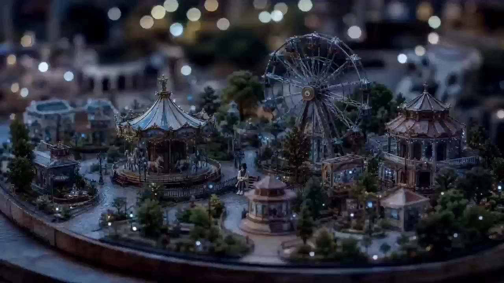

# Miniature World Creative Short Film

> **作者：** @黄鑫波

## Content

Process Planning:

Goal

Use miniature props and model scenes as the stage to tell gentle short stories with character arcs. The style is exquisite and detailed with restrained camera language, suitable for emotional shorts and holiday greeting videos.

Stage 0 — Spec Confirmation (Must be completed first, do not skip)

Before any content planning, present the following options to the user and proceed only after receiving a clear choice: ① Aspect Ratio (Single choice)

9:16 (Vertical, Recommended - suitable for mobile viewing)

16:9 (Horizontal, suitable for widescreen playback)

1:1 (Square, suitable for social media)

② Video Resolution (Single choice)

720p (Standard quality, available to all users)

1080p (HD, Membership required)

③ Target Duration (Single choice)

60s (Short version, approx. 10-12 shots)

90s (Standard version, approx. 14-18 shots)

Custom (User inputs seconds)

④ Image Generation Model (Single choice, for Key Elements images)

GPT Image 2 — Recommended, best realism and detail restoration for miniature scenes

Nano Banana Pro (Gemini 3 Pro Image) — Strong prompt adherence, excellent at complex layouts

Nano Banana 2 (Gemini 3.1 Flash Image) — Faster speed

Seedream 4.5 — Strong stylization

Midjourney V7 — Excellent aesthetics, slightly weaker consistency

⑤ Video Generation Model (Single choice, for Shot List videos)

Seedance 2.0 — Recommended, best image quality (Membership required)

Seedance 2.0 Fast — Faster speed (Membership required)

Kling 3.0 Omni — Available without membership

After receiving the user's choices, use text_editor to create Final_Video_Spec.md, writing the following parameters:

Video Type: Miniature life story film (emotional short)

Aspect Ratio: [User Selection]

Target Duration: [User Selection]

Video Resolution: [User Selection]

Image Generation Model: [User Selection], resolution 2K

Video Generation Model: [User Selection], resolution [User Selection]

Visual Style: Miniature model photography style, tilt-shift lens feel, exquisite and detailed, warm and gentle tones

Audio Style: Light BGM (mostly piano/strings), gentle narration or no narration

Output Language: Consistent with the user's interaction language Mandatory Pause (Checkpoint 0): Once the specs are written to Final_Video_Spec.md, show the summary of confirmed parameters to the user and ask for confirmation. Do not proceed to Stage 1 until explicit confirmation is received.

Stage 1 — Story Script Planning → Call storyboard_designer

Guide the user to provide a story outline, or draft one automatically via AI (characters, scenes, emotional arc).

Call storyboard_designer to complete:

Key Elements definition (protagonist, supporting characters, main scenes, core props)

Shot List planning (shot size, camera movement, duration, narrative rhythm; align duration parameters with Final_Video_Spec.md)

Audio Layers design (BGM tracks, narration rules) Mandatory Pause (Checkpoint 1): Present the full story script and shot list plan to the user for confirmation, including the shot size, camera movement, and narrative summary for each shot. Do not proceed to the next stage until explicit confirmation is received.

Stage 2 — Key Elements Generation → Call media_generator

Prioritize generating Key Elements images for all characters (front-facing reference + action/expression variants); use the image generation model specified in Final_Video_Spec.md.

Generate Key Elements images for scenes (miniature street views, interior sets, etc.).

If there is narration, generate the narration audio at this stage (text to narration) to serve as an audio condition input for subsequent video generation. Mandatory Pause (Checkpoint 2): Once all element images are generated, present them to the user to confirm that character designs and scene styles meet expectations. If the user requests regeneration of a specific image, do so and confirm again. Do not proceed to the video generation stage until explicit confirmation is received.

Stage 3 — Shot List Video Generation → Call media_generator

Batch generate video for all shots in sequence without pausing for confirmation between batches; all shots must carry the corresponding character and scene images as visual references, using the video generation model specified in Final_Video_Spec.md.

Primary Tool: MultiModalToVideo; only downgrade to FirstFrameToVideo if all models in the primary tool fail.

BGM Generation: Call text_to_instrumental, concurrent with video generation. Mandatory Pause (Checkpoint 3): Once all shot videos and BGM are finished, present them to the user for preview and confirmation before entering the assembly stage.

Stage 4 — Rough Cut Preview → Call video_assembler

Assemble all shot videos, narration, and BGM into a rough cut timeline.

Inform the user to play the "Rough Cut Preview" and confirm if the overall rhythm and emotional tone are correct. Mandatory Pause (Checkpoint 4): Collect user feedback. If modifications are needed, return to the corresponding stage for adjustments, then re-assemble; proceed to final output only after confirming satisfaction.

Stage 5 — Final Output

After confirming all assets are ready, call video_assembler for final composition.

Tell the user to click "Export" to complete the final video download.

Dependency Relationship

Stage 0 (Checkpoint 0) → Stage 1 (Checkpoint 1) → Stage 2 (Checkpoint 2) → Stage 3 (Checkpoint 3) → Stage 4 (Checkpoint 4) → Stage 5

Narration audio generation (Stage 2) must be completed before video generation (Stage 3) to be used as audio condition input. BGM generation and shot list video generation (Stage 3) can be performed in parallel.

Asset Analysis:

Analyze User-Uploaded Images

If the user uploads reference images (e.g., real miniature photography, figurine photos, scene set photos), extraction must include:

Visual Style Features: Color tone, light direction, depth of field level, material texture

Composition Rules: Shot size, perspective (high angle/eye level/low angle), visual focus

Source of Miniature Feel: Whether tilt-shift effect is used, blur level, prop scale relationship

Reusable Elements: Character design, scene spatial structure, core props Analysis results must be output as a "Visual Reference Summary" for use in subsequent Shot List design and prompt writing.

Analyze User-Uploaded Videos

If the user uploads reference videos, extraction must include:

Shot Structure: Number of shots, average duration, shot size distribution

Camera Movement Habits: Frequency of zoom, pan, follow shots, etc.

Rhythm Characteristics: Relationship between editing rhythm and BGM (on-beat?)

Emotional Arc: Emotional curve of opening → development → climax → resolution

Analyze User-Uploaded Documents

If the user uploads a story script or text outline, pay attention to:

Do not alter the original story content or rhythm, faithfully restore the author's intent

Extract character lists, main scenes, and key plot nodes

Identify segments with "strong visual sense" suitable for key visual presentation

Output structured Shot List suggestions (for user confirmation or modification)

Storyboard Design:

Theme → Story Flow Breakdown Guidelines

Upon receiving a user theme, before expanding into specific shots, break the story down into 4–6 key segments to form a complete narrative arc skeleton, then allocate shots accordingly.

Breakdown Principles

Segment Count: Recommended 4 (concise theme) to 6 (rich plot theme), must not be fewer than 4

Each segment corresponds to a narrative functional node, common structure reference:

Establish World → Trigger Event → Plot Progression → Emotional Climax → Lingering Resolution

Or split the flow based on the specific theme, e.g., "Holiday Gift": Finding Materials → Making the Gift → Wrapping & Waiting → Giving the Surprise → Warm Afterglow

Each segment must include: Core Scene, Participating Characters, Key Actions/Props, Emotional Tone

Segments must be logically coherent and have emotional progression; avoid jumps without causality

**Output Format (for internal planning, not shown directly to user) Before calling storyboard_designer for formal shot planning, first form the following structure internally:

Segment 1: [Segment Name] — [Scene] — [Core Action] — [Emotion] Segment 2: … …

After confirming the skeleton is reasonable, expand into specific shot designs for each segment (each segment usually corresponds to 2–4 shots).

Key Elements (key_elements) Planning Principles

Character Elements

Create an independent element for each main character, including:

Front-view full-body reference image (clearly showing style, clothing, hair, skin tone)

Expression / Action variant image (at least 1, showing emotional change)

Characters must conform to the "miniature figurine" aesthetic: proportions slightly stylized, detailed texture (fabric weave, skin sheen), naturally blended with the model scene

Scene Elements

Create an independent element for each main scene, including:

Wide-angle reference image (showing spatial structure, lighting atmosphere, prop placement)

Can set day / night variants according to the plot

Prop Elements

Create separate elements for core props with narrative function in the story (e.g., letters, bouquets, small tables) to ensure consistency across shots

Shot List Design Standards

Duration Rhythm

Recommended single shot duration: 4s–8s

Total film target duration: 60s–90s, usually containing 10–18 shots

Emotional climax shots can be extended to 10s

Shot Size and Camera Movement

Opening: Extreme wide shot or top-down panoramic, establishing the spatial sense of the miniature world (strong tilt-shift feel)

Narrative progression: Mid-shots mainly, showing character interaction

Emotional close-ups: Facial close-ups or prop close-ups, capturing details and emotions

Camera movement is restrained, mainly slow push-in, slight pans; avoid fast cuts that disrupt the gentle atmosphere

Narrative Structure

Follow the four-part structure: "Opening, Establishing the World → Plot Unfolding → Emotional Climax → Lingering Resolution"

Each shot description must include: shot size, camera movement, visual content, character emotion, and narrative connection to preceding/succeeding shots

Size Consistency and Subject Rules (Enforced across shots)

Large props require team effort: For props significantly larger than a single figurine (e.g., coffee cups, envelopes, flower pots), explicitly describe "multiple people working together" to complete the operation; avoid descriptions where a single person easily uses large props, to prevent generated images from having oversized arms or distorted characters.

Actions must correspond to specific subjects: Each action must specify who (which character, or "the two together") is performing it; avoid vague expressions like "someone" or "a person."

No defying common sense: Content that destroys the miniature realism, such as glowing props, floating objects, or riding insects, is prohibited.

Cross-shot consistency: The same character's clothing, hairstyle, and prop status must remain consistent across all shot descriptions; fixed props within a scene must not move without reason.

Audio Layers Design Standards

BGM

1–2 BGM tracks (can switch between opening + climax)

Style: Piano solo / Piano + strings, soft and warm, no vocals

Duration must cover the entire film, fade in and fade out

Narration (Optional)

If narration is used, annotate the shot_id corresponding to the narration text during the Shot List design phase

Narration tone: Gentle storytelling, can be first or third person

Note: Shots generated using FirstFrameToVideo / VideoInterp have native audio. The narration track for such shots must be muted or staggered to avoid overlapping

Media Generation:

Global Visual Style Tone

All image and video assets must maintain a unified "Miniature Model Photography" aesthetic:

Tilt-shift lens shallow depth of field, distant view significantly blurred

Tones are warm (warm white / milk tea / golden yellow) or cool/dreamy (mint blue / moonlight white)

Exquisite material texture: fabric fibers visible, wood grain clear, glass reflections realistic

Lighting is soft and diffused, avoiding hard shadows

Image Generation

Tool: TextToImage / ImageToImageModel and Resolution: Based on the "Image Generation Model" field in Final_Video_Spec.md, resolution 2K

If the user has not specified, use GPT Image 2 by default, resolution 2K

Character Reference Image Specification (Mandatory)

Generate one 16:9 horizontal composite reference image for each character, screen divided into left and right zones:

Left: Portrait close-up (head/neck/shoulder close-up, clearly showing face, hairstyle, skin tone, makeup)

Right: Full-body three-view (front, side, back side-by-side, fully showing clothing, footwear, silhouette)

Resolution: 2K; Aspect ratio: 16:9 (horizontal)

When generating the 2nd and subsequent character images, must use the 1st character reference image as image reference (ImageToImage) to ensure uniform character design style

Scene Image Mandatory Reference Rule

When generating scene images, if there is an existing style reference image, it must be used as a reference to maintain visual consistency

Video Generation

Primary Tool: MultiModalToVideoModel and Resolution: Based on the "Video Generation Model" and "Video Resolution" fields in Final_Video_Spec.md

If the user has not specified, use Seedance 2.0 Fast (720p) by default

If all models in the same tool fail, downgrade to FirstFrameToVideo (Google Veo3.1 Fast, 720p)

Seedance 2.0 / Seedance 2.0 Fast — Multi-Shot Automatic Shot List Rule

When using Seedance 2.0 or Seedance 2.0 Fast to generate video, and the project contains multiple shots, enable the automatic shot list function, splitting the overall content into segments, each no longer than 15 seconds, and assemble them via video_assembler after generation.

Within each prompt, you can utilize Seedance's multi-shot description capability to include internal switches (camera cuts) in a single generation; each segment is max 15s, must not exceed model limits.

Splitting basis follows the narrative rhythm in the Storyboard shot_list: prioritize cutting at narrative segment boundaries, avoid cutting forcibly in the middle of emotional climaxes or key actions.

Reference Binding Mandatory Rule

For every shot containing characters, the corresponding character Key Elements image must be used as visual reference input

For every shot containing scenes, the corresponding scene Key Elements image must be used as visual reference input

If the shot has generated narration audio, the narration audio must be used as audio condition input for Seedance 2.0, driving character lip-sync and emotion

Single Shot Duration Reference

General narrative shot: 4s–6s

Emotional climax / Close-up shot: 6s–8s

Lingering resolution shot: 8s–10s

Narration Generation (Optional)

Tool: text to narrationRecommended Model: ElevenLabs v3

Recommended voice references (choose based on emotion):

Gentle female narration: Xiaoxi (Voice ID: 9DMBSOAnMDPiFAsz1ZGK)

Warm male narration: Jin (Voice ID: vZZLclMx4wouUtKBRfZn)

Neutral clear female: Sage (Voice ID: APSIkVZudNbPAwyPoeVO)

Narration audio must be completed before video generation to be used as audio condition input.

BGM Generation

Tool: text_to_instrumentalRecommended Model: Suno 5 (Alternative: Mureka 8)

Do not include famous musician names in Suno 5 prompts

BGM duration must cover the entire target duration, recommend generating 90s+

Model Failure Handling Rules

When a model fails, prioritize switching to another model within the same tool to retry

Only downgrade to a backup tool if all models in the primary tool fail

Forbidden to replace tools on your own (e.g., using TextToVideo instead of MultiModalToVideo)

Prompt Writing:

Image Prompt Structure (TextToImage / ImageToImage)

Default Model: GPT Image 2, resolution 2K (If other models are specified in Final_Video_Spec.md, follow the spec file) Image prompts are assembled in the following four layers in order: ① Subject Description: Explicitly state the core content of the image (characters, scene, props), specify proportion relationships and size sense (e.g., "a coffee cup at the same height as a doll", "a round rock pushed by many small people working together") ② Miniature Model Aesthetic Tone (Must be included in every image)

Live-action style miniature world, tilt-shift photography, shallow depth of field, foreground and background softly blurred, subject in sharp focus, realistic material texture, highly detailed, ultra-sharp photography, natural light, soft bokeh (Or English version, GPT Image 2 accepts bilingual, choose one): live-action style miniature world, tilt-shift photography, shallow depth of field, foreground and background softly blurred, subject in sharp focus, realistic material texture, highly detailed, ultra-sharp photography, natural light, soft bokeh

③ Light and Tone (Choose based on scene)

Day Warm / Sunset Golden: Warm cinematic lighting, golden sunset oblique, golden water surface reflection, warm cinematic lighting, golden hour glow

Morning Soft Light: gentle morning diffused light, soft warm daylight, pale golden atmosphere

Night Dreamy: soft moonlight, warm candlelight glow, tiny fairy lights bokeh

Interior Exquisite: soft overhead studio light, pastel ambient light, creamy white light

④ Atmosphere Ending Words (Use as needed)Dreamy tranquil atmosphere / cinematic mood / warm and cozy feeling Scene Image Prompt Full Example (Reference format)

Live-action style miniature world, [Main character/prop + action + size comparison], [Specific scene environment details, e.g., lakeside grass, moss and gravel, round rocks], [Lighting time, e.g., sunset, golden sunset shining from behind distant mountains], [Distant view description, e.g., rolling green hills, blurred forest], tilt-shift photography, shallow depth of field, foreground and background softly blurred, subject in sharp focus, warm cinematic lighting, dreamy tranquil atmosphere, highly detailed, realistic material, ultra-sharp photography, natural light, soft bokeh. Character Reference Image Specification (16:9 composite image)When generating character reference images, clearly specify 16:9 horizontal single image, describe the left and right partition of the screen as follows:

Left (Portrait Close-up): left half: close-up portrait of [Character Name] as a miniature figurine, [Hairstyle + Hair Color], [Upper body clothing], delicate facial features, soft skin texture, sharp focus on face

Right (Full-body Three-view): right half: three-view full-body sheet of the same character — front view, side view, back view arranged horizontally, full costume including shoes, clear silhouette, same miniature figurine aesthetic

Overall Ending: single image, 16:9 aspect ratio, plain neutral background, 1:12 scale model aesthetic, highly detailed craftsmanship, no text labels

Negative Prompts (Must be attached to all images)no subtitles, no text, no watermark, no harsh shadows, no blurry faces, no distorted proportions, no cartoon style, no anime style, no 3D plastic look

Video Prompt Structure (MultiModalToVideo — Seedance 2.0 / Seedance 2.0 Fast)

Each video prompt is assembled in the following four blocks in order, the order between blocks must not be reversed:

Block 1: Global Visual and Aesthetic Tone (Must be included in every prompt, content can be adjusted according to story style)

Describe the visual anchor of the world this shot belongs to, covering at least:

Aesthetic Style: Miniature model photography style (diorama / tilt-shift miniature photography), exquisite handmade texture, non-realistic, non-anime

Lens and Depth of Field: Macro tilt-shift lens, creamy circular bokeh, shallow depth of field

Color and Lighting: Select specific descriptions from the tone library based on the scene (e.g., "warm golden diffused light, milk tea tone, soft window light creating slight Tyndall effect"); avoid hard shadows

Example: Macro tilt-shift photography, miniature model world, shallow depth of field, creamy circular bokeh, warm golden diffused light, milk tea tone, exquisite handmade texture, non-realistic, non-anime

Block 2: Character and Scene Asset Anchoring (Reference binding)

Declare the character and scene Key Elements images involved in this shot one by one using <<<image_N>>> placeholders, and explain the asset identity corresponding to each image, the order must be consistent with the image order passed by media_generator: <<<image_1>>> as protagonist [Character Name], [Brief posture/clothing/emotional state description] <<<image_2>>> as supporting character [Character Name], [Brief posture description] <<<image_3>>> as scene background [Scene Name], [Lighting/spatial atmosphere description] Also, write the size comparison anchor sentence for the current shot at the end of this block to highlight the miniature feel:

For props larger than a figurine's body, mark "multiple figurines working together" to operate, and use adjectives to highlight the size difference (e.g., "huge coffee cup lid", "envelope at the same height as the figurine")

Block 3: Script and Action Timeline

Split the visual content within the shot according to time segments, each segment must include at least camera position, visual screen (foreground/subject/background three layers), and auditory sound effects three sub-items. Use the following fixed format: [00.0s - XX.Xs]

Camera Position: [Shot size + Camera movement, e.g., Close-up, slow push-in]

Visual Screen:

[Foreground]: [Out-of-focus foreground elements, e.g., prop edges, figurine outline]

[Subject]: [Core action in focus, action must specify the specific character, do not use "someone/somebody"]

[Background]: [Blurred background atmosphere, e.g., warm light spots, blurred scene details]

Auditory sound effects: [Environment sound + Action sound effect description; if there is narration/dialogue, note "dialogue track" or "narration track sync", do not repeat the full script]

Time segment division must align with the planned duration of this shot in the Storyboard (4s–10s), number of segments usually 1–3

Narration is strictly prohibited in video prompts: Narration must be generated separately via the dubbing model (text to narration) as an independent audio track; the auditory sound effects part of the video prompt is only allowed to include environmental sound effects and character dialogue, no narration text text; no music, no narration must be attached at the end of the prompt

If there is character dialogue in the shot and Seedance 2.0 is used, embed it in the prompt main text at the corresponding action position in {Dialogue content} format to drive lip-sync; sound effects marked in <Sound effect description> format

Block 4: Generation Constraints and Negative Prompts

Every video prompt must be attached with the following fixed negative constraints, and additional specific items can be added according to shot content: Fixed Negative (Must be included)

no subtitles, no text overlay, no watermark

no music, no background music, no narration, no voiceover

no fast cuts, no shaky camera

no cartoon style, no anime style, no 3D plastic look, no clay feel

no oversized human hands, no giant figures inconsistent with miniature scale

no floating objects, no glowing props, no physically impossible actions

Added per shot (if applicable)

If the shot has no characters: no human figures

If the shot is a pure close-up: no wide-angle distortion

If the shot is a night scene: no overexposed highlights

Video Prompt — Camera Language Library

Effect description words Slow push-in, camera gently moves closer, slow pan right/left, gentle horizontal sweep, top-down overhead shot, bird's-eye view of miniature world, smooth follow shot, tracking the character gently, static lock-off, camera holds still, low-angle shot, slight upward tilt

Narration Script Style Suggestions

Tone: Gentle, restrained, with a sense of lingering space

Sentence structure: Short sentences, appropriate pauses

Reference example: "That day, the sunlight dyed the whole town in gold. He stood at the door, waiting for a long time."

Video Editing:

Track Planning

Video Track: Arrange all shot clips in Shot List order

BGM Track: Cover the whole film, fade in (first 2s) and fade out (last 2s)

Narration Track (if any): Align with the timecode of the corresponding shot

Volume Standard

BGM: Overall volume controlled at background level (approx. 40%–60% of narration volume)

Narration: Clearly distinguishable, as the main volume layer

Video native audio (FirstFrameToVideo / VideoInterp generated sound effects): Retain or mute based on narrative needs

Special Rules

Lip-sync video (e.g., using ImageToVideoByAudio generation): Must not change the speed of video clips, otherwise lip-sync and audio will be misaligned

MV-style clips with BGM: Must mute the video track's native audio, keep only the BGM audio track

When narration and native sound effect shots coexist: Must mute or lower the video's native audio for that shot to a very low volume, prioritizing narration

Rough Cut vs Final Output

The first assembly is qualified as "Rough Cut Preview", used for rhythm and emotion confirmation, not as the final film

Only after the user confirms satisfaction with the rough cut can it be qualified as "Final Output" and instructed to export

The system does not support adding screen subtitles, complex transitions, or independent sound effects (SFX); if needed, it is recommended to process with professional software after export
