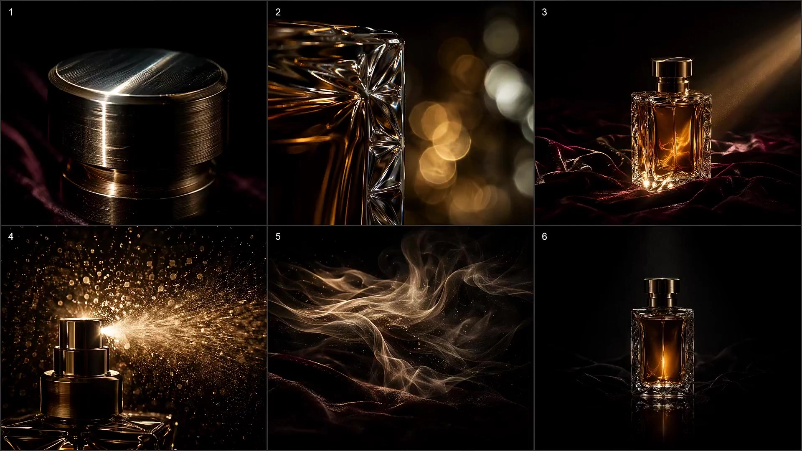

# Multi-Panel Grid to Video Generation

> **作者：** @Flova

## Content

Process Planning:

Stage logic and dependencies for the complete video:

Write Final_Video_Spec.md (title, genre, aspect ratio, duration, visual style, language) → text_editor.

Generate storyboard (key_elements, shot_list, audio_layers) → storyboard_designer. Once the storyboard is ready, scan the context for user-provided or previous assets (element images, background music, etc.); use media_generator to bind each asset to the matching storyboard slot before the generation step → media_generator.

Elements - If the user has uploaded element assets, bind them to key_elements. Otherwise, generate element images → media_generator.

Generate all multi-shot reference composites (one call per shot): For each shot, write an image prompt that places every internal clip/beat from that shot's storyboard onto one canvas as a multi-cut sheet (with clear cell boundaries). The spatial tiling order on the sheet does not define the clip order — the story order is carried only by the printed clip indices (matching the numbering in the storyboard clip list). The aspect ratio of each cell should match the aspect ratio locked for that shot in Seedance (see Final_Video_Spec.md / pipeline).

Generate all shot videos: Reference the multi-shot composite image → media_generator.

Generate all audio_layers from the storyboard → media_generator.

Final assembly once assets are ready; guide export → video_assembler.

Dependencies: 2→1; 3→2; 4→3; 5→2,4; 6→2; 7→2,5,6.

When to pause: Do not run all steps at once. Stop after specifications, storyboards, elements, after each batch or group of multi-shot composites (or after all composites are done), after shot videos, and after audio — confirm with the user between stages. Use cards or reply_to_user for review.

Note: User-provided media: Bind via media_generator before re-generating; avoid duplicating what the user has already provided.

Storyboard Design:

How to design key elements

Include key subjects (characters, objects), key locations/scenes, and key props as needed.

Characters: Multiple appearances (costume, age) → describe clearly (e.g., Appearance 1: …; Appearance 2: …).

Tone/Color Reference: If the project uses a global color grade or reference clips, note it when generating (keep reference duration practical, e.g., under ~15s for color extraction).

Locations/Scenes: Placement and orientation of important objects and performance areas.

User-provided assets: Descriptions must match the reference materials; never contradict what is seen or heard.

How to design shots

Prioritize long shots containing multiple internal clips: Use the model's full budget per shot (up to 15 seconds per shot), and aim for at least six internal clips per shot when the story supports it. Design within the long shot; the cutting rhythm follows the narrative. Do not split what can be told in one long shot into a second shot. Each shot is 15 seconds max (hard model limit).

Each shot description must include:

Scene: Location identified by element ID (e.g., [Element_Office_Noir]).

Story content: Action, dynamics, dialogue — include exact lines where applicable; reference characters by element ID.

Cinematography: Shot size, angle, and camera movement for each beat.

Internal clips: List each beat in chronological order and assign a stable clip index (1…N) used throughout downstream tasks (sheet labels, prompts). This list is the clip inventory for the single GPT Image 2 image for that shot: one grid cell = one internal clip (keyframe/state). On the composite, the sheet position can follow any layout; editors and models rely on the indices written on each cell, not just the left-to-right position.

How to design standalone audio

Background Music: At least one global track; longer segments can use multiple passages with audio_id and ranges.

Voiceover: Select type narration; voice, tone, exact script; layout_instruction for shot ranges.

Media Generation:

Element asset generation

Element Images: Use TextToImage / ImageToImage as needed. Recommended model: GPT Image 2, 2K, for quick iteration and consistency with other pipelines.

Characters: One landscape 16:9 character sheet per character, containing from left to right: half-body close-up + full-body three-view (front, side, back), which helps Seedance read identity and costume information.

Multi-shot reference composites for each shot (GPT Image 2)

Model: GPT Image 2. Resolution: 2K (use 1K / 4K only when explicitly requested in the brief or pipeline).

Modality: When element reference images exist, prioritize ImageToImage — pass in character/scene references to make the grid match the locked look. Otherwise, use TextToImage with full visual details.

Rule — One shot, one image, one call: The prompt must describe the complete multi-shot sheet and what is visible for each clip in a single generation.

Cell Aspect Ratio (Priority): The composition of each cell must be such that its width:height matches the output aspect ratio specified for that shot in Seedance (e.g., 16:9, 9:16, 1:1 — whatever is locked for that shot in Final_Video_Spec.md / generation presets). Do not compress cells into extreme strips that don't match the final video geometry; matching the ratio reduces reconstruction drift when using the composite as a reference.

Layout: Single canvas; N cells (one key still for each internal clip); thin neutral dividers; spatial arrangement is flexible (rows, columns, or irregular grids) — do not imply that reading direction equals story order.

Clip Order Markers (Required): In a fixed corner of each cell, print the storyboard clip index (1 … N, matching the clip inventory numbering). The index is the source of truth for chronological order; the sheet layout order is optional.

Clip Quantity: Keep N readable (usually 2–6 internal clips per shot on one sheet). If the storyboard has more beats, merge tiny beats or split shots during the storyboard phase — do not exceed the amount that one grid can clearly read.

Style Requirements: The multi-shot composite for each shot must embed the visual style defined in Final_Video_Spec.md (genre, look, palette, era, references) — apply it consistently to all clips on that sheet.

Final Shot Video (Seedance 2.0)

MultiModalToVideo, Seedance 2.0, 720p — Use the same aspect ratio as encoded in the composite cells and the spec sheet.

Reference: The multi-shot composite for that shot (beat roadmap + geometry of each clip aligned to the output ratio);

Marking: In the video prompt, tag each character according to the correct <<<image_n>>> reference (corresponding to the element sheet); the composite is the primary still reference — drive movement via the numbered clip indices (1…N) visible on the sheet, do not guess the sheet order (see write_the_prompt).

Prompt Writing:

A. Multi-shot reference composite prompt (GPT Image 2)

Intent: A contact sheet of N key stills for this shot. Each still sits within a cell whose aspect ratio matches the shot's final video aspect ratio (e.g., the same 16:9 or 9:16 Seedance will use). The sheet is a layout reference and does not declare that tiles are in timeline order by position.

Cell Geometry (Priority): Explicitly state in the prompt that each cell is letterboxed or cropped to the target output aspect ratio for this shot (write the ratio, e.g., "each sub-frame is native 16:9"). This is more important than how the tiles are arranged on the canvas.

Clip Order Markers / Storyboard Indices (Required): Each cell must show the same clip number as in the storyboard clip inventory (1 … N) in a fixed corner (the whole sheet adopts one convention, e.g., top-left). The edit order follows these numbers only — the spatial order of tiles is optional and can be any arrangement for a tidy layout. Markers: minimalist, high-contrast, small and readable; these are production metadata and should not be signage within the scene unless the script requires it.

Opening (Required standard template): Example format: "Single image, a contact sheet of [N] cinematic stills. Each still is composed at [target aspect ratio, e.g., 16:9] to match the final video. Thin neutral dividers between cells. Each cell displays a small index [1…N] in the [corner] matching the storyboard clip list. Realistic live-action film style; characters and costumes remain consistent." (Adjust rows/columns only for tidy arrangement; do not ask for left-to-right as story order.)

By Clip (By Inventory Index): For each index 1 … N, in a fluid English paragraph (or clearly numbered as Cut 1 / Cut 2 / … and matching the labels on the image), describe only what is visible in that still: subject pose, environment, shot size, angle, lighting, color grade, lens feel — aligned with the 6 Core Rules below (woven in natural language; do not use labeled bullet points in the output prompt).

6 Core Rules (Global + Per Clip): Professional style anchors (use auteur/reference films where necessary); composition & shot; lighting emphasizing negative fill/contrast; restrained color grading (single dominant hue ~90% unless otherwise requested by the user; avoid cliché neon magenta/cyan clashes unless requested); rendering quality (texture, detail); emotion & micro-expressions on dramatic beats. In-scene text: Place exact copy in quotes only when necessary.

B. Video Prompt (Seedance 2.0)

Start with live action: When the primary reference is the same multi-shot composite image, the video prompt starts with the phrase live action (lowercase phrase at the beginning). It subtly guides Seedance toward more realistic lighting, skin/object textures, and movement — closer to real footage than illustrations or overly "AI-glossy" stills. It does not replace specific movement or cinematography language; it biases the model interpretation in the right direction.

Then: Tag characters against element references (<<<image_1>>>, …). For the composite, state clearly: Follow clip numbers 1→2→…→N printed on the storyboard — do not assume sheet position equals temporal order. Describe the flow of time on these numbered beats — use Camera → Subject → Space → Audio for dynamic sections:

Camera — movement, re-framing, inter-beat cuts (aligned to cut 1, cut 2, … by index, not by grid position).

Subject — actions, expressions, beat-by-beat description.

Space — environment / depth / background movement.

Audio — dialogue {...}, sound effects <...>, use music (...) only when intentional; otherwise, follow the mute rules below.

Multi-beat / Shot 1, Shot 2: You can tag beats Cut 1, Cut 2, … to match the printed indices on the composite. Do not rely on precise wall-clock timing (e.g., "3.0–5.0s"); describe ordered beats by number, not by sheet position.

Seedance Wrappers: (...) music, <...> sound effects, {...} dialogue (annotate language if not the project language), 【...】 on-screen titles.

Negative Constraints (Always apply):

Standalone voiceover tracks in the storyboard → do not put that VO text into the video prompt.

Almost always no music unless the shot truly needs a built-in soundtrack.

Always no subtitles (subtitles are added in post).
