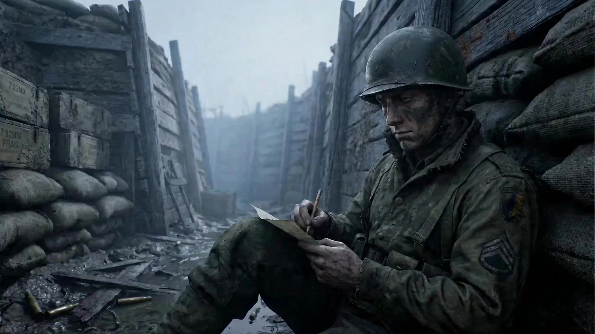

# Narrative-Driven Aesthetic Video

> **作者：** Flova

## Content

**Process Planning:**

**Stage Logic & Dependencies for Complete Video:**
1. Draft `Final_Video_Spec.md` (Title, Genre, Aspect Ratio, Duration, Visual Style, Language, Model Preferences) → **text_editor**.
2. Generate storyboard script (key_elements, shot_list, audio_layers) → **storyboard_designer**.
3. Generate images for all elements → **media_generator**.
4. Generate one keyframe image for each shot → **media_generator**.
5. Generate final video for each shot; reference the keyframe for that shot (Step 4) → **media_generator**.
6. Generate all audio_layers based on the storyboard script → **media_generator**.
7. Final assembly when all assets are ready; then guide the user to export → **video_assembler**.

**Dependencies:** 2→1; 3→2; 4→2,3; 5→4; 6→2; 7→2,3,4,5.

**Note — User-provided or Existing Media (Primarily affects steps 3–6):** Before filling in generated content, bind and assign it to the appropriate storyboard position via **media_generator**; avoid regenerating content the user has already provided.

**When to Pause:** Do not execute all steps at once. Stop at each of the critical stages mentioned above (e.g., after specs are finalized, after the storyboard script, after element images, after keyframes, after shot videos, after audio) to confirm with the user before proceeding to the next step. Invite the user for review using a card or reply_to_user before moving forward.

**Storyboard Design:**

**How to Design Key Elements**
- Always include **Key Subjects** (characters, objects, etc.), **Key Locations/Scenes**, and **Key Props** (if any).
- **Characters:** If a character has multiple states or appearances in the project (e.g., different outfits, ages), clearly state them in the description (e.g., Look 1: ...; Look 2: ...).
- **Key Locations/Scenes:** Describe the **position and orientation** of important objects within the scene, especially props or areas where major actions/performances occur.
- **User-Provided Assets:** If the user provides reference media and designates it as a key element, the description **must match** that asset; do not contradict what is seen or heard.

**How to Design Shots**
- **Each shot description must include:**
  - **Scene:** Reference the location/scene (use scene element ID, e.g., `[Element_Office_Noir]`).
  - **Story Content:** Actions and dynamics of characters and key objects; dialogue and performance. Write out **exact lines** (spoken dialogue or internal monologue / OS). Reference characters by element ID.
  - **Cinematography:** Shot size (e.g., Wide shot, Medium shot, Close-up), camera angle (e.g., Low angle, High angle), camera movement (e.g., Static, Pan, Dolly).

**How to Design Independent Audio**
- **Background Music:** Design at least one global background music track. If the video is long (e.g., 3 minutes or more) and has distinct scene changes or turning points, you can plan more than one music segment (each with its own `audio_id` and range).
- **Narration:** If using voiceover or narration to explain or drive the story, design it here (type: `narration`). Define voice characteristics, tone, and the exact script; use `layout_instruction` to limit it to the relevant shots.

**Media Generation:**

**Element Image Generation (Midjourney V7 — Style Benchmarking)**
Purpose: Build a **Reference Board** where the **look is anchored by `--sref` codes**, rather than rewriting the `Final_Video_Spec` style into every MJ prompt.
- **TextToImage** — Characters, props, large scenes. Recommended model: **Midjourney V7**.
- **Prompt Rules:** Describe the content (who/what/where, readable outlines, environmental interpretation). Append **`--sref`** according to the rules below. Do not stuff the full "planned video/image style" essay from the specs into MJ, and do not treat MJ as a step that must execute that document — **sref + subject/scene wording** is sufficient. MJ here is a benchmark factory for subsequent Nano work, not the final color grading step in assembly.
- **`--sref` Selection Rules:**
  - If the user has a Midjourney V7 **`--sref`** style code, ask the user for it. Otherwise, the agent selects a code (usually a valid random/content-tagged integer between **0–4294967295**); record the code used, and unless the user changes it, reuse it in all MJ calls within the project to maintain consistency.
  - Use **`--sref <code1> <code2> …`**, separated by spaces (e.g., `--sref 5877700996 4815442863 …`). Each value must be an integer between **0–4294967295**. **Multiple codes can be stacked.** If the user provides multiple codes, record the full list and use it in all MJ element work. When conceiving a code yourself without user preference, prioritize selecting one auto-generated integer for simplicity unless the user explicitly requests stacking.

**Keyframe Image Generation (Nano Banana — Refinement on MJ Reference Images)**
Purpose: **One static image for the first frame of each shot**, aligned with the **shot description in the storyboard**. The MJ board is the **source of truth for the look**; Nano should perform **light synthesis/adjustments** on top of these reference images, rather than **re-creating** the entire image from a long text prompt.

- **ImageToImage:** **Nano Banana Pro (Gemini 3 Pro Image)**; resolution set to **2K–4K** depending on project specs.
- **Input:** Scene/style/character/prop element references routed by shot.
- **Prompt Guidelines:** **Short**. Specify **which reference image provides the environment/texture**, **which reference image provides the style/lighting vocabulary**, and **only** associate what the **storyboard script** requires (pose, layout, who is holding what). **Do not** paste paragraphs that **re-describe** color grading, lighting, cinematic references, or mood — this forces a **total redraw** and **weakens** adherence to the MJ reference image. Refer to **write_the_prompt → `key_frame`**.

**Final Shot Video Generation**
- **MultiModalToVideo**. Input: Keyframes. Recommended model: **Seedance 2.0**, resolution **720p**.

**Prompt Writing:**

**Prompts for Image Generation (TextToImage, ImageToImage)**

**General principles for all image prompts**
- Prompt is not just about describing "what's in the image," but like a real film director and colorist giving instructions to the team.
- **`key_frame` (Nano Banana) is an exception:** Do **not** apply the long **6 Core Rules** treatment here. **Heavy cinematic prose makes Banana ignore or fight the MJ refs** and **re-draw** the frame. Prefer **slot labels + storyboard alignment** only — see **`key_frame`** below.
- For **Midjourney `key_element` TextToImage** (style/scene, character/prop bases, wide scenes): You MUST apply the 6 Core Rules of Cinematic Prompts. Write as a flowing natural English paragraph; do NOT output them as labeled sections:
  - Professional Style Terms: Use professional artistic or cinematic terminology together with style terms to improve accuracy. (e.g., Introducing Auteur and Specific Film Visual Anchors, use `Neo-Noir style, David Fincher Style, inspired by Se7en` as style anchors instead of generically stating `Neo-Noir` style).
  - Framing & Lens: Explicitly state the cinematic framing (e.g., Over-the-shoulder shot`, `Dutch angle`) and shot size  (e.g., `Close-up`, `Medium shot`).  
  - Lighting: Detail the key light and heavily emphasize "negative lighting" for contrast and drama (e.g., `Strong chiaroscuro contrast`, `dramatic interplay of light and shadow`, or `deep facial shadows emphasizing facial structure`).
  - Color Grading: Use high-end Hollywood color grading to set a restrained palette (e.g., `deep teal-cyan shadows dominating 90%, zero warm fill` or `muted watercolor wash`). Unless the user explicitly requests otherwise, never use red–blue neon clash (e.g. forbid `crimson bleed`, neon magenta vs cyan). Constrain the image to one dominant hue for roughly 90% of the frame (e.g. deep teal-cyan)—extreme restraint.
  - Visual Rendering: Describes the overall visual quality and texture of the content (e.g., fine rendering quality, rich and intricate details, soft-focus effect with subtle Gaussian blur.). 
  - Mood & Subtext: Describe the character's "subtext" and micro-expressions, freezing the action on a dramatic beat (such as `oppressive suffocation`, `no mercy`, and `predatory stillness`). Refuse stiff, posed looks. For inanimate objects, describe their condition (e.g., Destined aura, piercing gaze, cold and detached atmosphere). 
  - Conditional Elements (include ONLY when relevant):
    - Accurate on-image text: When relevant, if text appears in the scene (e.g., on-screen text), integrate it naturally. You MUST wrap the exact text content to be rendered in the scene with quotation marks to emphasize it. For example, 'A neon sign in the background reads "DANGER".'.

**When the target role is `key_element`**
Provide a clear, detailed visual definition of the element so it remains consistent across shots. Prompt structure as follows:
- Subject & Identity: Clearly state what the element is — character, prop, scene, or creature. For characters, include defined identity traits (age, build, ethnicity (if specified), notable features, voice).
- Feature Details: Describe specific key visual features of the element. Prioritize features that must remain consistent across shots:
  - Characters: Facial features (eye shape, jawline, hair style/color), makeup and styling (if relevant), clothing and accessories (material, cut, color, condition).
  - Props/Objects: Shape, material, color, size, condition (new/weathered/damaged), distinctive markings.
  - Mood/Emotional Tone: Describe the emotional tone that defines the scene (e.g., tense, melancholy, hopeful, serene, uneasy, warm, oppressive, fearful, nostalgic, isolated, intimate).
- Generate the **first-pass** hero character and important prop looks under the project **`--sref`** line (see below).
  - **`--sref` (all Midjourney V7 calls):** After the main prompt text, append --sref and one or more integers separated by spaces. Follow the Final_Video_Spec / storyboard_designer; verify each token is 0–4294967295; normalize user input into space-separated form. If not set, choose one code, record it, and reuse it everywhere in MJ.

**If the target role is a `key_frame`**  
- key_frame (Nano Banana) is an exception: Do not apply the long 6 core rules here. Heavy cinematic narration will cause Banana to ignore or fight the MJ reference image, causing it to redraw the entire frame. Prioritize using only slot tags + storyboard script alignment.
**Core rule:** The shot description from the storyboard is a script about what must happen in this static image (who, where, action, shot beats). The prompt only needs to add minimal routing text so the model uses the MJ element image as a reference and fine-tunes toward that beat — rather than performing a second full content and style treatment with words. If you describe the look and content you expect in exhaustive detail, Banana tends to regenerate the image rather than maintaining the MJ style lock.

*Ideal prompt pattern (short):*  
*`Reference environment texture Element_Dark_Void_img, and style Element_Glowing_Cube_img.`*  
*(Then only add what the storyboard script requires, e.g., subject position or "cube centered, static, push in before" — keep it short.)*

**Prompts for Video Generation**
In video prompts, name the character for each reference image so Seedance can correctly read faces and styling. Use the product's image tags (<<<image_1>>>, <<<image_2>>>). Template: Subject 1 — facial features reference <<<image_1>>> (head shot); hair, makeup, and costume reference <<<image_2>>> (full-body shot). For Subject 2, continue numbering (e.g., <<<image_3>>> head shot, <<<image_4>>> full-body shot, etc.).
**Then append action/dynamic prompts using the Seedance sequence below (Shot → Subject → Space → Audio):**
Follow this order in the written prompt:
1. Shot — movement or camera/cut changes (e.g., static → push in, cut to new angle, orbit, pan).
2. Subject — actions and expressions (who did what, facial beats).
3. Space — position or environmental changes (position of subject or camera relative to space; background motion; depth/layout transitions).
4. Audio — dialogue (if any), SFX, and music if absent from the model (see instructions below). Action Details
  - Base action on specific body parts when relevant: hands, legs, head, shoulders, etc.
  - Add degree: magnitude, speed, force (e.g., slowly raises one hand, snaps head left, pushes hard off the ground).
  - For multiple beats in one prompt, list by major action before minor action (chronological story order). Multi-beat & "Shot 1 / Shot 2" (Official Guidelines)
  - When the tool accepts long prompts, you can mark Shot 1, Shot 2, Shot 3 in a single generation to indicate the sequence of shots or story beats.
  - Precise clock timing (e.g., "0–3 s", "3–6 s") cannot be executed reliably — do not hard split prompts by precise second ranges, and do not write explicit second-by-second plans (e.g., "at 2 s…", "from 5–8 s…"). Describe what happens in sequence, not a timed shot list. Optional Modifiers (When the brief is live-action): Minor handheld micro-shake or subtle film grain can be added based on other strategy rules — keep it subordinate to the order of the four layers above. Special Character Conventions (For Seedance 2.0)Seedance accepts natural language prompts; these wrappers help the model separate music, SFX, dialogue, and on-screen title text:
  - Music (description of what plays): (...), e.g., (fast-paced rock playing in the background).
  - Sound Effects: <...>, e.g., <distant dog barking>.
  - Spoken Dialogue: {...}, e.g., {Hello, world} — if a line of dialogue is not in the project's primary language (e.g., Japanese lines in an English video), tag the language before the braces, e.g., Says in Japanese: {こんにちは}.
  - On-screen Titles / Chapters / Subtitle Text: 【...】, e.g., 【Chapter One: Departure】
- For special instructions regarding highly complex or multi-stage actions within a single shot: You must describe the sequence in order. You can use "cut to" tags to indicate transitions (shot A..., cut to shot B..., cut to shot C...).
  - Example: Shot1: <<<image_1>>> his hands carefully open a dusty wooden box, with the sound of a soft creak. <<<image_1>>> His expression is focused and curious. The camera is a fixed shot, and the background attic is static. Shot2: cut to a bright blue light emanates from the artifact inside, casting an ethereal glow on his face and creating long, shifting shadows in the room. <<<image_1>>> His expression changes from focused to shocked awe as the camera begins a slow zoom in on his face. Shot3: cut to <<<image_1>>> he looks up with determination, the blue light reflecting in his eyes, as he slightly turns his head to the left to look past the camera. (no dialogue, no music, no subtitles)

**Note:** You must always include the following negative constraints in prompts to ensure clean output for post-production:
  - If the storyboard script indicates the shot has a separate narration audio track, do not write narration text in the video prompt to avoid audio conflicts.
  - To prevent the model from adding unwanted background music, you should almost always include 'no music'.
  - Subtitles are added during post-production editing, so you must always include 'no subtitles'.

**Final Assembly:**

Assemble all shots, narration tracks, and background music in order of storyboard and timeline; guide the user to export when the edit is ready.
**If the final shot has no on-screen dialogue or narration, mute the embedded audio of the shot/video layer in the edit**, and rely on **audio layers** (as designed BGM/SFX), so the audio generated by the shot does not conflict with the mix.
