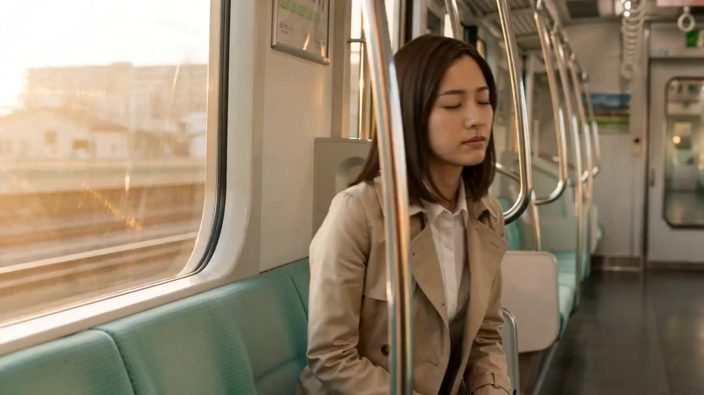

# One-Take Commercial

> **作者：** やはたうみり

## Content

**Process Planning:**

**Logic and Dependencies for the Full Video Phase:**
1. Write Final_Video_Spec.md (Title, Type, Aspect Ratio, Duration, Visual Style, Language) → **text_editor**.
2. Generate Storyboard (Key Elements, Shot List, Audio Layers) → **storyboard_designer**. Once the storyboard is ready, scan the current context for any assets provided by the user or previously generated that match the storyboard entries (e.g., element images, background music). For each match, bind and assign the asset to the corresponding storyboard slot via **media_generator** before proceeding to the generation steps → **media_generator**.
3. Set up elements:
   - If the user has already uploaded element assets (e.g., character images or reference characters), bind them directly as assets for the corresponding key_elements.
   - Otherwise, generate images for all elements → **media_generator**.
4. **Sequential Generation Loop for Shot Continuity (Strictly prohibited from concurrent generation; must be generated sequentially one by one. The following two optional execution workflows are available. You must first communicate the pros and cons of both options to the user and have them choose; you cannot proceed to subsequent steps without the user's selection):**
   - **Option 1: First-Frame Connection Mode (Based on keyframe extraction) - Faster generation, consumes fewer credits, but may have a stuttering effect.**
     - Must follow the order of the storyboard shot list, starting from the first shot (Shot 1).
     - **For the first shot (Shot 1):**
       - Call **media_generator** (using **MultiModalToVideo**, model **Seedance 2.0**, resolution **720p**), referencing the associated key element images, to generate Shot 1.
       - **Mandatory pause and confirm:** Guide the user to review the Shot 1 video.
     - **For subsequent shots Shot N (N > 1) loop:**
       - Only start the production of Shot N after the user has explicitly confirmed they are "satisfied" with the previous shot, Shot N-1.
       - Call **resource_prepare_and_analyze**: Analyze and extract the **last frame** (the final image of the last second) of the Shot N-1 video, output and save it as a keyframe image.
       - Call **media_generator**: Register this last frame image as an asset and **bind** it to the start_frame position of Shot N.
       - Call **media_generator** (using **MultiModalToVideo**, model **Seedance 2.0**, resolution **720p**) to generate Shot N. Its reference input must include: the last frame image extracted from Shot N-1 (as start_frame) and the key_elements assets for the current shot.
       - **Mandatory pause and confirm:** Guide the user to confirm whether they are satisfied with the current Shot N video. Only after satisfaction can the last frame of this shot be extracted to proceed to the next shot in the loop.
   - **Option 2: Pre-Video Reference Mode (Based on video stream reference) - Slower generation, very high credit consumption (remind the user to choose carefully), but the video is more coherent and fluid.**
     - Must follow the order of the storyboard shot list, starting from the first shot (Shot 1).
     - **For the first shot (Shot 1):**
       - Call **media_generator** (using **MultiModalToVideo**, model **Seedance 2.0**, resolution **720p**), referencing the associated key element images, to generate Shot 1.
       - **Mandatory pause and confirm:** Guide the user to review the Shot 1 video.
     - **For subsequent shots Shot N (N > 1) loop:**
       - Only start the production of Shot N after the user has explicitly confirmed they are "satisfied" with the previous shot, Shot N-1.
       - Call **media_generator**: Directly bind the final_shot video generated for Shot N-1 as the `reference_video` (pre-video reference) for Shot N.
       - Call **media_generator** (using **MultiModalToVideo**, model **Seedance 2.0**, resolution **720p**) to generate Shot N. Its reference input must include: the video of Shot N-1 as `reference_video`, and the key_elements assets for the current shot.
       - **Mandatory pause and confirm:** Guide the user to confirm whether they are satisfied with the current Shot N. Only after satisfaction can the final_shot of Shot N be used as a reference to proceed to the next shot in the loop.
5. Generate all audio layers based on the storyboard → **media_generator**.
6. Perform final assembly after all resources are ready; then guide the user to export → **video_assembler**.
7. **Remake Mechanism for Unsatisfactory Shots (For completed or edited stages, if the user requests a regeneration of a specific Shot N):**
   - **If the user is unsatisfied with an intermediate shot Shot N and needs it regenerated:**
     - Retrieve the first-frame reference image of the subsequent shot Shot N+1 (i.e., its start_frame, which already exists as a static image asset).
     - Call **media_generator**: Bind the first frame of Shot N+1 as the end_frame (end-frame reference) to Shot N.
     - Call **media_generator** (using **MultiModalToVideo**, model **Seedance 2.0**, resolution **720p**): Input the original start-frame reference image of Shot N (Option 1) / the video of Shot N-1 (Option 2) as the starting frame, input the newly bound end_frame as the ending frame, supplemented by key_elements assets, and remake Shot N using the start-end dual-frame generation mode.
     - **Mandatory pause and confirm:** Guide the user to review the remade Shot N video; once satisfied, re-insert it into the timeline.

**Dependencies:** 2→1; 3→2; 4 (Internal serial loop, Shot N depends on the video rendered by Shot N-1 and the extraction of the last frame or video stream binding); 5→2; 6→4,5; 7 (Remake mechanism, Shot N depends on its original start_frame and the start_frame of Shot N+1 as the end_frame).

**When to Pause:**
- You must pause after the specification is finalized, after the storyboard is completed, and after element images are ready, and continue only after confirmation from the user.
- **Core Mandatory Pause:** In the shot generation loop of step 4, **after each shot video is generated, you must pause and wait for user confirmation.** Only after the user explicitly confirms satisfaction can you proceed to generate the next shot (extracting the last frame for Option 1, or binding the reference video for Option 2). It is strictly forbidden to skip confirmation and perform batch generation.
- **Remake Mandatory Pause:** When remaking an unsatisfactory shot in step 7, you must pause and wait for user confirmation after regeneration; only after the user is satisfied can you re-assemble the timeline and export.

**Note:** Media provided by the user or pre-existing (mainly affects steps 3-5): Before populating generated content, bind and assign media to the appropriate storyboard location via media_generator; avoid regenerating content that the user has already provided.

**Asset Analysis:**

**Rules for Last-Frame Keyframe Extraction:**
- When the upstream Planner initiates a request to extract the last frame of the previous shot (Shot N-1), call **resource_prepare_and_analyze**.
- Analyze the video stream of the previous shot, precisely locating the last frame of the last second of the video (usually the final clear image before the video cuts), ensuring that it is not corrupted, glitchy, or all-black/darkened due to a fade-out at the end of the shot.
- Extract and output this frame as an independent high-definition image asset, so that the **media_generator** can bind it as the start_frame / reference_image for the new shot in subsequent steps.

**Storyboard Design:**

**How to Design Key Elements**

- Ensure the inclusion of **Key Subjects** (characters, objects, etc.), **Key Locations/Scenes**, and **Key Props** (if any).
- **Characters:** If a character has multiple states or appearances in the project (e.g., different clothing, ages), clearly state this in the description (e.g., Look 1: ...; Look 2: ...).
- **Character-Voice Reference:** Generate or process the voice reference material uploaded by the user; the audio duration must be within 15 seconds.
- **Key Locations/Scenes:** Describe the position and orientation of important objects in the scene, especially props or areas where major actions/performances occur.
- **User-Provided Assets:** If the user has provided reference media and designated it as a Key Element, the description **must match it**; do not contradict what is seen or heard.

**How to Design Shots**
- **Prioritize long shots with internal cuts** (e.g., 10–15 seconds per shot). Design *within* the shot rather than splitting it into many short shots; editing frequency should follow the narrative rhythm. No shot shall exceed 15 seconds (the maximum duration limit of the current model).
- **One-Shot First-Frame Connection Design Specification:**
  - Due to the use of start-end frame image transfer technology, when designing shots for the storyboard, ensure that the opening of the subsequent shot visually connects naturally with the end of the previous shot.
  - **Starting from Shot 2**, shot descriptions must include **continuation descriptions**. That is: the opening state of Shot N (character position, gaze direction, gestures, scene lighting, initial camera shot size and angle) must be strictly consistent with the ending state of Shot N-1.
  - Avoid designing teleports, major scene changes, etc., between adjacent shots that break continuity, unless it is a specific Match Cut or an artistic smooth transition.
- **Each shot description must include:**
  - **Scene:** Reference location/scene (use scene element ID, e.g., \[Element_Office_Noir\]).
  - **Story Content:** Actions and dynamics of characters and key objects; dialogue and performance. Write out **accurate lines** (spoken dialogue or internal monologue/voice-over OS). Use element IDs to reference characters.
  - **Cinematography:** Shot size (e.g., long shot, medium shot, close-up), camera angle (e.g., low angle, high angle), camera movement (e.g., static, pan, push-in/pull-out).
- **When a shot contains internal cuts:** List story content and cinematography in the order of the cuts after the scene/setting description.

**How to Design Independent Audio**
- **Background Music:** Design at least one global background music track. If the video is long (e.g., 3 minutes or more) and has obvious breaks or turning points, you can plan multiple music segments (each with its own audio_id and range).
- **Voice-over:** If using long segments of narration to advance the story, design it here (set type to narration). Define voice characteristics, tone, and accurate script; use layout_instruction to restrict it to the relevant shot range.

**Media Generation:**

**Element Asset Generation**
  - **Images:** Use **TextToImage**. For the same character with different appearances or ages, **ImageToImage** is recommended; subsequent appearances should reference previously generated images to maintain consistency. Recommended model: **Nano Banana 2 (Gemini 3.1 Flash Image)**, resolution **2K**.
  - **Character Images:** Generate 1 reference image for each character: use a horizontal side-by-side layout. The left side of the frame should show the character's **headshot** (compact composition, focused on the face, used to confirm identity, skin tone, eyes, hairline); the right side should show the character's **full-body shot** (showing the whole body, used for clothing, hairstyle, makeup, shoes, and silhouette).

**Final Shot Video Generation**
- Use **MultiModalToVideo**. Recommended model: **Seedance 2.0**, resolution **720p**.

- **One-Shot First-Frame Connection Strategy (Supports the following two generation branches; assets must be bound according to the selected workflow):**
  - **Option 1: First-Frame Connection Mode (Based on last-frame image extraction)**
    - **For the first shot (Shot 1):** The reference input must include the **element assets** (character images, scene/prop images) associated with the current shot.
    - **For subsequent shots Shot N (N > 1):** The reference input must include:
      1. **First-Frame Reference Asset (Last frame of the previous shot):** Bind and use the **last frame image** extracted by resource_prepare_and_analyze from the previous shot (Shot N-1) (as the start_frame / reference_image for this shot).
      2. **Element Assets:** Key element images for all characters in the shot and required scene/prop images.
      - **Logical Note:** MultiModalToVideo must use this last frame image as the starting point for generation to ensure the opening of the Shot N video seamlessly connects with this image (i.e., the ending image of Shot N-1).
  - **Option 2: Pre-Video Reference Mode (Based on pre-video reference)**
    - **For the first shot (Shot 1):** The reference input must include the **element assets** (character images, scene/prop images) associated with the current shot.
    - **For subsequent shots Shot N (N > 1):** The reference input must include:
      1. **Pre-Video Reference Asset (Previous shot video):** Bind and use the final_shot video from the previous shot (Shot N-1) as the `reference_video` for this shot.
      2. **Element Assets:** Key element images.
      - **Logical Note:** MultiModalToVideo uses the final_shot video from the previous shot as input for movement and state continuity to achieve dynamic connection.

- **Start-End Dual-Frame Remake Strategy for Unsatisfactory Shot N (When all generation or editing is complete and the user is unsatisfied with Shot N):**
  - Reference input must include:
    1. **Start Frame Reference (Original first frame):** 
      - Option 1: Use the original start_frame of Shot N (for Shot 1, it is the first-frame element image; for Shot N > 1, it is the extracted last-frame image of Shot N-1).
      - Option 2: Use the video of Shot N-1 as reference, input the newly bound end_frame as the ending frame, supplemented by key_elements assets, and recreate Shot N using the start-end dual-frame generation mode.
    2. **End Frame Reference (First frame of the following shot):** Bind and use the first-frame reference image of the subsequent shot Shot N+1 (i.e., its start_frame) as the end_frame for Shot N.
    3. **Element Assets:** Key element images of all associated characters in the shot and required scene/prop images.
  - **Logical Note:** MultiModalToVideo must use the original first-frame image as the video starting point and the first-frame image of the subsequent shot as the video end point to generate the video using both frames. This ensures that Shot N perfectly continues from Shot N-1 and that its tail seamlessly connects with the beginning of Shot N+1.

**Prompt Writing:**

**Highest priority, applicable to all prompt writing situations: When the user inputs in Chinese or loads a Chinese language environment, the prompt needs to be written in Chinese. However, content regarding voice-over/dialogue in the prompt must strictly follow the Output Language in Final_Video_Spec.**
**Image Generation Prompts (TextToImage, ImageToImage)**
**General Principles for All Image Prompts**
- The prompt is not just describing 

**Final Assembly:**

**One-Shot Seamless Assembly Specification:**
- **Minimalist Seamless Transition:** Consecutive shots (Shot N-1 and Shot N) are already aligned via start-end frames, so **it is strictly forbidden** to use fade-ins, cross-dissolves, white flashes, or any third-party effect transitions between shots when assembling on the timeline.
- **Hard Cut Connection:** All video connection points must use **Hard Cut** connections to reflect physical dynamics with infinite continuity between shots in the most natural way, thus presenting a near-perfect One-Shot long take effect after assembly.
- **Audio Track Fluidity:** Global background music and voice-overs must remain smooth and uninterrupted between these seamless hard cuts; audio must not stutter or have sudden volume changes at the hard cut points.
