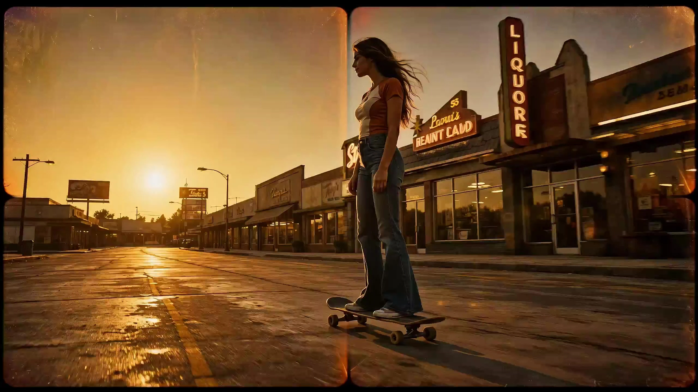

# One-Take Film Short

> **作者：** @Damon

## Content

Process Planning:

Execution Logic and Dependencies for One-Take Video Projects:

Establish Global Parameters: First, invoke Text Editor (text_editor) to create Final_Video_Spec.md, locking in the 16:9 aspect ratio, 720p resolution, total video duration, and the "one-take" visual style. If the user does not clearly state their visual style requirements when starting the project, the Planner must proactively list and recommend the thirteen classic styles natively supported by this project (Cinematic Realism, Anime, Cyberpunk, Sci-Fi Wasteland, Steampunk, Chinese Ink Wash, Gothic Dark, Surreal Dream, Ghibli Hand-Drawn, Claymation, Minimalist Bauhaus, 70s Retro, Ornate Baroque) in the first step. Guide the user to select a style, and write it to the Spec configuration file only after the style is confirmed.

Analyze User Assets: If the user has provided character or scene reference images, invoke Resource Prepare and Analyze (resource_prepare_and_analyze) to perform in-depth multimodal analysis, extracting core character features (hairstyles, clothing, facial features, etc.) and the spatial layout and lighting characteristics of the scene. Here, it is mandatory to verify whether the character image is a standard full-body three-view sheet and whether the scene image is a multi-angle, no-character four-quadrant layout.

Design Storyboard: Invoke Storyboard Designer (storyboard_designer) to plan the one-take storyboard. If the total duration is no more than 15s, plan it as 1 shot; if it exceeds 15s, scientifically split it into multiple continuous shots (each no more than 15s). Between shots, design seamless purely physical direct continuity (based on pixel locking at the start/end and physical trajectory continuity; strict prohibition of contrived visual transitions such as occlusions, whip pans, or passing through doors). In the storyboard, define key_element (including element character and element scene), and describe in detail the camera movement trajectory and character action flow for the long take. If the character has dialogue, clearly design the voice timbre and dialogue intent in the storyboard.

Generate Character, Scene, and Audio Reference Assets (if not provided by the user, or if provided assets are not standard): Invoke Media Generator (media_generator).

Character Three-View Completion and Conversion: If the user provides no character assets, use the TextToImage path to generate a standard full-body three-view sheet. If the user provides non-three-view character images (e.g., single half-body portrait, illustration), use the ImageToImage path with the user's image as reference_image, using Nano Banana Pro (Gemini 3 Pro Image) or GPT Image 2 (2K resolution) to convert and generate a standard full-body character three-view sheet that adheres to the short film's style while preserving character features.

Scene Four-Quadrant Completion and Conversion: If the user provides no scene assets, use the TextToImage path with the recommended models above to generate standard, no-character, multi-angle four-quadrant reference images. If the user provides non-four-quadrant scene images, use the ImageToImage path with the user's image as reference_image, converting and reconstructing it into a standard, no-character, multi-angle four-quadrant reference image while maintaining core elements and style. The four-quadrant content layout must be: top-left: panoramic establishing shot, top-right: detail/prop close-up, bottom-left: depth/perspective, bottom-right: atmospheric lighting effects.

Audio Asset Generation: If the character has dialogue, use MiniMax Speech 2.8 HD to generate a short voice sample matching the description, then register and save it as the character's voice asset key_element_audio.

Bind and Strictly Verify Asset References: Invoke Media Generator (media_generator) to bind user-provided or generated character reference images, scene reference images, and character-specific audio key_element_audio into the corresponding key_element slots in the storyboard. At this stage, the Planner must perform a comprehensive self-check of all designed Key Elements, verifying one by one whether each key_element has successfully completed image asset binding and (if applicable) key_element_audio asset binding. No elements may be left out; if an element without bound assets is found, it must be generated or bound immediately to ensure foolproof execution before proceeding to the next step.

Generate One-Take Video: Invoke the MultiModalToVideo image-to-video generation path of Media Generator (media_generator), using the Seedance 2.0 core model.

Voice Consistency Injection: In the video generation parameters, the bound key_element_audio must be introduced as a voice feature reference to ensure absolute stability of the character's voice during speech in the generated video.

Continuous Generation and Absolute First-Frame Locking:

For the first shot, generate using the bound character and scene reference images.

For subsequent shots N (N > 1), before generation, you must first invoke Resource Prepare and Analyze (resource_prepare_and_analyze) to capture the last frame of the previous shot (shot N-1) at a precise time point as the first-frame reference (must exclude potential generation shrinking, sticking, or static tail frames; locate the final full dynamic moment/peak blur frame of the physical action). Display this frame to the user, clearly pointing out the captured time point and key connection features (such as micro-positioning of the subject's hands, camera movement velocity vectors, and lighting highlights). After user confirmation, invoke Media Generator (media_generator) to register and bind this frame as the start_frame for shot N. During generation, you must simultaneously input this finely confirmed start_frame image, the final video of the previous shot N-1 (as reference_video), and the global reference images for the character and scene, based on the one-take continuous action and seamless connection description in the storyboard, achieving pixel-level strict locking of the start and end.

Timeline Assembly and Output: Invoke Video Assembler (video_assembler) for editing and assembly, using fine-tuned start/end frame alignment and seamless splicing to ensure natural transitions between multiple shots with no unnecessary hard cuts or black frames, presenting a perfect 'one-take' long video visual effect.

Ultra-Smooth Upscaling and Frame Interpolation (Optional): After editing is complete, invoke the super_resolution path of Media Generator (media_generator). Use the MediaKit model to perform super-resolution (recommend 1080p or 2K/4K) and AI frame interpolation (forced 60fps) on the final spliced video, ensuring that large-scale camera movements and action transitions achieve theater-level smooth optical flow, then prompt the user to export.

Phased Pauses and Confirmations:This Skill implements a strict "confirm first, generate later" interaction mechanism. You must pause and seek user confirmation at the following critical nodes, and only proceed to the corresponding generation steps or the next stage after receiving the user's explicit permission:

Before/After Establishing Final_Video_Spec.md: If the user has not specified a style, you must proactively display the style list recommendation for them to choose before writing parameters; after locking the Spec, pause and ask the user to confirm global aspect ratio, resolution, and style parameters;

After Completing Storyboard Design: Pause and ask the user to confirm the single-shot design, Key Elements, character voice timbre, and camera movement trajectory;

Before Starting the Generation of Any Media Assets:

Before generating character and scene reference images and character voice samples in Step 4, you must confirm the image and audio sample generation plan with the user;

Before generating supplementary reference assets due to omissions in Step 5, you must explain to and confirm with the user;

Before generating the final_shot (the first shot of the one-take video) in Step 6, you must confirm the final video generation parameters and prompts with the user; for subsequent shots N (N > 1), when capturing the previous shot N-1 as the start_frame, you must display this frame to the user and clearly point out the specific time point extracted (timestamp accurate to the millisecond) and key connection point features (such as skeletal gravity state, joint positions, camera blur direction, and light flow, etc.). Only after the user has reviewed and confirmed that this critical point and extraction time are correct may you register, bind, and proceed with subsequent generation;

Before generating any audio assets (BGM or narration), you must confirm;

Before performing super-resolution and frame interpolation optimization on the assembled video in Step 8, you must display the current spliced preview to the user and confirm the super-resolution resolution and frame rate configuration.

After Completing Reference Image Generation/Analysis, and After Completing the Generation and Binding Verification of All Key Elements (Confirming No Omissions): Display the current asset binding status (including image assets and key_element_audio audio assets) to the user and confirm that everything is correct.

Asset Analysis:

Multimodal Analysis Specifications for User-Provided Assets:

Character Three-View Analysis:

Three-View Layout Validation: First, verify whether the character reference image uploaded by the user is a standard "three-view" (front, side, and back views) full-body projection layout. If the user does not provide a three-view image (e.g., a single face shot, half-body shot, static illustration, or non-full-body multi-angle reference), it should be deemed non-compliant with the global consistency reference specifications for single-take consistency. The system must output a judgment result instructing the Planner to use the ImageToImage path in subsequent stages to automatically convert this image into a standard character three-view image that matches the short film's style, using the original image as a feature reference.

Feature Extraction: Extract the character's hairstyle (color, length, texture), face shape, facial features, and representative expressions.

Detail Analysis: Meticulously analyze clothing details (material, tailoring, color scheme, special insignias, or accessories) in the front, side, and back views.

Body Type Summary: Summarize the character's body proportions and posture style, refining them into highly structured text features to be outputted to downstream generation tasks.

Scene Multi-Angle Grid Image Analysis (Without Characters):

Four-Grid Layout Validation: First, verify whether the scene reference image uploaded by the user is a standard four-angle "four-quadrant grid" multi-viewpoint layout and whether the content in the four quadrants meets standard distribution requirements. If the user does not provide a four-grid image (e.g., a single perspective landscape photo, an incomplete collage, or a lack of multi-angle references), it should be deemed non-compliant with the specifications. The system must output a judgment result instructing the Planner to use the ImageToImage path in subsequent stages to automatically convert this image into a standard scene four-grid image that matches the short film's style, with content distributed according to standards (top-left: panoramic establishing shot, top-right: close-up of furnishings, bottom-left: depth/perspective, bottom-right: atmospheric lighting effects).

Style Identification: Identify the architectural or natural style of the scene (e.g., modern minimalism, sci-fi cyberpunk, retro Chinese, sci-fi wasteland, steampunk, wuxia ink wash painting, gothic dark fantasy, surreal dream space, Ghibli-style hand-drawn, clay stop-motion, minimalist Bauhaus, 70s retro film, ornate Baroque).

Space and Lighting Analysis: Analyze the spatial 3D structure, perspective relationships, and placement of major objects shown from different angles in the grid image; extract the direction, color temperature, shadow contrast, and overall environmental atmosphere of the dominant light source to ensure that multi-angle spatial features can be reconstructed across continuous shots.

Storyboard Design:

Single-Shot Long Take Storyboard Design Specification:

Definition of Key Elements:

Create a unique element character: Descriptions must strictly adhere to three-view (front, side, back) features; if there is dialogue, audio characteristics (voice type, timbre descriptions, e.g., [deep, magnetic male voice] for sound generation guidance) must be added to the character description.

Create a unique element scene: Descriptions must include multi-angle geometric relationships in space, iconic objects, and lighting tone.

Shot Design and Seamless Multi-Shot Stitching Specification:

Duration and Shot Splitting Mechanism:

If the total video duration is <= 15 seconds, plan for 1 shot, with a duration controlled between 4s - 15s.

If the total video duration is > 15 seconds, it must be scientifically split into multiple continuous shots (each shot kept between 4s - 15s, avoiding overly long individual shots).

Continuous Narrative and Forbidden Terms: The Shot Description for each shot must employ continuous narration; explicit transition interruption terms like "cut to" or "hard cut" are prohibited.

Cascading Alignment of Start and End States: In multi-shot storyboard design, the end state of the previous shot and the start state of the next shot must form a mirrored closed loop. For example, if Shot N-1 ends with "character's right foot stepping forward, body leaning forward, gaze directed downward-right, positioned in the middle of the corridor," the starting description of Shot N must precisely connect to "character maintains the posture of the right foot stepping forward, body leaning forward, gaze directed downward-right, continuing to walk in the middle of the corridor." The character's physical posture, absolute spatial position, and gaze orientation must be pixel-perfectly connected in the text description.

Pure Direct Continuation Spec: If there are multiple shots, all deliberate or artificial "visual transition gimmicks" must be discarded (occlusion transitions, whip pans, empty shot transitions, passing through doors, and other unnatural fabricated camera techniques are strictly prohibited) to ensure the entire video chain is formed by a pure, coherent, and uninterrupted single camera movement flowing through space. Storyboard descriptions must provide precise feature connection anchor points for "direct continuation" in the following dimensions:

Camera Momentum Continuation:

End of previous Shot: The precise vector state of the current camera movement must be specified (e.g., camera tracks the subject horizontally to the right at a constant speed of 1.2m/s, maintaining a medium shot, with the optical axis perpendicular to the direction of movement).

Start of next Shot: The starting camera movement must declare complete inheritance of the previous Shot's ending velocity and direction vector (e.g., following the previous shot's constant-speed tracking rail to the right, speed maintained at 1.2m/s, continuing to pan right without pause), achieving undamped inertial coupling of camera movement at the text level.

Biomechanical Kinetic Match:

End of previous Shot: The gravity distribution and skeletal joint spatial coordinates of the character's movement in the last frame must be precisely locked (e.g., character's left heel just touches the ground, toe tilted up 15 degrees, body center of gravity shifted forward by 60%, right arm swung back to its highest point).

Start of next Shot: This physical state must be used as the starting pixel and kinetic constraint (e.g., continuing from the moment the left heel touches the ground with 60% center of gravity forward, smoothly transitioning the center of gravity to the front foot, right arm naturally swinging forward), ensuring that the character's muscle tension and kinetic energy conform to pure Newtonian mechanics across video boundaries, with no instantaneous displacement or "sliding foot" phenomena.

Micro-Environmental Continuity:

Adjacent Shot boundary description: Perform strict consistent repetition of dynamic physical details in the environment. It must be specified that at the moment of switching between two shots, the incident angle of light, color temperature distribution, wind force/direction (e.g., a Force 3 breeze blowing toward the character, causing hair to drift backward continuously), and air medium density (e.g., density of floating dust or smoke) are in an absolutely equivalent state, ensuring AI generation does not produce abrupt "environmental mutations" or "light flicker" at the connection.

Design of Refined Camera Trajectories (Movement Paths) and Multi-Trajectory Combinations:

Single camera trajectories must specify the physical path, height, and velocity metrics of the camera in space.

Multi-Trajectory Combination Design: The storyboard must avoid simple, monotonous movement. For the narrative rhythm of a long take, a seamless combination of multi-dimensional camera trajectories should be designed and connected chronologically in the text:

"Dolly-In & Orbit" combination: For example, "The camera first slowly and smoothly moves towards the subject's face (Dolly In) until reaching a medium close-up, then seamlessly and smoothly transitions into a 180-degree clockwise horizontal orbit centered on the subject's face, revealing previously hidden scene elements behind them." Used to reinforce the subject's psychological state and expand spatial dimensions.

"Tracking & Low-Angle Tilt-Up" combination: For example, "The camera maintains parallelism with the character, tracking their side-profile movement to the right at a stable constant speed (Tracking); when the character stops and looks up, the camera smoothly lowers its height to the horizon level, and tilts up (Tilt-up) to show their micro-expressions and reveal the grand depth of the ceiling." Used to show the volume contrast between the subject and the environment.

"Dolly-Out & Crane/Jib Move" combination: For example, "The camera starts from a close-up of the character's hand, steadily pulls back (Dolly Out) to a wide shot, and immediately after, the camera height rises vertically (Crane Up) and tilts down to look over the scene, allowing the entire maze-like spatial scene to fully unfold in the frame." Used for atmospheric endings of narrative segments or the ultimate release of spatial sense.

"Pan & Rack Focus" combination: While the camera maintains constant-speed panning or tracking in the same direction, the focus smoothly switches (Rack Focus) between the foreground character (shallow depth-of-field close-up) and background clue elements (deep depth-of-field long shot), guiding the viewer's gaze seamlessly through the long take.

Detailed Description of Continuous Action Flow, Micro-Expressions, and Postural Transitions for Characters is Mandatory:

Alignment of Action and Camera Transition Points: The character's action pivots and posture adjustments must be precisely aligned with the camera trajectory change nodes. For example, when the camera performs an Orbit transition, the subject should accompany it with a shift in the center of gravity or a subtle deflection of gaze following the camera's direction; when the camera pushes in (Dolly In) to a close-up, micro-expression changes of the character must be clearly depicted (e.g., transitioning from initial vigilance and confusion to a relaxed smile, accompanied by flickering eyes or slightly lowered eyelids).

Postural and Spatial Coherence: Specify details of the character's body posture under different camera angles (e.g., shoulders slightly lowered to indicate relaxation, body leaning forward to show focus, arms crossed to reveal alertness), ensuring that when the camera orbits to the side or back, the subject's limb morphology perfectly matches the frontal emotional flow.

Independent Audio Layers and Sound Design Specification:

Multi-Track Audio Structure Planning:

Background Music Layer (BGM): Plan for 1 global BGM layer, selecting light music, Ambient music, or instrumental music that fits the story's visual and emotional atmosphere.

Ambient SFX and Dynamic SFX Layer (SFX): Clearly mark the dynamic ambient sound effects required for each shot in the storyboard (e.g., footsteps, wind, rain, clothing rustle, door opening/closing, etc.). Ambient sound effects are divided into "Background Ambience" (persistent, such as wind noise, distant environmental noise) and "Synchronous Action SFX" (transient, such as corridor footsteps, door slamming), with their timing noted in the shot description.

Acoustic Spatial Coordinate Labeling: When designing dynamic SFX, the physical distance of the action subject relative to the camera (e.g., close-up 1m, medium shot 3m, long shot 10m) and horizontal画面 orientation (left, center, right) must be explicitly labeled in the storyboard. For example: [SFX: Corridor footsteps, distance 8m decreasing to 1.5m, orientation from left to right], providing precise acoustic attenuation parameters for downstream editors.

Narration Layer (Narration): If narration is included, design the corresponding Narration audio layer and configure a clear narration_speaker_profile.

Volume Ratios and Soundscape Hierarchy Intent Description:

In storyboard design, explicitly define the primary/secondary and soundscape hierarchy of each audio track in text to ensure: Narration is the clearest and most dominant; SFX is tightly linked to the on-screen action, possessing spatial physical texture; BGM remains at a low level, serving only as atmospheric rendering, to avoid interfering with voices and sound effects.

Media Generation:

Single-Take Asset Generation and Binding Strategy:

Character and Scene Reference Image Generation:

Trigger Conditions:

Character Reference Image: If the user provides no character assets, use TextToImage to automatically generate a standard three-view drawing (T-pose/standard turnaround). If the user provides assets but Resource Prepare and Analyze determines they are not standard three-view drawings (e.g., a single portrait or common illustration), generation must be triggered. Use the ImageToImage path with the user's image as a visual reference to convert and reconstruct it into a standard three-view drawing consistent with the short film's style.

Scene Reference Image: If the user provides no scene assets, use TextToImage to automatically generate a standard four-quadrant scene reference image. If the user provides scene assets but Resource Prepare and Analyze determines they are not a standard four-quadrant image (or the quadrants are improperly allocated), generation must be triggered. Use the ImageToImage path with the user's image as a visual reference to convert and reconstruct it into a scene four-quadrant image with fixed standard content allocation consistent with the short film's style.

Model Selection: Preferred: Nano Banana Pro (Gemini 3 Pro Image) or Alternative: GPT Image 2 (Resolution recommended: 2K; this configuration provides excellent image quality, feature alignment, and structural adherence for complex three-view and multi-quadrant, multi-angle layouts).

Generated Content:

Character Three-View (No reference/New generation): Use TextToImage to generate a full-body character design sheet on a white background, including front, side, and back views.

Character Three-View (Non-standard reference/Conversion generation): Use ImageToImage, binding the user's single-view/non-three-view image as the reference_image. While maintaining core identifying features such as facial features, hairstyle, and basic clothing, reconstruct it into a refined full-body three-view design sheet on a white background. This ensures it retains the original character's "soul" while perfectly aligning with the thirteen specific styles designated for the short film.

Scene Quadrant Image: Generate a 4-quadrant grid conceptual image of the environment from multiple angles without characters. Due to the technical limitations of image generation models in maintaining spatial consistency, the four-quadrant grid is the best balance for ensuring consistent scene details and multi-angle stereo perspective (avoiding the perspective collapse caused by detail overload in nine-quadrant grids).

Asset Registration: Register the generated reference images as corresponding asset_ids and bind them to the key_element.

Single-Take Video Generation and Multi-Shot Continuity Assurance (Seedance 2.0):

Use the MultiModalToVideo path.

Model Selection: Seedance 2.0 (Aspect ratio 16:9, resolution 720p, single shot duration between 4s - 15s).

Reference Constraint Binding and Continuity Strategy:

Single Shot (<=15s): Must bind the character three-view asset_id and scene multi-angle quadrant asset_id as visual references to ensure consistency between characters and the environment.

Multi-Shot Seamless Splicing (>15s):

The 1st shot references only the character three-view and scene quadrant images.

Starting from the Nth shot (N > 1), in addition to binding the character three-view and scene quadrant images, you must additionally bind the final video of the previous shot (final_shot) as a reference_video (utilizing the video reference mode of MultiModalToVideo to maintain feature continuity).

Triple Super-Anchoring Mechanism (First-frame pixel lock + Static feature lock + Dynamic transition lock): To completely eliminate motion jumps, position offsets, or posture inconsistencies caused by AI randomness between the last frame of the previous video and the first frame of the next video, the Triple Super-Anchoring Mechanism must be executed when generating subsequent shots (Shot N, N > 1). The system must not just input video or static images as references; it must simultaneously input and bind:

First-Frame Pixel Lock (start_frame): Use the last frame of Shot N-1 extracted by resource_prepare_and_analyze, registered by the Planner and bound as the start_frame of Shot N, acting as a strong constraint for the generator's starting point.

Static Feature Lock (Global Static Feature Lock): The initially generated character three-view and scene four-quadrant reference images are used to lock facial features, clothing materials, and basic stereo perspective of the scene, preventing Face Drifting or scene environment distortion during iterations.

Dynamic Transition Lock (reference_video): The final video of the previous shot (Shot N-1), used to allow the generator to inherit the camera movement inertia, object velocity vectors, and the dynamic trends of the last second.

Prioritize the MultiModalToVideo mode to ensure absolute physical transitions and inheritance for camera paths, character clothing, facial expressions, dynamic trends, and ambient lighting, strictly preventing asset drift.

Background Music and Sound Effect Generation Path:

BGM Generation: Invoke the text_to_instrumental tool; Suno 5 model is recommended. Generate original instrumental music that meets duration requirements based on the musical style designed in the Storyboard (e.g., ambient synth, slow piano theme).

Environmental Sound Effect Generation:

On-screen Synchronized Sound Effects: Primarily rely on the "audio-visual synchronous generation" capability of Seedance 2.0 during the MultiModalToVideo generation process. By embedding SFX-specific wrappers in the video prompt, the model physically synthesizes localized action sound effects while generating the single-take action footage.

Continuous Ambient Background Sound: If necessary, generate specific continuous background white noise (e.g., wind howling, rain falling) via text_to_instrumental and bind it as an independent audio_layer.

Character-Specific Voice (key_element_audio) Generation and Injection Strategy:

Voice Sample Generation: If the Storyboard includes character dialogue design, before starting video generation, invoke the text to narration tool (recommended: MiniMax Speech 2.8 HD or ElevenLabs v3) to generate a clean, 1-15 second short audio sample based on the character voice description in the Storyboard.

Voice Asset Binding: Register the generated reference voice as an exclusive key_element_audio and bind it to that character's key_element slot.

Video Generation Voice Injection: When invoking Seedance 2.0 for MultiModalToVideo generation, this key_element_audio must be passed as a voice feature reference (bound via the audio_infos parameter to the character placeholder), forcing the generated video to perfectly align lip-sync with the dubbed voice while ensuring consistency across shots.

Final Video Super-Resolution and Frame Interpolation High-Dynamic Optimization (MediaKit):

Super-Resolution and Interpolation Timing: After the long single-take sequence is spliced, large-scale camera movements (e.g., Whip Pan, Dolly In) may cause slight visual jitter or stutter at standard frame rates (e.g., 24fps/30fps). The super_resolution path of the Media Generator (media_generator) should be invoked before final output.

Model and Parameter Selection:

Model: Select the MediaKit video super-resolution and frame interpolation model.

Resolution: It is recommended to upscale the 720p spliced generation material to "1080p" or higher (e.g., "2k"/"4k"), significantly enhancing microscopic image texture (e.g., realistic skin diffuse reflection, cyberpunk neon water reflection details).

Frame Rate (fps): Must be strictly configured to "60" fps. Through high-precision AI frame interpolation, physically insert frames for optical flow in motion-coincident frames at straight cuts and continuous camera transition frames, ensuring the "single-take" long shot presents an absolutely smooth, high-frame-rate fluid image without damping.

Prompt Writing:

Prompt Writing Guidelines for Image and Video:

Global Visual Style Guidance:

Style Alignment: The prompt must explicitly include and maintain the visual style locked in Final_Video_Spec.md throughout to ensure a high level of uniformity between images (Nano Banana Pro / GPT Image 2) and video (Seedance 2.0).

Realistic Style (Realistic / Cinematic): Building on foundational realistic terms (photorealistic, hyper-detailed, movie cinematography, professional lighting, 35mm photograph), focus on rendering physical camera variations and micro-textures of the environment to adapt to the long-take requirement. Must refine:

Physical Camera Expression: Describe the smooth transition of focal length and depth of field during camera Dolly or Orbit movements (dynamic depth of field, subtle chromatic aberration, realistic lens flare, natural motion blur).

Material and Light/Shadow Details: Detail skin pores and subsurface scattering of skin, reflections of clothing fiber textures at different angles; add drifting dust motes in volumetric light beams, and physical stretching of shadows as the camera moves.

Anime / Illustration Style: Building on foundational anime terms (anime style, key animation, cel-shaded illustration, clean line art, high-quality Japanese animation studio aesthetic), focus on rendering hand-drawn light/shadow tension, high-tension multi-layered spatial parallax, and kinetic textures to adapt to the long-take requirement. Must refine:

Multi-layered Spatial Parallax: Force the prompt to simulate deep three-dimensional space within flat hand-drawn images through explicit asynchronous rate relationships between foreground, midground, and background. Must concretely describe: foreground obstructions (e.g., sliding hair strands, falling flower petals, large cherry blossom branches, archaic Japanese pillars) moving past with rapid relative displacement (rapid sliding foreground elements), creating a strong focus-pull sensation; midground character movements locked in parallel with the camera; background (e.g., layered lush green mountains, heavy clouds at dusk, shimmering distant streets) shifting asynchronously at extremely slow angular velocities (asynchronous background shifting with slow parallax, slow multi-layered panning) to pull apart spatial depth at a physical level.

Speed Lines & Kinetic Smear Frames: For extreme camera movements or rapid pans, avoid CGI-heavy gradient blurs and specify hand-drawn mechanical visual buffering. Requirement: use stylized kinetic speed streaks, hand-drawn horizontal speed lines of varying thickness at the entry points of extreme camera movements to concentrate the viewer's gaze; at transient action points (e.g., sword swings, sudden stops), use classic expressive smear frames and dynamic motion smears on characters, using exaggerated limb deformation to soften physical breaks between frames.

Dynamic Hair Highlights & Stylized Rim Lights: For the iconic anime "angel ring" (angel ring highlights / halo hair shine), must explicitly indicate the displacement and morphing that occurs during camera Orbit movements (e.g., when the camera orbits to the rear side, the angel ring highlights along the hair curvature move smoothly and naturally narrow, presenting an organic flow rather than a static texture pasted on hair); strengthen dynamic hand-drawn glowing stylized rim lighting on clothing and hair to outline clear character silhouettes in dark environments.

Cel-Shaded Rendering & Artistic Textures: Clearly define sharp 2-tone cel-shaded drop shadows, but embellish the shadow boundaries and junctions (jaw, neck) with subtle airbrushed gradient blends in shadow crevices to add a premium feel; require the background environment to use textured watercolor wash, organic hand-painted background texture, and optionally integrate a delicate paper grain overlay into the prompt to filter out cold, smooth digital vector sensations and provide a warm, rich film-like texture.

Cyberpunk Style: Building on foundational cyberpunk terms (cyberpunk style, neon-drenched environment, high-tech low-life, holographic overlays, dark synth aesthetic, rain-slicked surfaces, volumetric cyan and magenta lighting), focus on rendering dynamic diffuse reflections of warm/cool light sources, suspended holographic layer perspective parallax, and environmental medium physical interference to adapt to the long-take requirement.

Cool-Warm Color Temp & Wet Reflections: Emphasize extremely contrasting color temperature interlacing and physical reflections. Must concretely describe the dynamic diffuse reflection and wave-like flow of high-purity cool light (e.g., cyan neon, dazzling magenta) and warm light (e.g., warm orange sodium glow, street food yellow light) on rain-slicked asphalt and puddled alleys. As the camera dollies or orbits, these neon reflections should stretch or distort with the changing angle of light (stretching and shimmering reflections, real-time light path distortion), showcasing the oily film mottling on liquid surfaces and refraction changes, enhancing the stereoscopic realism of the environment.

Holographic Parallax & Glitch HUD: When moving through space in a long take, holographic layers cannot look like rigid 2D flat textures. The prompt must precisely define the three-dimensional volumetric parallax of floating 3D neon holographic advertisements and translucent neon holograms as the camera pans and rotates. Requirements: describe the asynchronous rate between holograms and background buildings during camera movement, and when the camera cuts past their flanks or backs, the holographic light flow must present precise thickness compression and inverse perspective distortion; physical media characteristics on their surface must be described in detail (e.g., high-frequency semi-translucent scanlines, minor visual glitch flicker, localized light scatter in dust-filled air).

Atmospheric Steam & Dynamic Volumetric Particles: Inject full atmospheric volume into the long take. The prompt must concretely portray various types of steam, rain mist, and dust clouds flowing irregularly in the environmental space (swirling atmospheric steam plumes, heavy rising neon-lit steam, dense wet drizzle haze). When the camera or the main character moves through them, describe the disturbance and dispersion of steam and dust clouds generated by the airflow (interfering with air currents, localized aerodynamic turbulence, particle drift around passing character); fog particles must be able to deeply capture and refract the strong cool/warm light sources in the environment, manifesting shafts of vibrant neon light passing through drifting steam, thereby completely breaking the hollow, clean digital space sensation.

Post-Apocalyptic Wasteland / Sci-Fi Wasteland: Building on foundational wasteland terms (post-apocalyptic wasteland style, crumbling ruins, overgrown decayed structures, desolate desert, retro-futuristic wreckage, weathered metal, cinematic tragedy aesthetic), focus on rust-mottled textures, high-concentration dynamic dust media, deep spatial parallax, and tragic cinematic aesthetics of strong Tyndall beams to adapt to the long-take requirement.

Corroded Metal & Weathered Textures: Precisely portray the rough reddish-brown rust spots (heavy reddish-brown oxidation, textured rust flakes) caused by decades of weathering on metal surfaces, edges of peeling paint, and exposed matte alloys. When the camera dollies or orbits, light must produce uneven specular reflections between rust pores and remaining mirror-like surfaces (heterogeneous specular reflections, matte rust contrasting with metallic glints), showcasing heavy historical damage and time erosion textures.

Dynamic Dust Storms & Sand Turbulence: Concretely describe sandstorms, wind-blown sand, and flying debris sweeping irregularly during the long-take movement (swirling sand dust storms, airborne grit, flying wind-blown debris). Sand particles must be able to highly capture backlighting, manifesting high-density atmospheric volume under strong light; when the main character or camera passes through the sand/dust, micro-level aerodynamic fluid disturbances should be generated around them (localized aerodynamic turbulence around moving subjects).

Deep Spatial Parallax of Ruined Megastructures: When moving through a long take, must open up extremely deep spatial dimensions. Required description: rapidly passing ruined steel beams in foreground; midground: character struggling forward through broken walls; background: weathered half-collapsed skyscrapers, decayed mega-cooling towers in far background, creating gigantic asynchronous spatial parallax panning with the camera movement, showcasing the vast desolation of human civilization ruins.

Tyndall Beams & Cinematic Backlit Tragedy: Inject a strong sense of epic tragedy into the long take. Must portray heavy Tyndall beams piercing through shattered domes, majestic volumetric sunbeams, divine light shafts, forming distinct volumetric light pillars in the dim, dust-filled space; glowing drifting dust particles must be visible in light shafts; accompanied by camera movement, strong backlight entering the lens must produce natural cinematic anamorphic lens flares, warm sun flares, and cast extremely elongated dramatic moving shadows on the ground.

Steampunk / Retro-Industrial: Building on foundational steampunk terms (steampunk style, retro-futuristic industrial aesthetic, brass pipes, rotating gears, clockwork machinery, steam-powered apparatus, copper valves, amber lighting), focus on complex interlocking machinery, brass sheen and copper weathering, high-pressure steam pneumatic jets, and multi-axis camera rail traversing aesthetics to adapt to the long-take requirement.

Complex Interlocking Gears & Clockwork Mechanics: Finely portray interlocking brass gears of various scales, complex gear trains, rotating ratchets, and reciprocating metal pistons. When the camera dollies or pans, gears must maintain precise physical interlocking, and their teeth sides and bearing edges must show the glistening thin film of lubricating oil on gear teeth and the kinetic energy of mechanical micro-tremors.

Brass Piping & Copper Weathering Patina: Concretely describe tangled networks of polished brass pipes, heavy copper handwheels, and bronze pressure gauges with glass lenses. Pipe walls and valve bodies should present uneven material reflections, dotted with pockets of greenish oxidized copper patina caused by moisture, dark spots from oil condensation, and dazzling metallic highlights on polished wear points.

High-Pressure Steam Jets & Pneumatic Turbulence: Concretely describe high-pressure white steam plumes, dense jetting steam bursts ejected at high speed and intermittently from pipe seams, exhaust valves, and cylinder nozzles. Steam must have clear turbulent and diffusive physical trajectories (turbulent aerodynamic dispersion); when the camera or subject character passes through, the airflow must form dynamic interference, stirring up surrounding dust or clothing corners; steam particles must be able to capture the warm amber glow or kerosene lamp light from the environment, presenting glowing volumetric halos and diffuse textures.

Multi-Axis Rail Parallax inside Machinery: When the long-take camera travels inside a grand factory, it needs to open up extreme spatial depth. Required description: rapidly sweeping copper conduits and large industrial fan blades in foreground; midground: character advancing on steel catwalks or operator platforms; background: infinite towering furnaces, industrial smokestacks in deep background, creating gigantic asynchronous mechanical parallax panning with the movement of the multi-axis camera rails.

Traditional Chinese Ink / Oriental Wuxia: Building on foundational Chinese ink wash and wuxia terms (traditional Chinese ink wash painting, ethereal wuxia aesthetic, dynamic ink bleeding, calligraphic brushstrokes, minimalist composition, poetic atmosphere, flowing silk robes), focus on organic ink bleeding, ethereal translucent veils, expressive spatial parallax, and wind flow trajectories to adapt to the long-take requirement.

Ink Bleeding & Organic Fluidity: The five levels of ink (scorched, thick, heavy, light, clear) produce subtle and smooth wet/dry bleeding transitions in space following the camera movement; the background environment retains the subtle raw paper grain texture and just the right artistic conception of "blank space" (negative space). When the camera or subject character moves, mist and wind trails must drift like flowing scattered ink (diffused dynamic ink wash flows, organic bleeding edges at shadow borders), presenting organic vitality and expressive painting quality.

Flowing Silk & Physics-Based Wind Currents: Extremely strengthen the aerodynamic performance of the subject's translucent Hanfu veils, bamboo hat ribbons, and wide sleeves during high or low-speed movement (elegant counter-directional draping movement, physics-based wind fluttering on silk robes). The damping movement trajectory and swing amplitude of clothing hems as they flutter in the wind must form an elegant interaction and airflow resistance sensation with the camera's displacement direction and rotation speed (glowing semi-translucent chiffon layers capturing rim lighting).

Expressive Parallax of Bamboo Forests & Ink Landscapes: When moving through a long take in an ancient bamboo forest in the rain, on steep mountain cliffs, or across a long wooden corridor bridge. Rapid foreground bamboo blades and splashing rain droplets sweeping by; midground: character advancing with a sword on an ancient bridge or stone trail; background: pale mountain silhouettes, sprawling misty valley in deep background, creating rhythmic, ethereal asynchronous panning parallax with the smooth multi-dimensional camera movement, showcasing deep artistic depth.

Gothic Dark / Dark Fantasy Medieval: Building on foundational gothic and dark fantasy terms (gothic architecture, dark fantasy aesthetic, gritty medieval atmosphere, dramatic chiaroscuro, cold moody tone, decaying structures, flickering candlelight), focus on flickering candlelight projection flow, high-concentration fog media, stained glass volumetric light beams, and cold/hard physical flaw materials to adapt to the long-take requirement.

Flickering Candlelight & Moving Shadows: Dominated by extremely weak, low-position single light sources (e.g., flickering candlelight, dim wall-mounted torches). Light must produce high-attenuation warm amber diffuse reflections on cold, rough, mottled stone brick walls and dark old oak paneling full of knife marks; as the camera pans, pushes in, or orbits, the tall gothic ribbed vaults in the scene and the shadow of the main character must produce highly dramatic, real-time physical deflection, stretching, and geometric deformation on the floor and undulating walls (flickering candlelight casting real-time elongated warping shadows).

Heavy Fog & Stained Glass Tyndall Beams: Swirling cold haze with microscopic drifting dust particles filling the dim ancient castle or grand cathedral. Pale or gloomy moonlight passing through tall, mottled stained glass windows refracts into highly defined colored Tyndall beams, majestic volumetric light shafts through stained glass, casting alien and flowing light patterns on the wet stone floor, with precise refraction angle drift following camera displacement.

Cold Stone, Corroded Iron & Damp Moss Textures: Precisely portray the moisture and weathering in the medieval environment. Stone wall edges and ancient sculptures should show beads of condensation caused by moisture, scratches, and damp moss textures inside cold stone crevices; cast-iron chandeliers, rusty heavy iron grates, and blunt chains in the scene must show coarse matte dark-red rust oxidation and irregular metallic specular highlights, completely filtering out smooth modern sensations.

Surrealism / Dreamcore / Liminal Space: Building on foundational dream and backroom space terms (surrealist dreamcore aesthetic, liminal space style, unsettling nostalgia, soft diffuse lighting, physics-defying floating elements, repetitive clean architecture), focus on non-Euclidean floating media, low-contrast shadowless soft light, infinite depth parallax, and spatiotemporal material heterogeneous flow to adapt to the long-take requirement.

Non-Euclidean Geometry & Floating Mediums: A large number of floating objects violating conventional gravity physics exist in the scene (e.g., hourglasses slowly rotating in mid-air, stationary suspended broken mirror shards, tiny floating bubbles, clock parts rising in reverse). When the camera passes through, pushes in, or orbits these floating media, the light flow must precisely capture their refractive index and multidimensional physical deflection of highlights (specular highlight shifts on floating shards, real-time light refraction distortion across suspended liquid spheres).

Soft Low-Contrast Lighting & Infinite Liminal Depth: Use uniform, cold/warm shadowless soft light without any explicit directionality (similar to natural scattered light outdoors on an overcast day, or weak buzzing white recessed grid ceiling lights in a backroom space). Scene materials (e.g., yellowed, outdated wallpaper with repeating geometric patterns, seamless, laid-flat light beige PVC flooring) present extremely high consistency and low-noise diffuse reflection; through infinitely extending empty corridors, layered symmetrical doorways, or infinitely looping stairwells (repeating clean doorways, infinite hallway perspective stretching into far background), create hypnotic, reality-stripping, deep spatial parallax with the camera's perfectly uniform panning.

Surreal Micro-textures & Spatiotemporal Material Shift: During camera movement, organically combine conventional hard surfaces with unexpected liquid flow characteristics (e.g., when a character steps on a hard marble floor, the floor creates rings of extremely realistic physical ripples and refractive reflections like a liquid water surface; or the hands of an old wall clock smoothly dissolve, flow, and drip downward like liquid mercury when the camera sweeps past). This dream-like material flow process must be precisely described in the prompt to showcase a terrifying, absurd, and time-frozen artistic beauty.

Studio Ghibli / Cozy Gouache Aesthetic: Building on foundational cozy terms (cozy Ghibli style, vintage anime aesthetic, detailed gouache painting, soft hand-painted illustration, nostalgic watercolor wash), focus on dynamic dappled light displacement, physics-based fluid resistance of wind-blown plants, and gouache paper fiber texture to adapt to the long-take requirement.

Dynamic Komorebi & Dappled Light: When the camera dollies or pans through the forest/past the window, warm yellow dappled sunlight (Komorebi) leaking through the treetops and branch gaps must physically displace on grass, soil, and the character following the camera movement, with projection and bright areas smoothly expanding/contracting with the angle.

Physics-Based Grass Waves: Grass blades, wildflowers, and wheat waves generate layered, continuous fluid damping fluctuations in the breeze, with swaying trajectories and rebound amplitudes forming an organic interaction and resistance with the camera's movement (delicate grass swaying in wind, flowing meadow layers).

Textured Gouache & Watercolor Wash: Retain the micro-level raw paper or coarse gouache paper fiber texture unique to cozy hand-painted illustrations, as well as the visible soft dry-brush edges at the boundaries (cozy gouache illustration texture, visible paper grain, soft dry-brush edges), completely filtering out cold digital vector smoothness.

Claymation / Tactile Stop-Motion Miniature: Building on foundational stop-motion terms (stop-motion animation, claymation style, handmade miniature world, tactile felt textures, charming physical craftsmanship), focus on handmade fingerprint indentations, fiber felt textures, and extreme tilt-shift defocus smooth transitions to adapt to the long-take requirement.

Clay Fingerprint Indentations: Finely portray visible clay fingerprints, subtle hand-molded indentations, tactile clay texture on clay characters and hard props, creating a real raised tactile feel when the camera pans and refracts reflections.

Miniature Fiber & Cardboard Textures: Trees and architectural details in the miniature environment need to have the coarse fiber fuzziness of felt, the rough joints of cardboard cuts (felt fabrics, miniature cardboard joints), and refractive light halos with warm dim glows emitted by tiny model light bulbs.

Extreme Tilt-Shift Defocus: As the camera pushes in or pans through the miniature world, the focus transitions rapidly and smoothly within an extremely narrow range (shallow tilt-shift depth of field, extreme macro bokeh), making the out-of-focus foreground and background blur in a creamy way, highlighting the physical scale tension of the miniature world.

Minimalist Bauhaus / Geometric Light & Shadow: Building on foundational Bauhaus terms (minimalist Bauhaus style, crisp geometric architecture, clean symmetrical lines, raw concrete surfaces, industrial functionalism aesthetic), focus on linear hardcore projection flow, raw concrete micro-pores, and symmetrical spatial geometric parallax to adapt to the long-take requirement.

Crisp Architectural Shadows: Dominated by intense, single-direction strong light (e.g., direct noon sunlight or strong directional side lights). Architectural shadow edges are extremely sharp (sharp architectural shadow lines, high-contrast chiaroscuro) and present impeccable linear stretching and deformation on raw concrete walls and zigzag stairs as the camera pans at a uniform speed.

Raw Concrete Micro-pores: Tiny honeycomb air holes on concrete walls, hairline shrinkage cracks (raw concrete micro-pores, hairline shrinkage cracks), and the heterogeneity of specular reflection between brushed steel and polished marble (brushed steel vs polished marble specular heterogeneity), highlighting the tranquil, flawless industrial material texture.

Empty Symmetrical Parallax: No trivial furnishings in the scene, using diagonal compositions of tall symmetrical doorways, very long corridors, and stairs, combined with uniform camera dolly-in or pans, to pull apart hypnotic, deep spatial parallax like a geometric movement (perfect symmetry, clean mathematical lines, smooth linear dolly parallax).

70s Retro Film / Road Trip Documentary: Building on foundational retro terms (70s retro cinematic style, grainy analog film look, vintage Kodak Portra grading, nostalgic road trip aesthetic, dusty golden hour lighting), focus on dynamic warm sun diffuse reflection, edge reddish light leaks, and physical particle scratches to adapt to the long-take requirement.

Warm Halation & Light Leak: Strong low-angle sunset (Golden Hour) shining directly into the lens. When the camera rotates or pans across trees, mirrors, and other obstacles, create irregularly scaling warm orange-red light overflows at the frame edges, simulating light leaks and wide-format warm lens flares (warm analog halation, organic light leaks, orange lens flares).

35mm Film Grain & Organic Scratches: Retain the classic chemical silver halide coarse grain texture unique to 70s chemical film, trace organic mold spot impurities, and the extremely slight physical jitter and frame jump associated with camera movement (pronounced 35mm film grain, analog color grading, warm golden hour tones), firmly filtering out all digital high-definition purity.

Ornate Baroque / Palace Romanticism: Building on foundational baroque terms (ornate baroque style, lavish palace interior, gilded wood carvings, romantic rococo romanticism, warm candlelight, grand imperial aesthetic), focus on metallic specular flow, multi-dimensional mirror reflection parallax, and heavy velvet & lace micro-details to adapt to the long-take requirement.

Gilded Specular & Mirror Reflection: Giant crystal mirrors and exquisite gilded carvings attached to tall walls. As the camera pans, the reflections in the mirror reveal deep, nested mirror abyss parallax (gilded gold carvings, infinity mirror effect), with dazzling physical specular highlights on the edges of metal carvings that rise and fall with the camera angle (shimmering gold specular highlights).

Velvet & Lace Textures: Finely portray the heavy texture and light absorption unique to velvet skirts and curtains, as well as the physical damping movement of semi-translucent lace fringes and tassels generated by wind or character turns when the camera orbits/rotates (heavy rich velvet textures, semi-translucent lace fringes, physics-based fabric movement), expressing classical magnificence with tactile thickness.

Image Generation Prompts (Character Sheets and Grids - Suitable for Nano Banana Pro / GPT Image 2):

Character Sheet Template (Regular/Initial Appearance): "Character sheet, three-view orthographic projection showing full body from front view, side view, and back view. [Specific Style Core Terms, e.g., anime style / photorealistic], [Detailed text description of character appearance and clothing], clean studio background, high detail, professional character concept art."

Character Sheet Template (Multiple Outfits/Hairstyle Changes - Based on ImageToImage Path): "Character sheet, three-view orthographic projection showing full body from front view, side view, and back view. [Specific Style Core Terms], [Feature Locking Terms, e.g., same facial features as <<<image_1>>>], [Description of clothing or hairstyle change, e.g., dressed in a new outfit / with a new hairstyle], clean studio background, high detail."

Non-Three-View to Three-View Character Sheet Template (With Non-Three-View Reference/Conversion - Based on ImageToImage Path): "Character sheet, three-view orthographic projection showing full body from front view, side view, and back view. [Specific Style Core Terms], [Feature Inheritance Terms, e.g., inheriting identical facial features, expression, hair style, and color from <<<image_1>>>], [Detailed clothing and body type description], clean studio background, high detail, professional character concept art."

Character Feature Locking & Change Proprietary English Vocabulary Library (To be used for multiple appearance/hairstyle designs):

Identity Locking: identical facial features, same facial structure and bone geometry, perfectly consistent facial identity, unchanged face model, consistent eyes and expression across all panels.

Hairstyle Locking (For outfit changes only): identical hairstyle and hair color, same hair texture and volume, perfectly matched hair cut across all angles.

Outfit Swapping (Same face, change clothes): preserving the exact facial features from reference <<<image_1>>> while wearing [New Outfit Description], same face and body shape but dressed in a different costume: [New Outfit Description], identical identity wearing a brand-new outfit.

Hairstyle Swapping (Same face, change hairstyle/accessories): same character face and outfit from reference <<<image_1>>> but with a different hairstyle: [New Hairstyle Description], keeping the same facial identity while changing headwear and hair style to [New Hairstyle Description].

Multi-Angle Environment Grid Template: "Multi-angle architectural blueprint and concept art layout, 4-quadrant grid (quad-view split-screen) showing the exact same empty environment from four distinct camera angles: top-left quadrant shows the eye-level front view; top-right quadrant shows the 90-degree side-angle profile view; bottom-left quadrant shows the high-angle overhead view; bottom-right quadrant shows the 3D isometric 45-degree corner perspective. [Specific Style Core Terms], [Detailed English description of scene design, spatial furnishings, light sources, and materials], empty scene, no people, no characters, absolute spatial consistency, matching objects and synchronized lighting across all quadrants, unified color grading, ultra-precise geometric layout."

Four-Quadrant Scene Consistency Proprietary English Vocabulary Library (Should be combined as appropriate when writing prompts):

Layout Control: 4-quadrant grid with fixed angles, top-left front view, top-right side-angle view, bottom-left overhead view, bottom-right 45-degree perspective, quad-view split-screen, symmetrical quad layout.

Space and Light/Shadow Alignment: the exact same room from 4 directions, hyper-consistent spatial layout, synchronized light sources and shadows, perfectly matching architectural elements, identical texture rendering, unified color temperature.

Scene Exclusion Constraints: unpopulated space, completely empty scene, no humans, no characters, static environment.

Seedance 2.0 Video Prompts (Long-Take Long Shot):

Style Fusion: At the beginning of the video prompt, besides camera movement, must integrate core style modifiers (e.g., in cyberpunk style, under dramatic cinematic lighting) to ensure a perfect fit with the reference asset style.

Reference Image and Placeholder Binding & Initial Frame Absolute Inheritance Description:

Single shot or first shot: Use <<<image_1>>> to bind the character sheet, use <<<image_2>>> to bind the scene multi-angle grid.

Continuous multi-shot stitching: For the N-th shot (N > 1), in addition to character image <<<image_1>>> and scene image <<<image_2>>>, must use <<<image_3>>> to bind the last frame of the final video of the previous shot Shot N-1 extracted via resource_prepare_and_analyze (i.e., start_frame), and use <<<video_1>>> to bind the generated video of the previous shot (i.e., reference_video).

Pixel-Locked Head-to-Tail Conjunction: At the beginning of the prompt for Shot N (N > 1), must hard-code high-intensity initial frame consistency instructions, guiding the model to use the tail frame of the previous shot as the pixel-level starting point. For example: "Seamlessly and continuously transition from the previous shot. The first frame of this video must strictly lock and perfectly align with the pixels, posture, expression, and environment shown in <<<image_3>>> with 100% precision. Starting exactly from <<<image_3>>>, continuing the motion flow and camera movement trajectory from <<<video_1>>>..."

Spatiotemporal Feature Inheritance: In the prompt for Shot N (N > 1), in addition to the physical continuation of actions and camera, must consistently reiterate environmental micro-features at the end of the previous shot (e.g., same angle of incident light, light/shadow color temperature, same density of smoke or dust, dry/wet texture of material surfaces). When describing the subject, emphasize "wearing the exact same clothes and hairstyle as seen in <<<video_1>>> and <<<image_3>>> with identical facial structure and geometry", thereby locking out tendencies for clothing or facial feature drift caused by multi-round video iteration at the prompt text level.

Anti-Split-Screen Constraint:

Single Viewpoint Force Guidance: Because a four-quadrant scene reference image <<<image_2>>> was input, the video generation model can easily become confused and render the video with a multi-quadrant, split-screen, or black-bar stitched appearance. To force the model to render only a single, complete, and continuous single-shot image, must integrate high-intensity single-viewpoint constraint instructions into the first camera movement description of the prompt, for example: "The video is a single continuous shot. Render a single, unified camera perspective from one viewport only. No split-screen, no grid layout, no multi-angle panels, no side-by-side views. The camera must remain inside the scene as a single eye-level view."

Negative Prompting Exclusion: In the final negative exclusion prompt, must append split-screen multi-quadrant English vocabulary to the existing vocabulary, forming: "no music, no subtitles, no cuts, no transitions, no split-screen, no grid, no multi-view panels, no side-by-side views, no quad-view".

Pure Physical Continuation Prompts:

Transition Word Blacklist: In the video prompts for front/back shots, strictly prohibit any visual transition or trick instructions that break the continuous flow of a single shot (do not use "whip pan", "dolly into black", "panning to blank sky", "fade to black", "cut to", "transition", etc.).

Strict Pixel Continuity Mandate: At the beginning of the prompt for Shot N (N > 1), must hard-code instructions for the direct interlocking of the initial frame's pixels, physical posture, spatial orientation, and movement trend at extremely high intensity. For example: "Seamlessly and continuously resume the movement from <<<image_3>>>. The first frame of this video must strictly lock and perfectly align with the pixels, posture, expression, and environment shown in <<<image_3>>> with 100% precision. Starting exactly from <<<image_3>>>, continuing the motion flow, momentum, and camera movement trajectory from <<<video_1>>> with zero interruption, zero deviation, and absolute spatial-temporal continuity..."

Steady Camera Progression: To ensure the camera has no drastic speed mutation at the inter-video seam, must explicitly describe constant or smoothly graded movement in the prompt. For example: "The camera maintains a steady, continuous, and uniform forward tracking motion, matching the exact speed of <<<video_1>>> without any sudden acceleration or deceleration..."

Micro-environmental Sync: In the prompts for subsequent shots, in addition to describing main actions, must 100% reiterate micro-features from the end of the previous shot, such as: "under the exact same directional lighting with identical shadow mapping, identical atmospheric haze density, and the same wind force blowing the character's clothing..."

Motion Stack:

Camera: Must write the camera movement dominating the long take at the beginning, and must translate camera instructions from the storyboard into standard English camera terminology (e.g., dolly in, dolly out, horizontal panning, tracking shot, low-angle tilt-up, 360-degree camera orbit). For example: Continuous single-take camera movement, smooth low-angle tracking shot starting from front, slowly orbiting 180 degrees to the back while dollying in...

Subject Action & Micro-expressions: Describe the sequence of actions and micro-expression evolution of the character in the continuous shot.

Use temporal conjunctions (then, subsequently, while, at the transition point of...) to build a coherent chain of actions and expressions.

Deep Combination of Micro-expressions and Camera Movement: Explicitly describe the flow of emotion/expression matching the camera movement in the prompt. For example, in conjunction with Camera Orbit/Dolly In, add micro-expression and posture transition words: "...while the camera orbits to the side, the character's facial expression shifts from subtle tension to a relieved smile, with a slight tilt of the head, then shoulders visibly relax as the camera dollies in...".

Space: Describe micro-flows of environment such as light/shadow, wind force, smoke, etc., during the camera movement.

Seedance 2.0 Wrapper:

Narrations or dialogues are wrapped in { } (e.g., {I have been waiting for this moment.}).

Environment sound effects (SFX) are wrapped in < > (e.g., <footsteps on wooden floor>, <soft wind blowing>).

Negative Exclusion Prompts:

The end of the prompt must include no music, no subtitles, no cuts, no transitions, no split-screen, no grid, no multi-view panels, no side-by-side views, no quad-view to prevent the video generator from taking liberties by adding hard camera cuts, music, or split-screen/split-column visuals.

Audio and Sound Effect Prompt Writing Guidelines:

BGM Instrument Prompt (text_to_instrumental):

Structured Description: [Main Instrument] + [Tempo/Speed] + [Mood and Atmosphere Adjectives] + [Specific Genre/Style Keywords]. For example: ambient cinematic synthesizer, slow tempo, lonely and nostalgic mood, science fiction background theme.

Compliance Constraint: Strictly prohibit the inclusion of names of any famous musicians, singers, or specific bands (e.g., Hans Zimmer, Joe Hisaishi, etc.) in the prompt to prevent generation failure due to copyright policies.

Seedance 2.0 Built-in Sound Effects (SFX) Wrapper:

High Physical Fidelity Description: Sound effect words wrapped in <...> must be highly detailed regarding physics, spatial orientation, and material sensation.

Transient Action Sounds: Write down the action subject and medium. For example: <heavy boots squeaking on wet wooden floor>, <metallic click of door opening>, rather than simple <footsteps>, <door sound>.

Continuous Environmental Sounds: At the corresponding time point of the camera description, describe the physical fluctuation of the environmental medium. For example: <low rumbling wind howling through concrete corridor>, <soft constant rain pattering on glass window>.

Video Editing:

Single-Take Video Editing and Rendering Strategy:

Shot Assembly and Seamless Physical Splicing:

Main Track Hard Cuts: The entire long-form single-take video must strictly follow the storyboard order and be placed on the main video track. For multi-shot splicing, the use of any built-in video editing software transitions, black fades, white flashes, or cross-dissolves is strictly prohibited. Only absolute hard cuts must be used for seamless joining.

Pruning Static & Glitch Frames:

When generating each shot, video generation models may include non-coherent frames at the beginning or end, such as "startup lag," "static first-frame sticking," or "end-frame motion abrupt stops/pixel noise collapse."

Pruning Rules: Every frame must be checked during assembly. Prune 1-2 frames from the In Point until the frame exhibits clear physical camera movement or subject movement. Prune 1-3 frames from the Out Point to completely remove any frozen imagery or pixel jitter at the generation limits, ensuring both ends being spliced are in a state of full, smooth dynamic motion flow.

Velocity Alignment Consistency:

Camera Angular Velocity Alignment: At the splice point between adjacent Shot N-1 and Shot N, the physical displacement rate, Dolly speed, and Pan/Tracking angular velocity of the camera must be visually absolute or transitioned with an extremely smooth, undamped flow.

Velocity Fine-Tuning and Optical Flow Compensation: If there is a slight generation discrepancy between the physical speed of the camera movement at the start of Shot N and the end of Shot N-1, apply high-precision Speed Ramp processing to the 5-10 frames surrounding the splice point (e.g., fine-tune the beginning of Shot N to 1.05x - 1.15x, or apply a smooth slow-in to the tail of Shot N-1) to achieve a physically seamless, imperceptible merge of motion rates at the cut point.

Match Action Alignment and Refined Pruning Rules:

Eliminating Action Repetition (Dropping Overlapping Frames): Since Shot N often references the final video of Shot N-1 during generation, its beginning usually contains repeating actions that heavily overlap with the end of Shot N-1. Directly connecting the head and tail, which causes a "rewind/double-play" glitch, is strictly prohibited.

Standard Frame Deletion Criteria Based on Action Speed: Implement classified quantitative deletion based on the speed and magnitude of the action:

Fast/Explosive Actions (e.g., punching, rapid running, sudden turn of the head, falling objects, high-speed camera transitions): These actions have short visual persistence, resulting in narrower overlapping segments. Precisely delete 6 - 12 frames (approx. 0.2 - 0.4 seconds at 30fps) from the head of Shot N to prevent over-editing that causes the action to "teleport" or lose its explosive impact.

Medium/Normal Limb Actions (e.g., walking steps, pushing a door, reaching for an object, standing up/sitting down): These daily actions have uniform trajectories. Precisely delete 15 - 28 frames (approx. 0.5 - 0.9 seconds) from the head of Shot N so that the skeletal joints and center-of-gravity trajectories of both clips align perfectly.

Slow/Micro-Expression Transitions (e.g., slow head turns, looking down, slight breathing, thoughtful eye contact): These actions have minimal displacement, but models tend to generate long static, sticky frames. Precisely delete 24 - 40 frames (approx. 0.8 - 1.3 seconds) from the head of Shot N to completely filter out redundant static frames and ensure the flow of emotion is not interrupted.

Golden Cut Point Positioning Method:

Optical Flow and Contour Alignment: Compare the last 30 frames of Shot N-1 with the first 45 frames of Shot N to identify the frame where the subject's physical contours, skeletal joints, eye direction, and optical flow vectors have the highest degree of overlap (similarity > 95%). Define this as the "Action Overlap End Point."

Cut Point Locking: Delete all frames before this "Action Overlap End Point" in Shot N. The cut point must fall precisely on the smoothest moment of the action's inertia release (e.g., the moment a foot is about to land while walking but is still 1cm off the ground, or the moment a door is rotated to 30-45 degrees while gravity is releasing), perfectly carrying the physical kinetic energy forward and achieving a visually seamless relay.

Pure Continuation Lighting & Color Micro-keyframing at Seams:

Splicing Exposure & Color Matching: Even if we use <<<image_3>>> for first-frame pixel locking during generation, AI video generation may still produce extremely subtle global exposure or chrominance jitter on the first frame at a hard cut. To achieve a 100% cinematic, imperceptible transition, analyze 5 frames before and after the hard cut point during assembly. If there is a slight visible difference in color temperature or exposure, apply high-precision keyframe interpolation for Exposure and Color Temperature across this 10-frame interval. This allows the lighting to evolve extremely slowly and evenly, completely eliminating any instantaneous "flicker" or "color pulse."

Multi-Track Audio Mixing and High-Precision Volume Control:

Audio-Video Track Alignment and Synchronization:

If the video track includes action sound effects or character dialogue generated via Seedance 2.0 (wrapped in <...> or {...}), its audio stream must remain at absolute 1:1 frame-level alignment with the video stream during timeline assembly, without any non-linear misaligned cuts or disconnections.

Volume Levels Scaling:

When assembling the overall timeline audio track, apply precise graded volume gain/attenuation control to different tracks to establish a clear auditory pyramid:

Narration / Dialogue Layer: Maintain the highest clarity with volume gain set to 1.0 (0dB) as the absolute auditory focus.

Environmental SFX Layer: Standard base volume should be controlled within the 0.3 to 0.5 (-10dB to -6dB) range. In a single-take shot, action sound effects (footsteps, collisions, breathing, etc.) must achieve precise spatial acoustic attenuation and channel balance positioning based on the relative distance and horizontal position of the camera to the subject:

Distance Decay Curve:

Extreme Close-up/Macro (<1m): Increase gain to 0.7 to 0.9 (-3dB to -1dB) of the original waveform and increase high-frequency transient details to enhance visual proximity.

Medium Shot (2m - 4m): Maintain standard baseline 0.3 to 0.5 (-10dB to -6dB).

Long/Wide Shot (>10m): Attenuate gain logarithmically to 0.05 to 0.1 (-26dB to -20dB) of the original waveform and apply a slight Low-Pass Filter to simulate air absorption effects.

Dynamic Transitions (Camera Movement): During Dolly In/Out time intervals, volume gain must be smoothly transitioned using logarithmic interpolation with 0.1-second steps. Sudden volume changes are strictly prohibited.

Lateral Panning & Balance:

When the subject moves to the left or right side of the screen, the sound must pan dynamically between the left and right channels.

If the subject is skewed to one side edge (occupying >80% of the horizontal screen position), lock the corresponding channel balance ratio to 8:2 (or 2:8); i.e., increase the gain of one channel component to 0.8 and attenuate the other to 0.2 to perfectly align with the visual position, creating an absolute sense of immersion where "sound follows image."

Background Music Layer (BGM): Lower the overall volume to 0.15 to 0.25 (-16dB to -12dB), allowing it to gently support the soundscape base without ever masking vocals or action sound effects.

Ducking and Smooth Fade Transitions:

Automatic BGM Ducking: During periods where narration or dialogue occurs, the background music (BGM) track volume should automatically duck, attenuating by 3dB - 6dB, and recover smoothly after the speech ends.

Smooth Fade-in/Fade-out: To prevent abrupt audio starts and ends, add a 1.5-second linear fade-in at the beginning of the timeline and a 1.5-second linear fade-out at the end for the global BGM and persistent environmental sound layers. Transient action sound effects at adjacent cut points require a 0.2s - 0.5s micro-fade-in/fade-out cross-smoothing to ensure a stable soundscape transition.
