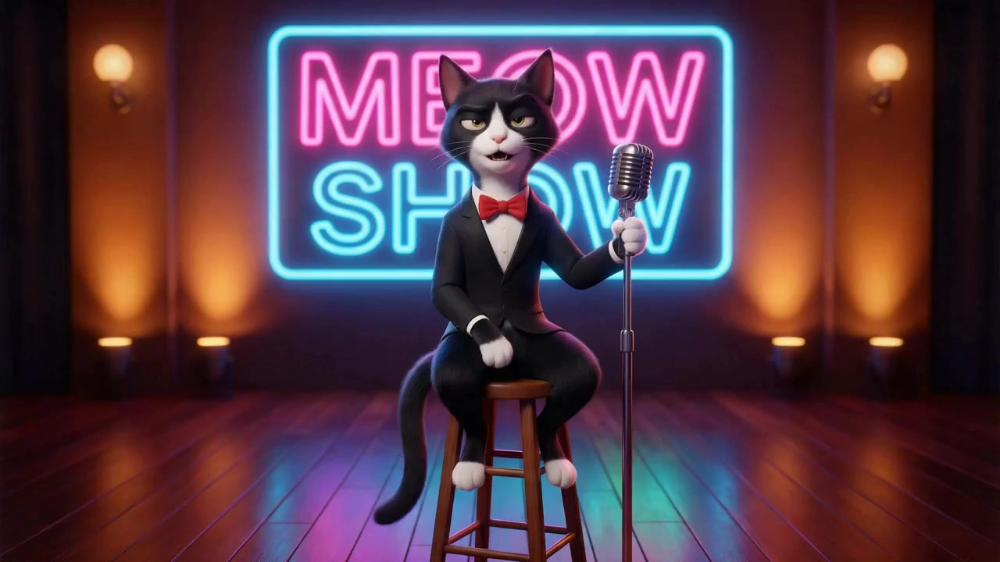

# Panel talk show

> **作者：** @Flova

## Content

Process Planning:

Phase logic and dependencies:

Write Final_Video_Spec.md (title, type, ratio, duration, visual style, language, model preference) → text_editor.

Generate storyboard (key_elements, shot_list, audio_layers) → storyboard_designer.

Generate images for all elements → media_generator.

Generate all audio_layers based on the storyboard: Narration and BGM → media_generator.

Generate one key-frame images per shot → media_generator.

Generate final video per shot; Reference key-frame(steps 5) and audio(steps 4) for that shot → media_generator.

Final assembly when all resources are ready; then guide user to export → video_assembler.

Dependencies: 2→1; 3→2; 4→2; 5→2; 6→4,5.

When to pause: Do not run through all steps in one go. Stop at each key phase above (e.g. after spec, after storyboard, after element, after shot videos, after audio), confirm with the user, then proceed to the next. Use cards or reply_to_user to invite review before continuing.

Storyboard Design:

How to design key elements

Always include key subjects (characters, objects, etc.), key locations/scenes, and key props (if any).

Characters: If a character has multiple states or looks in the project (e.g. different costumes, ages), describe each clearly in the description (e.g. Look 1: …; Look 2: …). Include the character's voice/timbre so downstream audio can match.

Key locations/scenes: Describe the placement and orientation of important objects in the scene, especially props or areas where the main action or performance happens.

User-provided assets: If the user supplies reference media and specifies it as a key element, the description must match that asset; do not contradict what is shown or heard.

How to design shots

Each shot description must include:

Scene: Reference the location/set (use the scene element ID, e.g. [Element_Office_Noir]).

Story content: Dialogue and performance of characters and key objects. Write out exact lines (spoken dialogue or inner monologue / OS). Reference characters by their element ID.

Shot size: Alternate two-shot, OTS, single on speaker for variety without breaking continuity.

Non-dialogue shot: Reaction shots, audience cutaways, or host nods — still need element for keyframe; if there is no spoken line in that shot, generate video with key-frame only (no lip-sync audio conditioning).

Overlap / turn-taking: If two characters exchange lines in one shot, storyboard must split into two shots.

How to design independent audio

Background music: Design at least one global background track. If the video is long (e.g. 3 minutes or more) and has clear act breaks or turning points, you may plan more than one music segment (each with its own audio_id and scope).

Narration: Always define the narration / voice-over layer in the storyboard (type narration): voice identity, tone, exact script, and layout_instruction scoped to the relevant shots. This layer is required for every project in this strategy.

Media Generation:

Element image generation

Use TextToImage. For the same character in different looks or ages, ImageToImage is recommended; later looks should reference the earlier generated appearance to keep consistency.

Recommended model: Nano Banana 2(Gemini 3.1 Flash Image), resolution 2K. Prefer three-view (front / side / back) for character elements to support cross-shot consistency.

Key-frame image generation (per shot)

Use ImageToImage. Recommended model: Nano Banana Pro(Gemini 3 Pro Image), resolution 2K. Reference images must include (1) the relevant element images for that shot, and (2) for each shot, the most similar key-frame from earlier shots in the same set (when generating in batches, later shots in the batch reference earlier ones) as an additional reference to strengthen continuity — e.g. where characters stand in the scene, how they face each other, and expression: details that element refs do not define.

Final shot video generationStoryboard designed a combination of pure narrative performance + lip-sync singing performance.

For dialogue shot:Use ImageToVideoByAudio. Recommended model: OmniHuman1.5, resolution 1080p. Reference key-frame + aligned audio segment.

For non-dialogue shot:Use FirstFrameToVideo. Recommended model: Kling 3.0, resolution 1080p. Reference key-frame image for that shot.

Prompt Writing:

Prompts for Image Generation (TextToImage, ImageToImage)General principles for all image prompts

Prompt is not just about describing "what's in the image," but like a real film director and colorist giving instructions to the team.

Use coherent natural language to describe the scene content (subject + behavior + environment, etc.), and use short phrases to describe visual aesthetics (style, color, lighting, composition). No Literary Fluff: Do not explain character motivation or inner state to the AI (e.g. "as if he doesn't care about the photo"). Do not describe off-screen or invisible elements. Describe only what is physically visible.

For all image prompts (any role): You MUST apply the 6 Core Rules of Cinematic Prompts globally across ALL target styles to ensure cinematic quality. Write the prompt as a flowing, natural English description that weaves these 6 rules together. Do NOT output them as labeled sections:

Professional Style Terms: Use professional artistic or cinematic terminology together with style terms to improve accuracy. (e.g., Introducing Auteur and Specific Film Visual Anchors, use Neo-Noir style, David Fincher Style, inspired by Se7en as style anchors instead of generically stating Neo-Noir style).

Framing & Lens: Explicitly state the cinematic framing (e.g., Over-the-shoulder shot, Dutch angle) and shot size (e.g., Close-up, Medium shot`).

Lighting: Detail the key light and heavily emphasize "negative lighting" for contrast and drama (e.g., Strong chiaroscuro contrast, dramatic interplay of light and shadow, or deep facial shadows emphasizing facial structure).

Color Grading: Use high-end Hollywood color grading to set a restrained palette (e.g., deep teal-cyan shadows dominating 90%, zero warm fill or muted watercolor wash). Unless the user explicitly requests otherwise, never use red–blue neon clash (e.g. forbid crimson bleed, neon magenta vs cyan). Constrain the image to one dominant hue for roughly 90% of the frame (e.g. deep teal-cyan)—extreme restraint.

Visual Rendering: Describes the overall visual quality and texture of the content (e.g., fine rendering quality, rich and intricate details, soft-focus effect with subtle Gaussian blur.).

Mood & Subtext: Describe the character's "subtext" and micro-expressions, freezing the action on a dramatic beat (such as oppressive suffocation, no mercy, and predatory stillness). Refuse stiff, posed looks. For inanimate objects, describe their condition (e.g., Destined aura, piercing gaze, cold and detached atmosphere).

Conditional Elements (include ONLY when relevant):

Accurate on-image text: When relevant, if text appears in the scene (e.g., on-screen text), integrate it naturally. You MUST wrap the exact text content to be rendered in the scene with quotation marks to emphasize it. For example, 'A neon sign in the background reads "DANGER".'.

When the target role is key_elementProvide a clear, detailed visual definition of the element so it stays consistent across shots. Structure the prompt around:

Subject & Identity: Clearly state what the element is — character, prop, scene, or creature. For characters, include defining identity traits (age, build, ethnicity if specified, distinguishing marks, voice).

Feature Details: Describe the element's key visual features with specificity. Prioritize features that must stay consistent across shots:

Characters: Facial features (eye shape, jawline, hair style/color), makeup & styling (if relevant), clothing & accessories (material, fit, color, condition).

Props/Objects: Shape, material, color, size, condition (new/weathered/damaged), distinctive markings.

When the target role is a keyframe

Shot Frame: Frame the speaking subject so they read clearly in the still — prefer medium close-up or chest-up (bust) shots with a large, sharp face share of the frame. Avoid wide establishing shots and full-body frames where the face is too small for the model to align with the conditioned audio.

Shot grammar: Alternate two-shot, OTS, and single on the active speaker for variety without breaking continuity.

Prompts for Video GenerationFor video generation based on key frame references, the prompt's primary purpose is to describe "change" and "dynamics." Focus on bringing the scene to life rather than re-describing static details already present in the reference images. A high-quality video prompt must describe the dynamic evolution of the scene across the following dimensions:

Basic prompt structure: Prompt = subject + motion, background + motion, camera + motion, etc. Use simple, direct wording and short sentence structures; the model will expand from your description and its understanding of the image.

Character/Object Dynamics: Describe the subject's own movements, including changes in expression, action, and any self-initiated orientation changes relative to the camera (e.g., a character turning from a profile view to face the camera directly). If the subject remains still, you must explicitly describe its static pose or state (e.g., the character stands perfectly still, staring forward).

Motion Specifiers: When describing motion, always specify degree adverbs (e.g., quickly, violently, large amplitude, high frequency).

Multiple consecutive actions: The model responds strongly to temporal, multi-beat actions and to multiple subjects with different actions. You can write: subject1 + motion1 + motion2, or subject1 + motion1, subject2 + motion2, etc. List actions in sequence; the model will expand and interpret relative to the frame(s). For ImageToVideoByAudio: When using audio-driven (lip-sync/performance) models, the prompt must follow the dimensions mentioned above while also adhering to the following unique structure:

You must explicitly describe the character's state as driven by the audio (e.g., speaking, singing, crying while talking, rapping).

Best Practice Template: Camera Movement + Speaker's Emotion + Speaking State + Specific Physical Actions + (Optional) Background Events.

Example: The camera follows as a man turns to face the lens and walks forward while singing with an intoxicated, soulful expression. He first touches his collar with both hands, then spreads his arms wide and tilts his head back, appearing completely immersed. Light and shadow in the background pulse with the rhythm.

Note: You must always include the following negative constraints in the prompt to ensure a clean output for post-production:

If the storyboard indicates a separate narration audio track for the shot, DO NOT write the narration text in the video prompt to avoid conflicting audio.

To prevent the model from adding unwanted background scores, you should almost always include 'no music'.

Subtitles are added later in the editing process, so you must always include 'no subtitles'.

Video Editing:

Dialogue-first: Treat audio_layers as the master for narration and dialogue; mute embedded audio on each generated video clip in the timeline so speech is not doubled or out of sync with the editorial mix.

Optional BGM (light talk show bed); duck under dialogue; avoid clashing chords under speech.

Tighten pauses between shots to maintain talk rhythm; add reaction inserts if pacing feels flat.
