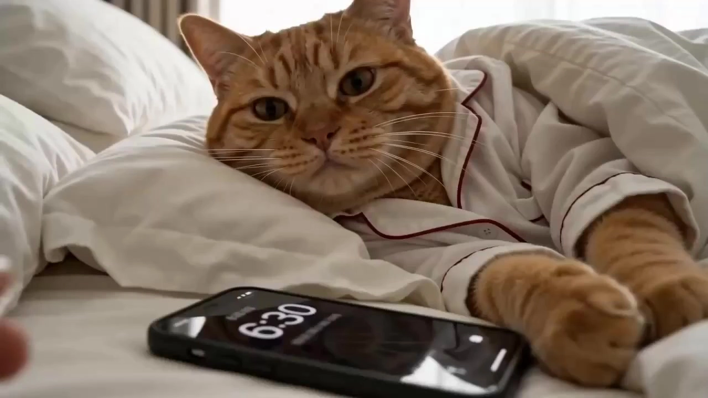

# Pet 9-to-5 Vlog

> **作者：** 阿娴AIGC

## Content

**Process Planning:**

**Overall Sequential Process and Milestone Confirmation:**
1. **Character Analysis and Image Confirmation** → Call **resource_prepare_and_analyze** to analyze the pet photos uploaded by the user:

   - **Single Photo**: Output one character realistic card;
   - **Two Photos**: Output two separate character realistic cards (Character A / Character B) and note their species combination (two cats / cat-dog / two dogs, etc.).
   Present the anthropomorphic image options (clothing/props/texture) for each character to the user and wait for confirmation of each. After confirmation, use **text_editor** to write to Final_Video_Spec.md (number of protagonists, breed and anthropomorphic image description for each pet, 9:16 aspect ratio, target duration, visual style: realistic handheld vlog, language). ⏸️ **Wait for user confirmation of all character image plans before proceeding.**

2. **Script/Outline Confirmation** → If the user provides a script, adopt it directly; if not, the AI will automatically generate an 'A Grunt's Day' narrative outline. Core segments include: Waking up → Commuting → Working → Lunch → Off work/Returning home at night; Optional extended segments include: Overtime (staying in the office), Convenience store (stopping by to buy things), Fitness (forcing oneself to exercise after work). Decide whether to include extended segments based on user requirements or target video duration, and present them in a table for confirmation. ⏸️ **Wait for user confirmation of the outline before entering the Shot List design.**

3. **Shot List Design** → Call **storyboard_designer** to batch design Key Elements + Shot List + Audio Layers, outputting 4–6 shots per batch and confirming batch by batch. ⏸️ **Continue to the next batch after each confirmation, and enter the generation stage after everything is completed.**

4. **Character Reference Image Generation** → Call **media_generator** to generate anthropomorphic dual-panel character reference images for element_character, register asset_id, and bind it to the corresponding Storyboard element slot. ⏸️ **Wait for user confirmation of character images before proceeding.**

5. **Batch Video Generation** → Call **media_generator** to generate video clips shot by shot.

6. **Internal Monologue VO Synthesis (Strictly optional, executed only when explicitly requested by the user)** → Only when the user explicitly requests an internal monologue/narration/VO in the conversation, call **media_generator** to synthesize the narration VO audio track and bind it to the corresponding Audio Layer. **If the user does not mention it, skip this step, do not proactively ask, and do not enable it by default.**

7. **Final Editing and Export** → Call **video_assembler** to splice clips and overlay ambient sound (and VO if applicable). No music, no subtitles. Output the quality inspection report and guide the user to export. ⏸️

**Dependencies:** 2→1; 3→1,2; 4→3; 5→3,4; 6→3 (only when requested by user); 7→5,6 (if no VO, then 7→5).

**Exception Handling Rules:**
- User has not uploaded pet photos: Prompt with "Please upload clear, front-facing photos of your cat/dog (facing forward or 3/4 side profile is recommended); for dual protagonists, please upload two separate photos corresponding to each pet."
- User uploads more than two photos: Prompt that this Skill only supports up to two protagonists, and guide the user to confirm which two to use, ignoring the rest.
- Images are not of living creatures or are blurry: Prompt to re-upload; do not force analysis.
- Script exceeds 12 shots: Suggest simplifying or splitting into part one and part two.
- User requests subtitles or background music: Prompt that this Skill has them disabled by default, and ask if they are sure they want to enable them before proceeding.

**Storyboard Design:**

**Design Key Elements**
- **element_character (Protagonist)**: Based on the character realistic card, create an independent element_character for **each pet protagonist**, fully locking in their respective anthropomorphic images—species characteristics (fur color, eyes, unique identification anchor points) + anthropomorphic clothing (specific style/color/material) + props (phone, briefcase, etc.) + overall texture definition (realistic photography style, not Q-version cartoon, not 3D rendering). For dual protagonists, it is also necessary to note the body size comparison relationship in their respective descriptions to maintain consistent proportions when in the same frame.
- **element_scene (Scene)**: Create independent scene elements for each narrative segment, including lighting presets and environmental atmosphere characteristics:
  - Bedroom (Waking up): Morning side light, warm scattering, 4500K
  - Bathroom: Top light + mirror reflection, cool white, 5500K
  - Subway carriage: Cool white fluorescent light, high contrast, 5600K
  - Office: Ceiling soft light + screen blue light mixed, 5000K
  - Lunch: Natural light from side window, slightly warm, 5200K
  - Night road/Returning home: Warm yellow street light + blue ambient fill light, 3200K + cool auxiliary light
  - Overtime (Late-night office): Screen blue light as main light, ceiling lights off or only emergency lights, highly cool blue and dark, 4500K (screen)
  - Convenience store: Cool white LED top light + warm yellow embedded shelf light, cold/warm mixed collision, 5500K main + 3000K warm aux
  - Gym (Fitness): Top cool white strong light + large mirror reflection, high brightness and high contrast, sweaty highlight on face, 5500K

**Design Shot List**
Each shot must include the following four items:
- **scene**: Reference the corresponding element_scene ID
- **story_beats**: Specific actions of the character + micro-expressions/emotional states; **The original text of the internal monologue is only written when the user explicitly requests VO** (enclosed in quotation marks, preserving the emotional rhythm of tone particles and punctuation, e.g., "The alarm... why is it ringing again... five more minutes... sigh..."); by default, do not write any monologue lines, focus on describing visual actions; **dual-protagonist shots** must note the actions and expressions corresponding to each character ID, and indicate who is the main subject and who is the foil; **single-protagonist shots** directly reference the corresponding element_character ID.
- **cinematography**: Shot size (close-up/medium close-up preferred, medium shot secondary, long shot sparingly) + Camera angle (low angle, about 30–50cm from the ground) + Camera movement type (fixed handheld selfie / slight walking shake / slow pan / follow-move); When both protagonists are in the same frame, prefer medium or close-up shots to accommodate both characters, avoiding an overly crowded frame.
- **duration**: 3–5 seconds per shot; for key emotional moments (staying in bed, sighing, zoning out, etc.), allow a static buffer of about 2 seconds after the action ends; do not force shortening.

**Overall Visual Tone:** Bright, natural, warm-toned, simulating straight-out-of-camera shots from a phone's front camera with slight brightening. Do not use filters or deliberate color grading; preserve the real texture of the fur. Indoor scenes (bedroom, bathroom, office) have soft lighting; outdoor scenes (subway station, street) retain the original cool white fluorescent light or natural daylight, without warming.

**Preferences for Shot Size and Camera Movement:** Close-ups and medium close-ups are prioritized (expressions, paws, prop details); medium shots serve as transitions; long shots are used sparingly only when establishing space. Stabilizer effects are prohibited to preserve the handheld, daily-life shaky feel and strengthen the vlog immersion. Camera movement is primarily "fixed selfie," and walking segments use "follow-move" (camera sways slightly up and down with steps); no sliders, no jibs, no professional stabilized movement.

**Dual-Perspective Mixing Rules:** The entire film can alternate between two perspectives; each shot must clearly label the current perspective type in the cinematography:
- **POV Selfie**: The cat holds the phone to take a picture of itself, low angle, slightly looking up, camera centered on the character's face/chest; suitable for strong immersion shots like staying in bed, washing up in the bathroom, zoning out at the desk, complaining to the camera, etc.
- **Third-Person Handheld**: Similar to a "friend helping to film" or "invisible follower" perspective; the filmmaker is behind or to the side of the character, retaining handheld shaking (slightly larger amplitude than selfie perspective), camera position is not fixed but has no professional stabilizer; suitable for commuting, entering/exiting, choosing items in a convenience store, fitness equipment, etc., where full-body movements or environmental relationships need to be shown.
Two perspectives can be switched within the same narrative segment; it is recommended that the switching frequency does not exceed once every 2 shots to avoid an overly jumpy perspective; emotional blank shots (staying in bed, sighing, zoning out) prioritize the selfie perspective to strengthen immersion.

**Dual-Protagonist Narrative Rhythm Suggestions:** Alternate between single-protagonist shots (focusing on one character) and dual-protagonist shots (interaction); high-density interaction segments (such as lunch, off-work, convenience store) can increase the proportion of dual-protagonist shots; personal state segments like waking up, commuting, fitness are primarily single-protagonist; overtime segments are recommended to use single-protagonist close-ups to strengthen the sense of loneliness.

**Season/Weather Variant Design Guide:**
When the user specifies weather or season, superimpose the following variant lighting and movement adjustments on the corresponding scene without rebuilding the element_scene. Just note the variant identifier in the cinematography and scene lighting layer of the shot description.
- **Rainy Commute (Subway station / Night road)**: Station/road surface water accumulation forms light source reflection, cool white or warm yellow reflection extends; overall skylight is lowered (gray-blue tone, approx 5500K → gray), street lights diffuse warm yellow in the rain and fog to form halos. Raindrops occasionally hit the foreground of the lens to form blurry water droplets; follow-move camera sways up and down with slightly increased amplitude (simulating fast walking to avoid rain); umbrella edge visible.
- **Summer Heat (Commute / Convenience store)**: Outdoor strong direct sunlight, high color temperature (approx 6500K), face highlights strong, shadows hard; entering the store creates a color temperature jump cut from "outdoor strong exposure → indoor cool white drop". Can add micro-action descriptions of "wiping sweat" and "using hand to shade"; when entering the store, the pushing-door action retains the slight exposure transition feeling from the door frame overexposure → indoor exposure recovery.
- **Winter Morning (Wake up / Going out)**: Early morning sky outside the window is cool blue (approx 6000K), indoor warm yellow light and window's cool blue form a collision; exhaled mist is visible. Character visible with action of wrapping themselves tight; outdoor shots have slightly rosy cheeks (feeling of cold wind), can add "exhaled mist briefly blurs the lens".
- **Rainy Off-work (Night road variant)**: No obvious street light highlights, overall environment is low-saturation cold gray (approx 4500K), ground is wet and reflective but not clear, distant car lights diffuse in rain and fog to form halos. Slow walking or jogging; handheld camera can show rain droplets hitting the foreground to form brief water droplet blurring; occasional umbrella opening/closing action.

Weather variants do not override the default scene design; they are only enabled when the user explicitly specifies or indicates weather in the script.

**Holiday/Weekend Variant Design Guide:**
When the user specifies holiday or special workday atmosphere, superimpose the following variant elements (lighting, decorative props, emotional rhythm) on top of the basic scene, without rebuilding the element_scene. Only note the variant identifier in the story_beats, cinematography, and scene lighting layer of the shot description.
- **Slacking Off on Friday (Office / Off-work road)**: Overall lighting is the same as standard office, but screen brightness is slightly lower (screen appears dim when the character is slacking off, non-work content reflections); if there is afternoon sunset outside the window, a warm yellow beam (approx 4800K) can penetrate, strengthening the "almost off work" atmosphere. Action slackness: leaning back on chair, hand propping chin, frequently looking at phone or clock; expression is a mild satisfaction of "barely holding on"; off-work road camera rhythm speeds up significantly, pace lighter than workdays; can add prop detail of "stopping by to buy a drink/small snack".
- **Last Day Before Holiday (Office / Off-work road)**: Office background shows small holiday decorative props on colleagues' desks (small red envelopes/ribbons/stickers, etc., without distracting from the subject); overall lighting is consistent with standard office, atmosphere is livelier; corridor/doorway shows small amount of holiday hanging ornaments blurred into the frame. Emotion is a release of "finally made it"; camera can deliberately speed up the action chain of "closing computer → grabbing bag → walking out of the company"; the last shot can freeze on the character pushing open the company door and the rush of outdoor light (slight overexposure simulating "escape").
- **Weekend Makeup Work/Adjusted Workday (Commute / Office)**: Subway commute shots have significantly fewer passengers, strong sense of emptiness, cool white fluorescent light looks more lonely; office has only sparse desks with lit screens, background is mostly dark, top lights can be partially turned off to form local lighting. Emotion is the helpless numbness of "why me?"; actions are a beat slow, expressions are blank; commute shots can use longer "zoning out" freeze-frames; office shots focus on screen reflection close-ups to strengthen loneliness.
- **Last Day Before Spring Festival/Long Holiday (Office / Off-work road / Night road home)**: Office background has holiday atmosphere decorations (red small elements, small quantity without dominating); outdoor light at the moment of leaving work is slightly warmer than usual (holiday lights/shopping mall window reflections permeate from afar, color temperature approx 3500K warm); night road warm yellow street light halo is softer and more diffused, holiday light strings occasionally enter the background as blurred bokeh. Emotion is mixed: exhausted + expectant, expression has a hint of "finally" more than usual; pace is faster than overtime scenes but more restrained than slacking off on Friday; props can include: large bag of New Year goods/souvenirs, luggage (going home for the holidays); it is recommended to end with the character looking up at the night sky or towards the platform, keeping the emotion moderate.

Holiday/weekend variants do not override the default scene design; they are only enabled when the user explicitly specifies or indicates the holiday/special date in the script.

**Optional Extended Segment Design Guide:**
- **Overtime (Late-night office)**: Reversal after "off work" — thought they were leaving, but were called back. Shots are primarily close-ups (screen reflection on face, paws mechanically typing on keyboard, window outside is completely black), emotion is exhausted, numb, blank zoning out. Duration suggested 2–3 shots, not too long, just enough.
- **Convenience store (Stopping by to buy things)**: Rhythm is slightly relaxed, a small breather after a high-pressure work segment. Shots include: pushing the automatic door to enter, hesitating and choosing in front of the shelf, checking out and scanning the code, carrying the bag out. Can design single or dual-protagonist encounter/together version.
- **Fitness (Forcing oneself to exercise after work)**: Emotion is the "ritual sense" of a worker who says "the body can't take it anymore but still came." Shots are primarily medium/close-up, recording treadmill, equipment, selfie in the mirror; camera movement keeps handheld style, appropriately adding details of panting actions. Recommended to place before the "going home" segment as an emotional node.

**Batch Design Rhythm:** Design 4–6 shots per batch, output in table form, and proceed to the next batch after confirming with the user one by one.

**Audio Layers Design (Cross-shot audio track)**
- **Ambient Sound (SFX)**: Design independent Audio Layers according to the scene, type is sfx, running through the corresponding scene segment. Prioritize selecting sounds that match the scene from the list below, and they can be superimposed:
  - Bedroom (Waking up): Alarm clock sound, blanket rubbing sound, yawn sound
  - Bathroom: Running water, toothbrushing, gargling sound
  - Subway: Station announcement broadcast, carriage noise, door closing alert
  - Office: Keyboard typing sound, mouse clicking sound, air conditioning white noise
  - Lunch: Takeout packaging rubbing sound, chopsticks hitting bowl, chewing sound
  - Night road home: Footsteps, distant car sounds, sighing sound
  - Overtime (Late-night office): Sparse keyboard typing, fluorescent light low-frequency hum, occasional footsteps in the hallway, yawning sound
  - Convenience store: Automatic door opening/closing alert, freezer low-frequency hum, cash register scanning sound, convenience bag rubbing sound
  - Gym: Equipment collision/rubbing sound, background crowd movement white noise, panting sound, sports shoes rubbing on the floor
  - Rainy commute (Variant): Rain sound (medium-intensity continuous rain white noise), umbrella opening/closing sound, footsteps splashing in puddles, rain hitting ground/roof, splashing sound of vehicles passing in the distance
  - Summer heat (Variant): Outdoor cicada sound (long-distance low-intensity), AC outdoor unit humming (moment of entering indoors), freezer opening/closing sound (convenience store), straw sucking drink sound
  - Winter morning (Variant): Exhaling sound (slight), crisp footsteps on hard ground, cold wind low-frequency ambient sound, heating/heating equipment slight humming
  - Rainy off-work (Variant): Medium-intensity rain sound, umbrella closing sound, footsteps on wet ground (low and muffled), sighing mixed with rain sound
  - Slacking off on Friday (Variant): Sparse keyboard sound (rhythm is casual), low whispering chat between colleagues (background blurry processing), phone sliding sound, brisk footsteps on the way home
- **Internal Monologue VO (Strictly optional)**: **Only when the user explicitly requests narration/internal monologue/VO** design an Audio Layer of type narration; describe narration_speaker_profile in the description (e.g., [Lazy cat internal voice, radio/phone quality, slight distortion, slower speech rate, volume lower than ambient sound]) and full text of the monologue for each shot and corresponding shot span. If the user does not mention it, do not design this track, and do not write any lines in the shot list, the video will have no voice output throughout.
- **Do not design any dialogue content**: By default, the whole film has no character dialogue, no narration, no subtitles; story_beats focus on action, expression, emotional state description, do not write any dialogue text, do not simulate character speaking scenes.
- **Do not design any music type Audio Layers**, the whole film has no background music.

**Media Generation:**

**Character Reference Image Generation (element_character)**
- Tool: **ImageToImage**, Model: **GPT Image 2**, Resolution: **2K**.
- Use the corresponding pet photo as reference_image input; **generate an independent character reference image for each element_character**.
- Generate a horizontal dual-panel character reference image: Left panel — head and shoulders close-up (locking in fur color, eyes, unique characteristics); Right panel — full-body standing pose (anthropomorphic clothing, props, overall proportions).
- Register an independent asset_id for each character reference image and bind it to the corresponding element_character slot in the Storyboard.
- **For dual protagonists**: After generating the two character reference images separately, additionally generate a **dual-character standing reference image** (ImageToImage, simultaneously passing the two character reference images as reference_image) to verify the body size ratio relationship; register asset_id for use when generating shots in the same frame.

**Shot List Video Generation (final_shot)**
- Tool: **MultiModalToVideo**, Model: **Seedance 2.0**, Resolution: **720p**, Duration: **3–5s** (integer) per shot, Aspect ratio: **9:16**.
- The reference_image of each shot is combined according to the following rules:
  1. **Single-protagonist shot**: The character reference image bound to the element_character + corresponding element_scene scene reference image (if any).
  2. **Dual-protagonist shot (same frame)**: Character A reference image + Character B reference image + dual-protagonist standing reference image + corresponding element_scene scene reference image (if any); prioritize placing the dual-protagonist reference image earlier in the reference_image list to enhance body size consistency.
- **Video reference (reference_video) strategy**: Only when the continuity between the previous and next shots is extremely strong (continuation of the same action, same physical space, and no scene change), append the final_shot of the previous shot as reference_video; usually, video reference is not used, using character reference images as the main source of consistency.
- If generation fails, prioritize retrying in **Seedance 2.0**; if it continues to fail, stop and explain to the user, and ask if they want to switch to another model.

**Internal Monologue VO Synthesis (Optional)**
- Tool: **text_to_narration**, Model: **MiniMax Speech 2.8 HD** (Chinese preferred).
- Synthesize audio according to narration_speaker_profile and monologue lines for each shot, register asset_id and bind to the corresponding Audio Layer.

**Do not generate any background music.**

**Prompt Writing:**

**Global Priority:** All prompts are written in Chinese.
**Character Reference Image Prompt (ImageToImage / GPT Image 2)**
- Based on the character realistic card, fully lock in species characteristics (breed, fur color, eye color and shape, body type, unique markings) + anthropomorphic clothing (specific style/color/material) + props (briefcase style, phone, etc.).
- Image format description: Horizontal side-by-side dual-panel composition, left panel head and shoulder close-up, right panel full-body standing, clean white or medium gray clean background.
- Texture requirements: Realistic photography style, fur texture is visible and real, fabric texture is natural, not cartoon/illustration/3D rendering style.
- Lighting: Front soft fill light, slight shadows, no overexposure, no dramatic lighting.

**Shot List Video Prompt (MultiModalToVideo / Seedance 2.0)**
- **Single-protagonist shot** reference image placeholder order: <<<image_1>>> Character reference image, <<<image_2>>> Scene reference image; if there is a video reference, append <<<video_1>>>.
- **Dual-protagonist shot (same frame)** reference image placeholder order: <<<image_1>>> Dual-protagonist standing reference image, <<<image_2>>> Character A reference image, <<<image_3>>> Character B reference image, <<<image_4>>> Scene reference image (if any); if there is a video reference, append <<<video_1>>>. The prompt for dual-protagonist shots must describe the actions and micro-expressions of each character respectively, and clearly define their relative positions (e.g., "Character A is standing on the left... Character B is standing on the right...").
- **Camera Movement Stacking Order**: Lens (camera movement type + low-angle position) → Main subject action (limb part + amplitude + micro-expression rhythm) → Space/Environment (scene lighting characteristics + background elements) → Sound effects (ambient sound description; if there is an independent narration VO track, **do not repeat the full lines here**).

**Precise Prompt Writing for Each Camera Movement Type (Embed directly in the "Lens" layer):**
- **Fixed handheld selfie (still or micro-moving scene)**
  > Handheld phone low-angle selfie, lens about 30–40cm from the ground, slightly looking up, camera fixed, retain slight hand-holding shaking, no slider, no stabilizer, slight out-of-focus blur, simulate the texture of direct output from a front-facing phone camera
  - Applicable scenes: Staying in bed, zoning out at desk, eating takeout, in front of computer, etc.
  - Can add "camera keeps low angle throughout without moving, subject is slightly above the center of the frame" to lock composition stability.
- **Follow-move (Walking/Commuting)**
  > Handheld phone low-angle follow-move, camera sways slightly up and down with the rhythm of footsteps (about 1–2cm amplitude per step), basically stable horizontally, simulating self-filming while walking, no stabilizer, retain life-like shaking, foreground occasionally has arm/briefcase entering the edge of the frame
  - Applicable scenes: Commuting in corridor, walking on subway platform, walking home from work.
  - If need to show hurried steps, can add "faster step frequency, slightly larger up and down amplitude (about 2–3cm), slight horizontal shaking".
- **Slow pan/Turn head (Emotional pause, looking around)**
  > Handheld phone low-angle slow horizontal pan, panning speed is extremely slow (about 15–30 degrees turn in 2–3 seconds), starting and ending have about 0.5 seconds of slight pause buffering, retain slight hand-holding shaking during the panning process, no jib, the whole thing is like a person turning their head naturally leading the camera
  - Applicable scenes: Looking out the window, scanning the office, looking around on a night road.
  - If only character head-turning (non-camera movement), change to "camera fixed, character head slowly turns left/right about 20 degrees, ears, chin contour appear with the turn, eyes wandering".
- **Third-Person Handheld**
  > Handheld camera following the character obliquely behind or to the side, camera position about waist to chest height (about 80–110cm), camera keeps slight irregular shaking (amplitude is about 1.5–2 times the selfie perspective), swaying with character's steps or actions, no stabilizer, no slider, similar to "friend casually following and filming" texture, occasional foreground occlusion (passerby/door frame/bag edge blurred into frame)
  - Applicable scenes: Commuting walking, entering/exiting, choosing items in convenience store, fitness equipment usage, etc., where full-body actions or spatial relationships need to be shown.
  - If need to emphasize the panic of "can't keep up," can add "horizontal shaking amplitude occasionally increases, character briefly moves out of the center of the frame and then re-enters".
  - **Note**: In the prompt for third-person perspective, remove descriptions related to "selfie", change to "follow filming", "documentary-style handheld following", etc., retain realistic texture keywords such as "no stabilizer", "life-like shaking".
- **Black screen jump cut (Used exclusively for segment switching, executed only in the editing layer, do not describe this effect in video prompt)**
  > Do not describe black screen in a single shot prompt; black field transition is inserted by **video_assembler** during splicing (black field duration does not exceed 0.2s). Shot prompt only needs to ensure the last frame action ends naturally.
- **Action description**: Precise to limb parts and action amplitude; multi-beat actions arranged according to story sequence, prohibited to use "0–3s / 3–6s" format for cutting.
- **Seedance sound effect annotation (Use as needed)**: Ambient sound with <...>, monologue lines with {...} (only original lines), in-film title with 【...】.
- **Forced negative words**: no subtitles, no music, no text overlay, avoid descriptions like "professional stabilizer" to preserve handheld shaking texture.
- **Realistic texture keywords**: Emphasize "real fur texture visible", "direct output texture from front-facing phone camera", "slightly brightened natural color", "handheld shaking", "vlog selfie perspective", "life-like natural light"; indoor scenes add "soft indoor fill light", outdoor scenes add "original cool white fluorescent light of environment" or "natural daylight", do not warm the outdoor light source.
- **Forbidden words**: Avoid "cinematic", "professional lighting", "film-level", "stabilizer", "slider camera movement" and other words that may lead to style deviation or elimination of handheld texture.

**Light Prompt Template for Each Scene**
Below are recommended light description fragments for each scene, embedded directly into the "space/environment" layer of image or video prompts:
- **Bedroom (Wake up)**: Morning side window diffused light, warm white tone (approx 4500K), light refracts through semi-transparent curtains to form a soft halo, bed area has slight highlight landing, shadows are soft with no hard edges, overall low-saturation warm tone, no direct sunlight beam.
- **Bathroom (Washing up)**: Top single-point cool white light (approx 5500K), mirror surface produces slight reflection superposition, character front receives even lighting, cheekbones and bridge of nose have slight highlights, reflection in mirror is slightly overexposed, background tiles are cool white, overall contrast is slightly stronger than the bedroom scene.
- **Subway carriage**: Cool white fluorescent tubes in carriage (approx 5600K), top lighting is high contrast, face is evenly lit but has slight vertical shadows, window shows deep blue/black background, local seats and armrests have reflection points, do not warm, retain original cyan-white tone of fluorescent lights.
- **Subway platform (Waiting for train)**: Platform fluorescent cool white top light (approx 5500K), deep blue background visible from the tunnel entrance in the distance, platform floor has halo reflection, overall environment is cold and cyan, do not add extra warm light source.
- **Office**: Ceiling grid light soft floodlight (approx 5000K), mixed with screen blue light from the side and below to supplement cold color, face presents neutral color temperature, desktop reflection is slight, background workspace area has scattered light spots, overall light is even and cold, do not use outdoor daylight supplement.
- **Lunch (Takeout/Restaurant)**: Noon indoor natural light obliquely enters from side window (approx 5200K), desktop has obvious local highlights, takeout packaging has slight reflection, face is hit by natural light from the side, shadows are soft, overall slightly warmer and brighter than the office.
- **Night road/Returning home**: Warm yellow street light main light (approx 3200K) hits from above obliquely, blue skylight/environmental cold light (approx 6000K) as low-intensity fill light, forming warm yellow + cold blue dual color temperature collision, face warm yellow as main tone, sides show cold blue edge light, ground has street light halo reflection, background retains city night view bokeh.
- **Overtime (Late-night office)**: Most top lights are off, only monitor blue-white cold light (approx 4500K) illuminates face from directly in front, forming strong screen reflection highlights, deep shadows on both sides, background workspace area only has scattered screen light spots, overall high-contrast cold blue dark tone, creating exhausted and empty feeling, do not add any warm light source.
- **Convenience store**: Cool white LED top lights (approx 5500K) in-store even floodlight, shelf layers have embedded warm yellow light strips (approx 3000K) to form local warm color strips, face is mainly lit by cool white top light, warm light from shelves below slightly fill color, overall cold-warm mixed collision, glass cabinet doors and packaging surfaces have obvious reflection points, outdoor night scene forms deep blue background through the store door.
- **Gym**: Top strong cool white light (approx 5500K) high-brightness hard lighting, large area mirror walls produce multiple reflection superposition, face highlights are obvious, cheekbones and nose bridge reflection are strong, sweat highlight points, background equipment area lighting is slightly darker but overall high brightness, overall high contrast and high saturation, do not use soft light processing.

**Weather Variant Light Prompt Template**
Below are light description fragments for weather variants, used by superimposing on the light description of the corresponding basic scene:
- **Rainy commute (Subway platform / Night road variant)**: Ground forms a large area shallow water mirror, cool white street lights and platform lights produce elongated reflections on the wet ground, sky is overall lowered to cool gray tone (approx 5200K gray-ish), atmospheric scattering makes distant light sources form soft-edged halos, no hard shadows; rain streaks fall obliquely into the foreground from the top of the frame to form briefly blurred water droplets, overall saturation is about 20% lower than sunny days.
- **Summer heat (Outdoor commute / Convenience store entry moment)**: Outdoor direct sunlight is strong (approx 6500K), face cheekbones, nose bridge highlights have obvious overexposure feeling, shadow edges are hard; entering the convenience store instantly creates a color temperature jump cut from "outdoor strong exposure → indoor cool white 5500K drop", eyes have slight squinting adaptation action; outdoor ground has heat wave weak refraction feeling (distant view slightly shaky blurred).
- **Winter morning (Bedroom wake up / Moment of going out)**: Indoor retains warm yellow light (approx 2800K), window outside sky is cool blue (approx 6000K), the two form a distinct cold-warm contrast; exhaled mist briefly visible in the foreground near the lens (approx 0.5s); face outdoor side is supplemented by cool blue skylight color, forming a clear boundary with indoor warm light at the nose bridge; overall low saturation, no direct sunlight.
- **Rainy off-work (Night road variant)**: Street light warm yellow light (approx 3200K) forms elongated reflections on the wet road, but halo is more scattered and larger than sunny days; sky background is dark gray (not sunny dark blue), city distance lights diffuse in the fog; rain water reflections on face form irregular fragmented highlight points; overall darker, colder, and lower saturation than sunny night road.

**Holiday/Weekend Variant Light Prompt Template**
Below are light and environment description fragments for holiday variants, used by superimposing on the light description of the corresponding basic scene:
- **Slacking off on Friday (Office / Off-work road)**: Office lighting is the same as standard scene, but screen brightness is slightly lower when character faces the screen (dim screen reflection of non-work content), if there is afternoon sunset outside the window, a warm yellow light beam of about 4800K can penetrate onto the desktop edge; overall atmosphere is more relaxed than usual, no dramatic lighting effects added; off-work road pace naturally speeds up, street light reflection clarity is normal, no rainy scattering.
- **Last day before holiday (Office tail / Moment of going out)**: Office background distance workspace can see sparse small holiday decorations (colored stickers/small red envelopes, etc., handled as bokeh background blur, without distracting from the subject); lighting is consistent with standard office; pushing open company door instantly creates color temperature sharp rise jump cut from "indoor cool white 5000K → outdoor warm yellow holiday atmosphere light 3500K", if there are holiday lights from shopping mall windows permeating from afar outdoors, form soft-edged warm color halos.
- **Weekend makeup work/Adjusted workday (Subway / Office)**: Subway carriage passengers are sparse, cool white fluorescent light (approx 5600K) irradiation range is larger and emptier, seats and armrests have more obvious reflection points; office has only sparse screens lit, background is mostly dark, top lights can be partially turned off to form local lighting, overall tone is colder and darker than standard office, loneliness is strengthened.
- **Last day before Spring Festival/Long holiday (Going out / Night road home)**: At the moment of going out, if there are holiday lights in the business district or street, distance background can see warm orange string light halos of about 3500K (background bokeh, not clear); night road home segment warm yellow street light main tone remains unchanged, but if there are occasional holiday decorative light strings entering the background, they form warm color spots in the bokeh; face light is based on street light main color, holiday atmosphere light only acts as very low-intensity fill color, do not destroy the dual color temperature collision relationship.

**Final Assembly:**

**Editing Assembly Rules:**
- Splice strictly in the order of the Storyboard shot list.
- **Transition strategy**: Default to "action match jump cut" or "eye-line match jump cut" (no transition effects, direct hard cut); when switching segments, can use "black screen jump cut" (black field does not exceed 0.2s, e.g., turning off alarm → black screen → turning on light); complex transition effects such as dissolve, wipe, zoom are prohibited.
- **Editing rhythm**: Overall fast-paced, fitting the hurried feeling of a worker; key emotional moments (staying in bed, sighing, zoning out) keep about 2s static buffer after the action ends, do not force cutting away.
- Retain original ambient sound of each clip; ambient sound at clip splicing points cross-fades about 0.2s to ensure natural transition.
- **VO Audio Track (if any)**: Superimposed on top of ambient sound, volume slightly lower than ambient sound (approx -3 to -6dB relative relationship); needs to simulate radio/phone sound quality (narrow frequency, slight distortion, secret recording feeling), do not use clean broadcasting sound quality.
- **Strictly prohibited**: Background music, subtitles, watermarks at the beginning/end, any text overlay.
- Output specification: MP4, 9:16, 720p, frame rate follows generated clips.

**Quality Inspection Report Shown to the User:**
Project Content | Pet Breed (Auto-filled) | Anthropomorphic Image (Auto-filled) | Total Shots (Auto-filled) | Total Duration (Auto-filled) | Camera Movement Style | Handheld selfie, low angle | Internal Monologue | Yes/No | Subtitles | No | Music | No
