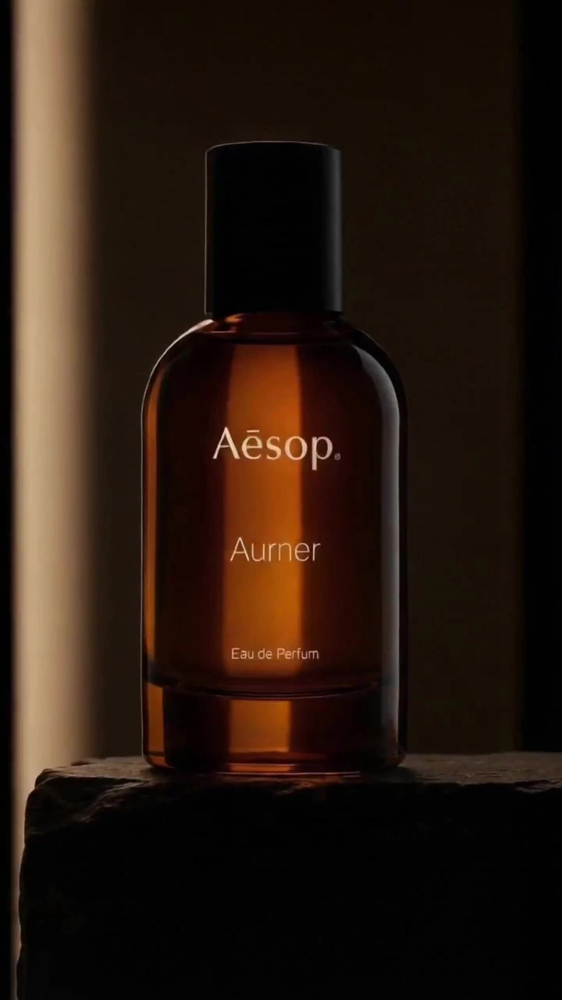

# Product commercial

> **作者：** @Flova

## Content

Process Planning:

Phase Logic and Dependencies:

Write Final_Video_Spec.md (Title, Type, Aspect Ratio, Duration, Visual Style, Language, Model Preferences) → text_editor.

Generate the Storyboard (Key Elements, Shot List, Audio Layers) → storyboard_designer.

Generate images for all elements → media_generator.

Generate the final video for each shot; reference the elements for that shot (from Step 3) → media_generator.

Generate all audio layers based on the Storyboard → media_generator.

Perform final editing once resources are ready; then guide the user to export → video_assembler.

Dependencies: 2→1; 3→2; 4→2,3; 5→2; 6→4,5.

Note — Media resources provided or explicitly specified by the user (primarily affects Steps 3–6): Before generating content, bind and assign user-uploaded assets to the appropriate storyboard positions via media_generator; do not regenerate assets already provided by the user.

Optional Intermediate Steps (if required by the router): When the video tool benefits from a locked first frame, generate one keyframe per shot before Step 4; otherwise, proceed directly from Element → Shot Video based on product defaults.

When to Pause: Do not run all steps at once. Stop at each key phase mentioned above (e.g., after specifications are determined, after the storyboard is determined, after element images are generated, after keyframes are generated, after shot videos are generated, after audio is generated), confirm with the user, and then proceed to the next step. Use cards or reply_to_user to invite the user to review before continuing.

Storyboard Design:

How to Design Key Elements

Always include key subjects: product objects, key scenes (usage environment), and key props (if any).

Objects: Extracted from product images uploaded by the user; descriptions must match these assets. Do not contradict the display content. If the user provides or explicitly specifies product asset images, bind the user-uploaded assets directly to the corresponding positions; do not regenerate assets already provided by the user.

Key Scenes: Design at least two application scenes demonstrating product advantages (to be used for post-production compositing). Create a separate element for each scene.

How to Design Shots

Prioritize long shots with internal editing, 5-15 seconds per shot. Design within the shot rather than splitting it into many short clips; editing frequency should follow the narrative rhythm. No shot may exceed 15 seconds (the maximum duration limit of the current model). This workflow is optimized for commercial advertisements constructed from product or packaging photography: for example, an action camera might combine (A) product-in-scene protagonist shots with (B) clips showcasing only the environment or highlighting features to sell the scenario and lifestyle the product belongs to — underwater, trail running, skydiving, skateboarding, live music, etc.

Divide shots into two categories:

Product in Environment (Protagonist Showcase) — The product (from user assets/elements) appears within the scene: dynamic, clear interpretation of SKU and usage scenarios (i.e., the same environmental elements designed under "Key Scenes"). Used to demonstrate actual deployment and brand vitality.

Auxiliary (Feature & Atmosphere) — Shots that emphasize product advantages without necessarily showing the device: e.g., pure environmental footage (skydiving landing, concert crowds, skateboarding) to imply features; macro textures/UI/mount details; lifestyle rhythms matching the brief. These are cross-cut with (1) so the final product is not just "packaging on a table."

Editing & Rhythm: Commercial product ads usually gain energy through more clips and hard cuts between concepts (see Planner). Prioritize short shots and have a clear visual change with every cut — do not default to long shots unless requested by the brief. When a shot does need to be longer, you can still use internal rhythm (time markers) within a single generation.

Pacing: Each shot expresses one point; vary the shot size/scale (Wide → Medium → Close-up → Climax). Typical flow: Establishment (Wide) → Detail (Medium) → Emotion or Texture (Close-up) → Climax/Logo (Controlled Wide or Packaging Showcase).

Shot List Fields:

Scene: Reference scene/set element ID (e.g., [Element_Underwater_Rig], [Element_Trail_Run]).

Story Content: For (1): Product + Protagonist or POV + Action. For (2): Environmental action, abstract motion, or details — if no product is in the shot, please state this clearly.

Shot Language: Scale, angle, movement; match the rhythm to the ad's tempo. To create tension and premium feel, plan to vary shot grammar in the edit — e.g., Dutch angle (tilted angle) / Pitch angle, slight rotation or pan, push-in (dolly/zoom towards subject), pull-out/reveal, swish or arc, whip pan (use sparingly). Alternate these camera movements between shots to make the edit feel driven rather than flat. Each shot must not exceed 15 seconds (current model maximum duration).

Branding: Pay attention to mandatory packaging shots, Logo duration — these requirements must be followed during assembly.

How to Design Independent Audio

Background Music: Design at least one global background track. If the video is long (e.g., 3 minutes or longer) and has clear sections or turning points, you can plan multiple music segments (each with its own audio_id and range).

Narration: If using voiceover or narration to explain or guide the story, design it here (type: narration). Define voice characteristics, tone, and the exact script; use layout_instruction to constrain it to the relevant shots.

Media Generation:

Element Asset Generation

Images: Use TextToImage to generate scenes, set the visual tone, lock in product color/material, features, color palette, etc. Use ImageToImage to get references for variations. Recommended model: Nano Banana 2 (Gemini 3.1 Flash Image), resolution 2K.

Final Shot Video Generation

Use MultiModalToVideo. Recommended model: Seedance 2.0, resolution 720p.

Reference input for each shot: Element Assets — the element images of all products, scenes, and props appearing in that shot.

Prompt Writing:

Highest priority, applicable to all prompt writing scenarios: When the user inputs in Chinese or loads a Chinese environment, the prompt must be written in Chinese. However, content within the prompt regarding narration/dialogue must strictly follow the Output Language in Final_Video_Spec.

Image Generation Prompts (TextToImage, ImageToImage)General Principles for All Image Prompts

The prompt is not just describing "what is in the frame," but more like a real film director and colorist directing the team.

Use fluent, natural language to describe scene content (subject + action + environment, etc.) and use short phrases to describe visual aesthetics (style, color, light/shadow, composition). Refuse literary embellishments: Do not explain the character's motives or inner state to the AI (e.g., "as if he doesn't care about this photo"). Do not describe elements that are off-screen or invisible. Describe only what is physically visible.

For all image prompts (any subject): You must apply the "6 Core Rules of Cinematic Prompts" globally across all target styles to ensure a cinematic texture. Write the prompt as a smooth, natural English description, weaving these 6 rules together. Do not output them as labeled chapters:

Professional Style Terminology: Combine professional art or film terms with stylistic terms to improve accuracy. (e.g., introduce an "author" and specific cinematic visual anchors, using Neo-Noir style, David Fincher Style, inspired by Se7en as stylistic anchors, rather than stating Neo-Noir style broadly).

Composition and Shots: Explicitly indicate cinematic composition (e.g., Over-the-shoulder shot, Dutch angle) and scale (e.g., Close-up, Medium shot).

Lighting and Shadow: Detail the key light and emphasize "negative fill" to increase contrast and drama (e.g., Strong chiaroscuro contrast, dramatic interplay of light and shadow, or deep facial shadows emphasizing facial structure).

Color Grading: Use high-end Hollywood color grading techniques to set restrained tones (e.g., deep teal-cyan shadows dominating 90%, zero warm fill or muted watercolor wash). Unless explicitly requested by the user, never use red-blue neon conflicts (e.g., forbidding crimson bleed, neon magenta vs cyan). Limit the image to using one dominant color tone in about 90% of the area (e.g., deep cyan) — extreme restraint.

Visual Rendering: Describe the overall visual quality and texture of the content (e.g., fine rendering quality, rich and intricate details, soft-focus effect with subtle Gaussian blur).

Atmosphere and Subtext: Describe the character's "subtext" and micro-expressions, freezing the action in a dramatic moment (e.g., oppressive suffocation, no mercy, predatory stillness). Refuse stiff, posed looks. For inanimate objects, describe their state (e.g., Destined aura, piercing gaze, cold and detached atmosphere).

Conditional Elements (include only when relevant):

Accurate In-frame Text: When relevant, if text appears in the scene (e.g., screen text), integrate it naturally. You must wrap the exact text content needing rendering in quotes for emphasis. For example: 'A neon sign in the background reads "DANGER".'.

When the Target Subject is a key_element (Key Element)Provide clear, detailed visual definitions of the element for consistency between shots. The prompt structure should revolve around:

Subject and Identity: Clearly state what the element is — character, prop, scene, or creature. For characters, include defined identity traits (age, build, ethnicity (if specified), distinctive features, voice).

Feature Details: Specifically describe the key visual characteristics of the element. Prioritize features that must remain consistent between shots:

Characters: Facial features (eye shape, jawline, hair style/color), makeup and styling (if relevant), clothing and accessories (material, cut, color, condition).

Props/Objects: Shape, material, color, size, condition (new/weathered/damaged), unique markings.

Atmosphere/Emotional Tone: Describe the emotional subtext defining the scene (e.g., tension, melancholy, hope, serenity, unease, warmth, oppression, fear, nostalgia, isolation, intimacy).

When the Target Subject is a Keyframe (Start Frame, End Frame, or Highlight Frame)First, locate the corresponding moment in the shot's Description: identify the exact beat — starting state, ending state, or the moment with the strongest visual/dramatic impact — and base it on that. If the shot description doesn't clearly depict that moment, simulate the shot in your mind (subject movement + camera movement + environmental change), imagine how the scene looks at that moment, and then fill in the details yourself. Either way, describe only the static image of that moment — what is visible, how it is composed, and the state of everything:

Start Frame: Shows the scene before the action begins — the subject's posture and intent before moving (center of gravity shift, direction of gaze, limb pre-loading), the basic state of the environment, and the camera's initial composition and angle.

End Frame: Shows the immediate result after the action is completed — the subject's finishing pose or final expression, the state of the environment after changes, and the final camera position preparing for the next clip.

Highlight Frame: Identify the moment with the strongest visual or emotional impact in the shot (e.g., the peak of an impact, the moment the truth falls on a character's face, the composition that crystallizes the theme of the shot). Freeze it and describe that frame with maximum detail — posture, expression, lighting state, camera composition — so it can stand alone as the most infectious still image in that shot.

Video Generation PromptsFor each subject, the workflow stores two images (head + full-body). In the video prompt, label each subject for each reference image so Seedance can correctly read the face and styling. Use product image tags (<<<image_1>>>, <<<image_2>>>, etc.). Template: Subject 1 — facial features reference <<<image_1>>> (head shot); hair, makeup, and costume reference <<<image_2>>> (full-body shot). For Subject 2, continue numbering (<<<image_3>>> head, <<<image_4>>> full-body, etc.).

Then append motion/dynamic prompts in the following Seedance order (Camera → Subject → Space → Audio):

Follow this order when writing prompts:

Camera — Movement or shot/editing changes (e.g., static → push-in, cut to new angle, orbit, pan).

Subject — Action and expression (who does what, facial action beats).

Space — Location or environmental changes (subject or camera position relative to space; background motion; depth/layout transitions).

Audio — Dialogue (if any), sound effects, and notes if music is not in the model (see below). Action Details

Based on specific body parts when relevant: hands, legs, head, shoulders, etc.

Add degree: amplitude, speed, intensity (e.g., slowly raises one hand, snaps head left, pushes hard off the ground).

For multiple beats in one prompt, list major action, then minor action (in chronological order of the story). Multiple Beats and "Shot 1 / Shot 2" (Official Guide)

When the tool accepts long prompts, you can label Shot 1, Shot 2, Shot 3 for sequences of camera or story beats in a single generation.

Precise clock timing (e.g., "0–3 seconds", "3–6 seconds") cannot be executed reliably — do not force splits in the prompt by exact second ranges, nor write explicit second-by-second plans (e.g., "at 2 seconds...", "from 5-8 seconds..."). Describe what happens in order, not a time-scheduled shot list. Optional Polish (when the brief is cinematic live-action): You can add slight handheld micro-jitter or subtle film grain based on other strategy rules — keep it subordinate to the four-layer order above. Special Subject Conventions (for Seedance 2.0)Seedance accepts natural language prompts; these wrappers help the model distinguish music, sound effects, dialogue, and on-screen title text:

Music (describing what is playing): (...), e.g., (fast-paced rock playing in the background).

Sound Effects: <...>, e.g., <distant dog barking>.

Spoken Dialogue: {...}, e.g., {Hello, world} — if the line is not the project's original language (e.g., Japanese monologue in an English short film), mark the language before the braces, e.g., Says in Japanese: {こんにちは}.

On-screen Title/Chapter/Subtitle Text: 【...】, e.g., 【Chapter One: Departure】.

Note: You must always include the following negative constraints in your prompts to ensure a clean output for post-production:

If the storyboard script indicates the shot has a separate narration track, do not write narration text in the video prompt to avoid audio conflicts.

To prevent the model from adding unwanted background music, you should almost always include 'no music'.

Subtitles are added during post-editing, so you must always include 'no subtitles'.
