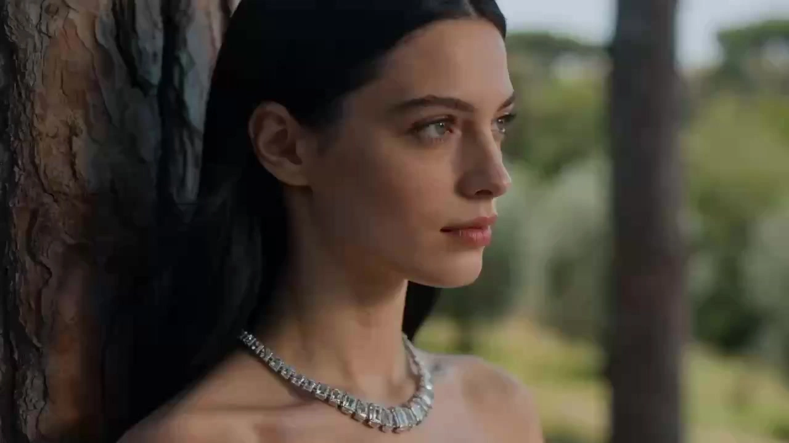

# Reference to video-remix

> **作者：** @Flova

## Content

Process Planning:

Phase logic and dependencies for a full video:

Analyze the uploaded video in full detail. Extract the key reference frames (iconic composition, framing, moment) and use them directly as key-frame → resource_prepare_and_analyze.

Write Final_Video_Spec.md (title, type, ratio, duration, visual style, language, model preference) → text_editor.

Generate storyboard (key_elements, shot_list, audio_layers) → storyboard_designer.

Set elements:

If the user has already uploaded element resources (e.g. character images or referenced library characters), bind them directly as assets to the corresponding key_elements. Otherwise, generate images for all elements → media_generator.

If dialogue/voice-over exists, generate a "voice reference" audio asset → media_generator.

Generate final video per shot; Strictly reference elements images + key-frame for that shot (steps 1 & 4) → media_generator.

Generate all audio_layers based on the storyboard → media_generator.

Final assembly when all resources are ready; then guide user to export → video_assembler.

Dependencies: 2→1; 3→1,2; 4→1,3; 5→1,3,4; 6→3; 7→3,4,5,6.

Note — user-provided or pre-existing media (primarily affects steps 3–6): Bind and assign via media_generator to the appropriate storyboard locations before filling gaps with generation; avoid re-generating what the user already supplied.

When to pause: Do not run through all steps in one go. Stop at each key phase above (e.g. after spec, after storyboard, after element images, after key-frames, after shot videos, after audio), confirm with the user, then proceed to the next. Use cards or reply_to_user to invite review before continuing.

Asset Analysis:

Analysis guidelines for VIDEO Analysis

Perform a full shot breakdown of the reference video. Output each segment in the format: 00:00–00:15s, shot description (or equivalent MM:SS.mmm ranges).

Shot description requirements: Each description must fully include, in natural language (no tables): character actions, dialogue, setting/background and its dynamics, framing, camera movement, shot type and angle, and any other relevant camera language. Be comprehensive and detailed, especially for camera language.

Segmenting logic: Do not create a new segment for every cut in the source; one segment may describe multiple cuts within a single time range. Segment by complete beat — each segment should fully convey one narrative beat — but no single segment may exceed 15 seconds.

Storyboard Design:

How to design key elements

Always include key subjects (characters, objects, etc.), key locations/scenes, and key props (if any).

How to plan element_id: When each character, prop, or scene is a distinct entity, assign one element_id per entity (e.g. [Element_Detective_Li], [Element_Boss_Zhao]; [Element_Observation_Room], [Element_Chief_Office]).

How to write description:

Characters: If a character has multiple states or looks in the project (e.g. different costumes, ages), describe each clearly in the description (e.g. Look 1: …; Look 2: …). Include the character’s voice/timbre so downstream audio can match.

Key locations/scenes: Describe the placement and orientation of important objects in the scene, especially props or areas where the main action or performance happens.

User-provided assets: If the user supplies reference media and specifies it as a key element, the description must match that asset; do not contradict what is shown or heard.How to design key elements

How to design shots

Each shot maps one-to-one or explicitly to a segment in the shot breakdown preserve the reference’s cut points, shot type, camera movement, framing, rhythm; only replace "who does what, which product/character" with the equivalent for the new subject.

Prefer long takes with internal cuts (e.g. 10–15 seconds per shot). Design cuts inside the shot rather than splitting into many short shots; cut frequency should follow story rhythm. Do not exceed 15 seconds per shot (current model max duration limit).

When the shot has internal cuts: After the scene/setting, order story content and camera language by cut. Use explicit timing and cut markers, e.g. "Shot1 (0–4s): [scene], [character] does X, close-up. Shot2 cut to (4–8s): … Shot3 cut to (8–12s): …"

Each shot description must include:

Scene: Reference the location/set (use the scene element ID, e.g. [Element_Office_Noir]).

Story content: Actions and dynamics of characters and key objects; dialogue and performance. Write out exact lines (spoken dialogue or inner monologue / OS). Reference characters by their element ID.

Camera language: Shot size, angle, movement (aligned with the breakdown for that segment), and which key-frame extraction this shot uses (e.g. "composition ref keyframe_02").

How to design independent audio

Background music: At least one global background track; style and rhythm match the reference or Final Video Spec; if the reference has clear act/emotion changes, split BGM segments and define scope. (each with its own audio_id and scope).

Narration: If the reference has voice-over or dialogue, design narration or dialogue in audio_layers (type narration) with content, voice/tone, and time range; if a voice_reference asset exists, link it in layout_instruction or notes for downstream alignment.

Media Generation:

Element generation

Images: If the user has specified assets for an element (e.g. product image, character image), use them directly; do not generate. Otherwise use TextToImage(or project convention) for characters, scenes, props. For multiple states of the same character, use ImageToImage referencing the first for consistency. Recommended resolution and model per project (e.g. 2K); multi-view for characters is recommended for cross-shot consistency and to assign separate asset_ids to each and generate them separately.

Recommended model: Nano Banana 2(Gemini 3.1 Flash Image), resolution 2K. Prefer three-view (front / side / back) for character elements to support cross-shot consistency.

Voice_references: If the reference has dialogue/voice-over and the storyboard requires replicating voice, generate or designate one voice _reference audio clip (e.g. a sample of that character/narrator) for narration generation to match voice and tone.

Recommended model: For Chinese (zh) content: doubao. For English/Global (en) content: elevenlabs.

Final shot video generation

Use MultiModalToVideo. Recommended model: Seedance2.0, resolution 720p. Reference both element images and the key-frame image for that shot.

Narration and BGM

Narration: Content, voice, tone, and timing strictly per storyboard; if a "voice_reference" asset exists, align to it when generating.

BGM: Style and rhythm match Final Video Spec / reference; duration and scope per storyboard.

Prompt Writing:

Prompts for Image Generation (TextToImage, ImageToImage)

General principles for all image prompts

Prompt is not just about describing "what's in the image," but like a real film director and colorist giving instructions to the team.

Use coherent natural language to describe the scene content (subject + behavior + environment, etc.), and use short phrases to describe visual aesthetics (style, color, lighting, composition). No Literary Fluff: Do not explain character motivation or inner state to the AI (e.g. "as if he doesn't care about the photo"). Do not describe off-screen or invisible elements. Describe only what is physically visible.

For all image prompts (any role): You MUST apply the 6 Core Rules of Cinematic Prompts globally across ALL target styles to ensure cinematic quality. Write the prompt as a flowing, natural English description that weaves these 6 rules together. Do NOT output them as labeled sections:

Professional Style Terms: Use professional artistic or cinematic terminology together with style terms to improve accuracy. (e.g., Introducing Auteur and Specific Film Visual Anchors, use Neo-Noir style, David Fincher Style, inspired by Se7en as style anchors instead of generically stating Neo-Noir style).

Framing & Lens: Explicitly state the cinematic framing (e.g., Over-the-shoulder shot, Dutch angle) and shot size (e.g., Close-up, Medium shot`).

Lighting: Detail the key light and heavily emphasize "negative lighting" for contrast and drama (e.g., Strong chiaroscuro contrast, dramatic interplay of light and shadow, or deep facial shadows emphasizing facial structure).

Color Grading: Use high-end Hollywood color grading to set a restrained palette (e.g., deep teal-cyan shadows dominating 90%, zero warm fill or muted watercolor wash). Unless the user explicitly requests otherwise, never use red–blue neon clash (e.g. forbid crimson bleed, neon magenta vs cyan). Constrain the image to one dominant hue for roughly 90% of the frame (e.g. deep teal-cyan)—extreme restraint.

Visual Rendering: Describes the overall visual quality and texture of the content (e.g., fine rendering quality, rich and intricate details, soft-focus effect with subtle Gaussian blur.).

Mood & Subtext: Describe the character's "subtext" and micro-expressions, freezing the action on a dramatic beat (such as oppressive suffocation, no mercy, and predatory stillness). Refuse stiff, posed looks. For inanimate objects, describe their condition (e.g., Destined aura, piercing gaze, cold and detached atmosphere).

Conditional Elements (include ONLY when relevant):

Accurate on-image text: When relevant, if text appears in the scene (e.g., on-screen text), integrate it naturally. You MUST wrap the exact text content to be rendered in the scene with quotation marks to emphasize it. For example, 'A neon sign in the background reads "DANGER".'.

When the target role is key_elementProvide a clear, detailed visual definition of the element so it stays consistent across shots. Structure the prompt around:

Subject & Identity: Clearly state what the element is — character, prop, scene, or creature. For characters, include defining identity traits (age, build, ethnicity if specified, distinguishing marks, voice).

Feature Details: Describe the element's key visual features with specificity. Prioritize features that must stay consistent across shots:

Characters: Facial features (eye shape, jawline, hair style/color), makeup & styling (if relevant), clothing & accessories (material, fit, color, condition).

Props/Objects: Shape, material, color, size, condition (new/weathered/damaged), distinctive markings.

Mood/Emotional tone: Describe the emotional undertone that defines the scene (e.g., tension, melancholy, hope, serenity, unease, warmth, oppression, dread, nostalgia, isolation, intimacy).

When the target role is a keyframe (start frame, end frame, or highlight frame)First, locate the corresponding moment in the shot's Description: identify the exact beat — the opening state, the closing state, or the most visually or dramatically charged instant — and use that as the basis. If the shot description does not clearly depict that moment, mentally simulate the shot (subject motion + camera move + environment change) and imagine what the scene would look like at that precise instant, then flesh out the details yourself. Either way, describe only the static image at that single frozen moment — what is visible, how it is framed, and what state everything is in:

Start frame: Show the scene before action begins — subject's pre-motion posture and intent (weight shift, gaze direction, limb preload), environment in its baseline state, and the camera's initial framing and angle.

End frame: Show the immediate outcome after the action resolves — subject's finish pose or final expression, environment after any change, and the camera's final placement ready for the next cut.

Highlight frame: Identify the single most visually or emotionally charged instant of the shot (e.g., the peak of an impact, the moment a revelation lands on a character's face, a composition that crystallizes the shot's theme). Freeze and describe that frame with maximum specificity — pose, expression, lighting state, camera framing — so it can stand alone as the most evocative still from the shot.

Prompts for Video GenerationAppend motion/dynamic prompts using the following Seedance order (Camera → Subject → Space → Audio):

Follow this order in the written prompt:

Camera — Movement or shot/cut changes (e.g., static → push-in, cut to new angle, orbit, pan).

Subject — Action and expression (who does what, facial action beats).

Space — Positional or environmental changes (subject or camera position relative to space; background movement; depth/layout shifts).

Audio — Dialogue (if any), sound effects, and notes if there is no music in the model (see notes below). Action Details

When relevant, base the action on specific body parts: hands, legs, head, shoulders, etc.

Add degree: amplitude, speed, intensity (e.g., slowly raises one hand, snaps head left, pushes hard off the ground).

For multiple beats in one prompt, list the main action, followed by secondary actions (in chronological story order). Multi-beats & "Shot 1 / Shot 2" (Official Guidelines)

When the tool accepts long prompts, you can label Shot 1, Shot 2, Shot 3 for sequences of camera or story beats in a single generation.

Precise clock timing (e.g., "0–3 seconds", "3–6 seconds") cannot be reliably executed — do not force-split prompts by exact second ranges, and do not write explicit second-by-second plans (e.g., "At 2 seconds...", "From 5–8 seconds..."). Describe what happens in order, not a time-scheduled shot list. Optional Polish (When the brief is cinematic live-action): You can add slight handheld micro-jitter or subtle film grain depending on other strategy rules — keep it subordinate to the four-layer order above. Special Character Conventions (for Seedance 2.0)Seedance accepts natural language prompts; these wrappers help the model distinguish music, sound effects, dialogue, and screen title text:

Music (description of what is playing): (...) , e.g., (fast-paced rock playing in the background).

Sound Effects: <...> , e.g., <distant dog barking>.

Spoken Dialogue: {...} , e.g., {Hello, world} — if the lines are not in the project's original language (e.g., Japanese monologue in an English short film), label the language before the curly braces, e.g., Says in Japanese: {こんにちは}.

Screen Titles / Chapters / Subtitle Text: 【...】 , e.g., 【Chapter One: Departure】

Special note for highly complex or multi-stage actions within a single shot: You must describe the sequence in order. You can use "cut to" markers to express transitions (Shot A..., cut to Shot B..., cut to Shot C...).

Example: Shot1: <<<image_1>>> his hands carefully open a dusty wooden box, with the sound of a soft creak. <<<image_1>>> His expression is focused and curious. The camera is a fixed shot, and the background attic is static. Shot2: cut to a bright blue light emanates from the artifact inside, casting an ethereal glow on his face and creating long, shifting shadows in the room. <<<image_1>>> His expression changes from focused to shocked awe as the camera begins a slow zoom in on his face. Shot3: cut to <<<image_1>>> he looks up with determination, the blue light reflecting in his eyes, as he slightly turns his head to the left to look past the camera. (no dialogue, no music, no subtitles)

Note: You must always include the following negative constraints in the prompt to ensure a clean output for post-production:

If the storyboard indicates that the shot has a separate voiceover audio track, do not write the narration text in the video prompt to avoid audio conflict.

To prevent the model from adding unwanted background music, you should almost always include 'no music'.

Subtitles are added during post-editing, so you must always include 'no subtitles'.

Video Editing:

Assemble all shots, narration track, and BGM in storyboard and timeline order; Guide the user to export when the cut is ready. If the final-shots has no in-shot dialogue or narration, mute the shot/video layer’s embedded audio in the edit and rely on the audio layers (BGM/SFX as designed) so shot-generated sound does not clash with the mix.
