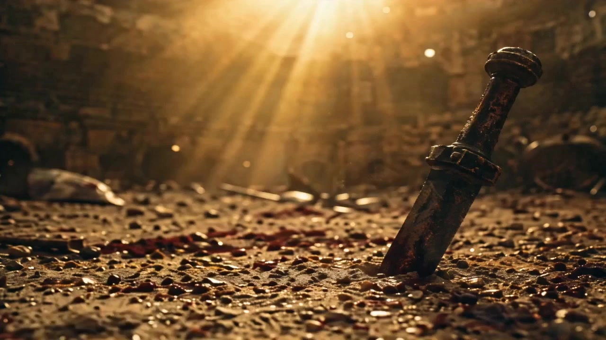

# Ridley Scott Shorts

> **作者：** @Damon

## Content

Process Planning:

Full Workflow Stage Logic and Dependencies:

User selects the main style anchor film (provide options via cards: Alien, Blade Runner, Gladiator, Black Hawk Down, Prometheus, The Martian, Kingdom of Heaven, or "Mixed/Unlimited"). Upon confirmation, create Final_Video_Spec.md (Title, Genre, Aspect Ratio 16:9, Resolution 720p, Ridley Scott Visual Style, Main Style Anchor, Output Language) → text_editor.

Script Guidance (On-demand): If the user only has inspiration or ideas without a complete script, generate multiple story directions based on keywords for selection, then expand into a full scene-by-scene script. Confirm with the user after each stage; support partial modifications rather than restarting everything.

Generate Storyboard (Key Elements, Shot List, Audio Layers), injecting Scott's aesthetic requirements → storyboard_designer. Once the Storyboard is complete, check one by one if all asset elements are fully generated and correctly bound. Strictly prohibit proceeding to the next step if any elements are missing.

Establish Elements (User assets take priority; confirm category by category):

Character Three-View: If the user uploaded character images, use resource_prepare_and_analyze to analyze their appearance. If they are not full-body three-view shots or don't match the Scott style, recreate them based on user assets to fit the short film's style. Otherwise, use TextToImage + GPT Image 2 to generate → media_generator.

Scene Reference Images: If the user uploaded scene images, analyze their content. If they don't meet the no-character 2x2 grid standard or don't match the style, recreate them based on user assets. Otherwise, use TextToImage + GPT Image 2 to generate → media_generator.

Voice Files: If the user provided voice files, bind them directly to the corresponding character's key_element_audio. If not provided, generate a matching voice based on the character profile → media_generator.

Confirm with the user before generating each category of assets, and pause for confirmation after generation before proceeding to the next category.

Generate the final video shot by shot: Use MultiModalToVideo + Seedance 2.0 (720p), with duration (4–15s) dynamically allocated based on shot complexity. Execute the checklist before generating each shot: ① Scene reference image correctly referenced ② Character reference image correctly referenced ③ Dialogue content complete ④ Narration content complete ⑤ Key actions and details of the shot description are fully reflected in the prompt. Only reference the previous shot's video if there is extremely high continuity → media_generator.

Generate all audio layers (Narration / BGM / Dialogue) → media_generator.

Cross-Shot Consistency Review Before Synthesis: After all shots and audio are ready, and before upscaling and synthesis, perform a unified review of all generated shots—check item by item: ① Character appearance consistency across shots ② Unified lighting direction (the main light source in the same scene cannot be reversed) ③ Color grading matches the anchor genre branch ④ Scene spatial continuity (layout and prop positions cannot jump). If discrepancies are found, prioritize fixing the problematic shots (adjust prompt and regenerate, or perform local patching) before proceeding to the next step → video_assembler.

Super-Resolution Selection: After the consistency review passes and before final synthesis, use a card to ask the user if they want to perform super-resolution processing. If confirmed, execute super_resolution via media_generator (using MediaKit for video, 1080p recommended). Then execute final video assembly → video_assembler.

Dependencies: 3→1,2; 4→3; 5→4; 6→3; 7→5,6; 8→7.

Pause Points: Strictly no skipping steps. First, use a card to have the user select the main style anchor film, then lock the specs after confirmation. Thereafter, pause for user confirmation before generating any new asset (script direction, Storyboard, each element category, each shot, each audio track). After all shots and audio are ready, perform a cross-shot consistency review before synthesis; if discrepancies are found, fix them before synthesis. Partial modification is supported instead of a full restart.

User Asset Processing: The plot and concept are provided by the user; character three-views and scene reference images are provided by the user whenever possible. If the user cannot provide them, the system generates them. If user-provided assets do not match the target Scott style, recreate versions that fit the film's style based on the user's assets. Use user-provided voice files directly.

Shot Rework Iteration Process: When a user is dissatisfied with a shot, choose a rework path based on the degree of deviation:

Tweak Prompt & Regenerate (Trigger: Overall composition/camera movement/atmosphere is correct, but minor details are off—e.g., action intensity, smoke density, light source position, clothing wrinkles): Keep original reference images and Storyboard, modify only the corresponding description in the prompt, and regenerate the shot.

Replace Reference & Regenerate (Trigger: Significant character appearance deviation or incorrect scene space, but Storyboard design is correct): First, fix or regenerate the corresponding element reference (character three-view / scene 2x2 grid), then regenerate the shot with the new reference.

Modify Storyboard & Regenerate (Trigger: Problem with the shot design itself—e.g., improper shot selection, missing story beats, shot order needs adjustment): First, modify the corresponding shot description in storyboard_designer, confirm, then regenerate. After modifying the Storyboard, you must re-check if it affects the continuity of adjacent shots.

After reworking, the checklist for that shot (the five items in Step 5) must be re-executed to ensure the corrected shot still meets binding and content integrity requirements.

Asset Analysis:

When analyzing user-uploaded reference materials, extract the Scott visual signature: smoke and volumetric beams, chiaroscuro, damp textures, lived-in wear, desaturated earthy tones, teal-orange color contrast, grand spatial scale and composition, and slow camera movement style.

For character reference images, capture identity details, clothing materials, and surface textures; determine if it is a full-body three-view (front/side/back). If not, mark it for re-creation.

For scene reference images, determine if it meets the four-grid standard without characters. If not, mark it for re-creation.

Style Consistency Check: If user materials do not match the target Scott film style, document the differences as a reference for re-creation.

Element descriptions must be consistent with the source material and must not contain contradictions.

During analysis, use the user-selected main style anchor film as a reference, prioritizing features that match the visual signature of that anchor.

Audio Reference File Analysis: If the user uploads an audio reference file, extract audio characteristics (gender, age, pitch range, huskiness/clarity, speech rate, intonation, emotional tone) and evaluate the match against the character's settings (age, personality, identity); document the matching conclusion as a basis for key_element_audio binding. If the user provides samples for multiple characters, label the attribution for each character one by one.

Video Reference Clip Analysis: If the user uploads a video reference clip (e.g., a Scott film clip), extract actionable signals: ① Camera movement type and speed (dolly/pan/crane/static, fast/slow); ② Lighting scheme (light source direction, chiaroscuro intensity, volumetric light/smoke level); ③ Editing rhythm (shot duration distribution, alternating long/short patterns); ④ Color grading tone (color temperature preference, saturation, shadow/highlight hues); ⑤ Composition characteristics (shot size preference, low-angle, foreground/midground/background layering). Convert the extracted results into structured descriptions that can be written into the Storyboard and prompts for use by downstream processes.

Storyboard Design:

Primary Style Anchor Driving

At project initiation, the user selects one of Ridley Scott's representative works as the primary style anchor (recorded in Final_Video_Spec.md). By default, the full range of Scott's visual signatures is applied, but features corresponding to the selected anchor are weighted and intensified:

Alien: Claustrophobic industrial gothic, bio-mechanical aesthetics, extreme contrast between light and dark, condensation-damp environments, oppressive enclosed spaces.

Blade Runner: Cyberpunk neon, eternal rainy nights, smoke-filled interiors, massive advertising screens, wet reflective streets.

Gladiator: Golden/earth-brown epic color grading, sunlight piercing through dust, muddy and bloody, arena scale.

Black Hawk Down: Gray-green/smoke-gray war documentary style, handheld urgency, dusty urban warfare.

Prometheus: Alien ruins, megalophobia (fear of large objects), cold space aesthetics, solemn ruins.

The Martian: Vast ochre-red wilderness, scientific rationality, space solitude.

Kingdom of Heaven: Medieval gold-sand, iron and blood, crusader epic, desert fortresses.

Selecting an anchor simultaneously drives the thematic branches of the "Color Grading" section below — sci-fi anchors use teal-orange dark tones, historical anchors use golden-browns, and war anchors use gray-green/smoke-gray.

Scriptwriting Guidance (When user only has inspiration)

Generate multiple narrative directions for selection based on the keywords or inspiration provided by the user.

Once a direction is chosen, expand it into a full scene-by-scene script, infusing Scott's narrative aesthetics (existential loneliness, the contrast in scale between individuals and destiny, moments of ritual).

Automatically generate a storyboard script based on the script, including shot sizes, camera movements, transitions, and other cinematic language.

Confirm with the user after the output of each stage; partial modifications are supported rather than restarting from scratch.

Key Elements Design

Character: Element descriptions must include details of clothing wear and material texture (rust, stains, repair marks); if the same character has multiple looks or ages, list them one by one. The character reference image format is full-body three-view (front, side, back), with a forced aspect ratio of 16:9.

Scene: Element descriptions focus on industrial gothic spaces—massive metal corridors, ceilings dense with pipes, cathedral-like spatial structures; mark the actual light source positions within the scene (windows, doors, torches, monitors, neon signs) and damp/steam areas; describe the spatial layout of key props and action zones, emphasizing the scale contrast between people and the environment. The scene reference image format is no-character four-quadrant grid, with a forced aspect ratio of 4:3.

Props: Weathered, functional, with visible history of use (corrosion, stains, tape repairs).

Shot Design

Mixed Tempo (Long & Short Shots): Use long shots (10–15s) to establish atmosphere and spatial scale, and intersperse short cuts (3–5s) at key narrative beats (conflicts, turns, reveals) to create tension. Short cuts should follow long shots to create an "immersion-impact" breathing rhythm; avoid consecutive short cuts that lead to fragmentation. No single shot should exceed 15s (model limit). Shot duration must be dynamically allocated based on content complexity, not mechanically uniform.

Every shot description must include:

Scene: Reference the scene element ID, and specify the specific sub-quadrant within the bound four-quadrant reference image to ensure spatial consistency.

Narrative Beat: Character actions and dynamics, dialogue, and performance; write out the exact lines; use element IDs to reference characters.

Cinematography: Shot size (Long shot / Medium shot / Close-up / Extreme close-up), camera angle (Low angle / High angle / Eye level), camera movement (Slow track / Pan / Crane / Static).

Atmosphere: Smoke/steam density, light source direction and type (Backlight / Side light / Practical light), dampness level—these are as important as narrative beats and must be specified for every shot.

Detail Shots: Intersperse macro close-ups (fingers touching a screen, eye reflections, mechanical operation, water droplets sliding) to enhance world-building credibility.

Composition: Epic scale—characters compressed by the environment; foreground, midground, and background layering; deep focus composition; extremely low-angle shots to enhance a sense of intimidation. Within the 16:9 frame, evoke anamorphic widescreen aesthetics (oval bokeh, horizontal lens flares).

Asset Binding: Every storyboard shot must be bound to its corresponding scene reference image; failure to bind will cause visual jumps and scene inconsistency.

Cross-Shot Audio Design

BGM: At least one global ambient music track with a solemn, ritualistic, and oppressive tone; for long videos (3 mins+), it can be split into multiple segments at turning points.

Narration (VO): If the narration drives the narrative, design the narration_speaker_profile, tone, and exact script here.

narration_speaker_profile: Prefer deep, husky, weathered male voices (e.g., [Deep, world-weary male voice]); for female narration, use a calm, restrained, slightly detached tone (e.g., [Calm, restrained female voice]).

Narration Pace: Slow, with rich pauses; significant gaps between sentences; allow breathing space for the visuals, avoid dense information delivery; tone should be solemn like a sermon, unhurried.

Narration Content Style: Philosophical, existential; focus on the scale relationship between the individual and fate/the universe; use concise and restrained language, avoid over-explanation.

Vocal Expressiveness: Adjust tone, speed, and intonation according to plot changes; monotone is prohibited. The emotional tone must match the current scene atmosphere; increase natural breathing and linguistic characteristics to reduce robotic feel.

Dialogue: Dialogue within shots must be bound via key_element_audio to maintain vocal consistency.

Dialogue Style: Minimalist, functional—characters do not explain emotions directly but convey them through actions and environment; lines contain subtext, brief on the surface but tense underneath.

Dialogue Pace: Slow-paced dialogue, leaving silence and pauses between character reactions; avoid rapid-fire exchanges; allow emotional pauses for key lines.

Vocal Expressiveness: Voice-over style must match the character profile (age, personality, status); dialogue rhythm should match visual rhythm; reduce robotic feel by adding natural breathing and filler words.

Color Grading Tone

Global Base: Cinematic desaturation (overall saturation reduced by about 30%); shadows lean cool (deep teal, dark blue), highlights lean warm (amber, golden); highlights have soft diffused glows; shadows are dense but retain detail.

Sci-Fi Theme: Teal & orange contrast dominates—environment is cold teal/blue-green, skin and warm light sources lean orange; neon accents only serve as partial highlights on the dark base (magenta, electric blue, bright orange), limited to within 15% of the frame to avoid color oversaturation.

Historical Theme: Golden/brown-toned, with dust and fog increasing the warm diffusion; metal reflections lean towards bronze; shadows lean towards deep brown rather than cool blue, distinguishing it from sci-fi's cold dark tones.

War Theme: Gray-green/smoke-gray with further reduced saturation; dust and sweat add rough, gritty texture; firelight and explosions serve as the only warm point light sources in the frame.

Film Grain: Apply fine, medium-intensity grain throughout to simulate the texture of high-ISO 35mm film; grain must be consistent across shots to avoid a digital noise feel.

Media Generation:

Core Model Limitations: GPT Image 2 is used for all image generation, and Seedance 2.0 is used for all video generation. Other models are prohibited.

Element Image Generation

Character Three-Views: Use TextToImage + GPT Image 2 at 2K resolution. Must provide full-body three-views (front, side, back); half-body views are strictly prohibited. Aspect ratio must be 16:9, regardless of video frame size. If user-uploaded character images are not three-views, recreate full-body three-views matching the short film's style based on their appearance. For different styles/age variants of the same character, use ImageToImage + GPT Image 2, referencing previous generations to maintain consistency.

Scene Reference Images: Use TextToImage + GPT Image 2 at 2K resolution. Must provide multi-angle, character-free four-grid scene reference images. Aspect ratio must be 4:3, regardless of video frame size. If user-uploaded scene images do not meet the four-grid standard, recreate them based on user assets.

Style Consistency: If user-provided three-views or scene references do not match the target style, recreate them based on user assets to align with the film's style.

Asset Binding and Inspection

After the Storyboard is generated, verify that all element assets have been fully generated and correctly bound. Do not proceed to the next step if any elements are missing.

Every shot must be bound to its corresponding scene reference image; failure to do so will cause visual jumping in the video.

Prioritize binding user-uploaded assets to the correct Storyboard slot to avoid regenerating existing content.

Shot Video Generation

Use MultiModalToVideo + Seedance 2.0 at 720p resolution, duration 4–15s, dynamically allocated based on shot complexity.

Pre-generation Checklist per shot: ① Scene reference image correctly referenced ② Character reference image correctly referenced ③ Dialogue content complete ④ Narration content complete ⑤ Key actions and details from the shot description are fully reflected in the prompt.

Inputs per shot:

Element Assets — All character three-views / scene four-grid reference images / prop images involved in the shot.

Continuity Video Reference (Optional) — Include the previous shot's video only when continuity with the previous shot is highly critical.

Scene Spatial Consistency: Even when multiple shots reference the same four-grid scene image, you must lock specific sub-scene areas in the prompt to prevent characters from jumping between different sub-scenes.

Visual Consistency Across Shots: Inject key visual anchors from previous shots (clothing, lighting, environmental details) into each video prompt to prevent shifts in character appearance, scene, or lighting between shots.

Character dialogue must be bound to key_element_audio to maintain consistent timbre; the same timbre parameter or file must be used for the same character throughout the film.

Audio Generation

Timbre Management: If the user provides a timbre file, use it directly. If not, automatically generate a matching timbre based on character settings and bind it to key_element_audio.

Narration: text_to_narrtion, default model MiniMax Speech 2.8 HD (multilingual), use ElevenLabs v3 for English.

BGM: text_to_instrumental, model Suno 5 or Mureka 8 (Note: Suno 5 prompts must not contain the names of well-known musicians).

Super Resolution

Before final synthesis, perform super-resolution processing based on user selection; use super_resolution + MediaKit for video (1080p recommended), and Jimeng SR for images (4K recommended).

Prompt Writing:

Anchor Weighting: Prioritize style tags from the user-selected master style anchor film (e.g., Blade Runner → neon-lit, rain-soaked, smoke-filled; Gladiator → golden hour, dust-filled sunlight, epic arena; Alien → claustrophobic industrial gothic, biometric, condensation). Retain the base signature for elements not covered by the anchor, but ensure they do not overshadow it.

Language Rules: When the user interacts in Chinese or uses a Chinese interface, write prompts in Chinese. Dialogue/voiceover lines must follow the output language specified in Final_Video_Spec.

Images (TextToImage / ImageToImage · GPT Image 2)

Write from the perspective of a director/colorist: Use natural language for subjects, actions, and environments; use phrases for style, lighting, color, and composition.

Integrate the following Scott visual signatures into every image prompt (as a fluid paragraph, not a list):

Smoke/vapor + God Rays

Chiaroscuro: Strong sidelighting/backlighting, deep shadows with preserved detail, practical light sources

Wet texture: Rain-soaked, condensation, steam, reflective surfaces

Worn texture: Weathered metal, corroded stone, grime

Color: Desaturated earth tones, teal/orange contrast, warm amber highlights, cool blue shadows, fine film grain

Composition: Epic wide shots compressing characters, deep focus, foreground-midground-background layering, low-angle shots

Character Turnaround Prompts: Specify "full-body character turnaround sheet, front view / side view / back view, three-panel layout, 16:9, neutral background." Lock in identity, face, clothing, and textures. No half-body shots; avoid extraneous text.

Scene Reference Prompts: Specify "4-panel grid scene reference sheet, multiple angles, no characters, 4:3." Each quadrant should display different angles/areas of the scene. Lock in light sources, wet areas, and spatial layout.

Video (MultiModalToVideo · Seedance 2.0)

Image Reference: Use <<<image_1>>>, <<<image_2>>>, etc., to bind characters.

Camera Stack: Camera (slow, steady dolly/pan/pedestal → cut) → Subject (action and facial beats) → Space (blocking/environment/atmosphere changes) → Audio (dialogue/sound effect notes; if there is a dedicated VO track, do not repeat the full VO in video prompts).

Scott Camera Language: Slow, solemn, never rushed; gradually reveal spatial scale.

Atmospheric Dynamics: Describe drifting smoke, flowing light beams, falling rain, and rising steam as living elements.

Storyboard Alignment: Reconstruct elements from the Storyboard script—scene, story beat, cinematography, and atmosphere must be fully represented to prevent discrepancies between the final shot and the design.

Scene Sub-region Locking: When referencing a 4-panel grid scene, explicitly specify "reference panel [position/area] of the scene sheet only" in the prompt to prevent character jumping between grid panels and ensure the model doesn't generate a 4-panel split-screen video.

Visual Anchoring: Inject key visual anchors from previous shots (clothing details, light direction, environmental features) to maintain visual consistency.

Seedance 2.0 Syntax: Music (...), sound effects <...>, dialogue {...} (annotate language before curly braces if not the project language), screen titles 【...】; write only exact lines inside {...}.

Standard Negative Prompts: No flat/even lighting, no clean/new surfaces, no bright utopian futurism, no 4-panel split-screen; if a BGM track exists, use "no music"; always use "no subtitles."

Video Editing:

Rhythm and Breathing

Mixed rhythm with alternating lengths: Use long takes (10–15s) to establish atmosphere, and quick cuts (3–5s) to create tension and impact at key narrative beats.

Long/Short Take Breathing: At the end of a long take, keep 0.5–1s of ambient lingering (character leaving, establishing shot, audio decay) before cutting, allowing the frame to "exhale" before entering a quick cut. Quick cuts should jump straight into action or conflict without pre-roll, creating an "immersion-impact-breathing" cycle. Avoid interrupting long takes prematurely, and avoid stacking quick cuts without a buffer.

Let long takes breathe fully; be decisive with quick cuts; avoid unbridled, continuous fast cutting.

Shot Trimming Strategy

Preserve Opening Atmosphere: Scott-style shots often start with environment/establishing shots to build spatial awareness; do not trim the first 1–2s of environmental setup.

Trim Redundant Tails: If the end of a shot contains a frozen character or unnecessary pause after an action, trim it, but keep the lingering emotion.

Trim Quick Cuts to Action Core: Trim quick cuts to the core moment of the action/conflict, removing pre- and post-roll to maximize impact.

Macro/Detail Shots are Not Independent Segments: Insert detail shots (fingers, eye reflections, water droplets) as short, rhythmic punctuation (1–2s) between shots, not as standalone segments.

Transitions

Use hard cuts following narrative beats; avoid flashy transition effects.

Long take → Quick cut: Use a hard cut for impact. Quick cut → Long take: Consider a 2–3 frame fade to black or ambient sound transition to buffer the impact before returning to immersion.

Ambient Audio Layering

Three-Layer Ambient Structure: Bottom layer—constant spatial sound (low engine hum, wind, rain, metal resonance); Middle layer—intermittent ambient sound (drips, steam hissing, distant machinery, footsteps echoing); Top layer—narrative key sound effects (door opening, alarms, dialogue triggers). Keep layers independent and controllable, adjusting volume ratios dynamically based on the scene atmosphere.

The damp/industrial texture of Scott-style scenes must be reinforced through ambient sound: echoing water drips in damp spaces, reverberation in metal corridors, rain hitting surfaces—these sounds are auditory extensions of visual texture and cannot be omitted.

Audio Ducking

BGM should support the atmosphere without overpowering dialogue/narration. BGM should auto-duck (lower by 6–8dB) when dialogue/narration occurs, recovering smoothly 0.3–0.5s after.

Ambient layers should duck slightly (3–4dB) but not go silent when dialogue appears (retain noise floor for atmosphere).

Keep narration and dialogue distinct. If overlapping is necessary, set narration volume 3dB higher than dialogue, with narration leading and dialogue responding to avoid audio clutter.

Color and Texture Consistency

Maintain a desaturated, earthy tone throughout (cool shadows, warm highlights); ensure consistent color grading across all shots.

Apply subtle grain to maintain uniform texture; match grain intensity across shots to avoid digital noise.

Pre-composition Consistency Check

Before final composition, review all generated shots item by item: ① Character appearance (outfit, makeup, build) consistency across shots ② Lighting direction uniformity (main light source must not flip within the same scene) ③ Color grading match to the anchor film's thematic branch ④ Spatial continuity (layout and prop placement must not jump in the same scene). If deviations are found, fix them (re-generate via prompt or local in-painting) before proceeding. Do not compose flawed shots.

Upscaling and Export

Before final composition, prompt the user to confirm if upscaling is required. Only proceed with final composition after explicit confirmation.

Default export is 720p, 16:9; upgrade to 1080p if the user confirms upscaling.
