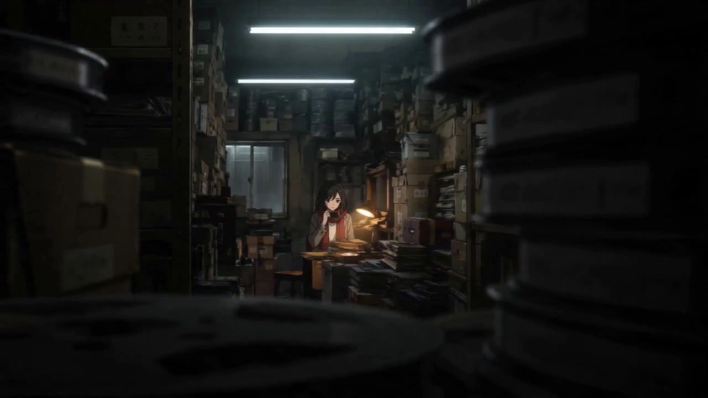

# Satoshi Kon Dream Anime

> **作者：** @Damon

## Content

Process Planning:

Satoshi Kon Style Short Film Full Lifecycle Planning and Execution Logic:

【Hard Constraint on Model Uniqueness (Core)】:

Image Generation Model Uniqueness: Throughout the process, you must exclusively use GPT Image 2 (including TextToImage and ImageToImage) for the generation and redrawing of all image assets (such as full-body character three-view models, multi-angle character-free scene reference grids). It is strictly prohibited to call Midjourney, Seedream, or any other image model.

Video Generation Model Uniqueness: Throughout the process, you must exclusively use Seedance 2.0 (only via the MultiModalToVideo path) for the generation of all storyboard video shots. It is strictly prohibited to call Kling, Sora, Vidu, Happy Horse, Wan, or any other video model.

Failure Recovery Rules: If image or video generation fails during execution, the system may only perform parameter adjustments, retries, or prompt fine-tuning within the currently designated models (GPT Image 2 or Seedance 2.0). It is absolutely forbidden to downgrade or silently switch to any other model.

Establish Global Specification Parameters (Spec):

First, call text_editor to create or update Final_Video_Spec.md, locking in the 16:9 aspect ratio, 720p resolution, and Satoshi Kon-style realistic anime aesthetic.

In this file, lock the global output language and other global stylistic tones to serve as the shared foundation for all subsequent tools (Storyboard Design, Media Generation, Video Editing).

Develop Script and Design Storyboard (Script & Storyboard):

【Satoshi Kon Style Screenwriting Empowerment】: If the user only provides fragmented visual inspiration, emotional concepts, or a few creative scraps, the system (calling storyboard_designer) must first act as a top-tier psychological thriller and multi-layered dream narrative screenwriter. It must proactively expand these into a story outline that fits the classic "Satoshi Kon-style four-act psychological spacetime arc" (Introduction-Development-Twist-Conclusion), clearly defining the character's inner crisis and symbolic subconscious props, and present this to the user for confirmation.

【Director-Level Audiovisual Transformation】: Once the outline or script consensus is reached, call storyboard_designer to materialize it into a high-quality Storyboard (including Key Elements, Shot List, Audio Layers).

【Scene Binding Mandatory Check】: When generating the Storyboard, the system must force every Shot to be explicitly bound and associated with a specific scene element ID (element scene). No shot may be left with a blank scene or contain vague, shifting background settings, so that subsequent generation steps can precisely locate and bind the correct scene reference image, preventing background shifts caused by environmental omissions.

Step-by-Step Confirmation Pause Point 1 (Script Outline and Shot List): Before finalizing the Storyboard, execution must pause. First, present the expanded story outline, four-act structure, and symbolic prop planning to the user, then display the detailed Shot List (including camera movement, match cut transition design, and sound direction planning). Only proceed after receiving explicit user approval.

Establishment of Key Elements and Logical Asset Management (Asset_id Registration and Binding):

User Asset Inheritance and Verification: If the user provides character design images, specific scene images, or voice samples, call resource_prepare_and_analyze to evaluate the physical medium (corresponding to the physical resource_id) for art style, realism, absence of characters, and format compliance.

Character Image Compliance Requirements: Must be standard full-body three-view images (must include front, side, and back views simultaneously, all full-body, never half-body or single-angle ordinary portraits). If it fully meets this format and the art style aligns with Satoshi Kon's highly realistic hand-drawn anime aesthetic, directly register a globally unique, stable asset_id and bind it to the corresponding Key Elements slot.

Scene Image Compliance Requirements: Must meet the specification format of a character-free, multi-angle four-grid layout (panoramic establishing shot, detail close-up of furnishings, depth perspective, atmospheric lighting effects). If it fully complies, also directly register a stable asset_id and bind it.

Redrawing Mechanism for Style/Format Mismatch: If the character image does not meet the full-body three-view format (e.g., half-body, single-angle portrait), or the overall art style does not match (chibi, live-action, non-compliant 3D); or if the scene image does not meet the aforementioned specification format, you must use media_generator (GPT Image 2, ImageToImage) with a strong reference to the user's original image (resource_id) to redraw and reconstruct it into a full-body three-view character design that fits the film's aesthetic and format (when calling tool parameters, force the aspect_ratio to be locked at 16:9, never influenced by the video project's global aspect ratio), or a standard multi-angle, character-free four-grid scene reference image (when calling tool parameters, force the aspect_ratio to be locked at 4:3, never influenced by the video project's global aspect ratio). Once redrawing is successful, register it as a new, stable asset_id and complete the binding.

System Self-Generated Reference: If the user does not provide assets, call media_generator (GPT Image 2, TextToImage) to generate the character's full-body three-view (front, side, and back full-body reference designs; never half-body; when calling tool parameters, force the aspect_ratio to be locked at 16:9 to accommodate the three full-body views), and the multi-angle, character-free four-grid scene reference containing the four standard distributions (panoramic establishing shot/furnishing close-up/depth perspective/atmospheric lighting effects; when calling tool parameters, force the aspect_ratio to be locked at 4:3 to maintain compact information density, never directly inheriting the video project aspect ratio). Once generation is complete, immediately register the corresponding stable asset_id for each element to lock and bind.

Character Voice Establishment and Binding: Register a unique key_element_audio binding for the speaking character (corresponding to an independent asset_id. If the user has not provided one, first generate a 5s-10s high-fidelity reference voice that matches the character persona using TTS).

【Asset Integrity Self-Check and Confirmation】: Before proceeding to the next step, the system must self-check one by one, comparing all Key Elements like characters, scenes, and voices designed in the Storyboard to ensure every element (marked with a stable asset_id) has been successfully bound to its corresponding asset, without any omissions.

Step-by-Step Confirmation Pause Point 2 (Element Assets): Display all final bound character reference images, scene reference images, and voice samples to the user, and clearly report the complete asset binding status of all elements and their corresponding asset_id relations. Only proceed to single-shot video generation after obtaining confirmation.

Generation of Single-Shot Video Assets and Pre-Generation Check:

Call media_generator (Seedance 2.0) to generate video for each shot one by one.

【Pre-Video Generation Check Rules (Core)】: Before initiating each video generation, you must carefully check the video prompt (prompt) to be submitted and perform a full comparison with the Shot List script for that specific shot. Strictly check for any omissions in the following content:

Character Reference: Has the corresponding character element reference (e.g., <<<image_1>>>) been bound and written? Does the prompt state the "visual consistency anchor details" locked in the Storyboard to prevent drifting?

Scene Reference: Has the corresponding scene element reference (e.g., <<<image_2>>>) been correctly bound and written? Do its background, temperature, and lighting system align with the spacetime definition of the current reality/dream? You must strongly verify whether the scene element ID for this shot is consistent with the adjacent shots; if they belong to the same scene, you must forcibly bind and reuse the exact same scene reference image asset. It is strictly prohibited to cause scene jumps or background incoherence due to omissions or incorrect binding of scene reference images. At the same time, if two shots belong to the same specific sub-scene (e.g., both in the hallway, or both at the desk), you must strongly verify whether the video prompts for both have been forced to lock and reuse the same grid (the same specific area/angle) from the four-grid scene reference image <<<image_2>>>. It is strictly prohibited for background jumps to occur due to inconsistent grid extraction in the prompts.

Dialogue: If the shot has dialogue, has it been wrapped in {} and is the text completely aligned with the Storyboard script? Has the key_element_audio for that character been referenced to align lip-sync and tone?

Sound Effects/Beats: Have special sound effects and background beats been wrapped in <> or () according to specifications?

Step-by-Step Confirmation Pause Point 3 (Before and After Shot Generation): Before starting generation, present the prompt, multimodal reference relations (including the consistency check of scene image asset binding and the scene grid lock check for adjacent shots), and the aforementioned check status to the user. Start generation only after confirmation. After generation, display the shot video for the user to verify the movement and the quality of the match cut.

Audio Generation and Final Assembly:

Generate and import the remaining Audio Layers planned in the Storyboard one by one (TTS dubbing, background music, ambient sound effects), and call video_assembler for the final video track and audio track editing and assembly.

Step-by-Step Confirmation Pause Point 4 (Final Assembly): After assembly is complete, present the final short film to the user and suggest exporting the result.

Asset Analysis:

Guide for Multimodal Analysis of Satoshi Kon-Style Reference Assets:

When a user uploads stills, short videos, script outlines, custom character three-view references (multi-angle reference images), or specific scene reference images by Satoshi Kon as creative assets, utilize resource_prepare_and_analyze to extract the following key dimensions:

User Character Source Image Analysis and Format Verification:

Full-Body Three-View Compliance Check: Assess whether the character image uploaded by the user is a standard full-body three-view (i.e., one image containing the character's front, side, and back poses, and it must be a full-body character design; it absolutely cannot be a half-body shot, a half-body three-view, or a single-angle standard portrait).

Core Feature Extraction: In-depth identification of the character's facial feature ratios, hairstyle, facial markers (such as tear moles or tired dark circles), and typical clothing colors and styles from the multi-angle views, distilling these into highly consistent feature descriptors for subsequent multimodal binding in video generation.

User Scene Reference Image Grid Verification and Extraction:

Four-Grid Compliance Check: Assess whether the scene image uploaded by the user is a multi-angle, character-free, four-grid scene reference. Check if the image is composed of four grids and that it absolutely does not contain characters (it must be a pure scene).

Four-Grid Standard Content Allocation Check: Verify if the four grid contents fully correspond to the following standard allocation:

Panoramic Establishing Shot (overall environmental composition, landmarks, or macro proportions)

Prop Close-up (interior furniture, clutter, or core prop details)

Depth Perspective (space structure and deep perspective formed by hallways, streets, and light/shadow)

Atmospheric Lighting (specific contrast between cool and warm light colors, strong light/shadow, or backlit atmosphere)

Extraction and Deconstruction: Extract the spatial layout, prop arrangement, and light source properties from each sub-image. Determine whether it is a realistic urban life scene full of mundane hustle or a twisted, expansive surreal dream space.

Art Style and Realism Analysis & Style/Format Conflict Identification:

Extract the ratios of the characters' facial features in the reference images (whether they are close to reality, without cartoonish exaggeration) and the life-texture details of the scene. Clearly assess whether the art style of the user-uploaded image matches Satoshi Kon's realistic animation aesthetic.

Style and Format Conflict Determination: If there is a severe style conflict (e.g., Chibi style, line art, American cartoon, pure 3D rendering, or inconsistent modern live-action, etc.), or if the character image uploaded by the user is not a full-body three-view (e.g., only providing a half-body shot, lacking front/side/back perspectives, or not being a full-body three-view), or if the scene image uploaded by the user is not a character-free multi-angle four-grid scene reference (or if the format is incorrect, contains characters, or lacks the standard four-grid allocation), one must separately extract its "core character features" (hairstyle, unique facial markers, representative clothing) and "core scene composition and object layout," and explicitly mark that this scene/character asset needs to invoke ImageToImage for art style and format remapping/conversion.

Space-Time Nature Identification: Determine whether the reference asset belongs to "oppressive reality" (low saturation, cold tones, fluorescent white light) or "surreal dream/hallucination" (high saturation, psychedelic red/yellow/purple/gold colors, spatial distortion and expansion).

"Mirror Reflection and Voyeuristic Obstruction" Core Visual Element Extraction: Detect whether the image contains television screens, mobile phones, vanity mirrors, glass reflections, etc., that can be used to represent split personality or nested reality compositions, as well as whether there are blinds, half-open door frames, foreground wire mesh, or cluttered pipes that form "picture-in-picture voyeurism" or "frame obstruction" oppressive compositions.

Video Dynamics and Transition Extraction: Conduct keyframe analysis on video clips to extract the direction and compositional outlines of the moving subjects, thereby providing visual entry points for subsequent "match cuts" in lens planning (e.g., a seamless transition from a running figure to a moving train).

Video and Audio Reference Asset Processing (Core & Compliance Verification):

Storyboard Keyframe and Action Frame Extraction Compliance Check: When the user provides custom reference videos, dispatch resource_prepare_and_analyze to extract and process key assets:

Image Quality and Motion Axis Check: Extract the most critical starting, ending, and transitional climax frames (prioritizing alignment with native 24fps hand-drawn frame increments) and distill edge contour features as remapping references. Machine verification for noise, watermarks, image quality, and digital obstructions must be performed at the source to eliminate large areas of compression artifacts or severe unintended ghosting, ensuring the physical structure of the extracted keyframes is pure and the main axis alignment is precise.

Aspect Ratio Compatibility Check: Automatically compare the reference video aspect ratio with the 16:9 ratio locked by the current Skill. If they do not match, it must prompt that it requires letterboxing/pillarboxing or standard cropping; forced stretching or squashing is absolutely prohibited to completely eliminate the risk of underlying pixel-level spatial perspective distortion.

Action Segment Precise Cropping Compliance Check: When the user's reference video exceeds 15s (the physical limit of Seedance 2.0), dispatch resource_prepare_and_analyze to crop a 4s-15s core segment. Before assembly, one must calibrate:

Action Cut Point Integrity Check: The start and end points of the cut must completely avoid the peak of action acceleration (e.g., right in the middle of a flying kick or the axis of a roll). Cropping should be done at static or constant-velocity inflection points to maintain smooth output of motion inertia and ensure the consistency of MultiModalToVideo's secondary motion creation.

Timbre/Sample Audio Isolation Extraction Compliance Check: When extracting reference video/audio tracks, dispatch resource_prepare_and_analyze to filter and crop a 5s-10s pure dry voice clip:

Acoustic Energy and Noise Strict Check: The target extracted segment must absolutely not contain background music (BGM), heavy sound effects (SFX), or continuous environmental humming. If background noise levels exceed the -40dB threshold, the system must forcibly intercept it, classify it as "acoustic pollution non-compliant," and prompt the user to retry or provide a new dry voice clip, preventing the contamination of the cloning reference timbre.

Single Speaker and Electrical Overflow Check: Machine verification must be performed to ensure the sample audio segment contains only a single, pure speaker (no overlapping voices, cross-talk, or sound card electromagnetic noise/whine). If there is overlapping speech from two people or multi-track crosstalk, it must be rejected to lock the acoustic cloning consistency base.

Storyboard Design:

**Storyboard Design Specification in the Style of Satoshi Kon (Screenwriter & Director Empowerment Edition):

I. Script Incubation and Psychological Narrative (Screenwriter Empowerment)

If the user only provides fragmented ideas, visual inspiration, or a few emotional keywords (e.g., "a girl seeing her reflection smiling on the subway"), the system must first activate the Screenwriter Brain. This converts the inspiration into a deep script containing the classic Satoshi Kon-style Four-Act Psychological Spacetime Arc and subconscious metaphorical symbols, confirming with the user before generating the storyboard:

Trigger Logic for Satoshi Kon-style Four-Act Psychological Spacetime Arc and Symbolic Props:

Introduction (Awakening of Paranoia - Crisis Awakening): Start with hyper-realistic, high-detail modern urban daily life (cramped studio apartments, crowded trains, sterile fluorescent-lit convenience stores) to reveal the character's identity anxiety, social apathy, or realistic repression.

【Symbolic Prop Trigger Logic - Reality Stable State】: Metaphorical props at this stage must maintain a fully physical Stable Reality State as a quiet anchor for the daily background.

【Storyboard Text Instructions】: The storyboard description must explicitly state the prop's realistic hand-drawn texture, dust accumulation level, and normal physical function (e.g., "A hand-painted brass-textured retro alarm clock sits on the corner of the desk; the hands tick rhythmically to 3:00 PM, with a dull sound of gears turning.").

Development (Reality Cracks - Reality Fissures): Reality and dreams/fantasies begin to intersect. Minor deviations in physical laws appear in the daily environment, sliding smoothly into the next narrative layer via match cuts.

【Symbolic Prop Trigger Logic - Mild Mutation State (Fissure Trigger Point)】: Metaphorical props experience slight, illogical delays, dissonance, or minor physical changes.

【Storyboard Text Instructions】: The storyboard must precisely specify the second of the mutation trigger and the pixel-level delay performance (e.g., "【Action Lock】: At the 4th second, the reflection of the protagonist in the mirror lags by 0.5 seconds, revealing an eerie, cold smile at the panicked protagonist outside the mirror; at the 6th second, subtle digital cracks appear on the mirror surface.").

Twist (Subconscious Parade - Carnival and Collapse): The subconscious world fully erupts and engulfs reality. Visual colors shift abruptly to high-saturation crimson, golden-yellow, and psychedelic purple. The scene undergoes physical overlapping, folding, and intense expansion, evolving at the collapse point into dream-collapse spectacles with extreme physical detachment like ground subsidence, spacetime fissures, and reality shattering into floating mirrors, pushing the character's mental disintegration to the emotional climax.

【Symbolic Prop Trigger Logic - Extreme Physical Collapse State】: Metaphorical props become fully animated, liquefied, weightless, or explosively shatter, acting directly as the fuse for spacetime rupture.

【Storyboard Text Instructions】: The storyboard must use strong physical imperative verbs to describe the prop's qualitative change process under weightlessness or overload (e.g., "【Action Lock】: At the 2nd second, the melting red candle flame instantly expands into a blinking pupil flowing with neon scarlet vitreous humor, the melting wax droplets transforming into countless anti-gravity blood droplets floating upward; at the 4th second, the space explodes and shatters amidst electric-blue fissures.").

Resolution (Identity Resolution - Reshaping or Ensnarement): The character is forced to confront their subconscious self (or hallucination). The boundaries between reality and fiction ultimately re-engage, reaching a conclusion of either tragic entrapment or dramatic release.

【Symbolic Prop Trigger Logic - Reality-Fiction Fusion or Loop Lock State】: Metaphorical props either retain indelible traces of dream trauma or declare a cycle reset in a form connecting back to Act 1.

【Storyboard Text Instructions】: The storyboard must write out the ending shot's permanent abnormal state or loop hint (e.g., "The protagonist wakes up in the sterile daylight and grabs their phone. While the screen returns to normal, a digital crack emitting a dim, electric-blue micro-glow remains in the center, signaling that the dream has permanently bitten into reality.").

Bi-directional Physical Evolution Design of Subconscious Metaphors (Symbolic Metaphors):

The script must proactively plan 1-2 highly psychologically oriented metaphorical props for the protagonist and have them appear repeatedly in the entire shot list. The bi-directional physical evolution and positional performance of each metaphorical prop are as follows:

*Splitting Metaphor (Dressing mirror / Mobile phone screen with digital cracks / Glass reflection):

Reality Stable State: Presents physically true reflection, fully synchronized actions, with delicate hand-drawn highlights on the mirror edges.

Dream Mutation State: Reflection angle is misaligned, pupils slightly shrink and smile half a beat late, or the text inside the phone screen flows downward like a waterfall of digital torrents.

*Time Passing Metaphor (Retro alarm clock constantly emitting harsh sounds):

Reality Stable State: Hands move rhythmically, the dial is full of hand-painted celluloid-textured brass scratches, and the gears turn with a dull sound.

Dream Mutation State: Hands melt and drip downward like high-temperature liquid, the brass dial distorts and stretches, and the internal meshing gears spin violently in reverse.

*Vitality and Sacrifice Metaphor (Melting red candle):

Reality Stable State: Firelight flickers gently, shadows are naturally distributed, and the candle body has hand-painted details of wax accumulation.

Dream Mutation State: The candlelight instantly turns into a blinking neon scarlet pupil, the flowing red wax transforms into anti-gravity blood droplets floating upward, and the air is filled with glowing red floating dust.

*Puppet Control Metaphor (Expressionless puppet suddenly dancing in the corner):

Reality Stable State: Dusty, rigid, leaning in a corner, with a thin layer of dust on the surface.

Dream Mutation State: Joints click and fold automatically, the glass eyes turn eerily to meet the lens, and the corners of the mouth split into an uncontrolled, neurotic, full-toothed smile.

Clue Anchor (Red scarf / Gold-rimmed glasses / Tear mole under the left eye): Visual feature anchors on the protagonist representing reality and desire projection, evolving physically as the dream changes (e.g., the red scarf becomes thicker, glows, or autonomously wraps around the body like vines; the reflection in the glasses transforms into a zoetrope-like dream scene, etc.).

II. Audiovisual Directing and Lens Grammar (Director-Level Audiovisual Transformation)

The system must exercise Director Thinking when converting scripts into shots, precisely implementing Satoshi Kon's most iconic cinematic lens grammar into every shot description:

Match Cut & Transition Creativity:

Never use mediocre means like "fade in/fade out." Between adjacent shots in different spacetimes, design anchors with extreme visual similarity to complete seamless "welding."

Form-based Association Transition: The previous shot focuses on a "spinning washing machine drum" (close-up), and the next shot seamlessly cuts to a "spinning Tokyo subway tunnel" (full shot) at the same composition position.

Movement-based Association Transition: The previous shot shows the character running desperately to the right in real rain (side medium shot); in the 1st second, through identical running dynamics and compositional position, it seamlessly transitions to the next shot of the character running desperately on a psychedelic stage (same composition).

Mirror/Reflection Media Transition: Shot A focuses on the reflection in the protagonist's pupils (extreme close-up), the camera pushes quickly into the pupil, the black shadow within the pupil expands seamlessly and unfurls into the deep, pitch-black corridor of Shot B.

Psychological Composition and Cinematography:

POV & Frame-in-Frame — "Picture-in-Picture" Peeping Depth Design: Frequently use specific physical obstacle edges for occlusion composition, forcing the audience's perspective into the oppressive view of a "third-person peeper" to convey the psychological urgency of being invisibly watched. When designing storyboards, you must follow these physical spatial divisions:

Blinds Obstruction: Force the use of parallel, dense horizontal gratings to slice the frame, setting the lens to look outward from behind the blinds, with grating shadows cutting across the character's face and torso in slanted stripes.

Door Gap & Narrow Crack: Over 70% of the frame area is occluded by pure black or low-saturation dark physical door frames and wall corners (forming a black frame edge), leaving only a narrow vertical bright slit, revealing the protagonist's restless activity in the room.

Cluttered Obstruction: Use slanted obstacles at street corners (e.g., densely crossed utility poles, rusty drainpipes, dusty iron nets, cluttered top shelves of goods) as foreground blurred occlusions, placing the protagonist in the mid-ground to reinforce the feeling of imprisonment in an urban cage.

Extreme Close-Up: Capture micro-expressions—pupil contraction, sweat beads sliding down the forehead, bitten lips, clenched clothing corners—to convey intense inner anxiety.

Dutch Angle & Handheld: When dreams invade or emotions collapse, the camera quickly switches to a Dutch Angle or simulated handheld shakiness with a sense of breathing, creating a feeling of imbalance.

Parade Kinetic Cinematography: When designing dream parade climax shots, break standard steady sightlines, alternating between the following three extreme movement grammars:

Low-Angle Pitching: From an extremely low angle at street level, tilt up to film towering grotesque monsters or puppets, then tilt down to film the chaotic crowd, highlighting the oppressive scale that cannot be viewed directly;

360-Degree Spiral Rotation: Perform a spiral circular rotation around the character's line of sight (Roll/Spin), making the streetscape, neon, and floats in the background melt into a swirling pattern of light and shadow, externalizing the confusion of the mind and psychological dizziness;

Extreme Dutch Angle Tilt: Tilt the camera position from 30° to 45°, breaking the horizontal horizon, letting the procession cut across the screen at an angle, producing a sense of gravity failure and the tension of uncontrollable physical laws collapsing.

Audio Directing:

"Non-fictional" Physiological and Interjection Design for Dialogue: Reject flat, complete, and stiff official-style dialogue. Character dialogue must be colloquial, fragmented, and must force the inclusion of physiological reaction tone markers and faint breathing sounds. Use high-density ellipses ("...") in the text to represent breathing pauses or swallowing/physical blockages under emotional loss of control.

Physiological Tone Marker Library (Forced insertion into dialogue text):

[sharp gasp]: Indicates fear, surprise, alertness, or momentary breath-holding;

[heavy panting]: Indicates running, chasing, extreme fear, or panic nearing the limit;

[hard swallow]: Indicates tension, hesitation, trembling, or subconscious self-suppression;

[breathless]: Indicates extreme weakness, exhaustion, dying, or extreme private whispers close to the ear;

[trembling sigh]: Indicates relief, helplessness, sadness, or emotional descent;

[shaky sob]: Indicates collapse, extreme sadness, grievance, voice trembling and choked by tears;

[tearful sniffle]: Indicates low sobbing, holding back tears, crying with nasal sounds and slight gasping pauses;

[manic giggle]: Indicates subconscious loss of control, breakdown of reason, or dream confusion.

Script Example: { [sharp gasp]"Who... [hard swallow]... who is there? [heavy panting] Stop hiding..." }

Multi-stage Tone Transition Staging:

When character dialogue covers intense emotional fluctuations or physiological state transitions (e.g., from repressed apathy -> sudden panic -> total breakdown and crying), the storyboard must segment/split the dialogue text (e.g., Part 1, Part 2, Part 3) and declare its independent main emotion and physiological state for each (e.g., first segment marked [Apathy/Restraint], second segment [Heavy Panting], third segment [Breakdown/Sobbing]). It is strictly forbidden to combine dialogue with extreme emotional spans into an indivisible long text sentence to ensure that downstream speech generation can perform precise segmented realistic rendering and post-assembly, thoroughly avoiding emotional flatness caused by a single setting.

Multiple Emotional Qualitative Design for Voiceover and Inner Monologue: When planning voiceover/monologue in the storyboard, must explicitly add composite emotional markers containing physiological actions (e.g., [trembling whisper with a deep sigh]、[sobbing with a tight voice]、[neurotic, sharp self-talk]、[cold, empty subconscious judgment]) as strong-constraint emotional feature parameters for the subsequent Text-to-Speech (TTS) tool.

Auditory Hallucination Layout (Satoshi Kon-style Multi-track Psychological Hallucination): Design dedicated "Satoshi Kon-style multi-track psychological hallucinations." In the storyboard, assign hallucinations independently to at least 3 independent audio tracks (e.g., Audio_Track_Main_VO, Audio_Track_Subconscious_Whisper, Audio_Track_Delayed_Echo), and clearly define their displacement and overlapping logic in space and time. Specify that there must be a 0.5s to 1.5s delay difference between different audio tracks, playing the same keywords (e.g., "wake up", "not me") overlappingly, thereby constructing a dizzying subconscious vortex in the auditory sense.

III. Key Elements Planning

Character Element (element character): Pursue a high degree of realism in human proportions and facial lines (Musashino Art University realistic base). Female characters are usually slender but powerful; male characters should have realistic life weariness or anxiety.

Visual Consistency Anchor (Long Video Anti-Drift): Must set one or two Visual Feature Anchors for the protagonist that never change during the long video (e.g., red long scarf, iconic thin gold-rimmed round glasses, tear mole under the left eye), and lock this feature strongly in the character description of the storyboard and all subsequent relevant shot descriptions, using it as the core visual clue for cross-shot tracking during AI video generation.

Voice Consistency Setting: Any speaking character with dialogue or voiceover in the film must have their vocal style planned and described (e.g., "hoarse, tired 20-year-old urban male voice" or "young female idol voice with neuroticism and urgency"), and explicitly state in the character attributes that key_element_audio will be used to implement cross-shot voice locking.

**Scene Element (element scene):

Standardized Four-Grid Allocation Description: Scene design must be deeply aligned with the bound multi-angle no-character four-grid scene reference image. When depicting a specific scene, the storyboard must cover and map the standard four-grid content from the scene's reference image:

Full Scene Setting (e.g., modern Tokyo dense high-rises, macro spatial proportions of cramped studio apartments);

Prop Close-up (e.g., books, CDs, messy clothes, etc., piled on the desk, traces of life);

Depth Perspective (e.g., long streets with cut-up utility poles, spatial oppression brought by unfathomable crowded corridors);

Atmospheric Lighting (e.g., sterile fluorescent light in convenience stores, warm dusk oblique light, cold/warm color temperature brought by neon mixed light).

Law of Cold/Warm High-Contrast Color Temperature Aesthetics (Scene High-Contrast Pairing): The scene's main color and lighting color temperature design must establish a sharp, progressive, and physically reactive cold/warm contrast between real daily life and dream collapse, thereby directly externalizing the protagonist's psychological shifts and personality fragmentation:

"Low Contrast, Local Cold/Warm Micro-light Conflict" of Real Daily Life:

Studio Apartment: Sterile, slightly moldy fluorescent green/cyan (pale fluorescent blue-green/teal, very high color temperature, large-area coverage representing the urban cage and cold inorganic reality) forms an intense local confrontation with the warm, fragile, dim amber light projected by the desk lamp (dim amber/warm orange, very low color temperature, local accent representing the protagonist's weak vitality and lonely defense).

Convenience Store: Harsh, sterile, cold, shadowless fluorescent white (sterile clinical white) forms an extreme dry/wet and bright/dark contrast with the pitch-black, damp, cold, and rainy deep night sky outside the store (pitch-black rainy night), rendering a void from which there is no escape.

"High-Energy Saturation, Crimson/Golden-Yellow Ripping Conflict" of Dream Parade:

Completely break the pallor and dullness of reality. The spatial background is completely occupied by high-energy, extremely saturated neon crimson/scarlet and dazzling amber-gold (vibrant amber-gold), cold tones are completely expelled or compressed into deep, hallucinatory purple shadows (hallucinatory purple), presenting the explosion of the unconscious carnival with extremely flamboyant high color temperatures.

"High Contrast, Void Blue/Purple and Sunset Interwoven Conflict" of Dream Collapse:

Void City and Ruined Train: The void deep space presents a completely dead cosmic black (deep cosmic void black) or mottled, rusty metallic reddish-brown. Electric blue and high-energy flashing neon violet/electric blue rifts (neon violet/electric blue rifts, very high color temperature, representing the high-dimensional energy of physical space disintegration) tearing through the sky and walls in large areas clash stereoscopically in weightless space with the last trace of warm, broken, even slightly blood-tinged sunset gold obliquely cutting in from outside the train window and one side of the tracks (amber-gold sunset, very low color temperature, representing the beautiful, tragic final flash of reason before extinction), forming an extremely wide, interwoven cold/warm color temperature collision.

Picture-in-Picture Prop Elements: Specifically design media elements like TV screens, computer monitors, handheld mirrors, window reflections, etc., using them as visual devices for reality-fiction switching and the feeling of peeping.

IV. Shot List (Shots) Depth Arrangement

【Hard Specification for Shot-Scene Binding (Anti-Jump Shot)】: Every shot description in the storyboard must explicitly label its associated Scene Element ID (e.g., [Element_Scene_X]). It is forbidden to leave any shot without a scene or containing loose, uncertain, or vague environmental descriptions. All continuous shots belonging to the same location, room, or spacetime must be forced to associate with the exact same Scene Element ID. From the source of script design, this ensures that in the downstream media generation phase, these shots are forced, without exception, to reuse the same multi-angle no-character four-grid scene reference image, thoroughly eliminating the hidden danger of the background causing unprovoked "jump shots" and inconsistencies when switching shots.

Match Cut Transition Implementation:

Clearly state the transition technique in the shot description. For example: "【Seamless Transition Design】: The screen reflection at the end of Shot A seamlessly transitions to the glass window reflection of Shot B at the 1st second."

Shot Duration and Dynamic Rhythm Planning: The design duration of a single shot in the storyboard must be dynamically planned according to the narrative rhythm and strictly conform to the limitations of the video model Seedance 2.0 (minimum 4 seconds per video, maximum 15 seconds).

Daily Repression, Realistic Contemplation, or Steady Pacing Segments: Designed as longer shots (usually 8-15 seconds per shot) to leave sufficient space for camera movement and micro-expression breathing.

Daily Unconscious Micro-movements and Prop Playing Design: Must proactively arrange unconscious physical micro-movements and prop playing for the protagonist in the storyboard shots (e.g., rubbing eyes, looking at watch, rotating/twisting keys, touching coins) as an excellent visual vehicle for showing the character's spacing out, exhaustion, or inner anxiety in realistic daily life.

High-Speed Edit Segments for Psychological Collapse, Hallucination, or Dream Invasion: The generated duration of a single video shot planned in the storyboard must still be precisely set to a minimum of 4 seconds (due to the model's hard limitation, single shot generation cannot be less than 4 seconds). However, the storyboard should explicitly indicate post-production cutting suggestions (e.g., mark "this shot is intercepted by video_assembler from the first 1-2 seconds for high-speed splicing"), achieving a suffocating, extremely fast flashback rhythm through subsequent timeline hard-cut assembly.

V. Audio Layers Design

Background Music (BGM): Segment or layer corresponding background music according to the different stages of the short film (Intro/Development - Reality Cracks, Twist - Dream Parade, Resolution - Reality-Fiction Engagement). Explicitly specify the instruments, mode, beat, and core psychological mood for each stage in the storyboard, and declare that the corresponding scene-adaptive BGM template will be called dynamically to ensure that the music tonality is deeply engaged with the shot narrative.

Voiceover and Narration (Physical Tone and Acoustic Multi-level Planning): Declare that the dialogue, panting, and voiceover of speaking characters must be synthesized with high fidelity using their bound unified key_element_audio assets (using a unified timbre descriptor narration_speaker_profile to follow).

Graded Emotion Design and Multi-track Script Coordination:

Reality Daily Track: Uses realistic, cold, and repressed urban daily dialogue. Forcibly insert moderate/low frequency [hard swallow]、[trembling sigh] and ellipses in the script.

Dream/Hallucination Multiple Overlapping Tracks (Multi-track Collage): For segments involving the protagonist's psychological collapse, multiple parallel audio_layers must be established in the storyboard. Each audio track must explicitly write out spatial direction markers and content.

audio_layer_1 (Central Main Line Area): Marked [Central Main Channel/dry]，script contains main emotional dialogue, e.g.: { [sharp gasp]"Who am I... after all? [heavy panting]" };

audio_layer_2 (Left Ear Hallucination Area): Delay 0.6s to enter the track, marked [Left Channel Close-up/wet-reverb, pan-left]，script repeats, mocks, or deconstructs main line words in extremely low, breathless whispers, e.g.: { [breathless]"...who am I... who is laughing..." };

audio_layer_3 (Right Ear Hallucination Area): Delay 1.2s to enter the track, marked [Right Channel Spatial Reflection/wet-reverb, pan-right, pitching-up]，script overlaps with sharp or delayed echo effects, e.g.: { [manic giggle]"...it's you... [sharp gasp]... haha, it's you..." }.

Media Generation:

Satoshi Kon-Style Media Generation and Model Binding Strategy:

【Hard Constraints for Image and Video Generation Models】：

Image Generation: Strictly restricted to GPT Image 2 only.

Video Generation: Strictly restricted to Seedance 2.0 only (via the MultiModalToVideo path).

It is strictly forbidden to use other image or video generation models such as Midjourney, Seedream, Kling, Sora, Vidu, Happy Horse, or Wan. This requirement must be strictly enforced during system-generated content, asset redrawing, or video generation.

1. Image Asset and Reference Binding Strategy (GPT Image 2)

User-Provided Asset Registration, Binding, and Redrawing Strategy:

Direct Binding for Consistent Style and Format: If the user uploads a custom Character Three-View/Turnaround (multi-angle design sheet) or a Specific Scene Reference Image, and the quality/format meets requirements (i.e., character sheets must be standard full-body turnarounds, including front, side, and back views; absolutely no half-body shots, half-body turnarounds, or single-angle images; scene reference images must be character-free, multi-angle, and organized in a standard 4-grid layout), and the art style aligns with Satoshi Kon's highly realistic hand-drawn cel animation aesthetic, the media_generator shall prioritize asset registration and bind them directly to the corresponding key_element slot in the storyboard.

Redrawing/Conversion Mechanism for Inconsistent Style/Format (CORE): If it is determined that the user-uploaded asset clashes with the film's aesthetic (e.g., minimalist chibi, real-life photos, non-compliant 3D rendering), OR if the user-uploaded character sheet is not a full-body turnaround (e.g., only a half-body shot, missing front/side/back views, etc.), OR if the user-uploaded scene reference is not a character-free, multi-angle 4-grid scene reference sheet (e.g., contains characters, single image not in a grid, non-standard 4-grid distribution, etc.), the media_generator is strictly prohibited from binding the original image directly. The ImageToImage image redrawing tool must be called, selecting the GPT Image 2 model (recommended resolution: 2K), using the user's original image as a strong reference_image input:

Rules for Redrawing/Converting to a 4-Grid Scene Reference Sheet: The prompt must explicitly state to strictly inherit the physical structure and color tone of the user's original image, and reconstruct it into a 4-grid panel scene reference sheet containing the following standard distribution while ensuring no characters (pure scenery) are present. In this ImageToImage tool call, the aspect_ratio parameter must be strictly locked to 4:3, ignoring the global aspect ratio of the video project:

Top-Left - Establishing Shot (Wide-angle establishing shot / overall space layout)

Top-Right - Prop Close-up (Close-up of props/furniture/indoor debris details)

Bottom-Left - Depth Perspective (Deep corridor / receding perspective structure)

Bottom-Right - Atmospheric Lighting (Cinematic lighting, high contrast and key color temperature)

Rules for Redrawing/Converting to Full-Body Character Turnarounds: The prompt must explicitly state to inherit the core character design from the user's uploaded original image (hairstyles, facial features, clothing details, and signature colors) and reconstruct/transform it into a full-body character turnaround consistent with the Satoshi Kon realistic aesthetic (displaying front, side, and back full-body character images simultaneously on a single landscape canvas, without separators; absolutely no half-body shots, close-ups, or single-angle images). In this ImageToImage tool call, the aspect_ratio parameter must be strictly locked to 16:9, ignoring the global aspect ratio of the video project. Once the redrawn generation is confirmed, it shall be registered and bound as a key_element asset.

System-Generated Original Art:

If the user does not provide any visual reference, call the TextToImage image generation tool, selecting the GPT Image 2 model (recommended resolution: 2K) to create the reference image from scratch.

Character Original Art Generation: For main character elements, the prompt must mandatorily specify the generation of a full-body turnaround consistent with the Satoshi Kon style (must present front, side, and back views of the full-body character design side-by-side in a single landscape image; absolutely no half-body shots or single-angle images), ensuring that character design details, full-body skeletal proportions, and clothing patterns are locked from all angles. When calling the TextToImage tool, the aspect_ratio parameter must be strictly locked to 16:9, ignoring and overriding the global aspect ratio of the video project.

Scene Original Art Generation: For scene elements, the prompt must mandatorily specify the generation of a 4-grid panel scene reference sheet containing no characters (pure scenery), with the four grid contents precisely fixed as the following four items. When calling the TextToImage tool, the aspect_ratio parameter must be strictly locked to 4:3, ignoring and overriding the global aspect ratio of the video project, to ensure that each of the four grids presents a standard spatial layout without stretching or distortion:

Establishing Shot (overall environment, macro proportions);

Prop Close-up (decorations, furniture, and life props details);

Depth Perspective (deep corridors, long streets, deep spatial geometric perspective);

Atmospheric Lighting (Satoshi Kon-style dramatic light source contrast, cool/warm color temperature).

Image Consistency Evolution (Long-Video Drift Prevention):

When generating character changes across different scenes, expressions, and looks, call the ImageToImage tool, using the aforementioned bound (whether user-provided or system-generated) original character turnaround/original art as a reference_image input to lock core facial proportions, hairstyles, and iconic accessories.

2. Maintaining Character Voice Consistency (key_element_audio Binding and Enhancing Emotional Fidelity)

Voice Asset Establishment and Registration (Injecting Emotional Undertones, Providing Emotionally Elastic Samples):

For any character with lines, a unique key_element_audio must be specified in the storyboard (registration format: Character_Voice_[Name]).

If the user provides a voice sample, register it directly as a key_element_audio.

Exclusive Voice A priori Template Design for Male/Female Protagonists (Core for Self-Generated Samples):If the user does not provide samples, in media_generator, select ElevenLabs v3 (English/Realism Extreme Emotion) or MiniMax Speech 2.8 HD (Multi-lingual Emotion) to generate a 5s-10s benchmark sample. You must use the following highly elastic scripts and acoustic locking words to ensure the cloning benchmark possesses the tension of extreme emotional expression at the acoustic source:

Female Protagonist Voice (Anxious Tokyo Idol/Woman - Character_Voice_Female):

narration_speaker_profile: youth female voice with high emotional volatility, vulnerable and trembling timbre, capable of transitions from cold whispers to intense gasping, choked with heavy tearful weeping

Benchmark Sample Generation Script: { [sharp gasp] “(terrified) Who is it… [hard swallow]… is that you? [shaky sob]… Don’t leave me alone in this dream…” }

Male Protagonist Voice (Fatigued Salaryman/Lost Man - Character_Voice_Male):

narration_speaker_profile: tired mid-20s male voice with a slight raspy texture, low-pitched chest resonance, heavy breathy tail, capable of delivering slow desaturated sighs, dry throat swallows, and weary monotone whispers

Benchmark Sample Generation Script: { [trembling sigh] “(exhausted) Here we go again… [hard swallow]… This isn’t reality at all… [sharp gasp]… Wake up…” }

Precise Timing Boundaries for Physiological Pauses:To ensure the physical realism of physiological fillers during voice synthesis, the following silent/physiological pause millisecond-level parameters must be strictly locked in the generation or assembly timeline to prevent illogical overlapping of gasps with articulation or speech:

[sharp gasp] pause: A physical silent gap of 350ms - 500ms must be reserved between the end of the inhalation and the start of the next syllable, allowing the gasp to be audibly distinct.

[hard swallow] pause: An absolute silent gap of 500ms - 700ms must be inserted at the hard swallow marker to simulate the physiological pause of throat muscle contraction and vocal cord locking.

[shaky sob] pause: A lagging entry gap of 250ms - 400ms must be reserved before the sobbing syllable to match airflow tremors with the swallowing delay caused by choking.

[trembling sigh] pause: The sigh must occur at the end of the sentence, and a physical decay silence of 600ms - 900ms must be appended between the sigh and the next segment, completely releasing residual lung air.

[breathless] pause: A pure blank breath preparation segment of 300ms - 450ms must be inserted before the start of intimate or extremely weak dialogue.

Cross-Shot Application of Voice Consistency and Physiological Tone Conversion Constraints (Panting, Sobbing, and Segmented Gradient Shifts):

Video Generation Side (Lip Sync): When calling MultiModalToVideo (Seedance 2.0) for video generation, the character's key_element_audio asset must be forcibly bound in the audio_infos parameter of the input call. The Seedance 2.0 model will generate character speech video shots with aligned lip-sync and consistent voice quality based on this voice profile and dialogue, ensuring consistent character vocals within the video.

Audio Synthesis Side (Acoustic Conversion of Physiological Markers and Multi-stage Tone Gradients):

Weeping & Sobbing Tone Coercion: When the storyboard dialogue is marked with [shaky sob], [tearful sniffle], etc., calling generate_audio_resource must force the injection of acoustic locking words (e.g., desperate weeping, choked with tears, sobbing tone, trembling vocal cords, high emotional distress) into the narration_speaker_profile, forcing the TTS engine to produce a hoarse, trembling, and breath-restricted voice consistent with crying, rejecting smooth and stable pronunciation.

Panting & Gasping Timing Rules: For [heavy panting] and [sharp gasp], the TTS engine must not read these as text, and the prompt must include breath pause instructions (e.g., insert natural breathy pauses, heavy gasping breath sound, no speaking during gasps). During generation, one must strictly follow the aforementioned "Precise Timing Boundaries for Physiological Pauses" (e.g., reserving 350ms - 500ms for gasps, 500ms - 700ms of silence for hard swallows) to ensure breathing/panting sounds and dialogue have a physical sequential order, strictly forbidding unnatural, illogical overlapping of breath sounds with speech.

Multi-stage Emotional Dynamic Rendering (CORE): If the storyboard dialogue is designed for multi-stage emotional shifts (e.g., from cold restraint -> sudden panic -> total breakdown/crying), the media_generator must intervene, and it is strictly forbidden to generate it as a single long text string. The system must split the task into independent, multi-segment generation tasks based on the emotional stages:

Stage 1 (Suppressed Routine): Set tool parameter speed = 0.9x, lock narration_speaker_profile to hollow, cold, quiet flat voice, low chest resonance.

Stage 2 (Sudden Panic): Set tool parameter speed = 1.15x, lock narration_speaker_profile to breathless, panic-stricken, rapid speech, high-pitched vocal instability, trembling and gasping.

Stage 3 (Total Breakdown): Set tool parameter speed = 0.8x, lock narration_speaker_profile to desperate weeping, choked with tears, high emotional breakdown, unstable sobbing pauses. After generating these separate physical acoustic assets, register logical asset_ids for each, and let the video_assembler stitch and weld them seamlessly on the post-production timeline.

Independent Generation of Multi-track Auditory Hallucination Assets: For Satoshi Kon-style multi-track auditory hallucinations planned in the storyboard, the media_generator is strictly forbidden from merging them into a single audio track. One must call generate_audio_resource three times separately for audio_layer_1 (center main line), audio_layer_2 (left ear hallucination), and audio_layer_3 (right ear hallucination):

For audio_layer_1: Use standard voice, generate clear main dialogue audio asset.

For audio_layer_2 (Left ear intimacy): Append whispering, intimate, very low breathy volume descriptions to the prompt, generating an audio asset that is close to the ear and has strong breathiness.

For audio_layer_3 (Right ear spatial reflection): Append manic, echo-like, high-pitched trembling laughter descriptions to the prompt, generating an audio asset that sounds hollow with slightly echoing, trembling panic laughter.

Post-Generation Parameter Fine-Tuning: Decrease speed (0.85x) and lengthen pauses between words for suppressed suspense segments; increase main track speed (1.15x) for breakdown/panic segments (especially at multi-track overlap points), keeping hallucination tracks overlapped to ensure perfect Satoshi Kon-style acoustic spatial layering. 3. Video Asset Generation and Shot Consistency Maintenance (Seedance 2.0)

The entire video generation process must call the MultiModalToVideo video generation tool, selecting the Seedance 2.0 model.

Video resolution is fixed at 720p, with duration controlled within [4s-15s].

Strategy for Visual and Dynamic Consistency Across Shots/Long Videos (Reference Strategy):

Multi-modal Visual Strong Binding (Preventing Character Drift): Every video shot generation containing a specific character or scene must forcibly bind the corresponding character turnaround/original art and scene key_element image in the input image_infos. It is not allowed to generate important character shots via TextToVideo without images.

Strong Continuity for Local Spacetime/Motion (Shot Fine-tuning Reference): When encountering "Match Cuts" or situations where actions between adjacent shots are highly continuous, when calling MultiModalToVideo, besides binding the key_element image, one must additionally input the final_shot video asset generated in the previous shot as a reference_video. Coordinate with text prompt instructions to precisely fine-tune the transition action between the preceding and succeeding shots, ensuring the spacetime transition is extremely smooth.

Locking Background Elements and Lighting (Preventing Image Jump and Locking Color Contrast): During video generation, forcibly bind the corresponding scene key_element image as an environmental baseline via input image_infos. If the storyboard indicates consecutive shots are in the same scene element, the system must bind and reuse that same scene reference image (<<<image_2>>>, i.e., the character-free multi-angle 4-grid scene reference sheet) 100% of the time when calling the video generation tool. This ensures that architectural outlines, room decor, furniture, and overall lighting color temperature in the long video background (e.g., the ratio of fluorescent green vs. desk lamp orange in an apartment, the contrast between white and night black in a convenience store, the balance between electric blue and sunset gold in a ruin carriage) remain highly stable. It is strictly forbidden to generate shots without scene references, preventing "image jumps" and inconsistent backgrounds between scene cuts due to unbound, missing, or incorrectly bound references. Special attention: To completely prevent characters from "teleporting" jump-cuts between different sub-scenes/perspectives within the 4-grid layout in consecutive shots, and to lock in the color temperature grades of the space, if adjacent shots belong to the same specific sub-scene (e.g., both at the desk, or both deep in a corridor), one must force specify and lock the same grid (the same specific area/perspective) of the 4-grid scene image <<<image_2>>> as the sole background and color temperature baseline when writing prompts and calling generation. It is strictly forbidden to jump grids without reason, ensuring cold/warm light ratios and color temperatures remain perfectly consistent.

Prompt Pre-generation Self-Check Rules: Before calling MultiModalToVideo (Seedance 2.0) to generate video shots, one must mandatorily compare the prompt against the storyboard script. Key check points: ① Character Reference: Has <<<image_1>>> been bound and does it include descriptions of the character's visual consistency anchor details? ② Scene Reference: Has the scene key_element image (i.e., <<<image_2>>>) corresponding to the shot been correctly bound in the input image_infos? Is the corresponding scene element ID consistent with preceding/succeeding shots of the same scene, and is the same scene reference image shared? Does the prompt describe the lighting/color system consistent with the scene reference image? When adjacent shots belong to the same specific sub-scene, has the same grid (specific area/perspective) of the 4-grid scene reference image <<<image_2>>> been forcibly locked and reused in the prompt, and is the shot's cold/warm color temperature ratio, light ratio, and picture tone strictly aligned with the aesthetic rules of the corresponding scene formula to prevent color inversion or imbalance? ③ Dialogue: If the shot has lines, are they correctly enclosed with {}, is the dialogue text complete and accurate, and is the character's key_element_audio linked? ④ Sound Effects/Beats: Are special sound effects and background beats correctly enclosed with <> or () as per specifications? If omissions or inconsistencies are found (especially inconsistent scene reference binding for shots in the same scene, inconsistent grid locking for adjacent shots, or deviations in color temperature/tone descriptions), it is strictly forbidden to generate directly; it must be rewritten and completed.

4. Music Asset Generation and Atmosphere Locking Strategy (BGM & Instrumental Music)

Tool and Model Selection: Unified use of the text_to_instrumental music generation tool, with Suno 5 or Mureka 8 models preferred.

Three-Set Scene Adaptive Dynamic Generation Mechanism: One must combine the current development stage of the storyboard (Introduction, Development, Twist, Conclusion) and emotional trend to dynamically match and call acoustic templates exclusive to the scene when writing music generation prompts:

【Psychological Suspense】 Stage (Cracks in Reality): Focus on extracting low-frequency synth pads, clock ticking, and broken bamboo flutes to create a feeling of oppression and urgency.

【Carnival Parade】 Stage (Dream Explosion): Focus on layering frantic Taiko drums, bright synth arpeggios, and operatic choruses to ignite out-of-control subconscious frenzy.

【Spacetime Epic】 Stage (Reality-Fiction Intersection): Focus on combining nostalgic strings, futuristic sequencers, and soaring operatic solos to render the atmospheric release of seeing through reality and fiction.

Prompt Evasion Restrictions: When writing BGM music generation prompts, it is strictly forbidden to include the real names of any famous music artists, singers, or bands (e.g., "Susumu Hirasawa", etc.) to prevent triggering Suno 5's safety compliance blocks and causing generation failure. Generation must be broken down and synthesized based on the acoustic physical words of the three major templates above.

5. High-Precision Quality Reshaping and Super-Resolution Strategy (Super-Resolution - High Frame Rate Smooth Dream Scheme)

Image Super-Resolution (Character Sheet/Scene Reference Stage):

For the generated full-body character turnarounds or multi-angle scene reference sheets, it is recommended to call the super_resolution tool before binding, selecting the Jimeng SR model for quality reshaping.

Parameter Specifications: The image resolution parameter (resolution) must be set to 4k, and the pixel reconstruction detail level (scale) must be set to 50. This can significantly enhance the sharpness of hand-drawn cel lines and color purity, providing the video generator with the purest, highest-definition visual a priori reference.

Video Super-Resolution (Pre-Final Shot Video Assembly Stage):

After the final shot video is generated, or before final assembly, it is recommended to call the super_resolution tool for key video shots, selecting the MediaKit model for quality and frame rate reshaping.

Parameter Specifications: The video resolution parameter (resolution) is locked to 1080p (if restricted by membership, etc., it can adaptively downgrade to other downstream-supported resolutions like 720p), and the video frame rate (fps) must be set to 60. This ensures smooth, silky visual dynamics at a high frame rate, perfectly presenting high-speed camera movements and action transitions such as dream parades, spatial distortions, and folding in the Satoshi Kon style.

Prompt Writing:

Satoshi Kon Director Style Multimodal Prompt Writing Guide:

1. Image Generation Prompt Formula (GPT Image 2)

Character Full-Body Three-View Model Sheet (TextToImage / ImageToImage):

Formula: [Core Character Description] + character sheet, full body model sheet, 3 view rendering showing front view, side view, and back view simultaneously side-by-side, clean white background, Musashino Art University 90s hand-drawn cel anime style, visible hand-drawn charcoal pencil outlines, organic cel-paint texture, tactile paper grain, high-precision hand-inked cel-shading without digital gradients, desaturated 90s retro film color wash, highly realistic facial proportions, extremely detailed anime key art --ar 16:9

Note: Strictly forbid any grid partition lines or incoherent backgrounds; ensure they are placed side-by-side seamlessly on a single canvas. Lock onto the pure hand-drawn organic brushstrokes and the core visual consistency anchors of the character.

Multi-Angle Characterless 4-Panel Grid Scene Image (TextToImage / ImageToImage):

Formula: pure scenery with no characters, 4-panel split grid reference sheet, panel 1 (wide-angle establishing shot of [Scene Name], asymmetric framing with dramatic negative space, split-level vertical layering, organic watercolor wash), panel 2 (macro close-up of domestic furnishings and props, shallow depth-of-field, dusty paper grain texture, tactile cel-paint layering), panel 3 (deep receding linear perspective corridor, off-center lens alignment, cold metallic industrial tones clashing with warm-tinted pools of light, visible ink outlines), panel 4 (dramatic cinematic lighting with high-contrast desaturated shadows and extreme temperature clash, muted retro film color palette with a 90s vintage warm-tinted wash, 85% teal and 15% amber ratio), Tokyo urban realism, Satoshi Kon anime style, visible hand-drawn outlines, organic paper texture overlay, highly detailed cel animation environment --ar 4:3

Note: Forcibly lock the "no characters" instruction at the beginning of the formula, and clearly divide the physical aesthetics of each grid in the prompt through compositional layouts and texture modification keywords (e.g., asymmetric framing, watercolor wash, paper grain, desaturated shadows).

2. Video Generation Prompts and Physical Motion Lock Formula (Seedance 2.0 - MultiModalToVideo)

Character Physiology and Lip-Sync Physical Synchronization Mechanism (Core): When the shot includes dialogue, ellipses, or physiological vocalizations (such as panting, dry swallowing, hysterical laughter, sobbing), the video prompt must use precise English to describe the corresponding facial muscles, jaw, lips, and thoracic breathing movements to achieve pixel-level physical fidelity alignment between sound and visual:

Gasping & Whispering: lips slightly parted in a quiet breathless gasp, chest rising and falling rapidly in sync with heavy breathing, eyes trembling, delicate mouth-sync motion representing shaky speaking

Swallowing / Hesitation: throat muscles visibly contracting in a hard swallow, trembling lower lip, mouth opening and closing hesitantly as if struggling to find words

Weeping, Sobbing & Tearful Facial Movements (Emotional Alignment): lips trembling violently, mouth gasping slightly as if choked by tears, subtle sniffle causing the nostrils to flare briefly, chest heaving unevenly, tearful glint in the wide eyes, throat muscles contracting rapidly to swallow a sob, capturing a raw emotional breakdown and painful weeping sync

Manic Laughter / Disorientation: eyes widening in psychological panic, a subtle manic and nervous twitching grin forming, mouth opening in hysterical laughter, facial muscles showing sudden tension and madness

Pupil Constriction & Eye Trembling (Extreme Voyeurism and Panic Response):

Sudden Fear Constriction: extreme close-up of a single eye, the pupil constricting suddenly to a tiny pinprick, the iris trembling with psychological shock, rapid micro-saccades, subtle twitching of the lower eyelid, veins slightly visible in the sclera, capturing the raw terror of sudden realization

Reality Rupture Constriction: sudden dramatic contraction of the pupil, constricting rapidly into a small black dot, reflecting a flickering light, eyelids twitching in silent terror, capturing an intense moment of psychological realization

Psychological Panic & Facial Muscle Lock (Horror Close-up Freeze):

Asphyxiating Panic Lock: facial muscles locking in sudden rigid terror, eyebrows drawing tightly together and upward, vertical lines forming between the brows, the jaw freezing slightly open, subtle twitching around the corners of the mouth, pale skin with beads of cold sweat forming along the hairline, capturing an expression of profound existential dread

Despairing Paralysis Lock: a paralyzed facial expression of sheer panic, muscles around the eyes and mouth tightening into a rigid frozen state, cold sweat glistening on the forehead, the corners of the mouth twitching downward, expressing a trapped and helpless psychological breakdown

4-Panel Scene Sub-region Locking Syntax:

Corridor/Deep Space: specifically expand and lock onto the deep perspective from the bottom-left panel of <<<image_2>>> as the background space of this unified shot, keeping the background extremely consistent with the previous shot.

Desk/Furnishing Close-up: specifically implement and lock onto the desk and furnishings details from the top-right panel of <<<image_2>>> as the background space of this unified shot, ensuring zero scene displacement from the previous shot.

Satoshi Kon-Style Seamless Transition (Match Cut) Physical Motion Locking Syntax (Core):

Pupil Zoom-In/Push Transition:

Pre-transition Shot (Shot A: Inhale) Prompt Physical Description: extreme close-up of a single eye, camera rapidly zooms in along an exponential speed curve, pushing deep into the pupil's center with extreme radial motion blur, the pitch-black pupil expanding exponentially at 2.0x velocity to consume 100% of the screen, shifting focal depth directly into the iris, sub-pixel centered axis alignment, transforming the entire frame into a deep black void in the final frame, smooth seamless transition

Post-transition Shot (Shot B: Expand) Prompt Physical Description: camera starts inside a complete pitch-black void, then smoothly pulls back along an inverse-exponential curve (deceleration) with 3D spatial alignment, revealing [next scene space] expanding outward from the sub-pixel exact center of the screen, shifting from a narrow pinhole depth-of-field to deep-focus composition, seamless wormhole transition matching the previous pupil axis

Mirror & Reflection Transition:

Reality-Illusion Interweaving Mirror (Shot A) Prompt Physical Description: starting with a sharp mirror reflection of the character's face on [reflective surface], camera initiates a slow linear dolly-in with subtle parallax shift (0.05m offset per second) between the reflective plane and the deep background, slowly shifting focal range from the glass surface to the distorted, surreal environment emerging from behind, matching 1:1 scale, seamless transition

Mirror Passage Cut-in (Shot B) Prompt Physical Description: camera pushes straight through the reflective boundary, camera motion perfectly aligned on the sub-pixel translation vector, transitioning seamlessly as the surface reflection dissolves and the physical space of [next scene] expands, shifting perspective from 2D reflection plane to deep 3D physical coordinate space, zero positional drift, rendering the transition boundary completely invisible

Subconscious Metaphor Prop Physical Description Formula During Reality/Illusion Switching (Core):

Metaphorical Clock Transition:

Pre-shot (Shot A: Reality Steady State) Physical Description: extreme close-up of a vintage mechanical brass clock on a wall, the clock hands ticking steadily and realistically under natural lighting, sharp cel-shaded lines, Musashino Art University 90s hand-drawn cel anime style

Post-shot (Shot B: Dream Alienation) Physical Description: extreme close-up of a warping clock, the clock hands melting and flowing downwards like liquid wax, the mechanical gears inside spinning violently in reverse direction under a hallucinatory golden glow, smooth seamless transition

Melting Red Candle Transition:

Pre-shot (Shot A: Reality Steady State) Physical Description: close-up of a burning red wax candle, a steady warm yellow flame flickering gently, casting realistic soft ambient shadows, highly detailed hand-drawn texture, Satoshi Kon style

Post-shot (Shot B: Dream Alienation) Physical Description: close-up of a melting red candle, the flame transforming into a tiny blinking neon-crimson eye, hot scarlet wax dripping rapidly in reverse gravity, floating upwards into small blood-like droplets, changing to a surreal hallucinatory glow, seamless transition

Expressionless Puppet Awakening:

Pre-shot (Shot A: Reality Steady State) Physical Description: medium close-up of an expressionless porcelain doll sitting static on a wooden shelf, covered in fine dust under pale cold fluorescent light, depressing contemporary Tokyo realism

Post-shot (Shot B: Dream Alienation) Physical Description: medium close-up of the porcelain doll, its glass eyes suddenly twitching and rotating to look directly at the camera, a creepy and subtle manic grin slowly widening on its painted mouth, shadows warping around its silhouette, intense psychological tension

Mirror/Phone Screen Shattering Transition:

Pre-shot (Shot A: Split/Metamorphosis) Physical Description: close-up of a character staring at [reflective surface, e.g., a hand mirror / a cracked smartphone screen], the reflection slowly drifting out of sync by half a second with a creepy smiling expression, or the screen text warping into a digital river of glowing binary code, Satoshi Kon style, intense psychological tension

Post-shot (Shot B: Shattering/Collapse State) Physical Description: extreme close-up of the glass mirror or phone screen suddenly shattering, hundreds of tiny glass shards blasting outward along explosive radial velocity vectors, each fragment possessing a high angular rotational speed (spinning rapidly at 180 degrees/sec) in 3D spatial turbulence, each shard reflecting a different tiny distorted fragment of the character's wide-open panicking eyes with progressive motion blur relative to velocity, pieces slowly drifting upwards in zero gravity, split focal depth layers across the shattered plane, electric blue spacetime fissures glowing in the background, seamless transition

Multimodal Binding Prefix: Forcefully declare at the head of the prompt: Referencing the character design in <<<image_1>>> for the primary subject, and matching the background style, layout, and colors from <<<image_2>>>.

Packaging Syntax Constraint: Forcefully bind the Seedance 2.0 specialized packaging symbols at the end of the video prompt:

Sound effects wrapped in <...> (e.g., <heavy breathing panting>);

Voiceover dialogue wrapped in {...} (e.g., {How could this happen... haven't I already woken up?});

Isolation Instruction (to avoid contamination): Since the voiceover and BGM have independent audio_layer tracks, the video prompt must forcibly include negative exclusion terms: no background music, no text captions, raw atmospheric audio only, to prevent the generation of overlapping noise.

3. Daily Life Scene (Depressing Apartment, Fluorescent Convenience Store) Visual Formula (GPT Image 2 & Seedance 2.0)

"Oppressive Studio Apartment" Exclusive 4-Panel Scene Formula (GPT Image 2):

Formula: pure scenery with no characters, 4-panel split grid reference sheet, panel 1: wide-angle establishing shot of a cramped messy single apartment room, stacks of unwashed dishes and messy clothes on floor, panel 2: macro close-up of a cluttered work desk with scattered pill bottles, a glowing phone screen, and trash, panel 3: deep receding perspective from a claustrophobic hallway looking into the dark room, panel 4: dramatic cinematic lighting with a cold, oppressive pale fluorescent blue-green teal wash (85% area) clashing sharply with a single warm, lonely dim amber-orange desk light pool (15% spot), casting long, deep melancholic desaturated shadows, Tokyo urban isolation, Satoshi Kon style, highly detailed cel animation environment --ar 4:3

Color and Aesthetic Rules (High-Contrast Cold/Warm Clash): The scene's color palette must be forcibly locked into a high-contrast clash between large areas of cold, sickly pale fluorescent green/teal (pale fluorescent blue-green/teal, occupying dominant ~85%, externalizing the inorganic oppression of cramped modern urban spaces) and warm, lonely twilight desk light/computer screen shimmer (dim amber/warm orange, occupying local accents ~15%, representing residual human warmth and anxious defense lines). Shadow areas are deep, oppressive grey-black, interwoven with faint temperature differences, rendering the extremely closed, oppressive, and lonely psychological undertones of urbanites.

"Fluorescent Convenience Store" Exclusive 4-Panel Scene Formula (GPT Image 2):

Formula: pure scenery with no characters, 4-panel split grid reference sheet, panel 1: wide-angle establishing shot of a brightly lit empty convenience store interior, long aisles with shelves of colorful products under sterile lights, panel 2: macro close-up of refrigeration glass shelves with canned drinks showing condensation droplets, panel 3: deep receding linear perspective looking down the store aisle toward the glass doors showing dark rainy streets outside, panel 4: cold clinical lighting under flickering overhead white fluorescent tube lights casting a sterile white glare (90% dominance), stark high-contrast clash with the pitch-black cold rainy night visible through the glass door (10% edge), harsh reflections on steel and glass surfaces, lonely Tokyo urban atmosphere, Satoshi Kon style, highly detailed cel animation environment --ar 4:3

Color and Aesthetic Rules (Extreme Dry/Cold High-Contrast): The scene's color palette must be locked into a stark, high-contrast contrast between large areas of glaring pale fluorescent white (sterile clinical white/flickering fluorescent light, occupying ~90%) and the boundless, cold, silent pitch-black rainy night outside (pitch-black rainy night, occupying ~10%). The disorderly colors emitted by the high-saturation colorful products inside the convenience store interweave with the cold, piercing white light and the abyssal blackness of the rainy night outside, creating an intense psychological horror-level contrast, highlighting the character's emptiness and panic with nowhere to hide under the cold light.

"Daily Life Scene" Shot List Video Prompt Formula (Seedance 2.0 - MultiModalToVideo):

Formula: Referencing the character design in <<<image_1>>> for the primary subject, and matching the background style, layout, and colors from <<<image_2>>>. + [Shot-specific subject and camera dynamic description] + depressing contemporary Tokyo realism, heavy sense of urban isolation, quiet melancholic atmosphere + subtle cinematic lighting, harsh cool fluorescent glare, deep shadows, rich atmospheric details + slow static shot or very slow camera push-in, Musashino Art University 90s hand-drawn cel anime style, Satoshi Kon style, highly detailed key art, fluid motion + no background music, no text captions, raw atmospheric audio only

Multimodal and Detail Locking (Daily Life Flow):

4-Panel Scene Sub-region Locking Syntax:

In front of the cluttered desk in the studio apartment: specifically implement and lock onto the desk and furnishings details from the top-right panel of <<<image_2>>> as the background space of this unified shot, ensuring zero scene displacement from the previous shot.

Convenience store long aisle: specifically expand and lock onto the deep perspective from the bottom-left panel of <<<image_2>>> as the background space of this unified shot, keeping the background extremely consistent with the previous shot.

Physical Locking of Character Fatigue, Zoning Out, and Unconscious Daily Micro-Actions: The character's psychological fluctuations in daily oppression must be precisely depicted through physical and hand prop actions such as drooping eyelids, vacant staring, slow/powerless sighing, unconsciously rubbing eyes, anxiously checking a watch, or nervously playing with keys/coins:

Zoning Out and Dissociation: tired eyes with dark circles under eyes, blank vacant expression reflecting extreme psychological fatigue, a slow subtle sigh with mouth slightly open and shoulders slumping down, subtle reflections on the window glass showing a double of the self

Unconsciously Rubbing Eyes: unconsciously rubbing tired closed eyes with a hand, shoulders slightly slumping, head slightly tilted down in deep exhaustion

Anxiously Checking Watch: unconsciously glancing down at a wristwatch on the wrist with a subtle anxious frown, fingers gently grazing the clock face

Fidgeting with Keys/Coins: fingers nervously fidgeting and playing with a set of brass keys, constantly turning and twisting the keys, subtle metallic glints capturing the dim room light

Picture-in-Picture Peeping and Edge Obstruction Frame Physical Locking Formula (Peeping & Frame-in-Frame Obstruction): When the shot represents a voyeuristic sense, the prompt must forcibly lock the physical material, translucency, and the geometric composition of the picture-in-picture frame in the Subject and Camera descriptions to achieve audiovisual physical isomorphism:

Blinds Obstruction: looking through the horizontal slats of partially open window blinds, dramatic linear shadows of blinds slicing diagonally across the room and character's face, frame-in-frame composition, heavy foreground blinds obstruction, extremely blurry foreground slats, voyeuristic slow camera drift

Door Gap / Narrow Crevice: camera positioned deep inside a pitch-black hallway looking through a slightly ajar door, narrow vertical sliver of light revealing the brightly lit room, voyeuristic POV, heavy dark door frame occupying 70% of the screen as a thick black frame, focus on the distant character, psychological claustrophobia

Cluttered Edge Obstruction: voyeuristic high-angle POV looking from behind blurred vertical rust-stained pipes and hanging wires, heavy foreground clutter obstruction in the corner of the frame, capturing the character walking below, handheld camera tremor Thereby allowing Seedance 2.0 to perfectly present the psychological undertones beneath the flow of daily life.

4. "Dream Parade" Frenzied Festival Vibe and Red-Yellow Psychedelic Color Visual Formula (GPT Image 2 & Seedance 2.0)

"Dream Parade" Exclusive 4-Panel Scene Formula (GPT Image 2):

Formula: pure scenery with no characters, 4-panel split grid reference sheet, panel 1: wide-angle establishing shot of an endless surreal parade street with glowing red neon signs and golden festival lanterns, panel 2: macro close-up of grotesque parade objects like marching tea kettles and brass trumpets, panel 3: deep receding linear perspective of a street warped by swirling red and yellow light, panel 4: dramatic cinematic lighting with high-contrast saturated neon crimson and vibrant amber-gold clash, Tokyo surrealism, Satoshi Kon style, highly detailed cel animation environment --ar 4:3

Color and Aesthetic Rules: The dominant color scheme must be forcibly locked into a dramatic contrast between extremely saturated neon crimson/scarlet and vibrant amber-gold/fiery yellow. The background complements this with hints of deep, psychedelic purple shadows, using high-contrast light and shadow, golden sparks flying in the sky, and heatwave smoke to render an ominous yet frenzied dream carnival atmosphere.

"Dream Parade" Shot List Video Prompt Formula (Seedance 2.0 - MultiModalToVideo):

Formula: Referencing the character design in <<<image_1>>> for the primary subject, and matching the background style, layout, and colors from <<<image_2>>>. + [Shot-specific subject and camera dynamic description] + frantic dream parade carnival, a massive chaotic procession of grotesque objects, marching band of hollow-eyed porcelain dolls, giant grinning frogs beating traditional taiko drums, waving golden beckoning cats, floating telephone poles drifting in a warped crimson sky, distorted streetlights, chaotic crowd of faceless onlookers + saturated psychedelic red and yellow color palette, surreal neon crimson glow, golden amber sparks, swirling heavy smoke, melting physical reality, extreme hallucinatory atmosphere + [Frenzied Motion Aesthetic Camera Movement Physical Description] + Musashino Art University 90s hand-drawn cel anime style, Satoshi Kon masterpiece, highly detailed key art, fluid motion + no background music, no text captions, raw atmospheric audio only

Multimodal and Detail Locking:

The prompt header must explicitly declare the extraction of the specified grid from <<<image_2>>> (e.g., specifically expand and lock onto the chaotic festival perspective from the bottom-right panel of <<<image_2>>> as the background space of this unified shot), so that the character has a perfectly interlocking sub-scene space between continuous shots.

The character's panic or the frenzied state of being swallowed by the dream during the parade must be tightly anchored through eye enlargement, mouth twitching, manic laughter, and facial muscle physical action locks (e.g., wide-open eyes in psychological panic, a nervous manic grin twitching in sync with hysterical laughter, facial muscles displaying intense tension and madness) and voiceover dialogue packaging symbols {...}, using visual physical dynamics to maximize the feeling of frenzy.

"Dream Parade" Frenzied Motion Aesthetic Camera Movement Physical Locking Formula (Low-Angle Pitching, Vertigo Rotation, Tilt Composition): When the shot description needs to reinforce the camera movement of the carnival segment, the following specific English description segments must be spliced into the video prompt so that Seedance 2.0 generates motion images with a strong sense of spatial imbalance:

Low-Angle Pitching & Tilt: dynamic extreme low-angle tracking shot, tilting and panning dramatically from street level up towards the towering colossal puppet floats, capturing the giant distorted figures marching overhead against a swirling crimson and gold sky, monumental scale perspective, intense visual oppression

Dizzying 360-Degree Spiral Rotation: disorienting 360-degree Dutch roll and spiral camera rotation, spinning rapidly on a central axis around the character, the surrounding neon signs, parade lights, and grotesque floats blurring into swirling chaotic trails, rendering extreme psychological vertigo and sensory overload

Extreme Dutch Angle Tilt & Diagonal Tracking: heavily tilted Dutch angle shot, imbalanced composition with the camera canted at a steep 45-degree angle, destabilizing the horizon line, tracking the fast chaotic parade movement diagonally across the screen, casting long warped slanted shadows, representing loss of physical and mental balance

5. "Dream Collapse and Reality-Illusion Breakdown" Surreal Shattering Geometry Visual Formula (GPT Image 2 & Seedance 2.0)

"Dream Collapse · Void City" Exclusive 4-Panel Scene Formula (GPT Image 2):

Formula: pure scenery with no characters, 4-panel split grid reference sheet, panel 1: wide-angle establishing shot of a crumbling Tokyo city with shattered concrete ground and gaping space-time cracks revealing a swirling deep cosmic void, panel 2: macro close-up of shattered glass mirrors and building debris floating upwards in zero gravity, panel 3: deep receding linear perspective of a city corridor splitting apart with massive dark fissures glowing with neon purple and electric blue light, panel 4: dramatic cinematic lighting with high-contrast high-energy electric blue and fluorescent violet spacetime rifts (60% dominance) clashing violently with brilliant saturated neon crimson flares and burning amber sparks (40% clash) against a deep void black background, floating glass mirror shards reflecting tiny warped fire fragments, Satoshi Kon surrealism style, highly detailed cel animation environment --ar 4:3

Color and Aesthetic Rules (High-Contrast High-Energy Cold/Warm Tearing): The color palette must be forcibly locked into a grand cold/warm tearing opposition between high-energy cold-toned electric blue, fluorescent neon violet spacetime rifts (electric blue/neon violet rifts, occupying ~60%, extremely high color temperature representing the tearing energy of high-dimensional spacetime physical detachment) and large-scale ominous flickering neon crimson frenzy, burning amber sparks (saturated neon crimson flares/burning amber sparks, occupying ~40%, extremely low color temperature representing the frenzied fury and subconscious embers during the collapse of consciousness). The background is locked into a pure, hollow, deep void black, and the strong cold/warm contrast uses unparalleled color tension to render the suffocating feeling of the mind completely shattering and collapsing.

"Dream Collapse · Ruined Train and Weightless Tracks" Exclusive 4-Panel Scene Formula (GPT Image 2):

Formula: pure scenery with no characters, 4-panel split grid reference sheet, panel 1: wide-angle establishing shot of an abandoned rusty train cabin sitting on shattered railway tracks floating in a void of swirling space-time cracks, panel 2: macro close-up of train interior with shattered windows, floating seat cushions and debris drifting upwards in zero gravity, panel 3: deep receding linear perspective looking down the empty rusted train aisle with passenger seats warping and twisting, panel 4: dramatic cinematic lighting with a stark, violent clash between crackling high-voltage electric blue electromagnetic fissures (70% cold dominance) slicing through the cabin and warm, thick, heavy amber-gold sunset light (30% warm contrast) pouring slantedly from shattered window frames, casting sharp contrasting shadows on floating zero-gravity debris, Tokyo realism in decay, Satoshi Kon surrealism style, highly detailed cel animation environment --ar 4:3

Color and Aesthetic Rules (Extreme High-Contrast Sunset and Electric Clash): The color palette must be forcibly locked into an extreme high-contrast cold/warm color temperature clash between the biting, ice-cold electric blue electromagnetic fissures slicing through the void inside the carriage (electric blue fissures, occupying ~70%, extremely high color temperature symbolizing cold-hearted space tearing and the death of reason) and the thick, heavy, amber-gold sunset warm light spilling slantwise from window frames and track gaps (warm amber-gold sunset light, occupying ~30%, extremely low color temperature symbolizing the poignant sunset redemption and the last remaining obsession before life vanishes). The cold/warm boundary is extremely sharp (sharp boundary), sculpting the everyday train carriage into a physical disintegration scene filled with the quality of a tragic epic elegy in zero gravity.

"Dream Collapse · Universal Urban Collapse" Shot List Video Prompt Formula (Seedance 2.0 - MultiModalToVideo):

Formula: Referencing the character design in <<<image_1>>> for the primary subject, and matching the background style, layout, and colors from <<<image_2>>>. + [Shot-specific subject and camera dynamic description] + apocalyptic dream collapse, the physical reality shattering into floating jigsaw pieces, massive space-time cracks fracturing the sky like broken glass, ground cracking open and collapsing into a bottomless glowing violet abyss, cars and telephone poles breaking apart and drifting upwards in zero gravity, swirling vortex of wind and neon dust, disintegrating building facades + dark hallucinatory violet and deep indigo palette, blinding electric blue flashes, glowing purple fissures, floating glass shard reflections + dizzying camera rotation, panning low-angle tilting shot, Dutch angle, violent screen shake, Musashino Art University 90s hand-drawn cel anime style, Satoshi Kon masterpiece, highly detailed key art, fluid motion + no background music, no text captions, raw atmospheric audio only

Multimodal and Detail Locking:

4-Panel Scene Sub-region Locking Syntax:

Collapsing corridor/deep space rift: specifically expand and lock onto the fracturing corridor perspective from the bottom-left panel of <<<image_2>>> as the background space of this unified shot, ensuring zero scene displacement from the previous shot.

Shattered glass/floating furnishings: specifically implement and lock onto the floating shattered glass shards and debris details from the top-right panel of <<<image_2>>> as the background space of this unified shot, keeping the background extremely consistent with the previous shot.

Character Extreme Panic and Anti-Physical Weightless Dynamic Lock: The character's state of extreme panic, weightlessness, or head-on collision with nothingness during the dream collapse must be precisely depicted through eye enlargement/trembling, mouth open in a silent scream, or body floating and rolling in zero gravity:

Silent Fear and Pupil Trembling: wide-open eyes with pupils dilated and trembling in extreme terror, mouth open in a silent scream with head tilted backwards, hair and clothing floating upwards and drifting wildly in zero gravity

Weightless Floating: primary subject weightlessly floating upside down in zero gravity, body slowly turning and spinning, arms outstretched reaching for vanishing shattered particles of reality, hair drifting in slow motion

"Dream Collapse · Ruined Train and Weightless Tracks" Shot List Video Prompt Formula (Seedance 2.0 - MultiModalToVideo):

Formula: Referencing the character design in <<<image_1>>> for the primary subject, and matching the background style, layout, and colors from <<<image_2>>>. + [Shot-specific subject and camera dynamic description] + surreal abandoned railway collapse, a rusted train cabin splitting apart, floating metal plates and railway tracks drifting upwards in zero gravity, massive glowing blue electromagnetic fissures slicing through the train walls, train passenger seats warping and twisting in slow motion, shattered glass shards floating like glittering dust + high-contrast electric blue energy flashes clashing with amber-gold sunset light, deep violet shadows, melting metal textures, intense hallucinatory atmosphere + [Weightless Train/Camera Movement Description] + Musashino Art University 90s hand-drawn cel anime style, Satoshi Kon masterpiece, highly detailed key art, fluid motion + no background music, no text captions, raw atmospheric audio only

Multimodal and Detail Locking:

4-Panel Scene Sub-region Locking Syntax:

Ruined carriage interior/depth corridor: specifically implement and lock onto the warping train aisle perspective from the bottom-left panel of <<<image_2>>> as the background space of this unified shot, keeping the background extremely consistent with the previous shot.

Floating tracks/shattered windows: specifically expand and lock onto the floating tracks and shattered debris details from the top-right panel of <<<image_2>>> as the background space of this unified shot, ensuring zero scene displacement from the previous shot.

Character's Void Floating and Panic Response in the Weightless Train:

Carriage Weightless Floating Physical Lock: primary subject weightlessly floating upside down inside the drifting train cabin, body slowly spinning in zero gravity, hair and clothing floating upwards, eyes wide-open in psychological panic with pupils dilated, hands reaching out toward floating glass shards reflecting glowing blue fissures, capturing absolute disorientation in a crumbling physical reality 6. Susumu Hirasawa-Style Scene-Adaptive Background Music (BGM) Prompt Template (Suno 5 / Mureka 8)

[Psychological Suspense] Segment: eerie slow tempo instrumental music, shivering low-frequency synthesizer drone pads, slow ticking mechanical clockwork rhythm, sporadic shivering Japanese shakuhachi flute, breathless whispers drifting in the background, creeping psychological dread, dark ambient suspense theme, high-contrast emotional tension

[Carnival Parade] Segment: upbeat 135bpm frantic energetic theatrical march, massive driving tribal drum beats, heavy chaotic traditional Japanese taiko drum rhythms, bright flashing synthesized techno arpeggios, overlapping ecstatic theatrical vocal chanting, chaotic brass sections clashing, divine madness, subconscious parade festival theme

[Spacetime Epic] Segment: nostalgic majestic cinematic orchestral strings, epic driving retro synthesizer sequencer loop, futuristic arpeggiators running fast, sacred soaring operatic female vocal solo, profound spiritual release, transcending time and space theme, emotional and sweeping resolution

Constraint: Strictly forbid the inclusion of "Susumu Hirasawa" or the names of any famous musical groups in the prompt, reproducing the master's style entirely through the above acoustic physical and musical instrument arrangement words.

Video Editing:

Satoshi Kon-Style Video Timeline Assembly and Rhythm Specifications:

Psychological Montage Pacing and Video Trimming & Time Remapping Specifications:

【Climax Montage Descending Hard Cut Rules (Montage Hard Cuts)】:In climactic psychological segments like "The Parade" or dream collapses, the assembler must forcefully break away from uniform editing and deploy a Descending Dynamic Rhythm skeleton. By utilizing high-speed straight hard cuts (100% Straight Hard Cuts; the use of fades, wipes, dissolves, or black frame transitions is strictly prohibited), deliver high-density psychological strikes to the user's senses within an extremely short timeline:

Descending Frame Duration Control (Physically based on 24fps):A cutting sequence for a climax segment must follow this descending frame length sequence: Shot 1 (48 frames / 2.0s) -> Shot 2 (36 frames / 1.5s) -> Shot 3 (24 frames / 1.0s) -> Shot 4 (12 frames / 0.5s) -> Shots 5 through 8 (fixed at 6-8 frames / ~0.25s - 0.33s per shot, extreme flashbacks), creating a spiraling, crushing sensory experience.

Inter-cutting & Symbolic Anchoring:Within the rapid-fire climax flashback chain, the assembler must alternate between the following three distinct visual layers to simulate the fragmentation of the mind through a collage:

Layer A (Character Reaction/Micro-expression Close-up): Focused on extreme close-ups of the protagonist's eyes widened in terror, miniaturized trembling pupils, twitching jaws, or trembling hands clutching clothes.

Layer B (Environment Collapse/Frenetic Parade): Grotesque dolls marching in a frenzy, distorted and misaligned vividly colored streets, collapsing floating building facades, or space-time fissures with electric blue light.

Layer C (Subconscious Symbolic Prop Mutation): Melting, dripping clock gears, blinking glowing red candles, puppets folding and dancing automatically. Inter-cutting Chain Formula: [Layer A] -> [Layer B] -> [Layer C] -> [Layer A Extreme Narrow Crop] -> [Layer B High-speed Displacement] -> [Layer C Physical Disintegration], using regular visual symbol jumps to provide subconscious narrative anchors for the chaotic disorder.

【Generated Video Multi-mode Dynamic Trimming & Remapping (Sub-clip Extraction & Remapping)】:Given the raw video minimum duration limit generated by the model (Seedance 2.0 mandates a minimum generation of 4 seconds), the assembler is strictly prohibited from placing 4-second+ video clips onto the timeline in their entirety. Instead, the following high-precision sub-clip extraction and variable acceleration physical laws must be applied for reshaping:

Peak Velocity Extraction (For camera movement/wide-range motion):If a storyboard shot contains 360-degree rotation, wide-range pitching, or character running, the assembler must analyze motion vectors to precisely trim and extract the 1.0s - 1.5s segment with the highest motion velocity and greatest tension (usually in the 1.5s to 3.0s interval). Discard the inertia of the start and the deceleration buffer at the end of the generated video, ensuring maximum dynamic energy immediately upon hard cut.

End-frame Collision Extraction (For impact/mutation points):If a shot contains physical impact, mirror shattering, prop activation, or the critical point of reality/illusion transition, the assembler must capture the last 1.0s - 1.2s (including the end frame) of the 4-second video. This ensures the cut point aligns precisely with the final frame where motion amplitude and physical change are most complete, achieving zero-latency, high-energy impact continuity.

Time Remapping / Speed Ramps:When expressing confusion between reality and illusion, or space-time stretching, the assembler should apply non-linear Speed Ramping to the extracted clips. For example, within a 1.5-second shot, the first 1.0 second plays at 0.5x slow-motion (highlighting the stagnation and suffocating feel of hand-drawn cel animation lines), and the final 0.5 seconds accelerates exponentially to 3.0x high-speed (visual stretching and blurring towards the edges), then immediately hard-cut to the next shot, creating a visceral tension of "hold your breath first, then tear through space-time."

【Long-take White Space Specifications for Oppressive Reality】:In daily oppressive reality settings (e.g., studio apartments, convenience stores), a cutting strategy completely opposite to the climax must be adopted. Utilize an extremely slow, restrained timeline rhythm, preserving the complete breathing room of the 8-second - 15-second generated shots. Absolutely no cutting within the shot; use wide, static camera angles and extremely faint, continuous low-frequency urban ambient sound (e.g., the hum of an air conditioner outdoor unit, the low-frequency rumble of a train passing in the distance) to accumulate the character's absolute loneliness and apathy.

Audio-Visual Synch & Breath Pacing:

J-Cut and L-Cut Cinematic Editing: Reject rigid "audio-visual cuts" (where the audio and video tracks cut at the exact same frame), as this creates a strong sense of artificiality. When using video_assembler, a staggered mechanism must be employed:

J-Cut (Audio leads): Before the video cuts to the new shot, allow the dialogue, exclamation, or scene-specific sound (e.g., subway roar) of that new shot to cut in 0.2 to 0.5 seconds early to guide the viewer's gaze, forming a natural gravitational pull for the space-time.

L-Cut (Audio persists): After the previous shot cuts away, allow the unfinished lingering sound or emotional sigh from the previous shot's character to persist in the subsequent footage for 0.2 to 0.5 seconds.

Audio Void (Dynamic Contrast): Avoid having background music cover the entire piece at a constant volume. When critical whispered dialogue, character breath-holding, deep sighs, or ellipsis pauses ("……") occur, the BGM track must be instantly attenuated (pulled down directly to -30dB or muted). This sudden acoustic silence (an "Audio Void") focuses all detail on the micro-tremors of breath and lip/teeth sounds in the high-fidelity reference audio, instantly pushing the suspenseful oppression to the extreme.

Sound-Driven Tremors: When high-amplitude psychological sound effects occur (e.g., frantic <heartbeat thumping louder> or <sharp high-pitched ringing>), the assembler should align these sound peaks precisely with subtle camera shakes, exposure adjustments, or minute fluctuations in cool/warm color temperature, allowing acoustic details to deeply penetrate the physical visuals.

Multi-track Stereo Hallucination Editing:

Timeline Delay Staggering: When assembling the timeline, overlap and stagger the entry of audio_layer_1 (center main dialogue), audio_layer_2 (left-ear close-proximity breathy voice), and audio_layer_3 (right-ear spatial reflection). They must never play at the same start time node. audio_layer_2 must enter 0.6 to 0.8 seconds after audio_layer_1; audio_layer_3 must enter 0.5 to 0.6 seconds after audio_layer_2 (i.e., delayed 1.1 to 1.4 seconds from the main channel), achieving the disjointed thought and fractured space-time chanting hallucination effect found in Satoshi Kon's films.

Spatial Panning:

audio_layer_1 forced to center (Pan = 0), volume set as master highlight (e.g., -3dB);

audio_layer_2 panned hard-left (Pan = L90 to L100), volume lowered (e.g., -10dB to -12dB), creating a realistic physiological sense of the character breathing and whispering close to the left ear/skull;

audio_layer_3 panned hard-right (Pan = R90 to R100), volume heavily suppressed (e.g., -15dB to -18dB), combined with a faint fade-in from distance to near, creating subconscious, demonic-like right-side acoustic echoes.

Audio Tidal Ducking: At the peak points of the three-track hallucination, the assembler must apply dynamic Envelope Control. When the central main dialogue (audio_layer_1) has voice gaps of 0.5 seconds or more due to physiological tone markers in the text (e.g., [hard swallow], [dry swallow], [inhale], ellipsis ……), the volume of the left and right hallucination tracks (audio_layer_2 and audio_layer_3) must synchronously surge upward by +6dB to +10dB within 0.1 seconds to forcefully fill the "Audio Void"; when the main dialogue speaks again, the hallucination track volume instantly ducks, forming a tidal sound pulsation that devours the protagonist's sanity.

Satoshi Kon-Style Seamless Match Cut Alignment and Audio-Visual Welding Specifications:

Pupil Zoom-In/Push Transition Alignment:

Visual Alignment:

Explosive Zoom Remapping: Ensure the last 15-24 frames (approx. 0.5-1.0s) of the previous shot (Shot A, focused on a pupil close-up) apply an Ease-In-Out exponential zoom curve, with Scale rapidly increasing from 1.0x to 16.0x, magnifying the black hole in the center of the pupil to full-screen solid black at A_last_frame.

Sub-pixel Centroid Registration: Calculate the precise Sub-pixel coordinate offset (dx, dy) of Shot A's pupil geometric center during assembly, and apply a subtle 2D Pan/Translation compensation in the first 8 frames of Shot B, allowing A_axis and B_axis to re-lock at a sub-pixel level, completely eliminating jumps when cutting.

Radial Blur & Focal Depth Morphing: 5 frames before the cut, apply Radial Motion Blur with a maximum length of 50px along the zoom direction; seamlessly interpolate the virtual camera's depth of field (DOF) from extremely shallow focus on the eyeball surface to infinity for the following shot, creating a space-time folding sensation.

Audio Welding: 0.5 seconds before the transition point, cut in a low-frequency whoosh sound (e.g., <whoosh>), with its audio envelope reaching an absolute peak at the Cut Frame, and implement a seamless cross-fade with the scene sound or high-frequency tremor (e.g., <high-pitched ringing>) of the following shot (Shot B), creating an intense sense of space-time tension.

Mirror & Reflection Transition Alignment:

Visual Alignment:

Parallax Coordinate Interpolation: When the previous shot (Shot A, viewing a reflection) performs a slow push-in, apply asymmetric displacement coordinate interpolation to the foreground glass reflection layer and the background depth layer on the timeline, generating a subtle 3D depth parallax effect (Dolly Parallax).

Non-linear Cosine Cross-Dissolve: Within 3-4 frames before and after the cut frame, apply a 5% - 15% extremely subtle non-linear cosine opacity transition rather than a standard linear fade, eliminating positional drift caused by AI generation.

Matched Lens De-focusing Curve: During the dissolve transition, apply the same slope Gaussian Lens Blur to both the reflective face in the previous shot and the background of the next shot, reaching maximum blur at Cut_frame, and rapidly recovering clarity (Re-focusing) with the same curve after cutting into the next shot, achieving perfect "refractive blur" in physical space between reality and dream.

Audio Welding: At the precise Cut Frame of the mirror transition, embed a crisp, ethereal sound effect with a long echo (e.g., <sharp metallic ring> or <glass shattering echo>). Meanwhile, the BGM track must feature an instant mutation of sound field and frequency bandwidth at this frame (e.g., instantly exploding from narrow mono to 3D wide stereo), marking the instant physical re-lock of reality and dream with an auditory "opening up."

Physical & Motion Match Cut Alignment:

Visual Alignment: The direction, speed, and framing proportion of the subjects in both shots must be strictly aligned. The assembler must cut in the middle of the movement (In-Motion Cut), never on the instant of stillness, starting, or stopping, allowing the physical inertia of the character's movement to provide a seamless splice.

Audio Welding: Movement sound effects of the moving object (e.g., running footsteps, fabric rustling) must be cross-faded 0.2s before the cut frame and overlapped into the next shot, ensuring visual inertia feels real through acoustic continuity.

【Dream Parade & Carnival】Audio-Visual Dynamics Resonance and Tremor Alignment Specifications:

Taiko Downbeat Camera Shake Alignment:

Tremor Amplitude & Decay Curves: Taiko downbeats (e.g., the accents of a 135BPM beat) must be 0-frame absolutely aligned with the 3D Micro-Camera Shake. At the 0th frame where the accent hits, the screen generates a random horizontal and vertical displacement amplitude (Amplitude = 8px - 12px, random direction), and employs an exponential decay curve to rapidly shrink to zero within the subsequent 3-4 frames, simulating the physical tremor of sound waves striking the camera lens.

Acoustic Amplitude Mapping: The pixel amplitude of camera displacement is linearly proportional to the Transient Peak Volume of the Taiko track at a 1:1 ratio. Every 3dB increase in drum sound pressure level (SPL) adds 2 pixels to the maximum camera shake displacement, creating an audio-visual physical resonance where "the louder the drums, the more violent the camera shake."

Transient Exposure Flashes & Chromatic Pulses:

Micro-Exposure Shimmer: At the start frame of the Parade downbeat, the assembler must apply a subtle exposure over-flash to that single frame (set to +1.5 EV to +2.0 EV) and recover using a logarithmic decay over the next 2 frames. This visually replicates the instantaneous electrical flicker produced by parade street neons and lanterns under atmospheric pressure oscillation when the drum is struck.

Transient Color Aberration: Synchronously apply subtle RGB lens separation (Chromatic Aberration, 3px displacement) on the single frame of the downbeat impact, recovering within 2 frames. This perfectly externalizes the mental short-circuit caused by sound energy overload during the frenzied parade.

Color Temperature Phase Shifts & Hue Clashes:

Color Temp Shift Pulse: When the Taiko sound effect produces continuous rapid drum rolls (Drum Rolls), the screen's main color temperature must alternate between cool and warm rapidly within 0.1s to 0.2s (3-6 frames) following the sound energy fluctuations. At the strongest point of the drum impact, the main color tone instantly shifts rapidly toward Saturated Neon Crimson (color temperature rises, large-area red cast), and in the gaps where drum sound weakens or pauses, it instantly snaps back or leans toward Vibrant Amber-Gold or even psychedelic Neon Violet, creating violent oscillations of cool/warm color temperature and hue, rendering the physical receptivity of the dream space as it constantly expands and contracts to the beat of the festival instruments.

Dynamic Contrast Mutation: Accompanied by the downbeat, the Black Level of the Shadows and the White Level of the Highlights simultaneously expand by a 20% limit contrast range, recovering to normal in the drum gaps. This high-contrast mutation makes the screen pulsate like a heart in time with the music.

Multi-track Rhythmic Audio-Visual Synch:

Body Motion/Prop Mutation and Beat Welding: Visual keyframes in the storyboard, such as puppet joint folding, float swaying, and the footfalls of grotesque idols, must be locked to the audio track Downbeats / Accents. Each squeaky fold of a puppet joint or heavy stomp of an idol must be precisely welded to the 0-frame transient of the Taiko ensemble and cymbal crashes, without allowing timing deviations of more than 1 frame, achieving perfect "audio-visual dance" coupling.

【Dream Collapse & Reality-Illusion Breakdown】High-Dimensional Acoustic Reconstruction and Multi-track Sound Effect Welding Specifications:

Multi-Track Layered Sound Field Structure:

Track 1 - High-Frequency Shattering/Crystalline Fissures: Specifically for high-frequency brittle sound effects like <glass shattering echo> and <sharp crystal cracking>. Panning must use non-physical, violent left/right swings (fast frequency sweeps from Pan L100 to R100) to simulate fragments of shattered reality mirrors and lenses cutting and slashing through the air at high speed.

Track 2 - Mid-Frequency Reality Tearing/Structural Collapse: For sound effects like <space-time cracking fissure> and <heavy concrete collapsing rumble>. This track must serve as the energy core for spatial deformation. When physical tearing appears on screen (e.g., the sky cracks like glass), cut in a high-intensity <tearing whoosh> at the start frame of the crack, with the audio envelope rapidly climbing to peak within 0.3s.

Track 3 - Low-Frequency Weightlessness/Cosmic Infrasound Abyss: For ultra-low frequency synthesizer energy like <deep cosmic void drone> and <sub-bass gravity distortion>. When the character floats upside down in zero-gravity or objects float anti-physically, this track volume oscillates in a "slow rising tide" (Volume swelling from -20dB to -6dB). The moment the shot hard-cuts (Cut Frame), the low-frequency sound energy must be instantly cut/fused (0-frame mute), creating a vacuum-drop sensation of cardiac arrest.

Dynamic Envelope and Side-chain Ducking Alignment for "Glass Shattering" and "Space-Time Collapse":

Instantaneous Crash Frame Alignment: The precise frame of visual reality splintering or mirror cracking must be 0-frame pixel-level absolutely aligned with the <glass shattering explosion> Transient Attack on Track 1.

Side-chain Ducking / Dynamic Muting: At the roar-explosion frame of glass shattering, to ensure the crisp metallic texture of high-frequency glass fragments is not masked by muddy BGM, the assembler must apply instantaneous strong attenuation to the BGM track (pull down directly -24dB to -30dB, set Release Time to 1.5s - 2.0s to recover slowly), allowing the sharp, high-frequency residual sound of shattering to achieve perfect physical penetration in the mid-high frequency band, creating an ultimate clean listening experience of "reality shattering here."

Anti-Physical Reverse Sweep Welding: 1.0s - 1.5s before the shattering cut frame, overlay a reversed glass shattering residual sound (<reversed glass shattering sweep>) on Track 1, with the volume rising exponentially, interlocking at the cut frame vertex with the real shattering impact sound. Through this anti-physical auditory reversal, build up the fatalistic sense of physical collapse before the screen actually shatters.

Physical Motion Resonance of "Acoustic Fissure" & "Geometric Tearing":

Visual Trace to Panning Mapping: When a space-time fissure appears and spreads on screen, the sound assembly must dynamically write a stereo panning trajectory based on the geometric direction of the crack. If the crack tears diagonally from the top-left to the bottom-right, the panning of the <space-time cracking fissure> sound effect in Track 2 must move at a constant speed from L80 to R80 within the same frame length (e.g., within 15 frames), achieving displacement resonance of "space being physically pulled and torn open" aurally.

Post-alignment and High-frequency Welding Specifications for Mirror/Mobile Screen Instant Shattering Collapse:

Visual Shock Alignment & Shake:

Flash Cut & Chromatic Aberration: At the moment of mirror/mobile screen shattering, the assembler must apply a 1-2 frame instantaneous exposure over-flash to the cut frame (set to +5.0 EV), and apply an RGB separation filter (Chromatic Aberration) during that over-exposed frame, shifting the red channel left by 5px and the blue channel right by 5px, simulating the high-level visual digital shriek of a breaking mind (RGB Glitch Split).

High-Frequency Shudder & Decay Curves: Apply violent handheld camera shake to the 8 frames following the cut, locked at 24Hz, with initial horizontal/vertical translation amplitude set to 15 pixels (Amplitude = 15px), and rapidly decaying to zero within 8 frames using a logarithmic decay curve.

3D Shard Sub-pixel Translation: The assembler needs to map spatial displacement for 2D/3D mirror fragment layers on the timeline, allowing the sub-pixel level Motion Vectors of foreground glass fragments to burst outward radially, with each fragment's displacement speed proportional to the centrifugal radius, sticking to the fragmentation dynamics generated by the video side (Seedance 2.0) at a sub-pixel level.

Audio Transient Shattering & Shard Reflections:

At the 0-frame position of the Cut Frame, the <glass shattering explosion> on Track 1 must cut in with absolute maximum transient impact (0dB Limit).

Spatial Shard Reflections: Because shattering creates numerous floating reflective fragments, the assembler must overlap multiple consecutive tiny glass slashing sounds (e.g., <sharp crystal shard scraping>) on Track 1 (high-frequency track) with extremely short delays of 0.05s to 0.1s. The panning of each slashing sound must execute opposite-pole sweep motion (e.g., 1st shard sweeps from L100 to R50, 2nd shard sweeps from R100 to L50), building a 3D surround soundscape of countless mirrors spinning and slashing under anti-gravity around the ears, each reflecting psychological fragments.

Dynamic Side-chain Ducking & Digital Screech: If it is a mobile screen shattering, overlay high-frequency <digital glitch screech> on Track 1. At the moment of shattering, the BGM and VO tracks must be instantly ducked -30dB via Dynamic Side-chain Ducking, allowing these crisp, sharp physical cracks and digital shrieks to penetrate completely in the 0.3s absolute vacuum, maximizing the suffocation of sanity breaking.

【Space-Time Epic & Reality-Illusion Interlock】End-Credits Audio Welding and Fade Curve Specifications:

Asymmetrical Logarithmic Cross-fade Curves:

Low-Frequency Infrasound Logarithmic Decay: At the absolute Cut Frame of reality-illusion interlock (the moment the protagonist's sanity awakens and breaks through the dream barrier), the low-frequency infrasound track (Track 3, such as <sub-bass gravity distortion> or <deep cosmic void drone>) must perform a Logarithmic Decay within 1.5s - 2.0s (in the first 0.5s after the cut, volume rapidly drops from -6dB to -24dB, then slowly slides to silence -∞ over the remaining 1.5s). This ensures the transient gravity collapse sensation is extracted quickly while avoiding clicks/pops caused by audio cuts.

Opera Solo Exponential Fade-in: The sacred female vocal solo in the epic end-credits score (e.g., <sacred operatic female vocal solo>) must execute an Exponential Fade-in of 2.5s - 3.0s. The fade-in must enter the track 1.0s before the cut frame (as a precursor to awakening at the deepest part of the dream, faintly audible beneath the collapsing ruin sounds), and reach peak sound energy (-3dB) 1.5s - 2.0s after the cut frame, forming an auditory redemption where holy light slowly and firmly overflows from the abyss fissure and finally gushes out.

Frequency Separation & Dynamic Side-chaining:

Frequency Band Ducking: In the frequency overlap and interweaving zone of 0.0s - 1.0s after the cut frame, apply dynamic EQ (or a high-pass filter) to the female vocal track, temporarily cutting the 200Hz - 400Hz low-mid resonance by 6dB, leaving spatial physical aftershocks to the low-frequency harmonics of the infrasound track; after 1.0s, when the low-frequency infrasound decays below -24dB, the high-pass filter automatically releases, and the female vocal regains warm and full chest resonance.

Stereo Field Spatial Expansion:

Spatial Panning Evolution: In the 1.0s interval where the female vocal enters early, its panning must be locked to the center (Pan = 0), with the timbre processed as narrow-band Mono dry sound, externalizing as the faint subconscious spark tightening in the protagonist's brain; starting from the cut frame, within the next 3.0s, the panning rapidly expands towards the far left and far right (dynamically evolving to Pan L100 and Pan R100 wide stereo), while injecting a wet-mix large-space reverb with a long tail (Wet-Reverb with space-delay), causing the auditory space to open up instantly, symbolizing sanity completely detaching and merging into the infinite space-time.
