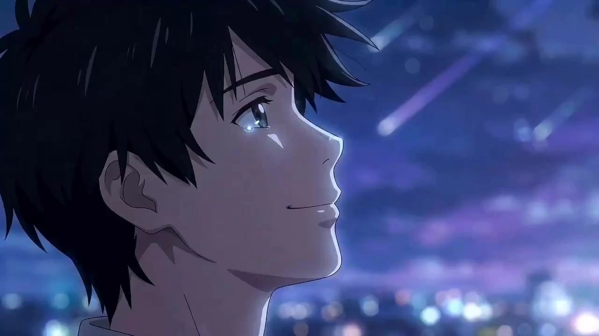

# Shinkai-Inspired Anime Shorts

> **作者：** @Aplus影像

## Content

Process Planning:

Complete Video Pipeline Steps and Tool Orchestration:

Receive user story input and analyze the core story → resource_prepare_and_analyze (extract characters, scenes, emotional curves).

Create Final_Video_Spec.md → text_editor (lock global parameters such as aspect ratio, total duration, visual style, output language, etc., serving as an alignment anchor for all downstream modules). Pause for confirmation.

Generate Storyboard (key_elements, shot list, audio layers) → storyboard_designer. Pause for confirmation.

Scan existing assets provided by the user or already generated in the current context, and bind matching resources to the corresponding slots in the Storyboard → media_generator.

Generate all element images (characters, scenes, props) → media_generator.

Generate keyframe fusion images → media_generator. Pause for confirmation.

Generate final video shot-by-shot → media_generator.

Generate voiceover (VO) → media_generator.

Generate BGM → media_generator.

Final compositing and export → video_assembler.

Dependencies: 1→2→3→4→5→6→7; 8 and 9 can be performed in parallel after 7; 10 depends on the completion of 7, 8, and 9. Pause Nodes: Pause after the completion of steps 2, 3, and 6 to confirm before proceeding to subsequent steps.

Asset Analysis:

Story Analysis Rules

Extract the following content:

Characters

Name, Age, Identity/Role, Appearance, Personality

Scenes

Location, Time, Weather, Mood

Key Elements

For example: Umbrella, mobile phone, letter, train ticket, necklace

Emotional Curve

For example: Meeting → Companionship → Separation → Reunion

Core Elements of Shinkai Makoto Style
Core Themes

Growth, distance, time, regret, longing, reunion, choices, destiny

Visual Keywords

Makoto Shinkai, Japanese Animation, Beautiful Sky, Cinematic Anime, Emotional Storytelling, Weather Driven Atmosphere, Volumetric Light, Ultra Detailed Background, Anime Film Frame, Masterpiece, 4K

Storyboard Design:

Color System
Clear Sky Series

Primary: Sky Blue | Secondary: Cloud White | Accent: Sunshine Gold | Mood: Hope, Youth, Future

Twilight Series

Primary: Orange Gold | Secondary: Magenta | Accent: Deep Blue | Mood: Regret, Nostalgia, Farewell

Rainy Day Series

Primary: Blue-Gray | Secondary: Misty White | Accent: Warm Neon | Mood: Loneliness, Longing, Waiting

Night Scene Series

Primary: Deep Blue | Secondary: Moonlight White | Accent: Urban Light Orange | Mood: Dream, Sense of Distance, Hope

Weather System (Highest Priority)

S Rank: Twilight, Meteor, Sea of Clouds, Starry Sky, Clearing after Rain

A Rank: Heavy Rain, Sunset Glow, Snowy Landscape, Dawn

B Rank: Overcast, Sunny, Breeze

Scene System

A Urban Scenes: Tokyo streets, commercial streets, pedestrian bridges, train stations, crossroads

B School Scenes: Classrooms, playgrounds, libraries, rooftops, hallways

C Nature Scenes: Seaside, shrines, mountain roads, forests, riverbanks

D Rain Scenes: Parks, pavilions, bus stops, outside convenience stores

E Twilight Scenes: Routes home from school, railway crossings, riverbanks, bridges

F Night Scenes: City night views, high-rise rooftops, illuminated districts, train stations

Light and Shadow Rules (Must be present in every shot)

Main Light Source: Sunset, moonlight, streetlights, sunlight, etc.

Secondary Light Source: Reflected light, window light, city lights, etc.

Ambient Light: Sky diffuse reflection, aerial perspective, volumetric light, etc.

Camera Language

M01 Wind Shot: Hair fluttering, clothes swaying, leaves shaking

M02 Cloud Shot: Fixed camera, flowing clouds

M03 Train Shot: Passing train, still character

M04 Sky Gaze: Emphasizing the sky, emphasizing the light

M05 Raindrop Shot: Raindrops, puddles, ripples

M06 Backlit Shot: Volumetric light, lens flare, light penetration

M07 Flashback Shot: Slow motion, soft light, low contrast

M08 Walking Shot: Character from behind, urban environment, slow movement

M09 Running Shot: Chasing, searching, reunion, climactic emotion

Character Design

Age Range: 14–25 years old

Appearance Principles: Ordinary people, realism, natural, lifestyle-oriented

Common Roles: Students, office workers, photographers, cafe staff, freelancers, travelers

Shot List Generation

Each shot includes: Scene, Character, Action, Camera Movement, Weather, Light, Mood, Duration. Default 5–8 seconds.

Media Generation:

Element Image Generation

Use TextToImage, recommended model Nano Banana Pro (Gemini 3 Pro Image), resolution 2K.

Character Image: Full body, cinematic still, animated film style, non-three-view (non-orthographic)

Scene Image: High-precision background, animated film-level art, realistic environment

Prop Image: High detail, emotional objects, cinematic texture

After generating the element images, they must be registered via asset_id and bound to the corresponding key_element (element character / element scene / element prop) in the Storyboard.

Video Generation

Use MultiModalToVideo, recommended model Seedance 2.0, resolution 720p.

Reference input for each shot:

All element images involved in the shot (character images, scene images, prop images)

Keyframes (if any)

Optional: Video of the previous shot (use only when there is high continuity between consecutive shots)

Unified style keywords: Makoto Shinkai Animated Film, Beautiful Sky, Volumetric Light, Cinematic Anime Lighting, Emotional Atmosphere, Ultra Detailed Background, Masterpiece

BGM Direction

Use text_to_instrumental, recommended model Suno 5.

5 Centimeters Per Second style: Piano solo

The Garden of Words style: Piano with ambient sound

Your Name style: Piano with strings

Weathering With You style: Piano with electronic elements

Suzume style: Piano with chanting

Prompt Writing:

Narration Style

First-person perspective, young adult literature style, restrained expression, slightly melancholy.

Example: I once thought it was just an ordinary twilight. Until many years later, I still remember the sky that day.

Video Editing:

Compositing Rules

Track 1: Video

Track 2: Voiceover

Track 3: BGM

Default: Hard cut. Between chapters: Fade in/fade out. Prohibited: Hardcoded subtitles, exaggerated transitions, 3D effects, excessive filters.

Final Output: Cinematic Shinkai Makoto style animated short film.
