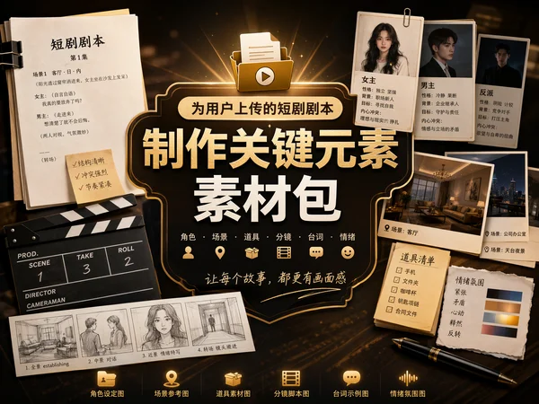

# Short Drama Preproduction Visual Kit

> **作者：** @Damon

## Content

Process Planning:

Full Process Stages and Dependencies:

Read the user-uploaded script or Shot List script → resource_prepare_and_analyze, extract the list of characters/scenes/props and shot drafts, and prioritize extracting visual style anchors.

【Conditional Pause: Visual Style Confirmation】

If the script has clear style direction, proceed directly to Step 3.

If the script does not specify a visual style, must pause here, ask the user, and recommend 3-4 style directions. Recommendations must include: style name, one-sentence description, recommended reason (explain why it suits this project based on script genre/characters/tone), and representative visual keywords. Example styles (actual recommendations must be dynamically generated based on script content, do not use a fixed list every time):

Cinematic Realism (cinematic realism) — Suitable for urban/workplace/emotional themes, close to mainstream media aesthetics, good balance of production cost and quality;

Vintage Film Grain (vintage film grain) — Suitable for period pieces/nostalgic narratives, warm yellow/faded tones, strong emotional weight;

Cold Desaturated Thriller (cold desaturated thriller) — Suitable for thriller/crime/psychological themes, low-saturation cold tones, enhances oppression and unease;

Ink Wash / Wuxia (ink wash / wuxia) — Suitable for ancient/martial arts/fantasy themes, ink-wash texture, high Oriental aesthetic recognition.

Present 3-4 style options using an interactive menu (cards), each including style name and keywords; also provide a "Custom Style" option; wait for explicit user selection before continuing to Step 3.

【Milestone Pause: Asset Language Mode Confirmation】 Before establishing the global spec file, ask the user for the text language preference for all image assets in this asset package (design cards, reference images, PPT atlases, etc.) via an interactive menu (cards). Options are as follows:

Chinese Version: All image-embedded text (annotations, labels, titles, relationship lines, beat labels, etc.) must use Chinese;

English Version: All image-embedded text must use English;

Chinese-English Mixed Version: Chinese as primary titles and key annotations, English as supplementary explanations and style tags.
Wait for explicit user selection before continuing; write the confirmation result into the Final_Video_Spec.md below as the "Asset Language Mode" field. All subsequent image generation prompts will be based on this.
Use text_editor to create Final_Video_Spec.md, locking global parameters: Aspect Ratio (prioritize reading the aspect ratio specified in the script/Shot List script, e.g., 9:16, 2.35:1, etc.; if not specified, default to 16:9), resolution 720p, project language, Asset Language Mode (user-confirmed result above); write the visual style anchors confirmed in Step 1 or Step 2, and all subsequent element asset images and prompts must be based on this, and must not contradict the visual style in Final_Video_Spec.md. Concept sample video generation and timeline assembly are based on the aspect ratio locked in Final_Video_Spec.md.

【Milestone Pause: Shot Selection Confirmation】 Based on the script analysis, screen 3-5 shots from the full script draft that best represent visual style and narrative rhythm as concept sample candidates. Use an interactive menu to display a brief description of the scene/content and the reason for selection for each candidate shot; wait for explicit user confirmation before continuing.

Design the Storyboard based on the confirmed shot selection plan: Create shot entries only for the selected 3-5 shots, while also establishing the Key Elements (characters/scenes/props) actually involved in these shots, and plan cross-shot Audio Layers → storyboard_designer. Do not create shot entries or Storyboard designs for the remaining unselected shots in the script.

【Milestone Pause】 Show the Storyboard draft (element list + selected shot list) to the user. Use an interactive menu (cards) to provide options like "Confirm, continue to next step", "Modify elements", "Modify shots", etc., and wait for explicit user confirmation before continuing.

Use text_editor to format the selected shot information from the Storyboard into a standard Shot List script table (Columns: Shot Number / Scene / Shot Size / Core Action / Dialogue / Suggested Duration), and save it as a project document for production reference.

Generate element asset images (character design cards, scene reference images, prop reference images) → media_generator; bind images to corresponding Key Elements. Simultaneously, use TextToSpeech to generate 5-10s short voice samples for each main character as key_element_audio, and bind them to the corresponding character Key Elements → media_generator.

【Milestone Pause】 Display all element asset images. Use an interactive menu (cards) to provide options like "Confirm, continue to next step", "Modify a specific image", "Regenerate all", etc., and wait for explicit user confirmation before continuing.

Generate extended asset package images → media_generator:

Generate Keyframe Contact Sheets (3×3 grid) for shots marked with keyframe_grid: true in the Storyboard;

Generate multi-angle composition matrices for scene elements requiring multi-angle reference;

Generate detailed close-ups for important props;

If the project has multiple main characters, generate a character comparison chart;

Generate a color/grading reference board for the entire film (includes color block matrix, color grading keywords, reference screenshot illustrations);

Generate costume/styling detail boards for each main outfit (fabric texture close-ups + accessory breakdown);

Generate scene mood boards for each main scene (combined multi-lighting/time-of-day reference images);

Generate makeup/hair reference boards for each main character (hair three-view + makeup tone reference);

If the project involves multiple main characters, generate a character relationship map (using character avatars as nodes, labeling relationship types and descriptions);

Generate 1-2 concept images for opening title styles (title font + background style + atmospheric tone);

Generate 1-2 vertical concept images for promotional posters/Key Visuals (protagonist image + title text + core emotional atmosphere);

Generate 2-4 transition/special effect style reference images (illustrating transition rhythm and color grading effects);

Generate visual state variant images for key characters (injured/tired/formal/casual, etc.), supplementing state references beyond the design cards;

Generate an emotional arc and tone arc overview chart (horizontal timeline showing the progression from setup→development→turning point→climax), integrated with the color/grading reference board as a complete tonal narrative reference system.

【Milestone Pause】 Confirm extended asset package images. Use an interactive menu (cards) to provide options like "Confirm, continue to next step", "Modify a specific category of images", "Supplementary generation", etc., and wait for explicit user confirmation before continuing.

Generate execution documents and sound samples:

Use text_editor to extract and organize all lines for each character from the script, categorized by scene/shot order, and output a Character Dialogue Script document, saved as a project document for actors and voice directors;

Use text_editor to output Character Biographies documents for each main character (family background/core motivations/key turning points), saved as project documents;

Use text_editor to output Location Scouting Lists for each main scene (set requirements/lighting plan/floor & wall materials/special props/shooting precautions), saved as project documents;

Use text_editor to integrate color/grading reference boards, scene mood boards, costume tones, and lighting standards, and output a complete Visual Style Guide, unifying execution standards for pre-production/shooting/post-production, and save as a project document;

Based on key action nodes marked in the Storyboard shots, generate Ambient Sound/SFX samples individually for each type of sound event → media_generator (MultiModalToAudio), registering only the asset_id for audio designer reference; these are not bound to Audio Layers and not used for concept sample assembly.

Integrate all confirmed asset package images, combined with the execution document content generated in the previous step, to generate a PPT Presentation Deck (can be directly used for pre-production proposals/creative communication PPTs) → media_generator; output the following 10 pages fixed (16:9, 2K), with specific tools and model parameters determined by the media_generator block:

Cover Page: Title + Key Visual + Core tone;

Character Lineup Page: Summary of main character design cards side-by-side, including character names and temperament keywords;

Scene Overview Page: Composite of main scene reference images, including scene names and time-of-day markers;

Visual Style & Color System Page: Summary of color/grading reference board + grading keywords, style consistent with Final_Video_Spec.md;

Shot List Summary Page: List of shot size/cinematography language/suggested duration summary for selected shots, with keyframe contact sheet frames displayed side-by-side;

Character Relationship & Emotional Arc Overview Page: Character relationship map + emotional/tonal arc overview combined into a single page;

Character Biography Summary Page: Using generated character design card images as reference input, horizontal card layout, each character card includes avatar thumbnail + name + core motivation + key turning point (one sentence each), editorial style, clean white background;

Visual Style Guide Summary Page: Using representative scene reference images and color/grading reference board as reference input, single overview image, includes style keywords (3-5) + color palette summary (main/secondary/accent color blocks) + lighting benchmark description + one-sentence description of color grading style, editorial style, clean white background;

Costume & Prop Summary Page: Using main costume/styling detail boards and important prop reference images as reference input, grid layout, each cell includes costume/prop name and material keywords, covering main visual objects in the film for quick verification by wardrobe and art departments;

Audio Direction Page: Generated text-driven, presented in an editorial text/image mixed layout covering the entire film's audio execution direction: BGM emotional tone (style keywords + instrument preferences), ambient sound/SFX list, character voice descriptions (temperament keywords for each character), for music directors and voice directors to quickly align on the creative direction; registered as asset_id only, not bound to Storyboard slots, not used for sample assembly.

【Milestone Pause】 Display PPT deck. Use an interactive menu (cards) to provide options like "Confirm, continue to next step", "Modify a specific page", "Regenerate full set", etc., and wait for explicit user confirmation before continuing.

Audio Direction Page: Generated text-driven (TextToImage / GPT Image 2), presented in an editorial text/image mixed layout covering the entire film's audio execution direction: BGM emotional tone (style keywords + instrument preferences), ambient sound/SFX list, character voice descriptions (temperament keywords for each character), for music directors and voice directors to quickly align on the creative direction;
After generation, register asset_id only, do not bind to Storyboard slots, do not use for sample assembly.

【Milestone Pause】 Display PPT deck. Use an interactive menu (cards) to provide options like "Confirm, continue to next step", "Modify a specific page", "Regenerate full set", etc., and wait for explicit user confirmation before continuing.

Generate video for each selected shot, referencing the Key Elements images (character design cards + scene images + prop images) involved in the shot as reference_image → media_generator (no need to bind key_element_audio, concept sample does not do character dialogue dubbing).

Based on the Storyboard BGM Audio Layer description, use text_to_instrumental to generate: (1) Main BGM, duration aligned with the expected total duration of the concept sample; (2) One short (15-30s) style sample for each of the three emotional segments (buildup, transition, climax) → media_generator.

【Conditional Step】 If a narration-type audio layer is designed in the Storyboard, use TextToSpeech to generate narration audio based on the narration layer description (narration_speaker_profile + full text) and register the asset_id, binding it to the corresponding narration Audio Layer → media_generator; if there is no narration layer, skip this step. This step runs in parallel with Step 16 and does not depend on BGM completion.

Assemble concept sample timeline and export → video_assembler (must wait for completion of steps 15 and 16; if there is a narration layer, also wait for step 17 to complete).

【Delivery Summary】 After the concept sample export is complete, must present the full delivery list to the user, listing all deliverables of this asset package by category using an interactive menu (cards), specifically including:

Image Assets: Character design cards, scene reference images, prop reference images, prop detail close-ups, character comparison charts, keyframe contact sheets/multi-angle composition matrices, color/grading reference boards, scene mood boards, costume/styling detail boards, makeup/hair reference boards, character relationship maps, promotional posters/Key Visuals, opening title style concept images, transition/special effect reference images, character visual state variants, emotional arc and tone arc overview charts;

PPT Deck: Cover page, character lineup page, scene overview page, visual style & color system page, Shot List summary page, character relationship & emotional arc overview page, character biography summary page, visual style guide summary page, costume & prop summary page, audio direction page (10 pages total);

Audio Assets: Character voice samples (key_element_audio), main BGM and emotional segment samples, ambient sound/SFX samples, narration audio (as needed);

Video Assets: Concept sample (3-5 shots, aspect ratio as per Final_Video_Spec.md / 720p);

Execution Documents: Shot List table, character dialogue script, character biographies, location scouting lists, Visual Style Guide.
Explicitly inform the user that the entire pre-production asset package has been generated, and provide options like "View/Export all documents", "Modify a category of assets", "End current production", etc., to prevent the user from mistakenly treating the concept sample export as the end of the process and ignoring other generated assets.

Existing Asset Handling: If the user has already uploaded reference images/audio for corresponding elements, first register the asset_id via media_generator and bind it to the corresponding Storyboard slot, then skip the corresponding generation step.

Dependencies: 3→1,2; 5→3,4; 7→5,6; 8→5,6; 10→8,9; 12→10,11; 13→8,9,12; 14→13; 15→8,9; 16→5,6; 17(conditional)→5,6; 18→15,16,17.

Pause Principle: After steps 2 (conditional trigger), 4 (shot selection confirmation), 6, 9, 11, 14, you must pause and wait for explicit user confirmation before continuing; do not run the entire process in one go. All pauses and confirmation points must present options via interactive menu (cards); using only text to ask and waiting for free-text input is prohibited; each menu must include at least "Confirm, continue to next step" and "Need modification" options, and add other specific operation options based on the context (such as style direction selection, shot selection confirmation, etc.).

Asset Analysis:

Script/Shot List Analysis Task:

Analyze the uploaded script or shot list to output structured information for immediate use by the Storyboard Designer:

Visual Style Anchor (High Priority): Extract explicit or implicit visual style descriptions—art style references (e.g., "vintage film," "cyberpunk neon," "traditional ink wash"), texture, color palette, lighting preferences, and cinematography traits. If unspecified, note "Unspecified, suggest realistic style for commercial shorts." If specified, list keywords for the Planner to include in Final_Video_Spec.md as global visual anchors.

Character List: Name, profession, age/appearance (hair, features, build), temperament keywords, primary clothing colors, and iconic visual traits for each character.

Scene List: Name, interior/exterior status, time of day, spatial layout/background elements, surface materials, lighting direction/quality, and 3-6 visual anchor keywords (e.g., constant tones, props, core light sources, weather/materials) to maintain consistency across shots.

Prop List: Key item names, material/form/color, and associated scene or character.

Plot Summary: One-sentence theme + four-beat emotional arc (Setup/Rising Action/Turning Point/Climax).

Shot Draft: List shots in narrative order: sequence number, scene, suggested shot type (ELS/LS/MLS/MS/MCU/CU/ECU/Low Angle/High Angle), core action beat, and suggested duration (seconds).

Storyboard Design:

Design Key Elements

Characters (element character): Create a separate key_element for each character. Include: name, occupation, age, physical appearance (hairstyle/hair color/facial features/body type), temperament keywords, and clothing (primary colors + materials + signature style features). If a character has multiple looks or ages, list them as Look 1/Look 2 to ensure consistency across shots.

Scenes (element scene): Create a key_element for each major scene. Include: space type (indoor/outdoor), layout and background elements, floor/wall materials, light direction and quality (hard/soft; key/fill/rim light), time of day, and 3-6 visual anchor keywords.

Props: Create a key_element for important props, describing their material, form, color, and associated scene/character.

User Assets: If the user uploads reference images, the key_element description must align with the image content and not contradict it.

Design Shots

Each shot description must include:

Scene: Reference the corresponding element ID (e.g., [Element_Office_Night]);

Story Beat: Character actions, expressions, and interaction details; write out complete dialogue text (for future audio generation);

Cinematography: Shot size (ELS/LS/MLS/MS/MCU/CU/ECU/low-angle/high-angle/insert shot), lens angle, camera movement (dolly in/out/pan/tilt/crane/static/handheld shake), and focal length preference (18/24/35/50/85mm).

Dynamic Shot Duration Planning: Set suggested durations based on narrative pacing rather than fixed intervals. Design longer shots of 10-15s for intense plot/high emotion moments (including internal cut beats) to utilize the Seedance 2.0 multi-segment generation capability. Fast-paced or functional transition shots can be 4-6s. Hard constraint: Minimum 4s, maximum 15s per shot (model limit); all suggested durations must stay within this range.

Mark shots requiring a keyframe grid (keyframe_grid: true) and scenes needing a multi-angle composition matrix (multi_angle: true).

Design Cross-Shot Audio Layers

Plan at least one BGM audio layer (type: music) covering the entire film or major segments.

If narration drives the plot, design a separate narration layer (type: narration), defining the narration_speaker_profile, tone/style, and complete script. Keep narration and dialogue on separate tracks to avoid overlap.

Media Generation:

Asset Image Generation

Using TextToImage, specify model GPT Image 2, resolution 2K:

Character Reference Sheet: aspect_ratio = 3:4 (vertical character profile page);

Scene Reference Image: aspect_ratio = 16:9;

Prop Reference Image: Select 1:1 or 16:9 based on the object's form.

If the user has already uploaded a reference image for the element, directly register the asset_id and bind it to the corresponding key_element, skipping the generation step for that element.

Prop Detail Close-ups

Using ImageToImage, specify model GPT Image 2, resolution 2K, aspect_ratio = 1:1:

Use the corresponding prop key_element image as image_ids input;

Generate 2-4 close-ups per prop (texture/material/structural details), focusing on props significant to the plot;

Do not generate irrelevant characters or scenes; use a minimalist or solid-colored background.

Character Comparison Sheet (Multi-character horizontal layout)

Using ImageToImage, specify model GPT Image 2, resolution 2K, aspect_ratio = 16:9:

Use the primary character reference sheet images as image_ids input;

Output a horizontal layout of multiple characters standing side-by-side, unified by background, lighting, and scale to clearly show differences in build, attire, and demeanor;

Suitable for projects with multiple main characters; skip for single-character projects.

Keyframe Contact Sheet & Multi-Angle Composition Matrix (Composite Panel)

Using ImageToImage, specify model GPT Image 2, resolution 2K:

Use the key_element images (character/scene/prop) for the corresponding shot as image_ids input;

Keyframe Contact Sheet: Generate a 3x3 grid including KF ID, shot type, and suggested duration;

Multi-Angle Composition Matrix: Generate a standard 9-shot matrix (ELS/LS/MLS/MS/MCU/CU/ECU/Low Angle/High Angle);

After generation, only register the asset_id for pre-production reference; do not bind to any Storyboard slot (these composite references are visual documents, not executable shot or element assets).

Character Voice Sample Generation (key_element_audio)

Using TextToSpeech, generate 5-10s short voice samples for each main character:

Select a matching voice based on character profile (gender, age, temperament keywords);

Reading content can be taken from script lines or neutral short sentences; the goal is to establish a voice fingerprint, semantic completeness is not required;

After generation, register the asset_id and bind it to the corresponding character key_element as key_element_audio for reuse in subsequent video generation;

Do not invoke this audio during the concept trailer stage.

Color/Grading Reference Board

Using ImageToImage, specify model GPT Image 2, resolution 2K, aspect_ratio = 16:9:

Use main character reference sheets and representative scene images as image_ids input (1-2 images that best embody the style);

Output a color/grading overview for the entire film: includes a color swatch matrix (primary/secondary/accent colors), color keyword tags, low-saturation reference frame examples, and a description of overall grading style;

The palette and visual style must align with the visual tone defined in Final_Video_Spec.md; generate only one for the entire film, do not break down by scene.

Clothing/Styling Detail Board

Using ImageToImage, specify model GPT Image 2, resolution 2K, aspect_ratio = 3:4:

Use the corresponding character reference sheet as image_ids input;

Generate a separate detail board for each primary outfit: includes close-ups of fabric textures (weave/leather/metal hardware), component breakdown (belt/collar/cuffs/accessories/shoes), and color swatch comparison;

Minimalist white background, focusing on material and structural details, without needing to show the full body.

Scene Mood Board

Using ImageToImage, specify model GPT Image 2, resolution 2K, aspect_ratio = 16:9:

Use all generated reference images for the corresponding scene as image_ids input;

Output a multi-panel mood reference page: combine visual representations of the same scene under different lighting (day/dusk/night) or emotional atmospheres into a 2x2 or 3x2 grid;

Annotate each cell with time points and mood keywords; maintain consistency in the color family for the scene, showing lighting variations rather than content changes.

Hair & Makeup Reference Board

Using ImageToImage, specify model GPT Image 2, resolution 2K, aspect_ratio = 3:4:

Use the corresponding character reference sheet as image_ids input;

Generate one for each main character: includes hairstyle from three angles (front/side/back) + hair color swatches + makeup tone breakdown (base/blush/lip/eyeshadow layering);

Minimalist white background, focusing on the head and neck/shoulder area, without needing full body.

Character Relationship Map

Using ImageToImage, specify model GPT Image 2, resolution 2K, aspect_ratio = 16:9:

Use all main character reference sheets as image_ids input;

Output a relationship network diagram with character avatars as nodes: each node includes name + job title + avatar thumbnail; nodes are connected by labeled lines indicating relationship type (family/rivals/allies/lovers/competitors/hidden connection, etc.); include a brief summary (1-2 sentences) next to the line;

Clean layout, editorial style, white or very light neutral background;

Suitable for multi-character projects; skip for single-character projects.

Promotional Poster/Key Visual Concept

Using ImageToImage, specify model GPT Image 2, resolution 2K, aspect_ratio = 2:3 (vertical poster):

Use primary character reference sheets as image_ids input (take 1-2 most important protagonists);

Generate 1-2 images, each representing a visual direction (e.g., minimalist mood poster / dynamic scene composite poster);

Must include placeholder title text (project title), protagonist image, and core emotional atmosphere;

Style must align with Final_Video_Spec.md visual tone; no extra characters or cluttered scene elements.

Transition/VFX Style Reference

Using TextToImage, specify model GPT Image 2, resolution 2K, aspect_ratio = 16:9:

Generate 2-4 images, each illustrating a transition or grading effect direction (e.g., dissolve/flash cut/jump cut/color shift);

Each image must demonstrate the visual characteristics of the effect (motion blur, light bloom, color separation, etc.) and overall grading effect;

Reference the tone of representative scenes to maintain consistency with the film's overall visual style;

For post-production editing reference only; do not write as executable parameters into the video timeline.

Character Visual State Variants

Using ImageToImage, specify model GPT Image 2, resolution 2K, aspect_ratio = 3:4:

Use the corresponding character reference sheet as image_ids input;

Generate only for key characters with distinct state changes (e.g., injured/extremely exhausted/formal attire/casual wear); skip supporting characters without obvious appearance changes;

Each image focuses on one state change, clearly presenting changes in clothing, hair, makeup, or body (e.g., wounds/messy hair/outfit change); maintain strict consistency in facial features with the reference sheet;

Minimalist background or a low-saturation blurred background matching the scene tone.

Emotional & Tonal Arc Overview

Using ImageToImage, specify model GPT Image 2, resolution 2K, aspect_ratio = 16:9:

Use main character reference sheets and representative scene images as image_ids input (take 1-2 images that best embody overall style); share the same input set as the Color/Grading Reference Board as an extension of tonal narrative;

Output a horizontal timeline-style tonal narrative overview: arranged left-to-right by the four narrative beats (Setup/Exposition/Turning Point/Climax); each section corresponds to a color swatch matrix + emotional keywords + representative low-saturation frame samples, with gradient transition arrows between blocks to visualize tonal evolution;

Editorial style layout, clean white space, annotated with project title and four-beat labels at the top;

Tonal evolution must align with Final_Video_Spec.md and the color reference board; do not design in isolation.

Opening Title Style Concept

Using TextToImage, specify model GPT Image 2, resolution 2K, aspect_ratio = 16:9:

Generate 1-2 concept images, each representing a title sequence style (e.g., minimalist black background with white text / atmospheric bloom title / dynamic texture background title);

Each image must include placeholder title text (project title or working title), background atmospheric treatment, and overall color tone direction;

Style must align with Final_Video_Spec.md visual tone; no characters or scene content.

Ambient/Sound Effect Samples

Using MultiModalToAudio, no image/audio reference input, driven by text description only:

Identify sound events requiring sound effects based on key action nodes noted in the Storyboard (e.g., rain ambience, mechanical door lock, glass shattering, footsteps, crowd noise, specific scene atmosphere);

Generate a sample (5-15s) for each type of sound effect; text description must include: sound source type, environmental spatial sense (indoor/outdoor/spacious/confined), emotional tone (tense/calm/oppressive/light), and distinct audio details;

After generation, only register the asset_id for the audio designer's reference; do not bind to audio_layer or use in concept trailer assembly.

BGM Generation

Using text_to_instrumental:

Style description based on the Storyboard BGM audio layer description, including emotional tone (e.g., suspenseful / romantic / tense), instrumentation preference (e.g., orchestral strings / electronic hybrid), and rhythm (e.g., moderate tempo / building intensity);

Main BGM: Set duration to the estimated total duration of the concept trailer (usually 30-60s); round up if the model has a minimum duration requirement; after generation, bind to the Storyboard's corresponding BGM audio_layer;

Emotional Segment Style Samples: Generate one segment (15-30s) for each of the three emotional beats (Setup, Turning Point, Climax), adjusting the emotional tone based on a common instrumental foundation (setup: softer, turning point: tenser, climax: more intense); only register the asset_id for reference; do not bind to audio_layer or use in assembly.

Narration Audio Generation (On-demand)

Execute only if a narration-type audio layer exists in the Storyboard; otherwise, skip:

Using TextToSpeech, select a matching voice based on the narration layer's narration_speaker_profile (gender, voice style, speaking rate, emotional tone);

Reading content taken from the complete narration script; generate paragraph by paragraph (if the narration layer has multiple segments, generate and register each asset_id separately);

After generation, bind to the corresponding narration audio_layer in the Storyboard;

Narration and BGM should be on separate tracks; do not merge into a single audio file.

Shot Video Generation (Concept Trailer)

Using MultiModalToVideo, specify Seedance 2.0, aspect_ratio and resolution = 720p, reading the frame locked in Final_Video_Spec.md (default 16:9, unless specified otherwise in the script), duration based on shot design (4s-15s):

Generate video only for the 3-5 representative shots selected by the Planner; do not batch generate for all Storyboard shots;

image_infos cite all key_element images involved in the shot (character reference sheet + scene image + prop image);

Only add the previous shot's video as a reference in video_infos if visual continuity with the previous shot is extremely strong; typically, do not add video references;

No character dialogue dubbing for the concept trailer; do not bind key_element_audio; BGM is handled on a separate track; do not describe background music in the prompt during video generation.

Failure Handling: Stop the task if all models within the same tool fail; do not silently switch across tools. Clearly report the failure reason to the user and ask if they wish to switch tools.

Prompt Writing:

Highest Priority (Global): When the user interacts in Chinese, the main prompt body must be written in Chinese; dialogue/voiceover content must follow the language specified in Final_Video_Spec.md.

Embedded Image Text Language (Global): All readable text appearing in generated images—including but not limited to titles, character names, annotations, tags, timestamps, beat labels, color block labels, relationship connectors, etc.—must strictly follow the asset language mode locked in Final_Video_Spec.md:

Chinese Version: All readable text must be in Chinese.

English Version: All readable text must be in English.

Mixed Version: Main titles and key annotations use Chinese; supplementary explanations and style tags use English.

Style tags, model parameters, etc., that appear only in the prompt itself and are not embedded in the image are not subject to this rule. If the prompt involves text to be embedded, the specific content must be explicitly written out (in the corresponding language) rather than leaving the language selection to the model.

Proper Noun Exception Principle: The asset language mode only restricts "descriptive text" (annotations, categories, relationship descriptions, timestamps, beat labels, layout titles, etc.). Proper nouns—including character names, prop names, and scene names—must strictly follow the original spelling from the script/storyboard and should not be forcibly translated or transliterated due to language mode. Example: If the character name is "Alex", even in the Chinese version, the set card should say "Alex", while annotations (profession, trait keywords) should be in Chinese.

Visual Style Priority (Global): All image generation style tags must follow the visual style locked in Final_Video_Spec.md. If the script specifies a specific art style (e.g., historical ink wash, cyberpunk, film vintage, etc.), style tags must be replaced with the corresponding descriptive system and should not use the default commercial short drama realism tags below; if not specified by the script, use the following default tags.

Character Profile Card (TextToImage / GPT Image 2, 3:4 Vertical)

Prompt construction order:

Page Type Declaration: High-end character profile page, magazine-grade editorial layout, clean white background, exquisite serif typography, official character design sheet style;

Character Identity: Name + Profession + Age + Physical features (hair style/color/facial features/body type) + Trait keywords + Clothing main color and material;

Layout Structure (List in order): Top large character name title + One-line character slogan → Center: Three-view (front/side/back, same character, high consistency) → Right: 6 expression avatars (calm/smile/wink/serious/surprised/thinking) → Left: Character base info column → Bottom: (clothing breakdown/accessory breakdown/partial detail close-up/color palette/bio/keywords);

Style Tags: cinematic live-action character concept art, photorealistic skin texture, physically accurate fabric and material rendering, studio-grade three-point lighting, subsurface scattering on skin, sharp fabric weave detail, film-quality color grading, premium editorial layout, clean white background, thin grid lines, sharp details, minimalist, sophisticated, collectible character sheet;

Negative Constraints: no anime line art, no cel shading, no cartoon stylization, no illustrated look, no cluttered background, no extra characters, no extra limbs, no deformed face, no inconsistent costume, no low quality, no oversaturation, no chibi, no cheap cartoon poster style.

Scene Reference Image (TextToImage / GPT Image 2, 16:9)

Prompt construction order:

Space Description: Space type (indoor/outdoor) + Layout and background elements + Floor/wall materials;

Lighting Scheme: Mixed natural and artificial light (e.g., diffused window light + warm desk lamp fill; street sodium light + blue sky ambient light); clear main light direction and light quality (hard/soft); choose between warm-cool contrast or low-contrast warm tone, avoid flat lighting;

Time and Atmosphere Keywords: Time (day/dusk/night) + 3-6 atmosphere keywords;

Style Tags: cinematic realism, Chinese commercial drama aesthetic, mixed natural and practical lighting, warm-cool color contrast or low-contrast warm tone, clean color grading without over-processing, photorealistic environment, subtle film grain, domestic streaming platform visual style, shallow to medium depth of field, no heavy LUT, no oversaturated colors;

Negative Constraints: no anime background, no game rendering style, no overly stylized color grade, no heavy vignette, no blown highlights, no muddy shadows, no cluttered foreground.

Prop Reference Image (TextToImage / GPT Image 2)

Prompt construction order:

Prop Subject Description: Prop name + Material (metal/leather/fabric/wood/glass, etc.) + Color/tone + Form/size + Surface texture/gloss/wear + Iconic visual features (engraving/print/parts structure, etc.);

Composition: Prop centered or using rule of thirds to fill the frame; important structural faces (front/top/main operating surface) facing the lens; perspective tilted at 45° (product shot standard angle) to show main face and depth/dimensionality;

Background: Prioritize pure white or minimal neutral gradient background (light gray/matte off-white) to ensure a clear silhouette; if the prop has strong scene attribution (e.g., antique/weapon/specific cultural item), a low-saturation blurred background matching its scene tone can be used;

Lighting Scheme: Studio-grade three-point lighting (main light 45° hard/soft; fill light to reduce contrast; rim light to outline details); metal/glass props use highlights and Fresnel edge lighting; fabric/leather props emphasize subsurface scattering and weave/texture details;

Style Tags: product photography, studio lighting, photorealistic material rendering, sharp focus on surface detail, physically accurate reflection and refraction, subsurface scattering for organic materials, clean neutral background, commercial catalog quality, no heavy post-processing;

Negative Constraints: no humans, no hands, no distracting background, no extra objects, no motion blur, no overexposed highlights, no flat lighting, no cartoon rendering, no low resolution.

Prop Detail Close-up (ImageToImage / GPT Image 2, 1:1)

Reference Format: <<<image_1>>> as the reference for the prop;

Explicitly specify the close-up area (e.g., surface texture/lock structure/engraving details), each image describes a single focus point;

Style Tags: macro photography, studio lighting, sharp focus, photorealistic material detail, clean background;

Negative Constraints: no hands, no humans, no distracting background.

Character Comparison Chart (ImageToImage / GPT Image 2, 16:9 Landscape)

Reference Format: <<<image_1>>>, <<<image_2>>>... in order for each character profile card;

Output Declaration: Landscape multi-character full-body side-by-side comparison chart, uniform white or neutral background, same lighting direction, same scale;

Each character must maintain face, hairstyle, and costume strictly consistent with their profile card; even spacing between characters, no overlapping;

Style tags consistent with character profile cards;

Negative Constraints: no overlapping figures, no inconsistent costume, no extra limbs, no background clutter.

Keyframe Contact Sheet / Multi-Angle Composition Matrix (ImageToImage / GPT Image 2, Composite Panel)

Prompt structure:

Reference Input: <<<image_1>>> for character reference, <<<image_2>>> for scene reference (if any);

Output Declaration: 3×3 film shot index page, professional storyboard matrix, each cell clearly marks KF number + shot type + suggested duration in the safe zone;

Nine-Grid Content (in order):

First row (Environment): Extreme Long Shot (ELS) / Long Shot (LS) / Medium Long Shot (MLS);

Second row (Core Coverage): Medium Shot (MS) / Medium Close-Up (MCU) / Close-Up (CU);

Third row (Details & Angles): Extreme Close-Up (ECU) / Low Angle (Worm's Eye) / High Angle (Bird's Eye);

Consistency Requirements: 9 grids maintain same character/costume/environment/lighting; depth of field changes realistically with shot type (close-ups must have background blur); follow axis principle and eye-line match;

Style Tags: realistic texture, cinematic color grading, professional contact sheet, cinematic color grading.

Shot Video Prompt (MultiModalToVideo / Seedance 2.0)

Reference Format: Each character image <<<image_1>>>, <<<image_2>>>, etc., scene/prop images added as needed;

Motion Stack Order: Camera movement (zoom/pan/tilt/dolly/crane/lock) → Subject action (action details + expression beat) → Spatial blocking (movement/blocking/depth of field changes) → Dialogue/Sound (mark dialogue with {original text}, do not rewrite here if there is an independent narration track);

Seedance 2.0 Special Tags: Music (...), sound effects <...>, dialogue {...} (dialogue in non-project language must label the language before the bracket), on-screen subtitles 【...】;

Constant Negative: no music (BGM on independent track), no subtitles (post-processed);

Prompts including all tags must not exceed 2,300 characters.

Color/Grading Reference Board (ImageToImage / GPT Image 2, 16:9)

Reference Format: <<<image_1>>>, <<<image_2>>>... for representative character profile cards and scene reference images;

Output Declaration: Overall color system overview for the series, professional visual development document style, clean white background, editorial typography;

Content Order: Top: Project title → Main color palette area (6-8 color blocks + color values or keyword labels) → Center: Color grading reference frame snapshots (low saturation, realistic tones) → Bottom: Color palette keywords (e.g., warm-neutral base / cool shadow accent / desaturated highlight);

Style Tags: professional color palette reference, film color grading, low-saturation cinematic tone, clean editorial layout, commercial drama visual development;

Negative Constraints: no oversaturated colors, no neon tones, no heavy vignette, no cluttered layout, no characters in frame.

Costume/Style Detail Board (ImageToImage / GPT Image 2, 3:4 Vertical)

Reference Format: <<<image_1>>> for the corresponding character profile card;

Output Declaration: Professional costume detail archive page, for costume/styling department, clean white background;

Content Order: Top: Character name + Costume name title → Main fabric texture close-up area (3-4 partial zoom cells, focusing on weave/texture/gloss/wear details) → Accessory breakdown area (belt/collar/cuffs/shoes/accessories presented one by one, each in an independent cell) → Bottom: Color swatches and material keywords;

Style Tags: fashion editorial, garment detail photography, macro fabric texture, studio lighting, clean white background, commercial catalog quality;

Negative Constraints: no full body portrait, no face, no distracting background, no extra clothing items, no motion blur, no extra hands.

Scene Mood Board (ImageToImage / GPT Image 2, 16:9)

Reference Format: <<<image_1>>>, <<<image_2>>>... for multiple reference images of the same scene;

Output Declaration: Scene mood reference page, grid merging multiple lighting/time periods, professional visual development document style;

Content: 2×2 or 3×2 grid, each cell presents the visual state of the same scene at different times (day/dusk/night) or emotional light tones; bottom-left corner of each cell marks time and atmosphere keywords (e.g., [Sunset Warm Light / melancholic]);

Consistency: All grids share the same scene layout and composition base, only lighting and tone change;

Style Tags: cinematic mood board, visual development reference, consistent environment, professional location survey, Chinese commercial drama lighting;

Negative Constraints: no characters in frame, no inconsistent layout across panels, no heavy post-processing artifacts, no cartoon rendering.

Makeup & Hair Reference Board (ImageToImage / GPT Image 2, 3:4 Vertical)

Reference Format: <<<image_1>>> for the corresponding character profile card;

Output Declaration: Professional makeup/hair reference archive page, for makeup/styling department, clean white background;

Content Order: Top: Character name + Makeup/Hair scheme title → Center: Hairstyle three-view (front/side/back, showing volume, hairline, braiding or bangs details) → Right: Hair color swatch (main color/reflective color/gradient section) → Bottom: Makeup tone breakdown area (foundation shade range / blush blocks / lip color options / eyeshadow layered swatch);

Style Tags: fashion editorial, beauty reference sheet, macro hair and makeup detail, studio lighting, clean white background, professional MUA reference;

Negative Constraints: no full body, no clothing focus, no distracting background, no extra faces, no inconsistent features, no motion blur.

Character Relationship Diagram (ImageToImage / GPT Image 2, 16:9 Landscape)

Reference Format: <<<image_1>>>, <<<image_2>>>... in order for each main character profile card (crop avatar part as node reference);

Output Declaration: Character relationship network diagram, professional film development document style, white or very light neutral background, editorial typography;

Layout: Each character node consists of an avatar thumbnail (circular crop) + character name + job abbreviation; lines between nodes are clear, different relationship types use different line styles or colors (e.g., solid=family, dashed=rival, double=lovers); middle of lines include relationship labels (e.g., "Father-Daughter" "Nemesis" "Secret Ally");

Overall layout is symmetrical and balanced, node spacing is appropriate, no overlapping;

Style Tags: professional character relationship map, clean node diagram, editorial layout, minimalist, film development document;

Negative Constraints: no full body figures, no scene background, no cluttered layout, no overlapping nodes, no extra text blocks.

Opening Title Style Concept Art (TextToImage / GPT Image 2, 16:9)

Prompt construction order:

Layout Declaration: Film/series opening title concept art, for professional visual development finalization;

Title Presentation: Clear title text (use project title) font style (serif/sans-serif/calligraphy/etched), font size ratio, layout position (centered/lower third/left vertical, etc.), contrast between text color and background;

Background Atmosphere: Solid color/gradient/scene blur/texture overlay, consistent with overall visual tone (refer to Final_Video_Spec.md defined visual style);

Overall Tone: Clear main tone range (e.g., dark gold + deep brown background / cool blue + silver-white text / warm orange + black background);

Style Tags: title card concept art, cinematic opening title, film credit sequence style, professional editorial typography, high contrast, premium visual identity;

Negative Constraints: no characters, no scene action, no busy background, no low-quality font rendering, no cluttered layout.

Promotional Poster / Key Visual Concept Art (ImageToImage / GPT Image 2, 2:3 Vertical)

Prompt construction order:

Reference Format: <<<image_1>>> (protagonist profile card); add <<<image_2>>> if there are dual leads;

Layout Declaration: Vertical promotional poster/Key Visual concept art, for commercial short drama distribution visual finalization;

Protagonist Image: Precise description of protagonist posture (standing/close-up/profile/dynamic), emotional state, contrast with background; figure is strictly consistent with the corresponding profile card (face/hair/costume);

Title Layout: Placeholder title text, font style (serif/sans-serif/etched), layout position (upper third / centered / lower third), contrast scheme between text color and background;

Background & Atmosphere: Scene blurred background or abstract ambient base image, highly aligned with the core emotion of the series (suspense/romance/urban/historical, etc.); tones anchored to the visual key defined in Final_Video_Spec.md;

Style Tags: Chinese commercial drama poster, cinematic key visual, professional poster design, high contrast emotional tone, editorial typography, photorealistic character integration, clean composition;

Negative Constraints: no extra characters, no cluttered background, no cartoonish rendering, no low-quality font, no inconsistent costume from character sheet, no overexposed face.

Transition/VFX Style Reference (TextToImage / GPT Image 2, 16:9)

Prompt construction order:

VFX Declaration: Clear transition type (dissolve/jump cut/frame pull/color shift/light leak transition, etc.), each image focuses on one effect;

Visual Characteristics: Describe specific visual representation—e.g., dissolve: "two frames semi-transparently superimposed, 50% opacity in middle frame"; jump cut: "high-contrast exposure transition frame, white or black field flash"; frame pull: "motion blur trails, dynamic trajectory clearly visible";

Color Tone: Specify tone direction based on the overall visual style of the series (consistent with Final_Video_Spec.md);

Composition Reference: Present the transition state between two consecutive scenes/shots, original scene content visible (highly simplified silhouettes of characters or scenes);

Style Tags: film transition reference, post-production visual guide, cinematic color grade, motion blur or exposure effect, professional editing reference frame;

Negative Constraints: no text overlay, no cluttered composition, no unrecognizable abstract noise, no cartoon rendering, no low quality.

Character Visual State Variant (ImageToImage / GPT Image 2, 3:4 Vertical)

Reference Format: <<<image_1>>> for corresponding character profile card;

State Declaration: Clearly specify the state represented (e.g., after injury, extremely exhausted, formal banquet, casual day off, etc.), and list specific appearance changes in this state (e.g., white bandage on left arm, messy hair, deepened dark circles, changed to black suit, etc.);

Face and profile card must be strictly consistent (facial features/hair color/skin tone unchanged), only partial changes related to expression and state are allowed;

Style tags consistent with character profile card (cinematic live-action, photorealistic);

Negative Constraints: no inconsistent face, no extra limbs, no costume inconsistency unrelated to stated state, no background clutter.

Emotion and Color Arc Overview (ImageToImage / GPT Image 2, 16:9)

Reference Format: <<<image_1>>>, <<<image_2>>>... for representative character profile cards and scene reference images (shares input with Color/Grading Reference Board);

Output Declaration: Horizontal timeline-style emotion and tone narrative overview page, professional visual development document style, clean white background, editorial typography;

Content Structure (left to right): Setup → Exposition → Turning Point → Climax, four beat segments each occupying about a quarter of the frame; each segment includes: beat label (e.g., "Setup") + 3-4 color blocks (corresponding main tones for that beat) + emotion keywords (2-3) + low-saturation representative frame snapshot (highly simplified composition); segments connected by gradient transition arrows, intuitively showing tone evolution direction;

Top marks project title, bottom can include a one-sentence comment on the overall color logic;

Style Tags: professional narrative color arc, film color development document, low-saturation cinematic tone, editorial timeline layout, clean white background;

Negative Constraints: no oversaturated colors, no neon tones, no characters in frame, no cluttered layout, no unrelated decorative elements.

PPT Gallery Page (ImageToImage / GPT Image 2, 16:9, 2K)

Below are general rules and page-by-page instructions for 10 PPT gallery pages. All pages share: clean white background, editorial typography, mixed image/text layout style; all readable text within the page (titles, annotations, descriptions, labels, etc.) must strictly follow the asset language mode locked in Final_Video_Spec.md (Chinese/English/Mixed); proper nouns (character names, scene names, prop names) follow original script spelling, not subject to language mode; style consistent with Final_Video_Spec.md visual tone.

Cover Page: <<<image_1>>> as Key Visual main image; output declaration: series release cover page, large title in center or lower third, subtitle or tagline secondary; background based on Key Visual, tone locked to series visual baseline; style tags: cinematic cover page, premium editorial layout, high contrast title typography; negative: no cluttered layout, no extra characters.

Character Lineup Page: <<<image_1>>>, <<<image_2>>>... in order for each character profile card; horizontal summary image, each card contains character name + trait keywords; uniform white or very light neutral background; style tags: character lineup editorial, clean ensemble layout; negative: no overlapping figures, no inconsistent costume.

Scene Overview Page: <<<image_1>>>, <<<image_2>>>... for each main scene reference image; grid composite layout, each cell includes scene name and time label (per asset language mode); style tags: location overview board, professional pre-production reference; negative: no characters in frame, no cluttered layout.

Visual Style & Color System Page: <<<image_1>>>... for Color/Grading Reference Board; summary palette area (main/secondary/accent color blocks) + grading keywords (3-5) + one-sentence style explanation; editorial layout, clean sections; style tags: visual style summary, color system reference, professional editorial; negative: no oversaturated, no extra imagery.

Storyboard Summary Page: <<<image_1>>>... as keyframe contact sheet representative frames; list-style presentation of shot size/cinematography language/suggested duration for selected shots, representative keyframe thumbnails side-by-side; style tags: storyboard summary, shot list reference sheet; negative: no full storyboard panels, no cluttered text.

Character Relationship & Emotion Arc Overview Page: <<<image_1>>> as character relationship diagram, <<<image_2>>> as emotion arc overview; two images combined into a single page, top/bottom or left/right split, each occupying about half; style tags: character map and color arc overview, editorial split layout; negative: no overlapping content, no inconsistent style across panels.

Character Bio Summary Page: <<<image_1>>>, <<<image_2>>>... for each character profile card (crop avatar area as reference); output: horizontal card-style layout, each character card contains circular avatar thumbnail + character name (large) + core motivation (one sentence) + key turning point (one sentence); white background, minimalist editorial style, clear font hierarchy; style tags: character bio summary card, editorial layout, clean white background, minimal serif typography; negative: no full body figure, no scene background, no cluttered text, no decorative borders.

Visual Style Guide Summary Page: <<<image_1>>>... for representative scene reference images and Color/Grading Reference Board; output: single visual style overview image, contains style keywords area (3-5 words) + main/secondary/accent color palette (color blocks + text labels) + lighting baseline description (one sentence) + grading style explanation (one sentence); white background, editorial layout, clear sections; style tags: visual style guide summary, professional editorial, color palette reference, clean white background; negative: no characters in frame, no cluttered layout, no extra decorative elements.

Costume & Prop Summary Page: <<<image_1>>>, <<<image_2>>>... in order for main Costume/Style Detail Board and important prop reference images; output: visual object summary page, grid composite layout (2×N), each cell shows one costume or prop, bottom-left labels costume name/prop name + 1-2 material keywords; uniform white background, consistent lighting direction across cells, no extra characters or scene interference; style tags: costume and prop reference sheet, editorial grid layout, clean white background, commercial production document; negative: no full body portrait, no scene background, no cluttered labels, no overlapping items.

Audio Direction Brief Page: Text-driven only (TextToImage / GPT Image 2, no reference image input required); output: series audio execution overview image, editorial text/image mixed, clean white background, three sections: (1) BGM emotion tone area—style keywords (2-3) + instrument preference (2-3) + emotion arc brief (one sentence); (2) Ambient sound/SFX list area—list major sound effect types by scene (3-6 items, format: Scene Name: SFX type keywords); (3) Character voice profile area—one line per main character, format: character name + gender/age + voice trait keywords (2-3); clean layout, clear font hierarchy; style tags: audio direction brief, editorial layout, professional production document, clean white background, minimal typography; negative: no characters in frame, no scene imagery, no decorative borders, no cluttered layout.

Video Editing:

Assemble only a concept sample (3-5 selected shots), not the full short film timeline;

Arrange in the narrative order of selected shots; aspect ratio and resolution must follow the parameters locked in Final_Video_Spec.md (default 720p / 16:9, or the specific aspect ratio if defined in the script);

Lay the BGM track across the entire sample; 0.5s fade-in at the start, 1s fade-out at the end;

If the Storyboard has a narration layer, place it on a separate track, aligned with the corresponding shot duration based on the layer's layout_instruction; lower BGM volume by ~30% (ducking) during narration, then restore after;

Use hard cuts between shots by default; use 0.5s cross-fades for style transition points;

Maintain a tight pace, highlighting visual style and character/scene consistency; total sample duration should typically be 30-60s;

Output the complete JSON timeline specification to drive backend rendering.
