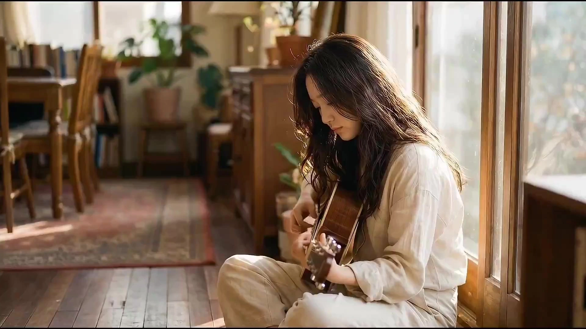

# Single asset to video

> **作者：** @Flova

## Content

Process Planning:

Phase logic and dependencies for a full video:

Generate images/video clips/audio clips based on the user's request → media_generator. If the user asks to continue from the generated assets to produce a scripted full film

Inventory standalone outputs from step 1: List every image / video / audio already generated (asset_id / resource_id as applicable), with a one-line content summary and type (element ref, B-roll clip, music stem, etc.). Optionally run multimodal_analyze_tool / resource_analyze_and_prepare on those files so structure and timestamps are explicit. Do not discard this list — it is the source of truth for what must appear in the film.

From that inventory + user intent, write Final_Video_Spec.md (title, type, ratio, duration, visual style, language, model preference) → text_editor. The spec must state that the edit is anchored to existing step‑1 assets unless the user explicitly authorizes replacing them.

Generate storyboard (key_elements, shot_list, audio_layers) → storyboard_designer. Hard rule: The storyboard must assign each material standalone asset from step 1 to at least one key_element, shot_list entry, or audio_layers / layout_instruction slot — i.e. build the narrative around these clips/images, not a fresh plot that ignores them. Only plan new generation for gaps (missing coverage, continuity bridges) called out in steps 5–6.

(Optional) Compare the storyboard's key elements with image/element assets from step 1 and the board; audit for gaps and generate or complete only missing elements → media_generator.

(Optional) Compare the storyboard with video assets from step 1 and the board; audit for gaps and generate or complete only missing shots → media_generator.

(Optional) Compare the storyboard's audio_layers with audio assets from step 1 and the board; audit for gaps and generate or complete only missing audio tracks → media_generator.

Final assembly when all resources are ready; then guide user to export → video_assembler.

Dependencies: 2→1; 3→2; 4→2,3; 5→1,4; 6→1,4,5; 7→1,4; 8→4,5,6,7.

Note — standalone assets → storyboard (critical): You must string together the user’s standalone assets from step 1 into one coherent story (full script / beat arc). The storyboard is responsible for ordering shots, bridging between them, and adding any connective or coverage shots so the final narrative short is smooth and complete—without treating prior assets as optional or replacing them with a greenfield plan. Bind via media_generator / manage_*_assets to storyboard targets before generating replacements; never re-generate the same beat if an acceptable asset already exists from step 1.

When to pause: Do not run through all steps in one go. Stop after inventory + spec, after storyboard (user must confirm that step‑1 assets are correctly assigned to shots/elements), after gap-fill generations, then before final assembly. Use cards or reply_to_user to invite review before continuing.

Asset Analysis:

Use when step 1 produced video or long audio and the storyboard needs accurate in/out points or structure labels before mapping shots. Output feeds step 2 (inventory) and step 4 (storyboard timing).

Storyboard Design:

Continuation mode — standalone assets from step 1 (mandatory when the user continues to a full film)

Do not greenfield: The plot, shot list, and key_elements must incorporate the assets already produced in step 1. Treat each such asset as committed media: either attach it to a key_element (look, environment, prop) or to a final shot (e.g. “Shot_03 uses resource_id … as hero take / key visual”).

Explicit binding: For every step‑1 asset_id / resource_id, record where it is used (element ID and/or shot_id, plus layout_instruction / timeline if needed). If a clip is B-roll or establishing, say so; if it is the hero product or character turnaround, reference the same element across shots.

Narrative follows assets: Write the story order and beats so that those clips/images make sense in sequence — you may add connective shots or new elements only where the inventory alone cannot cover the arc; do not replace the user’s standalone pieces with a wholly new plan unless the user explicitly requests a reset.

New vs existing: When naming key_elements, reuse descriptions that match step‑1 prompts/visuals; add new elements only for roles that no prior asset covers.

How to design key elements

Always include key subjects (characters, objects, etc.), key locations/scenes, and key props (if any).

Characters: If a character has multiple states or looks in the project (e.g. different costumes, ages), describe each clearly in the description (e.g. Look 1: …; Look 2: …).

Key locations/scenes: Describe the placement and orientation of important objects in the scene, especially props or areas where the main action or performance happens.

User-provided assets: If the user supplies reference media and specifies it as a key element, the description must match that asset; do not contradict what is shown or heard.

How to design shots

Prefer long takes with internal cuts (e.g. 10–15 seconds per shot). Design cuts inside the shot rather than splitting into many short shots; cut frequency should follow story rhythm. Do not exceed 15 seconds per shot (current model max duration limit).

Each shot description must include:

Scene: Reference the location/set (use the scene element ID, e.g. [Element_Office_Noir]).

Story content: Actions and dynamics of characters and key objects; dialogue and performance. Write out exact lines (spoken dialogue or inner monologue / OS). Reference characters by their element ID.

Camera language: Shot size (e.g. wide, medium, close-up), camera angle (e.g. low, high), camera movement (e.g. static, pan, dolly).

When the shot has internal cuts: After the scene/setting, order story content and camera language by cut. Use explicit timing and cut markers, e.g. "First (0–4s): [scene], [character] does X, close-up. Then cut to (4–8s): … Then cut to (8–12s): …"

How to design independent audio

Background music: Design at least one global background track. If the video is long (e.g. 3 minutes or more) and has clear act breaks or turning points, you may plan more than one music segment (each with its own audio_id and scope).

Narration: If voice-over or narration is used to explain or carry the story, design it here (type narration). Define voice identity, tone, and the exact script; use layout_instruction to scope it to the relevant shots.

Media Generation:

Element generation

Bind first, generate second: If step 1 or the storyboard already points to an image/video/audio for an element or shot, bind that resource_id / asset_id in the tool chain before issuing a new generation. Only generate when the board marks a gap.

Images: If the user has specified assets for an element (e.g. product image, character image), use them directly; do not generate. Otherwise use TextToImage(or project convention) for characters, scenes, props. For multiple states of the same character, use ImageToImage referencing the first for consistency. Recommended resolution and model per project (e.g. 2K); multi-view for characters is recommended for cross-shot consistency and to assign separate asset_ids to each and generate them separately.

Recommended model: Nano Banana 2(Gemini 3.1 Flash Image), resolution 2K. Prefer three-view (front / side / back) for character elements to support cross-shot consistency.

Voice_references: If the reference has dialogue/voice-over and the storyboard requires replicating voice, generate or designate one voice _reference audio clip (e.g. a sample of that character/narrator) for narration generation to match voice and tone.

Recommended model: For Chinese (zh) content: Seedaudio 1.0. For English/Global (en) content: elevenlabs.

Final shot video generation

Use MultiModalToVideo. Recommended model: Seedance2.0, resolution 720p. Reference element images for that shot.

Narration and BGM

Narration: Content, voice, tone, and timing strictly per storyboard; if a "voice_reference" asset exists, align to it when generating.

BGM: Style and rhythm match Final Video Spec / reference; duration and scope per storyboard.

Video Editing:

Assemble all shots, narration track, and BGM in storyboard and timeline order; Guide the user to export when the cut is ready. If the final-shots has no in-shot dialogue or narration, mute the shot/video layer’s embedded audio in the edit and rely on the audio layers (BGM/SFX as designed) so shot-generated sound does not clash with the mix.
