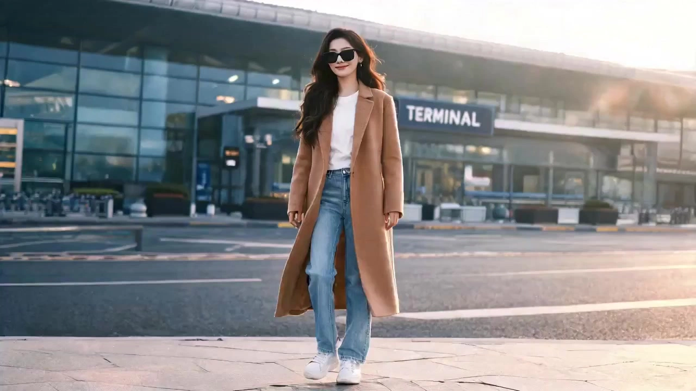

# Star in Any Video

> **作者：** 阿娴AIGC

## Content

**Process Planning:**

**Trigger Condition:** This Skill is triggered when the user uploads a video and explicitly requests a replacement (e.g., face swap, character swap, background swap, or character replacement), or when both a video and reference image are uploaded simultaneously.
**Global Mandatory Rules (Applies to every step):**
- Each key milestone (Mode Confirmation → Shot List Confirmation → Parameter Confirmation → Generation Confirmation) must be paused to wait for the user to explicitly reply with "Confirm"/"Continue" or select an option before proceeding to the next step.
- All structured information (Shot List, parameter configuration) must be presented in Markdown tables.
- Camera movement inheritance has the highest priority: The camera movement of every frame in the final output video must align frame-by-frame with the original video; adding or changing any camera movement is prohibited.
- Dynamic color matching: Automatically analyze the original video's color tone, brightness, contrast, and saturation. Match the color style of the replacement area to the overall tonality of the original video. Do not add any preset filters (unless explicitly requested by the user).

**Execution Stages and Sequence (Strictly sequential, no merging or skipping):**
1. **Welcome and Mode Selection:** Guide the user to select the replacement mode (Character Swap/Face Swap/Background Swap/Combined) and confirm that the reference image has been uploaded. Use `reply_to_user` to output, including mode numbers for the user to choose from. → Wait for user confirmation.
2. **Original Video Analysis:** Call **resource_prepare_and_analyze** to analyze the original video, extract all shot transitions, and generate a "Shot List Analysis Table" (see **resource_prepare_and_analyze** module for field requirements) for user confirmation. **Explicitly inform the user that any field can be modified shot-by-shot**, specifically including time segments (start/end seconds) and camera movement descriptions. The user can reply with "Change Shot N time segment to X–Y seconds" or "Change Shot N camera movement to…". Update the table immediately after each modification and re-present it until the user confirms the entire table is correct before proceeding to the next step. → Wait for user confirmation.
3. **Reference Image Analysis:** Call **resource_prepare_and_analyze** to analyze the user-uploaded reference image, extract key features of the replacement target (facial features, clothing, background style, etc.), and present them in a table for user confirmation of whether it matches the replacement intent. → Wait for user confirmation.
4. **Storyboard Generation:** Call **storyboard_designer** to generate the Storyboard shot-by-shot based on the Shot List Analysis Table. Each shot corresponds to a segment in the original video, clearly recording camera movement parameters and replacement intent. → Wait for user confirmation.
5. **Asset Binding:** Use **media_generator** to register the `asset_id` for the user-uploaded original video clips and reference images, binding them to the corresponding shot/key_element slots in the Storyboard.
6. **Shot-by-Shot Replacement Generation:** Follow the Storyboard shot sequence and call **media_generator** for each shot to execute video character/scene replacement. Present the result after each shot is generated, and wait for user confirmation before proceeding to the next shot.
7. **Final Assembly:** After all shots are confirmed, call **video_assembler** to splice them in the original video's timeline sequence, preserving the original rhythm and cut points to output the final video. → Guide the user to export.

**Dependencies:** 2→1; 3→1; 4→2,3; 5→4; 6→5; 7→6.

**Asset Analysis:**

**Original Video Analysis (Shot Breakdown):**
- Perform a shot-by-shot analysis of the original video and output a "Shot List Analysis Table." Field definitions are as follows (all fields are mandatory and cannot be left blank):
  Field Description: Shot Number (integer starting from 1), Time Segment (start/end seconds, accurate to 0.1s, e.g., 0.0–3.2s), Duration (automatically calculated: end second - start second, in seconds), Camera Movement Type (use standard terms: Fixed / Zoom In / Zoom Out / Pan (Left→Right) / Pan (Right→Left) / Tilt / Follow / Handheld Shake / Dive / Rise; if there is composite movement, list them), Camera Movement Intensity & Speed (e.g., Slow (<5°/s) / Medium (5–15°/s) / Fast (>15°/s), or describe displacement distance), Character Action Description (describe the subject's body movements, posture, facial orientation; fill with "None" if no characters are present), Background Description (main background content, depth layers, key visual elements), Replacement Difficulty Assessment (replacement complexity: Low / Medium / High, and note the reason (e.g., fast motion blur, occlusion, sudden light changes, etc.)
- Focus on identifying cut points and camera movement transitions to ensure shot boundaries are accurate to the frame level (using 0.1s as the minimum unit).
- Analyze the original video's overall color parameters (color temperature, brightness, contrast, saturation) and record them as baseline values for subsequent color matching; attach this to the end of the analysis table.
- **User Shot-by-Shot Modification Support:** After the analysis table is presented, the user can propose modifications to any shot's time segment or camera movement description. Update and re-present the complete table immediately after each modification; only proceed to the next step after confirming that "all shots have been modified and finalized."

**Reference Image Analysis:**
- **Face/Character Reference Image:** Extract facial structural features (features, skin tone, hairstyle, facial contours), body type characteristics, and clothing/style descriptions. Output as structured text for use in Storyboard and prompt generation.
- **Background Reference Image:** Extract scene type, light direction, color style, and spatial depth. Record this as an `element scene` description.
- After analysis, present key features in a table for user confirmation to ensure it aligns with the replacement intent.

**Storyboard Design:**

**Key Elements Design:**
- **Replacement Target Character (element character):** Based on the reference image analysis results, fully describe the appearance, skin tone, hairstyle, and clothing of the character after replacement, ensuring compatibility with the original video's actions and poses. If the user provided a full-body reference image, record both close-up and full-body descriptions.
- **Replacement Background (element scene):** Based on the background reference image or user text description, record the target scene type, lighting, color tone, and key visual elements, aligning them with the original video's color baseline values.
- **Original Video (Asset Anchor):** Register the original video as a whole as reference material, noting its total duration and resolution.

**Shot Design:**
- Each shot must strictly correspond to a shot segment in the Shot List Analysis Table that the **user has already confirmed**. The duration must be exactly consistent with the confirmed time segment. If the user modified the time segment during the analysis phase, use the modified value; do not revert to the original analysis value.
- Each shot must include:
  - **Time Segment:** Directly reuse the start and end times (accurate to 0.1s) from the user-confirmed Shot List Analysis Table; do not adjust them independently.
  - **Camera Movement Inheritance:** Directly reuse the camera movement type + intensity/speed description from the user-confirmed Shot List Analysis Table. Copy it completely; do not simplify or omit.
  - **Replacement Intent:** Clearly mark the content to be replaced in this shot (character/background/combined), and the `element id` corresponding to the replacement target.
  - **Character Action:** Reuse the action description from the Shot List Analysis Table; do not add actions not present in the original video.
  - **Color Matching Note:** Remind the generation process to refer to the original video's color baseline values (color temperature/brightness/contrast/saturation).

**Audio Layers:**
- By default, retain the original video audio; do not design additional Audio Layers (unless the user explicitly requests background music or vocal replacement).

**Media Generation:**

**Asset Registration and Binding:**
- For each segment of the original video uploaded by the user: Register an `asset_id` and bind it to the corresponding shot's `reference_video` slot.
- For user-uploaded reference images (face/full-body/background): Register an `asset_id` and bind it to the corresponding `key_element` (`element character` or `element scene`).

**Replacement Video Generation:**
- Use **MultiModalToVideo**, prioritizing the **Seedance 2.0** model, with a default resolution of **720p**.
- Input for each shot:
  1. The corresponding original video segment as `reference_video` (Video Modifies mode).
  2. The replacement target reference image (face/full-body/background) as `reference_image`.
  3. Clearly describe the replacement intent, camera movement inheritance requirements, and color matching requirements in the prompt.
- **Do not use TextToVideo or FirstFrameToVideo**; modifications must be based on the original video segment to preserve camera movement.
- If Seedance 2.0 generation fails, prioritize trying **Seedance 2.0 Fast** (also via the MultiModalToVideo path); do not switch to cross-tool alternatives.

**Reference Image Quality Assessment and Handling Deficiencies:**
During step 3 (Reference Image Analysis), assess the quality of each reference image according to the following standards and output the assessment conclusion:
Problem Type | Criteria | Impact Level
--- | --- | ---
**Resolution Too Low** | Face area pixels < 200×200, or image long side < 400px | High
**Partial Occlusion** | Face obscured > 30%, or full-body image only shows upper/lower body | Medium–High
**Poor Angle** | Face rotated > 45° from profile, or full-body image not front/back-facing | Medium
**Abnormal Lighting** | Strong backlight, extreme over/under-exposure leading to detail loss | Medium–High
**Confusing Background Composition** | Scene elements too complex, main subject cannot be clearly distinguished from background | Medium

**Handling Path (by impact level):**
- **High Impact Level (Must be handled, otherwise pause generation):**
  1. Clearly state the problem to the user: Output "⚠️ Reference image quality is insufficient: [specific problem description], which may lead to unstable replacement results."
  2. Prioritize guiding the user to supplement materials. Output suggestions: "It is recommended to provide [front close-up/full-body front view/higher resolution] reference images to obtain better results."
  3. If the user explicitly states they cannot supplement, ask if they authorize automatic generation of supplementary reference images (see generation rules below).
  4. **Must not enter the Storyboard Generation stage** until the user makes a clear choice.
- **Medium Impact Level (Alert user, choice to continue):**
  1. Mark "⚠️ Suggestion: Supplement" in the analysis table, explaining the specific impact (e.g., side profile angle may cause unstable front-facing face swap results).
  2. Provide two options: "Continue using existing reference image" or "Supplement/re-upload reference image."
  3. If the user chooses to continue, actively warn about this risk in the "Known Issues" column of the subsequent shot-by-shot confirmation cards.

**Automatic Supplementary Reference Image Generation Rules (Only executed upon user authorization):**
- **Character Reference Image Supplement:** Use **ImageToImage**, based on the original image provided by the user. Select model **Nano Banana 2 (Gemini 3.1 Flash Image)**, resolution **2K**, to generate:
  - Front-facing close-up portrait (for face swap scenarios)
  - Full-body front-facing image (for character swap scenarios)
  - The generation prompt must explicitly retain the character's appearance features from the original image (skin tone, hairstyle, clothing); do not change the character's identity.
- **Background Reference Image Supplement:** Use **TextToImage**, model **Nano Banana 2 (Gemini 3.1 Flash Image)**, resolution **2K**, generated based on the user's text description or the scene style of the original reference image.
- After each supplementary reference image is generated, **it must be confirmed and approved by the user** before it can be bound for use; do not skip confirmation and proceed directly to generation.

**Shot-by-Shot Confirmation Mechanism—Standardized Confirmation Card:**
After each shot is generated, a confirmation card must be output according to the following template, waiting for the user to explicitly reply before proceeding to the next shot:

**🎬 Shot N Generation Result Confirmation**
Field | Content
--- | ---
Shot Number | Shot N (Total X shots)
Time Segment | X.Xs – X.Xs (Duration Xs)
Replacement Type | Character Swap / Background Swap / Combined
Camera Movement Inheritance | Compared to original video: [Camera Movement Type + Intensity/Speed] → Generation Result: [Judge based on output video, note if consistent]
Replacement Quality Self-Assessment | **Character Similarity:** ⭐⭐⭐⭐☆ (1–5) ｜ **Background Integration:** ⭐⭐⭐⭐☆ (1–5) ｜ **Color Matching:** ⭐⭐⭐⭐☆ (1–5)
Known Issues | [If there are obvious flaws, note them here, e.g.: unnatural edge blending / slight face distortion / color temperature too warm]
Suggested Actions | ✅ Confirm and continue to Shot N+1 ｜ 🔄 Regenerate this shot ｜ ✏️ Retry after modifying prompt
> Please reply: **"Confirm"** to continue to the next shot, or explain the adjustments needed.

**Rating Explanation (For reference only, agent self-assessment):**
- **Character Similarity:** Degree of match between the replaced character and the reference image's face/body shape.
- **Background Integration:** Naturalness of the edges of the background replacement area relative to the foreground, and consistency of spatial sense.
- **Color Matching:** Consistency of the color style of the replacement area with the overall tonality of the original video.
- If any dimension is rated ≤ 3 stars, you must note the reason in "Known Issues" and actively suggest a retry.

**Prompt Writing:**

**Video Replacement Prompt (MultiModalToVideo / Seedance 2.0):**
- **Reference Image Placeholder:** Use `<<<image_1>>>` for character reference images, `<<<image_2>>>` for background reference images (if there are multiple, number them sequentially). Original video segments are passed directly as `video` input and are not marked with placeholders in the prompt.
- **Core Structure (Fixed Order):**
  1. **Replacement Object Description:** Explicitly state "Replace the character in the video with [specific appearance description of the character in the reference image]" or "Replace the background with [target background description]."
  2. **Camera Movement Inheritance Declaration (Must be written):** "Maintain the exact same camera movement as the original video: [Reuse the camera movement description from the Shot List, e.g., fixed camera / slow pan to the right / slight handheld shake], do not add any new camera movement."
  3. **Action Retention Declaration:** "The character's action trajectory, body movement, and rhythm must be exactly consistent with the original video."
  4. **Color Matching:** "The color, brightness, and contrast of the replacement area must match the overall tonality of the original video: [Color tone description], do not add preset filters."
- **Forbidden to Write:** Any actions, scene elements, or camera movements not present in the original video.
- **Fixed Negative Constraints (Appended to the end of every prompt):** `no added camera movement, no new lighting, no style filter, no subtitles`

**Reference Image Prompt (TextToImage / ImageToImage):**
- When describing character appearance, focus on visible features: facial features, skin tone, hairstyle, clothing material and color. Do not write psychological descriptions or invisible content.
- Use natural language paragraphs to describe subject + environment; use phrases to label style/lighting/composition; do not use tag stacking.

**Final Assembly:**

**Splicing Principles:**
- Splice all generated shots strictly in the timeline order of the original video, without changing existing cut points and rhythm.
- The duration of each shot must be exactly consistent with the corresponding shot segment of the original video; do not add extra transition effects (unless explicitly requested by the user).
- The Audio Layer defaults to using the original video audio (extracted from the original video), aligned precisely with the video track.

**Post-Splicing Overall Quality Check (Must be executed shot-by-shot before output):**
Check the following quality dimensions and present a quality inspection report to the user in a table:
Quality Dimension | Check Content | Criteria
--- | --- | ---
**Shot Transition Jump** | Is there screen jumping, ghosting, or frame misalignment 0.5s before and after the splicing point of adjacent shots? | Transitions at splicing points are natural, with no visible jump frames
**Audio-Video Sync Deviation** | Misalignment between audio track and video track | Deviation ≤ 1 frame (approx. 33ms@30fps), lip-sync matches original audio
**Color Tone Discontinuity** | Are there obvious discontinuities in color temperature, brightness, or saturation of the replaced area between adjacent shots? | Color change amplitude across shots is within visually acceptable range, no abrupt color jumps
**Camera Movement Continuity** | Is the transition of camera movement direction and speed between adjacent shots natural? | Camera movement transitions are consistent with the original video's cutting rhythm, with no abrupt changes in direction
**Replacement Area Edges** | Blending quality of edges in the character/background replacement area throughout the entire clip | No obvious aliasing, halos, or cutout remnants
**Duration Match** | Is the total duration of the output video consistent with the total duration of the original video? | Error ≤ 0.1s

**Quality Inspection Result Handling Rules:**
- If all dimensions pass, output "✅ Quality check passed" and guide the user to export.
- If problems are found in any dimension, mark "⚠️ Needs Attention" or "❌ Needs Repair," specify the problem location (e.g., color discontinuity at the splicing point between Shot N and Shot N+1), and provide suggested actions: regenerate the corresponding shot / adjust splicing parameters / forced export after manual confirmation.
- After presenting the quality inspection report, wait for user confirmation; execute export only after the user explicitly replies.
