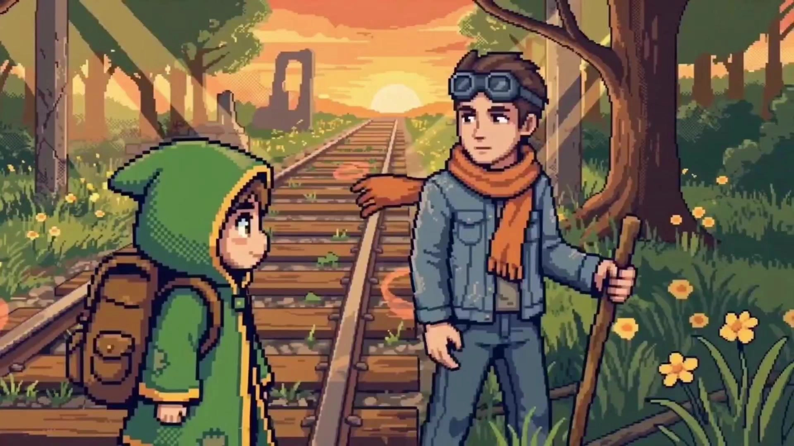

# Stardew Valley Pixel Art Nostalgic Short

> **作者：** @拾墨AI工坊

## Content

Process Planning:

Workflow Stages and Dependencies:

Create Final_Video_Spec.md (Title, Type: Pixel-art emotional memory short, Aspect Ratio: 16:9, Duration: 30–60s (expandable up to 90s by increasing shot count or duration of key shots), Visual Style: 16-bit pixel art / Stardew Valley warm pastoral tone, Output Language: Chinese) → text_editor.

Analyze user-uploaded memory photos (scenes, characters, composition, color, mood) and output structured text descriptions → resource_prepare_and_analyze.

Design the Shot List (Key Elements + shots + Audio Layers) → storyboard_designer.

Generate pixel-style Key Elements (character sheets, scene sheets) → media_generator. If the user provided reference assets, use resource_prepare_and_analyze to extract features, then use ImageToImage to blend with the pixel style; otherwise, use TextToImage to generate from scratch.

Generate keyframe images for each shot (one start_frame per shot), maintaining consistency with Key Elements → media_generator.

Convert keyframes into video for each shot (4–10s per shot, flexible allocation based on narrative pacing: transitional shots 4s, standard narrative shots 5–6s, emotional climax shots 8–10s; single shot max 15s) → media_generator.

Generate healing background music (BGM) → media_generator.

Final assembly and export → video_assembler.

Dependencies: 2→1; 3→2; 4→3; 5→4; 6→5; 7→3; 8→6,7.

Pause Checkpoints: Do not run the entire process at once. Pause and confirm with the user at these milestones: after Final_Video_Spec is locked, after the Shot List is complete, after Key Elements are generated, after all shot videos are finished, and after audio is complete. Use cards or reply_to_user to invite user review.

Handling User-Uploaded Assets: In steps 4–6, if the user provides photos or existing media, prioritize binding them to the corresponding Storyboard slots via media_generator to avoid re-generating content the user has already provided. Use ImageToImage to perform pixel-style fusion on uploaded photos.

Asset Analysis:

Analyze the content of user-uploaded memory photos and output a structured description: scene type (classroom/hallway/playground/tree-lined path, etc.), number of characters and general poses, composition (low angle/eye-level/panoramic, etc.), main color tone and light direction, and identifiable emotional atmosphere.

If multiple photos are uploaded, categorize them by scene and indicate which shot list scene each photo is best suited for.

Extracted photo features are only for guiding downstream pixel-style scene design and character settings, not for final use; downstream must "pixel-redraw" them rather than using them directly.

Storyboard Design:

Overall Structure (30–60 seconds, optional extension to 90s):

Recommended 5–7 shots, arranged in a four-part emotional arc rather than a fixed scene sequence:

Introduction (Set-up): 1 shot, fresh and bright panoramic/sky view, establishing the tone and visual hook; use transition shot duration.

Development (Daily Immersion): 2–3 shots, warm and intimate daily scenes to help the audience connect with the memories; use standard narrative shot duration.

Climax (Emotional Build-up): 1–2 shots, warmer color temperature or higher emotional density, pushing toward the peak; use emotional climax shot duration.

Conclusion (Lingering Aftertaste): 1 shot, image dissolves into sky/negative space + message text, creating a sense of farewell; use emotional climax shot duration.

Scene Selection Principle: Flexibly match scene types based on user-uploaded assets and the theme, rather than sticking to a fixed set. Each scene must map to a phase in the emotional arc (Intro/Daily/Build-up/Conclusion) and select the matching color temperature from the "Per-scene Color and Lighting Scheme."

Example Mapping (Graduation Theme): Intro=Campus Sky → Development=Studying at desk/Walking in corridor → Climax=Sunset on field/Cycling on tree-lined path → Conclusion=Message floating in sky. This is an example; for other themes (travel/seasons/friendship, etc.), replace scenes according to the same emotional arc.

Shot Duration Grading (Seedance 2.0 supports 4–15s, flexibly assigned by beat):

Transition Shot (4s): Shots for the introduction phase or quick scene establishment, tightly paced.

Standard Narrative Shot (5–6s): Shots carrying the main narrative during the daily immersion phase.

Emotional Climax Shot (8–10s): Emotional peaks in the build-up and conclusion phases requiring audience immersion; duration can be extended for slow camera movement.

Single shot limit is 15s. If users select 90s extended length, prioritize increasing the duration of emotional climax shots or adding 1–2 narrative shots, rather than uniformly stretching all shots.

The opening shot must establish a visual hook within the first 3 seconds: fresh panorama/sky + a message text fitting the theme (content determined by user theme and assets, not fixed to a specific phrase).

The closing shot concludes with message text + sky/negative space to evoke a sense of farewell; specific text is determined by the user's theme.

Key Elements Design:

element character: Define the main character's appearance in pixel style (hairstyle, uniform, backpack, etc.). If there are multiple people, set each character individually to ensure consistency across shots.

element scene: Define the pixelated look of core scenes—classroom (desk/window/sunlight), corridor, playground (track/fencing/grass), tree-lined path (trees/sunset), and describe the position and orientation of important objects.

key prop: If there are iconic props (books, bicycle, test papers, etc.), define them as independent elements.

Per-scene Color and Lighting Scheme (element scene descriptions must embed these specs):

Each scene in the Storyboard must explicitly specify the primary color (referencing the palette values) and lighting scheme to ensure distinct color layering and unified overall color temperature between shots. Scenes are categorized into three grades by color temperature; other themes can replace scene content by referencing the same grade: Warm Intimate Scenes (Classroom/Tree-lined path), Cool Transition Scenes (Corridor), Warm Climax Scenes (Playground/Sky).

Classroom: Primary colors: warm yellow (#F2C249) + warm brown (#8B6B3A), accented with grass green (#5BA84A) for windowsill plants. Lighting: warm natural light from side windows, with light beams in translucent pixel bars crossing the desk area to create a quiet afternoon mood. Dark areas under desks use dithering.

Corridor: Primary colors: sky blue (#7EC0E8) + warm white, accented with orange-red (#E8804A) for uniforms and posters. Lighting: diffused overhead light + backlight from window at the end of the corridor, creating depth with contrast. Overall clear and cool, providing an emotional pivot from the classroom's warmth.

Playground: Primary colors: orange-red (#E8804A) + grass green (#5BA84A), accented with warm yellow (#F2C249) filling the sunset sky. Lighting: low-angle golden sunset backlight, with pixelated fence shadows falling onto the track and grass. The warmest color temperature in the video to intensify the nostalgic climax.

Tree-lined Path: Primary colors: grass green (#5BA84A) + warm yellow (#F2C249), accented with warm brown (#8B6B3A) for tree trunks and road. Lighting: Tyndall light spots filtering through the canopy, scattered on the ground as translucent pixel circles, backlit toward the sunset. Warm and soft overall, echoing the youthful feeling of cycling after the sunset.

Opening/Closing Sky: Primary colors: gradient from sky blue (#7EC0E8) to warm yellow (#F2C249) at the horizon. Lighting: soft light for morning/dusk, clouds using low-saturation pixel blocks. Opening leans fresh and bright, closing leans toward warm and subdued dusk tones.

Shot Design:

Every shot must include: Scene (reference scene element ID), Story Beat (character actions and emotions), Cinematography (shot size, camera angle, camera movement—prefer slow panning/push-in/following, avoid intense motion to fit the nostalgic atmosphere), On-screen Text (if there is a message, specify exact content and appearance method).

On-screen text is presented on natural carriers like sky, ground, or light/shadow, not using modern subtitle bars.

Audio Layer Design:

BGM: A global background music audio_layer, described as "healing instrumental, piano + acoustic guitar + light strings, warm and nostalgic, slightly sentimental, refer to Stardew Valley soundtrack vibe," with the same duration as the video.

If the video includes voiceover/message narration, set a separate narration audio_layer, using narration_speaker_profile (e.g., [Warm Female Voice]) and write out the full narration script.

Media Generation:

Pixel Art Image Generation (Key Element & Keyframes):

Use TextToImage for the initial style reference image; recommended model: Nano Banana Pro (Gemini 3 Pro Image) (best for prompt adherence and precise pixel art control), resolution: 2K, aspect ratio: 16:9.

Use ImageToImage for subsequent scene images and character variants, referencing the initial style image + user-uploaded photos (if any) to ensure consistent pixel art style; recommended model: Nano Banana Pro.

Pixel art consistency is the core constraint of this Skill: every newly generated image must reference the established style image as the reference_image.

Shot Video Generation:

Use MultiModalToVideo; recommended model: Seedance 2.0, resolution: 720p, aspect ratio: 16:9, duration based on shot duration in the Shot List (4s / 5–6s / 8–10s, max 15s).

Each shot's image_infos must include the keyframe image for that shot (as a visual style anchor); if a shot includes a character, bind the corresponding element character image as a reference.

If strong continuity is required between adjacent shots (e.g., continuation of the same scene), the previous shot's video can be attached as a reference_video; generally, image references suffice.

BGM Generation:

Use text_to_instrumental; recommended model: Suno 5; describe a healing instrumental style in the prompt, avoiding names of famous musicians (Suno 5 compliance restriction).

If the user requires a full song with lyrics, use lyrics_to_song instead.

User-Uploaded Asset Binding:

User-uploaded graduation photos are analyzed via resource_prepare_and_analyze, then registered as an asset_id via media_generator and bound to the corresponding element/shot slot; these photos serve as reference inputs for ImageToImage to blend into the pixel art style, rather than appearing directly in the final video.

Prompt Writing:

Global Rules: When interacting in Chinese, write the prompt body in Chinese. Text within the image and voiceover content must follow the output language specified in Final_Video_Spec.md (Chinese).

Pixel Art Image Prompt (TextToImage / ImageToImage):

Style Anchor Keywords (Mandatory): 16-bit pixel art, Stardew Valley style, SNES-era JRPG aesthetic, limited color palette, dithering shading, tile-based environment; describe subjects, scenes, and actions using natural language, and use short phrases to lock in style/tone/lighting/composition.

Stardew Valley Visual Reference Elements: Isometric or 45° top-down composition, gridded tile map texture, simplified pixelated plants (rounded tree crowns, square bushes), wooden fences and stone paths, pixelated light beams through windows, low pixelated building silhouettes; characters feature chibi proportions (big head, small body), solid-color facial features (pixel eyes/no nose), and simple left/right side-profile sprite poses.

Color Constraints: Limit the palette to Stardew Valley warm tones—warm yellow (#F2C249), orange-red (#E8804A), sky blue (#7EC0E8), grass green (#5BA84A), and warm brown (#8B6B3A). Do not exceed 5–6 color levels per frame; maintain consistent color temperature throughout and avoid tone jumps between shots; use dithering (checkerboard/stripe patterns) for shadows instead of smooth gradients.

Lighting Description: Emphasize warm light language like "golden sunset backlight," "soft glow," or "sunlight spilling onto the table." Render light halos as semi-transparent pixelated rings and light beams as semi-transparent pixelated bars, avoiding soft Gaussian blurs.

Pixel Graininess: Explicitly require 16-bit pixel resolution texture (approx. 64px–128px sprite logic resolution) with stepped pixel edges rather than anti-aliased curves. Prohibit high-definition realistic details, smooth gradients, vector strokes, or cel-shading.

On-screen Text: If rendering a message, quote the exact string (e.g., "Salute to this encounter") and specify it should be presented in a pixel bitmap font (referencing the Stardew Valley dialogue box style) in the sky or light/shadow, with font size aligned to the pixel grid.

Video Prompt (MultiModalToVideo / Seedance 2.0):

Reference Image Binding: Use placeholders like <<<image_1>>>, <<<image_2>>>, etc., to bind each reference image, and specify the elements (character/scene/style) to be referenced from each image.

Motion Description Stack: Camera movement (slow pan/push-in/follow) → Subject action (character movement and micro-expressions) → Spatial changes (light/shadow flow, swaying leaves) → Audio notes (if ambient sound/SFX are needed).

Maintaining Pixel Style: Reiterate "maintain 16-bit pixel art style, SNES-era JRPG aesthetic, limited color palette, dithering shading" in video prompts to prevent the model from drifting into realistic or semi-realistic styles during animation. Dynamic elements (swaying leaves, flowing light/shadow) must maintain stepped pixel movement; motion blur or depth-of-field blurring is prohibited.

Dynamic Detail Examples: Classroom—"Slow camera pan showing books on the desk by the window; golden autumn leaves sway outside; sunlight floods the desk; light and shadow shift." Cycling—"Camera follows the student riding, facing the golden sunset, warm backlight, slow motion."

Negative Prompts: no subtitles (reserved for post-processing), no realistic rendering (to prevent deviation from pixel style), no modern UI elements.

Video Editing:

Total duration 30–60s (extendable to 90s). Arrange clips in shot list order. Vary clip lengths (4s / 5–6s / 8–10s) for a relaxed pace; avoid quick cuts.

Use soft cross-dissolves for transitions to match the nostalgic, healing vibe; avoid hard or flashy transitions. Transition duration/curves are driven by emotional flow + color temperature shifts:

Entry (Beginning→Middle): Slow, 1.0–1.5s, ease-in-out, to guide viewers into the memory.

Same Color Temp (Mid→Mid): Short, 0.5–0.8s, linear, to maintain flow and rhythm.

Warm→Cold: Slightly fast, 0.8s, ease-out, creating a gentle shift without a hard cut.

Cold→Warm: Longer fade-in, 1.0–1.2s, ease-in, allowing warmth to permeate the frame.

Ending (End): Longest, 1.2–1.5s, ease-in-out, dissolving slowly into sky/white space for a final farewell.

These are guides; adjust based on emotional density, following a "slow start/end, faster middle" rhythm.

Synchronize BGM with visuals: fade in at start, fade out at end; dip volume when text overlays appear.

Display text overlays in the latter half of shots for readability.

Export 16:9; default to 720p unless specified (1080p requires member access).
