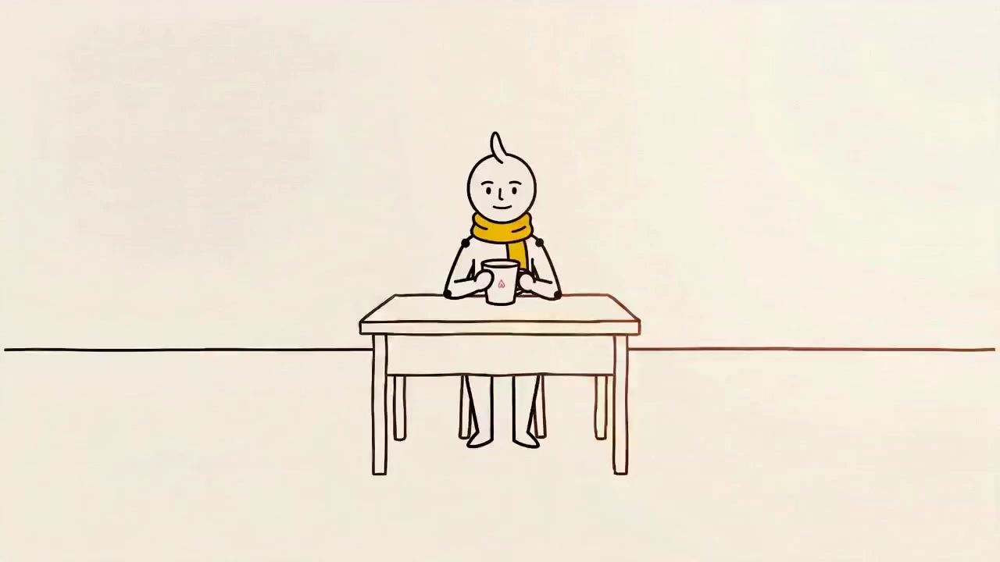

# Stickman-Style Educational/Narrative Short Videos

> **作者：** @澄海AI工坊

## Content

Process Planning:

Overall Workflow: Four-Node Serial Architecture

Call tools in the following sequence, strictly maintaining dependencies between nodes. Pause after each node is completed to confirm with the user before proceeding to the next.

Step 0: Establish Global Video Specifications

Use text_editor to create Final_Video_Spec.md and lock in the following parameters:

Video theme, duration target (1/3/5 minutes), and corresponding shot count (1 min: 8-12; 3 min: 20-30)

Style preset (Classic Science / Warm Narrative / Calm Analysis / Tense Suspense) and corresponding accent and background colors

Protagonist and side character settings (head shape, distinctive features)

Narration output language

Aspect ratio: Default 16:9

Step 1: Requirements Clarification

If the user has not specified the above parameters, clarify through questions or cards before proceeding to the planning node.

Step 2: Planning Node → storyboard_designer

Design the complete Storyboard and Audio Layers based on the four-act narrative structure (Setup 20% / Dilemma 35% / Epiphany 30% / Resolution 15%). Pause upon completion and wait for user confirmation before proceeding to the next node.

Step 3: Visual Node → media_generator

Prioritize generating reference images for all Key Elements; after user confirmation, generate background images for each scene in batches.

Register all generated image assets with an asset_id and bind them to the corresponding Key Element / shot slot.

Step 4: Generation Node → media_generator

Generate video clips shot by shot, ensuring each references the character image + scene image bound to that shot. If a single shot fails, it can be retried independently. Pause for confirmation after everything is complete.

Step 5: Audio Node → media_generator

Generate narration (narration VO) and BGM (music) according to the audio_layer in the Storyboard.

Step 6: Assembly Node → video_assembler

Once all assets are ready, perform transition splicing, audio-visual synchronization, and volume mixing to output the Final Video.

Node Dependencies

Step 2 → Step 0; Step 3 → Step 2; Step 4 → Step 3; Step 5 → Step 2; Step 6 → Step 3, 4, 5.

Asset Analysis:

If the user uploads character drafts, style reference images, or scene assets:

Extract visual keywords: line style, color scheme, and character-defining features (hairstyles, accessories, body proportions).

If the reference image is realistic, extract only transferable features, ignoring lighting and textures to ensure compatibility with the minimalist stick-figure drawing style.

Output the analysis results as text for use in Storyboard key_element descriptions and subsequent image generation Prompts. Element descriptions in the Storyboard must be consistent with the user-provided assets and not contradict them.

If the user uploads voiceover audio or BGM references, extract speech rate, emotional tone, and rhythmic characteristics, and record them in Final_Video_Spec.md for generation reference.

Storyboard Design:

Four-Act Narrative Structure

Science/narrative stick figure videos revolve around "knowledge gaps" and must strictly follow the four-act structure for shot planning:

Act

	

Function

	

Duration

	

Constraint

Setup

	

Introduce protagonist daily life, hint at problem

	

20%

	

Minimal background (one horizon line) to convey "ordinariness"

Struggle

	

Problem erupts, repeated failure

	

35%

	

At least 2 shots showing failure; visual humor beat every 45-60s

Insight

	

Reveal core knowledge point

	

30%

	

Insight shot must be marked pause_after: true; background shifts from chaotic lines to clean geometric shapes

Resolve

	

Apply new knowledge, problem solved

	

15%

	

Final shot freezes for 2-3s + punchline text

Set only 1 key_message per act; Information density: convey only 1 core point every 30 seconds.

key_element Design Specs

element_character

Protagonist: Round head + cowlick; Sidekick: Square head + no cowlick; For scenes with 3+ characters: use head shape (round/square/triangle) + 1 simple accessory.

Forbidden to distinguish by skin color/body type; keep stick figure essence.

Descriptions must include: head shape, identifying features, line thickness (standardized at 2-3px), emotional baseline.

element_scene

Describe core geometric elements (e.g., single horizon line, desk outline, window frame) and background color specs.

Leave blank space at the bottom-center for character placement; max 5 elements per frame.

shot Design Specs

Each shot must include:

Shot Scale: LS (Long Shot, 10-20% person) / MS (Medium Shot, 40-50%) / CU (Close-up, 70-80%) / ECU (Extreme Close-up, element fills screen)

Scene Reference: Label corresponding element_scene ID

Character Action: (Includes: Anticipation-Action-Follow-through phases; avoid vague descriptions like "do some action")

Emotional State: neutral / anxious / excited / thinking / relieved

Camera Movement: Direction + Speed + Scale change (e.g., slow push-in from LS to MS)

key_message: Core info of this shot (one sentence)

narration_text: Narration text (150-170 words/minute pace)

transition: cut / fade / wipe / pop_in (Use fade for act transitions; pop_in for knowledge reveal; 80% of scenes use cut)

pause_after: Mark true before insight and after climax shots; insert 2-second pause.

Composition Taboos: Characters touching edges (keep at least 1/6 margin), >5 elements, tilted composition (only for unbalanced emotions, max 2 seconds).

audio_layer Design Specs

Narration (Type: narration)

Define narration_speaker_profile: Warm, neutral tone, conversational, avoid announcer style; example: [Warm Neutral Voice, conversational, moderate pace]

Slightly tense tone in Struggle act, bright in Insight act; 0.8s pause before knowledge points, 1.5s pause at end of acts.

Speed: 150-170 words/min.

BGM (Type: music)

Style: Upbeat acoustic guitar / ukulele / simple piano, BPM 90-110, matching hand-drawn feel.

Add minor key elements in Struggle act, return to major key in Insight act.

Can segment for videos > 3 mins or with major emotional shifts, each segment has unique audio_id.

Volume: Do not exceed 40% of narration volume.

Media Generation:

Style Presets and Color Schemes

Based on the style presets locked in Final_Video_Spec.md, automatically apply the corresponding color schemes and style lock keywords during image/video generation. The four presets are as follows:

Style Preset

	

Background Color

	

Accent Color

	

Line Color

	

Style Lock Keywords (Append to Prompt)

Classic Educational

	

#FFFFFF (Pure White)

	

#FFD700 (Golden Yellow)

	

Pure Black 2-3px

	

clean educational style, friendly and approachable, golden yellow accent, pure white background

Warm Narrative

	

#FFF8F0 (Warm White)

	

#FF8C69 (Warm Orange)

	

Deep Brown 2-3px

	

warm storytelling style, cozy and inviting, warm orange accent, soft cream background

Analytical

	

#F5F7FA (Cool White)

	

#4A90D9 (Cool Blue)

	

Deep Gray-Blue 2-3px

	

analytical style, cool and precise, steel blue accent, light gray-blue background

Tense Suspense

	

#1A1A2E (Dark Navy)

	

#FF4444 (Warning Red)

	

White 2-3px

	

tense suspenseful style, dramatic contrast, warning red accent, dark navy background, white lines on dark

Usage Rules:

All image and video generation prompts must include the full "style lock keywords" segment corresponding to the current preset, combined with the global hand-drawn minimalist lock keywords (no realistic lighting, no shadows, no shading, flat illustration, hand-drawn minimalist style).

Tense Suspense uses a dark background with white lines. When generating characters/scenes, switch line color from black to white and background to #1A1A2E. The other three presets use light backgrounds with dark lines; process with default black lines.

All shots in a project must use the same style preset; no mid-project changes. If a user requests a style change after Step 0, all assets generated so far must be regenerated.

Character and Scene Image Generation

Character key_element Reference Image → TextToImage, Model: Nano Banana Pro (Gemini 3 Pro Image), Resolution: 2K

Generate a horizontal side-by-side comparison for each character: head/shoulder close-up on the left (for facial recognition baseline), full-body shot on the right (for clothing/accessories/pose).

Use ImageToImage (same model) for different emotions/outfits of the same character, referencing the initial generation to ensure consistency.

Scene element_scene Background Image → TextToImage, Model: Nano Banana Pro (Gemini 3 Pro Image), Resolution: 2K

Generate in batches after character images are confirmed; all scene images use the same set of style parameters.

Shot Video Generation

Use MultiModalToVideo, Default Model: Seedance 2.0, Resolution: 720p, Duration: 5-8 seconds (single call max 15s).

Reference input for each call:

Character element image bound to the shot (Required)

Scene background image bound to the shot (Required)

Previous shot's video (Add only if there is strong continuity with the previous shot; default is not to add)

Audio Generation

Narration narration VO → text to narration, Model: MiniMax Speech 2.8 HD (Supports multilingual Chinese/English)

Generate segment by segment per scene for easier tempo adjustment.

BGM → text_to_instrumental, Model: Mureka 8

If the BGM prompt does not contain well-known artist names, Suno 5 may also be used.

Asset Management

Immediately register asset_id after every image/video/audio generation.

Bind character and scene images to the corresponding key_element; bind shot videos to the corresponding shot slot; bind audio to the corresponding audio_layer.

If a user uploads character reference images or audio, prioritize registering + binding user assets; do not regenerate.

Prompt Writing:

Global Rules

Language: When the user interacts in Chinese, write the Prompt body in Chinese; keep English style-locking keywords (English keyword phrases) in English.

Global Hand-drawn Minimalist Locking Keywords (Must be included in both image and video generation): no realistic lighting, no shadows, no shading, flat illustration, hand-drawn minimalist style

Style Preset Locking Keywords: Based on the style presets locked in Final_Video_Spec.md, take the entire "Style Locking Keywords" segment from the corresponding row in the "Style Presets and Color Schemes" table within the Media Generation section, and append it after the global locking keywords. Color schemes (background, accent, line colors) must also be written into the corresponding color description positions in the Prompt.

Character Reference Image Prompt (TextToImage)

Write in the style of a Director + Art Director brief. Structure: Character Description → Distinguishing Features → Composition → Style Locking.

Example structure: Stick figure character, round head + cowlick, pure black 2px outline, no fill, front-facing full-body standing pose, close-up of head and shoulders on the left and full-body on the right, pure white background, hand-drawn minimalist style, small dots at joints, simple and recognizable expression, stick figure, minimalist line art, 2-3px stroke, pure white background, no fill, no realistic lighting, no shadows, no shading, flat illustration

Negative Prompts: realistic, 3D, shading, gradient, texture, render, ray tracing

Scene Background Prompt (TextToImage)

Structure: Core Scene Elements (≤5) → Composition/White Space Requirements → Style & Color → Style Locking.

Example structure: Minimalist office background, desk outline + chair + window frame, large white space in the bottom-middle of the frame for the character to stand, background #FFFFFF pure white, accent color #FFD700, minimalist background, simple geometric shapes, plenty of white space, center-bottom clear, hand-drawn minimalist style, no realistic lighting, no shadows, no shading, flat illustration

Negative Prompts: detailed, photorealistic, complex, crowded, realistic lighting

Shot List Video Prompt (MultiModalToVideo / Seedance 2.0)

Structure: Camera Movement (Reference Image Binding) → Emotional State → Three-Stage Character Action → Camera Manipulation → Style Locking → Negative Prompts

Use placeholders <<<image_1>>> to bind the character image and <<<image_2>>> to bind the scene image when referencing.

Character action must specify the three stages of "Anticipation - Main Action - Follow-Through" (e.g., bend knees to charge, then dash forward, body leans forward and rebounds upon landing).

Camera movement must include direction + speed + shot type changes (e.g., slow push-in from long shot to medium shot, camera pans slightly to the left).

Animation Physics Style Keywords (to convey elasticity): bouncy exaggerated motion, anticipation and follow-through, squash and stretch

Negative Prompts (must be included): no realistic physics, no cinematic lighting, no motion blur, no depth of field, no subtitles, no music, no realistic lighting, no shadows, no shading

If the shot has an independent voiceover audio track, do not repeat the voiceover text in the video Prompt.

Movement Type Quick Reference

Action Prompt Description Walking: bouncy walk cycle, exaggerated arm swing Running: leaning forward 30 degrees, speed lines trailing Jumping: crouch-jump-squash with rebound Surprise: sudden startle, limbs extend, exclamation mark above head Thinking: slow pacing, side-to-side sway, question mark floating

Video Editing:

Assembly Rules

Sequence: Assemble strictly according to the Storyboard shot order; no adjustments permitted.

Transition Execution (based on the transition field for each shot):

transition

	

Execution

	

Duration

cut

	

Hard cut, no transition

	

0 frames

pop_in

	

Center zoom + bounce ease

	

0.3 sec

fade

	

Fade out → Fade in

	

0.5 sec

wipe

	

Wipe from left to right

	

0.4 sec

Prohibited: Complex effects (e.g., 3D flip); more than 3 consecutive non-hard cuts; dissolves used in action scenes.

Breathing Pause: For any shot marked pause_after: true, insert a 2-second static freeze frame at the end of the shot.

Audio Mixing:

Align the voiceover track with the start frame of the corresponding shot.

BGM runs throughout the entire video; volume must not exceed 40% of the voiceover volume.

If a minor key BGM variation exists for the dilemma act, fade in at the start of that act (0.5-second fade).

Rhythm Check: The final shot of the realization act and the conclusion act must have a distinct sense of pause (achieved via pause_after or manual extension of the final frame). The difference between the voiceover and visual duration for any act must not exceed 0.5 seconds.
