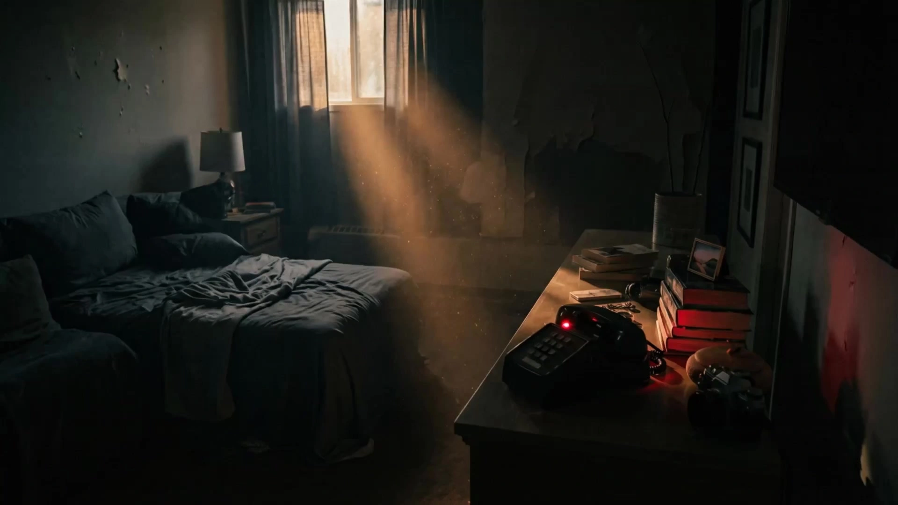

# Story-Driven Video - Video Prompt Reuse Storyboard

> **作者：** Flova

## Content

**Process Planning:**

**Workflow and Dependencies for Complete Video Production:**
1. Draft `Final_Video_Spec.md` (Title, Genre, Aspect Ratio, Duration, Visual Style, Language) → **text_editor**.
2. Generate storyboard (Key Elements, Shot List, Audio Tracks) → **storyboard_designer**. Once the storyboard is ready, scan the current context for assets already provided by the user or previously generated that match storyboard entries (e.g., element images, background music). For each match, bind and assign it to the corresponding storyboard slot before proceeding to the generation steps → **media_generator**.
3. Configure elements:
   * If the user has already uploaded element assets (such as character sheets or reference characters), bind them directly as the corresponding `key_elements`.
   * Otherwise, generate images for all elements → **media_generator**.
4. Generate video for each shot sequentially → **media_generator**.
5. Generate all audio tracks based on the storyboard → **media_generator**.
6. Perform final assembly once all assets are ready; then guide the user to export → **video_assembler**.

**Dependencies:** 2→1; 3→2; 4→3; 5→2; 6→3,4,5.

**When to Pause:** Do not run through all steps at once. Pause after each key stage mentioned above (e.g., after spec finalization, storyboard completion, element completion, shot video generation, audio generation) and confirm with the user before proceeding to the next step. Use cards or `reply_to_user` to invite the user to review before continuing.

**Note:** For media provided by the user or existing media (mainly affecting steps 3–5): Bind and assign them to the corresponding storyboard positions via `media_generator` before filling in generated content; avoid redundant generation of assets the user has already provided.

**Storyboard Design:**

**How to Design Key Elements**
- Must include **Key Subjects** (characters, objects, etc.), **Key Locations/Scenes**, and **Key Props** (if any).
- **Characters:** If the same character has multiple states or looks in the project (e.g., different outfits, ages), describe them clearly (e.g., Look 1: ...; Look 2: ...). Specify the character's **Voice/Timbre**.
- **Key Locations/Scenes:** Explain the position and orientation of important objects in the scene, especially areas and props that carry the main actions or performances.
- **User-Provided Assets:** If the user provides reference media (images or audio) and designates them as key elements, the description **must be consistent** with the assets; it must not contradict the visual or audible content.

**How to Design Shots**
- **Prioritize long takes + internal cuts** (e.g., 10–15 seconds per take). Design **within a single take**, do not break into many fragmented, short shots; cut frequency should follow narrative rhythm. A single take must not exceed 15 seconds (current model duration limit).
- **Each shot description must include:**
  - **Scene:** Specify the scene/space (use Scene Element ID, e.g., `[Element_Office_Noir]`).
  - **Story Content:** Beat, dialogue, performance; write out **exact lines** (dialogue or internal monologue/OS). Reference characters using Element IDs.
    - **Subject & Object Dynamics:** Clearly write out the action of each subject **themselves**—facial expressions, body movements, **active** changes in orientation relative to the camera (e.g., turning from a three-quarter profile to facing the camera). If stillness is required, **state it explicitly** (e.g., frozen still, gaze locked)—do not confuse with "unspecified blocking."
    - **Action Texture:** Add **degree modifiers** to actions (speed, intensity, magnitude, frequency, etc.) to ensure the performance on the storyboard is unambiguous.
    - **Multi-take Blocking:** List multiple actions within a single segment in **strict chronological order**; when multiple characters or key objects act simultaneously, use clear pairings: Subject 1 + Action 1 (+ Action 2...), Subject 2 + Action 2, making it easier for subsequent video generation to inherit clear blocking.
  - **Cinematography (Camera Language):**
    - **Shot Size & Composition:** Shot size (e.g., WS, MLS, MS, MCU, CU, ECU), as well as two-shots, over-the-shoulder, single-shots with foreground, master composition, etc., as needed.
    - **Angle & Height:** Eye-level, low angle, high angle, top-down, Dutch angle, etc.
    - **Camera Movement:** Clearly state the intent using natural language. Common categories: **Pan, Tilt, Zoom, Tracking/Dolly, Handheld**, as well as in-shot **re-framing or switching**. Video models based on imagery rely on clear camera language: If the camera **is moving**, write it out plainly; if it **is static**, you must write **`static camera`** or **`fixed shot`** to avoid subsequent misunderstanding that there is drift.
    - **Handheld Micro-movements & Film Texture (Default to realistic/live-action):** Unless `Final_Video_Spec` or that specific shot requires locked-down monitoring, motion-control level precision, clean CGI, product-level sharpness, or non-realistic stylized animation, you may write **slight** organic imperfection to avoid it being overly smooth—e.g., **very light handheld jitter**, **natural slight drift**, **faint breathing motion** (small magnitude and continuous, not violent camera shake). For **image appearance**, discretion can be used: **fine 35mm grain**, **slight chemical film grain**, **faint analog noise**; unless the style demands it, avoid coarse digital noise, heavy snow, or VHS texture. **Do not use handheld terminology when using a fixed camera.**
    - **Lens & Optical Characteristics (When necessary):** Wide-angle/telephoto characteristics, shallow depth of field/deep depth of field—use plain language only, and keep consistent with the look locked in other parts of the board.
- **Internal Cuts:** After establishing the scene/environment, arrange **story content and camera language** for **each cut**, and specify the **time** (e.g., *First (0–4s): ... Then (4–8s): ... Finally (8–12s): ...*).
  - **Complex or Multi-stage Actions within a Single Shot:** Must be described in **strict order**—you can use **First / Then / Finally**, **time intervals** (e.g., 0–3s / 3–6s / 6–9s), or **cut to** when switching shot size/angle within the same take. Keep the order consistent with the final video prompts; both planning and generation share the **same** authoritative storyboard text.

**How to Design Independent Audio Tracks**
- **Background Music:** At least one global BGM track. For longer video lengths (e.g., over 3 minutes) with distinct sections or transitions, multiple music segments can be planned (each with its own `audio_id` and coverage range).
- **Narration Track:** Use **only if** the story **must** rely on narration to push the narrative forward, and the narration consists of **long passages spanning multiple shots**—**do not** use it for one or two short OS lines per beat. Define here: voice characteristics, tone, **complete script**. Use `layout_instruction` to indicate **which shot ranges the narration covers from start to finish**.

**Media Generation:**

**Element Asset Generation**
- **Images:** Use **TextToImage**. For different looks or ages of the same character, **ImageToImage** is recommended; subsequent looks should reference the previously generated appearance to maintain consistency. Recommended model: **Nano Banana 2 (Gemini 3.1 Flash Image)**, resolution **2K**. Character elements should prioritize **three-view drawings** (front/side/back) to facilitate cross-shot consistency (note that a three-view drawing is a single image).

**Final Shot Video Generation**
- Use **MultiModalToVideo**. Recommended model: **Seedance 2.0**, resolution **720p**.
- **Prompt Assembly:** Use the **Shot description** of that shot from the finalized storyboard as the creative body text **exactly as is**—**do not** write a separate set of final video prompts.
- Reference inputs for each shot must include:
  1. **Element Assets**—all element images of the characters, scenes, and props appearing in this shot.
  2. **Continuity video reference (optional):** Use **only when** this shot is **strongly tied** to a specific earlier shot (very high thematic or visual continuity—same narrative beat carried across cuts, same space and blocking thread, same character through-line, etc.). Then pick **one** completed earlier shot video as reference; **omit** when no such strong link exists.

**Prompt Writing:**

**Image Generation Prompts (TextToImage, ImageToImage)

General Principles for All Image Prompts**
- Prompts are not just "what is in the picture," but instructions from a director and colorist to the team.
- Use coherent natural language to write scene content (subject + action + environment, etc.) and use phrases to write visual aesthetics (style, color, light, composition). **Avoid vague literary descriptions:** Do not explain motivations or inner thoughts to the model (e.g., "as if he doesn't care about this photo"). Do not write off-screen or invisible information; only write things that are **physically visible** in the frame.
- For all image prompts (any purpose): You must globally apply the **Six Core Rules of Cinematic Prompts** across **all** target styles, written as **fluent English** narrative; **do not** output in segmented tags:
  - **Professional Style Terminology:** Use professional terms that combine authorial intent, specific film visual anchors, etc., to improve accuracy (e.g., use anchors like `Neo-Noir style, David Fincher Style, inspired by Se7en`, rather than just writing Neo-Noir generically). Phrasing must be consistent with the **Visual Style** and overall look defined in `Final_Video_Spec.md` (video spec);
  - **Composition & Camera:** Clearly write out cinematic composition (e.g., over-the-shoulder, Dutch angle) and shot size (e.g., close-up, medium shot).
  - **Lighting:** Clearly write out the main light and emphasize "negative space light" to increase contrast and drama (e.g., strong chiaroscuro, intertwined light and shadow, facial shadows emphasizing structure).
  - **Color Grading:** Use high-end cinema-grade color grading logic to constrain the color palette (e.g., large areas of cyan/teal in shadows, almost no warm fill; or Muted watercolor wash). Unless explicitly requested by the user, avoid red-blue neon clashes (disable crimson bleed, magenta vs. cyan, etc.). Keep about 90% of the frame controlled within a single dominant hue (e.g., deep teal)—be extremely restrained.
  - **Image Presentation:** Overall image quality and texture (e.g., delicate rendering, rich details, soft focus and Gaussian blur feel, etc.).
  - **Emotion & Subtext:** Write the character's subtext and micro-expressions, capturing dramatic beats (e.g., oppressive, ruthless, predatory stillness). Avoid stiff, posed shots. For still life, write about its temperament and atmosphere.
  - **Conditional Items (Only when necessary):
    - **Readable text on screen:** If text needs to appear in the frame, integrate it naturally; render the **exact copy** in quotation marks for emphasis, for example, a neon sign in the background reading `"DANGER"`.

**When image purpose is `key_element`**
Provide clear, detailed visual definitions of elements to ensure consistency across shots. Organize around the following:
- **Subject & Identity:** Specify the element type—character, prop, scene, or creature. Characters must include defining characteristics (age, build, ethnicity if specified, identifying marks, voice).
- **Characteristic Details:** Specifically write key visual features, prioritizing points that must be consistent across shots:
  - **Characters:** Facial features (eye shape, jaw, hairstyle/color), styling/makeup (if relevant), clothing and accessories (material, fit, color, condition).
  - **Props/Objects:** Shape, material, color, size, state (new/old/damaged), iconic markers.
  - **Emotional Tone:** The potential emotion of the scene (tense, melancholy, hopeful, serene, uneasy, warm, oppressive, fearful, nostalgic, detached, intimate, etc.).

**When the goal is a keyframe (start frame, end frame, or highlight frame)**
First, find the corresponding moment in the shot description—opening state, closing state, or the moment with the strongest visual/dramatic tension—and use this as the basis. If the description does not clearly write out that moment, deduce the shot mentally (subject motion + camera motion + environmental change), imagine that frame frozen, and fill in the details. Regardless of the method, describe only a **single static moment**: visible content, composition method, state of all things.
- **Start Frame:** Before action begins—the subject's preparatory posture and intent (center of gravity, gaze, physical pre-loading), the base state of the environment, the initial shot size and angle.
- **End Frame:** After action settles—the subject's ending posture or expression, the state after environmental change, the position where the camera rests for the next cut.
- **Highlight Frame:** The single frame with the strongest visual or emotional impact in that shot (the apex of an impact, information hitting the face, the composition where the theme condenses, etc.). Freeze that frame and write it as specifically as possible—posture, expression, lighting, composition—so it can serve alone as the most compelling still frame of the shot.

**Video Generation Prompts**
- **Creative Body Text:** Keep it **consistent** with the shot description in the storyboard; **do not** rewrite a new set of video prompts.
- **Language:** Prompts are written in Chinese, but if there is dialogue/narration/lyrics, use the target language of the video itself (as written in the video spec).
- **Style:** Video prompts must include **style descriptions**, strictly following the **Visual Style** and related look-and-feel instructions agreed upon in `Final_Video_Spec.md` (video spec); keep it consistent throughout the entire film.
- **Reference Placeholders (Format):** When referencing a reference image, insert multimodal/reference image placeholders (e.g., `<<<image_1>>>`, `<<<image_2>>>` ...). Place them at the beat where they should be bound.
- **Post-production Friendly Constraints (Be sure to append after the full prompt is assembled):
  - If the storyboard configures an **independent narration track** for this shot, **do not** paste the narration script into the video prompt (to avoid double audio).
  - Write **`no music`** to prevent the model from adding its own soundtrack (BGM is mixed elsewhere).
  - Write **`no subtitles`**; **do not** ask for burned-in subtitles in the prompt—subtitles are added in post-production editing.
