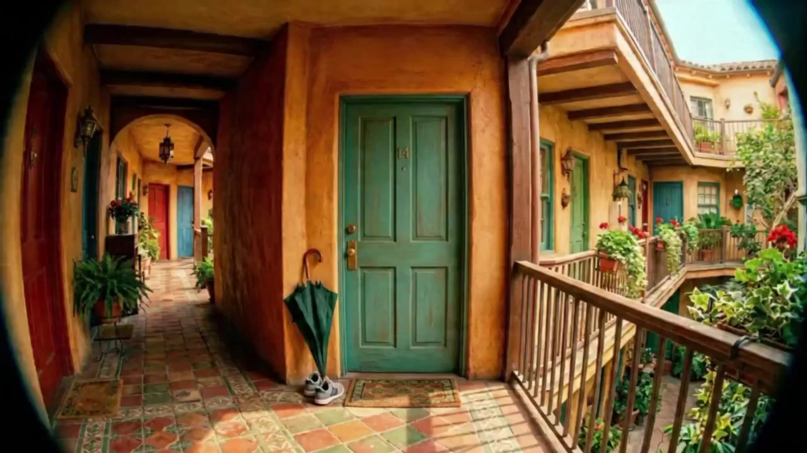

# Story-Driven Video

> **作者：** Flova

## Content

**Process Planning:**

**Stage Logic and Dependencies for the Complete Video:**
1. Write `Final_Video_Spec.md` (Title, Type, Aspect Ratio, Duration, Visual Style, Language) → **text_editor**.
2. Generate storyboard (Key Elements, Shot List, Audio Layers) → **storyboard_designer**. Once the storyboard is ready, scan the current context for any assets provided by the user or generated previously that match the storyboard entries (e.g., element images, background music). For each match, bind and assign the asset to the corresponding storyboard slot via **media_generator** before proceeding to generation steps → **media_generator**.
3. Set up elements:
  *   If the user has already uploaded element assets (e.g., character images or reference characters), bind them directly as assets for the corresponding key_elements.
  *   Otherwise, generate images for all elements → **media_generator**.
4. Generate final video for each shot; 1) Reference all element images related to that shot; 2) (Optional) If the current shot has extremely high continuity with the previous shot, use only the previous shot's video as a reference. (Step 4) → **media_generator**.
5. Generate all audio layers based on the storyboard → **media_generator**.
6. Final assembly once all resources are ready; then guide the user to export → **video_assembler**.

**Dependencies:** 2→1; 3→2; 4→3; 5→2; 6→3,4,5.

**When to Pause:** Do not run all steps at once. Stop at each key stage mentioned above (e.g., after spec finalization, after storyboard completion, after elements are finished, after shot video generation, after audio generation) and confirm with the user before proceeding to the next step. Use cards or reply_to_user to invite the user for review before continuing.

**Note:** User-provided or pre-existing media (mainly affecting steps 3-5): Before filling in generated content, bind and assign the media to the appropriate storyboard location via media_generator first; avoid redundant generation of what the user has already provided.

**Storyboard Design:**

**How to Design Key Elements**
- Ensure inclusion of **key subjects** (characters, objects, etc.), **key locations/scenes**, and **key props** (if any).
- **Characters:** If a character has multiple states or looks in the project (e.g., different outfits, ages), specify them clearly in the description (e.g., Look 1: ...; Look 2: ...).
- **Character-Voice Reference:** Generate or process user-uploaded voice reference material; audio duration must be under 15s.
- **Key Locations/Scenes:** Describe the position and orientation of important objects in the scene, especially props or areas where significant actions/performances occur.
- **User-Provided Assets:** If the user provides reference media and designates it as a key element, the description **must match it**; do not contradict what is seen or heard.

**How to Design Shots**
- **Prioritize long shots with internal cuts** (e.g., 10–15 seconds per shot). Design *within* the shot rather than splitting it into many short shots; the cutting frequency should follow the narrative rhythm. No shot shall exceed 15 seconds (the maximum duration limit of the current model).
- **Each shot description must include:**
  - **Scene:** Reference the location/scene (use scene element IDs, e.g., `[Element_Office_Noir]`).
  - **Story Content:** Actions and dynamics of characters and key objects; dialogue and performance. Write out **accurate lines** (spoken dialogue or internal monologue/voice-over OS). Reference characters using element IDs.
  - **Cinematography:** Shot size (e.g., wide shot, medium shot, close-up), camera angle (e.g., low angle, high angle), camera movement (e.g., static, pan, push-in/pull-out).
- **When a shot contains internal cuts:** List the story content and cinematography in the order of the cuts following the scene/setting description.

**How to Design Standalone Audio**
- **Background Music:** Design at least one global background music track. If the video is long (e.g., 3 minutes or more) and has obvious intervals or turning points, you can plan multiple music segments (each with its own `audio_id` and range).
- **Voice-over:** If using lengthy voice-over narration to advance the story, design it here (set type to `narration`). Define voice characteristics, tone, and accurate script; use `layout_instruction` to limit it to the relevant shot range.

**Media Generation:**

**Element Asset Generation**
- **Images:** Use **TextToImage**. For the same character in different looks or ages, **ImageToImage** is recommended; subsequent looks should reference previously generated images to maintain consistency. Recommended model: **Nano Banana 2 (Gemini 3.1 Flash Image)**, resolution **2K**.
  - **Character Images:** Generate 1 reference image for each character: use a horizontal side-by-side layout. The left side of the frame should show the character's **headshot** (tight composition, focused on the face, used for confirming identity, skin tone, eyes, hairline); the right side should show the character's **full-body shot** (showing the entire body, used for clothing, hairstyle, makeup, shoes, and silhouette).

**Final Shot Video Generation**
- Use **MultiModalToVideo**. Recommended model: **Seedance 2.0**, resolution **720p**.
- Reference input for each shot must include:
  1. **Element Assets** — For each character in the shot, reference the element images in the storyboard + reference scene/prop images as needed.
  2. **Continuity Video Reference** (Optional) — Only add the video reference of the previous shot when the current shot has extremely high continuity with the previous one.

**Prompt Writing:**

**Highest priority, applicable to all prompt writing situations: When the user inputs in Chinese or loads a Chinese locale, the prompts must be written in Chinese. However, content within the prompts regarding voice-over/dialogue must strictly follow the Output Language in Final_Video_Spec.**

**Image Generation Prompts (TextToImage, ImageToImage)**
**General Principles for All Image Prompts**
- Prompts are not just describing
