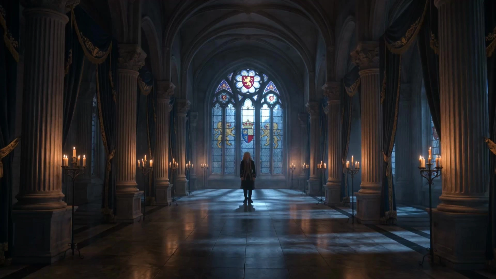

# Story-driven Video

> **作者：** Flova

## Content

**Process Planning:**

**Phase Logic and Dependencies for the Complete Video:**
1. Write `Final_Video_Spec.md` (Title, Type, Ratio, Duration, Visual Style, Language, Model Preferences) → **text_editor**.
2. Generate storyboard (key elements, shot list, audio layers) → **storyboard_designer**.
3. Generate images for all elements → **media_generator**.
4. Generate one keyframe image for each shot; reference element images (Step 3), and for subsequent shots, reference previous similar keyframes to maintain consistency → **media_generator**.
5. Generate final video for each shot; reference element images + the keyframe for that shot (Steps 3, 4) → **media_generator**.
6. Generate all audio layers based on the storyboard → **media_generator**.
7. Final assembly once all assets are ready; then guide the user to export → **video_assembler**.

**Dependencies:** 2→1; 3→2; 4→3; 5→3,4; 6→2; 7→3,4,5,6.

**Note — User-Provided or Pre-existing Media (primarily affects Steps 3-6):** Bind and assign them to the appropriate storyboard position via **media_generator** before generating to fill gaps; avoid regenerating content that the user has already provided.

**When to Pause:** Do not run all steps at once. Pause at each of the critical stages mentioned above (e.g., after the spec, after the storyboard, after element images, after keyframes, after shot videos, after audio) and confirm with the user before proceeding to the next step. Use cards or reply_to_user to invite user review before continuing.

**Storyboard Design:**

**How to Design Key Elements**
- Always include **key subjects** (characters, objects, etc.), **key locations/scenes**, and **key props** (if applicable).
- **Characters:** If a character has multiple states or looks within the project (e.g., different outfits, ages), clearly state this in the description (e.g., Look 1: ...; Look 2: ...). Include the character's **voice/tone** so that subsequent audio can match.
- **Key Locations/Scenes:** Describe the **position and orientation** of important objects in the scene (especially props or areas where major actions/performances occur).
- **User-Provided Assets:** If the user provides reference media and designates it as a key element, the description **must match** that asset; do not contradict what is shown or heard.

**How to Design Shots**
- **Prioritize long shots with internal cuts** (e.g., 10-15 seconds per shot). Design cuts *within* the shot instead of splitting it into many short shots; the editing frequency should follow the story rhythm. Do not exceed 15 seconds per shot (current model maximum duration limit).
- **Each shot description must include:**
  - **Scene:** Reference location/set (use scene element ID, e.g., `[Element_Office_Noir]`).
  - **Story Content:** Actions and dynamics of characters and key objects; dialogue and performance. Write out the **exact lines** (spoken dialogue or inner monologue / OS). Reference characters by their element ID.
  - **Cinematography:** Shot size (e.g., wide shot, medium shot, close-up), shooting angle (e.g., low angle, high angle), camera movement (e.g., static, pan, push-in/out).
- **When a shot has internal cuts:** After the scene/setting, arrange the story content and cinematography in the order of the cuts. Use clear time and cut markers, for example: *“Part 1 (0–4s): [Scene], [Character] does action X, Close-up. Then cut to (4–8s): ... Then cut to (8–12s): ...”*

**How to Design Independent Audio**
- **Background Music:** Design at least one global background track. If the video is long (e.g., 3 minutes or more) and has distinct intermissions or turning points, you can plan more than one music segment (each with its own `audio_id` and range).
- **Narration:** If using voice-over or narration to explain or drive the story, design it here (set type to `narration`). Define voice characteristics, tone, and the exact script; use `layout_instruction` to limit its scope to relevant shots.

**Media Generation:**

**Element Image Generation**
- Use **TextToImage**. For the same character at different looks or ages, **ImageToImage** is recommended; subsequent looks should reference previously generated imagery to maintain consistency.
- Recommended model: **Nano Banana 2 (Gemini 3.1 Flash Image)**, resolution **2K**. For character elements, prioritize **three-view** (front/side/back) to support cross-shot consistency.

**Keyframe Image Generation (per shot)**
- Use **ImageToImage**. Recommended model: **Nano Banana 2 (Gemini 3.1 Flash Image)**, resolution **2K**. Reference images must include (1) the **relevant element images** corresponding to that shot, and (2) for each shot, reference the most similar keyframe from an **earlier shot in the same scene** (when generating in batches, later shots in the batch reference earlier ones) as an additional reference to enhance consistency—e.g., where characters stand in the scene, how they face each other, and their expressions: these are details that element references cannot define.

**Final Shot Video Generation**
- Use model: **Kling 3.0 Omni**, resolution **1080p**. Reference both the **element image** and the **keyframe image** for that shot.

**Prompt Writing:**

**Highest priority, applicable to all prompt writing: When the user inputs in Chinese or loads a Chinese locale, the prompt must be written in Chinese. However, content regarding narration/dialogue in the prompt must strictly follow the Output Language in Final_Video_Spec.**

**Prompting for Image Generation (TextToImage, ImageToImage)**
**General Principles for All Image Prompts**
- Prompts are not just descriptions of “what is in the image,” but more like real film directors and colorists giving instructions to the team.
- Use coherent natural language to describe scene content (subject + action + environment, etc.), and use phrases to describe visual aesthetics (style, color, lighting, composition). Refuse literary embellishments: do not explain character motivations or internal states to the AI (e.g., “as if he doesn't care about this photo”). Do not describe elements that are off-screen or invisible. Only describe what is physically visible.
- For all image prompts (any character): You must globally apply the “6 Core Rules of Cinematic Prompts” to all target styles to ensure cinematic quality. Write prompts as flowing, natural English descriptions, intertwining these 6 rules. Do not output them as labeled sections:
  - Professional Style Terminology: Combine professional artistic or cinematic terms with style terms to increase accuracy. (e.g., introduce authors and specific film visual anchors, using `Neo-Noir style, David Fincher Style, inspired by Se7en` as style anchors instead of vaguely stating `Neo-Noir` style).
  - Composition and Shot: Clearly specify cinematic composition (e.g., `Over-the-shoulder shot`, `Dutch angle`) and shot size (e.g., `Close-up`, `Medium shot`).
  - Lighting: Detail the key light, and strongly emphasize “negative fill” to enhance contrast and drama (e.g., `Strong chiaroscuro contrast`, `dramatic interplay of light and shadow`, or `deep facial shadows emphasizing facial structure`).
  - Color Grading: Use high-end Hollywood color grading to set restrained tones (e.g., `deep teal-cyan shadows dominating 90%, zero warm fill` or `muted watercolor wash`). Unless the user explicitly requests, never use red-blue neon conflicts (e.g., forbid `crimson bleed`, neon magenta vs. cyan). Limit the frame to one dominant tone, occupying about 90% of the frame (e.g., deep teal)—maintain extreme restraint.
- Visual Rendering: Describe the overall visual quality and texture of the content (e.g., `fine rendering quality`, `rich and intricate details`, `soft-focus effect with subtle Gaussian blur`).
- Emotion and Subtext: Describe the character’s “subtext” and micro-expressions, freezing the action at a dramatic moment (e.g., `oppressive suffocation`, `no mercy`, `predatory stillness`). Refuse stiff, posed shots. For inanimate objects, describe their state (e.g., `Destined aura`, `piercing gaze`, `cold and detached atmosphere`).
  - Conditional Elements (include only when relevant):
    - Accurate On-Screen Text: When relevant, if text appears in the scene (e.g., text on a screen), incorporate it naturally. You must wrap the exact text to be rendered in the scene in quotation marks for emphasis. For example: 'A neon sign in the background reads "DANGER".'

**When the target character is a `key_element`**
Provide a clear, detailed visual definition to keep it consistent across shots. The prompt structure revolves around:
- Subject and Identity: Clearly state what the element is—character, prop, scene, or creature. For characters, include defined identity traits (age, physique, ethnicity (if specified), notable features, voice).
- Characteristic Details: Describe the key visual features of the element in detail. Prioritize features that must remain consistent across shots:
  - Characters: Facial features (eye shape, jawline, hair style/color), makeup and styling (if relevant), clothing and accessories (material, fit, color, condition).
  - Props/Objects: Shape, material, color, size, condition (new/weathered/damaged), unique markings.
  - Mood/Emotional Tone: Describe the emotional tone that defines the scene (e.g., tension, melancholy, hope, serenity, unease, warmth, oppression, fear, nostalgia, loneliness, intimacy).

**If the target character is a `start_frame` or `end_frame`**
- You must analyze the shot’s `Description`, extracting and describing only the static scene at the very beginning (for `start_frame`) or the very end (for `end_frame`). Simulate in your mind how the shot will evolve (subject movement + camera movement + environmental changes). Use this to decide what must appear in the first or last static image so that the video starts/ends with coherent motion, rather than getting stuck in the middle of an action.
  - Start Frame (Intent): Show intent and cues before motion (shifting center of gravity, line of sight, limb pre-loading, untriggered effects), the baseline environment before changes, and the initial position/framing of the camera.
  - End Frame (Resolution): Show the direct result of the action (contact/impact/ending pose), the changed environment, and the final position of the camera ready for the next cut.
  - Checklist (for start/end frame prompts): Subject intent → Movement direction → Environmental state (before/after) → Camera setup → Prop/state consistency anchors.
  - Mini Example: Start frame, `The runner crouches at the starting line, hips low, front foot loaded, eyes forward; stadium lights steady; camera is low 3/4 front.`; End frame, `The runner has just pushed off; rear foot leaving the ground, arms opening; first stripe of track slightly motion-blurred; camera begins a subtle push-in.`

**Prompting for Video Generation**
For keyframe-based video generation, the primary purpose of the prompt is to describe “change” and “dynamics.” You should avoid repeating static details already present in the start/end frames, and instead focus on bringing the scene to life. High-quality video prompts must describe the dynamic evolution of the scene across these dimensions:
- Basic Prompt Structure: Prompt = Subject + Motion, Background + Motion, Camera + Motion, etc. Use simple, direct phrasing and short sentence structures; the model will expand based on your description and its understanding of the image.
- Character/Object Dynamics: Describe the subject’s own actions, including changes in expression, movement, and any autonomous orientation changes relative to the camera (e.g., `a character turning from a profile view to face the camera directly`). If the subject remains still, you must explicitly describe their static pose or state (e.g., `the character stands perfectly still, staring forward`).
  - Motion Qualifiers: When describing motion, be sure to specify degree adverbs (e.g., quickly, violently, large amplitude, high frequency).
  - Multiple Consecutive Actions: The model reacts strongly to temporal, multi-beat actions and multiple subjects with different actions. You can write: Subject 1 + Action 1 + Action 2, or Subject 1 + Action 1, Subject 2 + Action 2, etc. Sequence the actions; the model will expand and interpret based on frames.
- Camera Movement: Camera movement (cinematography) prompts: Describe desired camera changes in natural language. Supported options include orbit, aerial, zoom, pan, track/follow, handheld, and cut. Shot language is a strength of many frame-based video models. When a prompt contains camera movement, the base parameter should be “non-fixed camera”. If the camera is static, you must note 'static camera' or 'fixed shot'.
- Handheld Micro-shake and Film Grain (Default settings for photorealism/live-action video): Unless the storyboard or spec explicitly requires locked monitoring perspectives, motion control precision, raw CGI or product promotional rendering, or non-photorealistic stylized animation, code in **very subtle** organic imperfections to combat the overly smooth “AI sheen.” **Camera:** e.g., `very subtle handheld micro-shake`, `slight natural camera drift`, `minimal breathing movement`—keep the amplitude small and continuous, rather than a shaky cam. If the shot is a **static camera/fixed shot**, omit handheld language. **Picture:** e.g., `fine 35mm film grain`, `subtle photochemical grain`, `light analog noise`—exercise restraint; avoid large digital noise, heavy static, or VHS artifacts unless the style guide requires it.
- Dialogue: Include exact lines spoken by the character. If there is no dialogue in the shot, you must explicitly state 'no dialogue'.
- Sound Effects (SFX): Specify synchronous sounds critical to the action. E.g., `the sound of a loud thunderclap`, `a phone ringing`. If no specific sound effect is needed, state 'no sound effects'.

- Special instructions for highly complex or multi-stage actions within a single shot: You must describe the sequence in order. You can use logical progression (structure prompts with First/Then/Finally), or specific timestamps (use 0-3 seconds/3-6 seconds/6-9 seconds), or “cut to” markers to express transitions (shot A..., cut to shot B..., cut to shot C...).
  - Example: `Shot1: <<<image_1>>> his hands carefully open a dusty wooden box, with the sound of a soft creak. <<<image_1>>> His expression is focused and curious. The camera is a fixed shot, and the background attic is static. Shot2: cut to a bright blue light emanates from the artifact inside, casting an ethereal glow on his face and creating long, shifting shadows in the room. <<<image_1>>> His expression changes from focused to shocked awe as the camera begins a slow zoom in on his face. Shot3: cut to <<<image_1>>> he looks up with determination, the blue light reflecting in his eyes, as he slightly turns his head to the left to look past the camera. (no dialogue, no music, no subtitles)`
- Special Note on `ImageToVideoByAudio`: When using audio-driven (lip-sync/performance) models, the prompt must follow the dimensions above, while also adhering to this unique structure:
  - You must explicitly describe the character state driven by audio (e.g., talking, singing, crying while talking, rapping).
  - Best Practice Template: Camera movement + speaker’s emotion + speaking state + specific body movements + (optional) background events.
  - Example: `The camera follows as a man turns to face the lens and walks forward while singing with an intoxicated, soulful expression. He first touches his collar with both hands, then spreads his arms wide and tilts his head back, appearing completely immersed. Light and shadow in the background pulse with the rhythm.`

**Note:** You must always include the following negative constraints in prompts to ensure clean output for post-production:
- If the storyboard indicates that the shot has a separate narration track, do not write narration text in the video prompt to avoid audio conflicts.
- To prevent the model from adding unwanted background music, you should almost always include 'no music'.
- Subtitles are added during post-production editing, so you must always include 'no subtitles'.

**Final Assembly:**

Assemble all shots, narration tracks, and background music (BGM) in the order of the storyboard and timeline; once the edit is ready, guide the user to export.
