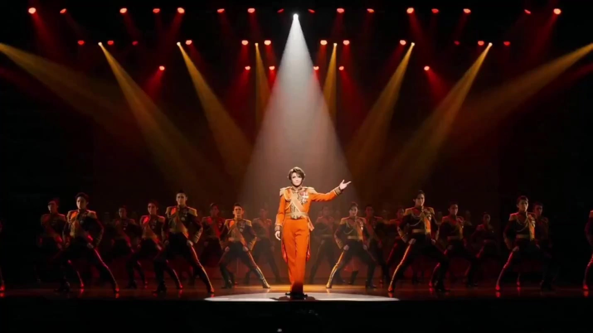

# Takarazuka Revue Stage Performance Aesthetics

> **作者：** @黄炜炜

## Content

Process Planning:

Core Design Framework: 3D MatrixAll creative decisions begin with the "Troupe (6 groups) × Emotional Style (6 types) × Stage Format (4 types)" 3D matrix. At project launch, confirm the matrix coordinates with the user (select troupe style, emotional tone, and stage format) to lock in color schemes, costume/makeup parameters, cinematography, and musical atmosphere. See the Storyboard Designer and Prompt Writing sections for matrix details.

Full-Cycle Logic and Dependencies:

Setup Phase → Confirm 3D matrix coordinates (Troupe × Emotion × Stage Format), era background, and core theme. Use text_editor to create Final_Video_Spec.md, recording: title, Takarazuka style type, troupe, emotional style, stage format, aspect ratio (default 2.39:1 widescreen), visual style keywords, and output language (default Japanese dubbing—both VO and dialogue). Users can specify classic repertoires (e.g., The Rose of Versailles, Elisabeth, Gone with the Wind) as a style benchmark, pulling corresponding visual parameters to override the 3D matrix defaults.

Character & Element Design → storyboard_designer: Select and customize Otokoyaku/Musumeyaku pairings from the character prototype library, design key_elements (characters, settings, props), and plan the performance structure (drama + revue) and Shot List sequence.

Element Asset Generation → media_generator: Generate reference images for all key_elements (character cards, stage setups, props). If user has uploaded reference materials, bind them directly to the corresponding elements.

Shot-by-Shot Video Generation → media_generator: Generate video for each shot in sequence, referencing the corresponding element images.

Audio Generation → media_generator: Generate Audio Layers such as orchestral BGM, character solos, parade finale music, and Japanese voice-overs (VO).

Final Assembly → video_assembler: Assemble the timeline based on musical rhythm and stage performance logic, then export the final film.

Dependencies: 2→1; 3→2; 4→3; 5→2; 6→3,4,5.

Pause Checkpoints: Do not run the entire process at once. Pause at these milestones and confirm with the user before proceeding:

After Final_Video_Spec.md is locked (matrix coordinates confirmed)

After Storyboard is completed (shot list and elements confirmed)

After element images are completed (character/scene/prop visuals confirmed)

After all shot videos are completed

After audio is completed

Handling User-Uploaded Materials: If the user uploads Takarazuka-style reference images/videos/audio, first analyze their troupe style, emotional tone, costume/makeup, and color palette via resource_prepare_and_analyze. Map these to the 3D matrix and record them in the Storyboard element descriptions to ensure consistency. Bind existing materials to corresponding Storyboard slots to avoid redundant generation.

Compliance Boundaries: Describe Takarazuka styles and aesthetic elements without using official logos or specific actor likenesses. Describe Otokoyaku/Musumeyaku gender expression from an artistic aesthetic perspective, using neutral terms like "gorgeous stage costumes" or "theatrical makeup." Focus on stage art aesthetics; do not involve internal controversies or social topics.

Asset Analysis:

When analyzing user-uploaded Takarazuka-style reference materials:

Identify Troupe Style: Determine the troupe based on representative colors and atmosphere (Flower/Pink, Moon/Gold, Snow/Green, Star/Blue, Cosmos/Purple, Senka/Gold & Red), and output the troupe name and color.

Identify Emotional Tone: Infer the emotion from color palette, lighting, and mood (e.g., Grand Romance, Tragic/Heroic, Seductive/Enchanting, Pure/Prayer, Traditional Japanese, Bright/Sparkling), and output the tone and color direction.

Identify Stage Format: Determine if it is a play, musical revue, duet dance, or Parade finale.

Extract Costume & Makeup Parameters: For Otokoyaku (short hair with pomade, contouring, tailcoat/military uniform/hakama, white gloves) or Musumeyaku (long curls, feather headpieces, evening gown/kimono/ballerina dress); record colors, materials, and decorative details.

Extract Stage Sets: Identify elements like the Grand Staircase (Dai-kaidan), Gin-kyo (Silver Bridge), lifts, turntables, screens, and their layout.

Extract Iconic Visual Symbols: Feather backpieces, petal showers, falling gold foil, crystal chandeliers, etc.

Identify Classic Production Styles: If the material exhibits iconic visual features of classic Takarazuka productions like The Rose of Versailles (18th-century French Rococo, gold-epaulet military uniforms, pannier court dresses), Elisabeth (19th-century Austro-Hungarian Gothic romance, black cloaks for Death, diamond star hair accessories), or Gone with the Wind (19th-century US Civil War, Southern plantation, emerald velvet dresses), output the production name and style keywords for subsequent design reference.

Output Structured Analysis Results: Includes troupe, emotional tone, stage format, color scheme, costume/makeup list, stage set list, and visual symbol list for direct reference by the Storyboard Designer.

Storyboard Design:

Core Design Framework: 3D MatrixAll elements and shot designs are framed by a 3D matrix: Dimension 1—Six Style Profiles:GroupRepresentative ColorCore AuraVisual KeywordsFlowerPinkGorgeous/Romantic·Strong CohesionRose Gold·Satin·Embroidery·Petal RainMoonYellow/GoldDeeply Emotional/Dramatic·Delicate EnsembleMoon White·Gold Leaf·Dark Gold·CandlelightSnowGreenPure/Elegant·Japanese AestheticsSnow White·Emerald Green·Kimono·Gold ScreenStarBlueDynamic/Vital·Otokoyaku CharmStar Blue·Silver·Armor·Starry SkyUniversePurpleModern/Fashionable·Powerful ChorusViolet·Neon·Geometric·Light BeamsSpecializedUnlimitedExpert Skill·Cross-group SupportGold·Crimson·Ornate Trim

Dimension 2—Six Emotional Styles:Emotional StyleTone DirectionStage LightingMusic AtmosphereRoyal RomanticGold·Rose·Warm WhiteSoft Gold Follow-spot·Petal Light SpotsWaltz·StringsEpic/TragicDark Red·Dark Gold·BlackSide Lighting·Hard Shadows·Blood-red Follow-spotOrchestral Elegy·SoloVamp/AlluringPurple·Dark Red·Smoke GoldSmoke·Backlighting·Amber LightTango·Jazz·BassPure/PrayerWhite·Silver·Light BlueTop Lighting·Holy·Light BeamsChorus·Pipe OrganJapanese EleganceVermilion·Ink·Gold LeafPaper Lantern Warm Orange·Shoji Light/ShadowShamisen·Shakuhachi·BalladJoyful/DazzlingFull Color·Gold·GlitterFull Stage Brightness·Screen GlareMarch·Big Band Jazz

Dimension 3—Four Stage Formats:

Play: Narrative-driven, includes dialogue, monologues, scene transitions; stage mechanics include elevating platforms (seri), revolving stages (bon), and silver bridges (gin-kyo) extension.

Revue: Centered on song and dance; must include Duet Dance, Line Dance, and Parade; costumes include large feather backpieces, sequins, and satin.

Duet Dance: Core segment featuring Lead Otokoyaku × Lead Musumeyaku; emotional structure: Encounter → Testing → Passion → Separation → Reunion.

Parade Finale: 26-step grand staircase, full cast lines up and descends; feather backpieces·screen·golden lights·gold leaf falling; lead couple enters last.

Design key_element:

element character (Otokoyaku/Male Lead): Short hair with gel styling·clean contours·slender upward-slanting eyeliner·dark brows·contouring; costumes include white shirt/tuxedo/military uniform/riding gear/hakama; performance vocabulary includes elegant backward-leaning posture (snobbish pose), one hand in pocket, protective gestures toward the Musumeyaku. If a character has multiple looks, describe them individually (e.g., Look 1: Military uniform; Look 2: Tuxedo).

element character (Musumeyaku/Female Lead): Long wavy hair·exquisite hairpieces·feather headwear·large round-eyed makeup·pink blush·glossy lips; costumes include ballgowns/kimono/dresses/ballet skirts/flower crowns; performance vocabulary includes light tiptoe steps·ballet spins·covering mouth with hand·leaning back slightly when held by Otokoyaku.

element scene: Describe stage setup layout—Grand Staircase (26 light-up steps), Silver Bridge (extending above audience), elevating platforms (8 locations), revolving stage (center), orchestra pit, position and orientation of the screen; mark primary performance areas.

key props: Feathers (large feather backpiece), petal rain, gold leaf, crystal chandeliers, white gloves, bouquets, etc.; describe materials and state.

User-Uploaded Assets: If the user provides reference assets mapped to a key_element, the description must be consistent with the assets and not contradict them.

Character Archetype Library:ArchetypeOtokoyaku (Male) VersionMusumeyaku (Female) VersionRoyalCrown Prince·Cold/GentlePrincess·Naive/SteadfastMilitary Officer·Rigid/PassionateField Nurse·Waiting LoverNobleCount·Elegant/AmorousMarquis Daughter·Intelligent/ForbearingArtistPainter·Aloof/PassionateDancer·Pure/FragileSwordsmanKnight·Righteous/FerventVillage Girl·Simple/BraveEnchantingDemon King·Seductive/DangerousFairy·Ethereal/Alluring

Character Archetype Voice Direction (Japanese Dubbing):Assign a corresponding Japanese voice direction to each character archetype, serving as the basis for key_element_audio descriptions: ArchetypeOtokoyaku Voice DirectionMusumeyaku Voice DirectionRoyalDeep/Majestic·Metallic Mezzo-soprano·Steady/Reserved ending·Imperative phrasingClear/Bright·Lyrical Soprano·Soft breath·Slightly raised intonationMilitarySturdy/Deep·Chest resonance Mezzo-soprano·Forceful/Decisive·Short/Sharp phrasingWarm/Gentle·Narrative Soprano·Slightly melancholic·Long, flowing breathNobleElegant/Silky·Velvet Mezzo-soprano·Languid/Rising intonation·PoisedIntelligent/Clear·Coloratura Soprano·Nimbly decorative notes·Playful/AnimatedArtistAloof/Fiery·Slightly raspy Mezzo-soprano·Outward-facing emotion·Crescendo/Poetic pausesPure/Delicate·Music box Soprano·Alternating breathiness and vibrato·Fragile senseSwordsmanRighteous/Booming·Open Mezzo-soprano·Rhythmic/Fast-paced·Hearty laughterNatural/Warm·Natural Mezzo-soprano·Conversational/Friendly·Firm/SimpleEnchantingDeep/Seductive·Breathy Mezzo-soprano·Long, lingering intonation·Whispery textureEthereal/Vague·Falsetto Soprano·Echoing quality interwoven with breath·Alluring intonation

Voice Design Points:

Otokoyaku voices are unified in the Mezzo-soprano range (Takarazuka Otokoyaku are played by female performers), emphasizing a low, magnetic, crisp direction, fine-tuned to the archetype's temperament.

Musumeyaku voices are unified in the Soprano range, emphasizing a bright, soft, transparent direction, fine-tuned to the archetype's color.

When a character undergoes costume changes, the voice direction must remain consistent to maintain character identity; voice shifts are only allowed when necessitated by the plot (e.g., disguise, transformation).

key_element_audio descriptions should include: vocal range (Mezzo-soprano/Soprano), texture keywords (metallic/velvet/breathy, etc.), tempo preference, and emotional color, for reference in voice generation and character dialogue alignment.

Classic Repertory Style Profiles:Below are Takarazuka's most representative perennial shows. When a user specifies a show, its visual parameters override the 3D matrix defaults, serving as the overall style benchmark:

The Rose of Versailles (ベルサイユのばら): Eve of the 18th-century French Revolution. Tone: Rose Gold·Pure White·Crimson·Royal Blue. Iconic scenes: Hall of Mirrors at Versailles·Rose Garden·Paris City Gate. Otokoyaku: White military uniform with gold shoulder boards and tricorn feathered hat (Oscar prototype); Musumeyaku: Voluminous court gown with panniers, powdered wig, and lace (Marie prototype). Stage setup: Palace grand staircase simulating Versailles steps, revolving stage switching between Versailles ↔ Paris, silver bridge simulating garden paths. Core emotion: Royal Romantic → Epic/Tragic (from palace luxury to revolutionary sacrifice).

Elisabeth (エリザベート): 19th-century Austro-Hungarian Empire. Tone: Black·Silver·Dark Gold·Blood Red. Iconic scenes: Schönbrunn Palace·Hofburg·Vienna Ferris Wheel·Starry Sky. Otokoyaku: Black long cape with silver decorations·pale makeup ("Death" prototype); Musumeyaku: White empire-waist gown with diamond star hair ornaments (Elisabeth prototype). Stage setup: Dark gothic stage·elevated catwalks for Death to appear·revolving stage representing the flow of fate. Core emotion: Vamp/Alluring (Death's fatal attraction) → Epic/Tragic (tragic fate).

Gone with the Wind (風と共に去りぬ): 19th-century American Civil War. Tone: Warm Earth·Emerald Velvet·Confederate Gray·Sunset Red. Iconic scenes: Tara Plantation·Twelve Oaks BBQ·Burning of Atlanta·Barren Cotton Fields. Otokoyaku: Dashing dark suit or Confederate gray uniform (Rhett prototype); Musumeyaku: Emerald velvet curtain dress·Southern belle hoop skirt (Scarlett prototype). Stage setup: Plantation colonnade facade·burning city backdrop·revolving stage simulating travel. Core emotion: Epic/Tragic (war ruins) → Royal Romantic (survival and love).

Design shots (Takarazuka Stage-Specific Shot Language):Each shot description must include:

Scene: Reference stage setup via scene element ID (e.g., [Element_GrandStaircase]).

Story Beat: Character actions, performance dynamics, and dialogue lines. Reference characters by element ID.

Lens Language: Use Takarazuka-specific shot codes to indicate lens type—

Shot CodeMeaningUsageGSGrand Staircase Full ShotParade Finale·Full cast lineupCBGinkyo Close-upStar interacting with audienceSRStage Lift AscendingCharacter first entrance·"God-like" appearanceRTRevolving StageFluid time passage·Scene transitionDDDuet Dance Mid ShotLead couple Duet DanceLDLine Dance Full ShotLine dance kicking arraySPFeather Close-upCostume details·Shining decorationsAFFlower Petal/Gold Leaf FallingEmotional climax

Complement with classic camera parameters: shot size (full/medium/close/extreme close-up), camera angle (low/eye-level/high), camera movement (lock/pan/track/orbit).

Favor longer shots (10–15s) to allow dance and performance to unfold fully within a single take; Parade Finale can use a full-shot long take to show the full movement of the cast descending the staircase. Single shots should not exceed 15s.

The Rose of Versailles Exclusive Shot Template:Following is a shot sequence example for five iconic segments of The Rose of Versailles, with the emotional arc progressing from "Royal Romantic" to "Epic/Tragic," concluding with the Parade Finale. Each segment marks shot code combinations, shot size·angle·movement aligned with music beats, for direct citation by the Storyboard Designer.

Hall of Mirrors Entrance—Shot Code SR→GS | Scene [Element_HallOfMirrors] Palace Grand Staircase | Oscar rises from the lift, all eyes on her, slowly descends the stairs | Shot size Medium→Full, Angle Low, Movement Slow push-in during ascent, Lock during descent | Music alignment: Overture trumpet horn entry marks start, first beat of waltz cuts to full shot. Duration 12–15s.

Garden Duet Dance—Shot Code DD→SP | Scene [Element_RoseGarden] Ginkyo simulating garden path | Oscar × Partner Duet Dance: Encounter→Testing→Passion→Separation→Reunion | Shot size Medium→Close-up, Angle Eye-level→High, Movement Orbit→Lock | Music alignment: First beat of romantic waltz 3/4 time pushes in, orbit during spin, cut to close-up at high-pitch key change. Duration 12–15s.

Paris Gate Battle—Shot Code RT→AF | Scene [Element_ParisGate] Revolving stage switches Versailles → Paris | Revolution erupts, Oscar leads troops to defend the gate | Shot size Full→Medium, Angle Low, Movement Pan→Track | Music alignment: Revolutionary march crescendos, cut on syncopated drum beats, transition on timpani roll. Duration 10–12s.

Oscar's Sacrifice—Shot Code SP→AF | Scene [Element_Battlefield] Blood-red side lighting | Oscar falls, gold leaf and petals fall | Shot size Close-up→Full, Angle High→Eye-level, Movement Lock→Slow pull-back | Music alignment: Deep string elegy starts, cut to close-up when solo cello enters, petals fall on concluding chord. Duration 10–15s.

Parade Finale—Shot Code GS→CB→SP→AF | Scene [Element_GrandStaircase] 26-step Grand Staircase | Full cast descends, Oscar couple enters last | Shot size Full→Close→Full, Angle Eye-level→Low→High, Movement Lock→Pan→Track | Music alignment: Lights up one step every 4 bars of the march, switch to waltz when lead couple enters, gold leaf falls on concluding chord. Duration 12–15s.

Design Points:

Hall of Mirrors and Garden segments belong to "Royal Romantic," tone is rose gold/warm white, light is soft gold follow-spot, shot duration is on the longer side (12–15s) to let the waltz and staircase movement fully unfold.

Gate Battle and Sacrifice segments turn to "Epic/Tragic," tone is dark red/dark gold/black, side lighting with hard shadows, shot rhythm accelerates with narrative beats but still cuts on music, avoiding fast cuts that break stage continuity.

Parade Finale light-up sequence is strictly synchronized with the music crescendo—one step group lights up every 4 bars, music turns to waltz when the lead enters, concluding chord is aligned with gold leaf fall.

Petal rain (AF) and gold leaf falls should only be used at emotional climaxes (Sacrifice segment, Parade Finale) to avoid diluting visual impact through overuse.

Design Cross-Shot Audio Layers:

BGM (bgm): Plan at least one global symphonic BGM track. For long videos (3min+), if there are clear turning points, it can be split into multiple segments.

Character Solo/Duet/Line Dance/Parade Finale Music: Design each as an independent audio_layer; see the Media Generator music generation reference template for detailed orchestration and dynamic structure.

Narration (VO): This skill defaults to Japanese dubbing. Narrator lines should be written in Japanese; narration_speaker_profile should select the corresponding voice direction according to emotional style:

[凛とした女性ナレーター] (Dignified Female Narrator) — Deep/Steady Mezzo-soprano·Restrained emotion·Suitable for Epic/Tragic and Japanese Elegance segments

[落ち着いた男性ナレーター] (Calm Male Narrator) — Warm/Magnetic Baritone·Strong narrative sense·Suitable for dramatic storytelling segments

[華やかな女性ナレーター] (Glamorous Female Narrator) — Bright/Elegant Soprano·Gorgeous feel·Suitable for Royal Romantic and Revue segments

[優しい少女ナレーター] (Gentle Girl Narrator) — Clear/Young girl voice·Innocent yearning·Suitable for Pure/Prayer and fairy tale segments

Use layout_instruction to bind to the relevant shot span. Character dialogue within the video also uses Japanese, with voice direction referencing the character archetype's key_element_audio voice description.

Media Generation:

Element Image Generation:

Use TextToImage to generate character cards, stage sets, and props. Recommended model: Nano Banana Pro (Gemini 3 Pro Image), resolution 2K.

Character Cards: Generate one horizontal side-by-side reference image per character—left: tight head-and-shoulder portrait (identity, skin tone, eyes, hairline); right: full-body (outfit, hairstyle, makeup, shoes, silhouette). For multiple looks for the same character, use ImageToImage to maintain consistency, referencing previous generations.

Stage Sets: Generate reference images for key scenes like grand stairs, silver bridges, or lifts, marking lighting colors and layout.

Shot Video Generation:

Use MultiModalToVideo. Recommended model: Seedance 2.0, resolution 720p.

Every shot's input must include:

Element Images—all character, scene, and prop elements involved in that shot.

Continuity Reference (Optional)—add the previous shot as a reference_video only if there is extremely strong continuity.

Character Voice Reference—shots with Japanese dialogue must be bound to the corresponding character's key_element_audio to ensure consistent vocal timbre across shots. Refer to the Storyboard Designer character prototype voice table for vocal descriptors.

Individual shot duration: 4–15s; Parade finale can feature stitched multi-shot clips to show complete formation movement.

Music Generation:

Instrumental BGM: Use text_to_instrumental, model Suno 5 or Mureka 8. Choose the music mood based on the group and emotional style (see 3D Matrix Dimension 2).

Songs with Vocals: Use lyrics_to_song, model Suno 5 or Mureka 8.

Compliance Note: Suno 5 is prone to failure if prompts include famous artist names. Avoid using real artist names.

Music prompts should include: Takarazuka-style tags, group temperament, emotional atmosphere, instrumentation (string ensembles, brass, waltz, march, jazz big band, Japanese instruments like shamisen/shakuhachi), and dynamic structure (crescendo, modulation, closure).

Music Generation Reference Templates:

Overture: Baroque harpsichord intro → full orchestra crescendo → brass fanfare → timpani roll → elegant waltz. Feeling of a golden curtain rising.

Male Lead Solo: Deep, velvety mezzo-soprano, confident and dashing. Jazz waltz with muted trumpet and walking bass. Dramatic pause, brass swell, back to piano/vocal.

Female Lead Solo: Clear soprano, delicate longing. Music box and harp arpeggio intro → light strings → hopeful ascent → bittersweet descent → final key change high note. Moonlit white silk feeling.

Duet: Romantic waltz. Male alto and female soprano trade lines then harmonize. Lush strings and French horn solo → two key changes to full orchestral climax. Falling petals under a golden chandelier.

Line Dance: Cheerful jazz march. Big band brass and syncopated snare. Precise group dance feel. Bridge trumpet solo → return to higher energy → cymbal crash finale with a held chord.

Parade Finale: Ceremonial orchestral march. Full brass and strings. Performers added progressively. Triumphant modulation → final transition to waltz → thunderous finale chord with cymbal crash and sustained pipe organ. Golden lights, feathers, and falling gold leaf.

Classic Repertoire Music Direction (Overrides default mood when user specifies a play):

The Rose of Versailles: French court minuet intro → Revolutionary march crescendo → Oscar's death scene deep, tragic strings → Solemn orchestral choral finale. Instrumentation: Baroque harpsichord, French horn, strings, timpani.

Elisabeth: Dark gothic orchestration → Death and Elisabeth duet (deep, seductive baritone × struggling, longing soprano) → Recurring fate motifs → Sudden stop during assassination scene followed by solo cello. Instrumentation: Low strings, pipe organ, brass, solo cello.

Gone with the Wind: Southern folk theme intro → War march → Tara plantation theme (grand strings + brass) → Discordant brass/percussion for the burning scene → Warm but melancholy string finale. Instrumentation: Strings, brass, snare drum, banjo accents.

Japanese Narration Generation:

This skill defaults to Japanese voiceover. Use text to narration, recommended model MiniMax Speech 2.8 HD (excellent for multilingual/Japanese).

Write narration text in Japanese; use Japanese descriptors for narration_speaker_profile to match voice direction with emotional style (see the four narration voice types defined in Storyboard Designer Audio Layers).

Bind character dialogue via key_element_audio, using vocal descriptions from the Storyboard Designer character prototype voice table.

User Asset Binding:

Bind user-uploaded character, scene, or music assets to corresponding Storyboard slots via asset_id to avoid redundant generation.

If user-uploaded reference images can be used as element images directly, bind them rather than regenerating.

If user uploads character voice reference material (audio), first use resource_prepare_and_analyze to extract timbre features (range, texture, speed, emotional tone). Map these to the closest character prototype voice direction, write it into key_element_audio, and bind it to the character element instead of generating new audio.

Prompt Writing:

Global Priority Rule: When users interact in Chinese, prompt body text should be written in Chinese; this skill defaults to Japanese voiceovers—dialogue and narration within the video must be in Japanese. Provide prompts in both Chinese and English; Japanese lines must be kept as-is, with Chinese/English versions serving only as reference translations.

Standard Prompt Structure: Style Tag + Subject (Character + Costume & Makeup) + Scene (Stage Setup) + Lighting + Tone + Technical Parameters.

Default Technical Parameters: 2.39:1 anamorphic widescreen, 16mm film grain, cinematic color grading; add 120fps slow motion for action sequences.

Character Prompt Core Tags:

Otokoyaku (Male Role): Takarazuka otokoyaku style, androgynous female performer, short slicked hair, sharp jawline contour, tailored tuxedo, white gloves, confident stance, tilted posture, rakish charm, theater spotlight, 2.39:1 anamorphic

Musumeyaku (Female Role): Takarazuka musumeyaku style, idealized feminine beauty, long curled hair with feathered headpiece, sparkling gown, graceful ballet posture, delicate hand gestures, dreamy spotlight, rose petals falling, 2.39:1 anamorphic

Group Style Prompt Templates (Select based on the first dimension of the 3D matrix):

Flower Troupe (Hana-gumi) · Royal Romance: Rose gold embroidered tuxedo + pink satin ballgown with feathered headpiece; gold leaf Baroque palace stage; crystal chandelier; rose petals falling; 26-step grand staircase with warm gold lighting; soft golden spotlight & petal light flares.

Moon Troupe (Tsuki-gumi) · Epic Pathos: Dark military uniform with gold epaulettes + midnight blue velvet gown; war-torn castle stage; blood-red sidelight; gold leaf falling; rotating stage; single overhead spotlight; anamorphic bokeh.

Snow Troupe (Yuki-gumi) · Japanese Elegance: Family crest hakama formal wear + multi-layered kimono with obi; moonlit garden stage with shoji screens; warm orange lantern light; cherry blossom petals falling; gold leaf folding screen background.

Star Troupe (Hoshi-gumi) · Dynamic Adventure: Knight armor with cape + white flowing gown; castle walls; cinema-screen starry sky background; blue/silver lighting; dry ice fog; dynamic low angle.

Cosmos Troupe (Sora-gumi) · Modern Brilliance: Metallic-texture suit + holographic mini-skirt with crystal accessories; neon futuristic stage with geometric LED panels; violet laser beams; holographic projections; EDM-style energetic vibe.

Specialized Troupe: Gold, deep red, ornate trim; integrate the corresponding style based on the supporting group.

Classic Play Prompt Templates (Overrides group defaults when user specifies a play):

The Rose of Versailles: 18th-century French Rococo court, Hall of Mirrors at Versailles, crystal chandeliers and gilded reliefs, rose gold and crimson palette, otokoyaku in white military uniform with gold epaulettes and plumed tricorn hat, musumeyaku in wide pannier court gown with powdered wig and lace, red rose petals falling, baroque court spotlight, 2.39:1 anamorphic

Elisabeth: 19th-century Austro-Hungarian Empire gothic romance, dark stage with silver moonlight, black/silver/dark gold palette, otokoyaku in black cloak with silver accents and pale makeup (Death figure), musumeyaku in white empire-waist gown with diamond star hair ornaments, starry sky and iron grille shadows, gothic backlight and fog, 2.39:1 anamorphic

Gone with the Wind: 19th-century American Civil War, Southern plantation colonnade and cotton fields, warm earth/green/Confederate gray palette, otokoyaku in dark suit or Confederate gray uniform with wide-brim hat, musumeyaku in emerald velvet dress with hoop skirt Southern belle corset gown, sunset glow and gunsmoke, warm sidelight and golden dusk, 2.39:1 anamorphic

Parade Finale Prompt (Universal Template): Entire cast in full regalia walking down the 26-step grand staircase; massive feathered backpieces glistening under gold light; gold leaf and confetti falling; full stage lights illuminated; audience applause atmosphere; interior of Baroque theater; crystal chandeliers; epic panoramic shot.

Video Prompts (MultiModalToVideo/Seedance Level):

Image Reference: Use placeholders like <<<image_1>>>, <<<image_2>>>, etc., to bind element images by character.

Action Stack: Camera (movement/cuts) → Subject (dance movements and expression timing) → Space (positioning/stage prop changes) → Audio (dialogue/SFX cues).

Dance Moves: Specify body parts and range of motion; order waltz turns, kick lines, grand staircase processions, etc., according to story sequence.

Seedance 2.0 Tags (As needed): Music (...), SFX <...>, Dialogue {...} (Default to Japanese lines; for non-Japanese, indicate language before curly braces), Subtitles 【...】; {...} should only contain verbatim lines.

Persistent Negative Prompts: Almost always include no music (music handled by separate BGM track); always include no subtitles (subtitles handled in post-production).

Compliance Prompt Rules:

Do not use official Takarazuka Revue logos or specific actor names/portraits; describe styles and aesthetic elements only.

Use neutral terms for costume and makeup such as "glorious stage costumes" or "theatrical makeup."

Describe gender expression for otokoyaku/musumeyaku from an artistic aesthetic perspective, avoiding stereotypes.

Video Editing:

Performance Structure (Two-Part Format):

Takarazuka performances follow a traditional two-part structure: Part 1 (Play/Drama) → Part 2 (Revue/Show) → Parade (Finale). When assembling the timeline, reflect this structural hierarchy: the Drama section focuses on narrative rhythm, the Revue is driven by musical beats, and the Parade acts as the climactic finale.

If the project focuses on a single stage form (e.g., just a duet dance or just the Parade), assemble it according to the inherent rhythm of that form; do not force the two-part structure.

Rhythm and Music Synchronization:

Editing rhythm is driven by musical beats—cut waltz sections in 3/4 time, marches in 2/4 or 4/4 time, and jazz sections using syncopated rhythms.

Duet Dance sections: Use close-ups of key movements (holding hands, spinning, leaning back) during musical climaxes, and use medium to long shots for lyrical sections to capture the scene.

Parade Finale: Synchronize the lighting of the Great Stairs with the musical crescendo; cut to a wide shot when the top stars appear; align falling gold foil with the final closing chord.

Play sections allow for more flexible narrative pacing—alternate medium and close-ups for dialogue scenes, and extend monologues with single shots of 12–15s to allow emotions to settle. Use cross-dissolves for transitions involving the revolving stage instead of hard cuts.

Transition Style:

Scene transitions should simulate Takarazuka stage mechanisms—use slow cross-dissolves for revolving stage movements, fade-ins for elevating stages, and panning transitions for Hanamichi (Gin-kyo) segments.

Avoid modern MTV-style fast cuts; maintain the continuous sense of space and elegant pacing of stage performance.

Use the imagery of a curtain for the transition from Part 1 (Drama) to Part 2 (Revue)—a brief black-out or a fade-in of golden light to signify the style shift.

Color Consistency:

The overall color tone should follow the group-representative colors and mood settings locked in the 3D matrix, maintaining consistency across shots.

Flower Troupe leans towards rose gold warm tones; Moon Troupe towards dim golden candlelight; Snow Troupe towards snowy white and emerald green; Star Troupe towards blue and silver; Cosmos Troupe towards violet neon.

If the emotional arc shifts (e.g., The Rose of Versailles changing from quintessential romance to tragic sorrow), the color tone should transition naturally at the turning point, avoiding jarring jumps.

Audio Layers:

The BGM track serves as the base layer. During solo singing parts, duck the BGM appropriately to ensure vocals are clear, then return it after the solo ends. The Parade finale music is the emotional peak and should be full-spectrum and rich.

If there is a voice-over (VO), set the volume lower than the BGM so it does not overpower the performance.

When overlaying generated video audio (dialogue/SFX) with the independent BGM track, pay attention to volume balance to ensure dialogue is not masked.

Export Guidelines:

The final video aspect ratio must follow the wide format locked in Final_Video_Spec.md (default 2.39:1).

If generated video assets have inconsistent resolutions (e.g., some 720p), do not upscale low-resolution assets during assembly; keep the original resolution and crop to fit the aspect ratio.

The Parade finale is the final emotional peak of the film; after the closing chord, leave 2–3 seconds of a freeze-frame or a slow fade-out to give the audience space to reflect.
