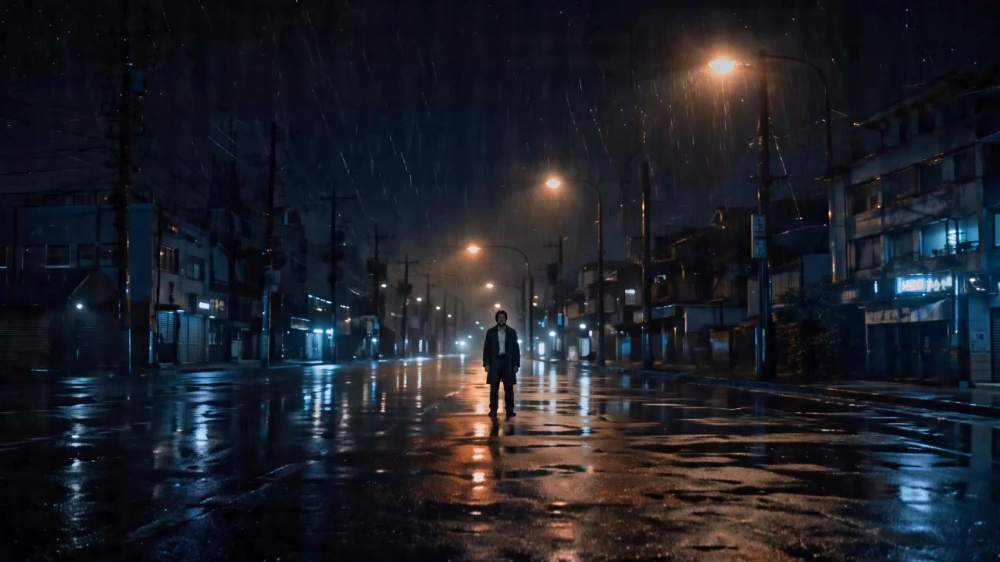

# Takeshi Kitano Blue-Tone Short

> **作者：** @Damon

## Content

Process Planning:

【Absolute Rigid Model Lockdown】Global Model Consistency Constraint:

Image Generation: Strictly force the use of GPT Image 2 for all image production. It is strictly prohibited to mix or automatically switch to any other image models (e.g., Seedream, Midjourney, Nano Banana, etc.).

Video Generation: Strictly force the use of Seedance 2.0 for all video production. It is strictly prohibited to mix or automatically switch to any other video models (e.g., Kling, Sora, Google Veo, etc.).

Global Planning and Orchestration Process (Planner):

Establish Global Video Specification (Final_Video_Spec):

Use text_editor to create or update Final_Video_Spec.md. Within it, strictly lock and declare the following initial core parameters as the globally shared, unique parameter anchors for all downstream agents to coordinate with:

Aspect Ratio and Scale Isolation Loop: Default to a mandatory film-grade 16:9 (Widescreen 1.77:1) or the highly fatalistic 2.39:1 (Anamorphic Cinema wide ratio, with top and bottom Letterbox black bars). In Final_Video_Spec.md, you must explicitly isolate the "Image Generation Aspect Ratio" from the "Asset Design Aspect Ratio":

Final video generation and assembly must use this global aspect ratio entirely.

Full-body character three-view assets must be physically locked to 16:9 landscape aspect ratio to provide ample flat layout space. Scene 2x2 grid assets must be physically locked to 4:3 aspect ratio to maintain a 2x2 square image, ensuring they never inherit the 9:16 or 2.39:1 aspect ratio of the video project, completely preventing any stretching, flattening, or missing limbs.

Target Resolution: Set the baseline to 720p for use by the generator (later upscaled to 1080p).

Output Language Self-Selection and Minimalist Aesthetic Norms: Users can choose the final output language of the video as Chinese or Japanese. If the script language differs from the output language, initiate the Bilingual Script Mapping mechanism and establish a 1:1 precise mapping table in Final_Video_Spec.md:

If Japanese is selected (Aesthetic Red Line): Japanese translation must discard any modern narrative or traditional anime exaggeration, strictly adhering to the Takeshi Kitano-style "minimalist, raw, tough yakuza male tone." Personal pronouns must use the rough and forceful "Ore" and "Omae"; sentence endings are strictly forbidden from using any honorifics (e.g., ~desu, ~masu forms), using only short, blunt plain forms or imperative forms instead (e.g., "koi" instead of "kite kudasai"); sentence structures should be extremely fragmented, frequently using ellipses "..." or "......" as markers for breathing gaps during sighing or silent spacing.

If Chinese is selected (Aesthetic Red Line): Chinese dialogue must also present a cold, restrained, and minimalist texture. Strictly prohibit any lengthy, lyrical, or modern internet-style colloquialisms. Sentences must be extremely short and fragmented, with cold, direct vocabulary. For example, use "Zou." (Go.) instead of "We must leave here now," and "Shou, na chu lai." (Hands, out.) instead of "Please take your hands out of your pockets." Frequently insert ellipses "..." or "......" into dialogue, accompanied by numerous silent sighs as physical pause points for fatalistic inner emotions.

Precise Data Track Mapping Format: [Shot_ID] | [Original Dialogue Description] | [Target Minimalist Translation/Polished Draft] | [Emotion/Action Physical Control Tag (CN/JP Corresponding)] This locks the triple-track synchronization of "dubbing generation translation, video lip-sync drive, and post-production subtitle reference."

Global Visual Style: Explicitly inject the "Kitano Blue" aesthetic: low saturation, cold grey-blue tones, symmetrical composition, and a raw film grain texture.

Subtitle Burn-in and Rendering Specification (Subtitles Spec): Hard-coded in Final_Video_Spec.md: External dual-language subtitles (Dual Subtitles) must be independently rendered and laid out by the post-assembly stage (video_assembler) based on the bilingual comparison track. It is strictly prohibited to hard-code, burn in, or generate any physical subtitles within the image (TextToImage/ImageToImage) or video (MultiModalToVideo) generation pixel layers during the early and intermediate stages. This completely eliminates issues like on-screen text errors, multi-language pixel overlap conflicts, and rendering distortions.

Screenplay Incubation & Storyboard Design:

Dramatic Inspiration Incubation: If the user only provides scattered moods (e.g., "a person standing by the sea"), minimalist visual inspiration, or unformed ideas, the Planner must not simply fill in mediocre plots. It must actively take on the role of a "top screenwriter" to assist the user in incubating inspiration:

Combine the unique narrative philosophy of "Kitano Blue" (interweaving mundane absurdity with fatalistic melancholy, warmth with violence), to conceive or enrich the conflict core of the story, the cold character settings, and the dramatic trajectory ("Quiet Daily Life - Absurd Play - Sudden Crisis - Lingering Mono no Aware"), and distill signature visual metaphors (e.g., a toy pinwheel in the sea breeze, handheld fireworks at the end of summer, a blue card with numbers).

Transform fragmented creative ideas into a concise screenplay outline with the essence of Kitano.

Precision Storyboard Construction: Call the storyboard_designer tool to deeply transform the incubated screenplay outline into professional shots and audio_layers. When constructing the shots, reflect the director-level approach of minimalist fixed-camera positioning, negative space, deadpan staring, and elliptical editing rhythm.

Artistic Transition Planning Mechanism: When planning the outline and designing the storyboard (storyboard_designer), detect whether the narrative structure contains major emotional outbursts, the emptiness following sudden violent gunfights, major characters encountering fatal endings (death/parting), or "Mono no aware" nodes marking the end of summer. Once these transition triggers are detected, the Planner must instruct storyboard_designer to actively insert 1-2 "Hand-drawn Sketch/Rustic Oil Painting" Artistic Transition Shots (Artistic Empty Canvas Shots) at key editing junctures in the storyboard as "Emotional Breathing Space" for visual and auditory senses, never transitioning in a plain or straightforward manner.

Human-Machine Collaboration Intercept Point (Core Locking Point): After completing the screenplay outline, storyboard framework, and Spec lockdown, must force a pause to present the script logic, narrative tension curve, and camera intention to the user in detail (e.g., "Why design a 3-second long silent stare here, followed by the void of silence after the gunshot?"). Only after obtaining the user's explicit authorization can the next stage of visual and audio asset design begin.

Reference Asset Pre-detection and Analysis:

Detect the format of the reference assets uploaded by the user (images, video, audio, or documentation) and use resource_prepare_and_analyze for multi-modal intelligent recognition and refined routing:

Video Reference Assets: If the user provides a reference video, call resource_prepare_and_analyze to perform media cropping and extraction: capture high-quality keyframes from the video as static references for character appearance or scene physical layout; or extract the audio track directly from the video and capture clear segments as initial vocal references for the character.

Audio Reference Assets: If the user provides audio clips, call resource_prepare_and_analyze to deeply analyze their phonetic physical texture, and extract, register, and bind them as the corresponding character's key_element_audio (voice reference), used to lock the consistency of subsequent video lip-sync and dialogue dubbing.

Static Image Assets: If the user uploads images, call resource_prepare_and_analyze to identify if the style conforms to Kitano Blue, and check if character reference images conform to the "full-body three-view" specification (rejecting half-body, single-angle, or close-up headshots), and if scene reference images conform to the "multi-angle character-free 2x2 grid" specification format. If the style does not match, it is not a full-body three-view, or the scene format is incorrect, deeply extract the physical characteristics of the characters or scenes from the original material and guide media_generator to trigger style re-creation or specification standardization strategies.

If no reference assets are provided: Supplement and generate them autonomously through the system in the next step.

Element Asset Supplement and Re-creation:

Call media_generator to supplement and generate missing characters (GPT Image 2 2K, must lock 16:9 aspect ratio, the first one must be a Full-Body Turnaround Sheet containing multiple angles of the character, showing front, side, and back views from head to toe, absolutely no half-body shots) and scene images (GPT Image 2 2K, must lock 4:3 aspect ratio, format must be a character-free 2x2 grid, content fixed as: panoramic setting, decor close-up, depth perspective, ambient lighting effects).

Specialized Generation of Artistic Transition Assets (Transition Canvas Generation): If Artistic Transition Shots are planned in the storyboard, the Planner must guide media_generator (GPT Image 2) to invoke the corresponding "Hand-drawn Sketch/Rustic Oil Painting" exclusive visual formula to generate static 2K image assets and register them as the core asset for that transition key_element (e.g., an empty, raw, black charcoal sketch scene, or a pure and rustic oil painting with a strong contrast between warmth and fate, such as a small red flower blooming quietly in the dark night).

If the assets do not conform (e.g., the user-uploaded character image is not a three-view, belongs to half-body/single-image, the style does not match, or the scene image is not a standard 2x2 grid), call the ImageToImage style and specification re-creation strategy of media_generator to regenerate 2K-level "Full-Body Character Three-Views" (force lock 16:9 aspect ratio) or "Multi-angle Character-free 2x2 Grid Scene Reference Images" (force lock 4:3 aspect ratio) that fit the user's physical image/environmental composition, conform to the Kitano Blue style, and strictly follow the format specifications.

Human-Machine Collaboration Intercept Point: Before actually calling tools to generate new assets such as images or audio tracks, must pause to clarify or show the current generation plan and drafts to the user, and only execute after obtaining authorization.

Element Asset Binding Integrity Verification (Rigid Locking Point and Scene Lockdown):

Compare every core character, scene, and prop defined in the storyboard one by one to ensure that every element has been successfully generated and bound to a 2K image asset.

Strong Alignment of Shot Scenes: Verify whether every shot in the storyboard script has been explicitly associated and correctly filled with its scene key_element (e.g., [Element_Scene_xxx]). If any shot is found to have an unassociated scene, missing scene, or ambiguous scene association, it must be corrected and filled in the storyboard immediately.

For characters with dialogue designs, check if their corresponding voice assets (key_element_audio) have been bound; if there is no user reference, automatically call text to narration (MiniMax Speech 2.8 HD) to generate a 5s - 10s monologue dubbing as their sole voice asset for binding.

Absolute Intercept: If any element asset (image or voice) is missing, not bound, or if there is any shot that has not clearly associated a scene key_element, it is strictly prohibited to proceed directly to video generation; they must be supplemented and bound on the spot.

Shot Video Generation and Prompt Alignment Check:

Call media_generator (Seedance 2.0, 720p) to generate video for each shot.

Transition Video Animation: If "Hand-drawn Sketch/Rustic Oil Painting" Artistic Transition Shots are included, call media_generator (Seedance 2.0, 720p) for dynamic video generation. The generated static art (16:9 aspect ratio) must be used as the First Frame or reference_image. The prompt must include de-gridding instructions and force the application of extremely subtle physical micro-movements (e.g., slight trembling of the canvas paper edges, very slow shifting of charcoal strokes following the camera's breath, subtle changes in light and shadow under the thick impasto oil painting texture, or the faint rotation of a pinwheel/sparks in the painting), transforming it into a 720p dynamic video with vitality. It is strictly prohibited to generate stiff, static dead frames, and absolutely prevent any inappropriate, violent movements.

Prompt Comparison and Verification Specification: Before initiating the video generation for each shot, must force a comparison with the storyboard script, meticulously checking the prompt content to ensure no information is missing:

Visual Reference and Background Lockdown: Verify whether the corresponding key_element character three-view and scene assets are correctly referenced, and whether reference_image and <<<image_x>>> placeholders are configured. Especially for all continuous shots within the same physical scene, it is mandatory to enforce the unified use of the exact same multi-angle, character-free 2x2 grid scene reference image, configured with the same placeholders, completely avoiding issues of jumping shots due to un-bound or inconsistently referenced scenes.

Dialogue/Lines: Check whether the {...} control characters in the prompt contain the complete dialogue and are highly aligned with the key_element_audio lip-sync bound in the storyboard script.

Environmental Sound Effects: Check whether the <...> sound effect control characters in the prompt completely include the environmental sound elements designed in the storyboard (e.g., waves, wind, gunshots).

Camera Movement: Ensure the Motion Stack camera actions written in the prompt are 100% consistent with the static, restrained painting style in the storyboard.

Human-Machine Collaboration Intercept Point: Before starting batch/individual video generation, confirm the video generation plan with the user and proceed only after obtaining authorization.

Audio Track Generation and Timeline Assembly:

Supplement generation of the background music (BGM, Suno 5 or Mureka 8) and ambient sound effect layers designed in the storyboard. When generating BGM, if using the Suno 5 model, it is strictly prohibited for the prompt to contain any names of famous musicians or singers (to prevent the risk of failing copyright review) → media_generator.

Call video_assembler to strictly follow the art of elliptical editing and silence, completing the final audio-video timeline assembly.

Transition Integration: Instruct video_assembler to adaptively control the independent editing duration of "Hand-drawn Sketch/Rustic Oil Painting" Artistic Transition Shots to a short, evocative 4s - 6s or an ultra-long, empty 8s - 12s. The moment the screen enters the transition, execute "J-Cut/L-Cut acoustic misalignment" or "daily soundtrack avoidance and ultra-slow fade-in/fade-out curves" simultaneously. When cutting to a new chapter or the end of the film, it is permitted to use 1.5s - 2.5s of Fade to Black to carry the visual aftertaste, achieving a perfect soft landing of audio-visual emotion.

Super Resolution & Mastering:

After the timeline assembly is completed, to achieve the ultimate cinematic grain texture and realism, call the super_resolution tool and specify the MediaKit model to upscale the final generated short film video to 1080p (or as determined by the Spec), and force the frame rate (fps) to be locked at 24 frames/second, locking in the dynamic damping of traditional cinematic imagery.

For the full-body three-views of key characters, if their faces or black suit material appear slightly blurred, before binding in step 5, you may call super_resolution (Jimeng SR, "4k" resolution, scale: 50) for detail enhancement.

Asset Analysis:

User Reference Asset Analysis Standard:

Asset Classification, Type Identification, and Specification Verification (Multimodal Pre-processing):

Intelligently identify the multimodal media attributes of user-uploaded assets and perform triage verification:

Video Reference Assets: Execute physical extraction operations. Extract high-quality static frames that display facial features (must be cold/expressionless, no emotion), body type (classic black suit, full-body), or environmental characteristics (seaside, empty streets) for subsequent visual analysis; if the video contains dialogue or ambient sound, extract the audio stream for timbre quality analysis.

Audio Reference Assets (or audio tracks extracted from video): Determine the physical quality of the human voice. Analyze its timbre (deep, rough), intonation (slow, weathered), speech rate (less than 100 characters/minute), and breath, verifying whether it possesses the characteristics of a "Takeshi Kitano-style bleak, gritty voice."

Character Image Reference: Verify if it belongs to the standard "Full-Body Turnaround Sheet" specification (must include front, side, and back views of the same character from head to toe; half-body/single-angle headshots are prohibited).

Scene Image Reference: Verify if it belongs to the standard "Multi-angle, no-character 4-grid scene reference" (must be devoid of people, and the four grids must be: wide establishing shot, prop close-up, deep perspective, and atmospheric lighting).

Determination of Color, Style, and Sound Characteristics:

Visual Style Determination: Determine whether the visual assets (images or key video frames) conform to the "Kitano Blue" aesthetic (low saturation, cool gray-blue tones, high contrast, natural light, and film grain).

If both style and specifications conform: Directly extract color tones and physical/geometric characteristics for each angle, and bind them as key_element core visual references.

If style or specifications do not conform (e.g., uploaded as a standard portrait, single half-body shot, or scene image is not a 4-grid without characters): Mark as "Style/Spec Mismatch." Extract the physical structural characteristics that need to be inherited (e.g., facial contours, hairstyle, black suit coordination, or scene object layout) and output precise instructions for "style remastering, turnaround completion (filling in side/back views and full-body), and 4-grid formatting" to assist the media_generator in remaking them into 2K-level standard assets via ImageToImage.

Sound Characteristic Determination: Determine the sonic texture of the audio assets. Extract its timbre characteristics and generate corresponding descriptive tags. If noise or background music is present, output filtering and reconstruction instructions, extract the purest physical characteristics of the human voice, and guide text to narration or voiceover generation to synthesize a high-fidelity key_element_audio while retaining the original timbre.

Analysis of Composition, Character Features, and Acoustic Attributes:

Character Features (element character): Extract visual anchors such as facial expressions (Deadpan, hollow gaze), hairstyle, accessories (black sunglasses), clothing (classic black suit, white shirt, black leather shoes, emphasizing full-body lines, no half-body cropping) to establish the visual standard for the core character.

Scene Features (element scene): Extract symmetrical composition, large areas of negative space (sea/sky void occupying 2/3), and geometric attributes of fixed camera positions; accurately classify and map different scene feature points (establishing wide shot, close-up, depth, partial lighting effects) into a 2x2 grid slot for the no-character 4-grid.

Acoustic Features (key_element_audio): Translate extracted audio characteristics into highly evocative acoustic control terms. Analyze its sense of weathering and fatalistic tone, clarify the rules for speech rate and phrasing/breathing (e.g., sighs, raspy voice), and output as narration_speaker_profile guidelines.

Standardization Conversion and Output:

Convert the analyzed visual and acoustic multimodal features into high-definition, structured descriptive text that conforms to downstream tool specifications. Output this seamlessly to storyboard_designer and media_generator as a benchmark for creative and asset generation, ensuring the entire audio-visual workflow perfectly aligns with the original reference.

Storyboard Design:

Takeshi Kitano-Style Screenplay Golden Rules (Screenplay & Narrative Craft):

Asymmetric Narrative Arc (Asymmetric Narrative Arc):

The pacing follows "long periods of everyday serenity (over 80%) and extremely short, sudden turns (under 5%)." It avoids the Hollywood-style continuous causal chain and saturated plot exposition, instead employing an "Omission" technique characterized by minimalism. It skips trivial processes, abruptly cutting the plot between mundane play and tragic climaxes, forcing the audience to fill in the blanks in the silent gaps, creating powerful emotional tension and a sense of fate.

Aesthetics of Contrast: Absurdist Daily Playfulness & Warmth:

When designing the screenplay, characters must never just be "cool." Amidst the cold shadow of death or gang confrontations, you must intersperse innocent, childish, or even nearly stupidly comical daily behaviors (e.g., gangsters playing cards on an empty beach, shooting each other with toy water guns, playing childish tug-of-war, kicking stones, doing funny clumsy dance steps, or setting off fireworks like children). This absurdist innocence of "playing games among ruins" is the core of Kitano-style warmth and poetry.

Absurdist Play Dialogue and Pause Practice Example 1 (Gangsters Playing Cards on the Beach):

Scene Concept: Two grim-faced gang members, wearing sunglasses and sharp black suits, sit on the ground of a dead silent, vast, azure beach. They don't talk about life or death; instead, they are playing a childish game of "Old Maid" with extreme seriousness. The sea wind blows violently, and the sound of waves hitting the beach is clearly amplified.

Shot List, Dialogue, and Control Symbol Chain:

[Shot_Play_1] (Fixed camera, gazing at Gangster A's expressionless profile, sea wind blowing hair and clothes): {(Slowly handing out poker cards expressionlessly) ... (Deep breath) ... Draw.}

[Shot_Play_2] (Cut to Gangster B, medium shot, body absolutely still, sunglasses reflecting the sea light): { (silence) [pause: 3.5s] } (B's gaze is extremely focused, staring at the card face as if defusing a bomb, with only weak chest breathing, forced silence)

[Shot_Play_3] (Close-up, B's fingers hesitating over the cards): {(Fingers trembling slightly, drawing a card with extreme gravity and slowness) ... (Swallowing) ... This one.}

[Shot_Play_4] (Medium two-shot, waves in the background): {(Suddenly laughing triumphantly like a child) ... (Clapping and chuckling) ... Old Maid! ... (Smile completely freezes within 0.5 seconds, instantly cutting back to an absolutely cold deadpan state) ... You lost.}

Absurdist and Mono-no-aware Aesthetics Example 2 (Holding Sparklers on a Twilight Beach):

Scene Concept: A deep-sea beach at nightfall, the sky presenting a cold and profound "Blue Hour." Two gangsters wearing sunglasses squat silently on the beach, carefully lighting an extremely fragile, fleeting Japanese handheld sparkler. Sparks scatter, the faint light reflecting off their expressionless, aged faces, expressing the strong sense of fate (Mono-no-aware) that life is as fleeting and fragile as brilliant fireworks.

Shot List, Dialogue, and Control Symbol Chain:

[Shot_Sparkler_1] (Close-up fixed camera, a handheld sparkler in the hand of a man in a black suit burns in the night, emitting faint golden sparks. Background is the deafening sound of waves): { (silence) [pause: 4.5s] } <faint crackling sparkler sound, deep low roar of sea waves in the background> (Pure visual gaze and faint crackling sound, forced silence without dialogue, no mouth movement, focusing on the birth and death of the sparks)

[Shot_Sparkler_2] (Medium two-shot fixed camera, two tall black-suited figures squatting on the cold beach like statues, the orange light of the sparkler dancing on their cold-toned sunglasses. Wind is extremely fierce): {(Voice low and raspy, whispering extremely slowly) ... Summer ... [pause: 1.5s] is almost over.} (A squints slightly against the wind, letting out a low, weathered sigh)

[Shot_Sparkler_3] (Close-up fixed camera, the sparkler burns out, leaving only a wisp of blue smoke dissipating in the cold blue night. The screen gradually falls into absolute darkness): {(Sighing self-deprecatingly) ... (Sighs) ... Yeah.} (B's voice is so light it is almost blown away by the sea wind, accompanied by a heavy acoustic breath)

Absurdist and Mono-no-aware Aesthetics Example 3 (Running on the Beach and Origami Pinwheel):

Scene Concept: A windy daytime beach with a vast, cold blue background. A burly, rough-faced gangster in a tight black suit carefully holds a childish, colorful "origami paper windmill" with his rough, scarred hands. He runs clumsily and comically on the wet, sandy beach against the strong wind, his eyes vacant and almost stubborn. This extreme display of innocence creates a wonderful contrast with his cruel gangster background and cold face.

Shot List, Dialogue, and Control Symbol Chain:

[Shot_Origami_1] (Extreme long shot, fixed camera, the horizon bisects the screen. A tiny black figure holding a colored paper windmill jogs clumsily like a child on the empty azure beach): { (silence) [pause: 5.0s] } <loud howling wind, heavy running footsteps on the wet sand> (Extreme visual emptiness and extreme loneliness, with only the howling wind and the physical friction of shoes stepping on sticky sand)

[Shot_Origami_2] (Medium shot, fixed camera, the man suddenly stops, standing still with his back to the wind. The sea wind violently blows the hem of his black suit. He slowly lowers his head, protecting the paper windmill that is trembling slightly and slightly deformed by the dampness with his huge hands, his eyes staring fixedly at it): { (silence) [pause: 4.0s] } (Long take, long freeze, locking the character's static breathing state, preventing mouth movement artifacts)

[Shot_Origami_3] (Close-up, fixed camera, rough fingers gently touch the windmill blades, the windmill spins feebly twice, making a faint paper friction sound): {(Extremely gentle, slow, and childish self-talk) ... (Long sigh) ... It's spinning.} (A cold, violent person revealing the purest and most sorrowful weak whisper)

Mono-no-aware and Loneliness of Fate Example 4 (Cold Rain on the Roadside and Broken Umbrella):

Scene Concept: A cold, quiet, waterlogged street corner in Tokyo during a downpour. A black umbrella with broken ribs is abandoned on the wet cement floor, raindrops splashing on the black canopy. A tall gang member in a black suit and sunglasses stands quietly by the wall, hands in pockets, letting the cold rain soak his shoulders, frozen together with the broken umbrella as a footnote to fate.

Shot List, Dialogue, and Control Symbol Chain:

[Shot_Umbrella_1] (Close-up, fixed camera, focusing on the broken black umbrella abandoned on the wet, cold cement floor in the rain, ribs broken, raindrops splashing bright highlights on the damaged surface and puddles. No characters in the frame): { (silence) [pause: 4.5s] } <heavy sound of pouring rain, water splashing on the asphalt pavement> (Pure environmental Mono-no-aware empty shot, roaring rain sound, locking visual focus through close-up, pushing the sense of lonely fate to the extreme)

[Shot_Umbrella_2] (Medium shot, fixed camera, cut to the man's profile. He stands expressionless in the downpour, no umbrella, hair and cheeks soaked, rain flowing down his tightly closed lips and chin, throat swallowing slowly, shoulders trembling slightly with breathing): {(Lower lip twitching slightly, raspy and low) ... The rain ... [pause: 2.0s] ... is getting heavier. <-> (Lip quivering slightly, raspy voice) ... The rain ... [pause: 2.0s] ... is getting heavier.} <heavy pouring rain sound continuing, clothes friction under the wet wind> (Aiming at physical micro-movements in the rain and acoustic frequency, combined with lower lip twitching, embodying sorrow in the cold rain)

[Shot_Umbrella_3] (Close-up, fixed camera, camera focused on the man's eyes behind black sunglasses. The broken umbrella in the rain and the blurry gray-blue cement wall are clearly reflected on the sunglass lenses, he closes his eyes, eyelids twitching visibly in suppression): {(Deep long sigh) ... (Sighs) ... Let's go. <-> (Heavy sigh) ... (Sighs) ... Let's go.} <rain sound fading slightly, low heavy footsteps on wet ground slowly walking away> (Locking scene consistency through sunglass physical mirror reflection, finally completing the emotional soft landing with a sigh and wet footsteps)

Suspenseful Standoff and Bound by Fate Example 5 (Silent Night and Stationary Sedan):

Scene Concept: Beside a cold, empty dock under deep blue twilight. An old, black boxy sedan sits quietly under a dim street light. The car body is slightly damp, the metallic paint reflecting the cold gray-blue skylight. No lights are on inside the car, pitch black. Two members in sunglasses and black suits lean against the car doors, staring motionless at the cold blue sea.

Shot List, Dialogue, and Control Symbol Chain:

[Shot_Sedan_1] (Full shot, fixed camera, extremely symmetrical composition. A vintage black sedan parked in the center beside the cold blue coastline, dim street lights hit the roof, refracting gray-blue highlights on the car body. Two men in black lean against both sides of the car like two tombstones, hands in pockets, staring motionless at the horizon): { (silence) [pause: 5.5s] } <deep low rumble of the sea, faint hum of the distant dock, quiet wind blowing> (Large-scale void background, through minimalist symmetry and 5.5 seconds of absolute stillness, rendering the death-like suspense tension before the confrontation)

[Shot_Sedan_2] (Close-up, fixed camera, aimed at the gang member's profile. He leans against the wet car window glass, his cold deadpan face reflected on the car's paint surface. He slowly raises his hand, pinching the edge of his sunglasses with trembling fingers, masseter muscles twitching visibly): {(Clenched jaw, mouth twitching, whispering to himself) ... (Swallows) ... They aren't coming. <-> (Clenched jaw, mouth twitching, whispering) ... (Swallows) ... They aren't coming.} (Locking sunglasses, masseter muscles, and physiological micro-tremors of fingers through close-up lens, acoustic vacuum and micro physical actions highly synchronized)

[Shot_Sedan_3] (Medium shot, fixed camera, cut back to the symmetrical shot of the car rear. Headlights suddenly turn on without warning, blinding white light piercing through the deep blue twilight, followed by the low, rough roar of the engine. The camera remains absolutely still, without any shaking): { (silence) [pause: 4.0s] } <sudden heavy engine roar shaking the frame, headlights blinding bright, followed by low purring exhaust> (Breaking the serenity with the turning on of headlights and low engine hum in absolute silence, silently declaring the locking of fate, building tension within the frame without exploding)

Life-or-Death Negotiation and Minimalist Clash Example 6 (Late-Night Izakaya):

Scene Concept: Late at night, in a corner of a dim, dull, and cold Izakaya. Under a low-hanging orange pendant light, two opposing gang leaders in sharp black suits and sunglasses sit opposite each other across a rough wooden bar counter. A half-full glass of amber sake sits on the counter. The two are conducting a final life-or-death negotiation in the dead, oppressive atmosphere.

Shot List, Dialogue, and Control Symbol Chain:

[Shot_Izakaya_1] (Close-up, fixed camera, camera focused on the glass of amber sake on the bar, the corner of the bar lit by the dim orange light above, the surrounding background falling into low-saturation cold blue-black shadows. No characters in the frame): { (silence) [pause: 4.0s] } <faint clinking of glasses in the background, low hum of the refrigerator, absolute quietness> (Creating a prelude to the undercurrent-filled dead silent negotiation through still-life close-ups and high-contrast lighting)

[Shot_Izakaya_2] (Medium shot, fixed camera, two tall black-suited figures standing in silent opposition on both sides of the bar. Leader A wears sunglasses and is motionless, his hand resting on the wooden bar, his index finger tapping the tabletop rhythmically. Leader B keeps his head down, expression cold and stiff): {(Voice extremely low and raspy, slow and fragmented) ... Things ... [pause: 1.5s] ... need to be done. <-> (Deep raspy voice, speaking slowly and in fragments) ... Things ... [pause: 1.5s] ... need to be done.} <faint refrigerator hum continuing, regular finger-tapping sound on the wood counter> (Minimalist and raspy Yakuza-style dialogue, combined with dull tapping of the index finger on the bar counter, acoustic details highly highlighted)

[Shot_Izakaya_3] (Close-up, fixed camera, aimed at Leader B's face. He wears sunglasses, the masseter muscle on one side of his cheek twitching visibly, throat undergoing a slow and heavy physical swallowing rise and fall, hands slowly clenching on his knees, knuckles turning white): {(Extremely restrained, eyelids trembling) ... No. <-> (Extremely restrained, eyelids trembling) ... No.} -> { (silence) [pause: 3.5s] } (After a cold negation, they fall into a long, dead-silent stare, swallowing actions and physiological micro-vibrations are physically aligned in the frame, murderous intent instantly accumulating)

Sudden Violence and Fateful End Example 7 (Night Rain Overpass):

Scene Concept: Tokyo late at night in a downpour. Under a huge concrete overpass, the rain hits cold, wet cement pillars and asphalt roads reflecting cold red and green neon lights. A gang member leans against a bridge pier, meeting the final chapter of his life in absolute acoustic vacuum and sudden violence.

Shot List, Dialogue, and Control Symbol Chain:

[Shot_Overpass_1] (Extreme long shot, fixed camera, tall, cold cement overpass pillars form perfect perspective depth in the frame, asphalt road reflecting blurred and distorted neon red lights due to puddles. Downpour, a tiny black-suited figure stands alone on the center axis of the frame, leaning against a huge bridge pier motionless): { (silence) [pause: 5.0s] } <loud sound of pouring rain, heavy water splashing under the concrete pillars> (Extremely symmetrical and deep perspective composition, poster-like stillness, highlighting the despair and insignificance of a person under the grand reinforced concrete structure)

[Shot_Overpass_1] (Medium shot, fixed camera, man in black suit leaning diagonally against the cold, wet cement pillar, sunglasses clearly reflecting the light of rain under neon. His body twitches weakly due to cold and serious injury, lower lip noticeably trembling physiologically, shoulders rising and falling with raspy gasps): {(Lower lip twitching slightly, extremely exhausted and raspy) ... Can't ... [pause: 2.0s] ... go back. <-> (Lip quivering, extremely exhausted raspy voice) ... Can't ... [pause: 2.0s] ... go back.} <heavy pouring rain sound continuing, clothes friction under the wet wind> (Through physiological micro-tremor control symbols and sorrowful, coarse frequency alignment in the sound, pushing the Mono-no-aware feeling of the fateful end to a climax)

[Shot_Overpass_3] (Close-up, fixed camera, on the cement road under the overpass, rain splashing on asphalt and in puddles. The man's right hand hangs down, losing strength, and the blue card with numbers on it slowly drifts away in the puddle. The moment the frame remains completely still, without any fade, the heavy rain sound in the environment is instantly cut off, falling into dead silence): { (silence) [pause: 4.5s] } <sudden, sharp, dry gunshot echoing in the empty street, followed by absolute silence> (Gunshot rings out deafeningly off-screen under the bridge, leaving the physical clash of sudden violence and death outside the frame, followed by 4.5 seconds of absolute dead silence, the frame has no shaking, extremely cold)

Minimalist Dialogue & Realistic Voice Rhythm:

Silence is Heavier than Sound: The climax of emotions (sadness, deep affection, breakup) must never be resorted to in words. Use long gazes, bowing heads, meaningless smoking, handing over an insignificant small object, or slightly trembling shoulders to externalize the surging inner waves.

Control Symbols Spec for Dialogue Pauses & Narration Emotion:

To give AI voices the ultimate breathing feel and dramatic rhythm, screenplay and shot planning must strictly follow the following control symbol system:

Parentheses Annotations: Insert (Action/Emotion) prompts in dialogue. Use parentheses for cues, e.g., (long sigh), (bitter smile), (choked pause); for English prompts and narration, use English parentheses, e.g., (heavy sigh), (bitter smile). These control symbols will be recognized by the dubbing engine and lip-sync driver (Seedance 2.0) and converted into subtle sighs, tremors, and corresponding micro-facial movements.

Explicit Pause Tag: Use [pause: X.Xs] (e.g., [pause: 1.5s] or [pause: 3.0s]) to mark pure silence or empty air time. This will block TTS from generating speech and keep the avatar in a closed-mouth, gazing, or weak breathing state.

Punctuation Rhythm Separators: Always use ellipses ... (indicating about 0.5s of breath and hesitation) or ...... (indicating long breaks and blank staring of 1.0s or more) to cut off the robotic continuous reading feel.

Pure Silence/Long Staring Shot Packaging: If the character in the shot is only staring aimlessly with no dialogue, it must be written as { (silence) [pause: 3.0s] }, do not leave blank or skip directly, to lock in facial silent micro-movements.

Bilingual Mapping & Physiological Shivering: When the project output language is Japanese and the user's input or script outline is Chinese, bilingual intelligent mapping is allowed and encouraged in prompts and storyboards: {(Emotion/Action) Original Mother Tongue Dialogue <-> (Emotion/Action) Target Dubbing Dialogue}.

Refined Physiological Tremor and Action Control Symbols: In the mapping track, control symbols expressing facial and limb physiological tremors must be explicitly written, such as: (Lip quivering slightly), (Swallowing, throat twitching), (Eyelids trembling, suppressing tears), (Fingers trembling, gripping sunglasses).

Bidirectional Semantic & Physical Movement Coupling: For example: {(Fingers trembling, knuckles turning white) ... I, never. <-> (Fingers trembling, knuckles turning white) ... Ore, zettai ni.} This symbol system, when parsed, not only guides the dubbing engine (MiniMax Speech 2.8 HD) to synthesize high-realism human voices with raspy, trembling texture but also forces the follow-up video generation tool (Seedance 2.0) to execute 1:1 physical alignment of these physiological states on lips, chin, and hand bone movements, blocking any stiff, deadpan expressions that violate emotional fluctuations, completing a deep linkage of "emotion - voice tremor - physical shaking."

Minimalist Dialogue Practice Examples:

Dialogue: [Shot_1] {(Calm) Want to go?} -> [Shot_2] { (silence) [pause: 2.0s] } (Staring blankly for a long time) -> [Shot_3] {(Looking down and sighing) ... Yeah.}

Narration: {(Desolate and weathered) ... Summer ... [pause: 1.5s] ... was bound to pass anyway ...}

Minimalist, Sudden Gun-Drawing Standoff Drama Example (Cold Standoff & Sudden Violence):

Scene Concept: Two opposing gang members in black suits and sunglasses meet by chance at a cold-toned, empty Tokyo street corner. The camera is completely still, both sides standing coldly opposite each other a few meters away. No passionate roars, only cold eyes and extremely short, fragmented dialogues with long pauses, followed by an unpredictable moment of drawing guns, solving the violence in off-screen space.

Shot List, Dialogue, and Control Symbol Chain:

[Shot_Confront_1] (Medium static established shot, camera slightly low-angle, coldly gazing at A's face. A wears sunglasses, head slightly lowered, gaze looking vertically downward through the edge of the lens, fixed on the opponent's hands in pockets; throat moving slightly, tie slightly trembling in the corner breeze): {(Calm, face twitching, extremely indifferent) ... (Long sigh) ... You've arrived. <-> (Calm, face twitching, deadpan) ... (Sighs) ... Kita ka.} <faint howling wind echoing in the alley> (Long freeze for buildup, wind blowing, gaze vertically locked on the opponent's pockets, face accompanied by small physical twitches, establishing heavy murderous intent)

[Shot_Confront_2] (Medium static shot, cut to B's front. B's body stiff as a tombstone, head slightly raised, gaze meeting A's eyes behind sunglasses from bottom to top, forming a highly consistent eye-contact angle; one corner of his mouth twitches slightly, right hand causing slight fabric bulge friction inside the pocket): {(Sneer, mouth twitching, raspy voice) ... (Swallows) ... Yeah. <-> (Cold sneer, mouth twitching, raspy voice) ... (Swallows) ... Aa.} -> { (silence) [pause: 4.5s] } (After a short clash, both fall into a super-long stare of 4.5 seconds of dead silence. Camera absolutely does not move, A and B complete eye-level lock from across the space, only chest rising and falling with breathing and micro-movements of light reflected in the sunglass corners, completely preventing disorderly mouth opening, murderous intent highly accumulated)

[Shot_Confront_3] (Cut back to the same medium static shot of A. A's eyes cold behind sunglasses, right hand probes into his chest like lightning; but the moment the gun is drawn, the screen cuts hard without any transition to the adjacent empty, mottled cement wall. No blood, only wind sweeping past): { (silence) [pause: 4.0s] } <sudden, sharp, dry gunshot echoing in the quiet street, followed by absolute silence> (Hiding the core clash of violence outside the lens frame, breaking the long serenity like a thunderclap. The moment the gunshot rings out, all environmental wind sounds are instantly and forcibly cut to zero, the screen only left with the cold-toned cement dead wall, the aftertaste empty and nihilistic)

Vocal Realism & Breath Control (Rhythm & Sighs): Machine-like continuous rapid reading is strictly prohibited. Explicitly intersperse sighing, swallowing, bitter smiling, and other action prompts and onomatopoeia in the dialogue text (e.g., "... (sighs) Already, can't go back.", "(chuckles self-deprecatingly) ... Do whatever you want."), and use numerous ellipses (...) and punctuation to forcibly chop up sentences, forcing the dubbing engine and video generator to produce sighs and rhythmic pauses with human warmth between the words.

Takeshi Kitano-Style Directing & Cinematography Aesthetics:

Core Character Design (element character) & Setting Guide:

Character Classification & Physical Settings (Classic Characters & Outfits):

Fallen Cop: An officer who has experienced disillusionment of faith, whose heart is riddled with holes. Eyes are often bloodshot from insomnia, face cold and deeply weary. Classic outfit is a slightly worn and frayed dark gray wool coat (worn wool coat) or old suit, worn over a slightly wrinkled shirt. In addition to unconsciously fumbling with cigarette cases, bowing head and sighing, and pressing temples lightly with rough fingers, his specific micro-movements MUST be embedded with Kitano-style iconic daily absurdist warmth: such as, at the moment before a murderous standoff, suddenly taking out a small pink plastic windmill from his pocket, expressionless, and blowing it rapidly in the wind; or using rough, calloused hands to fold a pink origami paper crane on a desk full of cigarette ash, slowly and clumsily, and pushing it gently to the side; or wearing sunglasses and peeling a colorful lollipop with a deadpan expression, sticking it in his mouth like a cigarette; or, on a silent, cold rainy Tokyo street corner, expressionlessly kicking a deflated soda can repeatedly with the tip of his leather shoe, trying to make it land precisely in a cement crack, failing repeatedly but persistently and happily stuck in the routine.

Society Outcast / Marginalized Wanderer: Nameless people forgotten by mainstream society, youth adrift by the sea or in the city, retired boxers. Wearing faded, slightly loose linen shirts or loose short sleeves with a bit of summer tropical style but low-saturation tones. Expression vacant and hollow, often in a state of long, aimless staring or gazing. In addition to blankly looking at the horizon, his specific micro-movements MUST be deeply integrated with small action settings of seaside nihilism and childhood innocence:

Beach Handstand Staring (Absurdist Nihilism): On an empty, windy, cold blue beach, expressionless, hands supporting the ground, handstanding on the wet sand. His sunglasses hanging diagonally on the bridge of his nose, gazing upside down at the rolling waves in the distance, using this extremely absurd and counter-intuitive posture to resist the void of life.

Sand-Drawn Smiley Face & Wave Eradication (Childish Mono-no-aware): Squatting on the wet intertidal beach, using one finger to draw a large, clumsy, childish "sun smiley face" or writing meaningless numbers in the sand extremely slowly and seriously. When a wave of cold white sea water hits and instantly wipes away the smile and the writing, he just watches the receding tide quietly, eyes hollow, without sorrow or joy.

Squinting at the Sky While Biting Dry Seaweed or Shells (Vain Self-Soothing): Lips tightly closed, deadpan expression, biting a piece of dried, shriveled black seaweed washed up by the waves, or biting a small translucent shell, pointing obliquely toward the sky (to replace a cigarette), hands in pockets, standing motionless against the sea wind, freezing loneliness.

Clumsy Seagull Imitation (Spinning and Jumping in the Wind): On the edge of a windy beach, suddenly expressionless, spreading his arms, body leaning slightly forward, spinning and hopping on one foot on the slippery sand like a clumsy, fat seagull, sea wind violently blowing his loose summer short sleeves, movements extremely funny and absurd, but eyes hollow to the point of being devout.

Yakuza Gangster: Cold gang member who adheres to the code of silence. Sharp, wrinkle-free heavy black suit (heavy black suit) paired with a clean, crisp white shirt, often wearing black sunglasses. Facial muscles stiff and tense due to long-term suppression.

The "Deadpan" Gaze: In character portrayal, try to eliminate exaggerated dramatic performance. Protagonists often have long periods of staring at one place, blank staring, no expression (Deadpan), or sudden and short stupid laughter at inappropriate times.

Melancholic Voice Characterization: Voice characterization must explicitly define voice characteristics: low, raspy, gravelly, extremely slow speech rate (controlled within 80-100 words per minute), with tired breathing sounds. Acoustic parameter characteristics for different professional characters are as follows:

Fallen Cop Acoustic Parameters: High Gravelly (85%). Deep, with obvious guttural rasp and airflow friction (Deep, extremely raspy, gravelly, with heavy breathy exhalations). Speech rate adjusted to extremely slow, with tired, obvious sigh tails after each sentence. Voice Control Template: [Deep, weary, extremely raspy and gravelly middle-aged Japanese male voice, flat tone, speaking with heavy sighs and gravelly throat friction, dry tired tone]

Outcast Acoustic Parameters: Medium-High Gravelly (65%). Voice ethereal, raspy, vocal cords slightly trembling and shriveled, tone carrying a kind of inorganic coldness of utter despair (Dry, hollow, slightly trembling, flat and detached). Pauses between sentences are longer (1.5s - 2.5s), and sentence breaks are abrupt and irregular. Voice Control Template: [Hollow, detached, raspy and slightly trembling younger Japanese male voice, flat emotionless whisper, empty tone, long pauses of absolute silence]

Yakuza Gangster Acoustic Parameters: Dense Gravelly & Heavy Throat Quality (75%). Voice deep, raspy but highly oppressive, with a cold, viscous granular texture (Deep, heavy, cold, raspy voice with dry, tense, gravelly bite). No excess emotional fluctuation, violence hidden in straight narrative. Voice Control Template: [Deep, heavy, cold, raspy Japanese male voice with dry tense gravelly quality, slow authoritative tone, zero emotional inflection]

Classic Scenes & Visual Symbols (element scene):

The Beach: Azure, vast, nearly dead-silent sea and deserted beach, symbolizing the origin, void, wandering, and end of life.

Empty Road/Street Corner: Minimalist Tokyo alleys, or straight roads extending to the horizon.

The Izakaya: A narrow Japanese Izakaya in the middle of the night with only faint warm light, air stuffy and full of cold, silent texture, representing warm memories and undercurrent-filled life-or-death negotiations.

Night Rain Overpass: Under or on the edge of an overpass in the middle of the night with pouring rain, wet cement pillars and asphalt roads reflecting red and green neon lights and cold blue car lights, symbolizing the watershed of fate and cold, inescapable confinement.

Iconic Props & Metaphors: Black sunglasses, dark pistol, summer fireworks (Hanabi), minimalist hand-drawn sketches/oil paintings, children's toys, broken umbrellas abandoned in the cold rain, stationary cars parked at quiet street corners.

Shots & Shots Sequence:

Lock-off framing: Make extensive use of completely stationary fixed camera positions (Lock-off camera), shots like still photos, without any breathing shake, handheld feel, push-pull, or flashy camera movements. The camera just coldly and objectively gazes at the scene.

Empty Composition & Large-Scale Sky/Sea White Space: Use Extreme Long Shot and Full Shot frequently, placing characters at the geometric center of the horizon, sea level, or buildings, with void backgrounds like sky, sea, road occupying more than 2/3 of the frame, highlighting the ant-like loneliness and insignificance of the person. Use frame composition (e.g., through door frames, windows, car windows) to frame characters, metaphorically trapped by fate.

When planning shots, the four-grid scene type (Full shot setup/Setting close-up/Depth perspective/Atmospheric lighting effect) must be explicitly specified as the basis for subsequent prompts to lock in shot size and prevent background jumping.

Shot Duration & Rhythm Dynamic Planning: Plan the lens length and rhythm of each shot dynamically according to narrative tension and emotional ups and downs. Make full use of the Seedance 2.0 model advantages, single shot duration must be strictly controlled between 4 seconds and 15 seconds. Adopt extremely differentiated rhythm contrast:

Silent Long Take (blank stare, gaze, empty shot, daily absurdist play): Duration strictly locked at 8s - 15s (extremely long visual extension and breathing feel, completely locking the silent tension).

Narrative Transition, Action Buildup, or Sudden Turn Shot: Duration set at 4s - 6s (short and crisp, creating sharp contrast with the long gaze).

Off-Screen Space & Sudden Violence (Off-Screen Space & Sudden Violence):

Suddenness & Anti-Rendering: Conflict or violence erupts instantly at the most calm, most boring moment without warning, no slow motion, no extreme close-ups, no impassioned music.

Off-Camera Violence: The highest-level directorial technique is to place key actions (drawing gun, getting shot, falling) outside the lens frame (Off-Screen). The lens remains in the original fixed, empty camera position (e.g., a pale wall, or a stationary car nearby), the audience can only hear a dry, shriveled, harsh off-screen gunshot <sharp, dry gunshot>, followed by a few seconds where the screen still has no changes, only wind blowing through leaves. Then, a survivor walks into the frame, either face-to-face or expressionless. This "whitespace violence" that does not directly show violence delivers doubled coldness and thriller through silence and off-screen sound.

Off-Screen Space Use & Plastic Pinwheel Classic Example ("Absent Violence" Practice Shot):

Scene Concept: At a cold, azure seaside street corner, a low-saturation, slightly faded cheap plastic pinwheel is stuck on a wet wooden railing. The wind is extremely strong, the pinwheel spinning crazily in the center of the frame. Two characters are engaged in a cruel life-or-death standoff outside the lens frame (Off-Screen). The screen always coldly gazes at the pinwheel, the audience cannot see the drawing of the gun or being hit, they can only hear an extremely sudden, dry off-screen gunshot, and the pinwheel continues to spin coldly in the sea breeze, pushing the Mono-no-aware mood and the cold sense of fate of violence to the peak.

Shot List, Sound Effects, and Control Symbol Chain:

[Shot_Violence_1] (Medium static shot, camera focused on the cheap plastic pinwheel spinning rapidly in the wind, background is a vast, empty cold blue sea. No characters in the frame): { (silence) [pause: 4.0s] } <continuous sound of strong wind howling, waves crashing in the background> (Sea wind howling, waves crashing, camera static gazing at the pinwheel spinning, creating suffocating long serenity)

[Shot_Violence_2] (Maintain the exact same static shot, pinwheel still spinning rapidly, no characters): { (silence) [pause: 5.0s] } <sudden, sharp, dry gunshot echoing in the silence, followed by absolute silence> (Suddenly erupting with a single sharp, shriveled gunshot off-camera without warning, breaking the stillness like a thunderclap. The lens does not produce any shaking or cut change, the pinwheel still spinning on its own. After the gunshot, the BGM or wind sound is instantly and forcibly cut off, falling into dead silence, aftertaste fully drawn out)

[Shot_Violence_3] (Cut to extreme long shot, empty and lonely blue-toned beach, background sea and sky each occupying half of the frame): { (silence) [pause: 6.0s] } <sound of wind howling resumes softly, slowly fading back in> (Only sea wind sweeping past in the frame. A fallen figure wearing a baggy black suit and sunglasses limps slowly into the frame from the right edge of the frame, freezing in the center, gazing into the distance, whitespace narrative complete)

Mono-no-aware Empty Shot Insertion (Emotional Breathing Space):

In the middle of long dramatic segments, abruptly and restrainedly intersperse minimalist natural/still-life empty shots completely unrelated to the main line (e.g., a crow resting on wet wood, a handheld sparkler quietly blooming and extinguishing in the dark night, a plastic pinwheel spinning in the wind, cold-toned waves hitting the beach, broken black umbrella abandoned in cold rain, stationary car parked silently at a quiet street corner). These shots act like "seasonal words" (kigo) in haiku, serving the purpose of emotional extension, emptying, and Mono-no-aware mood.

Independent Audio Layer Design (audio_layers):

Background Music (BGM) —— Joe Hisaishi-Style Counterpoint Soundtrack:

Style must be clear, minimalist, slightly melancholy but warm modern piano, cello, or ethereal electronic music.

Sound Counterpoint Design: The soundtrack must avoid violent conflicts! Only play during the quietest beach games, wandering walks, or daily contemplations. When violent conflicts erupt or crises stand off, background music must be forcibly zeroed (Silence).

Environmental Sound Effects & Silence Control:

Amplify environmental sounds as much as possible. In long takes without dialogue, let the clearly amplified sound of waves, wind, wind chimes, and the heavy sound of shoes rubbing against gravel dominate the audio track, reinforcing the character's inner loneliness with a strong acoustic physical feel.

Independent Narration & VO Layer:

Narration Speaker Profile (narration_speaker_profile): If the short film uses narration/monologue, an independent narration track must be configured (type is narration).

Emotion & Speech Rate Limits: Must select the MiniMax Speech 2.8 HD model with excellent Chinese and Japanese expressiveness. Explicitly specify in narration_speaker_profile: tone with a deep sense of fate and having experienced the vicissitudes of life, leaving 1.5 to 2.5 seconds of silent white space between words and sentences. Use ellipses in the copy to cut the monologue into fragments (e.g., "... Summer ... was bound to pass anyway ..."), strictly prohibiting continuous flat narration, thus conveying a strong cinematic and literary feel.

Media Generation:

【Absolute Rigid Model Lock】Model Exclusivity Constraints:

Image Generation Model Uniqueness: Except for GPT Image 2, the use of any other image generation model (e.g., Seedream, Nano Banana, Midjourney, etc.) is strictly prohibited. The autonomous generation and remixing of all full-body character turnarounds and scene 2x2 grid reference images must be locked one-way to this model; no automatic downgrades or alternative options are accepted.

Video Generation Model Uniqueness: Except for Seedance 2.0, the use of any other video generation model (e.g., Kling, Sora, Google Veo, etc.) is strictly prohibited. The rendering and generation of all shot list videos must run 100% on Seedance 2.0; mixed use of other video models is strictly forbidden.

Membership Privileges and Credit Fallback Mechanism Explanation: Since Seedance 2.0 (video generation) and MediaKit 1080p (video upscaling) are high-tier member privilege models, this Skill should always prioritize these settings during generation scheduling. Never actively downgrade strategies due to potential membership limitations. All specific permission verification, insufficient credit prompts, or automatic fallback decisions caused by account restrictions must be delegated entirely to downstream execution modules and frontend interaction components to be handled dynamically, ensuring the Skill's logic remains pure and professional.

Visual Asset Generation Strategy (GPT Image 2):

Model Specification: Image generation must call the TextToImage or ImageToImage tool and specify the GPT Image 2 model.

Resolution and Quality: Set resolution to "2K" or "4K" (recommended "2K") to ensure high image clarity and excellent film grain texture.

Image Aspect Ratio Locking (Preventing aspect ratio inheritance and deformation errors):

Full-Body Character Turnaround Sheet Ratio Locking: When generating or remixing a "full-body character turnaround" (whether autonomously generated by the system or remixed via ImageToImage), you must explicitly pass aspect_ratio: "16:9" to the image generation tool. Never apply or inherit the final video project's aspect ratio. This ensures sufficient horizontal space to display the front, side, and back views side-by-side, strictly preventing image compression or limb loss caused by a narrow frame.

Scene 2x2 Grid Reference Image Ratio Locking: When generating or remixing a "multi-angle person-free 2x2 grid scene reference image" (whether autonomously generated by the system or remixed via ImageToImage), you must explicitly pass aspect_ratio: "4:3" to the image generation tool. Never apply or inherit the final video project's aspect ratio. This maintains the symmetrical composition and original proportions of the four quadrants in the 2x2 grid, avoiding image stretching, flattening, or distortion.

Consistency Control and Asset Binding (Asset Diversion Strategy):

If the user provides a character reference image:

If the style matches "Kitano Blue" and the specifications are indeed a "full-body turnaround" containing front, side, and back views from head to toe: Register and bind it directly to the corresponding key_element. No remixing is required; reference it directly as a reference_image when generating video.

If the style does not match, or the specifications are not "full-body turnaround" compliant (e.g., uploading a single photo, half-body shot, or headshot): It is uniformly judged as non-compliant in specification/style, and a remixing strategy is forced. Call the ImageToImage tool (specifying the GPT Image 2 model, resolution "2K"), using the uploaded image as a visual reference (deeply extract and inherit core physical contour features such as facial features, face shape, and hairstyle), and forcibly inject the "Kitano Blue Full-Body Turnaround Formula" into the prompt. Regenerate a 2K-level "Full-Body Character Turnaround Sheet" that fits the Kitano Blue aesthetic (must fully contain the front, side, and back views of the same character from head to toe; cropping to half-body is forbidden). After remixing is complete, bind this new full-body turnaround image to the corresponding key_element character as the core reference_image for subsequent video generation.

If the user does not provide reference assets: Use TextToImage for autonomous system generation. The first character image must be a "Full-Body Character Turnaround Sheet" generated via the "Kitano Blue Full-Body Turnaround Formula" (containing front, side, and back views from head to toe). Subsequently, during Storyboard character design or scene state expansion, this image can be referenced via ImageToImage as a reference_image for consistent generation, maintaining a high degree of consistency in facial features, the full black suit, white shirt, black dress pants, and leather shoes.

Same logic for scene reference images (2x2 grid standardization strategy):

If the user provides a scene reference image:

If the style matches "Kitano Blue" and is already a "multi-angle person-free 2x2 grid": Register and bind it directly to the corresponding key_element scene, and reference it as a reference_image when generating video.

If it does not match (including style mismatch or not being a multi-angle person-free 2x2 grid): It is judged as non-compliant in style/format. Call the ImageToImage tool (specifying the GPT Image 2 model, resolution "2K"), using the user-uploaded scene image as a physical reference, and forcibly inject the "Person-Free 2x2 Grid Scene Formula" into the prompt for remixing. Regenerate a 2K-level "Multi-Angle Person-Free 2x2 Grid Scene Reference Image" that fits the user's original environment settings, perfectly incorporates the Kitano Blue aesthetic, and strictly follows the standard distribution: "Top Left: Establishing Panoramic Shot / Top Right: Close-up of Furnishings / Bottom Left: Depth Perspective / Bottom Right: Atmospheric Lighting Effect." Once remixed, bind it as the core asset of the key_element scene.

If the user does not provide a scene reference image: Use TextToImage for autonomous system generation. Call the GPT Image 2 model (resolution "2K"), directly input the "Person-Free 2x2 Grid Scene Formula," autonomously generate a perfect "Multi-Angle Person-Free 2x2 Grid Scene Reference Image," and register/bind it as the core asset for that key_element scene.

Hand-drawn and Oil Painting Special Art Style Adaptive Generation: If the Storyboard or dramatic outline specifies that the short film should use a "gritty black sketch" or "naive rustic oil painting" style, the general "Person-Free 2x2 Grid Scene Formula" must be automatically replaced with the corresponding "Hand-drawn Sketch 2x2 Grid Scene Formula" or "Rustic Oil Painting 2x2 Grid Scene Formula" during scene generation/remixing. This maintains the multi-angle consistency of the hand-drawn/oil painting strokes and prevents artistic style fragmentation.

Video Asset Generation Strategy (Seedance 2.0):

Model Specification: Video generation must call the MultiModalToVideo tool and specify Seedance 2.0 (default resolution selection "720p").

Visual Consistency and Continuity Guarantee between Shots:

Static Consistency and Anti-Scene Jump/Grid Misalignment Mechanism: In the MultiModalToVideo reference configuration (refer_infos), every single shot must simultaneously and forcibly pass the full-body turnaround image of its associated character key_element and the multi-angle 2x2 grid scene reference image of its associated scene key_element as a reference_image. All adjacent or non-adjacent shots under the same physical scene (element scene) must not only consistently use the exact same scene 2x2 grid reference image asset (binding the same asset_id, configuring the same placeholders), but also forcibly bind the visual space of the current shot to the unique, specific quadrant in the 2x2 grid (establishing panoramic shot/close-up of furnishings/depth perspective/atmospheric lighting effect) through prompt and parameter mapping. This locks the scene background and viewpoint from the source of the physical reference, completely resolving the continuity error where "characters shuttle between different sub-scenes in the 2x2 grid when the camera cuts, causing scene jumping/misalignment." Blind-box generation without scene references is prohibited.

Dynamic Continuity Between Shots: For adjacent shots with continuous narrative, action, or extremely tight spatial connection, the previously generated final video (final_shot) of the preceding shot can be passed as a reference_video to the tool, enhancing the fluidity and stability of body movements, blowing clothing, and environmental layout between shots.

Coordinate Locking Logic for Multi-Shot Continuity and Background Jump Prevention in Confrontation Shots: For multi-shot continuous sequences such as gangster standoffs, reverse-cutting, or Shot-Reverse-Shot, to prevent background jumps caused by camera switching or left/right orientation changes, the following "Spatial Coordinate Dual-Locking" must be executed during MultiModalToVideo generation:

1:1 Physical Reference Inheritance and Sightline & Facing Angle Locking: If consecutive shots occur in the same scene (e.g., Confront_1 and Confront_2), the prompt for Shot B must inherit the scene 2x2 grid quadrant coordinates of Shot A, but the subject's orientation and sightline must be mirrored (Opposite Facing Direction). For example, if the character in Shot A is facing right, the character in the opposing Shot B must face left, and the Eye-level of both must be on the same horizontal plane to maintain the physical spatial geometric relationship of a classic cinematic Shot-Reverse-Shot.

Spatial Depth Synchronization: In multiple shots of a standoff, if the camera angle remains on the same axis (e.g., Shot-Reverse-Shot), not only must the same scene 2x2 grid reference image asset be forced, but the same background spatial baseline coordinates must be specified in the prompt and refer_infos (e.g., both locking to the depth corridor in the bottom-left quadrant). By providing specific foreground/background distance descriptions (e.g., "the character is located 2 meters from the foreground wall, with the deep perspective Corridor in the background exactly matching the left-hand wall of <<<image_x>>>"), the absolute physical position (Coordinates) of the character in 3D space is locked, preventing background reversal or sudden displacement (Background Shifting) when the shot type changes.

Motion and Detail Inheritance: For confrontation shots with extremely high requirements for micro-expression or subtle movement continuity (e.g., A staring at B, B sighing), the final video of the previous shot (final_shot) must be passed as a reference_video, with reasonable temporal influence weights set. This visually inherits the amplitude of clothing corners ruffled by sea breezes, the dynamics of dissipating smoke, and faint facial micro-movements, ensuring that physical environmental changes are smooth, seamless, and trackable after a hard cut.

Character Voice Consistency and Emotional Realism Strategy (key_element_audio linkage):

Emotional Audio Asset Creation (TTS Generation): For all element characters with dialogue design in the Storyboard, if the user does not provide a voice reference, call the text to narration function in advance.

Model Selection: Prefer MiniMax Speech 2.8 HD for multilingual (Chinese/Japanese) cinematic realistic dubbing; if pure English, ElevenLabs v3 can be used.

Denoising and Emotional Tuning Description: When generating voiceovers, exclusive acoustic graininess tags and control parameters must be forcibly injected into the description parameters based on the character's occupation and acoustic parameters. For example:

Fallen Cop: Forcibly inject high roughness (Gravelly: 85%) and heavy breathing tags, such as: [Deep, weary, extremely raspy and gravelly middle-aged Japanese male voice, flat tone, speaking with heavy sighs and gravelly throat friction, dry tired tone].

Society Outcast: Forcibly inject medium-high roughness (Gravelly: 65%) and inorganic apathy, micro-trembling tags, such as: [Hollow, detached, raspy and slightly trembling younger Japanese male voice, flat emotionless whisper, empty tone, long pauses of absolute silence].

Yakuza Gangster: Forcibly inject oppressive graininess (Gravelly: 75%) and heavy throat sound, dead silence killing intent tags, such as: [Deep, heavy, cold, raspy Japanese male voice with dry tense gravelly quality, slow authoritative tone, zero emotional inflection].

Audio-Visual Lip-Sync and Emotional Tension Alignment (Bilingual Physical Tremor Linkage): When using MultiModalToVideo to generate a final video containing dialogue shots, the reference audio bound to the character (key_element_audio) must be passed in the audio_infos parameter. The video generation tool (Seedance 2.0) will use this reference audio not only to generate perfectly lip-synced talking motions and highly consistent tone across shots, but also to deeply read the aged, raspy, and micro-trembling acoustic physical frequency bands (tremulous voice frequencies) in the audio. When fine physical tremors accompanying emotions, swallowing obstructions, or heavy sighs are detected in the sound, the video generator must synchronously drive the character's face and limbs to produce micron-level physiological micro-vibrations: for example, slight lower lip trembling, faint twitching of the masseter or one side of the cheek muscle (cheek muscle spasm), a distinct and slow swallowing physical movement of the laryngeal prominence (laryngeal swallowing movement), and subtle shoulder shuddering of the shoulders and chest following the rhythm of the raspy breath. This mechanism, which strongly locks "audio high-low frequency tremors" to "video physical multi-modal deformation," gives the character amazing performance realism with human temperature.

Generation Parameter Settings:

Video Duration: Strictly align with the duration design of the Storyboard dynamic planning. Silent long shots are adaptively set between 8s to 15s, and action/narrative/transition shots are set between 4s to 6s, ensuring model parameters perfectly match the director's rhythm (strictly complying with Seedance 2.0's minimum 4s, maximum 15s model physical boundary constraints).

Music and Sound Resource Generation:

Background Music Generation: Distill melodic characteristics ("minimalist sad piano interwoven with cello"), use the text_to_instrumental tool, and optionally use the Suno 5 or Mureka 8 model to generate original background music.

Compliance Red Line: If using Suno 5, it is strictly prohibited to include names of any famous musicians or bands (e.g., "Joe Hisaishi") in the prompt. You must use purely objective instrument and emotion descriptions (such as "melancholic piano and solo cello duet, minimalist and cinematic, kitano blue style") as substitutes to ensure the generation channel remains unblocked.

Upscaling and Image Quality Reshaping Strategy (Super Resolution):

Video Mastering:

Tool and Model: Use the MediaKit video model under the super_resolution tool.

Parameter Configuration: Upscale resolution must be set to "1080p" (or "2k" if the user has high-spec requirements).

Frame Rate Reshaping (fps): Must be explicitly set to "24", utilizing the unique dynamic damping of the 24 fps cinematic frame rate to eliminate the overly smooth, greasy digital feel inherent to AI video, reshaping the dynamic shutter of film with full graininess.

Image Enhancing:

Tool and Model: Use the Jimeng SR image model under the super_resolution tool.

Parameter Configuration: Upscale resolution set to "4k", and the upscale detail reconstruction degree (scale) parameter is forced to 50, significantly boosting the light and shadow detail graininess of clothing and environments while retaining the consistency of the original GPT Image 2 facial contours.

Prompt Writing:

Prompt Global Language and Alignment Specifications:

Prompt Language Strategy: Adhere to global standards. When users operate or generate content in a Chinese interface, primary prompt descriptions should be written in Chinese. However, to maximize the precision of GPT Image 2 and Seedance 2.0 in understanding classic cinematic aesthetic characteristics, English aesthetic core tags must be precisely embedded within the Chinese prompt (e.g., "Kitano blue aesthetic", "cool-toned gray-blue color palette", "symmetrical composition", "deadpan expression", "35mm film grain", etc.). If operating in an English interface, the entire prompt must be written in English.

Highest Priority (Language and Dialogue Alignment): When a user edits or generates in a Chinese environment, the Prompt Body must be written in Chinese; however, for dialogue and narration subtitle lines within video prompts, the Output Language specified in Final_Video_Spec.md (e.g., Japanese) must be strictly followed, and must never be confused.

Audio Dialogue and Subtitle Control (Intelligent Bilingual Comparison and Adaptive Translation):

The actual spoken dialogue or narration entered within the character dialogue {...} control brackets must strictly follow the project's output language defined in Final_Video_Spec (e.g., Chinese or Japanese).

Comparison Filtering Strategy: If the prompt upstream has inherited a bilingual comparison dialogue format of {(Source Language) <-> (Target Dubbing)}, when writing the video prompt {...}, you must perform intelligent text stripping. Remove the <-> and the original source language (Chinese) on its left, retaining only the target dubbing text on the right (e.g., Japanese) and the action/emotion annotations in parentheses inside the {...} (e.g., { (Sighs) ……行くのか？ }). This ensures that the physical lip-sync drive received by Seedance 2.0 is purely in the project's output language state, preventing lip-sync collapse or erratic mouth movements caused by directly injecting bilingual comparison text.

Strong Coupling of Audio and Visual/Tone Assets (Physiological Micro-tremor Multimodal Linkage Writing Standards): The parsed final pronunciation text (including phrasing, emotions, sighs) must be 100% consistent with the bound key_element_audio file in every line. When encountering dialogue containing physiological tremors, sighs, or swallowing (e.g., with prefixes like (下唇抽搐微颤) / (Sighs/Trembles)), the Prompt Optimizer (Write Media Prompt) must forcefully insert the precisely corresponding English facial and physiological behavioral word chains into the video prompt's subject action and facial expression descriptions (the Subject part of the Motion Stack).

Micro-tremor/Breathing Formula: If the dialogue is { (Sighs) ……行くのか？ }, the prompt must explicitly include: the mouth is closed during sighs, with a sudden heavy exhalation seen through dust particles under the light, the character's lower jaw exhibits a rapid micro-tremor, and their shoulder drops 2 centimeters synchronously as the heavy breath exits their lips.

Swallowing/Twitching Formula: If the dialogue contains swallowing or muscle twitching tags, you must force the insertion of: a visible, slow swallowing motion in the throat where the adam's apple moves vertically by 3 centimeters, accompanied by a sudden, intense twitch of the left cheek muscle, directly matching the audio rhythm. By performing a pixel-level "re-locking" of micro-movements at the prompt text level, it ensures the generator (Seedance 2.0) is forcefully given clear physical displacement and micro-movement instructions, completely bridging the multimodal loop of "text symbol-dubbing tremor-visual deformation."

Copyright Sensitivity Filtering: Directly mentioning any copyrighted movies, brands, or real-life director names (e.g., it is strictly forbidden to write "directed by Takeshi Kitano" directly in the prompt) is prohibited in image and video prompts. You must substitute them with specific style formulas (e.g., "Kitano blue aesthetic, minimalist deadpan composition").

Image Prompt Writing Specifications (GPT Image 2):

Kitano Blue Visual Formula and Low-Saturation Shadow, Coarse Film, High-Contrast Lighting Control Formulas:

Core Visual Tag Stacking: Must include Kitano blue aesthetic, cool-toned gray-blue color palette, low saturation, high contrast, natural ambient lighting, retro cinema film grain, slightly faded look, 35mm photography.

Low-Saturation Shadow Control Formula:

Locking Shadow Tones and Purity: All shadows and dark areas are strictly forbidden from appearing with any pure black, warm brown, or muddy mixed colors. They must be forcefully rendered as a cold, low-saturation cold gray-blue tone. The prompt must explicitly state: desaturated cool-gray and navy-blue shadowed areas, deep shadows filled with cold ambient blue tones, desaturated dark values with zero warm tones, muted black levels, cold blue-gray color grading in the under-exposed regions.

Shadow Detail Retention and Degradation: Intentionally reduce the latitude of dark areas, allowing secondary shadow details to hide in the cold gray-blue mist, highlighting the sculptural sense of the light and dark subjects. Write into the prompt: suppressed dark details, shadow details slightly crushed and blended into cold dark blue undertones, atmospheric mist in dark areas.

Coarse Film Grain & Texture Formula:

Grain Physical Characteristics: Simulate the large grain of traditional 35mm film, increasing grain density and physical roughness to eliminate the oily smoothness of AI. The prompt must explicitly state: heavy, coarse, and highly visible 35mm film grain, analog noise texture, visible silver halide grain pattern, gritty film texture, high-density cinematic grain, scanline-like raw photography noise, desaturated color noise in midtones.

Texture Degradation: Simulate the faint fading and edge distortion of old film. Write into the prompt: slight chemical fading on edges, vintage photographic vignette, analog physical print style, non-digital matte surface texture.

High-Contrast Chiaroscuro Lighting Formula:

Strong Directional Light: Adopt classic unidirectional hard natural light (e.g., side skylight on a cloudy day at the beach, cold top light in a narrow alley), forming a clear and harsh light-dark boundary. The prompt must explicitly state: hard directional side lighting, strong single light source, cold overcast natural sky light casting harsh dramatic shadows, high-contrast chiaroscuro, sharp division between light and shadow.

Highlights and Contrast: Keep highlights pale and slightly overexposed, with shadows falling rapidly into cold blue, without soft neutral transitions. Write into the prompt: stark pale highlights with zero fill light, extremely sharp drop-off into deep blue shadows, dramatic ambient contrast, high dynamic range with suppressed midtones.

Cinematic Look Rendering Framework:

When describing cinematic framing in image prompts, you must merge the following elements into a coherent, flowing paragraph. Outputting segmented text with obvious tags or category headers is strictly prohibited (to prevent the model from accidentally generating header text into the image): professional aesthetic style anchors + explicitly specified shot distance and composition (classic lens vocabulary) + leading light source and high-contrast formula + extremely restrained cold color grading and low-saturation shadow control formula + coarse film grain and texture degradation formula + character's restrained micro-expressions/demeanor. If the image must contain text, it must be enclosed in double quotes "" to clearly specify the text to be rendered (e.g., writing inside 【...】).

Key Element Characteristic Locking (key_element):

When generating images for a character's key_element, the prompt must lock in their consistent physical identity, cross-shot stable facial features, specific makeup, classic sharp black suit fabric texture, and microscopic details of props, and optionally render the character's cold, stoic emotional tone. You must strictly avoid generating irrelevant drifting text, letters, or printed typography at the edges or blank spaces of the image.

Kitano Blue Full-Body Three-View Formula:

Must specify the full-body three-view specification and 16:9 ratio description: A full-body character turnaround sheet, three views of the same character (front view, side view, and back view), full body standing pose showing the character from head to toe, no body parts cropped, plain background. wide 16:9 widescreen layout to accommodate three side-by-side full body views cleanly.

Character attire and appearance: A silent, stern Japanese middle-aged man with an expressionless, deadpan face, wearing black sunglasses, a sharp black suit, a crisp white shirt, black suit trousers, and black leather shoes.

Black Suit, White Shirt, and Leather Shoe Texture and Lighting Details (Detail Locking):

Heavyweight Black Fabric and Physical Crease Description: The black suit is made of heavy, coarse woolen fabric with highly visible woven textures. Sharp, distinct physical creases and heavy fabric folds on the sleeves, shoulders, and trousers, catching subtle directional light.

High-Contrast Shadows and Structural Contours: Deep black creases and shadow contrast, with folds completely falling into pure black shadows, emphasizing a structured, blocky silhouette of the suit against the cool gray-blue background.

White Shirt and Leather Shoe Highlights: The crisp white cotton shirt has a stiff collar and matte texture, providing a stark stark-white contrast against the deep black jacket. The black leather shoes (black leather oxfords) exhibit sharp, glassy specular highlights and a polished leather sheen along the toe cap and heel, reflecting the cold, ambient blue-gray light of the environment.

Composition and Negative Space:

Must include strong composition instructions: Symmetrical composition, minimalist framing, vast empty space, extreme long shot, the character is a small silhouette against a massive bleak ocean and gray-blue sky, feeling of absolute solitude.

Empty Scene Four-Panel Grid Formula:

Must specify empty scene four-panel grid layout and 4:3 ratio description, strictly forbidding any characters: A 2x2 grid multi-angle reference sheet of an empty scene with no characters, no people, neat 4:3 grid layout to arrange four panels symmetrically.

Fixed allocation of the four-panel content: The sheet is divided into four panels:

Top-Left panel (Establishing): A wide panorama establishing shot of the desolate location.

Top-Right panel (Details): A close-up of scenic objects, furniture, or props (e.g., wet bench, old sign).

Bottom-Left panel (Perspective): A deep spatial perspective with high depth-of-field.

Bottom-Right panel (Atmosphere): A purely atmospheric view highlighting local lighting, shadows, and textures.

Classic Prop and Visual Metaphor Exclusive Formulas:

Twilight Sparkler Formula (Japanese Mono no Aware and Faint Warmth): A close-up shot of a delicate Japanese sparkler (senko hanabi) being held by a hand in a black suit. The sparkler is burning in the deep blue hour of dusk, emitting fragile, tiny, branching golden sparks. Symmetrical composition, shallow depth of field, with a blurry, dark gray-blue empty beach and sea in the background. Kitano blue aesthetic, melancholic tone, retro 35mm film grain.

Origami Pinwheel Formula (Daily Absurdity and Childlike Obsession): A colorful, slightly weathered origami paper windmill on a wooden stick, spinning rapidly in the strong sea wind. Minimalist centered composition, asymmetrical landscape with a vast, desolate, and silent deep blue sea meeting a cool gray-blue sky. No characters, complete loneliness. Low saturation, high contrast, Kitano blue style, 35mm film texture.

Tattered Umbrella Formula (Loneliness, Void, and Fatalistic Imperfection): A tattered, broken black umbrella lying on a wet, dark asphalt street or a cold gray beach. Heavy rain is falling. Symmetrical composition, centered framing, shallow depth of field, with a desaturated and misty cool-toned gray-blue street or empty shoreline in the background. Droplets of rain splashing on the glossy wet pavement or dark sand. Kitano blue aesthetic, melancholic tone, retro 35mm film grain, desaturated cool-gray and navy-blue shadowed areas.

Stationary Car Formula (Latent Energy in Stillness and Fatalistic Imprisonment): A vintage, boxy black sedan parked silently under a dim streetlamp in a desolate, wet alleyway or on an empty seashore at twilight. Deep blue hour. Minimalist centered composition, extreme symmetry. The glossy wet metal body of the car reflects the cold ambient blue-gray light of the overcast sky or streetlamp. A faint mist hanging in the background. No characters, absolute stillness and suspense. Low saturation, high contrast, Kitano blue style, 35mm film texture, shadow details slightly crushed and blended into cold dark blue undertones.

Kitano Slow Hand-Drawn and Naive Oil Painting Exclusive Visual Formulas (Crude/Rustic Style):

Coarse Charcoal Sketch Formula (Introspection, Loneliness, and Painful Confession): A raw, primitive, and coarse charcoal pencil sketch of [Subject in painting, e.g.: an empty wooden chair on a deserted dark beach / a faceless man standing under the cold rain]. Bold, uneven, thick black hand-drawn charcoal lines, rough and heavy textured drawing paper, highly expressive and child-like yet dark and melancholic style. Monochromatic, high contrast, heavy shadows, absolutely minimalist, zero digital polishing, conveying deep loneliness and emotional rawness.

Naive Rustic Oil Painting Illustration Formula (Childlike Absurdity and Fatalistic Tenderness): A naive, primitive, and child-like oil painting illustration of [Subject in painting, e.g.: a bright red flower blooming from a crack in a bleak blue concrete wall / two cartoonish figures standing next to a yellow car]. Thick oil paint texture with visible, rough impasto palette knife strokes, slightly clumsy and simplified shapes, rich and flat saturated colors but heavily dominated by Kitano blue and warm ochre accents. Innocent yet deeply melancholic mood, simple folk art style, raw handmade canvas texture.

Multi-Angle Four-Panel Grid Formula for Sketches and Oil Paintings (Empty Scene Consistency):

Sketch Four-Panel Grid Formula: A 2x2 grid multi-angle reference sheet of an empty scene with no characters, drawn in a raw, primitive charcoal sketch style, neat 4:3 grid layout. All four panels must maintain consistent thick, rough black charcoal lines and heavily textured sketching paper. Symmetrical compositions with simplified geometric spaces, depicting four distinct camera angles of the same empty desolate location, dominated by heavy monochromatic shadows and absolute loneliness.

Rustic Oil Painting Four-Panel Grid Formula: A 2x2 grid multi-angle reference sheet of an empty scene with no characters, painted in a naive primitive oil painting style, neat 4:3 grid layout. All four panels must maintain consistent visible impasto palette knife strokes, slightly clumsy simplified shapes, and a unified color scheme heavily dominated by flat Kitano blue and warm ochre accents. Four distinct camera angles of the same environment (establishing, details, deep perspective, and atmospheric lighting) without any people.

Rustic Sketch/Oil Painting Background Symmetrical Composition and Character Alignment Instructions (Character-Scene Positioning and Mirror Balance):

Symmetrical Grid Composition Standard: The background must use extremely simplified geometric symmetry. For example, the horizon line splitting the frame precisely in half horizontally, or a perfectly centered symmetrical wall or doorframe dividing the background vertically. Remove all unnecessary diagonal lines or complex perspectives.

Character Coordinate & Alignment Match: When drawing a character in such naive imagery, their positioning must follow strict planar geometric comparison to lock the positional consistency between shots:

Dead-Center Static Alignment: The prompt must explicitly state that the character is placed on the geometric center axis of the frame, perfectly overlapping with the vertical symmetry axis of the composition (the simplified character is placed dead-center, perfectly overlapping with the vertical symmetry axis of the composition), presenting a flat, poster-like sense of dullness.

Mirrored Shot-by-Shot Balancing: In continuous cross-cuts or shot comparisons, if the character is aligned precisely at the left-third of the frame in Shot 1, then in Shot 2, the opposing character must be symmetrically placed at the right-third of the frame (the simplified character is aligned precisely at the right-third of the frame), showing an ultimate minimalist sense of confrontational balance through absolute mirrored horizontal positioning.

Stroke Weight and Texture Integration: The painting texture of the character image must be 100% integrated with the background, explicitly requiring that the thickness of the character's outline and the brushstroke marks be completely consistent with the background. In sketches, the character must be drawn with the same thick, uneven charcoal outlines as the environment, and in oil paintings, the character must be rendered with the same flat, rough impasto strokes and matte texture as the surroundings; the character must never appear more detailed or refined than the background, thereby maintaining a high degree of harmony in the 2D rustic imagery.

Sunglasses Reflection & Facial Details Formula:

Sunglasses Reflection Formula: The dark lenses of their black sunglasses perfectly reflect [Specific environmental reflection, e.g.: the bleak gray-blue coastline and low horizon / the flickering tiny sparks of a hand-held sparkler], capturing a mirror-like high-contrast projection of the desolate surrounding.

Facial Micro-expression and Twitch Formula: An expressionless deadpan face, with a subtle, tense twitch of the cheek muscle (cheek twitch) and a clenched jaw, conveying immense inner turbulence and silent cold aggression behind absolute physical stillness.

Video Prompt Writing Specifications (Seedance 2.0):

Reference Binding and Alignment Check (New Rule Enhancement):

Before officially writing and submitting video prompts, a 1:1 shot-by-shot comparison check must be performed. Verify that no elements from the shot list script are missing in the prompt.

Explicit binding: Use placeholders like <<<image_1>>> to explicitly bind character and scene images generated by GPT Image 2. Ensure that all key_element reference images cited in the storyboard are mapped into refer_infos and prompt associations without omission.

Motion Stack:

Video prompt action descriptions must follow the following standard physical priorities and sequential logic, written in a chained manner: Camera movement/cut → Subject action & facial beats → Space/blocking shift → Audio/SFX wrapper. If an independent narration layer has already been designed separately in the storyboard, you must never repeat the full narration text in the video prompt.

Action Specification (Fine-tuning and Avoiding Absolute Time Expressions):

When describing subject actions, precisely name limbs/body parts (e.g., fingers, throat, corner of the eye) and specifically describe the amplitude, speed, and frequency of the action. The use of easily ineffective, physically incoherent "absolute time-slice segmentation" expressions (e.g., "0-3s... 3-6s...") is strictly prohibited. You must use coherent sequential words driven by event streams, causal chains, or storylines (e.g., "First... then... finally...") to link actions.

Scene Four-Panel Grid Reference, Precise Panel Locking, and Anti-Grid Error Correction:

When referencing multi-angle four-panel scene reference images of key_elements (e.g., bound to <<<image_x>>>), the prompt must forcefully include precise panel locking and de-gridding instructions to prevent the video generator (Seedance 2.0) from rendering a split-screen or four-panel video, and to ensure that the character does not move erratically or jump scenes across the multi-angle scene panels in different shots.

Panel Mapping Locking Strategy (Crucial): According to the shot distance and perspective design of the current shot, you must explicitly designate one of the panels in the four-panel grid as the "spatial background primary reference" for the current shot. Perform a deep locking description of this panel in the prompt:

Panorama/Establishing Shot (Lock top-left panel): State that the main visual space is completely aligned with the wide panorama of the top-left panel. Description example: "The background of this shot is strictly aligned with the top-left panel of <<<image_x>>>, which is a wide panorama establishing shot of the desolate location. The character is placed inside this wide open panoramic landscape. Do not use other panels' structures for background."

Close-up/Decor/Prop Shot (Lock top-right panel): State that the main visual focus is on the decor details of the top-right panel. Description example: "The background of this shot is strictly aligned with the top-right panel of <<<image_x>>>, focusing closely on specific scenic objects and local details. The character is standing near these specific objects."

Depth/Corridor Shot (Lock bottom-left panel): State that the main visual focus is completely aligned with the perspective channel of the bottom-left panel. Description example: "The background of this shot is strictly aligned with the bottom-left panel of <<<image_x>>>, featuring high depth-of-field perspective with deep spatial structures. The character is placed within this deep corridors or street lines."

Atmosphere/Lighting Shot (Lock right-bottom panel): State that the lighting atmosphere of the main visual is completely inherited from the bottom-right panel. Description example: "The background, lighting, and color grading of this shot are strictly based on the bottom-right panel of <<<image_x>>>, utilizing its specific dramatic shadows and atmospheric contrast. The character is lit by this ambient light."

Spatial Coordinate Inheritance for Continuous Shots: In the same physical scene, if shots occur continuously without drastic changes in shot distance, you must forcefully declare the locking of the exact same four-panel grid section in multiple consecutive prompts (e.g., specify locking the top-left panel for three consecutive shots) to completely eliminate scene jumping issues where "the previous shot is a panorama, and the next shot suddenly jumps to the bottom-left depth corridor."

De-gridding Integration Description Example:

"Reference <<<image_x>>> is a 2x2 grid four-panel reference sheet of a single empty environment: top-left is panorama, top-right is details, bottom-left is depth perspective, bottom-right is atmosphere. Generate a single, unified cinematic video clip with a single camera perspective and a single background. Do NOT output a split-screen, grid layout, or multi-panel split video (strictly forbidden). Synthesize these panels by strictly locking the background to the [Specified panel, e.g.: top-left] view only, using its layout as the primary space, integrating the aesthetic lighting of bottom-right."

Motion Stack (Camera Movement and Motion Control):

Camera movement must be: Static camera, lock-off frame, absolutely no panning or zooming, heavy stillness.

Actions must be: The character stands perfectly still, staring blankly at the sea, wind blowing their hair and tie slightly, minimal physical movement, slow breathing.

Dynamic Sunglasses Reflection & Micro-motions Template: To allow Seedance 2.0 to delicately present facial twitches, sunglasses texture, and swallowing actions in dynamic videos, the following prompt snippets must be explicitly spliced into the action description:

Sunglasses Dynamic Reflection Formula: The black sunglasses reflect a sharp, high-contrast mirror image of [Specific reflection content, e.g.: the crashing ocean waves under a dim blue sky / the tiny golden sparks of a sparkler], with the reflection shifting slightly in the lenses as the camera captures a slow, almost imperceptible tilt of their head.

Facial Twitch and Physiological Action Formula: The character keeps a completely deadpan face, with a subtle, sudden nervous twitch of the cheek muscle (cheek twitching) and a visible, slow swallow of their throat (swallowing movement), showing suppressed violent intent.

Off-Screen Violence Action/Sound Effect Control:

For conflict shots, express as: A sudden, dry, lightning-fast action without slow-motion. A cold, sudden gunshot, then immediately freezing back into absolute stillness.

Off-Screen Gunshot and Still Empty Scene (Plastic Pinwheel) Combined Prompt Formula:

Visual Description: A plastic toy windmill on a weathered wooden fence, spinning extremely fast in the powerful sea wind. In the background, a vast, desolate, and silent deep blue sea meets a cool gray-blue sky. Minimalist centered composition. No characters, no people, complete loneliness.

Sound Wrapper (Seedance 2.0 Specific):

Must explicitly include a silence/pause tag inside braces: { (silence) [pause: 5.0s] } to ensure the video does not automatically synthesize vocal noise.

Must write the dry, violent off-screen gunshot in angle brackets: <sudden, sharp, dry gunshot echoing in the silence, followed by absolute silence>. This guides the audio synthesis engine to precisely explode with a dry, harsh gunshot amidst the silent, everyday scene of the pinwheel spinning.

Seedance 2.0 Audio and Dialogue Alignment and Emotional Encapsulation (New Rule Enhancement):

Must verify that there are no missing lines or sound effects from the shot list script. To prevent stiff and robotic mouth movements when the character speaks, audio wrappers with action and emotion prefixes must be used precisely within the video prompt:

Emotional Encapsulation Standard for Narration or Dialogue {...} (Aligning with Storyboard Symbol System): Dialogue wrappers must not only contain text but also forcefully add emotional, breathing, or action prefixes in parentheses, as well as precise silence control tags, and the dialogue content must be 100% perfectly aligned with the bound key_element_audio tone and storyboard text in terms of semantics, speaking speed, and pauses:

Pure Silence/Staring Encapsulation: For shots without dialogue, only quiet staring/gazing, you must write { (silence) [pause: X.Xs] } (e.g., { (silence) [pause: 3.0s] }). This can forcefully lock Seedance 2.0 so that no lip movements are generated, keeping the character only in a static gaze with slight breathing movements, completely solving the bizarre mouth-opening issues caused by random staring actions.

Emotional Breathing and Phrasing Encapsulation (Including Bilingual Intelligent Stripping and Physiological Micro-tremor Synchronization Mechanism): Shots with dialogue must intersperse emotional action annotations in parentheses, ellipses ..., or explicit pauses [pause: X.Xs] within the {}. If the input text is in the bilingual comparison format of {(Sad sigh) Leaving now? <-> (Sighs) ……行くのか？}, you must intelligently strip the <-> and the original language on its left, and finally keep only the clean encapsulation of the target language in the video prompt, such as: { (Sighs) ……行くのか？ }.

Physiological Micro-tremor Comparison Stripping Example: If the input is {(Clenching teeth, lower lip trembling) Don't come over. <-> (Clenched jaw, lip trembling) ……来るな。}, strip the Chinese on the left during parsing and only fill in { (Clenched jaw, lip trembling) ……来るな。 } in the prompt.

Physical Linkage Anti-Loss: This can forcefully guide Seedance 2.0 to perfectly render detailed stoic emotional fluctuations such as breathing pauses, slight shoulder tremors, lower lip quivering, and throat swallowing according to the target translation text and corresponding physical micro-movement parameters, eliminating mouth generation confusion and loss of physical physiological tremor details caused by the coexistence of bilingual comparison text.

Sound Effects <...>: E.g., <loud crash of waves>, <dry, harsh gunshot>, <crickets chirping in the silence>. Must align with all audio-visual detail plans for this shot in the storyboard.

Music (...): Write the musical direction (only for non-violent daily scenes).

Standing Negatives & Negative Controls:

In video prompts with independent audio tracks, if there is already narration or external dubbing, the video prompt must automatically avoid and filter out excess narration/dubbing text.

In the Negative Prompt or at the end of the prompt, it must almost always include no music to avoid sound overlap conflicts, and consistently state: no music, no subtitles, no camera shake.

Video Editing:

Guidelines for Video Timeline Assembly and Audio/Video Final Cut Alignment:To perfectly recreate the unique audiovisual rhythm of Takeshi Kitano's films—'still as water, dynamic as lightning'—during the Video Assembler phase, the assembly engine must strictly adhere to the following micro-editing, audio-video alignment, and silence-mastering algorithms:

Extreme Shot Pacing & Restrained Omission Editing (Shot Pacing & Hard Cut Rules)：

Long Gaze Retention：For silent shots containing daze, gaze, or the silence symbol { (silence) [pause: X.Xs] }, strictly forbid cutting the end of the shot early during assembly. The full physical duration of the shot (at least 8s - 15s of integrity) must be preserved, allowing character actions and time to completely stagnate, creating a suffocating sense of prolonged breath and fatalistic tension within the frame space.

Strict Hard Cuts Only：For all shot transitions throughout the film, 100% force the use of 'Hard Cuts' with no transition effects. The use of any Cross Dissolve, Flash White, Focus Push, or any modern digital transition effects is strictly prohibited. Between slow-paced daily life and sudden violence (or dramatic shifts), create a direct, hard impact of imagery to reinforce the fatalistic, abrupt feel of the omission editing.

Action Omission Editing & Acoustic Mismatched Edit Points (Action Omission & J-Cut/L-Cut Transition)：When editing action conflicts or dramatic sudden turns, leave the most critical physical processes (e.g., drawing a gun, shooting, the moment of being hit) completely outside the frame. Edit points for sudden turns can adaptively select between the following two professional acoustic alignment modes based on dramatic tension, rather than a single rigid alignment:

Sound Warning Hard Cut (L-Cut)：Have off-screen sound effects (e.g., a dry gunshot <sudden, sharp, dry gunshot>) burst into the audio track 0.2s - 0.5s before the current silent long shot (e.g., a turning windmill, standing still) ends, while the image remains static. Then, within milliseconds of the sound peaking or dissipating, instantly hard-cut the image to the 'aftermath' or an empty shot, utilizing the physical intrusion of the sound to create intense sensory horror.

Visual Lead-in Empty Window (J-Cut)：The image silently hard-cuts first to the 'aftermath' or an empty, mottled wall. After 0.5s - 1.0s of absolute acoustic vacuum, a single sharp gunshot suddenly bursts from off-screen, using visual dead silence to build suspense, followed by sound tearing through the space.

Artistic Transition Duration & Slow-fade Logic：For 'hand-drawn sketch/rustic oil painting' artistic transition shots defined in the storyboard, the assembly specifications for edit in/out points are as follows:

Hard-cut Entry：When entering a hand-drawn/oil painting canvas from live-action or violent shots, use 100% transitionless hard cuts, leveraging the instantaneous change in art style to create a strong sense of visual abruptness and psychological emotional damping.

Duration Control：The independent editing duration for transition canvas shots is fixed at 4s - 6s (short, freehand, evocative, like a red oil-painted flower quietly blooming and extinguishing in the dark night) or 8s - 12s (deep, dazing, ultra-long pause, like a black sketch of a broken windmill in the wind, used for deep sedimentation of emotional resonance after major character life-or-death choices or partings).

Slow-fade Exit to Next Scene/Ending：When a transition shot ends and is ready to cut into the next new chapter (new story segment) or the end of the film, it is permitted—and only here—to break the 'Absolute Hard Cut Principle' by using a 1.5s - 2.5s Fade to Black. While visually fading slowly into pitch black over a few seconds, maintain a linear, slow retreat (Linear Fade-out) of background music or faint sea breeze ambient sound, achieving the aesthetic realm of Chinese painting 'ink dispersing' or the Japanese 'Mono no aware' (the pathos of things)—a summer ending, with lingering echoes.

Refined Audio Track Fade-in/Fade-out & Audio-Visual Alignment (Audio-Visual Alignment & Fade Spec)：

BGM (Piano & Cello) Avoidance and Fade Curves during Dialogue and Violence：

Daily Scenes (Gradual Alignment)：When starting slow-paced daily life, seaside wandering, or beach game chapters, the sorrowful background music (BGM) track of piano and cello must use a 2.5s - 3.5s Logarithmic Fade-in, allowing it to blend naturally and silently into the cold blue-toned frames like ocean waves, without creating any abrupt auditory boundaries.

Dialogue & Narration Ducking Curve (Dialogue Ducking S-Curve)：When encountering an independent Narration track or character Dialogue, the BGM track volume must use a 'Sigmoid Ducking Curve' that gradually lowers and raises:

Duck In：0.5s before the first word of speech (especially the mid-low frequency, weathered voice with heavy, rough texture from MiniMax Speech 2.8 HD), the BGM must smoothly duck to 15% - 25% of its original volume (a powerful reduction of 75% - 85%) within 1.0s using an S-curve, completely clearing out the mid-low frequency human voice band. Prevent the high and low ranges of the piano and cello from causing any acoustic masking on the dialogue, ensuring every breath and rough friction detail of the voice is crystal clear.

Duck Out：1.2s after the last word of the dialogue text is completely finished (and fully excluding pauses caused by [pause: X.Xs] or '...'), the BGM should slowly recover to 100% original volume via a gentle S-curve over 2.0s, allowing the sorrowful, ephemeral resonance to slowly flow and revive in the gaps of the dialogue.

Micro-tremor Sound Accentuation & Instantaneous Attenuation Curve (Micro-tremor Music Accentuation & Attenuation)：When encountering characters exhibiting specific micro-tremor control tags (e.g., (lower lip twitch/tremor) / (Adam's apple bobbing/swallowing) / (eyelid trembling), etc., expressing extreme internal emotional fluctuations during silence or dialogue), the BGM arrangement must execute an instantaneous strong attenuation and cold single-note accentuation algorithm:

Instant Attenuation：Within 0.1s of detecting the micro-tremor action, the heavy mid-low frequency cello section and sustained backing chords in the BGM track must be instantaneously compressed down to a very weak 5% - 10% (a near-silent low hum), thereby leaving an acoustic cavity for extremely subtle physical movements (such as clothing friction, heavy sighing) and the deep fragility of the character's inner self, strictly refusing full-bodied, grand musical melodies to overshadow this moment.

Single-Note Accentuation：While the overall music is instantaneously strongly attenuated, one must suddenly emphasize a lonely, high-pitched single piano key with long decay reverberation in the soundtrack. The millisecond strike point of this single note must be 1:1 precisely aligned with the physical starting point of the micro-tremor (e.g., the peak of the Adam's apple swallow, the first tremor peak of the lower lip). Use this cold, lonely 'metallic single note' strike to 'physically amplify' the character's heartbreak and repressed emotions in the ears, creating an emotional climax where sound and image are in perfect sync.

Transition Recovery：1.5s after the micro-tremor action ends and the character's mood returns to a static, deadpan daze, the cello and chord sounds of the BGM should resume and recover to the original background volume extremely gently via a 2.0s Logarithmic Fade-in.

Violence Avoidance & Vacuum Curve：

Pre-violence Vacuum：During the pre-conflict standoff period before sudden violence (e.g., drawing a gun, deadly confrontation, or the 0.8s - 1.2s window before an off-screen gunshot), the BGM (piano and cello) must use a Sharp Linear Fade-out over 0.5s or be hard-cut to absolute 0% (Instant Mute) the moment the antagonistic killing intent peaks, completely severing all musical melodies to create a dead, oppressive acoustic vacuum.

Sudden Mute at Gunshot：Within the 0.1s extremely short moment before a gunshot (e.g., <sudden, sharp, dry gunshot>) occurs, the BGM track and all regular ambient natural sounds (e.g., wind, sea waves) must execute an instantaneous hard physical block (Hard Gate to -inf dB), with the volume dropping to absolute zero within milliseconds; the use of any gradient or fade-out effect is strictly prohibited. Use the sudden silence and the dry, harsh gunshot sound to deliver a devastating physical acoustic impact to the audience's eardrums, reinforcing the coldness and fatalism of 'absent violence'.

Transition Music Alignment：When the image enters a 'hand-drawn/oil painting' artistic transition shot, the BGM must be highly aligned with the lonely, 'Mono no aware' (ephemeral) emotions conveyed by the painting. If the transition shot immediately follows sudden violence, the BGM should revive 1.0s - 1.5s after the 'Post-Violence Absolute Silence (1.5s - 3.0s)' has completely ended, accompanying the micro-movements of the frame, with an Ultra-slow Logarithmic Fade-in over 3.0s. Never burst into high volume at the moment the frame cuts in, using an auditory silent echo to highlight deep self-redemption and a sense of void.

Ultimate 'Mute Art' & Silence Mastering (Mute Style & Silence Mastering)：

Sudden Mute：At the moment of an off-screen gunshot (e.g., <sudden, sharp, dry gunshot>) or a fatal impact explosion, all BGM tracks must be hard-cut to zero (Instant Mute) within 0.1 seconds; music fade-out is strictly prohibited.

Post-Violence Deathly Silence：

After the off-screen gunshot, during the subsequent still-life empty shots or extreme long shots of a character standing still, the audio track must enter 1.5s - 3.0s of Absolute Mute (i.e., 0 dB on all channels), creating a suffocating, thrilling void.

After the absolute silence period, only extremely weak, low-pitched single ambient natural sounds (e.g., distant sounds of wind howling, faint physical rotation sounds of a windmill, or a single distant crow cry) are allowed to revive with a very slow Fade-in over 2.0s, wrapping the cruel aftermath of death in the natural background sounds of 'Mono no aware'.

Physical Fit of Ambient Sound & Spatial Alignment (Ambient Sound Design)：

Acoustic Spatial Sense Shot Size Alignment & Sound Field Parameter Locks (Ambient & Footsteps Stereo Parameter Locks)： Ambient sound effects (e.g., waves, wind) and sand footsteps must have their sound field (Stereo Width), volume attenuation (dB), and frequency response (EQ Filter) parameters locked precisely based on the shot's physical scale and perspective relationship:

Extreme Long Shot / Establishing Shot — 'Vast, Void Natural Envelopment'：

Waves & Wind：Sound field width locked to Extra Wide (Stereo Width: 80% - 100%) to reflect the infinite extension of space. Baseline volume set at -12dB to -18dB, with a slight boost in low frequencies (Low-pass Filter below 250Hz slightly boosted) to render the heavy, deep, and irresistible fatalistic oppression of the sea.

Sand Footsteps：Sound field width compressed to Ultra Narrow (Mono or Stereo Width: 10% - 20%) and strictly centered. Volume executed with deep physical attenuation locked at -28dB to -35dB, applying high-frequency roll-off at 4kHz (Low-pass/High-cut Filter at 4kHz) to simulate long-distance air resistance attenuation, thereby using this contrast to reinforce the character's smallness and loneliness within the vast, desolate world.

Medium Shot / Full Shot — 'Narrative Space of Harmony Between Person and Landscape'：

Waves & Wind：Sound field width locked at Moderate (Stereo Width: 50% - 60%). Volume gently attenuated to -18dB to -24dB, receding into a stable background layer.

Sand Footsteps：Acoustic focus. Sound field width maintained at 20% - 35%, with the sound image (Pan) 100% synchronized with the physical position of the character in the frame. Volume locked at -20dB to -26dB, with a slight boost in the 1.5kHz - 3kHz range to restore the dry, crisp action details of sand friction and shoe sole stepping.

Close-up / Extreme Close-up — 'Auditory Magnification of Physical Details'：

Waves & Wind：As a distant acoustic phantom. Sound field width extra wide but extremely weak (Stereo Width: 70% - 90%), volume deeply attenuated to -26dB to -32dB, and forced application of high-pass filter (High-pass Filter above 150Hz) to cut low-frequency heavy sounds, avoiding masking close-up details.

Footsteps & Local Physics Friction：Auditory microscope. Sound field width extremely focused (Mono or Stereo Width: 5% - 15%), sound image locked at the center of the close-up object. Volume significantly amplified to -14dB to -20dB, with granular high-frequency gain (High-frequency Boost) applied at 5kHz - 8kHz, extremely magnifying subtle physical textures like crumbling sand, sticky friction between leather shoes and wet sand, or wind blowing on the edges of wool coats, using extremely clear micro-sounds to force a closer psychological distance between the viewer and the object.

Dynamic Crossfade Curves：

During continuous shot transitions via Hard Cut (except for hard track cuts during sudden violence), to avoid ear-splitting auditory disconnects caused by sudden changes in sound field and volume, waves and wind sounds must use an extremely short 0.5s - 1.2s Exponential Crossfade for smooth dynamic sound field reshaping, allowing the audience to seamlessly adapt to the conversion of physical spatial dimensions.

Language-Adaptive Subtitle Layout & Collision-Avoidance Rules：

Adaptive Subtitles Layout：

Layout Structure：

If the final video is Japanese：Use a cinema-grade bilingual layout format with two centered lines. The top is the primary subtitle (Chinese, showing core plot meaning), and the bottom is the secondary subtitle (Japanese original, reflecting the context of the original pronunciation).

If the final video is Chinese：Use a cinema-grade, minimalist single-line centered Chinese subtitle format (or adaptively toggle to bilingual Chinese-English layout).

Font Hierarchy：In bilingual layout, set the primary subtitle font size to the base size (e.g., 32-36px) and the secondary subtitle to 75%-80% of the base size (e.g., 24-28px), forming a clear primary-secondary visual hierarchy to avoid screen crowding or loss of focus due to equal font sizes on two lines. In single-line layout, use the base size uniformly.

High Contrast & Shadow Style：Because 'Kitano Blue' often involves large areas of highlight, exposure, or cold white sky/sea, subtitles must use solid white (#FFFFFF) main characters, supplemented by a semi-transparent dark grey-blue (#1C2331, 45% opacity) rectangular background bar or 3px-wide semi-transparent black stroke and Drop Shadow, ensuring clarity in any extremely bright scenes or scenes with mist, wind, and rain in 'Mono no aware' frames.

Safe Area Margins：The subtitle Bottom Margin must be controlled within the 10% - 12% safety line area at the bottom of the frame. Do not stick to the edge to prevent edge cutting or obstruction by playback control bars on different playback terminals.

A-V Synchronization & Silence Removal：

A-V Synchronization：Subtitle In-points and Out-points must be 1:1 millisecond-aligned with the actual start and end of human voice energy in the dubbed track.

Immediate Removal During Daze/Silence：When encountering explicit silences [pause: X.Xs] designed in the storyboard/dialogue, silent daze shots { (silence) [pause: X.Xs] }, or the 'Absolute Mute' phase after sudden violence, subtitles must 100% physically exit and be immediately cleared (Immediate Visual Clear) at the moment sound terminates. No subtitle residue is permitted. If the frame is silent, the subtitles must be invisible, maintaining a nihilistic, pure, and fatalistic prolonged blank space.

Visual Collision Avoidance：

Avoidance of Large Titles and Intro Artistic Text：If the frame contains on-screen artistic text/large titles defined in write_the_prompt (e.g., intro black background white text or location description text controlled by 【...】), the external subtitle track must trigger a vertical axis automatic avoidance mechanism: automatically shift the Chinese-Japanese bilingual subtitles up by 15% - 20% as a whole, or make the display times of the large titles and external subtitles completely staggered. No pixel overlapping or double text stacking is permitted.

Avoid Obstruction of Visual Metaphor Cores：When the shot renders close-ups or empty shots such as 'twilight handheld sparklers (close-up of sparks)', 'rapidly spinning origami pinwheel', 'broken umbrella in cold rain', or 'stationary car at a silent street corner', if the visual center of gravity happens to be in the lower 1/3 of the frame, bilingual subtitles should automatically fine-tune their horizontal position to the left or right, or appropriately reduce the secondary subtitle font size (to 60%), maximizing the space for the visual focus and making way for the Kitano-style silent 'Mono no aware' cinematic art.
