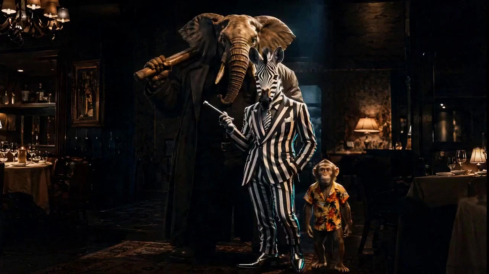

# Tarantino-Style Conflict Short

> **作者：** @灵燚AI

## Content

Process Planning:

Global Planning and Multi-Agent Collaboration Workflow:

Establish global brief

Call text_editor to create and lock Final_Video_Spec.md. Lock the following: Aspect Ratio (16:9 recommended for mainstream models), Total Duration 30s (2 segments x 15s), Output Language, Global Visual Style (Vintage feature film collage aesthetic: aiming for 35mm film grain, realistic natural skin tones, deep blacks, and practical lighting. Avoid over-sharpening or a transparent digital advertising look; emphasize local high-saturation color accents and dynamic depth-of-field control).

Analyze & Genre Classification

Call resource_prepare_and_analyze to perform a deep analysis of user-provided assets and conflict events.

Core Task:

Classify characters into Active Subject and Passive Subject.

Analyze the underlying emotions and movement lines of the event, precisely classifying it into one of four conflict types: [Classic Suspense/Violent Conflict], [Humorous/Absurdist Conflict], [Competitive/Chase Conflict], or [Affectionate/Sweet Interaction], and pass this classification result to downstream modules.

Storyboard Construction

Call storyboard_designer to write a structured Storyboard.

Elements: Define the main characters (tag with [Active Subject]/[Passive Subject]) and scenes (including main color tone, lighting position, and core reference objects), and specifically define one Key Prop with Color Accent that fits the type.

Shot List: Plan 2 x 15-second long takes (total 30 seconds), leveraging long-term consistency advantages:

Shot 1 (15s) [Building Suspense]: Based on the Suspense Shot Selection Rules, adaptively combine 2 to 3 camera techniques to build tension. If there are vehicle or physical space constraints, execute corresponding substitute camera angles.

Shot 2 (15s) [Conflict Explosion]: Strictly maintain the wardrobe, lighting, scene, and key props from Shot 1. Maximize tension at the moment of the transition through high-frequency micro-expression quick cuts, followed by high-density action collisions.

Dialogue Generation: When there is more than 1 character and the user has not provided dialogue, storyboard_designer will automatically generate witty, Tarantino-esque dialogue (chatter, dry humor, or trivial daily banter during tense moments) based on character personas and event tonality, and write it into the Shot Beats of Shot 2.

Audio Layers: Plan adaptive background music track (bgm_adaptive, changing style according to conflict type), realistic movement/vehicle SFX track (sfx_movement), and specific environmental/physical impact SFX track for the action climax (sfx_conflict).

Element asset generation

Call media_generator based on the Storyboard specs:

Use TextToImage / ImageToImage (prefer Nano Banana Pro(Gemini 3 Pro Image) model, 2K resolution) to generate element character reference images and scene reference images with specific color schemes/lighting/high-saturation props, ensuring consistency in facial features and spatial environment.

If the user provided images/audio, register the asset_id and bind them directly to the corresponding slots; do not perform repetitive generation or modifications that violate user references.

Video and Audio Generation

Call media_generator:

Video Generation: Use MultiModalToVideo (Seedance 2.0 recommended, 720p, 15s per shot). Generate Shot 1 and Shot 2, binding the key_element character reference images, scene, and key high-saturation prop reference images.

Adaptive Audio Generation: Use text_to_instrumental (Suno 5 recommended) to generate distinctive background music strongly aligned with the conflict type.

Timeline Assembly

Call video_assembler to arrange the Timeline. Perform strict color accent ratio matching and physical reference alignment at the 15s transition splice to ensure no visual discontinuity; implement rhythm editing tailored to different conflict types so that action bursts and conflict sound effects (sfx_conflict) are frame-accurate.

Workflow Collaboration Constraints and Pause Points:

First Pause: Pause after Final_Video_Spec.md and the structured Storyboard are completed to confirm character classification, conflict type determination, suspense shot combinations, and dialogue with the user.

Second Pause: Pause after the reference images for characters, scenes, and local high-saturation accent props are generated (or bound) to confirm the vintage film texture and color tone are correct.

Final Stage: After video generation and audio/video assembly are complete, guide the user to click "Save and Activate" in the upper right corner of the interface to complete the delivery of the Skill.

Asset Analysis:

User Input Parsing and Adaptive Norms for Subject Relationships, Color Aesthetics, and Depth of Field:

Deduction of Character Relationships and Vehicle Movement Lines:

Active Subject: The initiator/executor of the action.

Passive Subject: The receiver/defender/responder of the action.

Vehicle Analysis: Detect whether vehicles are present. If present, analyze the physical motion of multi-vehicle scenarios (chase trajectories) or single-vehicle scenarios (the spatial pressure between interior spaces and the vast external environment).

Plot Conflict Classification and Adaptive Aesthetic Mapping (Core aesthetic norms: strictly prohibited to use blue-cyan shadows and orange lighting throughout the entire video):

Suspense & Combat:

Primary Scene Colors: Dark brown, black, dark yellow.

Lighting Design: Use indoor tungsten bulbs, table lamps, or pendant lights to create warm yellow localized illumination, keeping the rest of the scene at extremely low brightness to build a sense of fatalistic confrontation.

Single Red Accent: Only 1 major red object may be set in the frame (e.g., a red tablecloth, red suit, red car, red wine glass, red door, or red neon light), located near the characters or where the conflict occurs. Large-area red staining is strictly prohibited.

Clothing Norms: Black, dark brown, or grey suits or coats. Avoid having all subjects wearing high-saturation colors simultaneously.

Visual Texture: 35mm film grain, slight fading, deeper black levels. Digitally over-sharpened advertising textures are strictly prohibited.

Humor & Absurdist:

Primary Scene Colors: Mustard Yellow, orange, olive green, burgundy.

Set Dressing: Vintage wallpaper, colorful dining chairs, old-fashioned lamps, striped or patterned shirts.

High Saturation Accent: Set 1 high-saturation prop directly related to the conflict (e.g., yellow microphone, red cake, green suitcase, orange drink).

Visual Tonality: Neat composition; it is strictly prohibited to add cartoon spring lines, manga effect lines, or random colored ambient lighting unrelated to the plot.

Sports & Chase:

Outdoor Primary Colors: Sand yellow, burnt brown, grey-blue; Indoor Primary Colors: Cement grey, deep blue-grey, dark green.

Lighting Design: Use intense sunlight, overhead lights, or high-power stadium lights to create hard light with clear direction, strongly highlighting sweat, dust, tire textures, water splashes, and muscle definition.

High Saturation Accent: Set 1 high-contrast recognition target (e.g., red helmet, yellow swim lane, orange motorcycle, white finish line) to ensure the audience can instantly lock onto the primary character's movement.

Romance & Sweetness:

Primary Scene Colors: Off-white, light brown, soft golden yellow.

Lighting Design: Natural window light, sunset/dusk backlighting, candles, or warm indoor lighting. Characters' faces must be clearly visible; large areas of shadow, horror-movie-style black levels, or harsh blue light are strictly prohibited.

High Saturation Accent: Set 1 exquisite emotional prop (e.g., red rose, red gift box, burgundy tie, red umbrella).

Adaptive Depth of Field Control Rules:

It is strictly prohibited to rigidly adopt a single deep or shallow depth of field throughout the entire film. It must be dynamically adjusted based on narrative function:

Establishing shots, duels between two characters, or showcasing group spatial layouts: Use Deep depth of field to keep characters in the foreground and background, as well as environmental reference points, clear and distinguishable, demonstrating spatial pressure.

Close-ups on core conflict details such as eye contact, hand movements, weapons, gifts, or microphones: Use Shallow depth of field / Shallow focus to firmly lock visual focus, making the background softly and naturally blurred to strengthen emotional or suspenseful tension.

Storyboard Design:

Storyboard Architecture Design Standards:

Key Elements Design Specifications:

element character: Must create corresponding active and passive subjects. Clearly describe their offense/defense stance; costumes must align with the color specifications for that conflict type (e.g., suits for suspense, striped shirts for absurdism, etc.). If the user has uploaded an image, bind this reference and strictly inherit from it.

element scene: Define the physical contours of the scene in detail. Clearly specify the scene's primary colors, lighting type, and direction corresponding to that type (e.g., warm yellow localized lighting, sunset backlighting, etc.), as well as 35mm film and black-level texture descriptions.

High-Saturation Prop Elements: Must explicitly define one key, high-saturation prop of a specific color for the scene (e.g., [Element_Prop_Red_Box] / [Element_Prop_Yellow_Mic]) and record its initial spatial position.

Double Long-Take Shot List Details:

Shot 1 (15 seconds) - [Opening Plot: Building Suspense]

Scene: [element scene ID], apply the corresponding type color scheme and lighting atmosphere.

Suspense Shot Selection Rules (Shot 1 must adaptively select only 2 to 3 types from the following; do not pack all of them together):

Footsteps/Tire Close-up: Extremely low-angle tracking shot of the active subject's approaching shoes or the vehicle's wheels/tires, conveying a sense of encroachment.

Eye/Gaze Close-up: Close-up of the active subject's cold, sharp, or deeply affectionate gaze.

Core Prop Close-up: Close-up of hands reaching for, touching, or gripping a conflict prop/weapon/gift/pocket.

Partial Reflection Cut: Reveal another character's figure through a partial reflection in a mirror, glass window, or rearview mirror reflection.

Spatial Distance Wide Shot: Wide-angle or Bird's-eye view shot showcasing the physical maneuvering as the distance between the two subjects gradually shortens.

Passive Subject Unprepared Activity: A cut showing the passive subject engaged in solitary activity (eating, performing on stage, straightening a skirt, focusing on driving, etc.), unaware of the approaching active subject.

Color Cue Placement (High-Saturation Props): In Shot 1, the key high-saturation accent object for that type (e.g., red umbrella, yellow microphone, red wine glass) exists only as a background clue or on the edge of the frame, not featured in a prominent close-up, allowing the audience to perceive it subtly.

Cinematography: Fluidly splice the 2 to 3 selected suspense shots. If both subjects are in the same vehicle, focus on the interior at the start; when using an overhead shot, the camera must fully pull out of the vehicle to show the larger environment.

Shot 2 (15 seconds) - [Adaptive Conflict and Interaction Burst]

Scene: Maintain absolute consistency with Shot 1 regarding scene logic, primary light source orientation, and physical placement of key props. Strictly avoid suddenly adding irrelevant color filters, weird lighting, or new props; achieve seamless inheritance of costume, lighting, and scene to eliminate visual discontinuity.

Story Beats:

Rapid Cross-cutting (Facial Expressions): At the 15-second transition, do not rush into big movements. Instead, first detonate the tension in the air through rapid cross-cutting of the two protagonists' facial micro-expressions/gazes (each cut only 0.5s - 1s).

Violent Explosion of Physical Conflict & Slow-motion Micro-expressions: Immediately adopt an artistic slow motion to capture the drastic change in the passive subject's facial expressions at the very moment conflict arrives (pupils constricting, stunned closing of eyes, gasping mouth open, or shyly lowering eyelids). Then, based on the deduced conflict type, unfold high-density physical interaction:

Classic Suspense/Violent Conflict: Close-quarters combat, blocking, dodging, fighting. The red object from Shot 1 becomes highly prominent at this moment through tracking close-ups or extreme proximity to the subject; red clothing, wine glass, knife handle, or neon lights instantly occupy the visual center of the frame, releasing a color accent.

Humorous/Absurd Conflict: The two characters comically and seriously fight over the high-saturation prop (yellow microphone/red cake, etc.), creating a comedic contrast through slow-motion snatching, dropping, spilling, or breaking.

Competitive/Chase Conflict: High-frequency cutting between sweat and muscles, splashing water/mud, and tire screech close-ups. The high-saturation target (red helmet/finish line) leads the action trajectory at the center of the frame.

Affectionate/Sweet Interaction: Gentle embraces, deep gazes. The red prop held by the active subject (e.g., red rose/red gift box) cuts into a detailed close-up with a shallow depth of field, with the background naturally blurred.

Dialogue Generation (Adaptive): When there are > 1 characters and the user has not specified dialogue, automatically compose daily conversations full of Quentin-esque absurdity, chatter, and nagging that is extremely sharp, arguing about common sense, food, pop culture, or nonsensical bills during moments of high tension or romance.

Classic Suspense Dialogue Example: "Before we do this, I have to confirm one thing—did you turn off the gas? I don't want our duel ruined by an accidental explosion."

Humorous/Absurd Dialogue Example: "You can take my microphone or even my coffee, but you just said you can put pineapple on pizza—that is a formal declaration of war!"

Affectionate/Sweet Dialogue Example: "I love you, baby... but seriously, while you're cleaning that gun, could you please not point it at my new carpet?"

Competitive/Chase Dialogue Example: "Given your body weight and the resistance of these cheap leather shoes, the probability of you successfully escaping is physically zero."

Cinematography: Rapid cut of dual-subject micro-expressions -> Extreme close-up, slow-mo to capture the action moment -> Fast cross-following tracking to lock onto the movement trajectory -> Extreme shallow depth of field focus close-up on the high-saturation accent prop.

Adaptive Audio Layer Design:

Audio Layer 1 (BGM) (bgm_adaptive, type: music): Shot 1 uniformly adopts a building suspense atmosphere with gradually intensifying rhythm and fluctuating drum beats. At the 15-second transition, the music rhythm and soundtrack style instantly mutate based on the conflict type:

Classic Suspense ➔ Fast-paced, heavy Western suspense folk, electric guitar, or heavy percussion.

Humorous/Absurd ➔ Comical, lighthearted, retro jazz with cheeky spring sounds or banjo.

Competitive/Chase ➔ High-speed, adrenaline-pumping drum beats with a strong sense of rhythm and retro rock.

Affectionate/Sweet ➔ Warm, soft, soothing, and melodic acoustic guitar, gentle piano, or soft strings.

Audio Layer 2 (Movement & Ambience) (sfx_movement, type: sound_effects):

Regular Walking: Lay down crisp leather shoe footfalls and gravel surface friction sounds.

Vehicle State: Lay down deep engine roars, tire screech against the road, and rushing wind sounds, matching the vehicle's physical inertia.

Audio Layer 3 (Adaptive Sound FX) (sfx_conflict, type: sound_effects): Precisely synced to the frame where the action conflict in Shot 2 explodes. Classic Suspense: heavy physical impact, metal friction, blocking sounds; Humorous/Absurd: spring boing, slipping, exclamations; Competitive/Chase: screeching, collision, heavy breathing; Affectionate/Sweet: clothing friction, breeze, heartbeat, and deep breathing.

Media Generation:

Visual and Audio/Video Asset Generation Strategy:

Key Element Images Generation:

Use TextToImage / ImageToImage.

Recommended model: Nano Banana Pro (Gemini 3 Pro Image) (recommended resolution: 2K). This model performs with extreme precision in retro magazine layouts, local color accent configuration, 35mm film texture, and text rendering. GPT Image 2 is an alternative option.

Generation strategy: Generate scenes strictly according to the aesthetic mapping of [Classic Suspense / Humorous Absurdity / Competitive Chase / Sentimental Sweetness]. When generating variations with multiple subjects or scenes, loop the reference to the first image using ImageToImage to lock in hairstyles, facial features, clothing color schemes, and the chroma of high-saturation props.

If the user provides their own image assets, register the asset_id and bind it directly to key_elements; do not regenerate these images.

Video Generation:

Must use MultiModalToVideo.

Recommended model: Seedance 2.0 (default resolution: 720p). This model perfectly executes 15s long-form continuous shots and has excellent consistency maintenance capabilities for multi-character reference images and prop images.

Resolution setting: 720p (members can use 1080p; non-members run at 720p).

Video aspect ratio: Adaptive based on Final_Video_Spec.md, default 16:9.

Single shot duration: Must be 15 seconds.

Reference Image Binding: Shot 1 binds the active subject and specific scene reference images; Shot 2 binds the active subject, passive subject, scene, and that unique high-saturation accent prop reference image simultaneously.

Adaptive Audio Generation:

Schedule text_to_instrumental. Recommended model: Suno 5.

Generation strategy: Input a prompt that conforms to the soundtrack definition of the conflict type (e.g., comedic retro jazz with banjos, or heavy-rhythm Western suspense ballads) to generate high-quality audio resources for the bgm_adaptive track.

Prompt Writing:

Adaptive Aesthetic Prompt Writing Specifications:

Image Prompt (Nano Banana Pro / 2K) Writing:

Utilize a blended paragraph structure: "Subject clothing characteristics + scene base color + specific local color accent + tungsten/hard light/backlight control + 35mm film texture + depth of field settings."

Adaptive prompt tags for retro genre film collage aesthetics:

Classic Suspense/Violent Conflict:35mm film grain, Quentin Tarantino pastiche style, faded cinematic colors, heavy dark shadows, deep blacks, high-contrast, dramatic tungsten yellow local spotlight illumination on characters, scene dominated by dark brown and dark yellow tones. Active subject wearing black/grey vintage suit coat. Features exactly ONE highly saturated red item (such as a crimson wine glass/red suitcase) near the character as a striking color accent, leaving the rest of the scene dark and organic. Realistic skin textures, natural skin tones. (Deep depth of field for wide shot / Shallow focus, beautiful blurry background for extreme close-up).

Humor/Absurdist Conflict:35mm vintage film pastiche, Technicolor style, mustard yellow, olive green and burnt orange palette, retro patterned wallpaper, old-fashioned lights. Featuring exactly ONE high-saturation color prop (such as a vibrant yellow microphone / a bright red cake) at the center of the frame as a comedic focus. Neat symmetrical composition, high contrast, organic texture. No cartoon graphics. Shallow focus, soft background blur.

Competitive/Chase Conflict:70s sports documentary pastiche style, gritty 35mm film grain, hard directional sunlight, harsh overhead illumination, high contrast, sand yellow, scorched brown and dusty concrete grey tones, highlighting sweat, tire textures and flying dust. Exactly ONE high-visibility marker (such as a vibrant red helmet / a bright orange motorcycle) as a tracking focus. Dynamic tracking composition, sharp details. Deep depth of field.

Affectionate/Sweet Interaction:Warm vintage film aesthetic, soft golden hour light, beautiful sunset rim lighting, window natural light, rice white and soft amber tones. No heavy shadows, clear facial features, romantic breathing atmosphere. Active subject holding exactly ONE delicate crimson red rose (or a crimson umbrella/gift box) as a romantic color accent, shallow focus, extreme shallow depth of field, background elegantly blurred, dreamy bokeh.

Video Prompt (MultiModalToVideo / Seedance 2.0) Action and Sound Effects:

Must use <<<image_1>>> (active subject), <<<image_2>>> (passive subject), <<<image_3>>> (scene), and <<<image_4>>> (high-saturation prop) for asset placeholders and precise binding.

Action and Camera Control Syntax (Motion Stack):

Shot 1 Syntax Paradigm (splice motion and depth of field descriptions based on 2 to 3 selected suspense shots):<<<image_1>>> (active subject) in vintage suit. Camera pans across <<<image_3>>> (scene). (Choice 1: Extreme low-angle tracking shot of active subject's moving leather shoes) and (Choice 2: dramatic close-up of <<<image_1>>>'s intense gaze/eyes, shallow focus) and (Choice 3: Cut to rearview mirror reflection showing the active subject approaching). Cut to <<<image_2>>> (passive subject) peacefully doing scene-matching activity, totally unsuspecting. (Choice 4: Crane jib shot high above, panning down in a bird's-eye view, showing the spatial distance closing between them, deep depth of field). 35mm film grain, cinematic lighting, continuous motion, no subtitles.

Shot 2 Syntax Paradigm (strictly inherit all characteristics of Shot 1):Dynamic interaction scene with explosive action breakout. Strictly maintain visual identity, clothing, scene geography and lighting direction with <<<image_3>>> (scene), <<<image_1>>> and <<<image_2>>> from Shot 1. In the first second, rapid cross-cut montage of intense facial expression close-ups between <<<image_1>>> and <<<image_2>>> (0.5s - 1s cuts), capturing instant tension. Transition to extreme slow-motion (slow-mo) close-up of <<<image_2>>>'s face, capturing micro-expressions of shock and realization. Immediately, physical action breakout: [Insert Action Module]. Fast cross-following tracking camera, cinematic grain, professional camera cuts, no subtitles, no music.

Classic Suspense Action Insert: They engage in high-intensity physical combat. Precise blocks and strikes. The red item <<<image_4>>> (e.g. red wine glass) is captured in a dramatic dolly-in close-up with shallow focus, popping out as a strong crimson color accent against the dark environment.

Humorous/Absurdist Action Insert: A hilarious struggle unfolds as they playfully scramble to grab <<<image_4>>> (yellow microphone) in the center of the frame. Clumsy body movements, tripping, falling, creating a funny tug-of-war.

Competitive/Chase Action Insert: A high-speed sprint breakout. Fast tracking shot of driving/running, dust flying. <<<image_4>>> (orange motorcycle) stays in the center of the frame, showing intense speed and tactile collision.

Affectionate/Sweet Action Insert: They share a warm intimate embrace. <<<image_1>>> gently holds <<<image_2>>>. The crimson item <<<image_4>>> (red rose) is shown in an extreme shallow focus close-up between them, background beautifully blurred.

Seedance 2.0 Sound Effect and Dialogue Envelope Integration Specifications:

Shot 1 Suspense Setting Sound Envelope:

When walking: wrap audio after the action description with <heavy rhythmic shoes clicking on concrete, sand gravel crunching>;

When in vehicle: wrap with <low deep engine roaring, tires spinning on asphalt>.

Shot 2 Action Breakout Audio-Visual Alignment Envelope:

Classic Suspense: bgm (tense Western acoustic guitar picking and heavy single drum beat) + <sharp physical impact thud, glass shattering, body slam sfx>.

Humorous/Absurdist: bgm (bouncy playful retro jazz whistle and fast percussion) + <funny spring boing, comedic slide whistle, slide fall sound>.

Competitive/Chase: bgm (fast-paced rock drumming and gritty overdrive bass) + <loud metal screech, tire friction squeal, heavy gasping breath>.

Affectionate/Sweet: bgm (gentle acoustic piano and warm violin melody) + <soft fabric friction, deep breathing, soft ambient chime sfx>.

Dialogue Voiceover Envelope (Dialogue Wrappers):

If Shot 2 contains dialogue, it must be followed immediately at the end of the action narrative sentence by {CharacterID: "Dialogue content"}. Dialogue content must strictly align with the classic black humor/small talk lines automatically generated by the Storyboard (e.g., {Active_Subject: "I love you, honey, but did you turn off the gas?"}), ensuring Seedance lip-sync matches the voiceover.

Add "no subtitles" to the negative prompt uniformly.

Video Editing:

Two-Stage Editing and Timeline Assembly Logic:

Pacing & Rhythm Adaptation:

0s - 15s (Shot 1): Tight yet steady pacing, with suspense building gradually. Edit evenly using 2 to 3 selected suspense shots. Footsteps/wheel sound effects increase in intensity as the visuals get closer.

15s - 30s (Shot 2):

15s - 16s (Micro-expression Quick-cut Period): At the moment of transition, execute high-frequency hard cuts between the expressions/gazes of the two protagonists (0.5s to 1.0s per clip), pushing the suspenseful atmosphere to its peak through rapid micro-expression cuts.

16s - 30s (Action Conflict Burst Period): Immediately transition to artistic slow motion to release large-scale physical interaction.

Classic Suspense: Cuts should be crisp and clean with a strong sense of rhythmic resistance, hard-cutting to match action force and impact points.

Humorous/Absurdist: Use quick cuts with dramatic, jarring jumps, cutting hard at moments of lost balance, dropped props, or spills.

Competitive Chase: Increase cutting frequency in tandem with movement intensity, using Match Cuts to interlock close-ups of wheels and sweat.

Romantic/Sweet: Use extremely slow, breathy fade-ins/fade-outs or soft cuts, maintaining smooth movement of long-focal-length, shallow-depth-of-field close-ups.

Seamless Transition and Visual Consistency Verification:

Costume and Environment Inheritance Check: At the 15-second transition point, strictly verify and lock subject characteristics (hairstyle, face, clothing color and texture) and spatial geometric relationships (main light source position, main color tone, physical reference objects) between Shot 1 and Shot 2. Ensure that the transition is free of extraneous props or color jumps, reducing the error rate to zero.

High-Saturation Prop Clue Progression: Check the transition positioning of the single, high-saturation "accent" prop from Shot 1 (background clue) to Shot 2 (visual center/close-up) to ensure spatial movement is logical.

Audio-Video Sync and Audio Layers Merge:

Frame-Level Hard-Sync for Sound Effects: Ensure that the moment of core action bursts in Shot 2 (blocks, impacts, dropped microphones, snatching/tugging, deep-gaze closing eyes) is aligned at the frame level with the sfx_conflict audio on the timeline, using sharp, powerful sound effects to fully ignite the visual impact.

Seamless Audio Splicing: Merge Audio Layers from Shot 1 and Shot 2. The BGM track should transition naturally at the 15s mark; the sfx_movement track should fade smoothly after the action burst at 15s, ensuring no pops, noise, or abrupt level fluctuations, and output the complete 30-second short film.
