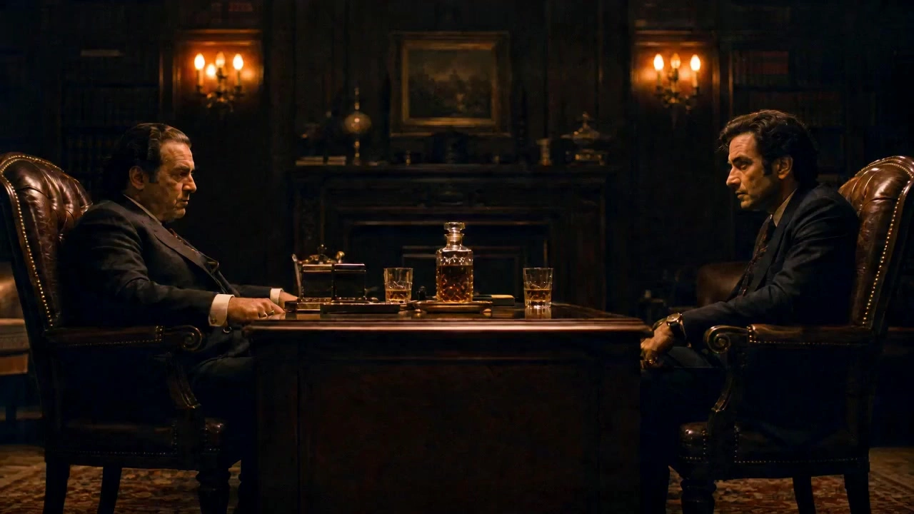

# The Godfather Aesthetic

> **作者：** @境在丨米叔

## Content

Process Planning:

Full-Stack Asset Cloning and Video Generation Temporal Dependency

Script Outline Establishment and Scene/Character Concept AnchoringReceive user requirements and automatically draft three script outlines that adhere to the classicism style of "The Godfather" (customizable by the user). Based on the selected outline, generate the primary scene and character concept image that strongly anchors the texture of 1970s film equipment and the optical characteristics of vintage lenses.

GPT Image 2 One-Click Generation of Simplified Character Reference Sheet (16:9 Landscape)Directly input the confirmed script core variable {Protagonist} into the GPT Image 2 engine. Use GPT Image 2 to render a simplified character reference card featuring "left-side full-body three-view + right-side six-frame headshots and costume texture details." 【Milestone Checkpoint ①】: Present the character reference card and ask the user to confirm the core character and voice profile. Simultaneously, confirm the final video aspect ratio (default is 16:9 landscape, 9:16 portrait can be specified).

Scene Movement Overhead View and Spatial Aesthetics Establishment (16:9 Landscape)Use GPT Image 2 to generate pure panoramic empty scene images (Stage) and overhead 3D blueprints, locking in core spatial assets: mahogany furniture, vertical overhead lighting, and chiaroscuro contrast.

Intelligent Shot List Planning and Adaptive 3x3 Grid Refinement (Aspect Ratio and Grid Adaptive)Elastic algorithm intervention: Deeply determine plot density. For individual dialogues, split into 4-6 frames; for fast-paced editing or action, split into a 9-frame continuous action sequence. GPT Image 2 renders a 3x3 Storyboard, where all internal shots must strictly inherit the Mitchell BNC equipment texture, Super Baltar lens bloom, 5254 film grain, and dark-area sepia tones from the original concept art, forming an absolute asset lighting lock. The center [Grid 2,2] fixedly displays the spatial movement blueprint; the surrounding grids precisely align with the compositional logic of "The Godfather" (golden triangle positioning, louver/door frame power framing, "oranges mean disaster" semiotics, and obscured, shadowed eyes under overhead light). 【Milestone Checkpoint ②】: Display the elastic 9-grid prompts and dialogue lines, waiting for final user confirmation before going live.

Seedance 2.0 Ultimate 15-second 720p Video Direct DriveCombine all previously locked assets to drive Seedance 2.0 to generate a 15-second cinematic blockbuster in 720p resolution (strictly aligned with the locked aspect ratio).

Storyboard Design:

Meta-Intelligence Skill Activation Instructions: The multi-dimensional lighting lock has been fully hardened. The 9-grid large image (elastic disassembly into 4-9 grids) and the final Seedance 2.0 video are now fully aligned with the pure film industrial-grade equipment, composition, and color grading parameters of the initial concept art.

Prompt Writing:

Global Highest Priority: All generated content, including prompt text and code blocks, must be presented exclusively in English; the appearance of any Chinese characters is strictly prohibited.

Example 1: [Initial Anchor: Core Concept Prompt for Scene and Character]

Cinematic full shot, a masterpiece scene from The Godfather (1972). Shot on vintage 35mm film with a heavy Mitchell BNC camera and Bausch & Lomb Super Baltar 50mm prime lenses. 1940s classic gang family aesthetic. The variable protagonist {Protagonist} is framed in a dimly lit mahogany wood office study room [Stage_Corleone]. Heavy overhead top lighting casts dramatic deep shadows, completely cloaking the character's eyes in true black. The optical texture features organic 35mm film grain of Kodak Eastmancolor II 5254 negative stock with forced development, resulting in uncompromised deep true black shadows and a soft halation blur around warm glowing high-contrast lights. Steady oil-painting-styled composition, photorealistic film texture, hyper-focused details, no text, no watermarks, no digital sharpness, landscape 16:9 ratio.

Example 2: [Adaptive 3x3 Grid Storyboard Prompt] (Taking "Action Genre: 9-Grid High-Frequency Continuous Editing and Continuous Action" as an example, perfectly matching the concept image equipment and lighting descriptions)

Professional cinematic multi-panel director's display sheet, 3x3 grid panel alignment system. Absolute visual DNA lock: all active panels are strictly shot on vintage 35mm film with a heavy Mitchell BNC camera and Bausch & Lomb Super Baltar lenses, capturing the signature organic Kodak Eastmancolor 5254 film grain texture, forced development hyper-contrast. Centered at Grid [2,2], it displays a precise 3D top-down blueprint view of Stage: [Stage_Corleone], sketching swift tactical movement lines. Surrounding the center, 8 high-velocity active panels display a continuous fast-paced action montage: Grid [1,1]: Low-angle wide shot. The protagonist {Protagonist} suddenly rises from a leather sofa, body-rigged momentum cutting through harsh top lighting shadows. Grid [1,2]: Fast tracking shot. A hand reaches towards a coat pocket, motion blur rendering high tension, warm halation on polished brass elements. Grid [1,3]: Low-angle medium close-up. Violent camera movement. The character lunges forward, facial features exhibiting jaw clenching muscle tension, eyes hidden in dark shadows. Grid [2,1]: Narrative cutaway shot. A glass of amber liquor shatters on the mahogany table, liquid flying under deep chiaroscuro contrast. Grid [2,3]: Extreme wide angle. Two silhouettes clashing in the dark, heavy brown and deep charcoal palette dominating 85% of the frame. Grid [3,1]: Fixed 40mm lens. A plate of bright oranges bursts apart from an impact, vibrant orange peels scattered into true black shadows as a visceral death omen. Grid [3,2]: Tight macro detail. Leather shoes pivoting aggressively on the dark carpet, kicked-up dust particles catching golden rim light. Grid [3,3]: Low-angle static master frame. The target collapses, the heavy wooden door frame creating a claustrophobic closed composition, sealing the sequence into quiet moral isolation. Photorealistic film grain, pure solid borders partitioning the grids, no watermarks, no generic text, landscape 16:9 ratio.

Example 3: [Seedance 2.0 Ultimate Video Direct Drive Prompt] (Pure English code · 720p Action Blockbuster Flow Drive)

Based on smart reference panel <<<image_01>>> layout grid [1,1] to [3,3] sequentially. Landscape 16:9 ratio, resolution 720p, 1940s textbook cinematic language, Mitchell BNC camera with Baltar prime lens look, Kodak 5254 film aesthetics with signature high-contrast shadows. Actions unfold chronologically within 15 seconds with opera-style high visual drama: 00:00 - 00:03 (Grid 1,1 to 1,2): The godfather {Protagonist} violently stands up under heavy overhead top lighting, eyes buried in deep black shadows, transitioning with a sharp snap-pan tracking shot to a hand pocket reach with high motion blur. 00:03 - 00:06 (Grid 1,3 to 2,1): Low-angle explosive forward lunge, camera shaking to mimic hand-held Arriflex 35 mobility, instantly J-cutting into a close-up of a glass shattering on dark mahogany wood, liquid refracting warm amber LUT tones. 00:06 - 00:10 (Grid 2,3 to 3,1): Silhouette hand-to-hand combat inside the chiaroscuro shadow boundary, followed by an aggressive cut to a plate of bright oranges violently bursting apart, rolling into pure black void as a tragic visual omen. 00:10 - 00:15 (Grid 3,2 to 3,3): Close-up of heavy leather shoes pivoting on dust-filled air tracks, concluding as a massive heavy door slowly shuts in the foreground, locking out the light and dissolving the final shot into total true black isolation. Perfect lipsync matching the dialogue {Insert bilingual dialogue text here based on the project}. Blinds and doorframes block 35% of the frame for claustrophobic Z-axis depth. Low-frequency operatic strings, <Foley: Glass and body heavy impacts rustle shattering sound wood>. Completely pure, no field borders, no face melting, no generic digital smoothness, no music.

Video Editing:

Industrial-Grade Audit Specifications for Full-Case Spatial and Image Consistency

Storyboard and Concept Alignment Audit: Conduct an intelligent audit of the storyboard descriptions for the 4-9 active shots within the grid. This ensures that for both dialogue scenes (axis locks, over-the-shoulder composition) and action scenes (continuous motion, high-frequency motion blur), the underlying Mitchell BNC camera characteristics, Super Baltar blooming, and dark-area desaturation LUTs remain 100% dynamically aligned with the initial concept art. Sudden shifts in style between grid cells are strictly prohibited.

Aspect Ratio Consistency and Thermal Calibration Audit: Before video assembly, verify the dimension ratio between the storyboard grid and the final edited video to eliminate any aspect ratio mismatch flaws.

Negative Constraint Purge: Prior to final output, automatically inject rigid English-only intercept tokens to block all garbled text, false flickering, and unintended deformations. This ensures the final delivered 720p clean short film passes the final production audit perfectly.
