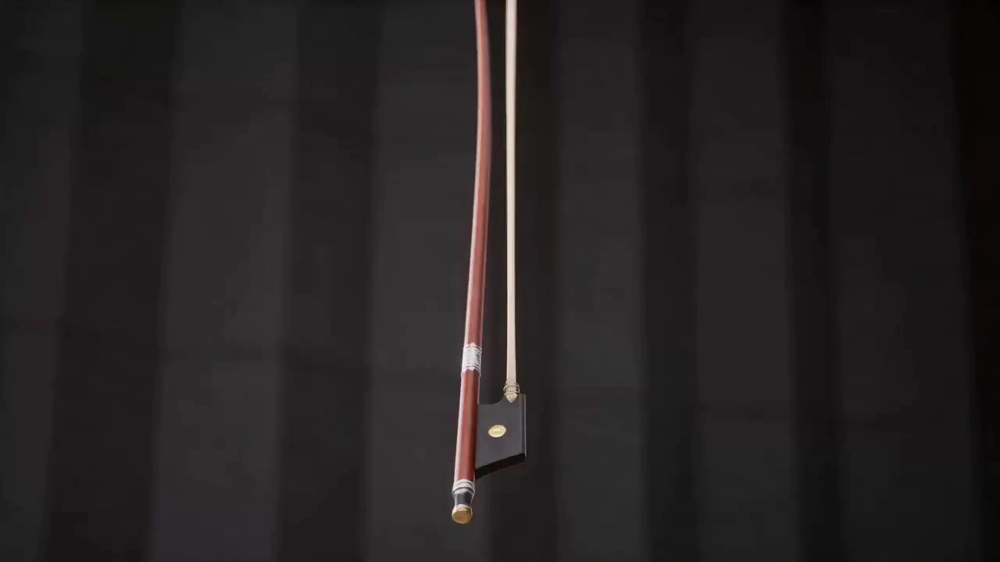

# Themed Transformation Effects Video

> **作者：** 灵燚AI

## Content

**Process Planning:**

**Startup Phase: Collect User Parameters**
Before each use, confirm the following two core parameters with the user (ask in one go, use cards to display common preset options, and support free user input):
1. **Grouping System**: Which 'character groups' are to be generated this time?
   - Common presets: 12 Zodiac Signs / 12 Chinese Zodiac Animals / Five Elements (Metal, Wood, Water, Fire, Earth) / Four Seasons / Other (custom)
   - Required clarification: The list of group names (e.g., 'Rat, Ox, Tiger...' or 'Metal, Wood, Water, Fire, Earth') and the core personality/symbolic characteristics of each group (if it's a general knowledge system like Zodiac/Astrology, it can be auto-completed; otherwise, ask the user to provide details).

2. **Theme**: What is the core theme for this time?
   - Supports any type, including but not limited to:
     - **Holiday Consumption**: 521 Romantic Consumption / 618 Shopping Festival / Valentine's Day / Singles' Day (11.11) / New Year's Day
     - **Occasion/Atmosphere**: Wedding Scene / Circus / Graduation Ceremony / Music Festival
     - **Movie/Game IP**: Honor of Kings / Genshin Impact / Harry Potter / A Record of a Mortal's Journey to Immortality / Battle Through the Heavens
     - **Other (Custom)**: User can freely input any theme keyword.
   - Theme determines: Overall style of artifacts, makeup/styling embellishments, scene atmosphere tone, and the tone/keywords of the lines.

**Planning Phase: Dynamically Derive Parameters for Each Group**
After receiving user input, derive the following content for each group member one by one, present it in a table for user confirmation, and proceed to generation after confirmation:
Group Member | Core Characteristics | Holiday Artifact | Consumption Scene | Makeup/Styling Theme Embellishment | Exclusive Lines
Derivation Rules (handled by the Planner's intelligent judgment, switching logic flexibly based on theme type):
- **Artifact**: Combined with the member's personality symbol × theme worldview, select the most recognizable single prop or item:
  - Holiday Consumption: Corresponding consumer goods (Zodiac Tiger × 618 → Fitness equipment; Zodiac Rabbit × Valentine's Day → Pink jewelry)
  - Occasion/Atmosphere: Corresponding occasion symbols (Circus → Magic wand/Clown mask; Wedding → Bouquet/Ring box)
  - Movie/Game IP: Corresponding iconic weapons, props, or symbols of the IP (Honor of Kings → Hero-specific weapon; A Record of a Mortal's Journey to Immortality → Magic tool/Pill bottle)
- **Scene**: The spatial environment corresponding to the artifact:
  - Holiday Consumption: Physical store or consumption space (Sneakers → Sports flagship store; Perfume → Fragrance boutique)
  - Occasion/Atmosphere: Typical space for that occasion (Inside a circus tent; Wedding hall/garden; In front of a music festival stage)
  - Movie/Game IP: Iconic scene of the IP (Honor of Kings → Canyon battlefield; A Record of a Mortal's Journey to Immortality → Immortal mountain sect)
- **Makeup/Styling Theme Embellishment**: On top of the unified Rococo base styling, layer the visual symbolic elements of the current theme:
  - Holiday Consumption: Valentine's Day → Rose/Heart decorations; 618 → Shopping bag/Price tag installations; New Year → Red and gold tassels/Lanterns
  - Occasion/Atmosphere: Circus → Feather mask/Star-shaped sequins; Wedding → White tulle lace/Flower crown
  - Movie/Game IP: Extract iconic colors and patterns of the IP and integrate them into hair accessories, skirt hem patterns, or accessory designs.
- **Lines**: Around the theme + artifact + member personality, write concise and powerful declarations, kept within 20 characters; Holiday Consumption types should start or end with the holiday name, while other theme types should reinforce the atmosphere with theme keywords or character declaration tones.

**Generation Phase:**
1. According to the confirmed parameter table, dynamically assemble full prompts for each group member within the `write_media_prompt` rule framework, and directly call **media_generator** to generate videos.
2. After each generation, display the result and ask the user if they want to proceed to the next or adjust the current result.
3. Summarize and deliver after all tasks are completed.

**Note:**
- All videos are independent and can be executed concurrently in batches.
- Strictly prohibit background music, strictly prohibit subtitles.
- No pre-set fixed group content; everything is dynamically generated based on the user's input this time.

**Storyboard Design:**

No background music or subtitles throughout.
**Rigid Character Specifications (Global Prohibitions):**
- **Style**: Strictly 3D stereoscopic rendering, Chinese anime style beautiful female character. **Absolutely prohibit live-action, realistic photography feel**.
- **Body/Temperament**: Slender 'Yujie' (mature/cool female) figure, 22 years old, cold white skin. Prohibit black skin, wheat skin tone, muscularity, or bulky physique.
- **Contact Lenses**: Fixed to dark gray or navy blue, presenting a high-end, cold, and glamorous texture. Prohibit red eyes, white eyes, solid black pupils, or heterochromia.
- **Global Content Restrictions**: Strictly prohibit bloody, violent, or hurtful imagery; strictly prohibit non-human limb features (such as goat horns, animal ears, tails, wings, or other alien appendages). The character must be in a complete, normal human form.
- **Hairstyle**: Highlighted big wavy long curly hair. **Strictly prohibit: Permed curls (afro/wool-like), high ponytail, high bun, long straight hair.**

**Clothing:** Fusion of European vintage Rococo + British academic style, multi-layered lace bubble skirt, heavy embroidery, pearl and crystal hair accessories/earrings/necklaces, floral pantyhose.

**Rigid Hair Accessory Specifications:** Uniformly use Rococo ladylike hair accessories. Fixed characteristic elements include bows, beaded chain hair accessories, mini princess hats, flower lace hair accessories, etc. Multiple items can be layered. **Strictly prohibit** rough or alien-shaped hair accessories such as goat horns, lion manes, or animal horns. The thematic makeup/styling overlay elements can only adjust colors and add details based on the aforementioned ladylike hair accessories and must not subvert the overall ladylike style.

**Camera Movement Structure (Strictly follow this order, do not omit any step):**
1. Opening empty shot, no characters in the scene.
2. Camera quickly captures the artifact thrown upward, following the parabolic trajectory of the artifact.
3. The moment the artifact lands, it shatters into tech-style particles, spiraling and condensing from feet to head to complete the transformation.
4. Camera quickly zooms out to show the full scene and the character's full body.
5. The character interacts romantically with the artifact/scene.
6. 360° surrounding camera movement slowly zooms in to a face close-up, the character says the corresponding lines.

**Media Generation:**

**Video Generation Configuration**
- Tool: **TextToVideo**
- Model: **Seedance 2.0** (default) or **Seedance 2.0 Fast** (optional when users request fast image output). **Strictly prohibit using any other model**. Even if Seedance 2.0 / Seedance 2.0 Fast fails to generate, do not silently switch to other models—stop the task and inform the user.
- Duration: **15s**
- Resolution: **720p**
- Aspect Ratio: **Must be explicitly set to 16:9 landscape**. This is a rigid parameter and must not be omitted; only switch if the user explicitly requests another aspect ratio (e.g., 9:16 portrait) in the current conversation.
- All videos for group members are independent and can be generated concurrently in batches.

**Prompt Writing:**

## Unified Character and Style Base
**Character Setting:** 22-year-old young 'Yujie' (mature/cool female) figure, cold white skin (prohibit black/wheat skin tone), slender and soft figure (prohibit muscularity, bulky physique), exquisite 3D features, cold, glamorous, and confident expression. Highlighted big wavy long curly hair, **strictly prohibit: Permed curls (afro/wool-like), high ponytail, high bun, long straight hair**. Contact lenses are fixed to dark gray or navy blue, presenting a high-end, cold, and glamorous texture; prohibit red eyes, white eyes, solid black pupils, or heterochromia. Character must be in a complete, normal human form, **strictly prohibit any non-human appendages such as goat horns, animal ears, tails, wings**; **strictly prohibit bloody, violent, or hurtful imagery**.

**Visual Style Rigid Specifications (Highest Priority):** 3D stereoscopic rendering, Chinese anime aesthetic style, Unreal Engine texture. **Strictly prohibit live-action, realistic photography feel, or photo-realism**; if the prompt does not explicitly emphasize the style, append to the end: 3D stereoscopic rendering style, Unreal Engine rendering, not live-action, not real-life.

**Clothing/Styling Base:** European vintage Rococo style, multi-layered bubble skirt, floral pantyhose, lace and beaded chain embellishments on clothing, exquisite hair accessories, earrings, necklaces, and other accessories. The skirt hem has rich layers with a British vintage vibe. The overall styling is gorgeous, complex, and full of aristocratic aura. Prohibit administrative suits; prohibit simple skirts.

**Hair Accessory Unified Base Specifications:** Hair accessories must use Rococo ladylike style. Fixed characteristic elements include bow hair accessories, beaded chain hair accessories, mini princess hats, flower lace hair accessories, and multiple items can be layered. **Strictly prohibit** rough alien-shaped hair accessories such as goat horns, lion manes, or animal horns. Thematic makeup/styling overlay elements can only adjust colors and add details based on the aforementioned ladylike hair accessories and must not subvert the overall ladylike style.

**Theme Makeup/Styling Overlay Rules:**
On top of the aforementioned Rococo base, overlay visual symbolic elements of the current theme, reflected in one or more areas: hair accessories/accessory shapes, skirt hem details, or prop items. Derive flexibly according to theme type:
- Example Holiday Consumption (521/Valentine's Day): Rose ornaments, heart-shaped crystal accessories, pink and gold tones
- Example Holiday Consumption (618): Shopping bag-shaped shoulder bag installation, lively orange-gold tones
- Example Holiday Consumption (New Year): Red and gold tassel hair accessories, lantern-shaped earrings, red and gold tones
- Example Occasion/Atmosphere (Circus): Feather mask hair accessories, star-shaped sequin skirt hem, red-black-gold circus tones
- Example Occasion/Atmosphere (Wedding): White tulle lace crown, flower brooch, white and gold tones
- Example Movie/Game IP (Honor of Kings): Extract hero-exclusive colors and patterns integrated into skirt hem patterns and hair accessory designs
- Example Movie/Game IP (A Record of a Mortal's Journey to Immortality): Ethereal flowing light hairpins, spirit stone pendants, cyan-blue immortal mist tones

**Visual Style:** 3D stereoscopic, Chinese anime style, Unreal Engine rendering, non-real-life, beautiful and soft, based on the subject's color attributes and original destiny colors, adjusted combined with the main holiday colors.

## Dynamic Prompt Assembly Framework
Each video prompt is assembled according to the following fixed seven-step shot structure. Insert dynamic parameters (scene, artifact, artifact particle color, holiday embellishments for makeup/styling, character expression/temperament, interactive action, lines) into the corresponding placeholders:
Opening shot, \[scene description, lighting and display atmosphere\], **absolutely no characters in the scene**.
One \[artifact\] is **quickly thrown upward** from the bottom of the screen, <high-speed first-person camera follows the \[artifact\]'s upward trajectory>,
The moment the \[artifact\] lands, it shatters into \[artifact corresponding color\] tech-style particles,
Particles spiral and surround, gradually condensing and materializing from the ground upward,
First revealing \[shoe/boot description\], then \[Rococo skirt+floral pantyhose+clothing skirt details+holiday makeup/styling overlay elements\],
Finally completely presenting a 22-year-old cold white-skinned 'Yujie': \[hairstyle\], \[holiday theme hair accessories and earrings\], \[expression and temperament\].
<Camera quickly zooms out> to show the main character's full body and the \[scene\] background, \[character's interactive action with the artifact or scene\].
<Camera revolves 360° slowly zooming in>, character \[finishing action and expression\],
{\[exclusive lines\]} No background music, no subtitles, no other characters appearing.

**Rules for filling in each dynamic parameter:**
- **Artifact corresponding color**: Select the color with the most visual tension based on the artifact material/category (Sneakers → Red/Fluorescent; Perfume → Deep Purple/Smoke; Jewelry → Gold/White Light; Tech products → Electric Blue; Food → Warm Gold/Orange)
- **Shoe/Boot description**: Consistent with the overall Rococo style, colors echo the character's main tone
- **Rococo skirt main color**: Blended based on the group member's personality symbol color + holiday theme color (e.g., Zodiac Tiger × 618 → Orange-gold tiger stripe gradient Rococo bubble skirt)
- **Character expression/temperament**: Strongly bound to the group member's personality characteristics (e.g., Zodiac Dragon → Dominant and dignified; Five Elements Water → Flowing and profound; Four Seasons Spring → Bright and radiant)
- **Interactive action**: Naturally fits the scene and artifact, showing personality characteristics (e.g., Zodiac Horse → Striding towards the display area, lifting chin; Five Elements Metal → Reaching out to gently stroke metal accessories, gaze sharp)
- **Exclusive lines**: Around the holiday theme + artifact + member personality, write concise and powerful consumption declarations, kept within 20 characters, starting or ending with the holiday name (e.g., "521"/"618") to enhance the holiday feel

**Global Prohibitions (Must be appended to the end of every prompt):**
No background music, no subtitles, no other characters appearing.

**Language Requirement (Highest Priority):** All prompts must be written entirely in Chinese. Strictly prohibit any English words, English tags, or English phrases. This includes style descriptions, action descriptions, and the global prohibition statement—all must be expressed accurately using Chinese semantics.
