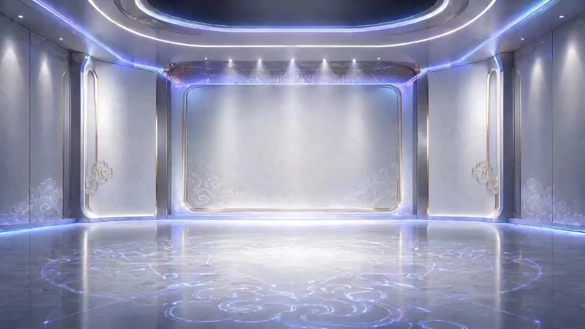

# Toy IP Design Kit

> **作者：** @Damon

## Content

Process Planning:

Full Process Stages and Dependencies:

Establish IP Design Brief — Use text_editor to create Final_Video_Spec.md, locking in global parameters: IP character concept description (trigger inspiration assistance—IP character concept if the user hasn't specified a direction), trend toy style tone, Brand Name (fixed value "BLUEPURPLE GIRL", cannot be overwritten), Main Color Palette (fixed value blue-purple gradient, cannot be overwritten), Merchandise Product List (default: tote bag, phone case, pillow, thermos, sun hat, umbrella, stickers, eye mask), target aspect ratio (image 16:9 and 3:4, video 16:9), and output language. The brand name and main color palette are fixed values; all subsequent steps must strictly reference them and cannot be overwritten or changed. If the user uploads existing IP character reference images, use resource_prepare_and_analyze to extract core character features (facial profile, hairstyle/color, head-to-body ratio, skin tone, clothing style, main color palette) and record them in the brief as consistency constraints for subsequent steps, while skipping Step 2 (Base Image Generation). If the user uploads multiple reference images, execute the multi-image processing strategy (select main image + multi-angle supplementation + conflict resolution).

Base IP Image Generation (Skip this step if the user has already uploaded an IP character reference image) → media_generator (TextToImage, GPT Image 2). Generate both a 3D rendered version (volumetric texture) and a flat vector version (distinct color blocks) simultaneously. For uploaded branches, use the user-uploaded image as the base image and proceed directly to Step 3.

Four-View Specification → media_generator (ImageToImage, GPT Image 2, reference image = base image). Generate a collection of front/side/back/45° side views, white background, 16:9. Register the base image and four-view images as key_element core assets of the IP character.

Expression and Action Expansion (Default 8) → media_generator (ImageToImage, GPT Image 2, reference image = four-view images). 2 rows × 4 columns, 3:4. The user can specify the quantity and type of expressions; if they want customization but lack direction, trigger inspiration assistance (Expression Type Expansion Library); if the quantity is adjusted, automatically format in a grid (e.g., 6 = 2×3, 9 = 3×3).

Outfit Schemes (Default 6 sets) → media_generator (ImageToImage, GPT Image 2, reference image = four-view images). Full-body shot, 3:4. The user can specify quantity and style direction; if they want customization but lack direction, trigger inspiration assistance (Outfit Style Expansion Library); multiple outfit sets must cover differentiated themes (e.g., trendy/traditional/casual/formal/cute/sporty) to avoid overly similar styles.

Layout Beautification and Expression Series Display → media_generator (ImageToImage, GPT Image 2, reference image = expression expansion image). Wrap half-body expressions in white thin-line circular frames with a gradient background (if the user has no preference for the background, trigger inspiration assistance—Layout Beautification Background Direction), 16:9.

Merchandise Design → media_generator (ImageToImage, GPT Image 2, reference image = base image/four-view images). 4 different display schemes, using the product list locked in the brief, brand name and main color palette must be consistent with the brief, 16:9.

Dynamic Display Video—Storyboard Design → storyboard_designer. Design elements (IP character outfits, merchandise items, empty scenes), shot sequence, audio layers (BGM + intro SFX). If the user has no idea for the display video scene, trigger inspiration assistance (Video Scene Direction).

Empty Scene Generation (Dual Mode) → media_generator (ImageToImage, GPT Image 2). If the user has selected a scene direction during the Storyboard stage (via inspiration assistance or custom), generate a new background scene based on that description (depends on Step 8); if the user has not selected a scene direction, use the merchandise display image as a reference, remove all items and characters from the scene, and keep only the empty background (depends on Step 7, can be parallel to Step 8).

Display Video Generation → media_generator (MultiModalToVideo, Seedance 2.0). Two types of shots: ① Character dynamic montage short shots (generated by default, user can skip entirely; one for each outfit look, 4–5s, reference image = corresponding outfit image); ② Main display shot (10–15s, reference image = outfit image + merchandise image + empty scene image). SFX embedded in the video via Seedance audio capability (prompt <...> tag), not generated as a separate SFX track. After each shot is generated, perform video generation consistency verification via resource_prepare_and_analyze (clipping/glitches, facial/clothing drift, element appearance completeness); mark failed shots with issue type and timestamp, then regenerate.

Background Music Generation → media_generator (text_to_instrumental, Suno 5 / Mureka 8). Generate background music based on the BGM audio layer design in the Storyboard; if the user has no preference for BGM style, trigger inspiration assistance (BGM Music Style Direction). BGM duration must match the total video duration (max 30s); if it exceeds, trim to video length. Can be parallel to Step 10.

Final Assembly → video_assembler.

Dependencies: 3→2; 4→3; 5→3; 6→4; 7→2 or 3; 8→5,7; 9→7 or 8 (if scene direction is selected → 8, if not selected → 7); 10→5,7,8,9; 11→8; 12→10,11. Among these, 4, 5, and 7 can proceed in parallel after 3 is complete; 8 and 9 can proceed in parallel after 7 is complete (8 depends on 5, 7; if no scene direction is selected, 9 depends only on 7 and can be parallel to 8; if scene direction is selected, 9 depends on 8 and cannot be parallel); within step 10, montage short shots (require only outfit images) and the main display shot (require outfit images + merchandise images + empty scene images) can be generated in parallel; 10 and 11 can be parallel after the Storyboard is complete.

Pause Points and Interaction Method: Do not run the entire process at once. When pausing at each milestone, first briefly report what has been completed and the output, then request user confirmation via cards. Specific interactions are as follows:

After Brief Locking: Report IP character concept description, trend toy style tone, brand name (fixed value "BLUEPURPLE GIRL"), main color palette (fixed value blue-purple gradient), product list, aspect ratio, and output language. If the user uploaded IP reference images, also report the extracted character feature summary.

Card options: ① Confirmed, start generating base image ② Adjust brief parameters ③ (Upload branch) Confirmed, start generating four-view images

1b. After Base Image Dual-Version Generation (Step 2 complete, before Step 3 starts): Display the 3D rendered version and flat vector version side-by-side, report style differences (rendering texture, color block distinctness) and character consistency. This is the final image confirmation node before four-view generation—the base image is the consistency anchor for all subsequent steps; if there is a deviation now, the correction cost is lowest before entering the four-view stage.

Card options: ① Satisfied with both versions, start generating four-view images ② Regenerate (can adjust character description or style tone) ③ Keep one version, start generating four-view images

After Four-View Completion: Display the four-view collection (front/side/back/45° side), report that they have been registered as IP character key_element core assets.

Card options: ① Confirm consistency, continue with expressions/outfits/layout/merchandise ② Regenerate four-view images ③ Adjust and continue

After Completion of Expressions/Outfits/Layout/Merchandise: Group display of expression expansion series, outfit scheme series, layout display images, and 4 merchandise design schemes; report the quantity and style coverage of each series.

Card options: ① All confirmed, proceed to Storyboard design ② A series needs adjustment (prompt user to specify which item and adjustment direction; if expression expansion is adjusted, layout beautification must be regenerated linkedly) ③ Supplementary generation

After Storyboard Completion: Report shot sequence (number of montage short shots + main display shot duration + main display shot outfit looks), audio layer design (BGM style + SFX intro scheme), and total duration estimation. If the user has selected a scene direction, explain that the empty scene will be generated based on the selected direction.

Hard Prerequisites (Must be fully met before entering video generation, without exception):

All key_elements (IP character, all outfit looks, all merchandise props, element scene) must be registered with asset_id, and source_resource_ids must not be empty—i.e., each key_element must be bound to at least one specific resource_id;

All shot and audio layer visual_res_asset_bindings in the Storyboard must not be empty—i.e., each shot's reference image slot is bound to the corresponding asset_id, with no hanging slots;

The outfit looks used in the main display shot have been confirmed by the user, and the corresponding asset_id is reflected in the above binding.

If any of the above conditions are not met, do not prompt the user to "start video generation"; first complete the missing registration/binding via media_generator, then perform self-checks again. Only after all pass can you prompt the user to confirm proceeding to the next step.

Card options: ① Confirm Storyboard, start generating empty scene (montage short shots start simultaneously, main display shot waits for empty scene confirmation) ② Adjust shot plan ③ Adjust audio design

4b. After Empty Scene Generation (Step 9 complete, before Step 10 main display shot starts): Display the generated empty scene image, report the generation mode (new background scene generation / background extraction from merchandise display image) and automatic verification results (whether there are residual items/characters). This is the final visual asset confirmation node before the main display shot starts. Montage short shots can be generated in parallel with Step 9 after confirmation at pause point 4; no need to wait for this confirmation node; the main display shot must wait for user confirmation at this node before starting.

Card options: ① Empty scene effect satisfactory, start generating main display shot ② Regenerate empty scene (can adjust scene direction or strengthen removal instructions) ③ Fine-tune scene description and regenerate

After Video and Audio Generation Completion: Display dynamic display video and BGM track, report SFX embedding and total duration.

Card options: ① All confirmed, proceed to final assembly ② Regenerate a certain shot ③ Adjust BGM style

After Final Assembly (Delivery Acceptance): Compare against the final delivery list and display the outputs one by one (Base Image → Four-View → Expression Series → Outfit Series → Layout Display Image → Merchandise Schemes → Dynamic Video + BGM), wait for user confirmation after each item; complete acceptance after all are confirmed. Report total output quantity, video duration, and BGM style.

Card options: ① Fully accepted, complete this IP full-case creation ② An output needs regeneration (prompt user to specify specific project and modification direction) ③ Generate additional variants

Inspiration Assistance (When the user lacks design direction):

When the user does not provide a specific direction at any design decision point (vague description, says "you design it," "I don't know," etc.), actively provide inspiration assistance—present structured options via cards instead of asking open-ended questions to reduce decision cost.

Inspiration Assistance Trigger Timing Mapping:

IP Character Concept → Step 1 (Brief stage), triggered when user has not specified a character direction

Expression Type → Step 4 (Expression expansion), triggered when user wants to customize but lacks direction

Outfit Style → Step 5 (Outfit schemes), triggered when user wants to customize but lacks direction

Layout Beautification Background → Step 6 (Layout beautification), triggered when user has no preference for background color

Video Scene → Step 8 (Storyboard design), triggered when user has no preference for display video scene

BGM Music Style → Step 11 (Background music generation), triggered when user has no preference for BGM style

IP Character Concept: When the user has not specified a character concept, provide inspiration directions for selection, each direction comes with 1–2 sentences of character description (appearance keywords + personality setting + main color suggestions):

Animal Category: Cat-ear girl, Bunny elf, Panda dumpling, Jellyfish girl, Shiba Inu boy, Parrot princess

Food Category: Strawberry cake elf, Matcha dumpling, Watermelon soda girl, Donut angel, Lollipop knight, Shaved ice snowman

Plant Category: Cactus elf, Sunflower girl, Mushroom girl, Cherry blossom fairy, Venus flytrap hunter, Dandelion traveler

Occupation Category: Astronaut, Magician, Cyberpunk hacker, Deep-sea explorer, Dessert chef, Interstellar courier

Fantasy Category: Star elf, Cloud fairy, Dark witch, Dream weaver, Aurora messenger, Time clockmaker

Holiday Category: Christmas elf, Halloween pumpkin, New Year koi, Valentine's Cupid, Mid-Autumn rabbit, Halloween ghost cat

Zodiac Category: Aries warrior, Gemini twins, Libra girl, Pisces mermaid, Leo king, Aquarius inventor Once selected by the user, write it into the brief as the character concept anchor point.

Expression Type: Use the default 8 when not specified by the user; if they want to customize but lack direction, provide an extended expression library to check and replace; trigger expression differentiation verification after replacement. The extended library is divided into three groups:

Happy: Smug, Heart-eyes, Flying kiss, Starry eyes, Peeking, Fan-girling, Cool sunglasses smile

Negative: Pouting, Enraged, Touched/crying, Wronged, Startled, Embarrassed smile, Crying while holding head

Funny: Tongue-out, Sneeze, Grimace, Dazed, Drooling, Tsundere hum, Confused/puzzled, Yawning

Outfit Style: Use the default 6 sets when not specified by the user; if they want to customize but lack direction, provide an extended style library to check and replace; trigger style differentiation verification after replacement. The extended library is divided into four groups:

Street Trend: Cyberpunk, Sporty street, Moto sweet-cool, Hip-hop oversize, Street workwear

Oriental Charm: Shinto shrine maiden, Guochao (National Trend), Oiran, Republic-era cheongsam, Hanfu girl

Fantasy Wonderland: Vaporwave, Gothic Lolita, Magical girl, Forest elf, Sweet Lolita

Academy/Commuter: Preppy style, Japanese JK, Future techwear, Ballerina, Cyber ninja Users can mix and match from multiple groups; as long as it passes the three-dimensional differentiation verification, it is acceptable.

Layout Beautification Background: When the user has no preference for the layout background of the expression series display image, provide background direction suggestions:

Blue-pink gradient sky (light blue → light pink, soft and dreamy)

Purple-orange gradient sunset (deep purple → warm orange, trend toy vibrancy)

Mint green gradient (light green → white, fresh and natural)

Macaron color block (pink/yellow/blue/green four-quadrant, candy feel)

Starry deep blue (deep blue base + star dots, mysterious and cool)

Creamy warm white (warm white base + fine light spots, minimalist and premium)

Rainbow streamer (seven-color gradient flowing, lively and colorful)

Cyber neon (deep purple base + neon light strips, cyberpunk)

Video Scene: When the user has no preference for the display video scene, provide scene direction suggestions, each direction comes with atmosphere keywords and light source description for Storyboard design reference:

Dreamy starry stage (deep blue gradient + star light spots + top soft light)

Candy-colored laboratory (macaron pink-yellow wall + fluorescent light strips + bubble decorations)

Futuristic exhibition hall (cold white metal + neon blue-purple light strips + holographic projection texture)

Floating island garden (cloud surround + warm backlight + floating petals)

Dreamy undersea palace (blue-green gradient + water wave refraction light + coral bubbles)

Retro pixel world (pixel mosaic background + scan lines + warm yellow CRT halo)

Four seasons garden (four seasons in one frame + soft natural light + butterfly/firefly embellishment)

Crystal gem mine (amethyst cluster + refracted starlight + bottom faint blue cold light)

Castle in the clouds (cotton clouds + golden sunset + rainbow arch bridge)

Neon night market (cyber signs + warm orange street lamps + rainy night ground reflection)

BGM Music Style: When the user has no preference for the background music style, provide music direction suggestions, each direction comes with BPM range and timbre keywords:

Fashion Electronic (BPM 120–128, synth lead + drum machine + piano embellishment, suitable for tech-cute tonality)

Dreamy Pop (BPM 100–115, pad background + soft electronic drums + bell arpeggios, sweet and dreamy feeling)

Lively Japanese Style (BPM 128–140, bright synth + cheerful piano + handclap rhythm, energetic girl style)

Virtual Diva (BPM 115–130, electronic vocal slices + synth bass + 8-bit timbres, ACG feel)

Light Jazz Fusion (BPM 110–125, electric piano + light swing drums + brass embellishment, playful and stylish feel)

8-bit Retro Chip (BPM 120–135, square wave + triangle wave + noise percussion, pixel game retro style)

Ethereal Ambient Electronic (BPM 90–105, pad + ethereal bells + slow rhythm beat, fairylike feeling)

Festive Celebration (BPM 120–135, bells + brass + cheerful melody, festive celebration atmosphere)

Asset Management: Every image generated in each step should be registered with an asset_id via media_generator and bound to the corresponding Storyboard element (IP character → key_element character; merchandise products → key_element prop). Subsequent steps refer to previously created assets using the registered asset_id to ensure character consistency.

Final Deliverables List and Display Method:

Base Image Dual-Version (3D rendered version + flat vector version, or user-uploaded image) — display both versions side-by-side, label version type; upload branch displays original image labeled "User Uploaded"

Four-View Collection (front/side/back/45° side) — single image display, label each view direction

Expression and Action Expansion Series (default 8) — grid display, label name below each expression

Outfit Scheme Series (default 6 sets) — grid display, label style name below each set

Layout Beautification Expression Series Display Image — single image display

4 Merchandise Design Schemes — display each scheme one by one, label differences in display form for each scheme

Dynamic Display Video (including embedded SFX) + BGM track — video playback preview, report total duration, shot composition (montage segments + main display shot), BGM style

After final assembly, enter pause point 6 (delivery acceptance)—display according to the list above, wait for user confirmation after each item, complete acceptance after all are confirmed.

Asset Analysis:

Reference Image Analysis:

When a user uploads reference images of an existing IP character, extract and record the character's core features dimension by dimension. Each item must output quantifiable descriptors to serve as consistency constraints for subsequent ImageToImage steps:

Facial Contour: Face shape (round/square/pointed/oval), face cheek aspect ratio, chin curvature—used as a benchmark for facial consistency.

Eyes: Eye shape (round/almond/slender), pupil color, eye spacing ratio (wide/standard/narrow)—all three must be recorded; none can be omitted.

Hairstyle and Hair Color: Hairstyle structure (short/long/twin tails/bun, etc.), hair volume (thick/medium/thin), hair color (precise color name or color code), fringe style (straight bangs/side-swept bangs/no bangs)—all four must be recorded; none can be omitted.

Head-to-Body Ratio: The ratio of head height to full body height (e.g., 1:2.5), accurate to one decimal place—subsequent generations with a deviation >5% will be marked as failed.

Skin Tone: Skin color name or approximate color code (e.g., light skin/wheat/cool white)—used as a benchmark for skin tone consistency.

Clothing Style: Current clothing category, color scheme, patterns, and accessories—used as a reference for the "base outfit" during wardrobe change steps.

Main Color Tone: Extract the main color tone of the image—if it conflicts with the main color tone locked in the brief (e.g., blue-purple gradient), note the conflict in feedback and suggest the user confirm which one should take precedence.

When a user uploads reference images of peripheral products or scenes, extract the product type, color scheme, layout style, and brand logo position.

Strategy for Processing Multiple Reference Images:

Primary Image Selection: When a user uploads multiple IP character reference images, use the image with the highest resolution where the character is fully visible from the front as the primary reference; use the others as auxiliary references to supplement features obscured or blurry in the primary image.

Multi-Angle Complementarity: If the uploaded images cover different angles (front + side + back), cross-verify features across dimensions—use the front view to extract information about the face, eyes, and front hairstyle; use side/back views to supplement hairstyle structure and side profile head-to-body ratio.

Feature Conflict Handling: If multiple images conflict in the same dimension (e.g., inconsistent hair color, different clothing), note the conflicting item in feedback and ask the user to confirm which one to prioritize; do not make decisions arbitrarily.

Non-Character Asset Recognition: If non-character assets like style references or scene references are mixed in, classify them as style direction references (record them, but do not use them as identity anchors for key_elements). Only character images participate in feature extraction.

Upload Asset Usability Verification:

Image Quality Threshold: Uploaded images must have a resolution of at least 1K, be clear and unobscured, and the character must be fully visible (head and feet within the frame). If any condition is not met, note the issue in feedback and suggest the user re-upload higher-definition or more complete reference images.

Feature Extraction Completeness: All seven dimensions mentioned above must be successfully extracted. If any dimension cannot be extracted due to obstruction, blurriness, or angle issues, note the missing dimension in feedback and suggest the user upload a reference image from that angle—it is not recommended to proceed to the Four-View step with missing features.

Uploaded Image as Consistency Benchmark: Under the upload branch, the uploaded image replaces the generation result of Step 2 as the identity anchor for the key_element character. All subsequent ImageToImage consistency checks will use the extracted feature records as the comparison benchmark, rather than comparing generation against generation.

Consistency Verification Standards for Each Step: After each ImageToImage step is completed, automatically compare the generation result with the IP's base image (key_element character) and check the following dimensions item by item:

Facial Features: Are face contour, eye shape and size, pupil color, and mouth shape consistent? If the deviation exceeds the fine-tuning range (e.g., face shape changing from round to pointed), mark as failed.

Hairstyle and Hair Color: Are hairstyle structure, volume, hair color, and fringe style consistent? Wardrobe change steps allow for accessory obstruction, but do not allow changes to the hairstyle itself.

Head-to-Body Ratio: Is the head-to-body ratio consistent with the base image? Deviation >5% is marked as failed.

Art Style Consistency: Are the rendering texture (3D/flat), line style, and color saturation consistent with the base image? Style drift (e.g., from 3D rendering to watercolor) is marked as failed.

Brand Guideline Consistency (Peripheral Design Steps): Is the brand name spelling and main color tone consistent with the values locked in the brief? Missing brand name or main color tone shift is marked as failed.

If verification fails, clearly note the deviant dimension and suggested adjustment direction (re-generate/modify prompts/change reference image) in feedback for the media_generator to execute corrections.

Outfit Style Differentiation Verification (Step 5):

After generating outfit schemes, compare all outfit looks one by one, checking for differentiation in three dimensions: theme, color scheme, and accessories—at least two dimensions must be clearly different between any two sets. If two sets are highly similar in all three dimensions, mark as failed and suggest replacing the style direction of one of them for the media_generator to execute corrections.

Empty Scene Verification (Step 9):

After generating an empty scene, automatically check if any items or people remain in the frame—if any products, props, characters, or text logos are detected, mark as failed. Both modes (generate from selected scene direction / extract from peripheral display image) must pass this verification.

If verification fails, note the location of the residue and suggest re-generation: In the mode without a selected scene direction, strengthen the "remove all items and people" instruction in the prompt; in the mode with a selected scene direction, check if unrelated item descriptions have been mixed into the prompt, for the media_generator to execute corrections.

Video Generation Consistency Verification (Step 10):

After each video shot is generated, automatically check the following dimensions item by item—if any dimension fails, mark that shot for re-generation:

Clipping and Collapse: Detect rendering anomalies such as character limbs clipping through objects, broken/distorted limbs, distorted facial features, or collapsed peripheral product shapes—if any occur, mark as failed and prioritize suggesting re-generation (rather than modifying the prompt), as such issues usually stem from model randomness rather than prompt defects.

Facial Consistency: Compare the character's face in the video with the key_element character identity anchor (base image/reference image feature records)—check if face contour, eye shape and pupil color, and mouth shape remain consistent. Facial drift (e.g., face shape changing from round to pointed, pupil color change) is marked as failed.

Clothing and Styling Consistency: Are the outfit look's clothing category, color scheme, and accessories consistent with the corresponding outfit reference image? Sudden changes in clothing material, color shift, or lost or deformed accessories are marked as failed.

Head-to-Body Ratio Consistency: Is the character's head-to-body ratio consistent with the base image? Deviation >5% is marked as failed.

Art Style Consistency: Is the rendering texture consistent with the base image? Art style shifts from 3D rendering to watercolor/2D, etc., are marked as failed.

Element Appearance Completeness (Main Display Shot Only): Check if all peripheral products planned in the Storyboard appear in order and are recognizable—if key elements are missing, the appearance order is chaotic, or products are unrecognizable, mark as failed.

If verification fails, clearly note the issue type, the time of occurrence (e.g., "3-second mark, character left hand clipping"), and the suggested correction direction in the feedback:

Clipping/Collapse → Suggest re-generation (retry with the same model); if it still fails after 2 consecutive attempts, try fine-tuning the motion intensity description in the prompt (reduce motion complexity).

Facial/Clothing/Art Style Drift → Suggest re-generation and strengthen the consistency constraint wording in the prompt, while confirming that the reference image binding is correct.

Incomplete Element Appearance → Suggest checking if the appearance order description in the prompt is consistent with the Storyboard; simplify the number of elements or split into multiple shots if necessary.

Montage short shots and main display shots are checked independently; montage short shots are additionally checked for whether actions echo the outfit style theme and whether actions are repetitive between different looks.

Storyboard Design:

Element Design:

key_element character (IP Character): Use the base image and four-view diagram as the anchor for the character identity; use the outfit plans as multiple look variants for this character (Look 1–N, default 6), with each look bound to the corresponding asset_id of the outfit image.

key_element prop (Peripheral Products): Reference the product categories locked in the brief and list them one by one as independent prop elements (Tote bag, phone case, pillow, tumbler, sun hat, umbrella, stickers, eye mask), binding each item to its corresponding asset in the peripheral display images.

element scene (Empty Scene): Describe the visual characteristics of the empty scene background (gradient tone, spatial layout, light source direction) to serve as the foundation for the animation stage. If the user selects a scene direction (Inspiration Assistance or Custom), the element scene description must fully reflect the mood keywords and light source characteristics of that direction and serve as the basis for the description in Step 9's Empty Scene Generation (Selected Mode).

Shot Design:

Character Dynamic Shots (Generated by default, 1:1 mapping with outfit looks): One shot per outfit look, each lasting 4–5s, used for an opening montage to showcase character diversity. Users can skip the montage segment entirely (starting directly from the main display shot), but once enabled, the quantity is fixed—strictly equal to the number of outfit looks, with no additions or subtractions.

Action Design: The action in each shot must echo the style theme of the outfit—Western Cowboy → Tip hat + sidestep; Ancient Fantasy → Wave sleeve and turn + lift hand; Summer Trendy → Cool gesture + slight head bob; Cute Bear → Hugging arms + sway left and right; Cute Watermelon → Jump on spot + hands cupping face; Cool Black Suit → Adjust tie + confident glance. The action amplitude should be clear, with cute but recognizable body language; actions must not repeat between different looks.

Opening Rhythm: Start with a fast-paced montage, with each short shot cut rapidly at 1–2s (individual shots are generated at 4–5s, then trimmed to 1–2s during assembly). Complete the display of at least 2 looks within the first 3 seconds to create visual impact. Scale total duration proportionally to the number of looks (2 ≈ 4s, 4 ≈ 8s, 6 ≈ 12s), leaving a 0.5s buffer at the end before entering the main display shot to avoid the abruptness of cutting from fast-paced shots to a long shot.

Shot Transitions: Short shots are primarily connected by hard cuts, supplemented by a few 0.3s fade-in/fade-out transitions for rhythmic variation. Between the last short shot and the main display shot, use a 1s gradient transition to naturally conclude the fast pace and ease into the leisurely unfolding of the main shot.

Main Display Shot (Core shot, 10–15s): Fully utilize the long-shot capability of Seedance 2.0 to complete the entire display in a single shot.

Outfit Selection: No default value—during Storyboard design, use a card to let the user specify which outfit look the character wears in the main display shot; the selected look serves as the character appearance reference image for this shot.

Element Entry Sequence: ① IP character fades in/pops up from the center of the frame and stands still → ② Tote bag (Brand main visual, appears first, largest size) → ③ Phone case → ④ Pillow → ⑤ Tumbler → ⑥ Sun hat → ⑦ Umbrella → ⑧ Stickers/Eye mask (Smallest items appear last, as finishing touches). Each element is spaced about 1–1.5s apart.

Character Interaction Beat: The character remains centered after appearing; as each new element appears, the character turns their head toward the element's direction and reacts with an expression (Discovery → Surprise → Happy interaction → Return to center), forming a "Discovery-Response" rhythm loop to avoid the character being static for too long.

Camera Design: Fixed medium shot, character positioned slightly below the center of the screen; when the last element appears, the camera performs a slight push-in to tighten the visual focus.

Entry Style: Each element appears in a differentiated way (pop up/slide in/fade in with glow/scale in) to avoid monotony.

Each shot description must include: Scene (reference element scene), Story Beat (element entry sequence + character interaction action), and Photography (fixed camera/slight push-in).

Total Duration Constraint: The total duration of the montage segment is scaled proportionally based on the number of looks (2 ≈ 4s, 4 ≈ 8s, 6 ≈ 12s), with no single shot exceeding 5s. The total duration of the entire film is capped at 30s (montage segment + main display shot + buffer). If it exceeds this, prioritize compressing the short shots in the montage segment while keeping the full duration of the main display shot.

Audio Layers Design:

BGM (audio_layer): Fashion/tech/cute style background music throughout the film. The beat is upbeat (BPM 110–130), with electronic synthesizer timbres as the main tone, incorporating light piano embellishments. The opening segment (character dynamic montage) features a tight rhythm and prominent drum beats; upon entering the main display shot, it shifts to a melody-driven, slightly dreamy feel, with a final closing beat added at the end. Volume automatically lowers (ducking) when SFX is triggered and recovers within 300ms after the SFX ends (consistent with the video_assembler ducking rules).

SFX (Video embedded audio specification, not an independent track): Design independent sound effects for each peripheral product entry as input specifications for the <...> wrapping symbols in the video generation prompt—SFX is embedded by Seedance audio capabilities during video generation and does not generate a separate audio track. It must be precisely aligned with the element's entry style and timing—Pop up → Short "pop" bounce sound (0.3s); Slide in → Light "whoosh" sliding sound (0.4s); Fade in with glow → Soft "ding" chime + continuous micro-hum (0.6s); Scale in → Low-frequency "thud" crescendo sound (0.5s). Each SFX triggers on the first frame the element appears, with volume not exceeding -6dB of the BGM; the interval between adjacent SFX should be at least 0.8s to avoid cluttered sound effects. Assign a signature "ding-dong" entrance sound when the character appears as an IP sound signature. SFX timestamps also serve as a reference for BGM ducking in the video_assembler.

Media Generation:

Image Generation (Steps 2–7, 9):

Base Image Generation (Step 2): Use TextToImage with model GPT Image 2 at 2K resolution. Generate two resource_ids: one for the 3D rendered version and one for the flat vector version.

Reference Image Generation (Steps 3–7, 9): Use ImageToImage with model GPT Image 2 at 2K resolution. For each step, use the reference image specified by the source in the Planner (e.g., base image/four-view/expression sheet/merchandise display, etc.), explicitly specifying character consistency constraints in the prompt.

Empty Scene Generation (Step 9, Dual Mode): Use ImageToImage with model GPT Image 2 at 2K resolution. If the user has selected a scene direction, use the merchandise display image as a style reference, generating a new background scene based on the element scene description in the Storyboard. If no selection has been made, use the merchandise display image as a reference, with prompts instructing to remove all objects and characters, keeping only the background scene.

Video Generation (Step 10):

Use MultiModalToVideo with model Seedance 2.0 at 720p resolution (use 1080p if the user explicitly requests higher quality).

Character Dynamic Montage Shorts: Generate a 4–5s clip for each outfit look independently, using the corresponding outfit image as a reference. Ensure significant range of motion and non-repetitive actions across different looks. Embed SFX (if applicable) within the short clips using Seedance's audio capabilities.

Main Showcase Shot: A 10–15s single shot. Reference inputs: outfit image (for character appearance consistency) + merchandise product image (for product appearance) + empty scene image (for background consistency). Generate element entry SFX embedded in the video according to the Storyboard SFX design (see SFX rules below).

Single shot duration must not exceed 15s.

Audio Generation (Step 11):

BGM: Use text_to_instrumental with model Suno 5 (default) or Mureka 8. Generate based on the BGM Audio Layers description in the Storyboard: fashionable, tech, cute style, BPM 110–130, electronic synthesis with piano accents, compact opening → melody-driven main shot → conclusive ending. BGM duration must match the total video length (up to 30s limit); trim if it exceeds the video length. If Suno 5 fails, switch to Mureka 8 (model switching within the same tool).

SFX: Do not generate separately—embed SFX during video generation using Seedance's audio capabilities, specified in the prompt using <...> delimiters as designed in the Storyboard SFX section.

Asset Binding and Consistency:

Register the base image and four-view as key_element core assets for the IP character; bind outfit images as character look variants; bind merchandise product images as prop elements.

For all ImageToImage steps, prioritize using registered key_element assets as reference images to prevent drift in character face, hairstyle, or head-to-body proportions.

Model Usage Constraints: Use only GPT Image 2 for image generation and Seedance 2.0 for video generation throughout the process; do not use other models. If model generation fails, retry within the same model; do not switch to other models. If failures persist after multiple attempts, stop the current step and provide feedback to the user; do not automatically replace the model.

Prompt Writing:

Image Prompting (TextToImage / ImageToImage, GPT Image 2):

Base Character Style Anchor: Full-body shot, front view, super cute, kawaii, Pop Mart style, blind box figure, art toy, cute stylized vinyl doll, big head and small body, minimalist. Optional style reference: moonlab_studio style.

Dual-Version Output: The base image must cover both a 3D rendered version (volumetric texture, delicate lighting) and a flat vector version (distinct color blocks, clear outlines); describe these separately in the prompt.

Consistency Constraint (Required for all reference image steps): "Strictly maintain consistency in character face, hair, head-to-body ratio, and physical characteristics; strictly maintain consistency in art style."

Four-View: Explicitly specify front view, side view, back view, and 45° side view, all placed on a single image, white background, 16:9.

Expression Extension (8 by default): By default, cover 8 types of expressions/actions (kissing, happy, craving/hungry, angry, sleepy, shy, scared, crying), emphasizing clear and exaggerated motion ranges. Users can increase/decrease the quantity or replace types (can be selected from the Inspiration Assistant extension library); after adjustment, auto-layout in a grid, 3:4.

Custom Expression Workflow: When the user specifies a brand-new expression type (not among the default 8), handle it according to the following rules:

Expression Definition: Write 1–2 sentences describing each custom expression, covering emotional keywords, facial expression changes (eyebrows/eyes/mouth state), and matching body movements; write this into the brief as the anchor for this expression.

Differentiation Check: Before generation, compare all expressions (including default and custom) one by one to confirm that every two expressions are significantly different in at least two of the three dimensions: emotional category, facial change, and body movement; if two expressions are highly similar in all three dimensions, one must be merged or replaced.

Action Linkage: Design a signature body movement that corresponds to the emotion for each custom expression (e.g., "Smug" → hands on hips + looking up and smiling), serving as the visual description anchor for the expression; the action must not repeat with existing expressions.

Layout Linkage: After adjusting the quantity, auto-layout in a grid (4 = 2×2, 6 = 2×3, 9 = 3×3, 12 = 3×4) to keep the image evenly distributed; add the global consistency constraint at the end of the prompt.

Outfit Extension (6 sets by default): By default, cover 6 sets of outfits with differentiated styles (Western cowboy, ancient Xianxia, summer trendy/cool, cute bear, cute watermelon, cool black suit), emphasizing synchronized matching of accessories. Users can increase/decrease the quantity or specify a new style direction (can be selected from the Inspiration Assistant extension library); multiple outfits must maintain style differentiation to avoid duplication, 3:4.

Custom Outfit Style Workflow: When the user specifies a brand-new style direction (not among the default 6), handle it according to the following rules:

Style Definition: Write 2–3 sentences describing each custom style, covering theme keywords, clothing category, color palette preference, and signature accessories/parts; write this into the brief as the anchor for this look.

Differentiation Check: Before generation, compare all styles (including default and custom) one by one to confirm that every two sets are significantly different in at least two of the three dimensions: theme, color palette, and accessories; if two sets are highly similar in all three dimensions, one must be merged or replaced.

Action Linkage: Design a signature action that corresponds to the theme for each custom style and write it into the Storyboard character dynamic shots; the action must not repeat with existing looks.

Prompt Writing: When describing each set individually, start with the style theme word → clothing category and color palette → accessory details; when integrating multiple sets into one image, describe the style for each position in a grid, and add the global consistency constraint at the end.

Layout Beautification: Wrap each IP character in a white thin-lined circular frame, showing only a half-body facial expression, with a gradient background (referencing the layout background color direction chosen by the user in the Inspiration Assistant; if not chosen, default to blue-pink gradient sky); integrate all expressions from the expression extension series into the same scene, 16:9.

Merchandise Design: Reference the brief's locked list for product categories (tote bag, phone case, pillow, thermos cup, sun hat, umbrella, stickers, eye mask); the main color palette and brand name are fixed values and must strictly follow the values locked in the brief (Brand name: "BLUEPURPLE GIRL", Main color: blue-purple gradient) and cannot be overridden. Use a minimalist cute pattern style. The brand name should appear in large English print on main visual products like tote bags. Generate 4 completely different display schemes, 16:9.

Empty Scene Generation: Dual-mode—If the user has selected a scene direction, generate a new background based on the element scene description in the Storyboard (atmosphere keywords + light source + spatial layout); the prompt must include all visual features of the scene direction. If no scene direction is selected, use the merchandise display image as a reference image, and the prompt must require: "Remove all objects and characters from the image, keeping only the background scene." Both modes must specify "No characters, products, props, or text should appear."

Video Prompting (MultiModalToVideo, Seedance 2.0):

Montage Short Shots: Use <<<image_1>>> etc., to bind corresponding outfit reference images; name specific body parts for action descriptions, add range and speed, and correlate with the outfit style theme; do not write element appearances in short shots, focus on character performance.

Main Display Shot Motion Stack: Fixed camera (slight push-in allowed) → Character interaction action (looking at appearing elements one by one) → Elements appear one by one (pop up/slide in/glow and emerge/scale entry, following the story order) → SFX prompt (each element's appearance accompanied by the corresponding <...> packaging symbol, referencing the Storyboard SFX design; do not write a separate BGM script).

Quality Constraints: Prohibit clipping and model breakdown; maintain character consistency. Style keywords: fashion, tech, cute.

Seedance 2.0 Packaging Symbols: SFX <...>, Dialogue {...}, BGM (...). BGM is handled in a separate audio layer and should not be repeated in the video prompt; SFX are embedded via <...> in video generation and are not generated in a separate audio track.

Language: The prompt body uses the user's interaction language; brand names and dialogue content follow the output language specified in Final_Video_Spec.md.

Montage Short Shot Prompt Template (one per look):

<<<image_1>>> (Corresponding outfit look reference image) [Character Identity Reference] The IP character wearing [Outfit Style Theme] performs [Signature Action] in [Scene Description]. Action: [Name specific body parts] + [Range/Speed], arrange multi-step actions in story order, primary action first. Style: Fashion, tech, cute. Prohibit clipping and model breakdown, maintain character consistency. <Sound Effect Description (if any)>

Main Display Shot Prompt Template:

<<<image_1>>> (Outfit image) <<<image_2>>> (Merchandise image) <<<image_3>>> (Empty scene image) Fixed medium shot, [Character] fades into the center and stands still. Merchandise elements appear one by one according to the Storyboard appearance order: ① [Element A] appears via [Appearance Method], character [Expression Reaction] <Corresponding SFX>; ② [Element B] appears via [Appearance Method], character [Expression Reaction] <Corresponding SFX>; ③ ... (expand item by item according to appearance order) Slight camera push-in when the last element appears. Style: Fashion, tech, cute. Prohibit clipping and model breakdown, maintain character consistency. Appearance order and SFX in the template must reference the design locked in the Storyboard; BGM is handled in a separate audio layer and not written into this prompt.

Video Editing:

Assembly Preferences:

Dynamic short character shots (generated by default, skippable by user) serve as an opening fast montage, with 1–2s quick cuts for each to create a pacing that showcases character variety.

The main showcase shot is kept as a complete long take, not split.

BGM is an independent Audio Layer throughout the entire video; SFX are sourced from the video track, with no separate SFX track mounted.

A 1s dissolve transition (referencing the Storyboard transition design) connects the dynamic character shots to the main showcase shot, transitioning naturally from the fast-paced montage to the composed unfolding of the main shot.

Output 16:9, matching the aspect ratio locked in the Final_Video_Spec.md.

Total Duration Constraint: The total duration of the entire video is capped at 30s (montage segment + main showcase shot + buffer), referencing the Storyboard duration constraints; if exceeded during assembly, prioritize compressing the duration of the short montage shots while retaining the full duration of the main showcase shot.

Audio Synchronization and Ducking Timeline Rules:

SFX Triggered Ducking: Based on the first frame trigger time of each SFX in the Storyboard, start lowering the BGM volume 0.1s before that timestamp, smoothly reducing it to -9dB of the BGM base volume (approx. 35% of original volume) within 200ms. Maintain this low volume for the duration of the SFX; smoothly restore to base volume within 300ms after the SFX ends. If the interval between adjacent SFX is <0.8s, the BGM remains at the low volume to avoid repeated volume fluctuations (pumping).

Character Signature Audio: When the entry audio for the IP character "Dingdong" is triggered, the BGM also performs ducking (-9dB drop, 300ms recovery). However, as it is the first SFX of the entire video, its ducking start point coincides with the BGM fade-in start point—the BGM enters at a low volume and then recovers, creating an opening effect of "sound preceding music."

Montage Segment Volume: The BGM in the montage segment maintains a base volume + 2dB boost (accentuating drum beats for a tight, rhythmic feel). 0.5s before entering the main showcase shot, the BGM volume smoothly drops from the boost level back to the base volume, while the style shifts from beat-driven to melody-driven, with no silent gaps in the transition zone.

Main Showcase Segment Volume: The BGM in the main showcase segment maintains the base volume, executing ducking only when SFX are triggered. After the final element's entry SFX concludes, the BGM recovers to the base volume within 300ms and maintains it until the concluding note. The BGM does not duck when the concluding note (one beat) is triggered; the concluding note and BGM are superimposed, followed by a 500ms fade-out to finish.

Volume Transition Curves: All ducking adjustments use S-curves (ease-in-out) to avoid the jarring auditory experience caused by linear adjustments; the volume drop from the montage segment to the main showcase shot uses a 500ms linear fade, matching the visual rhythm of the dissolve transition between shots.
