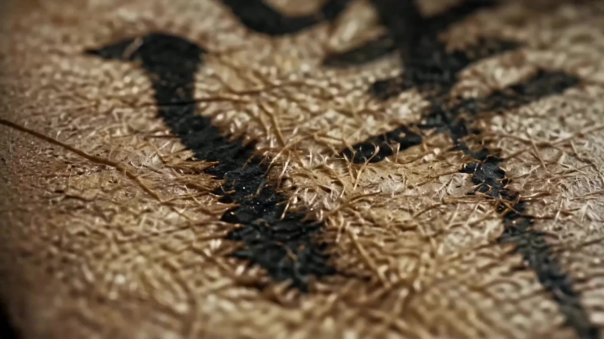

# Traditional Craft Documentary

> **作者：** 境在丨米叔

## Content

**Process Planning:**

# Logic and Dependencies of the Process Planning Phase
### Step 1: Lock the Global Production Specifications
Invoke **text_editor** to create Craft_Spec.md and write the following global parameters: Title, Craft Theme and Type, Historical Background and Heritage Duration, Geographic Distribution, Aspect Ratio (16:9), Total Duration (45 seconds, 3 groups × 15 seconds), Color Arc (Traditional Chinese Mineral Pigment Palette), Output Language (Chinese narration), Visual Tone (Ancient Book Woodblock Texture × Ultra-realistic Macro × Documentary Film Style).

### Step 2: Analyze Craft Literature
Invoke **resource_prepare_and_analyze** to perform a deep analysis of the traditional craft literature uploaded by the user, and output: 
① Craft provenance information; ② Complete process node list; ③ Finished product morphology list; ④ Quantifiable visual language dictionary.

### Step 3: Write the Three-Act Story Script and Narration
Invoke **text_editor** to write and append the story script based on the literature analysis results and Craft_Spec.md.
**Hard Constraints:** The script must clearly define the narrative mainline and plot beats for each group. The entire film consists of 3 groups × 6 cells = 18 shot nodes:
- **Shot List Group A (Craft Provenance, Grid A1–A6):** Introduce the characters, location, and historical context.
- **Shot List Group B (Craft Process, Grid B1–B6):** Showcase 6 core process steps, dramatic tension points, and physical interaction details.
- **Shot List Group C (Finished Product/Live Action, Grid C1–C6):** Showcase the finished product in specific real-life scenes, followed by concluding emotions and philosophical narration.
**Narration (VO) lines must be written simultaneously with the story script in this step:** Write verbatim lines for each Shot List group (A/B/C), matching the total word count to the 45-second duration. The tone of the narration must reflect a documentary-style magnetic voice—concise, steady-paced, rich in imagery, and coordinated with the emotional arc of each group's Shot List. The narration lines, acting as the narration_speaker_profile anchor text, are written into the script file to be called directly in step 7 to generate the VO audio.
> **Milestone Pause ①:** Present the story script (including the three segments of narration) to the user. Confirm the 18-cell plot direction for the three groups and the tone of the narration before proceeding to the Storyboard Design stage.

### Step 4: Design the Storyboard
Invoke **storyboard_designer** to design a 2×3 six-grid tiled Storyboard for each group based on the confirmed story script, defining the camera movement instructions, plot actions, and emotional beats for all 18 nodes; simultaneously plan the Audio Layers (45 seconds of classical BGM + continuous VO for the entire film).

### Step 5: Generate and Confirm the Six-Grid Director's Shot List Image for Each Group
Invoke **media_generator** to sequentially generate a 2×3 six-grid tiled Shot List reference image for Shot List groups A, B, and C based on the story script and Storyboard. After generation, register the asset_id (Craft_Asset_A / Craft_Asset_B / Craft_Asset_C) and bind it to the corresponding Shot List group slot.
> **Milestone Pause ②:** Pause after generating each 6-grid Shot List image, waiting for user confirmation; proceed to video generation only after confirmation, advancing group by group.

### Step 6: Drive Video Generation with the Shot List Matrix
Invoke **media_generator** to generate video group by group in the order A→B→C. Each video group uses the confirmed 6-grid Shot List matrix as a reference_image, combined with hierarchical prompts to drive **MultiModalToVideo (Seedance 2.0 @ 720p)**, synthesizing a 15-second group-level video in one go; SFX/Foley for each shot are natively mixed in by Seedance 2.0 via prompt tags.

### Step 7: Generate Independent Audio Layers
Invoke **media_generator** to generate 45 seconds of classical instrumental BGM (Guqin / Chimes / Xun timbre) and the narration VO audio for the entire film.

### Step 8: Final Edit and Upscaling
Invoke **video_assembler** to splice the 3 × 15-second video clips in the A→B→C sequence, perform staggered L-Cut/J-Cut audio editing, overlay BGM and VO tracks, and invoke **MediaKit** to upscale to 1080p.
> **Milestone Pause ③:** Ask the user to confirm the narrative completeness and audiovisual consistency of the final film before exporting.

**Dependencies:** 2→1; 3→2; 4→3 (requires milestone ① confirmation); 5→4; 6→5 (requires milestone ② group-by-group confirmation); 7→4; 8→6,7 (requires milestone ③ confirmation).

**Asset Analysis:**

Deep analysis of craft literature for process breakdown: Identifying the complete process node sequence from ancient texts or woodblock prints (e.g., 'mining → crushing → smelting → molding → quenching → shaping'), perfectly mapped to a 3-group × 6-shot = 18-shot audiovisual node framework.
Physical dynamics quantification: Converting obscure classical descriptions into executable visual physical language: 'Fire control is perfect' → 'Blue-white flames lick the crucible walls, molten iron appears as a semi-transparent, bright-white viscous liquid, with tiny bubbles on the surface constantly bursting, accompanied by orange-red sparks'; 'Sudden quenching in cold water' → 'The instant red-hot metal touches the water, a violent column of steam rises vertically, water splashes radiate in slow motion, and the metal surface quickly turns from orange to black, developing ice-crack patterns'; 'Bamboo screen fiber molding' → 'Paper pulp fibers drift on the bamboo screen with the water flow, surface tension causes fibers to slowly interweave and aggregate, water droplets fall along the bamboo texture'.
2×3 Matrix spatial layout calculation: Analyze historical background and workshop scenes, calculating the visual contrast, traditional Chinese line-drawing texture, and spatial perspective relationship of the 6 process step shots within a single 16:9 frame.
Visual element list extraction: Output a structured list including: main artisan physical features (clothing/posture/hand movements), core tools (shape/material), raw material state, and key props and scene objects.

**Storyboard Design:**

Global visual tone and Shot List group structure (each group must correspond to a 2×3 six-grid tiled director's Shot List image). Aesthetic tone: Fusion of ancient woodblock print line-drawing texture with modern ultra-realistic macro photography; fine film grain, high-contrast dark areas, mineral pigment palette (Ochre, Turquoise, Cinnabar, Indigo) as the primary tone, accounting for ≥90%; strictly prohibiting any modern industrial scene elements.

Eye Tracing: Accurately mark the center coordinates $X,Y$ for 18 shots. The visual center of the tail frame of the previous shot must achieve momentum conservation with the first frame of the subsequent shot, ensuring that the 45-second film remains extremely smooth at the documentary level with 6 high-frequency shot advances per group, eliminating jump-cut sensations.

Shot List Group A: Craft Provenance (0–15s, containing 6 shots, approx. 2.5s per cell)
Grid (Origin Establishment): Wide shot, stable pan. Present the iconic geographical panorama of the craft's origin, conveying primitive historical vibes.
Grid (Historical/Humanistic): Deep-focus wide shot, slow push. Showcase historical and humanistic labor scenes of ancient agriculture or early workshops.
Grid (Literature/Woodblock Print): Ancient book woodblock line-drawing style. Interspersed with ancient text annotations (craft name, origin dynasty, heritage duration).
Grid (Geographic Distribution): Aerial diving shot. Showcase the iconic terrain or raw material producing areas where this craft spreads and is primarily distributed.
Grid (Artisan Appearance): Medium shot, dramatic side lighting. The contemporary or ancient core artisan makes their first appearance in a specific regional environment.
Grid (Raw Material Familiarization): Medium shot cut to close-up, depth-of-field transition. The artisan's focused expression while examining and selecting raw materials, preparing to enter the process refinement.
Narration Framework: Point out the timeline → Explain the geographic origin → Reveal the civilizational significance of the bond between people and plants/objects.

Shot List Group B: Process Breakdown (15–30s, containing 6 shots, approx. 2.5s per cell)
Grid (Raw Material Initial State): ECU extreme close-up, lock-off. The microscopic moment of stacking, soaking, or initial crushing of raw materials (e.g., ore, bamboo, pig iron).
Grid (Initial Smelting): Medium shot, handheld documentary style. Artisans use sledgehammers or ancient tools to perform large, sweeping initial processing actions.
Grid (Morphological Reshaping I): Medium shot Time-lapse, light and shadow moving rapidly. The first stage of material form evolution under high temperature, stirring, or filtering.
Grid (Core Refinement II): ECU macro close-up, shallow depth of field, breathing zoom. Extremely focused hand details (e.g., bamboo screen fiber molding, fine forging, detailed carving).
Grid (Physical Interaction Climax): High-contrast close-up, motion blur. The ultimate dramatic moment where water and fire mix (e.g., white mist explosion upon quenching, iron sparks flying upon pouring).
Grid (Craft Molding): Close-up, slow dolly. The final frame showing the object being demolded, cooling down, or taking initial shape, marked with characteristic-level SFX tags.
Narration Framework: Describe technical conditions → Present key nodes of the crafting process → Highlight human intervention and the artisan spirit.

Shot List Group C: Finished Product/Live Action (30–45s, containing 6 shots, approx. 2.5s per cell)
Grid (Kiln Quality Inspection): Handheld documentary medium shot. The artisan holds the finished product just out of the kiln or completed, examining the texture in natural side lighting.
Grid (Live Action Setting I): Lifestyle medium shot. The finished product placed in the first real-life application scenario (e.g., pouring tea into a bowl, spreading silk).
Grid (Live Action Usage II): Wide shot, soft daylight. Real dynamic scenes of people using the finished product in daily life; avoid repeating scenes.
Grid (Microscopic Material Charm): ECU extreme close-up. High-contrast lighting highlights the microscopic texture of the product surface (e.g., porcelain ice-cracks, wood patina, silk gold thread).
Grid (Integration of Humanistic Space): Medium shot, deep depth-of-field blur. A cinematic shot where the finished product blends perfectly with classical furnishings and spatial lighting.
Grid (Aesthetic Ending): Extremely smooth dolly back, image fades into darkness. The finished product freezes, accompanied by philosophical narration to conclude.
Narration Framework: List core functions and uses → Connect the transformation chain from processing to application → Elevate the philosophical relationship between craftsmanship and human civilization.

## Independent Audio Layers Planning
**Narration VO (Continuous for the entire film)**
- audio_layer type: narration
- narration_speaker_profile: [Magnetic Male Voice · Documentary Style] — Deep and powerful voice, steady and restrained pacing, full breath, introverted yet infectious emotion, similar to CCTV documentary narration tone.
- Script text: Directly quote the three verbatim narration segments written in Step 3, marked by time intervals for A / B / C segments (0–15s / 15–30s / 30–45s).
- Layout instruction: Continuous throughout the film, synchronized with the emotional beats of the visual content; pause for 0.5s before climax cells (e.g., physical interaction climax, aesthetic ending) to enhance tension.

**Background Music BGM (Continuous for the entire film)**
- audio_layer type: music
- Style: Classical Chinese instrumental music, featuring Guqin, Xun, and Chimes as the main timbres, with low-frequency resonance and a relaxed rhythm to set off the historical weight of the documentary.
- Layout instruction: 45-second single track covering the entire film; fade in at the entry point of Group A (0–2s), fade out at the end of Group C (43–45s); volume 8–12 dB lower than the VO track.

**Media Generation:**

2×3 Six-grid Craft Matrix Reference Image Generation (Craft_Asset_A / B / C)
Tool: TextToImage (Model: GPT Image 2), resolution 2K.
Composition Specification: Within a single 16:9 landscape frame, neatly tile 2×3 total 6 shot reference images. Each grid is separated by an independent black border, with grid numbers (A1–A6 / B1–B6 / C1–C6) and director's Chinese handwritten camera movement annotations marked in the corners.

Shot List Video Generation (Group A / B / C, 3 video clips total)
Tool: MultiModalToVideo (Model: Seedance 2.0), resolution: 720p.
Each group video uses the confirmed '2×3 six-grid tiled Shot List image' as the reference_image, combined with the group's exclusive Shot List prompts to drive 6 shot nodes dynamically to occur and synthesize a 15-second group-level video in one go; Foley for each shot are natively mixed in during generation via Seedance 2.0 prompt tags.

**No element visual reference binding required:** Artisan images and workshop scenes are generated in real-time based on the craft literature description. There are significant differences between different crafts, and cross-shot consistency for characters or scenes is not strictly required; no element character or element scene assets need to be bound during generation.

## Independent Audio Layers Generation (BGM + VO)
**Narration VO:**
- Tool: text_to_narration, Model: **MiniMax Speech 2.8 HD** (preferred, supports Chinese multilingual); Alternative: **ElevenLabs v3**.
- Script text: Directly quote the A / B / C three-segment verbatim narration written in Craft_Spec.md, generated segment by segment (0–15s / 15–30s / 30–45s).
- Voice parameters: Refer to narration_speaker_profile in the Storyboard—[Magnetic Male Voice · Documentary Style], deep and powerful, steady pacing, full breath.

**Background Music BGM:**
- Tool: text_to_instrumental, Model: **Mureka 8**.
- Generation prompt: Classical Chinese instrumental, featuring Guqin, Xun, and Chimes as the main timbres, relaxed rhythm, low-frequency resonance, 45-second single track, setting off the historical weight.
- Note: Do not use names of specific famous musicians to avoid generation failure.

**Prompt Writing:**

Global Highest Priority: Prompts must be written in Chinese; sound effect tags and camera terminology should remain in English; narration lines must be tightly wrapped in braces {Narration: ...}.

Shot List Reference Image Prompt (GPT Image 2 specific example · Force generation of 2×3 six-grid)
Based on the literature analysis results, generate a high-resolution cinematic craft Shot List reference image. Neatly arrange 2×3 total 6 shots (2 rows × 3 columns) within a 16:9 landscape frame; professional director's Shot List board style, ancient woodblock print line-drawing texture × ultra-realistic material macro, fine film grain, mineral pigment palette (Ochre/Turquoise/Cinnabar/Indigo) primary tone ≥90%, high-contrast dark tones, matte rough surface, pore-level texture restoration, ancient tools, water stains, and fire traces. The six grids present in order: \[Insert core description of the six steps for Grid 1,1 to Grid 2,3 written by the planner\]. Requirements for each grid: separated by independent thin black borders; corner labeled with grid number (e.g., B1–B6); camera movement arrows and shot size specifications (e.g., ECU Macro / Medium Tracking); Chinese handwritten director's annotations at the bottom. The image presents near-large and far-small perspective, strong spatial depth, and realistic perspective; clear subject, blurred background. no digital glow, no cyberpunk colors, no neon lights, no modern industrial rendering, no quotes, no subtitles.

Video Generation Prompt (MultiModalToVideo / Seedance 2.0 specific example · Directly driven by 6-grid Shot List image)
Reference image <<<image_01>>> \[Craft_Asset_B, 2×3 six-grid paper-making process Shot List image\]. Extreme Close-up ECU macro shot with slow breathing zoom. The video must completely present all 6 process shot contents arranged in the 2×3 matrix of the reference image. Artisan images and workshop scenes are presented in real-time based on the literature craft description shown in the reference image, without needing cross-shot consistency. Camera movement and subject actions occur sequentially: starting from Grid (whole bamboo bundles slowly pressed into the barrel), experiencing the motion blur of Grid (sledgehammer initial pounding), Grid (time-lapse light and shadow displacement of fiber interweaving due to surface tension during bamboo screen molding), close-up of Grid (water passively squeezed from the edge of the wet paper stack), dense steam rising in Grid (wall-mounted drying), and finally a steady dolly to Grid (the final frame of the paper being neatly peeled off, revealing the rough texture of the vessel surface); 6 plot beats evolve in sequence according to the story, maintaining momentum continuity of the visual center during switching between grids. Ochre and Turquoise tones dominate the screen ≥90%. (Guqin low-frequency plucking reverberation, low-frequency bellows movement sound) <Impact: Anvil_Slam> <Foley: Water_Hiss_Quenching> {Narration: A curtain of clear water, washing away the mundane; ancient methods for a thousand years, only then obtaining a sheet of heritage.} Final video screen must remain absolutely pure, strictly forbidding any dividing borders, arrows, garbled text blocks, or watermarks. no digital glow, no cyberpunk colors, no neon lights, no generic slick rendering look, no modern industrial elements, no arrows, no watermarks, no borders, no quotes, no subtitles, no music.

**Final Assembly:**

45-second three-act non-linear final edit and self-check
Splice the 3 video clips (each 15 seconds, independently containing 6 process contents, total 18 audiovisual nodes) in the A→B→C sequence, locking the total duration at 45 seconds.

L-Cut / J-Cut staggered audio editing:
A→B transition: The whistling sound of the bellows (<SFX: Bellows_Blowing>) cuts in 0.5 seconds early at the end of the last grid of Shot List Group A, forming a J-Cut with the visual.
B→C transition: The quenching steam hissing sound (<Foley: Water_Hiss_Quenching>) continues for 0.5 seconds after the end of the last grid of Shot List Group B before fading out (L-Cut).

Color Arc Audit:
Verify the proportion of the Chinese mineral pigment palette (Ochre/Turquoise/Cinnabar/Indigo) in the entire film, ensuring each group of videos reaches a threshold of ≥90%; the final frame of Shot List Group C must converge to the preset global color tone in Craft_Spec.md. Control the deviation of the eye-guiding coordinates $X,Y$ within 20% when switching between adjacent grids within a group to ensure smoothness within the group.

After passing self-check, invoke MediaKit to perform 1080p, 24fps video upscaling export.
