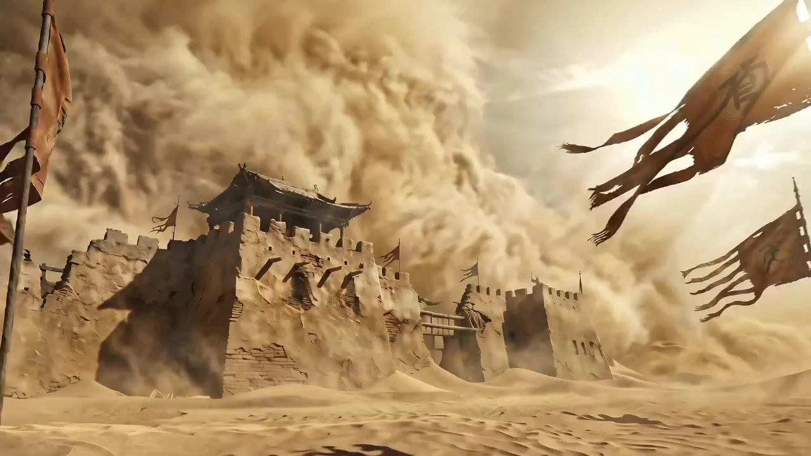

# Tsui Hark Film Aesthetic: New Wave Wuxia, Liaozhai Fantasy, and Modern Kung Fu Short Films

> **作者：** @Damon

## Content

Process Planning:

Logical Flow and Dependencies for Full Film Creation:

Establish Global Specifications: Fully absorb the plot, concepts, or direct instructions provided by the user, and determine or guide the user to choose the appropriate sub-style (select from 'New Wave Classic Wuxia', 'Liaozhai Fantasy/Ghost Film', or 'Modern Kung Fu'). Once the sub-style is determined (via system intelligent assessment or direct user specification), you must immediately inform the user of the locked sub_style branch name in the reply so the user can request adjustments if dissatisfied. Use text_editor to write and lock Final_Video_Spec.md, clearly defining the aspect ratio (16:9), target resolution (720p), global visual style, and adding a sub_style field (recorded as 'New Wave Classic Wuxia', 'Liaozhai Fantasy/Ghost Film', or 'Modern Kung Fu') along with the target language. This serves as the branch control source for the entire pipeline.

Design Storyboard: Based on the plot, concepts, or outline provided by the user, use storyboard_designer to plan key elements, the shot list, and independent audio layers. In the storyboard design, clearly distinguish between character dialogue (performable within shots) and independent narration (spanning multiple shots).

Bind or Generate Core Element Assets and Audio References:

Character and Scene Visual Assets:

User-provided assets: Check if the user has provided character turnarounds, character reference images, or scene references. If available:

Image quality assessment: If multimodal analysis indicates serious quality defects (e.g., blur, color shift, noise, or low resolution), prioritize media_generator's super_resolution (Video: MediaKit to 1080p; Image: Jimeng SR to 4k with scale set to 50) to obtain a high-quality version.

Aesthetic style assessment: If the style fits the film's tone (Tsui Hark style), register and bind these user assets directly to the corresponding key_element via media_generator. If it deviates from the film's aesthetic (e.g., Chang Cheh's dull/gritty style), use the provided asset (or the super-resolved version) as a reference to regenerate 2K element images matching the Tsui Hark aesthetic using media_generator's ImageToImage path (using high-consistency model Nano Banana Pro, 2K), then bind to the key_element.

System-generated assets: If not provided, use media_generator's TextToImage path (using high-consistency model Nano Banana Pro, 2K) to generate character and scene assets and associate them within the storyboard's key_element.

Character audio reference (key_element_audio): Check if the user provided audio samples. If yes, register and bind as the key_element_audio for the respective character for voice cloning. If not, generate a short sample matching the character's personality and bind it.

Asset generation and binding self-check: At the end of this step, perform a comprehensive inventory of all defined key_elements (characters, scenes, props, etc.) and their key_element_audio (for characters with dialogue). Ensure every element has a high-quality asset generated and bound to its slot; do not proceed to shot generation with missing or unbound elements.

Generate Shot-List Videos: For each shot, use media_generator's MultiModalToVideo path (model: Seedance 2.0, 720p), using the bound key_element image as input. For shots containing character dialogue, reference the character's key_element_audio in the multimodal video parameters' audio_infos to ensure high consistency between the action subject, environment, and voice cloning.

Generate Independent Audio Layers: Use media_generator to generate independent audio, including Chinese-style background music (BGM) and cross-shot narration (plan narration in a separate audio_layer and specify the narration_speaker_profile; strictly distinguish between narration and in-shot character dialogue regarding generation paths and binding).

Video Editing and Timeline Assembly: Use video_assembler to combine footage and audio tracks, setting a dynamic, fast-paced editing rhythm.

Dependencies: 2→1; 3→2; 4→3; 5→2; 6→3,4,5.

Control and Pause Points:

After global spec and storyboard design (Steps 1 & 2): Pause. Clearly inform the user of the locked sub_style in the reply. Invite confirmation of the plot outline, shot list, and global audiovisual tone. Allow the user to request changes if dissatisfied.

Before generating new element assets (Before Step 3): Present the model, prompt, and composition intent for any character/audio/scene elements to be generated or remastered. Pause and obtain user confirmation before triggering generation.

After element asset generation (After Step 3): Planner must perform a strict self-check. Provide the user with a 'Registered Asset Checklist' (verify all roles, scenes, props, and audio references, listing asset_ids). Pause after showing the checklist and generated assets to invite user confirmation on consistency, voice, and visuals.

Before generating shot-list videos (Before Step 4): Clearly display the referenced element images and dynamic action stack prompts for each shot (include dubbing plans if dialogue is present). Pause and obtain user confirmation before generating.

Before generating audio layers (Before Step 5): Present audio prompts, scripts, and voice tone descriptions for independent audio (BGM, narration). Pause and obtain user confirmation before generating.

Before final timeline assembly (Before Step 6): Pause after generating all shots and audio. Have the user evaluate material quality, action intensity, and cuts. Proceed to final rendering only after confirmation.

Asset Analysis:

Analyze user-provided Wuxia and fantasy assets (resource_prepare_and_analyze):

Assess style consistency of user-provided assets: Analyze uploaded character designs, three-view drawings, or scene references to assess if they align with Tsui Hark-style expressive, romantic, and supernatural fantasy aesthetics. If they lean towards realistic, gritty, or dull styles (like classic Chang Cheh films), explicitly point this out to the Planner. Extract core facial features/hairstyles or scene structural layouts from the original images to ensure key recognizability is preserved during ImageToImage.

Low-quality classic Wuxia film/material analysis, color reconstruction, and composition distillation: For uploaded low-resolution, noisy, color-cast, faded, or aspect-ratio-outdated old Wuxia films/stills:

Color extraction and modern reconstruction (preventing noise pollution):

Separating aging color casts from artistic intent: During analysis, strictly distinguish between yellowing/dimming caused by physical aging (silver salt oxidation, fading, grayscale compression, chemical mold) and the director's implied "artistic color grading intent."

Color translation and modern mapping: Translate analyzed vintage tones into modern digital film-grade high saturation and strong contrast. E.g., map faded desert scenes to a cold/warm collision of "Warm Tangerine Orange" and "Cool Deep Teal" in shadow areas; reconstruct old green scenes into a texture of modern "Ink Green" and large areas of "Ink Black."

Blocking physical aging color pollution: The analysis report must explicitly extract "physical aging feature words" (e.g., sepia, faded, yellowed, vintage film color, chemical stain, brown noise) as Negative Prompts for subsequent prompt design to prevent dirty old film colors from polluting the clear 720p output of Seedance 2.0.

Image composition distillation and geometric denoising (adapting to old aspect ratios):

Geometric framework extraction: Automatically filter out visual interference from low resolution and grid noise. Extract underlying geometric perspective lines and visual tension axes of characters, props, horizons, and light sources.

Standardizing classic lens language: Precisely distill image composition into professional photography instructions: e.g., "Dutch angle," "Extreme low-angle tilt up," "Telephoto spatial compression," or "Foreground occlusion framing."

4:3 to 16:9 aspect ratio mapping: Since most classic Wuxia films are 4:3, the analysis tool must automatically extrapolate their extended layout for the target 16:9 aspect ratio (locked by Final_Video_Spec.md). It must specifically plan how to use "negative space with drifting smoke/leaves" or "extended background forest" on the 16:9 visual edges, ensuring composition weight isn't compressed or distorted by stretching.

Quality assessment and enhancement decision: Determine if material has severe grid noise, blur, aliasing, or low resolution. If quality is a bottleneck, clearly feedback to the Planner, suggesting to trigger the super_resolution tool, calling MediaKit (video, upscaled to 1080p) or Jimeng SR (image, upscaled to 4k, with scale set to 50) first for super-resolution enhancement and denoising to ensure visual clarity for subsequent multimodal video generation.

New-school classical Wuxia: Analyze uploaded clips or stills, extracting color tonality (e.g., high-saturation cool/warm contrast), expressive aesthetics (e.g., ink-wash negative space, strong diagonal composition, misty rain/sandstorm environments), and character costumes (e.g., conical hats, light veils, wide-sleeved martial arts attire). Distill ethereal actions that transcend physical limits, such as wire-fu flight trajectories and sword aura explosions.

Modern Martial Arts: For realistic Southern-style martial arts, plum blossom pile sparring, or street fighting videos, focus on analyzing physical impact, move transitions, muscle tension, and short, powerful force generation (e.g., Inch Punch, close-quarters combat). Extract environmental characteristics with historical weight and street atmosphere (e.g., brass tones, beams of light through grid windows) and iconic props (e.g., lion dance, wooden dummy, long gowns).

Horror/Fantasy: For Chinese horror or fantasy supernatural material, analyze its eerie tone with low saturation and high-light backlighting (e.g., ghostly green, ghastly white, deep purple). Extract erratic movement styles (e.g., gravity-defying ghostly floating, instant transmission, materializing amidst flying paper scraps) and eerie spatial imagery such as desolate mountain temples, paper lanterns, and cinnabar talismans.

Extract action and editing features: Analyze slow-motion buildup and fast-motion clashes (Speed Ramping) and match cuts in reference videos to provide precise audiovisual and editing rhythm references for subsequent Storyboard Design and prompt design.

Storyboard Design:

Branch Style Adaptation Principles:

When planning the Storyboard, you must first read the sub_style field in Final_Video_Spec.md.

Ensure all Key Elements, Story Beats, Cinematography, and background audio planning are strictly aligned with the core aesthetics and scene characteristics of the chosen branch (“New Classical Wuxia,” “Liaozhai Fantasy Ghost Film,” “Modern Kung Fu”).

Key Element Design Specifications:

Character Elements: Create Wuxia characters with blurred lines between good and evil, and distinct personalities. Female characters need a balance of heroism and allure (e.g., knightesses, enchantresses in flowing red or plain silk); male characters should emphasize weathered grit, scholarly heroism, or a wild, villainous charm. Descriptions must include iconic Tsui Hark-style props like conical hats, veils, or broken swords.

Scene Elements: Design imaginative, fictional “Jianghu” worlds. Examples: “misty, ethereal immortal mountains,” “eerie and treacherous demon sect bamboo forests,” “desert border inn whipped by wind and sand,” or “misty Jiangnan wine shop.” Emphasize dynamic media in the air: sandstorms, snow, diffuse smoke, and falling bamboo leaves.

Shot List Specifications:

Shot Duration & Rhythm: Shot lengths should be planned between 5–15 seconds (compliant with Seedance 2.0 specs). Follow the “sharp and varied” Hong Kong high-speed editing aesthetic, often carrying a complete dynamic narrative within a single shot through freehand action and rapid viewpoint shifts.

Story Beats: Fighting moves must transcend physical limits.

Wire-Flying: Emphasize weightlessness and aerial gliding. E.g., “soaring from the ground, vertical ascent,” “stepping on bamboo leaves or jumping mid-air.” Clothing and ribbons must show intense, wild motion during flight.

Spells & Illusions: Showcase visual spectacles. E.g., “hands forming seals, golden Tai Chi Bagua diagrams appearing in the void,” “exploding talismans creating dozens of phantom clones,” “sword energy tearing through space, triggering storms of water/bamboo leaves.”

Group Battles: Plan multi-combat point fights with clear primary and secondary focus. Define “one-vs-many breakthroughs,” “heroic standoffs,” or “formation sieges.” Describe central combat visuals using [Element_Character_A] and [Element_Character_B], while describing background extras (guards, soldiers) with “group dynamics” (e.g., “hordes of black-clad assassins closing in,” “monks forming a staff formation”) to emphasize spatial depth.

Large-Scale Blasts: Design clear “energy centers,” “shockwave expansion,” and “scene destruction” for spell duels or internal power blasts. Describe physical aftershocks: “blast waves sending characters and tiles flying,” “golden spell shockwaves sweeping through, snapping bamboo forests,” or “ground stones instantly pulverized by internal force.”

Cinematography: Utilize extreme angles and avant-garde lens designs extensively.

Core Common Techniques:

Extreme low-angle setup to convey the crushing pressure and divinity of characters soaring.

Dutch angle to create a sense of fatalism and dynamic imbalance in duels between good and evil.

Crash Zoom & Whip Pan to simulate the sharpness and impact of martial arts.

Style-Specific Camera Control Rules:

New Classical Wuxia: Pursue sharp dramatic contrast between extreme stillness and extreme motion. Use “Extreme Wide Shots” to show a hero's solitude in deserts/bamboo forests, then hard-cut to “Extreme Close-ups” of eyes, dripping water/blood on sword tips, or cold sweat. In wire-fu, use “Low-angle tracking shots” to lock onto aerial leaps, or “High-angle overhead views” to look down at chases on treetops/roofs. Use strong side-backlighting to outline characters.

Liaozhai Fantasy Ghost Film: Create surreal, oppressive feelings beyond physical norms. Plan “Ghostly POV” (zero-gravity, absolutely smooth gliding without human footstep jolts). Use “Distorted wide-angle lenses” or “Dutch angles” to disrupt balance and amplify the eeriness of ancient temples. Frequently use “Backlighting (silhouettes)” and “Framing” (through webs, withered branches, broken windows) to hide floating specters in strong light/shadow.

Modern Kung Fu: Emphasize the physical weight, muscle force, and stance of direct combat. Plan “Medium / Medium-Close Shots” with “Eye-level / Low static camera” to clearly record pole stances, sweeps, and Wing Chun strikes. For impacts, use “Point-of-impact close-ups” to capture the texture of heavy punches, vibrating wooden dummies, friction of clothing, or dust kicked up. Use “Rapid whip pans” to track fast sparring, reflecting the speed of “punches like wind.”

Audio Layers Planning & Soundscape Design Specifications:

Background Music (BGM - Audio Layers): Plan high-dynamic-range “New Style Cinematic Chinese-flavor scores.” Custom frameworks per branch:

New Classical Wuxia: “Melodic release + intense rhythm” structure. Start with Guzheng, Xiao, or Pipa for desert loneliness; climax with rapid Chinese battle drums, cymbals, gongs, and male vocal chants to ramp up tension.

Liaozhai Fantasy Ghost Film: “Ethereal phantasm + eerie shifting tempo” structure. Use deep Xun, hollow Xiao, Guqin, and ambient synthesizer pads for surreal spaces; transition into fast, irregular wooden fish, bells, or ethereal female humming to highlight inescapable fate.

Modern Kung Fu: “Urban passion + solid impact” structure. Feature high-pitched Suona, Erhu, and Lingnan lion dance percussion, with heavy low-frequency beats and powerful male chants to render a righteous, heroic spirit.

Shot-Level Ambient & Impact SFX (SFX - In-Shot): Reserve space for exaggerated Tsui Hark-style sound effects. Designate four categories in shot descriptions:

Signature Whooshes: Violent airflow sounds from wire-fu, rapid movement, and fabric tearing.

Metallic Zings & Clashes: Crisp high-frequency resonance of swords drawing, explosive clashing of metal, and sharp whistles of sword energy.

Magic Spells & Low Rumbles: Hissing of burning talismans, low-frequency rumbles of Bagua formations, and gravity-defying/floating stone sounds.

Heavy Thuds & Impacts: Thuds of fists hitting flesh, bone-crushing sounds, and solid physical vibrations of feet crushing rubble.

Narration (Audio Layers): Used for world-building or character internal monologue (OS). Plan in Storyboard Audio Layers (type: narration). Use narration_speaker_profile to lock vocal traits (e.g., [Weathered husky male voice] or [Cold, arrogant knightess voice]). Dialogue should be filled with vicissitudes and metaphors.

Dialogue (In-Shot): Shot-level audio. If a character speaks on-screen, the dialogue must be written directly in the shot description as: {CharacterID: Dialogue Content}. Voice traits are determined by the key_element_audio linked to the character's Key Elements (voice cloning), rendered by the video model (Seedance 2.0) to avoid conflict with cross-shot narration.

Media Generation:

Branch Style Generation Alignment:

When generating elements and video, you must read the sub_style field in Final_Video_Spec.md to determine the visual atmosphere, color and lighting, prop details, and generation path.

Asset Introduction and Generation Logic:

Asset Acquisition Principles (Use what's provided, generate if missing, remake if unsuitable):

User-provided reference (Style matches): If the user has uploaded character turnarounds, multi-view character designs, or scene references that match the aesthetic style of the film (Tsui Hark-style new wuxia/fantasy), prioritize registering these as asset_id and binding them to the corresponding storyboard key_element. Use these as the benchmark for screen control in subsequent video generation.

User-provided reference (Style mismatch): If the asset style does not match the film's freehand, elegant, and fantasy aesthetic (e.g., realistic, bloody, gritty, or dull tones like Chang Cheh films), do not use them directly. You must use the user's image as a feature reference, employ the ImageToImage path, select the top-tier consistency model Nano Banana Pro, set the resolution to 2K, and fuse the original facial features/hairstyles or core composition into the Tsui Hark-style aesthetic (e.g., warm/cold lighting, rich ink-wash colors, ethereal and sinister vibes). Generate a new 2K element image (character or scene) that fits the style, and re-bind it to the key_element.

System-generated reference: If the user provides nothing, you must use the TextToImage path. Specify the model as Nano Banana Pro and set the resolution to 2K (ensuring maximum character consistency and high-precision detail).

Character Design Sheet Specs (For system/remake generation): Characters should use a "horizontal layout" (or include multi-view turnarounds), with a high-def close-up face shot wearing a hat/veil on the left, and a full-body character portrait in fluttering ancient costumes on the right, to facilitate consistency in later video stages.

Shot-based Video Generation and Audio-Visual Consistency Binding:

Video Generation Path: Prioritize the MultiModalToVideo path, with the recommended model being Seedance 2.0 (output resolution 720p). If unavailable due to account permissions, dynamically select Seedance 2.0 Fast (720p) or Kling 3.0 Omni as alternatives. When using Kling 3.0 Omni, the refer_type parameter must be explicitly set in the multimodal video parameters (set to "base" for video editing/background replacement, or "feature" for video references/frame-to-frame motion continuity).

Multimodal Reference Strategy:

Visual Binding (image_infos): In the video generation's image_infos, you must reference the bound Nano Banana Pro element reference image (e.g., character model, iconic scene) to ensure high consistency between the acting subject and the environment. For multi-character combat shots, bind 2-3 core combatant element images in image_infos (e.g., <<<image_1>>> for the protagonist, <<<image_2>>> for the main opponent) and specify their relationship in the prompt. Non-core background extras should be driven by text descriptions to avoid screen deformation caused by reference overload.

Audio Binding (audio_infos): If the current shot contains character dialogue, you must pass the key_element_audio sound reference bound to the corresponding key_element in the multimodal video parameters' audio_infos to clone and output that character's specific voice for consistent timbre.

Shot Continuity: Only consider introducing the final_shot video from the previous clip as a reference_video when there is a critical need for frame-to-frame continuity (e.g., continuous sword moves); for everyday freehand shots, generate directly using element reference images and motion prompts.

Strategy for Long/Multi-Shot Video Consistency and Audio Cohesion:

Long-term Character Consistency:

Core Element Anchoring: All shots involving the same character must unconditionally and continuously bind the same high-quality 2K key_element image generated by Nano Banana Pro. Regardless of the length of the shot list, the asset_id of the reference image must not deviate.

Scene Element Anchoring: Continuous shots within the same scene must be forced to bind the same key_element scene image to ensure spatial and physical structural stability when switching shots.

Prompt Consistency Verification: When describing clothing, hair accessories, or iconic props in video generation prompts (Seedance 2.0), you must use the exact same vocabulary as defined in the key_element design sheet (e.g., "crimson flowing wide-sleeved suit," "bamboo hat with black veil"). Use the "text + reference image" dual-track mechanism to constrain the model and avoid character appearance changes due to minor prompt variations.

Long-term Character Timbre Cohesion (key_element_audio):

Single Timbre Source Locking: Each character can only be bound to a single 5-15s high-quality key_element_audio (recommended: ~10s, no background noise, clear enunciation, rich emotional tension). When generating shots with dialogue, all audio_infos parameters must always reference the logic ID of this unique key_element_audio.

Decoupled Rendering of Timbre and Dialogue: Strictly follow the decoupling rule: "Shot dialogue uses key_element_audio for timbre cloning and rendering with the video stream; long-form narration (VO) is placed on a separate narration track and synthesized in batches by MiniMax Speech 2.8 HD" to prevent source sound cross-contamination.

Multi-character Dialogue Isolation: If two characters speak in the same shot, the video generator's prompt must use curly braces {CharacterID: Dialogue Content} to strictly separate them, and bind their respective voice references in parallel within audio_infos. This enables the multimodal video model to accurately locate and clone the distinct timbres of both characters separately, strictly preventing crosstalk.

Independent Audio Layer and Soundtrack Generation Logic (BGM & Narration):

Background Music (BGM) Path: Use the text_to_instrumental path to convert text into highly dynamic Chinese-style soundtracks. The default model selection is Suno 5 or Mureka 8. Prompts must strictly avoid the names of famous musicians to prevent violation interception; use descriptive combinations of traditional instruments and emotional style words to drive generation.

Theme Song & Vocal Lyrics Path (if lyrics are required): Use the lyrics_to_song path with the Suno 5 model to synthesize grand wuxia-style lyrics (e.g., the "Cang Hai Yi Sheng Xiao" genre) into a complete male/female vocal track.

Cross-Shot Narration Path: Use the text to narration tool. The default model is MiniMax Speech 2.8 HD (high expressiveness for Chinese and multiple languages). If a specific English cinematic tone is needed, ElevenLabs v3 can be selected. The generated narration voice must precisely match the narration_speaker_profile described in the Storyboard.

Prompt Writing:

Language Principles:

When the UI is in Chinese, use Chinese for prompt text, but keep professional cinematography terminology in bilingual (Chinese-English) format; dialogue/voiceover must strictly adhere to the language requirements specified in Final_Video_Spec.md.

Image Prompt Writing (Nano Banana Pro):

Visual Style Tags: Incorporate elements like "Tsui Hark martial arts aesthetic, new expressive realism, high color saturation contrast, cool and warm lighting, heavy smoke, backlit close-up, Chinese ink wash painting mood."

Color & Lighting: Emphasize extreme contrast between cool and warm tones, e.g., "Inside a late-night tavern, warm orange candlelight illuminates half of the character's face, with a background of a cold, deep blue night sky"; add environmental atmosphere like "backlit, floating dust and swirling smoke in the air, strong Tyndall effect."

Prompt Differentiation Norms for Three Sub-genres (Select based on the sub_style field locked in Final_Video_Spec.md):

New Classical Wuxia:

Color & Lighting: Use vast, atmospheric ink-wash-style tones reminiscent of traditional Chinese painting. Focus on extreme cool/warm contrast, such as the "warm orange" of desert sunsets against the "cold deep blue" of night deserts, or high-saturation collisions between "emerald green bamboo forests" and "crimson/plain white clothing."

Key Props & Imagery: Bamboo hat, floating face veil, chipped steel sword, carved wine jar, swirling dead leaves, and vast desert sands.

Liaozhai Fantasy Ghost Film:

Color & Lighting: Create gloomy, dark, low-saturation eerie tones. Dominated by "eerie green phosphorescence," "pale moonlight," and "deep purple shadows." Lighting is extremely exaggerated, often using bright backlighting to outline erratic, ghost-like white figures.

Key Props & Imagery: Abandoned derelict temple, hanging paper lanterns (red/white) shaking violently in the wind, runic talismans, billowing white funeral shrouds, lonely graves with Guqin, drifting underworld joss paper.

Modern Kung Fu:

Color & Lighting: Present warm tones rich in earthy atmosphere and historical weight. Dominated by "brass tone," "sepia earthy tone," and "warm golden hour," using strong "sunlight beams through latticed windows" to create a solid, physical sense of reality.

Key Props & Imagery: Colorful Southern lion dance head, wooden plum blossom poles, traditional kung fu tunic shirt, folding fan, oil-paper umbrella, carved martial arts school plaque, fireworks rising.

Video Prompt Writing (Seedance 2.0):

Template Referencing: Use <<<image_1>>> to bind the protagonist, <<<image_2>>> for the main antagonist (for group fights), and <<<image_3>>> for scene images (incrementing by reference number).

Motion Stack Writing Order & Key Control Words:

Camera Movement (Hong Kong-style intensity):

Extreme zooming: "Rapid crash zoom"

Rapid tracking: "Rapid whip pan tracking"

Dynamic tilting/diving: "Extreme low-angle tilt down/up," "Dynamic spiral drone dive shot."

Group fights & explosion tremor: "Violent camera shake from explosion," "Rapid zoom out to reveal the massive battlefield scale."

Subject Action (Flying & Magic/Combat):

Wuxia Wire-Fu: "<<<image_1>>> weightless glide across the frame," "stepping on air mid-air jump," combined with "fabric and ribbons swirling dynamically in mid-air."

Spell casting: "Hand seals and gestures forming motion blur," accompanied by "crescent metallic sword energy slash."

Multi-character clashes (Group fights): "<<<image_1>>> engaged in fierce melee combat with surrounding assassins," "<<<image_1>>> parrying simultaneous strikes from <<<image_2>>> and surrounding enemies," "blown backward by the blast wave, falling through the air."

High-tension Facial Expressions: During intense combat or large-scale explosions, meticulously depict micro-expressions and shifts in demeanor—avoid stiffness.

Clash moments: Capture focused eyes and gritted teeth. E.g., "<<<image_1>>> moment of blade contact: eyes wide with unyielding resolve and fierce determination, clenched jaw, facial muscles tensed under pressure, veins slightly bulging on temple."

Explosion impact: Link expressions to explosion light. E.g., "During the explosion: pupils contracting in sudden shock, squinting eyes from the blinding flash and intense shockwave, expression shifting from shock to absolute determination."

Sub-genre micro-expression aesthetics:

New Classical Wuxia: Seek "aloof, cold" and "fatalistic ruthlessness." Eye contact is an "icy emotionless deadly stare"; during combat, a "sharp hawk-like gaze."

Liaozhai Fantasy Ghost Film: Seek "eerie, spectral" and "inhuman, seductive." Faces often show "eerie emotionless blank expression," or during spell-casting/teleportation, "a subtle sinister smile playing on lips," with glowing, hypnotic eyes.

Modern Kung Fu: Seek "composed and steely" and "master-like." During combat, a "composed and serene face"; during exertion or impact, "clenched teeth, temple muscles bulging with raw physical effort" to show physical struggle.

Environment Physics (Energy Fields & Explosions):

Magic Seals: "Rotating golden Taoist bagua trigram seal appearing in the air," "burning runic talismans orbiting the character."

Force fields: "Shockwave radiating outward, debris exploding in a ring," "debris and rocks defying gravity, floating upwards slowly."

Explosion lighting/physics: "Massive magical spell energy explosion at the center," "intense orange and blue light flashes casting sharp moving shadows on <<<image_1>>>'s face," "shattered roof tiles, debris, and wood splinters flying in all directions, thick dust and smoke billowing across the screen."

Seedance 2.0 Sound Effects & Dialogue:

Use curly braces {} for dialogue, e.g., {The world's storms arise from our generation; entering the Jianghu hastens the passing of years}.

Use angle brackets <> for environment/combat sounds, e.g., <sword ringing, sharp wind-breaking sound, deep rumble of internal energy explosion>.

Use parentheses () for emotional tone of music, e.g., (Melancholic Guzheng interwoven with high-tempo war drums).

Negative Prompt Rules:

Must include no subtitles to prevent unwanted text on screen.

If voiceover is generated on a separate track, do not include extra voiceover text in video prompts, and include no music to avoid background noise.

If multimodal analysis identifies low-quality, discolored, vintage footage, include physical aging keywords in the negative prompt (e.g., sepia, faded, yellowed, vintage film color, chemical stain, brown noise) to prevent old-film artifacts from polluting the clear modern visuals.

Independent Audio Prompt Writing (text_to_instrumental / lyrics_to_song):

BGM/Music Prompting (text_to_instrumental): Focus on instrumentation, rhythm, genre, and emotional atmosphere. Use a mix of Chinese and English, strictly avoiding names of people.

New Classical Wuxia: Epic cinematic Chinese martial arts soundtrack, frantic and high-tempo, traditional Guzheng, intense Pipa solo, high-pitched Shakuhachi, heavy Chinese war drums, dramatic percussion, surging and heroic male vocal chants, dynamic, cinematic sweep.

Liaozhai Fantasy Ghost Film: Eerie ambient Chinese fantasy horror music, slow and haunting, low Xun, ethereal bamboo flute, spectral Guqin, lingering synthesizer drones, haunting reverb, irregular woodblock knocks, chilling female vocal humming, spooky and mystic.

Modern Kung Fu: High-spirited energetic Southern kung fu soundtrack, rapid tempo, loud Suona, high-pitched Banhu, traditional lion dance drums and gongs, intense brass, martial arts orchestration, powerful shouts, heroic and patriotic tone.

Song with Lyrics Prompting (lyrics_to_song):

Lyrics: Use classical quatrains (jueju), new Wuxia yuefu, or heroic-style ci; structure must include [Verse] and [Chorus].

Style: Wuxia theme song, traditional Chinese instrumental, classical vocals, male and female duet, epic martial arts ballad, dramatic string section, heroic and emotional.

High-Fidelity Prompt Examples (Aligning Nano Banana Pro with Seedance 2.0):

Branch 1: New Classical Wuxia

Image Prompt (Nano Banana Pro - 2K Character Element): Tsui Hark martial arts aesthetic, New Classical Wuxia style. Desert at dusk, sandstorm filling the sky. A swordswoman wearing a bamboo hat and black veil stands sideways in the wind, dressed in flowing crimson劲装 (martial attire) with wide sleeves; her robes and veil billow violently in the gale. She grips a chipped, ancient sword that reflects cold, metallic light under the setting sun. Background features a desolate wilderness ravaged by sandstorms with broken stone pillars half-buried in sand. Extreme contrast between high-saturation warm orange sunset and cool deep blue shadows. Backlit close-up, thick smoke and sand in the air, strong Tyndall effect, capturing the essence of Chinese ink wash painting.

Video Prompt (Seedance 2.0 - 720p Dynamic Shot List):<<<image_1>>> binds Swordswoman element, <<<image_2>>> binds Desert Inn scene. (Melancholic Guzheng interwoven with high-tempo war drums) <Howling sandstorm, sudden crisp sword ring, sharp wind-breaking sound>

Camera: Extreme low-angle tilt, followed by Rapid crash zoom to the swordswoman.

Action: <<<image_1>>> weightless glide across the frame, stepping on air mid-air jump; hair and crimson robes swirling dynamically in mid-air. She has an icy emotionless deadly stare, sharp hawk-like gaze fixed on the opponent, sweeping her sword to unleash a crescent metallic sword energy slash.

Physics: Where the energy slash passes, shockwave radiating outward, debris exploding in a ring of desert sand and rocks. no subtitles, no music

Branch 2: Liaozhai Fantasy Ghost Film

Image Prompt (Nano Banana Pro - 2K Character Element): Tsui Hark fantasy aesthetic, Liaozhai ghost film style. Deep night in wild mountains, a derelict temple half-hidden among gnarled trees and strange rocks. A cold, aloof female ghost in white floats in mid-air, draped in billowing white funeral shrouds, hair cascading like a waterfall. A red paper lantern hangs before the temple, shaking violently in the wind, emitting an eerie green phosphorescence. Countless pale joss papers and burning runic talismans drift around her. Low-saturation dark tones, pale moonlight backlighting outlines the ghost's semi-transparent silhouette, deep purple shadows. Misty, cold, and eerie, with a strong sense of Chinese supernatural lore.

Video Prompt (Seedance 2.0 - 720p Dynamic Shot List):<<<image_1>>> binds White-robed Ghost element, <<<image_2>>> binds Derelict Temple scene. (Haunting flute melody and eerie low-frequency ambience) <Wind chimes shaking, sizzling of burning talismans, inhuman whispers>

Camera: Rapid whip pan tracking the ghost's drift.

Action: <<<image_1>>> performs magical arts, hand seals and gestures forming motion blur in golden light. Her expression is an eerie emotionless blank expression with glowing eyes; as she teleports like a weightless ghost, a subtle sinister smile playing on lips, white shrouds dancing wildly.

Physics: Multiple semi-transparent white afterimages appear in the void, burning runic talismans orbiting the character, drifting joss papers spinning wildly in the wind field. {You and I belong to different worlds; why remain so obsessed?} no subtitles, no music

Branch 3: Modern Kung Fu

Image Prompt (Nano Banana Pro - 2K Character Element): Tsui Hark modern Kung Fu aesthetic. Inside an old Southern martial arts school at sunset. A young master in a traditional white Chinese tunic stands on wooden plum blossom poles, posing in a classic Wing Chun opening stance. Faint smoke in the air, strong warm golden sunlight piercing through latticed windows, creating beams of light (god rays) that outline his solid muscular definition. Background features a chipped, carved martial arts plaque and a wooden dummy. Dominant brass and sepia tones, presenting a rich atmosphere of common-life bustle and historical weight.

Video Prompt (Seedance 2.0 - 720p Dynamic Shot List):<<<image_1>>> binds Kung Fu Master element, <<<image_2>>> binds Southern Martial Arts School scene. (Energetic cymbals and heavy war drums) <Punch wind whistling, heavy thud of wooden impacts, rustling of clothing>

Camera: Extreme low-angle tilt, accompanied by rapid zoom push-pull.

Action: <<<image_1>>> leaps up from the poles, stepping on air mid-air jump. After landing, with a composed and serene face, he strikes the wooden dummy rapidly. At the moment of impact and explosive power, he clenches teeth, temple muscles bulging with raw physical effort; punches become motion-blurred, showing extreme physical impact force.

Physics: When his feet strike the ground, dust rises in a ring from the force; red banners and oil-paper umbrellas in the school sway wildly from the punch wind. {Only he who can stand firm is a true master} no subtitles, no music

Video Editing:

**Timeline Editing & Rhythm Control (video_assembler):

Speed Ramping: Adopts Tsui Hark's signature editing rhythm. Gentle eye contact and sword-drawing tension shots use normal speed or slight slow motion. Once blades clash, immediately switch to high-frequency, multi-angle fast-paced editing.

Match Cuts & Kinetic Continuity:

Consistent Kinetic Direction: Precise transitions aligned with the physical motion in the frame. The trajectory at the end of the previous shot (e.g., sword sweeping right, body twisting left) must perfectly inherit its physical momentum in the next shot (e.g., rapid pan right, or character flying left along the same axis) to achieve a seamless hard cut via 'kinetic continuity'.

Action Overlap / Double-Cut: To artificially amplify the physical tension of impacts during high-speed duels, allow the first frames of the next shot to overlap with the last frames of the previous shot by 1 to 3 frames during match cuts on impact (fist-to-flesh, blade-to-blade). This creates intense visual impact and power condensation.

Prohibition of Slow Transitions: Never use soft transitions like Cross Dissolves or Wipes during intense fight or sorcery scenes. You must unconditionally use Hard Match Cuts to maintain suffocating combat tension.

Merging Long Duel Shots: For 10–15 second continuous duel shots generated by Seedance 2.0, extract the character's rotational axis, falling trajectory, or ripple edges from spell explosions as visual alignment anchors for Match Cuts. This ensures momentum and energy flow remain fluid during long-take transitions.

Exclusive Editing & Transition Control for Three Branches:

New Classical Wuxia:

Editing Rhythm: Dramatic 'instant stillness-to-motion' transitions. During atmospheric shots like gazing or power-charging, lengthen shots to build suspense. Once combat starts, switch to high-frequency cuts (0.5s–1.5s per shot).

Transition Techniques: Must use directional Hard Cuts or Whip Pan Transitions. For example, a sword sweep right in shot A, followed by a whip pan right to lock onto the reeling opponent in shot B, using motion blur for seamless flow.

Liaozhai Fantasy Ghost Film:

Editing Rhythm: Maintain an 'ethereal, eerie, and uncanny' inhuman rhythm. Use slow, gliding shots for atmosphere; switch abruptly to high-tension 'Jump Cuts' or 'Shock Cuts' during monster reveals or sorcery, breaking temporal continuity.

Transition Techniques: Use 'Match Action on elements' and material-based transitions. Use white fabric, fog, or talismans as foreground wipes for hard cuts. For teleportation, use very short Cross Dissolves to simulate 'vanishing/illusion' effects.

Modern Kung Fu:

Editing Rhythm: Pursue 'solid, visceral, and continuous' physical rhythms. Sync cuts precisely with attacks and blocks, fully showcasing the accumulation and release of kinetic energy.

Transition Techniques: Mandatory 'Match Cut on Action' and impact-based perspective shifts. Immediately hard-cut from a 'mid-shot of defense' to a 'close-up of the impact point' or 'opponent's reaction shot' upon contact, paired with bone-cracking or cloth-ripping sound effects to convey physical force.

Action-Beat Sync & Hitpoints:

Dual Sync (Accent/SFX): Match Cuts must align precisely (millisecond accuracy) with the peak transients of war drums, cymbals, or blade clashing/explosions.

Audio-Visual Oscillation: Ensure 'impact frame + cut point + SFX transient + drum beat' coincide perfectly. Drive the rhythm via drums, and as music intensifies, shorten Match Cut intervals (down to 0.5s) to achieve ultimate synchronization, where music drives blade light.

Audio Layering, Ducking & Spatialization:

Multi-track Arrangement: Divide into 4 tracks: 1 (VO/Narration), 2 (Character Dialogue), 3 (SFX/Impacts/Environment), 4 (BGM).

Audio Ducking: When dialogue or narration is active, BGM volume must auto-duck by 10dB to 12dB. Suppress harsh high-frequency impacts to protect vocals. Recover BGM to standard level within 0.5s after speech ends.

Spatialization per Branch:

New Classical Wuxia: Apply Panning and stereo width to sword/attack sounds for dynamic space; use desert wind as wide-field background ambience.

Liaozhai Fantasy: Apply medium large-space Reverb (>2.0s decay) and Delay to VO, talisman humming, and ghost dialogue to simulate deep, ethereal environments.

Modern Kung Fu: Reduce high-frequency noise; apply Bass Boost (100Hz–250Hz) to impacts, punches, and footwork, making each hit sound heavy, solid, and physically grounded.
