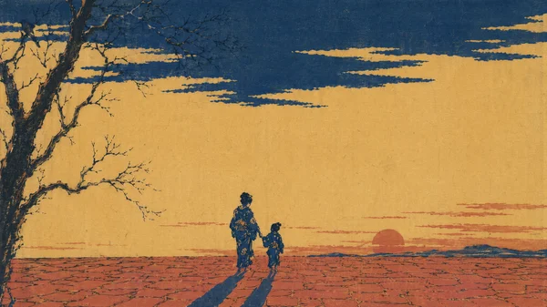

# Ukiyo-e Aesthetic Short Film

> **作者：** @Ai创意研习社

## Content

Process Planning:

Communication Rules (Global)

Do not mention internal step numbers during the conversation. Use functional descriptions for all user-facing communication.

Step 1: Collect User Creation Info

A. Creative Assets (Any combination)

Story idea / Full script / Reference materials (images/videos) / Specific Ukiyo-e works or art schools to replicate / Thematic concepts (e.g., "Mount Fuji," "Edo streets," "Samurai," "Yokai")

B. Basic Parameters

Video Title

Target Duration: 15 seconds / 30 seconds / 1 minute / 3 minutes (Ukiyo-e style videos are typically shorter, with a tranquil pace)

Narrative Pace Preference: What overall rhythm does the user's story require?

Tranquil Immersive (Focus on stillness, long frame retention, slow emotional infiltration)

Narrative Flow (Clear progression, shots serve the plot advancement)

Dynamic Tension (High action, tight pacing, e.g., samurai duels, chases, dramatic conflict)

Mixed Pace (Switch freely based on plot segments)

Let Flova Decide (No preference; Flova designs the best pace based on plot content)\n If the user has no specific idea, design the rhythm best suited to the plot content; do not default to a tranquil preference.

Aspect Ratio: 16:9 (Default) / 9:16 (Vertical) / Custom. Original Ukiyo-e prints are portrait-oriented (Oban is approx. 38x26cm); 9:16 vertical can better recreate the original Ukiyo-e proportions.

Video Generation Model: Seedance 2.0 (Default) / Kling 3.0 Omni / Other

Short Film Language: Chinese / Japanese / No Dialogue (Default; Ukiyo-e style usually features no dialogue)

Voiceover Needed? (Ukiyo-e style defaults to no voiceover; if enabled, use Classical Chinese or Waka-style narration)

C. Art School Selection: Specify an art school style? The school determines line style, color tendencies, and compositional features.

D. Chapter Selection: Ukiyo-e styles usually do not use chapters (tranquil rhythm itself is the structure). For durations over 1 minute, consider 2 to 3 "Print Gallery" segments (similar to turning pages in an Ukiyo-e book), with blank scenes as transitions between segments.

Step Workflow

Step 1: Collect user input

Step 2: Analyze input (can run in parallel with Step 1). Execute resource_prepare_and_analyze (Section A/B/C) when files are uploaded. Regardless of upload status, perform integrity check (Section D). If incomplete, mark as "Story Expansion Needed" and trigger before Step 6.

Step 3: Generate Final_Video_Spec.md, pause for confirmation

Step 4: Art school and color palette design consultation, pause for confirmation (loop until confirmed)

Step 5: Convert visual specs into script (storyboard_designer) → Element images (media_generator) → Fused keyframes (provide a preview of key shots for user confirmation before proceeding), pause for confirmation

Step 6: Generate all shot list images (media_generator). If marked "Story Expansion Needed," perform expansion first. Ask for generation method: A All / B Segment-by-segment / C Side/Back views first, then all. Pause for confirmation

Step 7: Generate video clips, must wait for explicit user confirmation

Step 8: Generate voiceover (if enabled, run in parallel after Step 7 starts)

Step 9: Generate sound effects (same as above)

Step 10: Generate BGM (same as above)

Step 11: Assemble and output

Tool Mapping and Execution Hierarchy

Steps 1 to 2: Use Resource Prepare and Analyze (resource_prepare_and_analyze) to process user-provided assets.

Step 3: Use Text Editor (text_editor) to create and lock the Final_Video_Spec.md spec.

Steps 5 to 6: Use Storyboard Designer (storyboard_designer) for shot list and element design.

Step 5 (Image Generation) & Steps 7 to 10: Call Media Generator (media_generator) to schedule corresponding image/video/audio model asset generation.

Step 11: Render final timeline via Video Assembler (video_assembler).

Dependencies: 3→1,2; 4→3; 5→4; 6→5; 7→6; 8-10→7; 11→7,8,9,10

Step 4 · Art School and Color Palette Consultation

Pre-check: If assets contain art school info, ask the user if they want to use this as a base (Choose A → Skip main question, generate plan directly; Choose B → Enter main question).

Main Question:

A · Leave it to Flova: Autonomous design, display for confirmation. Defaults to Katsushika Hokusai landscape style.

B · Imitate a specific art school (Must immediately show art school selection board, fixed process, cannot skip):

Katsushika Hokusai School: Prussian blue tone · Frozen dynamic moments · Bold composition · "The Great Wave off Kanagawa" "Thirty-six Views of Mount Fuji" Utagawa Hiroshige School: Lyrical blue-purple tones · Seasonal atmosphere · Soft lines · "The Fifty-three Stations of the Tōkaidō" "One Hundred Famous Views of Edo" Kitagawa Utamaro School: Skin-tone vermilion hues · Beauty portraits · Fine hair lines · "Ten Physiognomies of Women" Tōshūsai Sharaku School: Theatrical dark tones · Kabuki actor close-ups · Exaggerated expressions · Close-up composition Utagawa Kuniyoshi School: Dynamic composition · Samurai prints · Whimsy · Cat prints · Bold colors Suzuki Harunobu School: Graceful polychrome · Early nishiki-e · Lyrical beauties · Delicate lines Other

C · Seasonal Tones (Enter seasonal sub-flow): Spring (Sakura pink + fresh green + light blue sky) / Summer (Deep green + cyan-blue + white) / Autumn (Orange-red + gold + brown) / Winter (Blue-white + ink + silver-gray). After selecting the season, Flova overlays the seasonal tendency based on the art school's standard palette.

Also provide a custom input field (can be filled independently; works even if A/B/C are not selected)

After outputting the plan, you must display a confirmation interface as options (Prohibited: switching to open-text questioning):

Confirm current plan, proceed to design visual elements

Wish to adjust the current plan

If "Adjust" is selected: Ask for adjustment direction → Regenerate → Display confirmation interface again; loop until confirmed.

Shot Count Reference

Target Duration

	

Recommended Shot Count

	

Default Duration per Shot

	

Notes

15 seconds

	

3 to 6 shots

	

3 to 5s (Default)

	

Tranquil rhythm

30 seconds

	

6 to 12 shots

	

3 to 5s (Default), can extend to 8s for scroll unrolling

	

Tranquil rhythm

1 minute

	

10 to 18 shots

	

4 to 6s (Default), can extend to 8s for scroll unrolling

	

Can split into 2-3 "Print Gallery" segments

3 minutes

	

24 to 40 shots

	

4 to 6s (Default), can extend to 10s for layered printing reveal

	

Can split into 2-3 "Print Gallery" segments

Default per shot is 3 to 6s. Scenarios where extension to 8 to 10s is appropriate: Scroll unrolling (needs time to read), layered printing reveal process, blank scenes (no less than 3s).

Static "gaze" shots are an optional tool in the Ukiyo-e visual language (letting the viewer gaze at the scene like a finished piece), not a narrative constraint. Whether to insert a static gaze shot after dynamic shots is determined by narrative rhythm; it is not mandatory.

Asset Analysis:

This module is to be followed by Resource Prepare and Analyze (resource_prepare_and_analyze) when processing user-provided reference assets.

A. Script/Story Text

Extraction: Character list (name/identity/costume/identity color/artistic style preference), Scene list (location/season/weather/mood type), Key moments (dynamic peaks that need to be captured), Decorative pattern list (ripples/cloud patterns/motifs/fabric patterns), Narrative emotional arc.

B. Visual Reference Assets

Extraction: Art style (line characteristics/color tendencies/composition type), Main color palette (color set/flat painting method/no shadow confirmation), Sense of space (degree of flatness/cropped composition/negative space ratio), Line style (thickness/rhythm/contour clarity), Pattern elements (type of decorative motifs/arrangement), and Paper texture cues (paper fibers/misregistration/pigment penetration).

C. Restrictions

Do not analyze specific facial features of real people; do not copy the composition of specific Ukiyo-e works (extract the stylistic language, do not copy the image); only extract visual language rules from reference materials.

D. Script Completeness Assessment

No expansion needed (proceed directly to step 3): Has complete scene description + character list + inferable emotional arc + at least one dramatic action node.

Expansion needed (flag and pass to step 6):

Missing input type: Concepts/emotional direction/scenes/characters are all missing

Character concept exists but no scene or art style description

Theme words have no specific narrative elements

Incomplete script is missing any of: composition description, line style, or color tendency

Visual reference only, no text or emotional direction

Flagged output format (inherited by Planner):

Completeness judgment: Needs story expansion / No expansion needed. Summary of missing content: Specific missing items.

Storyboard Design:

I. Set Design Specifications

Space as Composition: Ukiyo-e space is not based on perspective but on "constituent space." The positional relationship between elements is more important than depth. The core of scene design is "composition"—how color blocks, lines, and negative space are arranged within the frame.

Planar Treatment (Core Constraint): All scenes must be presented in a planar manner; perspective-based depth is forbidden. Elements in the distance and foreground are arranged on the same plane, implying space through size and position rather than creating a depth illusion through perspective. "Extreme contrast in distance" is allowed—exaggerated enlargement of foreground elements and sharp reduction of background elements—but this is leapfrog depth, not perspective gradient.

Three-Layer Composition Structure (Required for every shot):

Subject Layer: Main characters or objects (clear ink outlines, flat color blocks, visual focal point). Supporting Layer: Secondary elements (building details/natural elements/props, on the same plane as the subject). Negative Space Layer: Large areas of negative space or decorative background patterns (no less than 30% of the screen, washi paper base color).

All three layers must exist. The Negative Space Layer area must be the largest or balanced with the Subject Layer.

Cropped Composition Ratio: At least 40% of the shots in the entire work must use cropped composition (the subject is cut off by the frame). It is forbidden for all shots to use full composition.

Decorative Pattern Integration: Decorative patterns can be integrated into the scene as background or borders—Seigaiha (wave pattern), Kumo (cloud pattern), Hana-mon (flower pattern), Shima (stripe), Asanoha (hemp leaf pattern). Patterns are symbolic decorations, not realistic textures.

Washi Texture Anchoring: All scenes must include washi paper texture—paper fiber texture, slight ink permeation, and subtle registration misalignment. This is the material source that distinguishes Ukiyo-e from digital illustration.

Seasonal Anchoring: All scenes must designate a season. The season determines natural elements (cherry blossoms/fresh green/red leaves/snow) and color tendencies. The same scene presents a different appearance in different seasons.

II. Ukiyo-e Visual Rhythm Tools (Optional technique, no mandatory narrative structure)

These are native camera tools in the Ukiyo-e visual language, which can be combined freely according to narrative needs or not used at all:

Static Gaze: The screen is completely still or has very slight movement, as if viewing a complete Ukiyo-e painting—used as a "breathing point" for the shot.

Static Gaze is an optional tool and is not mandatory to be inserted after dynamic shots. The narrative rhythm is determined by the content, not dictated by the visual style.

III. Picture Scroll Segments (Applicable when duration exceeds 1 minute)

Segment Naming: Flova autonomous naming (2-5 word noun phrases, poetic and concise, e.g., "Boat in Morning Mist," "Return at Twilight Bridge"), user adjustable.

Segment Transition: Use negative space empty shots (not less than 3s) or decorative pattern flow as transitions between segments; do not use title cards. The color tone of the empty shot should maintain the same school style as the surrounding segments.

Internal structure of each segment: Cut into dynamic shots → Core shots (1 to 3) → Static Gaze conclusion (optional).

IV. Requirements for Every Shot

Shot count statistics: Static Gaze shots count towards the total but must be at least 3s long. Example: 30-second video → 6 to 12 shots.

Each shot must include the following eight elements:

School Style: Hokusai/Hiroshige/Utamaro/Sharaku/Kuniyoshi/Harunobu (determines line and color tendency).

Scene Type: (Classes A to H, see definitions below).

Composition Description: Three-layer composition structure (Subject/Supporting/Negative Space) + geometric segmentation method + whether cropped or not.

Dynamic Description: (If any) Description of element movement, using vocabulary from the dynamic library, specifying the planar movement method.

Decorative Pattern: (If any) Pattern type and arrangement.

Cinematography Language: Shot size + camera position + camera movement code U-00 to U-09 (required) + corresponding English keywords.

Color Slot: Defines the color palette for the shot.

Line Style: Thickness/rhythm/contour clarity.

Sound Annotation: Ambient sound, Shamisen/Shakuhachi sound, core sound effects.

Duration Estimate: Default 3 to 6s; Static Gaze not less than 3s; scroll unrolling can be extended to 8 to 10s.

Scene Type Definitions:

A Famous Place Scenery — Mt. Fuji/waves/bridges/streets/famous sites, core scene for landscape school. B Townsperson Life — Edo streets/shops/teahouses/common life. C Beauty Portrait — Interior/veranda/dressing scenes, half-body or full-body portraits. D Kabuki — Stage/actors/dramatic scenes, exaggerated expressions and movements. E Samurai — Battlefield/dojo/samurai portraits, dynamic composition. F Bird-and-Flower — Flowers/birds/insects/natural close-ups, decorative composition. G Yokai — Yokai/ghost stories/supernatural scenes, fantastical composition. H Decorative Pattern — Pure pattern background/pattern display, no characters.

V. Narrative Units: Cross-Shot Combination Modes

A single shot is a painting; a shot combination is flipping through a picture scroll. When designing the storyboard, one must design the "scroll relationship" between shots, not just each individual shot.

Two fundamental sentence structures (the basis for all modes):

Panoramic → Cropped: Establish the composition with a panorama first, then cut to a local close-up (cropped composition) to magnify details. Two shots form a "walk closer to view the painting" loop.

Dynamic → Gaze: Present element movement first (wave surge/cloth flutter/character action, etc.), then cut to a static gaze to allow the painting to be fully read. Two shots form a "view the painting" loop (optional, not mandatory).

The following six modes are the manifestations of these two sentence structures in specific scenes.

Mode 1 · Panoramic → Cropped Close-up (2 shots)

Structure: Panorama establishes image composition → Cut to local close-up (subject cut by frame).

Camera Movement: Shot 1 U-00 panorama → Shot 2 U-07 local enlargement (cropped).

Constraint: The close-up must be an enlargement of a part of the panorama; no new elements may be introduced. The close-up must use cropped composition (subject cut by frame).

Mode 3 · Scroll Unrolling (2 to 3 shots)

Structure: The image unfolds horizontally like a scroll, showcasing long-scroll composition.

Camera Movement: Shot 1 U-01 planar horizontal pan → Shot 2 U-01 continue horizontal pan → (optional) Shot 3 U-00 static gaze conclusion.

Constraint: Panning speed is uniform and slow, like unfolding a painting. The composition at each position is an independent, complete Ukiyo-e painting. Panning direction is unified (from right to left, consistent with the unfolding direction of Japanese scrolls).

Mode 4 · Overprint Emergence (2 to 3 shots)

Structure: Color blocks emerge layer by layer, simulating the woodblock printing process—first ink outlines, then the first color, then the second color, overlaid layer by layer.

Camera Movement: Shot 1 U-04 line sketching → Shot 2 U-03 color block gradual appearance → (optional) Shot 3 U-05 dynamic planar movement or U-00 static gaze.

Constraint: Each layer emergence process is 1 to 2 seconds. Color block emergence order: Ink line → Main color → Secondary color → Accent color. Whether the final complete image is static is determined by narrative rhythm—use U-00 when the narrative needs closure, use U-05 when it needs to continue (e.g., characters begin to act, wind blows fabric, etc.).

Mode 5 · Perspective Contrast (2 shots)

Structure: Bird's-eye view panorama → Low-angle close-up, or vice versa.

Camera Movement: Shot 1 U-06 bird's-eye view → Shot 2 U-06 low-angle view.

Constraint: Both perspectives must be different angles of the same scene. Perspective switching creates an "extreme distance contrast" of Ukiyo-e space.

Mode 6 · Pattern → Reality (2 shots)

Structure: Decorative pattern background → Realistic scene or character "emerges" from the pattern.

Camera Movement: Shot 1 U-08 pattern flow → Shot 2 U-05 dynamic planar movement (scene emerges and starts movement) or U-00 static gaze.

Constraint: There must be a visual connection between the pattern and the scene (e.g., Seigaiha pattern → wave scene, Kumo pattern → sky scene). The emergence process should look like "a painting growing out of the pattern." Whether dynamic elements continue after emergence depends on the narrative rhythm; it is not mandatory to stay static.

Mode 7 · Seasonal Change (3 to 4 shots)

Structure: The same scene presented in different seasons—Spring cherry blossoms → Summer green → Autumn red leaves → Winter snow (optional 2 to 4 seasons).

Camera Movement: Each shot prioritizes using U-05 dynamic planar movement (e.g., breeze blowing through cherry blossoms, snowflakes falling, maple leaves floating), but U-00 static gaze can also be used—determined by narrative rhythm, not mandatory static. Use 3s negative space transitions between seasons.

Constraint: Scene composition is exactly the same; only seasonal elements and color tendencies change. This is a transformation of the Ukiyo-e "Famous Places in Four Seasons" tradition.

Cross-Shot Continuity Constraints (Applies to all modes):

School Style Continuity: All shots within the same combination must maintain the same school's line style and color tendency.

Palette Continuity: Color palettes for multiple shots within the same scene must be consistent and not adjusted due to shot size changes.

Line Style Continuity: Line thickness and rhythm within the same scene must be unified.

Washi Texture Continuity: The washi paper texture parameters remain unchanged throughout the film (paper fiber/registration misalignment/ink permeation degree).

VI. Decorative Pattern Trigger Rules

Location: Appears as a background in large areas, or as borders/filler decorations in localized areas.

Classic Ukiyo-e Pattern Types:

Seigaiha: Concentric semi-circular wave pattern, symbolizing good luck and tranquility. Kumo: Spiral cloud pattern, symbolizing sky and the supernatural. Hana-Mon: Flower patterns (cherry/chrysanthemum/plum), symbolizing seasons. Shima: Stripes, decorative arrangement. Asanoha: Hemp leaf pattern, repeating hexagon, symbolizing healthy growth. Kikkō: Tortoise shell pattern, hexagon, symbolizing longevity. Ichimatsu: Checkerboard pattern, alternating color blocks. Yabane: Arrow feather pattern, symbolizing direction and determination.

Pattern Usage Rules: When patterns are used as backgrounds, colors are selected from the school's palette; no new colors are introduced. Use ink lines to separate the pattern from the subject, forming "painting within a painting" layers. Patterns can be fluid (U-08), but the flow speed is very slow, like spreading water waves.

VII. Narrative and Character Expansion (Triggered when step 2 marks "Needs Story Expansion")

7.1 Integrity judgment is executed and passed by resource_prepare_and_analyze. When expansion is required, proceed with 7.2 to 7.5 without pausing for confirmation.

7.2 Character Definition

Prioritize using user-provided character settings, regardless of identity, era, or personality type. When user input is thin (no character information), refer to the following common Ukiyo-e archetypes for completion—these are reference directions, not fixed frameworks that must be followed:

Ukiyo-e Reference Archetypes (For reference only when input is thin):

Traveler: People on the road; their backs are more important than their fronts; measuring the floating world with footsteps. Artisan: Conversing with the world through craftsmanship; focused hands and tools are the visual core. Courtesan/Prostitute: Capturing the beauty of the floating world with a glance or posture. Samurai/Wanderer: Solidifying belief with a decisive action.

Layer 2 · Visual Identity: Clothing main color (selected from school palette) + iconic posture or action + school style anchoring.

When designing the signature posture, answer two questions: What moment does this posture freeze? How does it express itself visually through lines?

7.3 Narrative Structure: Choose freely based on user story content and rhythm preferences. It can be alternating quiet rhythms, linear narrative progression, dramatic arc structure, or, if the duration exceeds 1 minute, use picture scroll segmentation—determined by the plot, with no preset structural bias.

Plot Skeleton Generation Rules (Triggered when user input is only keywords or vague concepts):

Step 1 · Determine the core of the conflict: Every story must have a core tension. Select one of the following four categories to match the user's theme keywords:

Internal Tension: Character's inner contradictions or dilemmas (suitable for beauty portraits, travelers, artisan stories).

External Opposition: Conflict between the character and nature/society/others (suitable for samurai, yokai stories).

Passage of Time: Sense of loss brought by the change of seasons or eras (suitable for famous place scenery, seasonal cycles).

Encounters and Separation: Two entities meet briefly then separate (suitable for townsperson life, travel scenes).

Step 2 · Design three-act emotional arc:

Setup Act (20–30% of total duration): Establish world and characters, emotional tone is calm or suspenseful.

Development/Conflict Act (40–50% of total duration): Conflict or tension emerges, rhythm speeds up, dynamic shots are dense.

Conclusion Act (20–30% of total duration): Tension resolves or lingers, ends with static gaze or scroll unrolling.

Step 3 · Recommend scene count (linked to shot count reference):

15 seconds: 1-act structure, 1–2 key action nodes, no act separation.

30 seconds: 2-act structure (setup + conflict/conclusion), 3–4 key nodes.

1 minute: 3-act complete structure, 5–7 key nodes, can be divided into 2 picture scroll segments.

3 minutes: 3-act structure + internal sub-plots, 10–14 key nodes, divided into 2–3 picture scroll segments.

Step 4 · Refine visual climax nodes: For each act, design at least one "moment worth painting as Ukiyo-e"—this is the visual anchor of the entire story, the frame with the most dramatic tension or emotional concentration. Visual climax nodes must be clearly labeled when passing the storyboard to the storyboard_designer, prioritizing arrangement in shots with rich image layering and active dynamic elements.

7.4 Emotional Trigger: Fatigue and amazement of travel / Focus and mistakes of creation / Peak and emptiness of pleasure / The moment of decision and its price. Core logic: Every moment is to confirm that "this moment of the floating world is worth painting."

7.5 Dialogue Guidelines: Ukiyo-e style defaults to no dialogue. If dialogue is necessary, use classical Chinese or Waka poetry style, no more than 7 characters per line, brief and evocative.

VIII. Image Richness Principles (Automatic completion for thin input)

When users provide single or vague theme keywords (e.g., "a puppy," "Mt. Fuji," "samurai"), do not generate it as an isolated element; instead, use it as the subject layer and design a complete Ukiyo-e composition around it:

Auto-complete three-layer composition: Determine the subject layer (user-specified element), supporting layer (scenes/props/natural elements matching the subject), and negative space layer (washi paper texture base color + decorative patterns or pure negative space). All three layers must exist; none can be missing.

Foreground layer mandatory requirement (Core constraint): The supporting layer must include at least one foreground entity element, placed in the foreground of the image to form vertical layering contrast with the subject. Foreground blanking is forbidden. Typical foreground elements: Landscapes (pine branches reaching into the image, wave details, reeds, rocks), People (traveler's back, boat details, building eaves), Bird-and-Flower (flower branch details, close-ups of birds). Foreground elements must be processed with cropped composition (cut off by the frame edge) to reinforce the layering of "painting within a painting."

Example — "Mt. Fuji": Subject layer = Mt. Fuji (background, top of frame); Supporting layer foreground = pine branch in the foreground (cut off by the bottom edge of the frame) + mid-ground waves or traveler's back; Negative space layer = large area of washi paper sky (no less than 30%).

Example — "Samurai": Subject layer = full-body samurai (center of frame); Supporting layer foreground = foreground cherry blossom branch (cut by frame edge) + background building/mountain; Negative space layer = sky or washi paper negative space.

Auto-match scene type: Select the most appropriate A–H scene type based on the subject's nature (e.g., "Puppy" → F Bird-and-Flower or B Townsperson Life, "Samurai" → E Samurai).

Auto-supplement season and atmosphere: Select the season and school style that best sets off the subject, giving the image a complete Ukiyo-e narrative feel, rather than just a floating single unit.

Do not over-add characters: If the user does not mention characters, the supporting layer should prioritize natural elements and scene elements; do not add characters without permission.

Exception: If the user explicitly states that only a single element is needed (e.g., "only a puppy," "generate element image alone," "don't add other things"), then generate according to single element image specifications without adding scene content.

Media Generation:

Phase 1: Visual Spec Conversion

Execute scene by scene, uniformly defining anchors for composition aspect ratios. Refer to the prerequisites in Prompt Writing for detailed rules.

Phase 2: Element Image Generation

Characters/Scenes/Decorative Patterns/Washi Texture: Use the image generation tool TextToImage.

Recommended Model: GPT Image 2, set resolution to 2K. GPT Image 2 supports aspect ratios of 3:4, 4:3, 16:9, and 9:16; it does not support 1:1 or 21:9. If the Shot List involves square or ultra-wide compositions, use Nano Banana Pro (Gemini 3 Pro Image) to generate that frame instead.

Character Images: Full-body front-facing ukiyo-e style still frames; must include ink-line contours and flat color blocks. Forbidden: turnaround / character sheet / T-pose / reference sheet / realistic rendering.

Scene Images: Flattened panoramic views; must include a three-layer composition structure and reserved white space ratio.

Decorative Pattern Images: Pure pattern repetition, sampled from the art school palette.

Washi Texture Reference Images: Close-ups of paper fibers, pigment penetration, and misaligned overprinting.

Character and scene images share the same art school style anchor.

Phase 3: Merging Keyframes

Use ImageToImage for image merging and generation.

Recommended Model: GPT Image 2, set resolution to 2K. Same as above, fallback to Nano Banana Pro (Gemini 3 Pro Image) for 1:1 and 21:9 ratios.

Generate 2 to 3 representative frames (must include at least one dynamic scene and one static gaze shot) to verify art style, lines, color blocks, negative space, and Washi texture.

Step 6: Shot List Generation

Use the image generation tool ImageToImage (or TextToImage if no prior reference exists).

Recommended Model: GPT Image 2, 2K resolution. Same as above, fallback to Nano Banana Pro (Gemini 3 Pro Image) for 1:1 and 21:9 ratios. Generate 1 to 2 images per shot.

Each shot must include a three-layer composition structure, ink-line contours, flat color blocks, and Washi texture. Generate static gaze shots separately to ensure quality of negative space. Mark cut-off composition shots separately.

Step 7: Video Clip Generation

Default Selection: MultiModalToVideo path.

Recommended Model: Seedance 2.0 / Seedance 2.0 Fast, 720p resolution.

Multi-shot Prioritization Strategy (Seedance 2.0): Prioritize merging adjacent 2–3 shots into a single multi-shot generation task (max 15 seconds), rather than generating shot-by-shot. Merging criteria: adjacent shots belong to the same narrative unit, share the same art school palette, and total duration ≤ 12 seconds. Use the <write_the_prompt>"12. Seedance 2.0 Multi-shot Prompt Template" structure for prompts. If criteria aren't met, revert to single-shot generation.

Alternative Selection (if using Kling 3.0): ImagesToVideo or MultiModalToVideo.

Recommended Model: Kling 3.0 Omni, 720p resolution optional. Use formats like <<<image_1>>> for reference image binding.

Video Parameters:

Duration: Default 3 to 6s; static gaze shots ≥ 3s; scroll unfolding shots can be set to 8 to 10s. Total duration for merged multi-shot generation must not exceed 12s.

Style Lock Verification: After generation, verify the maintenance of flatness (no 3D stereoscopic regression), ink-line contours (no light/shadow blurring), flat color blocks (no gradient blending), and Washi texture (no digital smoothness). If regressions occur, regenerate or strengthen style lock prompts.

Step 8 Narration Generation (if enabled)

Use TextToSpeech to generate narration.

Recommended Model: ElevenLabs v3; suggest using a Japanese literary narrator model or a deep, neutral chanting model.

Intonation Standards: Literary (classical), chanting style, with negative space (pauses). Japanese or Chinese, extremely slow pace, very low information density, max 7 characters per phrase, with long pauses between phrases.

Prompt Reference: classical Japanese recitation, slow chanting pace, long pauses between phrases, minimal information density, seven characters per phrase maximum, waka or haiku rhythm, ElevenLabs v3

Step 9 Sound Effect Generation

Use MultiModalToAudio to generate sound effects.

Core Ukiyo-e Style Sound Effects:

Type

	

Typical Sounds

	

Texture

	

Intensity

Environmental Natural

	

Wind/Water/Birdsong/Rain/Snow/Bamboo leaves rustling

	

background

	

naturalistic

Japanese Artifacts

	

Clogs/Paper doors/Wind chimes/Shamisen plucking/Fan opening/closing

	

foreground

	

handmade

Dramatic Statement

	

Taiko beat/Shakuhachi long note/Noh flute

	

statement

	

theatrical

Negative Space/Silence

	

Switch to silence or very light ambient sound during static gaze

	

—

	

—

Shot-by-shot annotation format: Main SFX: [Description] · Texture: handmade/theatrical/naturalistic · Intensity: background/foreground/statement

Quiet Rhythmic SFX Constraints: SFX for static gaze shots should be reduced to background or silence. Dynamic climax shots may switch to statement (Taiko beat or Shakuhachi long note). Return to background after dynamic action concludes.

Step 10 BGM Generation

Use text_to_instrumental or lyrics_to_song.

Recommended Model: Suno 5 or Mureka 8, full-frequency high-fidelity instrument synthesis.

Strategy A (Emotion consistent throughout, suitable for <30s): Generate a single BGM track, loop or stretch for the entire piece. Recommended direction: Shamisen solo/Shakuhachi solo/Koto music, quiet rhythm (with negative space between notes), very slow, instrumental, no vocals.

Strategy B (Emotional arc, suitable for >1 minute):

Trigger conditions: Obvious transitions between different scroll segments / Total duration over 1 minute / Seasonal transitions enabled.

Multi-segment BGM rules:

Arc Analysis: Extract key emotional nodes from Shot List quiet rhythm annotations.

Define Instrumental Framework (Shared throughout): Shamisen+Shakuhachi / Koto+Shakuhachi / Shamisen solo / Koto solo / Wataiko+Shakuhachi.

Generate segment by segment: [Framework Instrument], [Emotion: transience/floating world/seasonal beauty], [Tempo: very slow], [Duration]s, instrumental, no vocals, [opening/continuation/closing]

Segment duration setting: Segment duration = Corresponding narrative duration + 15s buffer.

Emotional Direction References:

Famous Sites → Koto pieces, lyrical / Daily Life → Shamisen, light / Beauty (Bijinga) → Shakuhachi solo, profound/mysterious (yūgen) / Kabuki → Taiko+Shamisen, dramatic / Samurai → Wataiko+Shakuhachi, tense / Birds & Flowers → Koto solo, serene / Yokai → Shakuhachi+Noh flute, eerie / Decorative Patterns → Koto+Shamisen, decorative

Prompt Writing:

0. Principle for Completing Sparse Input Prompts

When user input contains only a single subject or vague instructions (e.g., "a puppy", "draw Mt. Fuji", "samurai"), do not generate prompts for isolated elements. Instead, follow these steps to complete the prompt into a full Ukiyo-e scene:

Determine Scene Type: Select a scene type from A–H based on the subject (e.g., Animals → F. Bird-and-Flower painting; Street scenes/people → B. Genre scene).

Complete Three-Layer Structure, Foreground Must Include Entity: Subject layer (user-specified element) + Support layer (matching natural/scene elements) + White space layer (Washi paper background + optional decorative patterns). The support layer must include at least one foreground entity, handled with cropping composition (cut off by the frame) to create vertical depth. Foreground must not be empty.

Landscape foreground reference: foreground pine branches cropped by lower frame edge, foreground crashing wave foam partial, foreground reeds cut by frame

Character foreground reference: foreground traveler silhouette back-facing small, foreground temple roof eave cropped

Bird-and-Flower foreground reference: foreground cherry blossom branch cropped by upper frame, foreground bird in flight partially cut by frame

Add School of Art and Seasonal Anchor Points: Select the school and season that best complement the subject and write them into the style section of the prompt.

Integrate Global Style Lock Words: Use the lock words from the third step of Ukiyo-e compatibility to ensure the flatness is not lost.

Exception: If the Storyboard explicitly labels the task as a "Single Element Image," generate only the subject layer prompt without adding scene elements.

Preliminary Step: Visual Specification Conversion

Convert user input into positive physical descriptions to solve two issues: narrative interference (filtering out narrative context to keep only visual descriptions) and conceptual literalization (translating metaphors/concepts into concrete visual specs).

Step 1 · Filter Narrative Context

Keep: Where the scene is / What is in it / Who is in it / School of art / Dynamic element descriptions / Decorative patterns (visual descriptions)

Filter: Emotional intent / Plot function / Conceptual metaphors / Narrative verbs

Step 2 · Identify Style Risks (If any of the following signals appear, trigger Step 3 locking)

Signal 1: The prompt includes "realistic/3D/volumetric/lighting/depth of field" (destroys flatness).

Signal 2: Color descriptions include "gradient/shading/transition/layers" (destroys flat color blocks).

Signal 3: Composition descriptions include "perspective/vanishing point/depth" (destroys flat composition).

Signal 4: No ink outline description (loses line aesthetics).

Signal 5: No Washi paper texture description (loses materiality).

Step 3 · Ukiyo-e Compatibility Check

Ukiyo-e compatibility conditions (all must be met): Flattened composition + Ink outlines + Flat color block filling + No shadows + Washi paper texture + At least 30% white space.

If not met, execute locking: Keep the narrative content but forcibly add style lock words:

ukiyo-e woodblock print style, flat composition, no perspective depth, no shadows, no volumetric lighting, bold ink outline, flat color block filling, limited palette, washi paper texture, woodblock print grain, slight registration offset

Step 4 · Fill Physical Specifications

Core principle: Fill every attribute slot with positive physical descriptions, avoiding negative statements.

Composition Specs: Composition type (flattened/cropped/bird's-eye/low-angle/far-near contrast) / Geometric division (S-curve/diamond/circle/triangle) / White space ratio (no less than 30%)

Ink Line Specs: Line weight (thick/medium/thin) / Line rhythm (flowing/jerky/elegant) / Contour clarity

Color Block Specs: Palette (select 2-4 colors from the school palette) / Filling method (no gradients or shading) / Registration offset (slight color shift)

Washi Paper Specs: Paper fiber (visible/fine) / Pigment penetration (edge bleed/clear) / Registration offset degree (none/slight/obvious)

Decorative Pattern Specs (if any): Pattern type (seigaiha/cloud/floral/etc.) / Arrangement (repeating/border/fill) / Color source (school palette)

Dynamic Element Specs (if any): Movement direction / Movement method (from dynamic vocabulary library) / Flatness locking

Photography Specs: Camera angle (frontal/bird's-eye/low-angle/cropped) / Composition (asymmetric/geometric) / Movement (insert camera code U-00 to U-09)

Step 5 · Art School Anchor Transmission: Define the art school style here; character and scene images share the same school anchor.

I. Aspect Ratio Settings

Emotional Intent Aspect Ratio Notes Landscape/Open 16:9 (Default) Horizontal scroll feel Beauty/Portrait Vertical 9:16 Restores Ukiyo-e Oban vertical composition Square 1:1 or 4:3 - Decorative/Flower-Bird Close-up Scroll unfolding Ultra-Wide 21:9 Horizontal scroll/panorama

II. Color Slot System

Slot Function Default (Hokusai School) Ink Line Color Outline definition Dense Ink Black #1A1A1A Soul Color Overall tone (determined by school) Prussian Blue #1B4F72 Primary Color 1 Main color Vermillion #B83A2A Primary Color 2 Auxiliary color Gamboge #D4A017 Accent Color Highlight/Focus Light Purple #8E5A8E Paper Color Background/White space Washi Beige #F5F0E6 Registration Offset Color Slight color shift Pale Magenta #E8C4C4

Art School Palette Differences (including anchor values):

School Soul Color Primary 1 Primary 2 Aux/Accent Line Characteristics Hokusai Prussian Blue #1B4F72 Vermillion #B83A2A Gamboge #D4A017 White #F5F0E6 Bold, dynamic, powerful Hiroshige Lyrical Blue-Purple #4A5F8A Blue-Green #5B8FA8 Pale Brown #C4A882 White #EEE8D8 Soft, fluid, seasonal Utamaro Skin Tone #E8B49A Vermillion #C45A3C Pink #F0C0B0 White #FAF0E8 Delicate, fine, hair detail Sharaku Dramatic Red-Black #6B1A1A Deep Red #992020 Ink #1A1A1A Gold #C8960C Exaggerated, sharp lines Kuniyoshi Bold Vermillion #C03028 Ultramarine #2050A0 Gamboge #E8B400 Purple #784898 Dynamic, imaginative Harunobu Soft Pink #E8B4C8 Tender Green #7ABCD8 Light Purple #C8A8C8 White-Green #D8ECD0 Delicate, lyrical, early Nishiki-e

Fixed anchors shared by all schools: Ink Line Color #1A1A1A · Paper Color #F5F0E6 · Registration Offset Color #E8C4C4

Seasonal Color Overlay (adjust hue tendency on top of school palette, do not change palette structure):

Spring: Overlay Sakura Pink + New Green accents Summer: Overlay Deep Green + Deepen Blue-Green Autumn: Overlay Orange-Red + Golden Brown Winter: Overlay Blue-White + Silver-Gray, lower saturation

Fixed Slot Principle: Ink line color (Dense Ink Black) remains constant. School soul color remains constant. Seasonal overlays only adjust hue tendency, not palette structure. Ukiyo-e aesthetics require color uniformity across the piece; no scene/chapter color shifts.

Color Dialogue between Clothing and Setting:

Color Block Contrast (Core Strategy): Contrast clothing color blocks with background color blocks. Vermillion clothing + Prussian Blue background = Complementary color contrast, character pops out. Gamboge clothing + Ink background = Light-dark contrast.

Monochromatic Grouping: Clothing and background colors belong to the same school palette, differentiated by block size and position, not by gradients.

Pattern Color Sourcing: Decorative pattern colors selected from the school palette, no new colors introduced.

Hard Constraint (No exceptions): All colors in the image must be selected from the school palette + seasonal overlay. Prohibit colors outside the palette. Prohibit gradients and blurring. Color blocks must be flat with sharp boundaries.

III. Composition Rules (Applicable to all shots)

Every shot prompt must contain and embody at least 6 of the following composition standards:

flat composition, no perspective depth, planar arrangement of elements

bold ink outline defining all forms, line art as primary structure

flat color block filling, no gradient, no shading, no shadow

asymmetric composition, cropping frame cutting subject partially

washi paper texture visible, woodblock print grain, slight registration offset

minimum thirty percent empty space as compositional element

decorative pattern integrated when applicable

geometric structure dividing frame: S-curve / diamond / circle / triangle

Composition Type Differences:

Dynamic Shot Composition: Element movement has clear direction, composition has kinetic tension, extreme far-near contrast.

Static Gaze Composition: Perfectly symmetrical or balanced, large areas of white space, viewed like a complete Ukiyo-e print.

Cropping Composition: Subject cut by frame edge, incomplete presentation, creating associations beyond the frame.

Bird's-Eye Composition: Overhead panoramic view, cities/landscapes become patterned arrangements.

Low-Angle Composition: Low-angle view, characters/buildings become monumental.

IV. Background Prompt Specifications

Every scene prompt must contain these four structural layers:

Ink Line Layer: bold ink outline, line weight [thick/medium/fine], line rhythm [flowing/jagged/elegant], clear contour definition

Color Block Layer: flat color block filling, palette from [School Palette], no gradient no shading, block edges sharp and clean

Texture Layer: washi paper texture visible, woodblock print grain, slight registration offset, pigment bleed at edges, paper fiber visible

Pattern Layer (if any): [Pattern type] pattern as background/border, colors from palette, repeating motif

Flattening Constraint: All elements arranged on the same plane, no perspective depth. Far-near relations implied by size and position, not perspective techniques.

V. Character Prompt Specifications

Character images must be generated in Ukiyo-e woodblock style (not realistic, 3D, or modern illustration), must be full-body (frontal or profile), and must include ink outlines and flat color blocks.

[Scene Type], ukiyo-e woodblock print style, [School] school aesthetic, [Identity Color] [Clothing Description] flat color block, full body [frontal/profile] pose, bold ink outline defining all forms, line art as primary structure, flat color filling no gradient no shading, [Signature pose description], [Ink line specs], washi paper texture, woodblock print grain, slight registration offset, traditional Japanese woodblock print aesthetic, muted traditional palette from [School Palette], not over-saturated

Profile Pose: standing in profile, ink line defining silhouette

Back Pose: standing with back to camera, figure small against vast empty space

Prohibited Words: realistic rendering 3D render CGI photorealism studio photography modern illustration anime cartoon digital painting smooth shading gradient color depth of field bokeh

Color Ratio: 60% school primary color · 25% auxiliary color · 10% ink line · 5% accent color, consistent throughout.

VI. Decorative Pattern Prompt Specifications

Repeating Pattern Background

flat overhead pattern fill, ukiyo-e woodblock print style, [Pattern type: seigaiha wave / kumo cloud / hana-mon flower / asanoha hemp leaf / kikkō tortoiseshell] pattern repeating uniformly, colors from [School Palette], bold ink outline on pattern edges, flat color block filling no gradient, washi paper texture, woodblock print grain, traditional Japanese decorative pattern

Border Decoration

ukiyo-e woodblock print style, [Pattern type] pattern as border frame, central scene empty with washi paper texture, pattern colors from [School Palette], bold ink outline separating pattern from center, flat color filling, traditional Japanese decorative border

Prohibited Words: digital pattern seamless texture modern graphic design vector art gradient pattern

VII. Washi Paper Texture Prompt Specifications

Material Close-up

extreme close-up material shot, ukiyo-e woodblock print style, washi paper fiber texture visible, woodblock print grain, pigment bleed at color block edges, slight registration offset between color layers, traditional Japanese handmade paper texture, ink absorption variations, non-uniform printing imperfections, physical woodblock print materiality, not digitally smooth

Prohibited Words: digital smoothness plastic sheen perfect rendering uniform texture CGI surface

VIII. Global Prompt Structure Template for Images

[Scene Type], ukiyo-e woodblock print style, [School] school, [Ink line layer], [Color block layer], [Texture layer], [Pattern layer if any], [Composition keywords], [Character description with signature pose], [Dynamic element description if any], [Emotional footnote: transience / floating world / seasonal beauty], washi paper texture, woodblock print grain, slight registration offset, traditional Japanese woodblock print aesthetic, muted traditional palette, not over-saturated

A. Famous Landscape ukiyo-e landscape, [School] school, bold ink outline defining mountains and waves, flat color block filling with prussian blue and vermillion, washi paper texture, cropping composition cutting [element] at frame edge, [Season] seasonal elements, [small figure in landscape], 35mm equivalent flat framing, woodblock print grain, slight registration offset, traditional Japanese landscape print aesthetic

B. Genre Scene ukiyo-e genre scene, [School] school, bold ink outline, flat color blocks from palette, Edo street with [shops/tea house/bridge], washi paper texture, asymmetric composition with geometric division, [person in daily activity], cropping frame cutting [element], woodblock print grain, slight registration offset, traditional Japanese genre print aesthetic

C. Beauty Portrait (Bijinga) ukiyo-e bijinga, [School] school, fine ink line defining hair strands and facial features, flat color blocks with skin tone and vermillion, washi paper texture, [beauty in half-body/full-body pose], [Signature pose: turning back/grooming/reading letter], decorative pattern on kimono from palette, large empty space as compositional balance, woodblock print grain, slight registration offset, traditional Japanese beauty print aesthetic

D. Kabuki Actor Print ukiyo-e yakusha-e, [School] school, bold dramatic ink outline, flat color blocks with strong contrast, kabuki actor in [mie pose], exaggerated facial expression, [close-up cropping face partially], washi paper texture, dynamic composition, woodblock print grain, slight registration offset, traditional Japanese actor print aesthetic

E. Warrior Print (Musha-e) ukiyo-e musha-e, [School] school, dynamic bold ink outline, flat color blocks, warrior in [action pose: drawing sword/clashing/riding horse], [Dynamic action description], extreme near-far contrast, washi paper texture, cropping composition, woodblock print grain, slight registration offset, traditional Japanese warrior print aesthetic

F. Bird-and-Flower (Kachōga) ukiyo-e kachōga, [School] school, delicate ink outline, flat color blocks, [bird/flower/insect] as subject, [Season] seasonal botanical, decorative pattern background optional, large empty space, washi paper texture, woodblock print grain, slight registration offset, traditional Japanese nature print aesthetic

G. Supernatural/Yōkai ukiyo-e yōkai-e, [School] school, varied ink line from fine to bold, flat color blocks with eerie tones, [Yōkai creature] in [scene], unusual composition with [extreme angle/distortion], washi paper texture, woodblock print grain, slight registration offset, traditional Japanese supernatural print aesthetic

H. Decorative Pattern ukiyo-e decorative pattern, [School] school, [Pattern type] repeating pattern, flat color blocks from palette, bold ink outline on pattern, washi paper texture, woodblock print grain, slight registration offset, traditional Japanese decorative design, no figurative elements

IX. Global Negative Prompt

This is the most critical part of the Ukiyo-e Skill—you must strongly resist the AI's default behavior to revert to 3D realism:

no 3D render, no CGI, no photorealism, no realistic photography, no modern illustration, no anime style, no cartoon style, no digital painting, no smooth shading, no gradient color, no color transition, no depth of field, no bokeh, no volumetric lighting, no ambient occlusion, no subsurface scattering, no HDR, no lens flare, no perspective vanishing point, no cast shadows, no soft shadows, no ambient shadows, no specular highlights, no rim light, no backlight glow, no atmospheric perspective, no fog, no haze, no motion blur, no chromatic aberration, no film grain (digital), no digital noise, no plastic sheen, no airbrushed surfaces, no perfect uniform rendering, no contemporary objects, no digital devices, no brand logo, no watermark, no subtitles

X. Ukiyo-e Dynamic Vocabulary (For Video Generation)

When describing element movement in video prompts, you must use terms from the vocabulary library below. Prohibit 3D realistic animation terms (e.g., "smooth animation", "flowing simulation"). Dynamic descriptions must be paired with lock words like "ink outline locked" and "flat composition maintained" to prevent style reversion during movement.

Water and Waveswave crest curling into frozen ink arc · foam edge dissolving into white flat block · water surface as overlapping flat curved lines rippling laterally · woodblock wave unfolding from right edge

Cherry Blossoms and Falling Leavescherry petals drifting as flat ink-outlined ovals, no depth trajectory · petals floating in planar scatter, lateral drift only · autumn leaves falling as flat color blocks, no motion blur

Fabric and Clothingkimono sleeve billowing as flat ink-edged plane, no volumetric fold · fabric edge as bold ink arc sweeping laterally · robe hem lifting as geometric flat curve

Fire and Smokeflame as upward-reaching ink spike, flat orange-red block, no glow · smoke as flat grey block rising in layered steps · torch fire flickering as alternating flat color blocks

Character Movementfigure in continuous dynamic motion at peak intensity, ink outline tracing gesture edge throughout movement · sword sweeping in continuous bold ink arc, motion fluid and uninterrupted · hair strand lifting and flowing as fine ink line curves in sustained motion

Natural Dynamicspine branch swaying as slow lateral arc, flat silhouette locked · bird in flight as flat ink silhouette cutting across frame · reeds bending as unified flat plane tilt

XI. Multi-Shot Rhythm & Pacing Design

A single shot completes the visual description, while the sequence of shots handles the emotional rhythm. After storyboarding and before generating video, you must check the shot sequence for rhythm:

Basic Rhythm Units (Three types)

Tension-Release Unit (2–3 shots): Dynamic shot (Tense) → Static Gaze (Relaxed) → Next Dynamic (Tense). Suitable for segments with clear dramatic conflict.

Accumulation Unit (3–4 shots): Consecutive dynamic shots, camera framing gradually tightens (Long shot → Medium shot → Close-up), creating a sense of pressure accumulation, finally releasing in a Static Gaze.

Drift Unit (2–4 shots): Consecutive static or scroll-unfolding shots, no strong dynamics, suitable for emotional setup, environmental establishment, and seasonal transitions.

Rhythm Fluctuation Rules

No more than 3 shots of the same type (consecutive static gazes or consecutive dynamics); if exceeded, a contrast shot must be inserted.

The final shot of a segment should prioritize Static Gaze (emotional resolution), while the opening shot should prioritize Dynamic or Scroll Unfolding (to grab attention).

For videos longer than 30 seconds: The overall rhythm must have at least one clear tension-release shift; constant rhythm density is not allowed.

XII. Seedance 2.0 Multi-Shot Prompt Template

Seedance 2.0 supports generating multi-shot videos up to 15 seconds. Prioritize using multi-shot mode to generate 2–3 adjacent shots instead of generating each separately, improving stylistic consistency and efficiency.

Applicable conditions: Adjacent 2–3 shots belong to the same narrative unit (e.g., "Freeze → Gaze", "Scroll Unfolding"), share the same school/palette, and total length does not exceed 12 seconds.

Multi-Shot Prompt Structure:

[Reference Image Binding: <<<image_1>>> Character/Scene Element]

SHOT 1: [Framing] [Scene Brief], [Camera Code + English keyword], [Dynamic element description, from dynamic vocab], flat composition locked, ink outline maintained, [School Palette Keyword], washi paper texture [CUT ->] SHOT 2: [Framing] [Scene Brief], [Camera Code + English keyword], [Dynamic element/Static description], flat composition locked throughout, [Style Lock Word], woodblock print grain

Character Movement Description Notes (Applicable to all SHOTS): Every SHOT with a character must describe movement using specific body parts + continuous action (e.g., figure walking with slow deliberate steps, robes swaying as flat ink-edged planes / warrior raising sword arm in continuous arc, robe hem billowing as flat curve). Prohibit pure pose words (standing / in battle pose) — pose words do not drive movement, and the model will generate a static image.

Multi-Shot Style Lock Requirements:

Each SHOT description must independently contain style lock words (cannot be written only once in SHOT 1) to prevent style drift in subsequent shots.

Reference image bindings must be declared at the beginning of the prompt and apply to all SHOTS.

Mark SHOT transitions with [CUT ->], do not use [FADE] or [DISSOLVE] (transitions are controlled by the video_assembler).

Single-Shot Generation Scenarios: Scroll-unfolding shots longer than 6 seconds, scene transitions with extremely different compositions from adjacent shots, or shots requiring independent reference image bindings should be generated separately.

XIII. Global Prompt Structure for Video

[Reference Image Binding] [Camera Code + English keyword], [Scene Brief], [Character/Subject Action Description (Required)], [Environmental Dynamic Element Description (from dynamic vocab)], [School Style], [Ink/Color Block Spec], [Washi Paper Texture], ukiyo-e woodblock print style maintained, flat composition locked, no camera shake, no perspective drift

Character/Subject Action Description Slot (Required, do not leave empty):Each shot prompt containing a character must clearly describe what the character is doing and how specific body parts are moving. Actions must be continuous and visible, not just pose descriptions.

Correct Example: figure walking forward with slow deliberate steps, robes swaying laterally as flat ink-edged planes, sleeves lifting and falling in rhythm / warrior raising sword arm in continuous arc, ink outline defining sweeping gesture, robe hem billowing as geometric flat curve / beauty turning head slowly, hair ornament swinging as fine ink-line pendulum, kimono sleeve drifting outward

Incorrect Example (Prohibited): figure standing / warrior in battle pose — pure pose descriptions do not generate movement; the model will generate a static image

Reference image format: Kling 3.0 Omni uses <<<image 1>>>, other models use native Flova format binding.

Each shot prompt must explicitly include corresponding style lock words (choose one):

Flat Gaze Lock (For Static Gaze Shots): flat composition locked throughout, planar framing maintained, no perspective drift, no camera movement, no 3D depth emergence

Dynamic Shot Lock (For Shots with Movement): flat composition maintained during motion, ink outline locked on subject throughout movement, no 3D depth emergence, movement as continuous fluid planar animation, subject in active motion entire duration

Scroll Unfolding Lock (For Lateral Shots): flat composition maintained during lateral movement, planar framing locked, no perspective drift, scroll-unfolding motion only, no camera push into depth

Smart Cutting (When using Seedance 2.0 / Kling 3.0 to generate video up to 8s): Each shot description must independently contain style lock constraints, not relying on the overall prompt.

Cut-shot prompt structure example:

Shot 1: [Framing] [Spatial Description], flat composition, ink outline, [Character/Dynamic element description], [School Palette] [CUT ->] Shot 2: [Framing] [Spatial Description], flat composition locked, [Static gaze description]

Allowed Cut Types: Panorama → Cropped Close-up (same plane, different parts) / Dynamic → Static Gaze (same scene, rhythm shift) / Perspective Switch (Bird's-eye ↔ Low-angle, same scene).

Cut Rhythm Note: In Dynamic → Static Gaze structures, suggest placing the cut point when the dynamic climax is finished; if narrative requires continuous dynamic, skip the static gaze and cut directly to the next dynamic shot.

Prohibited Cut Types:

Cutting from flat composition to perspective depth composition (destroys flatness).

Cutting from ink outlines/color blocks to lighting rendering (destroys style).

Cutting from Washi paper texture to digital smoothness (destroys materiality).

Camera Code Consistency: U-01 corresponds to flat horizontal move, U-05 corresponds to dynamic flat movement. If the code conflicts with text, the model prioritizes the text, causing the lock to fail. Prohibit paraphrasing camera descriptions in Chinese — only Camera Code + English keywords are allowed. Chinese is only for describing narrative events and scene composition.

Ten Legal Camera Movements & Keyword Definitions:

Code Name Trigger Condition Prompt Keyword U-00 Static Gaze White space/Gaze/Allow full reading static locked gaze, no camera movement, image as complete woodblock print U-01 Flat Lateral Scroll unfolding/Show continuous cross-section lateral scroll movement strictly parallel to picture plane, slow horizontal unfolding like hand scroll, never pushing into depth U-02 Flat Vertical Scroll unfolding/Vertical presentation vertical scroll movement, slow vertical unfolding like hanging scroll, planar movement only U-03 Color Block Fade-in Registration printing process/layering color block gradually appearing as woodblock printing sequence, flat color layer emerging, no depth emergence U-04 Line Drawing Ink outline depiction/Drawing process ink outline gradually drawing itself, line art self-generating, bold ink strokes forming U-05 Dynamic Flat Movement Element movement/Character action/Wave/Fabric/Bird flat planar motion, ink outline maintained during movement, subject moving within flat composition, no depth emergence U-06 Perspective Switch Bird's-eye ↔ Low-angle/Extreme contrast perspective shift from bird's eye to worm's eye or reverse, flat composition maintained throughout shift U-07 Partial Zoom Panorama → Cropped Close-up sudden zoom into partial detail, cropping composition, subject cut by frame edge, flat framing maintained U-08 Pattern Flow Pattern flow/Ripple expansion decorative pattern slowly flowing or rippling, seigaiha waves expanding, flat pattern movement only U-09 Washi Vibration Subtle image shake/Physical paper feel subtle paper vibration, washi paper physical texture trembling, material authenticity

U-05 Shot Suggestion: Dynamic shots can be followed by a Static Gaze (same composition, movement stops), creating a "return to woodblock print" feel. This is an optional narrative choice, not mandatory.

Prohibited Camera Language: handheld dutch tilt rack focus shaky cam speed ramp fast zoom snap zoom slow zoom gradual zoom slow pull arc shot orbit dolly in dolly out crane shot steadicam gimbal

Video Editing:

Track Layout

Track 1: Video track Track 2: Voiceover track (if enabled) Track 3: Sound effects track (synchronized sound effects for each shot, including natural sounds/traditional Japanese instrument sounds) Track 4: BGM track (single or multiple background music segments)

Volume Levels

State

	

Voiceover

	

Sound Effects

	

BGM

Normal

	

0dB

	

-6dB

	

-12dB

With Voiceover

	

0dB

	

-12dB

	

-18dB

Static Gaze Shot

	

Muted

	

-20dB

	

-18dB

Dynamic Climax Shot

	

Muted

	

0dB (Taiko/Shakuhachi)

	

-20dB

Static Gaze Shot Sound Constraints: Reduce to -20dB or silence, keeping only very faint natural ambient sounds. Do not lower BGM (keep at -12dB) to let it carry the mood during the gaze.

Dynamic Climax Shot: Can cut in a 'statement' sound effect (a single Taiko beat or long Shakuhachi note), lasting no more than 1.5s, then return to background levels.

Transition Control

Default Transition: Direct cut; no transitions used.

Quiet Rhythm Transition (when narrative uses "Dynamic → Gaze" structure): Dynamic shot to static gaze uses a direct cut. Static gaze to the next shot uses a 0.5s crossfade for a natural emotional transition. Use direct cuts between consecutive dynamic shots.

Section Transitions (for videos over 1 minute): During blank shots (empty frames), fade out the previous BGM for 0.5s and fade in the new BGM for 0.5s.

Overall Intro: 1.5s fade-in (Ukiyo-e style intros can be longer, allowing the image to appear slowly like a painting). Overall Outro: 2.0s fade-out (must occur on a static gaze shot, letting the final image slowly fade away).

Multi-segment BGM Synthesis (Strategy B)

Section Boundary Switching Priority:

Preferred: During blank shot transitions. Secondary: Hard cut points in static gaze shots. Prohibited: Mid-sentence in voiceover. Mid-dynamic shot.

Connection & Fade Control:

Emotional Difference

	

Handling Details

Minor

	

Crossfade: Previous segment fades out 1.5s, next fades in 0.5s early, overlapping by 0.5s

Significant

	

Hard Cut + Short Fade-in: Previous segment cut abruptly, 0.3s silence, then next segment fades in over 1.5s

With Blank Shot

	

Use blank shot buffer: Previous segment fades out with blank shot, next segment fades in at the end of the blank shot

Prohibited Operations

Strictly No Speed Changes: Do not use any speed ramping or slow motion.

Strictly No Subtitles: No overlay subtitle tracks (Ukiyo-e style is dialogue-free by default).

Strictly No Color Filters: Do not perform secondary color grading; maintain native generated tones (art style palettes are locked during generation).

Strictly No 3D/Dissolve Transitions: No 3D rotations or non-standard transitions.

Strictly No Aspect Ratio Compression: Do not force aspect ratio squeezing or distortion; maintain the generation ratio.

Strictly No Out-of-Palette Colors: All colors must be selected from the art style palette + seasonal overlays.

Strictly No 3D Realism Fallback: If results appear 3D, depth-rendered, or have gradient colors, regenerate immediately. Do not 'fix' via editing.
