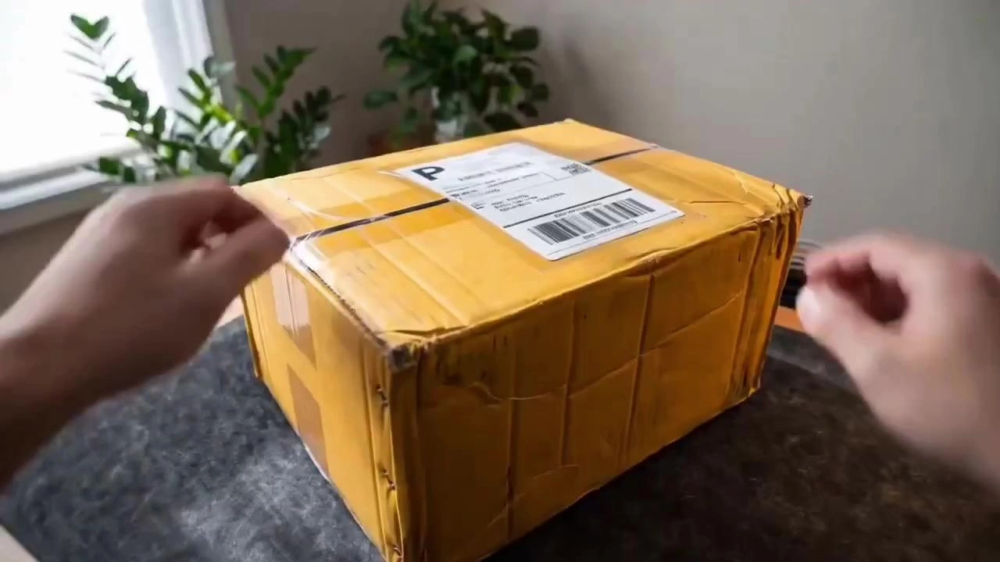

# Unboxing & First-Impressions Product Ads

> **作者：** @1282097223

## Content

Process Planning:

Phase Logic and Dependencies:

Collect User Decision Parameters → Ask the User DirectlyBefore creating the Final_Video_Spec.md, you must confirm the following key decisions with the user. These can be combined into a single prompt: ① Review Category: Provide the following options for the user to select one (or describe their own):

A. 3C Digital — Phones/Headphones/Laptops/Tablets/Cameras/Drones/Wearables/Speakers/Peripherals/Power Banks/Cables/Cases, focusing on unboxing rituals + functional tests + visualized specs

B. Beauty & Skincare — Makeup/Skincare/Perfume/Beauty Devices/Tools/Masks/Sunscreen/Cleansers, focusing on the application process + results comparison + texture close-ups

C. Personal Care — Electric Toothbrushes/Water Flossers/Shavers/Hair Dryers/Curlers/Shampoo/Body Wash/Cleansers, focusing on usage demos + effect comparisons + texture display

D. Fashion & Apparel — Clothing/Shoes/Bags/Accessories/Hats/Scarves/Socks/Underwear, focusing on styling effects + fabric details + multi-angle display + matching tips

E. Jewelry & Accessories — Necklaces/Bracelets/Rings/Earrings/Watches/Hair Accessories/Brooches/Pendants, focusing on luster/texture + wear effects + craftsmanship + gift box unboxing

F. Mother & Baby — Formula/Diapers/Strollers/Car Seats/Toys/Maternity Wear/Nursing Supplies/Food Makers, focusing on material safety + convenience + authentic experience

G. Food & Beverage — Snacks/Drinks/Instant Food/Coffee/Tea/Supplements/Seasonings/Fresh Food/Baking, focusing on unboxing/brewing process + taste descriptions + ingredient breakdown

H. Home & Kitchen — Pots/Knives/Tableware/Small Appliances (Air Fryers/Blenders/Coffee Machines/Rice Cookers)/Storage/Cleaning Tools/Textiles (Bedding/Towels/Rugs), focusing on usage scenarios + effect display + storage organization

I. Major Appliances — TVs/Fridges/Washers/AC/Robotic Vacuums/Dishwashers/Dryers/Water Purifiers, focusing on installation + functional tests + space integration + energy efficiency

J. Smart Home — Smart Speakers/Locks/Lights/Cameras/Sensors/Curtains/Switches, focusing on installation + linkage demos + App operations + scenario-based experience

K. Sports & Outdoors — Fitness Equipment/Yoga Gear/Running Shoes/Outdoor Gear (Tents/Sleeping Bags/Hiking Poles)/Cycling/Swimming/Balls, focusing on usage demos + performance tests + outdoor footage

L. Pet Supplies — Pet Food/Treats/Toys/Beds/Leashes/Grooming Tools/Litter/Cat Trees/Clothing, focusing on pet interaction + effects + material safety + palatability

M. Auto Accessories — Dashcams/Car Chargers/Seat Covers/Wash Tools/Car Air Fresheners/Mounts/Emergency Tools, focusing on installation demos + effects + in-car environment

N. Toys & Collectibles — Blind Boxes/Figures/Blocks/Plushies/Remote Toys/Board Games/Puzzles/Models/Stress Toys, focusing on unboxing rituals + details + assembly + collection value

O. Musical Instruments & Audio — Guitars/Ukuleles/Keyboards/Amps/Mics/Audio Interfaces/Effects Pedals/Vinyl, focusing on sound quality + playing demos + build details

P. Stationery & Office — Pens/Notebooks/Planners/Stickers/Tapes/Printers/Chairs/Standing Desks/Desk Organization, focusing on writing experience + texture + desk setup + usage scenarios

Q. Books & Cultural/Creative — Hardcovers/Art Books/Merch/Calendars/Postcards/Pop-up Books/Prints, focusing on page-turning texture + print details + design insight + collection display

R. Gardening — Potted Plants/Succulents/Pots/Tools/Seeds/Fertilizer/Stands/Sprayers/Grow Lights, focusing on unboxing state + planting process + growth comparison + space setup

S. Luggage & Travel — Suitcases/Backpacks/Organizers/Neck Pillows/Passport Holders/Toiletry Bags/Compression Bags/Anti-theft bags, focusing on capacity + material details + packing demos + travel scenarios

T. Healthcare — Blood Pressure Monitors/Glucometers/Thermometers/Massagers/Braces/Wheelchairs/Hearing Aids/Sleep Trackers, focusing on usage demos + data comparison + comfort + safety certs

U. Other (Custom) — User-provided description

② Video Duration: Provide the following options for the user to select one:

30 Seconds — Minimalist version, suitable for quick product reviews/short-form social media videos

60 Seconds — Standard version, suitable for full product reviews, covering unboxing → experience → summary

90 Seconds — In-depth version, suitable for multi-dimensional comparison reviews/product head-to-heads

③ Aspect Ratio: Provide the following options for the user to select one:

Vertical 9:16 — Suitable for TikTok/Douyin/Kuaishou/Red/Reels, etc.

Horizontal 16:9 — Suitable for Bilibili/YouTube, etc.

④ Review Style: Provide the following options for the user to select one:

A. Immersive Unboxing — First-person view, ASMR quality, emphasizing sound details like tearing film/opening lids/removing items, soothing rhythm

B. Fast-Paced Review — Rapid shot switching, dense colloquial narration, emphasizing information density and rhythm

C. Comparative Review — Multiple products on screen simultaneously, structured comparison (appearance/performance/price), with support from tables/tags

D. Scenario-Based Experience — Products integrated into real-life scenarios, focused on the usage process, downplaying specs to emphasize the experience

⑤ Product Information: Request the following from the user:

Product images (required, at least 1, multi-angle recommended)

Product name and core selling points (1-2 sentences)

Product price (if available, for value-for-money analysis)

Competitor info (if available, for comparison scenarios)

Proceed to Step 2 after receiving all confirmations from the user.

Lock Global Parameters → text_editorCreate Final_Video_Spec.md and write: review category, video duration, aspect ratio, review style, resolution (720p), frame rate (30fps), product info, voiceover style (colloquial/natural), music style, and language. Have the user confirm before continuing.

Analyze Product Assets → Asset AnalysisPerform a structural analysis of the user-uploaded product images, outputting: product visual features, core visual selling points, material/color keywords, visualizable functional logic, and unboxing touchpoints (where close-ups are suitable). The analysis serves as the basis for the Storyboard design.

Design Shot List → Storyboard DesignDesign Key Elements, shot sequences (including three acts: unboxing/experience/summary), Audio Layers (BGM + VO + SFX), and subtitle layers. Pause and ask the user to confirm the Storyboard plan.

Generate Key Elements → Media GenerationIf the user has uploaded product images, register them as asset_id and bind them; otherwise, generate product scene images based on the Storyboard. Pause and ask the user to confirm the visual tone.

Generate Video Shot-by-Shot → Media GenerationUse MultiModalToVideo + Seedance 2.0 at 720p. Each shot uses the corresponding element image as a reference. Handheld shots must clearly simulate slight handheld shake in the prompt.

Generate Audio Layers → Media GenerationVoiceover: Colloquial, natural style (approx. 4-5 chars/sec), like a friend recommending something rather than a professional broadcast voice; BGM: Upbeat and unobtrusive, Lo-fi/light electronic/acoustic guitar; SFX: Key unboxing sounds (tearing film, opening lids, button clicks, etc.).

Timeline Editing & Subtitle Overlay → Video EditingAssemble according to the Shot List, overlay subtitles, sync audio/video, and export the final product.

Dependencies: Step 2 depends on Step 1; Step 3 depends on Step 2; Step 4 depends on Step 3; Step 5 depends on Step 4; Step 6 depends on Steps 4 and 5; Step 7 depends on Step 4; Step 8 depends on Steps 6 and 7.

Pause Points: Pause once after Step 1, Step 2, Step 4, and Step 5, waiting for user confirmation before proceeding. Step 6 can be batch-generated; after completion, proactively present it and ask for user feedback.

Mandatory Constraints:

Strive for "authenticity" over "advertising feel" throughout—the footage should look like a real influencer filming, avoiding excessive set design, over-lighting, or overly perfect composition.

Voiceover must be colloquial and natural; broadcast/advertising tones and excessive sentimentality are prohibited.

Product info must match the user-confirmed selling points; do not fabricate functions or effects.

Videos must not contain prices, brand logos, or comparison conclusions not confirmed by the user.

Asset Analysis:

Product Image Analysis Rules:Scenario A: Uploading a single product image

Extract product silhouette and overall proportions, body color, surface material (matte/glossy/lacquer/fabric/metal/plastic/ceramic/wood/glass/leather, etc.), and key visual features (Logo placement, unique design, colors).

Mark the optimal display angle for the product to serve as the orientation baseline for subsequent shots.

Identify "Unboxing Touchpoints"—physical locations most suitable for demonstrating the unboxing process, such as packaging seals, zippers, buttons, caps, film-peeling edges, magnetic closures, clasps, or knobs.

Perform category-specific analysis:

3C/Appliances/Smart Home: Screen reflection, port layout, tactile button feedback, fingerprint visibility.

Beauty/Personal Care: Texture (lotion/cream/powder/liquid/gel/foam), gloss, transparency, spreadability, fragrance hints.

Fashion/Jewelry/Bags: Fabric drape/stiffness, metal finish (mirror/brushed/matte), gemstone refraction/fire, stitching quality, leather texture.

Food/Beverage/Baby: Packaging seal, color naturalness, grain/powder fineness, mixing/dissolving hints.

Home/Kitchen/Stationery: Heat/scratch resistance hints, surface cleanability, assembly complexity, storage volume.

Sports/Outdoor/Auto: Durability/abrasion resistance, waterproofing hints, portability/foldable size, color performance in outdoor lighting.

Pet/Toys: Material safety (non-toxic/odorless), bite/drop resistance, color appeal, interaction hints.

Instruments/Books/Creative: Wood grain/finish gloss, paper weight/binding quality, print precision, sound visualization.

Gardening/Health: Plant freshness, soil/medium state, equipment precision, data visualization interfaces.

Scenario B: Uploading multiple product images

Archive images categorized by main view, angle shots, detail shots, and packaging shots.

Use the main view as the anchor for product identity, detail shots to supplement material/craftsmanship info, and packaging shots as core assets for unboxing sequences.

Cross-verify color consistency and highlight any discrepancies.

Review Scenario Matching Analysis:

Based on the user's chosen review category and style, output the following dimensions to inform storyboard design:

Priority list of Unboxing Touchpoints (best locations for close-ups).

Usage scenario suggestions (home, outdoor, office, commute, car, travel, gym, kitchen, bathroom, etc.).

Comparison dimension suggestions (smart recommendations by category—e.g., 3C: performance/battery/feel/heat/image/sound; Beauty: finish/longevity/feel/coverage/pigmentation; Home: cleaning/noise/energy/capacity/storage; Food: taste/sweetness/satiety/ingredients/value).

Voiceover tone suggestions (professional/relaxed/authentic/emotional/rational).

Music style suggestions (Lo-fi/upbeat/tech/warm/rhythmic/elegant).

Output Format: Structured summary including: "Product Appearance Features", "Core Visual Selling Points", "Material & Color Keywords", "Unboxing Touchpoints List", "Usage Scenario Suggestions", "Review Style Matching Suggestions", and "Category-Specific Analysis".

Storyboard Design:

Unboxing & Review Three-Act Structure (Universal for All Categories):

All unboxing review videos must follow this three-act rhythm; do not skip or scramble the sequence:

Act 1: The Unboxing (First 20% of duration) — Build Anticipation

Goal: Establish audience immersion and curiosity through an authentic unboxing process.

Core Content (Choose combination based on review style):

Immersive Unboxing (Style A): Panoramic view of packaging → Close-up of tearing film/unsealing → Opening lid/zipper → Product reveals for the first time. Keep audio quiet or use light BGM to highlight ASMR textures (tearing, box friction, zipper, magnetic snaps).

Fast-Paced Review (Style B): Quick cuts of packaging → Rapid product reveal → Visual jump from package to product within 3 seconds, voiceover enters simultaneously.

Comparison Review (Style C): Multiple products displayed side-by-side → Unified unboxing rhythm → Simultaneous product reveal.

Scenario-based Experience (Style D): Daily scenario of opening delivery/shopping bags → Product debut in a real-world environment.

Shots in this phase should not exceed 3 seconds (Immersive unboxing can extend to 4-5 seconds); close-ups dominate.

First Shot: Panoramic view of packaging or product close-up to establish a first impression.

Act 2: In-Depth Experience (Middle ~60% of duration) — Multi-dimensional Showcase

Goal: Build trust by fully showcasing the product across appearance, usage, and results.

Must cover the following shot types (select combination based on category, at least 1 shot for each type):

Appearance Details (CU/Macro): Close-ups of texture, craftsmanship, ports, colors, logo, and design details. Handheld, slight product rotation to let light flow across the surface.

Usage Process (MS/CU/POV): Real-world usage footage—

3C/Digital: Power on/pairing/operation/feature demo, clear screen content.

Beauty/Skincare: Application/massage techniques, visible skin texture.

Personal Care: Brushing/shaving/drying/washing, visible foam/water flow/temp changes.

Fashion/Apparel: Trying on/styling/fabric touch/movement/multi-angle display, diverse body types.

Jewelry/Accessories: Wearing/shining/clasp details/multi-angle display/styling.

Mother & Baby: Mixing/assembling/using, heartwarming interaction scenes.

Food/Beverage: Opening/brewing/eating/chewing reactions/melt/boil, authentic and natural.

Home/Kitchen: Cooking/cleaning/storage/assembling, realistic steam/water stains.

Major Appliances: Installation/first run/operation/noise test/App link/energy display.

Smart Home: Installation/networking/demo/App UI/voice control/automation.

Sports/Outdoor: Assembly/wearing/action/sweat/outdoor environment/stress test.

Pet Supplies: Interaction/feeding/play/wearing/before-after, capture natural reactions.

Automotive: Installation/driving/before-after/cabin space/night effects.

Toys/Collectibles: Unboxing/assembly/play/display/lighting/sound/transformation.

Music/Audio: Tuning/playing/recording/comparison/details/connectivity.

Stationery/Office: Writing/drawing/printing/assembling/desk setup/usage test.

Books/Cultural: Flipping/details/reading experience/binding/print texture.

Gardening: Unboxing/potting/watering/pruning/growth progress/styling.

Bags/Travel: Opening/packing demo/capacity/carrying experience/zippers/durability.

Medical/Health: Power on/measurement/data comparison/wearing/cleaning/tracking.

Results Showcase (MS/CU): Before/After comparison visuals—

3C/Digital: Benchmarks/battery test/quality comparison/heat comparison.

Beauty/Skincare: Left vs Right face/Before-After/longevity/moisture test.

Personal Care: Cleaning results/before-after effects/plaque test/hair quality.

Fashion/Apparel: Flat lay vs worn/styling options/different body types.

Jewelry/Accessories: Worn vs unworn/sparkle in different light/styling styles.

Mother & Baby: Before-after/brand comparison/safety test.

Food: Before/after brewing or heating/ingredient comparison.

Home/Kitchen: Spatial comparison/cleaning effectiveness/cooked results.

Major Appliances: Space change/noise decibels/energy/temperature/humidity.

Smart Home: Pre/post automation/security/energy/convenience.

Sports/Outdoor: Effect before/after/performance in different environments/durability.

Pet Supplies: Pet state before/after/fur comparison/behavior change.

Automotive: Before/after installation/usage effects/cleaning results.

Toys/Collectibles: Before/after assembly/display/various play styles.

Music/Audio: Sound quality comparison/pre-post recording/playing.

Stationery/Office: Pre/post writing/different paper/ink/efficiency.

Books/Cultural: Edition comparison/collectible value/reading experience.

Gardening: Plant health changes/growth progress/different care effects.

Bags/Travel: Packing comparison/capacity demonstration/wear test.

Medical/Health: Data comparison/usage before-after/trends.

Detail Close-ups (Macro): The most exquisite parts of the product—mesh texture, lipstick cut, fabric weave, food granules, jewelry claw craftsmanship, wood grain, paper grain, plant leaf veins.

Rhythm of Shot Transitions: Alternate between CU → MS → POV → Macro to simulate a natural, authentic vlogger style.

Shot duration: 2-5 seconds, usage shots can extend to 5-6 seconds (to preserve complete actions).

Act 3: Conclusion & Recommendation (Last ~20% of duration) — Give verdict

Goal: Provide a clear purchasing recommendation after the full showcase.

Core Content:

Pros & Cons Summary (MS/CU): Product returns on screen, voiceover summarizes pros/cons, visuals overlay key information.

Value Judgment (if price info exists): Product + Price on screen, voiceover delivers "Is it worth it?" verdict.

Purchase Recommendation (last 1-2s): Final product shot, voiceover gives final verdict ("Highly Recommended"/"Buy if needed"/"Not recommended"), can include purchase guidance.

Closing Shot: MS or CU, product is the main subject of the frame.

Key Elements Design Guidelines:

Product (element_product): Use user-uploaded product image as an anchor; record name, features, material, color, packaging.

Usage Scene (element_scene): Design at least 1 authentic usage scene per category. The scene should resemble the target user's actual life environment (e.g., home desk/vanity/kitchen/living room/bathroom/car/outdoors/gym/pet area/garden/travel), avoid studio looks.

Props (element_prop): Natural props matching the product usage scene—

3C/Digital: Cables, chargers, phone stands, desk items, screen wipes.

Beauty/Skincare: Brushes, mirrors, cotton pads, vanity items, makeup removers.

Personal Care: Towels, cups, bathroom racks, vanities, organizers.

Fashion/Apparel: Hangers, shoe boxes, accessories, full-length mirrors, matching items.

Jewelry/Accessories: Jewelry boxes, velvet trays, magnifiers, different lighting displays.

Mother & Baby: Cribs, high chairs, toys, bottles, bottle warmers.

Food/Beverage: Tableware, cups, placemats, seasonings, cutting boards, measuring cups.

Home/Kitchen: Existing home items, cleaning tools, bins, aprons, oven mitts.

Major Appliances: Existing appliances, tape measures, voltage testers, thermometers, decibel meters.

Smart Home: Phone (for App), routers, existing home items, other linked devices.

Sports/Outdoor: Water bottles, towels, smartwatches, backpacks, yoga mats.

Pet Supplies: The pet, food bowls, treats, grooming tools, toys.

Automotive: Car keys, existing car items, cleaning cloths, sunshades.

Toys/Collectibles: Display cases/racks, other collectibles, light boxes, gloves.

Music/Audio: Music stands, cables, headphones, tuners, recording gear.

Stationery/Office: Other stationery, organizers, desk lamps, rulers, ink.

Books/Cultural: Bookmarks, shelves, lamps, magnifiers, protective covers.

Gardening: Pots, trowels, sprayers, gloves, soil, fertilizer.

Bags/Travel: Other travel items, clothes, toiletries, passports, tickets.

Medical/Health: Manuals, cases, charging cables, journals, data charts.

Competitor (element_competitor, conditional): Only designed for comparison review styles. Competitor appearance and key features must create an effective contrast with the main product.

Shot Design Guidelines:

Each shot description must include: Scene (Element ID reference), Story Beat (on-screen content and action), Shot Type and Camera Movement, Suggested Duration, Voiceover Script (if any).

Review-Specific Shot System:

POV: Simulates what the vlogger sees, product held in view with real background. Creates immersion: "You are watching the vlogger unbox."

Product CU: Product occupies 60-80% of the screen, showcasing material, quality, details. Handheld, slight rotation.

Usage MCU: Product + Usage Scene + Hand Action in frame, showcasing actual operation.

Comparison MS: Before/After usage side-by-side or switching, clearly shows effectiveness difference.

Desk WS: Product + Packaging + Accessories + Environment, establishes overall spatial context of unboxing.

Camera Movement Strategy:

POV: slight handheld shake to simulate real recording; shake amplitude should be natural, not forced.

Product CU: handheld slight rotation to let light flow across the surface, showcasing material.

Usage: static shot or handheld follow, using action to lead the camera.

Comparison: lock-off, ensuring Before/After positions align.

Prohibited: slider pushes, aerials, studio gimbal moves—these destroy authenticity.

Shot Span Constraint: Adjacent shots should not span more than two levels of scale to avoid jarring visual jumps.

Lighting Design Guidelines (by Review Style):

Review Style

	

Key Light Setup

	

Shadow Plan

	

Environment Features

Immersive Unboxing

	

Window light or single soft light, 45° side light, warm tone

	

Medium shadows, soft edges

	

Desktop/bed/floor, realistic home environment

Fast-Paced Review

	

Ring light or front soft light, evenly lit

	

Light shadows, bright and clear image

	

Clean desk, slightly decorated but not staged

Comparison Review

	

Even front soft light, no directionality

	

Almost no shadows, ensures accurate colors

	

Solid color desk or backdrop paper, clean and crisp

Scenario Experience

	

Natural window light + mixed ambient light, changes with scene

	

Natural shadows, follows ambient light distribution

	

Real life scenes with signs of living

Authentic Lighting Core Principles (Universal):

Prohibit "Studio Look"—no studio light reflections, pure black/white seamless backgrounds, or perfectly uniform lighting.

Allow "Imperfect"—slight underexposure, natural shadows, color temperature shifts; these enhance authenticity.

Window Light First: All indoor scenes should prioritize window light as the main source, presenting natural daylight or indoor ambiance.

Avoid Over-processing: Surface highlights should be natural, not overexposed; do not force "commercial photography" lighting.

Audio Layer Design:

Narration (audio_layer_narration): Core audio throughout. Colloquial, natural style, ~4-5 chars/sec, like a friend recommending rather than a broadcast voice. Predefine narration_speaker_profile in the description field for audio generation:

Immersive Unboxing → narration_speaker_profile: [Whispering, Female, Slow pace, ASMR texture, sharing like a whisper in the ear]

Fast-Paced Review → narration_speaker_profile: [Energetic young voice, fast pace, engaging, slightly excited]

Comparison Review → narration_speaker_profile: [Rational, clear voice, moderate pace, judgmental, objective]

Scenario Experience → narration_speaker_profile: [Relaxed, natural voice, moderate pace, like chatting with a friend, authentic]

BGM (audio_layer_music): Throughout the film, volume ~6dB lower than narration, shouldn't overpower:

3C/Smart Home/Appliances → Lo-fi beats / Light electronic / Tech synths, BPM 80-100

Beauty/Personal Care/Jewelry → Upbeat pop / Light jazz / Elegant piano, BPM 90-110

Fashion/Travel → Light electronic / Rhythmic Lo-fi / Fashionable House, BPM 90-115

Food/Mother & Baby → Upbeat ukulele / Light percussion / Warm acoustic guitar, BPM 100-120

Home/Stationery → Acoustic guitar / Light piano / Warm Lo-fi, BPM 80-100

Sports/Auto → Rhythmic electronic / Light rock / Dynamic drums, BPM 100-130

Pets/Toys → Cute & upbeat / Toy xylophone / Relaxed ukulele, BPM 100-120

Music/Books → Soothing piano / Classical guitar / Low-volume ambient, BPM 70-90

Gardening/Health → Natural white noise / Light piano / Healing ambient, BPM 60-80

SFX (audio_layer_sfx): Critical unboxing sound design, enhances immersion/authenticity. Must be precisely synced with on-screen actions (error ≤ 0.1s).

Packaging: <Tear>, <Open box>, <Zipper>, <Rip tape>, <Foam friction>, <Magnetic snap>, <Pop bubble wrap>, <Untie ribbon>

Product: <Button click>, <Open cap>, <Brush friction>, <Slide zipper>, <Fabric touch>, <Metal clasp>, <Dial turn>, <Page flip>, <Shutter>, <Pluck string>

Usage: <Apply>, <Pour>, <Stir>, <Chew>, <Switch>, <Water flow>, <Brushing>, <Hair dry>, <Cut>, <Snap assembly>, <Pet eating>, <Watering plant>

SFX volume controlled at -12dBFS (approx. 6dB higher than BGM, enhancing immersion without overpowering), do not overlap with narration. In Immersive Unboxing, SFX can rise to -9dBFS.

Duration Distribution Reference:

Total Duration

	

Unboxing (approx 20%)

	

In-Depth (approx 60%)

	

Conclusion (approx 20%)

30s

	

~6s

	

~18s

	

~6s

60s

	

~12s

	

~36s

	

~12s

90s

	

~18s

	

~54s

	

~18s

Media Generation:

Asset Generation:

Tool: TextToImage (without reference) / ImageToImage (if user uploads product image). Recommended model: Nano Banana Pro (Gemini 3 Pro Image), resolution 2K.

If a user uploads a product image, register it as an asset_id and bind it to the corresponding Key Elements. Use ImageToImage with the user's image as a reference to generate the product in different angles/scenes, ensuring material, color, and craftsmanship match the original exactly.

Usage Scenes: Place the product in a real-life context. Scenes must show "signs of life" (e.g., clutter naturally arranged on a desk, light from a window rather than studio lights) to avoid a sterile studio look. Match categories to scene types:

3C/Office Supplies → Desk/office table/coffee shop table, natural usage traces

Beauty/Personal Care → Vanity/bathroom/sink, natural mirror reflections

Apparel/Jewelry → Bedroom/closet/full-length mirror, natural wearing scene

Food/Kitchenware → Kitchen/dining table/coffee table, authentic cooking or dining environment

Home Appliances → Realistic home space, with existing appliances/furniture as context

Outdoor/Automotive → Outdoors/gym/car interior, natural lighting

Pets/Toys → Pet area/display cabinet/table, signs of interaction

Musical Instruments/Books → Music room/study/reading corner, atmospheric setting

Gardening/Plants → Balcony/garden/windowsill, natural light and plants

Luggage/Travel → Bedroom packing scene/airport/hotel/outdoor travel

Health/Medical → Bedroom/living room/bathroom, clean and bright but not overly sterile

Generation order: Generate product usage scenes first (visual tone anchor), then generate prop images once approved.

Video Generation:

Tool: MultiModalToVideo. Model: Seedance 2.0 (default). Resolution: Fixed 720p. Aspect Ratio: Match user choice in Final_Video_Spec.md (9:16 or 16:9).

Reference inputs for each shot:

Element Image (Required): Product scene, product image, or prop image involved in the shot.

Previous Shot Video (Conditional): Use as reference_video only if it's a continuous action in the same scene as the previous shot.

Shot duration: Unboxing close-up 2-4s; usage 3-5s; result comparison 3-4s; summary shot 2-3s.

Shots can be generated in parallel (independent, no start/end frame dependency).

Do Not use FirstFrameToVideo: This skill requires natural, handheld-style camera movement. Fixing the first frame limits the opening movement and breaks realism. If all MultiModalToVideo models fail, report failure; do not silently fallback to FirstFrameToVideo.

IP Restriction Fallback Policy (if Seedance 2.0 fails due to IP restrictions): Fallback within the MultiModalToVideo tool in this order (do not switch tools silently):

Seedance 2.0 Fast / Seedance 2.0 Mini (Same family, try first, marked syntax compatible)

MiniMax H3 (Preferred fallback: supports audio_infos, prompt limit 7000 chars, resolution fixed 2K; does not support Seedance <SFX>/{dialogue}/【字幕】 tags—rewrite SFX as natural language in the prompt body)

Kling 3.0 Omni (Secondary fallback: no audio_infos, prompt limit 2000 chars, no audio reference; video references must be declared per refer_type spec; rewrite SFX as natural language)

If all models fail, terminate generation for this shot and report to the user. Do not downgrade further.

Audio Generation:

BGM: Tool text_to_instrumental, model Suno 5 (Alternative: Mureka 8; both support instrumental-only output, keep style consistent). Description: Match music style to review category, no vocals, duration matches video total length.

Narration: Tool TextToSpeech, model MiniMax Speech 2.8 HD. Natural, conversational style, approx. 4-5 chars/sec. Avoid announcer tones; must sound like a friend's recommendation, not professional VO.

SFX: Do not generate separately—embed via Seedance audio capability during video generation. Use <...> tags in prompts as specified in the Storyboard SFX design. Each SFX must align precisely with the action.

Asset Binding Contract:

Follow manage_item_assets tool contract specs, using target IDs from the Storyboard. Do not define ID templates in the Skill.

Before referencing an asset, call query_assets_info to check current binding status. If missing, call manage_item_assets while keeping the full binding array, then verify.

Determine binding types and roles based on actual asset usage and Shot List placement, not just media labels.

If an asset serves multiple purposes, keep all applicable bindings in the asset_bindings array.

Register user-uploaded product images as an asset_id, bind to the corresponding Key Elements (element_product), then use as reference_image for video generation.

Prompt Writing:

Global Priority: All prompt text must be written in Chinese; narration content follows the output language settings defined in Final_Video_Spec.md.

Image Prompts (TextToImage / ImageToImage):

Writing Style: Describe natural language using Product + Scene + Atmosphere, overlaying phrases for Style/Lighting/Composition.

Structure for Product/Scene Images: [Product Name and Appearance Description] placed in [Real Scene Description], [Natural Lighting Scheme], [Composition/Shot Size], [Color Tone].

Unboxing/Review scenes should aim for a "real blogger filming" look rather than a "commercial photography" look—scenes should look like natural snapshots of real life, allowing for slight clutter, natural lighting, and signs of daily life.

Visual Keywords for Different Review Styles:

Immersive Unboxing: shallow depth of field, window side lighting, warm tones, natural desk textures, ASMR aesthetic

Fast-Paced Review: bright, even lighting, clean desk, highlighted product, vibrant colors

Comparative Review: solid color desk/background, even lighting, neatly arranged products, accurate colors

Scenario-Based Experience: real life scenes, mix of natural window light + ambient light, signs of daily life, soft tones

Supplementary Keywords by Category:

3C/Electronics: desk setup with natural cable clutter, warm desk lamp glow, window light on matte screen

Beauty/Skincare: vanity table with natural light, makeup brushes in holder, mirror reflection

Personal Care/Cleaning: bathroom sink with natural light, water droplets, towel texture

Fashion/Apparel: bedroom with full-length mirror, clothes laid on bed, natural morning light

Jewelry/Accessories: velvet jewelry tray, window light creating sparkle on gemstones, macro detail

Baby/Maternity: nursery with soft natural light, baby items neatly arranged, warm and safe atmosphere

Food/Beverage: kitchen counter with natural light, steam rising, ingredients scattered naturally

Home/Kitchenware: lived-in kitchen, cooking preparation scene, natural window light, slight mess

Major Appliances: real home environment, existing furniture as context, before/after installation

Smart Home: smart home setup scene, phone showing app interface, connected devices visible

Sports/Outdoors: outdoor natural light, park or trail setting, equipment in use, sweat and effort visible

Pet Supplies: pet interaction scene, natural home lighting, pet's genuine reaction, fur texture

Car Accessories: car interior with natural light through windshield, dashboard context, hands installing

Toys/Collectibles: display shelf or desk, natural room light, collector's setup, unboxing excitement

Instruments/Audio: music room or studio corner, instrument in natural light, wood grain and metal finish

Stationery/Office: desk with stationery spread, natural window light, handwritten notes, ink and paper

Books/Creative: reading nook with warm light, book pages turning, textured paper, cozy atmosphere

Gardening/Flowers: balcony or garden with natural sunlight, fresh soil, water droplets on leaves

Luggage/Travel: bedroom packing scene or travel destination, luggage open, travel essentials laid out

Medical/Health: home setting, natural light, clean but not clinical, device in use, data display

Forbidden Content (To prevent garbled text in images): Watermarks, studio backgrounds, overly perfect symmetrical compositions, obvious AI-generated traces, pure white seamless backgrounds, reflections from photography lights. English negative prompts: no text, no letters, no characters, no typography, no signage with text, no watermark, no logos — All text (product names, brand names, prices, specifications, etc.) must not be generated in images; they should be added as separate layers during the video_assembler stage.

Video Prompts (MultiModalToVideo / Seedance 2.0):

Image Reference Binding: Each product/scene image must be labeled sequentially using placeholders like <<<image_1>>>, <<<image_2>>>, etc.

Motion Stack Sequence (Organize the prompt body in this order):

Camera Movement (Shot size, angle, movement type + speed)

Subject State and Action (Behavior of the product/hands/people/pets)

Environment and Background State

SFX Notes (<...> brackets, written item by item according to the Storyboard design)

Vocabulary for Review Camera Movements:

Handheld sway (handheld slight sway, simulates real mobile phone shooting, for unboxing/usage)

POV shot (handheld product in frame, with real environment background)

Handheld slight rotation (handheld slight rotation, product close-up, showcasing materials and angles)

Lock-off (fixed shot, for effect comparison/summary, ensuring visual stability)

Handheld follow (handheld follow, during usage, lens follows the movement)

Forbidden: Dolly, aerial shot, gimbal-smooth camera movement

Seedance 2.0 Structural Markup (Only for Seedance series):

Ambient SFX: <peeling film>, <opening box>, <button press>, <opening bottle cap>, <zipper sound>, <smearing sound>, <pouring sound>, <chewing>, <fabric kneading>, <ripping tape>, <foam friction>, <switch sound>, <magnetic snap>, <flowing water>, <brushing teeth>, <hair dryer>, <turning page>, <pet eating>, <strumming strings>, <metal latching>, <snapping assembly>, <watering plants>, <popping bubble wrap>, <untie gift ribbon>

Dialogue/Narration (Usually not used, narration is generated separately): {Text}

On-screen Captions (Usually not used, added in post-production): [Text]

Fallback Model Prompt Adaptation (MiniMax H3 / Kling 3.0 Omni):

The Seedance structural markup is invalid for fallback models and must be replaced with natural language SFX descriptions, integrated into the environment description part of the prompt motion stack. For example, change <peeling film> to "packaging film being slowly peeled off, making a crisp sound."

MiniMax H3 prompt limit is 7000 characters; retain rich scene and action descriptions. Kling 3.0 Omni limit is 2000 characters; simplify prompts, prioritizing camera movement and subject actions.

MiniMax H3 can still use audio_infos for audio references; Kling 3.0 Omni does not have this parameter, so audio references are lost, and visual consistency is maintained via image references.

Quality Negative Prompts (Must be added to the end of every video prompt):no subtitles, no text overlay, no watermark, no music, no studio lighting, no seamless white background, no perfect symmetry, no AI-typical overcomposition, no cheap glow, no lens flare, no gimbal-smooth camera movement, no cinematic dolly, no aerial shot, no unnatural skin texture, no over-polished product appearance

Narration Prompt (TextToSpeech):

Format: [narration_speaker_profile] + Narration body. narration_speaker_profile references the predefined field value in the narration audio layer (audio_layer_narration) of the Shot List; no need to redefine here.

Narration Principles:

Intro: Natural opening, avoid templated intros like "Hello everyone, I am XXX"

Middle: Describe product experience colloquially, using real expressions like "honestly," "actually," "it feels like," "in my personal opinion," etc.

Conclusion: Provide a clear but balanced judgment (e.g., "worth buying," "choose based on needs," "wouldn't recommend," "suitable for XX crowd"), avoiding absolute hype

Forbidden: Advertising tone, news anchor voice, overly sensational, exaggerated words like "shocking," "mind-blowing," "game-changing," "must-buy," "unbeatable"

Video Editing:

Anti-Garbage Text Strategy (Top-Level Design):AI image/video generation models inherently produce garbled, distorted, or blurry text (especially with Chinese). This skill uses a "Separated Generation and Text" architecture to fundamentally avoid this:

Image/Video Generation Phase: Use negative prompts (no text, no letters, no characters, no typography) to prevent the model from generating any text, ensuring no garbled characters appear in the product footage.

Subtitle Overlay Phase: All text information (product name, selling points, price, buying advice, etc.) is overlaid as an independent layer during the video_assembler phase, rendered using system fonts rather than AI generation.

Brand Logo: User-provided Logo assets are overlaid as independent PNG layers and never AI-generated.

Seedance SFX Markers: Angle-bracket tags in audio descriptions (e.g., <unboxing tape sound>, <button click>) are used solely for SFX cues and will not appear as visual text on screen.

Timeline Assembly Rules:

The total duration must strictly adhere to the duration confirmed by the user in Final_Video_Spec.md (one of 30s / 60s / 90s).

Shots must be arranged in the order of the Shot List, primarily using Hard Cuts; quick 0.2-0.3s cross-dissolves are permitted only at scene transitions.

Three-Act Rhythm Check: Unboxing/First Impressions (~20%), Deep Experience (~60%), Summary/Recommendation (~20%), with a deviation limit of ±5%.

Subtitle Overlay Rules:

Subtitles are overlaid as an independent layer above the video track, not embedded during video generation.

Subtitle Style: White, standard font with thin black outline. Size should be moderate (occupying ~50% of the screen width) placed in the lower 1/3 of the frame, with simple cut-in/cut-out transitions. Aim for a natural, "vlogger-added" feel; avoid flashy animations like bouncing or zooming.

Key information can be slightly enlarged or highlighted in warm colors (e.g., product name, price, core selling points), but keep it restrained overall.

Subtitle Timeline: Each subtitle must align with the start time of the corresponding narration sentence, with a duration equal to or slightly shorter than the narration (cutting out 0.2s early).

For comparative reviews, translucent label strips may be used to help annotate product names and key parameters.

Outro/End Card Rules:

Core Principle: Brand Logo/text are overlaid as independent layers; never AI-generated. AI-generated video tracks must not contain any text or logos; all text info is overlaid as an independent layer in the video_assembler phase.

The final 1-2 seconds are fixed for the outro: product centered, with a blurred real-scene background (background footage sourced from the video track).

If a brand logo is used, display it at a small size in the bottom right corner as an independent PNG layer, keeping it understated. Logo is sourced from user-provided assets, not AI.

Short purchase advice text may be overlaid (independent text layer, e.g., "Worth Buying"), but avoid high-pressure conversion copy like "Click the link below" (maintain an objective review tone).

Color Grading Uniformity Rules:

All shots on the timeline must maintain a consistent color grading style, matching the review style locked in Final_Video_Spec.md (Immersive Unboxing / Fast-paced Review / Comparative Review / Situational Experience).

Immersive Unboxing: Maintain natural warm tones (color temperature 3500-4500K), simulating a real home/office environment. Deviation ±300K.

Fast-paced Review: Maintain neutral-to-cool tones (4500-5500K) for high clarity, vibrant colors, and high information density. Deviation ±200K.

Comparative Review: Maintain neutral color temperature (4500-5500K) for accurate color reproduction to ensure product colors appear true. Deviation ±200K.

Situational Experience: Maintain warm natural tones (3500-4500K), complementing outdoor/lifestyle scenes. Deviation ±300K.

Sudden color temperature changes between shots are prohibited. For product close-ups, ensure colors match the actual object.

Audio-Visual Synchronization Rules:

BGM runs throughout the film at a baseline of -18dBFS.

Unboxing Segment: BGM starts at 0s (0.5s light fade-in), volume -20dBFS (slightly lower than baseline to leave room for SFX).

Experience Segment: BGM maintained at baseline -18dBFS.

Summary Segment: BGM performs a quick fade-out to -30dBFS in the final 0.5s.

Narration: -6dBFS, always clearly positioned on top; BGM automatically ducks to -24dBFS during narration.

SFX: -12dBFS, triggered at key action points, not overlapping with narration. In immersive unboxing, SFX can be raised to -9dBFS.

BGM Ducking for SFX: BGM drops to -24dBFS 0.1s before SFX trigger, and restores to -18dBFS within 200ms after SFX ends.

If adjacent SFX intervals are < 0.5s, BGM should maintain low volume without repeated fluctuating.

If using both narration and subtitles, timelines must be aligned sentence by sentence (error ≤ 0.1s).

Audio Layers:

Track 1: BGM (Throughout, baseline -18dBFS)

Track 2: Narration (Throughout, approx. -6dBFS)

Track 3: Video Audio/SFX (According to Shot List timestamps, approx. -12dBFS)

Quality and Export:

Video track resolution unified at 720p, frame rate 30fps, aspect ratio set according to Final_Video_Spec.md.

Prohibited: Watermarks, studio filters, over-sharpening, unconfirmed pricing/brand info.

Export Format: MP4, H.264 encoding.

Final Quality Checklist:

[ ] Visuals feel like a real vlogger's shoot, no "studio" look

[ ] Unboxing process is complete and natural, with real sound details

[ ] Core product selling points clearly conveyed through usage

[ ] Narration is conversational and natural, no "ad-read" or "news anchor" tone

[ ] Clear purchase advice at the end

[ ] Subtitle copy matches narration

[ ] Subtitles do not obscure the main product

[ ] Music style matches the review category

[ ] Total duration complies with user-confirmed value

[ ] Aspect ratio is correct (9:16 or 16:9)

[ ] No unconfirmed prices/brands/comparative conclusions

[ ] Visuals show signs of real life, not overly perfect
