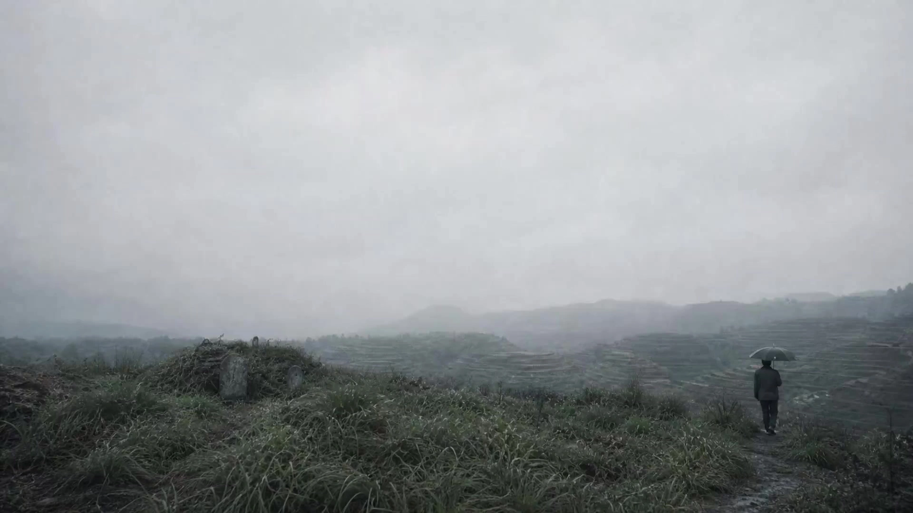

# Urban Memory Narrative Short

> **作者：** Flova

## Content

**Process Planning:**

**Workflow and Stage Dependencies:**
1. **Obtain Story Premise (Choose one):**
   - **User has uploaded script/text material:** Use **resource_prepare_and_analyze** to parse, extracting character relationships, core conflicts, scene lists, key event nodes, and key objects. Output a concise story premise summary and ask the user to confirm before proceeding to Step 2. **Do not enter Step 2 before confirmation.**
   - **User has not uploaded material:** Use reply_to_user with **card guidance** to collect: location and time of the story, core dilemma or decision facing the protagonist, another key character, and their relationship with the protagonist. Default settings if information is insufficient: duration 1–3 minutes, type "Short Narrative Film". After collection, output a concise story premise for user confirmation.
2. Confirm with the user and establish Final_Video_Spec.md (title, type tone, scene settings, aspect ratio, target duration, visual style, output language) → **text_editor**
3. Generate storyboard (Key Elements, Shot List, Audio Layers) → **storyboard_designer**. Once the storyboard is ready, scan the assets provided by the user or generated in the context, bind them to the corresponding storyboard slots via **media_generator**, and then proceed to generation steps.
4. Set elements:
   - If user has uploaded element assets (character reference images, scene reference images): Register asset_id and bind to the corresponding key_element.
   - Otherwise: Generate images for all key characters and scene elements → **media_generator**.
5. Generate the first frame image (start_frame) for each shot → **media_generator**
6. Generate video by shot type:
   - **Narrative Shot [Narrative] (~80%):** FirstFrameToVideo + Happy Horse → **media_generator**
   - **High-Intensity Shot [High-Intensity] (~20%, no more than 20% of total shots):** MultiModalToVideo + Seedance 2.0, referencing the corresponding element image as reference → **media_generator**
7. Generate BGM / Narration audio layers → **media_generator**
   - **Confirm narration generation method with user:** 1. Use narration generation model Minimax Speech 2.8 HD (fast generation, low credit consumption); 2. Use Seedance 2.0 to generate narration audio (natural effect, high credit consumption, choose carefully!)
     - Method 1: Use narration generation model Minimax Speech 2.8 HD: **text_to_narration**, model **Minimax Speech 2.8 HD**
     - Method 2: If the narration exceeds 15s, split the narration into multiple paragraphs and generate them separately.
     - First, use Seedance 2.0 to generate the first paragraph of the narration video, requiring the duration to be locked at 14s, without other sound effects or music in the video, and only let the character say this sentence. Only generate one video at a time, do not generate multiple videos even if the user requests it;
     - Use multimodal analysis to split the audio from the generated first narration video, and use it as one of the references for subsequent narration video generation. Use Seedance 2.0 to complete all remaining narration videos at once, referencing the corresponding character element image + the audio file of the first narration video just split (must be less than 15s; if the audio exceeds 15s, crop it to under 14s before referencing) to generate the remaining narration content. After generation, call the multimodal model again to split the audio files from these videos.
8. Complete the assembly of the full film timeline. If Method 2 was selected in step 7, the audio layer needs to edit all extracted audio files as narration into the corresponding positions → **video_assembler**
**Dependency Order:** 2→1; 3→2; 4→3; 5→3,4; 6→3,5; 7→3; 8→6,7
**Pause Nodes:** Do not run the entire process at once. Pause after premise confirmation, storyboard completion, element/first frame image completion, video batch completion, and audio generation, waiting for user confirmation before proceeding.
**Pause Nodes:** Do not run the entire process at once. Pause after premise confirmation, storyboard completion, element/first frame image completion, video batch completion, and audio generation, waiting for user confirmation before proceeding.
**When user provides media:** Prioritize binding it to the corresponding slot in the storyboard; do not re-generate content already provided by the user.

**Guidelines for creating Final_Video_Spec.md**
- Title tone: Fits the story type and mood, avoid over-artsy or commercial tendencies.
- Aspect ratio: 16:9 recommended; 4:3 or 2.35:1 can be used to emphasize oppression or intimacy.
- Visual style: Matches the story type, can be realistic, lightly stylized, or genre film visuals; low saturation is not mandatory.

**Asset Analysis:**

**Call this tool when the user uploads a script file or text material.**
- Parse the uploaded file (image/PDF/text), extract: character relationships (protagonist + person who is close but distant + person who brings change), space list, life-flow event chain (5–8 everyday events), key objects, key actions, and dialogue nodes.
- Output a concise story premise summary and structured key information for use by Final_Video_Spec and **storyboard_designer**. Do not make judgments about era or qualitative value.
- If the file cannot be parsed or the content is incomplete, explain to the user and request supplementation.

**Storyboard Design:**

**Core Tone**
- Emphasize the relationship between people and people, and people and the environment. The scene is not just a background board, but one of the characters: the scene is also part of the narrative expression.
- Dramatic conflict should be low: avoid explosive arguments, use silence, waiting, detours, unspoken words, and suddenly interrupted routines more.
- Plot events should feel coincidental, grounded in specific life actions.
- The ending should not pass judgment: give the audience space or an action after a change, do not give a complete answer.

**Script Story Structure Construction**
Urban humanistic narrative films do not rely on dramatic confrontation, but on **accumulating emotions through observation**—allowing the audience to feel the changes themselves through the real behavior of characters in urban space, the reproduction of detailed objects, and the traces of cause and effect between scenes.
- **Bury an unresolved line at the beginning:** No explanation, no summary—an action, an object, a look, let the audience keep watching with questions.
- **There is history between characters:** Even for encounters between strangers, there must be an implicit reason for "why these two people"—a place, a time, an old object.
- **Key objects appear at least twice:** The first time establishes existence, the second time the state has changed—the position has changed, it is damaged, it was taken away.
- **Leave traces between scenes:** Events that happened in the previous scene should be traceable in the space or character of the next scene, do not use jump cuts without cause.
- **Arrange at least one "expectation failure":** Characters do something, and the result is different from expected—not a plot twist, but just how life is.
- **The ending action has double meanings:** The final action or shot can be leaving, staying, or doing nothing at all—but make this choice carry weight.

**Character Design Principles**
- Character motivation should be small, character dignity should be big: behind small goals are face, old feelings, identity, family affection, or "am I still a useful person" etc.
- Dialogue should be like a detour: characters rarely speak their true needs directly, often saying "it's fine", "just passing by", "you're busy", "another day".
- Emotion is expressed through actions: smoking, tidying the collar, touching an old mobile phone, repeatedly opening and closing a lighter, wiping the table, waiting for the water to boil, watching others pay.

**Scene Selection**
- Space selection serves the current plot relationship and character state, there is no rigid rule.
- Any space must carry social information: slogans, price lists, payment QR codes, old posters, construction noise, TV news, square dance music, dialect radio—these details are part of the narrative, not decoration.

**Key Elements Design**
- Prioritize designing **character elements** (age, appearance, clothing, current activities) and **scene elements** (geographic environment, time period, lighting conditions, social information carriers).
- Prop elements are only established separately when they have a substantial impact on the consistency of multiple shots (such as frequently appearing old mobile phones, tickets, payment QR code signs).
- When the user provides reference material, element descriptions must be consistent with the reference content and must not contradict.

**Shot List Design Principles**
**Shot Duration and Rhythm Layering**
Each narrative segment is built by mixing three types of shot durations; the change in rhythm itself is a narrative signal—slowing down means time condenses here, speeding up means the character or space is moving:
Shot Type Duration Function and Usage Timing **Short Shot** 2–3s Key object insertion, emotional reaction cut, urban detail capture; create rhythmic jumps or emphasis **Medium Shot** 6–10s Character behavior development, daily interaction, movement and staying within space; main narrative, accounts for about 60% of the film **Long Shot** 11–15s Opening space establishment, emotional settlement moment, ending lingering rhyme; at most 1–2 per narrative segment

**Rhythmic Structure of Each Narrative Segment:**
- **Opening establishment segment:** 1 medium or long shot to establish the urban space and character situation—can start with an action, no need to explain the background.
- **Observation development segment:** Mainly medium shots, showing specific character behavior in space; insert 1 short shot (object close-up or environmental detail) every 2–3 medium shots to break visual rhythm and accumulate information density.
- **Emotional turning segment:** Use 1 long shot or slow-paced medium shot to hold time, giving enough space for a subtle reaction or choice of the character to be seen.
- **Dynamic rhythm segment [Dynamic]:** When characters travel through urban space, rush, or search, use continuous medium and short shots to advance the rhythm; marked as [Dynamic], generated by Seedance 2.0.
- **Ending conclusion segment:** The last 1–2 shots use medium or long shots—give the result or emotion enough time to linger, do not end with short cuts.

**Overall Rhythm Control:**
- Total number of shots recommended: 10–16 (1–3 minute film length).
- Avoid uniform duration throughout the film—the density of the rhythm itself is speaking. The beginning can be slow, the middle follows the ups and downs of the character's rhythm, the ending leaves space.

**Shot Size:**
- Opening to establish urban space and character situation: Medium-long shot or wide shot, let the space speak first.
- Character interaction or solitude: Two-person medium shot or single-person medium shot, eye contact and body language are readable.
- Emotional accumulation or turning point: Close-up, capturing subtle expressions and hand movements.
- Key objects: Cut-in shot, short, clear (2–3s).

**Camera Position and Movement:**
- Conventional observational narrative: Fixed camera position mainly, or slightly handheld following the character, prioritizing the natural presentation of character behavior and space.
- [Dynamic] scenes (characters crossing streets, rushing, searching): Tracking or moving shots, noting sense of direction and amplitude of movement.
- Forbidden: Show-off camera work, rotating shots, purely decorative aerial shots, slow motion without narrative function, multi-cut shots, etc.

**Composition:**
- Characters can be off-center, leaving a large amount of wall, street, door frame, window, or empty chair.
- Use door frames, glass, railings, car windows, counters to separate characters.
- When new and old objects are juxtaposed, do not deliberately emphasize the contrast, let them coexist naturally in the same frame.
- Allow the frame to be "dirty": debris, dust, old tiles, plastic stools, wires, advertising paper should not be cleaned up.

**Tone and Lighting:**
- Day scenes: Gray-white sky, low-saturation cement color, old red slogans, faded blue-green shop signs, dusty yellow.
- Night scenes: Sodium lamp orange, KTV neon pink-purple, cold light of mobile phone screens, roadside stall fluorescent lights.
- Indoor: Fluorescent light with a greenish tint, TV cold light, gray light outside the window; do not use high-end studio texture.
- Color grading: Low saturation, slight grain, real dynamic range, retain dark area noise.

**Each shot description must include:** Scene (cite scene element ID + time of day/lighting), subject action (mainly body/expression), photographic language (shot size + camera movement + focus strategy), sound sense (environmental sound/diegetic sound).
**Shot labels:** Note the generation route label at the end of the shot description—narrative shots marked [Narrative], strong dynamic/cut shots marked [Dynamic]; [Dynamic] shots must not exceed 20% of the total number of shots.
**Dialogue rules within the shot**
- At most 3–6 lines of dialogue per scene; each sentence as short as possible, dialect words are allowed but do not stack.
- Do not say everything completely, let the audience fill in from actions and space. Do not write narration to explain the theme.
- Available sentence patterns: "You came back without saying a word." / "Passing by." / "Scan this now." / "I don't have that." / "Forget it then." / "You go ahead."

**Audio Layer Design**
- BGM (optional): If used, choose minimalist instrumental music or atonal ambient soundscapes; pop music rhythms are prohibited.
- Does not drive the narrative with dialogue.

**Quality Control Checklist (Self-check before output)**
- Are at least 60% of the shots medium-long shots, fixed camera, or slow movement?
- Are there more than 2 public spaces?
- Is there diegetic sound instead of added emotional background music?
- Are straightforward summary sentences like "He finally understood" or "This is fate's arrangement" deleted?
- Is the direct reuse of any off-the-shelf movie characters, lines, scenes, and plots avoided?

**Prohibited Items**
- Do not write the story as a pile of suffering or a judgment of value; characters should have humor, vanity, clumsiness, decency, and life inertia.
- Do not use narration to explain the theme or era significance.
- Do not make every scene carry plot functions; allow useless waiting and accidental passersby, but they must increase the sense of spatial reality.
- Do not overly poeticize the world. Beauty comes from observation, not from golden sentences and filters.

**Media Generation:**

**Element Image Generation**
- Tool: **TextToImage / ImageToImage**, Model: **Image 2**, Resolution: **2K**
- If the user has uploaded reference images (character/scene), register them as asset_id and bind them to the corresponding Storyboard element slot, prioritizing their use for replacement generation.

**First Frame Image Generation (start_frame for each shot)**
- Tool: **TextToImage / ImageToImage**, Model: **Image 2**, Resolution: **2K**
- The first frame image must be strictly consistent with the shot size, lighting, and subject posture described in the Storyboard shot, serving as a visual anchor for video generation.

**Shot Video Generation (Routed by path)**
- **Narrative Shot [Narrative] (~80%):** Tool **FirstFrameToVideo**, Model **Happy Horse**, Resolution **720p**, using the corresponding shot start_frame as the first frame input.
- **Dynamic Shot [Dynamic] (not exceeding 20% of total shots):** Tool **MultiModalToVideo**, Model **Seedance 2.0**, Resolution **720p**; reference the character/scene element image involved in the shot as reference_image, and use start_frame as the first frame reference; only for scenes with strong conflict, fast cuts, or high-speed character dynamics.

**Audio Layer Generation**
- Narration (if any): Execute the following models according to user choice
  - Method 1: Use narration generation model Minimax Speech 2.8 HD: **text_to_narration**, model **Minimax Speech 2.8 HD**
  - Method 2: If the narration exceeds 15s, split the narration into multiple paragraphs and generate them separately.
    - First use Seedance 2.0 to generate the first paragraph of the narration video, requiring the duration to be locked at 14s, without other sound effects or music in the video, and only let the character say this sentence. Only generate one video at a time, do not generate multiple videos even if the user requests it;
    - Use multimodal analysis to split the audio from the generated first narration video, and use it as one of the references for subsequent narration video generation. Use Seedance 2.0 to complete all remaining narration videos at once, referencing the corresponding character element image + the audio file of the first narration video just split (must be less than 15s; if the audio exceeds 15s, crop it to under 14s before referencing) to generate the remaining narration content. After generation, call the multimodal model again to split the audio files from these videos.
- BGM: **text_to_instrumental**, Model **Suno 5** or **Mureka 8**; style description as minimalist instrumental music / ambient soundscapes; do not generate lyric-based music.

**Failure Handling**
- When any model generation fails, prioritize retrying within the same model; do not automatically switch to other video generation tools, stop and notify the user, and let the user decide whether to change the route.

**Prompt Writing:**

**First Frame / Element Image Prompt (TextToImage / ImageToImage)**
Core logic: Capture the "decisive moment", emphasize film color texture, real light/shadow and airiness; discard camera movement and rhythm vocabulary.

**Prompt Formula:**
[Subject and Micro-action] + [Spatial environment and social information carrier] + [Airiness] + [Lighting state] + [Photographic language and shot size] + [Color system and film texture] + [Style reference]

**Core Vocabulary Bank:**
- Subject and Micro-action: Back view / smoking hands / staring out the window / dazed pause / tidying collar / touching old phone
- Spatial social information: Faded slogans, payment QR code stickers, old posters, price lists, construction hoarding, old calendars
- Environment and Airiness: Dusty air, morning mist, dampness, heat haze
- Lighting state: Natural light, soft window light, fluorescent greenish, sodium orange, overcast diffused light
- Photographic language: Medium shot / Full shot / Close-up (restrained) / Minimalist composition / Negative space / Door frame masking / Glass reflection
- Color system: Kodak Vision3, Fuji Eterna, ARRI Alexa Natural, low saturation, soft highlights, detailed shadows, real skin tone, slight grain
- Style reference: Jia Zhangke, Hirokazu Kore-eda, Magnum Photos, Leica Documentary

**Example Prompt (First Frame):**
Real Chinese small-town life-flow film scene, winter evening in 2001, a small shop next to the long-distance bus station; a young man in an old black jacket stands at the door, clutching a crumpled ticket, hesitant to enter; Composition: fixed medium-long shot, character on the right edge of the frame, foreground is a glass door covered with faded advertisements, middle ground is the shop counter, background has the cold white light of the waiting room and passengers walking back and forth; Lighting tone: gray-blue daylight mixed with greenish fluorescent light, low saturation, cement floor reflection, slight grain; Kodak Vision3 film stock, real skin tone, soft highlights; Jia Zhangke aesthetics, observational, quiet, realistic; Avoid: exquisite advertising feel, strong backlighting, excessive beauty filters.

**Video Prompt (FirstFrameToVideo / MultiModalToVideo)**

Core logic: Focus on "the flow of time" and "long shot observational feel"; keep looking for a while after the action is completed; environmental sound takes precedence over background music description.

**Prompt Formula:**
[Real Chinese small-town life-flow film scene, era/season/time, location]; [Character appearance and clothing] is [specific action]; Composition: [shot size, character position, front/middle/background layers, occlusion relationship]; Lighting tone: [lighting type], low saturation, slight grain, life texture; Shot: [movement type], [duration], action happens naturally, retain pauses; Sound sense: [environmental sound/diegetic music/radio/car sound]; Avoid: exquisite advertising feel, excessive beauty filters, theatrical performance, exaggerated tears, strong cinematic lighting, show-off camera work

**Camera Movement Vocabulary (Strictly Restrained):**
Fixed camera / Slight handheld breathing / Extremely slow push-in / Extremely slow pan; Forbidden: rotation, fast push/pull, drone, MV-style fast cuts

**Sound Sense Description Reference:**
Distance bus reversing prompt sound, ticket window broadcast, mahjong sound, TV news sound, KTV sound leakage, construction sound, square dance music, mobile phone short video playback

**Example Prompt (Narrative Shot):**
Real Chinese small-town life-flow film scene, winter evening in 2001, a small shop next to the long-distance bus station; a young man in an old black jacket stands at the door, clutching a crumpled ticket, hesitant to enter; Composition: fixed medium-long shot, character on the right edge of the frame, foreground is a glass door covered with faded advertisements, middle ground is the shop counter, background has the cold white light of the waiting room and passengers walking back and forth; Lighting tone: gray-blue daylight mixed with greenish fluorescent light, low saturation, cement floor reflection, slight grain; Shot: fixed camera 12 seconds, young man looks up at the station sign then lowers his head, action happens naturally, retain pauses; Sound sense: distance bus reversing prompt sound, ticket window broadcast, plastic bag friction sound; Avoid: exquisite advertising feel, strong backlighting, exaggerated expression, fast editing, modern luxury street scene.

**Final Assembly:**

**Rhythm Principles**
- Long shots take priority, preserving the complete sense of time flow; do not shorten shots to chase "interestingness".
- 0.5–1s black screens or sound continuations can be used between shots to create a sense of breathing.
- Fast cuts, music beat-matching, special effect transitions, and TikTok rhythms are prohibited.

**Audio-Visual Relationship**
- Complete the assembly of the full film timeline. If Method 1 was selected in step 7, align the generated narration to the corresponding position; if Method 2, the audio layer needs to edit all extracted audio files as narration into the corresponding positions;
- BGM (if any) volume 0.1x; fade in and fade out, do not compete with the visuals.
- No forced audio-visual synchronization; let the visuals and sound flow naturally on their own.
