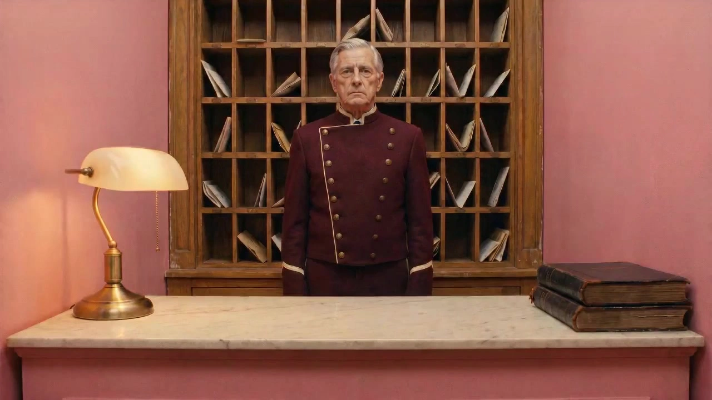

# Wes Anderson Short

> **作者：** @Seast Zhu

## Content

Process Planning:

Communication Rules (Global)

Do not mention internal step numbers in the conversation. Use functional descriptions for all user-facing statements:

Step 1: Collect User Creation Information

A. Creation Materials (Any combination)

Story idea / Complete script / Reference materials (images/videos)

B. Basic Parameters

Title

Target Duration: 1 / 2 / 3 / 5 minutes

Aspect Ratio: 16:9 (Default) / Let Flova decide / Custom

9:16 is only provided as an option if the user input contains "vlog/advertisement/promotion/short video"

Video Generation Model: Seedance 2.0 (Default) / Kling 3.0 Omni / Other

Short Film Language: Chinese / English / Other

Language selection applies to the whole film: Narration, on-screen text, and title card language must be consistent.

Need narration? C. Chapter Selection: Split into chapters? Number of chapters (Default is no more than 4 chapters)

Step Workflow

Step 1: Collect user input
Step 2: Analyze input content → Can be done in parallel with Step 1
· When uploading files, execute resource_prepare_and_analyze section A/B/C
· Whether uploaded or not, perform integrity check (Section D)
· If incomplete, mark as "Story Expansion Needed," trigger before Step 6
Step 3: Generate Final_Video_Spec.md ★Pause for confirmation
Step 4: Color design consultation ★Pause for confirmation (loop until confirmed)
Step 5: Visual specification conversion to script (storyboard_designer ) → Element maps (media_generator ) → Fusion keyframes (schematic previews of a few key shots, confirm with user if it meets expectations before continuing generation) ★Pause for confirmation
Step 6: Generate all chapter Shot List images (media_generator )
· If marked "Story Expansion Needed," perform story expansion first
· Ask for generation method: A·All / B·Chapter by chapter / C·Complete character back/side views first, then all
★Pause for confirmation
Step 7: Generate video clips ★Must wait for explicit user confirmation
Step 8: Generate narration (if enabled, starts in parallel after Step 7)
Step 9: Generate sound effects (same as above)
Step 10: Generate BGM (same as above)
Step 11: Synthesis output

Tool Mapping and Execution Hierarchy Explanation:

Steps 1-2: Use Resource Prepare and Analyze (resource_prepare_and_analyze) to process user-provided materials.

Step 3: Use Text Editor (text_editor) to create and lock the Final_Video_Spec.md specifications.

Steps 5-6: Use Storyboard Designer (storyboard_designer) for Shot List and element design.

Step 5 (Image generation) and Steps 7-10: Call Media Generator (media_generator) to schedule corresponding image/video/audio model asset generation.

Step 11: Render the final timeline via Video Assembler (video_assembler).

Dependencies: 3→1,2; 4→3; 5→4; 6→5; 7→6; 8–10→7; 11→7,8,9,10

Step 4 · Color Design Consultation

Pre-check: If materials contain color information, first ask the user if they want to use it as a direct basis (Select A → Skip main question, generate plan directly; Select B → Enter main question). Main Questions:

A · Let Flova handle: Autonomous design, show for confirmation

B · Imitate Anderson films: Must immediately show the film selection board (fixed process, cannot skip): "The Grand Budapest Hotel" (Powder Pink/Lavender/Cream White) / "The French Dispatch" (B&W Base + Saturated Color Blocks) / "Isle of Dogs" (Faded Matte + Amber) / "The Royal Tenenbaums" (Mustard/Caramel/Olive) / "Moonrise Kingdom" (Autumn Orange/Moss Green/Sand Yellow) / Other

C · Chapter/Era Jump: Enter jump sub-process (see below)

Also provide a Custom Input Box (can be filled separately, works even without selecting A/B/C) C's Jump Sub-process: Flova first determines the applicable type, then confirms with the user (two can be enabled simultaneously): Era Jump (Applies if either is met):

Story includes the same space appearing in different eras

Flova-designed scripts adopt a Golden Age → Decline structure
→ When applicable: Design color schemes separately for golden/decline, set materials/content fade with the color scheme, aspect ratio can change synchronously (Golden → Academy ratio, Decline → Widescreen) Chapter Jump (Applies if either is met):

Clear differentiation in chapter themes/emotional directions

Script duration ≥4 minutes and clear emotional differences between chapters
→ When applicable: Independent main color scheme for each chapter (Soul color specified per chapter), forming a color narrative arc

After confirming the jump type, ask for the source of the color scheme for each segment: Let Flova handle / Reference an Anderson film / Custom After the plan is output, must display a confirmation interface using options (Prohibit changing to open text questions):

Confirm current plan, start designing visual elements

Wish to adjust the current planWhen selecting "Adjust": Ask for adjustment direction → Regenerate → Display confirmation interface again, loop until confirmed.

Shot Quantity Reference

Target Duration Recommended Shots Default Duration per Shot Chapter Limit 1 minute 4–12 shots Default 5–6s, can extend to 10–15s 1 chapter 2 minutes 8–24 shots Default 5–6s, can extend to 10–15s 2–3 chapters 3 minutes 11–33 shots Default 5–6s, can extend to 10–15s 3–4 chapters 5 minutes 20–60 shots Default 5–6s, can extend to 10–15s 4 chapters Chapter title card 3–4s, not counted in shot quantity.

Default per shot 5–6s. Situations where it can be extended to 10–15s: T-10 close-ups requiring full reading, M-11 slow-motion, shots with narration exceeding 6s.

Asset Analysis:

This module is for Resource Prepare and Analyze (resource_prepare_and_analyze) to follow when processing user-provided reference assets.

A. Script/Story Text

Extract: Character list (name/identity/costume/identity color), scene list (location/indoor vs. outdoor/emotional type A–F), key props, narrative text props (T-10 candidate: label name/narrative function/suggested chapter), emotional arc, chapter logic.

B. Visual Reference Materials

Extract: Main color scheme, main mood, sense of space (scale/planimetric/dollhouse feel), prop density, audio clues (video).

C. Restrictions

Do not analyze real human faces; do not copy brand logos; only extract language rules from reference materials.

D. Script Integrity Judgment

No expansion needed (Proceed directly to Step 3): Has complete scene list + named characters + inferable narrative arc Expansion needed (Mark and pass to Step 6): Input Type Missing Concept/Emotional Direction Scenes/Characters/Events All missing Character concept exists, no scenes, no events Theme words, no concrete narrative elements Incomplete script, missing lines/action/visual description/ending direction Any one Visual reference only, no text, no narrative content Marked output format (inherited by Planner):

Integrity Judgment: [Story Expansion Needed / No Expansion Needed] Missing Content Summary: [Specific missing items]

Storyboard Design:

I. Set Design Specifications

1. Scene as Character: Explain "who lives here" for every space. Objects on shelves/walls/tables are narrative information. 2. Structural Symmetry · Non-mirrored Content (Core Constraint)

Structural layer (walls/door frames/pillars/built-in lights): Symmetry allowed

Content layer (tables/chairs/props/ornaments): Left and right content must be different, balance using visual weight Dollhouse/Cross-section composition usage conditions (Enabled if any is met):

Space itself is the narrative protagonist (need to display system structure/multiple parallel activities)

Opening establishing shot of the film

Chapter opening (optional) Frequency cap: Whole film cross-section shots ≤ 20%, otherwise use frontal planimetric realistic composition. 3. Era Anchoring: All props/furniture/fonts locked to 1930s–1980s, contemporary brands and digital devices prohibited. When Era Jump is enabled: Two versions of the same space (Golden → Decline), same composition angle, material degradation + content vacancy + color shift (warm saturated → desaturated cool) + aspect ratio change (11:8 → 12:5). 4. Character Uniforms: One main color + one signature prop per character, constant throughout the film. 5. Handcrafted Texture: Prioritize description of material details (wood grain/leather/wall paint/fabric), props carefully arranged, do not pursue photorealism.

II. Linear Narrative Structure

Opening (Location Definition) → Narrative Segment (each shot advances one narrative piece of information) → Climax (Emotional Peak) → Ending (Closed loop or frozen prop)

III. Chapter-based Narrative

Chapter Naming: Flova autonomously names (2–5 word noun phrases, formal and slightly literary), user can adjust. Title Card Base Material: From the narrative world of that chapter itself: Narrative World Adapted Base Material Hotel/Palace Molded door panels, folded napkins, key cabinet panels Legal/Archive Legal stationery, handwritten documents, wax-sealed documents Academic/Study Old book covers, manuscript pages, notebook paper Factory/Prison Concrete walls, chalk blackboards, metal doors Nature/Travel Hand-drawn maps, plant specimen paper, old postcards Military/System Official paper, archive covers, official forms Catering/Social Menu covers, table settings, wine labels Medical/Science Medical records, lab logs, specimen container labels Internal chapter structure: Cut-in shot → Core shots (1–6) → Closing shot

IV. Every Shot Must Include

Shot count statistics: Title cards not counted in total; T-10 counted (Film-wide recommended ≤3); Example: 3 minutes·4 chapters → 180s−4×3.5s=166s → approx 11–33 shots

Scene Type: (A–G or T-10)

Set Description: (Three-layer specification: Material/Content/Era)

Story Content: (Lines/Narration text/Spoken dialogue)

Cinematography Language: Shot size + camera position + Camera Movement Code M-00 to M-11 (Required) + Corresponding English keywords (Directly referenced from write_the_prompt rules)

Color Slot: Define image color tone attributes

Audio Annotation: Dialogue, narration, and core sound effects

Estimated Duration: (Default 5–6s; can extend 10–15s; Title card 3–4s)

Camera Movement Description Rules: Write only the code and English keywords for camera movement, do not re-describe the movement method in Chinese. Use Chinese only to describe narrative events. ✗ Incorrect: M-03 (Lateral tracking, camera follows character from left to right) ✓ Correct: M-03 · lateral dolly strictly parallel to scene plane, camera never pushing into depth

Camera Movement Allocation Constraints (Executed during design stage)

M-00 in narrative shots ≤30% (excluding T-10/F-class/Dialogue close-ups)

Mandatory non-M-00 positions: First shot of the film / First narrative shot of each chapter / Emotional climax/turning point / Last shot of the film

M-00 allowed: T-10 close-up / F-class archives / Dialogue facial close-up / Framing content display (Static locked after frame is established for reading, not counted in 30% cap) Scene Type Preferred Movement Narrative Purpose A Indoor Social M-01 / M-05 Snap zoom to emphasize props or narration objects; lock symmetrical composition after character enters B Outdoor Street M-02 / M-03 Snap zoom out to reveal full building architecture; planimetric lateral move to show continuous street cross-section C Night Action M-05 / M-09 / M-10 Follow character across dark background; lateral parade feel; POV to show subjective movement perspective D Private Space M-01 / M-04 Snap zoom to emphasize books/props/characters; rise to reveal full space E Institutional Power M-02 / M-04 Snap zoom out to highlight architectural oppression; low angle rise to emphasize power depth F Archive Memory M-00 / M-03 Static archive feel (allowed); or planimetric lateral sweep across historical collection G Architectural Cross-section M-02 / M-00 Snap zoom out to gradually reveal multi-layer structure; or static locked for reading spatial relationships T-10 Prop Close-up M-00 Static locked, for audience to fully read prop content Emotional Climax (Film-wide ≤2) M-11 Slow motion Objectifies the emotion; used only for strongest narrative moments First-person POV M-10 First-person perspective of vehicle/walking; followed by a front-facing subject confirmation shot Framing (Architectural opening/window/doorway) M-01 → M-00 M-01 snap push to reveal subject within frame; M-00 static lock after frame established for reading; overhead opening framing combined with M-07

V. Narrative Unit: Cross-Shot Combination Pattern

A single shot is a word; a combination of shots is a sentence. When designing the Shot List, you must design the narrative relationship between shots, not just each shot individually. Two fundamental sentence structures (the basis for all patterns):

Establish→Reveal→React: First establish the relationship between the character and the environment/target, then reveal the target itself, then show the character's reaction to the target. Three shots form a cognitive loop.

Action→Prop→Proof: Character performs an action, cut to a close-up of the prop involved in the action, then cut back to the character or result—the action has physical evidence, the narrative gains materiality.

The following seven patterns are how these two sentence structures unfold in specific scenes.

Pattern 1 · Action→Reveal (2–3 shots)

Structure: Shot of relationship between character and target → Frontal close-up of target (T-10) → (Optional) Shot of character reaction

Movement: Shot 1 M-00 or M-03; Shot 2 T-10 (M-00); Shot 3 M-00 (face or back)

Constraints: The prop/target in Shot 2 must be the same object held or stared at by the character in Shot 1, not to be replaced.

Pattern 2 · Introduce→Anchor (2 shots, reverse order)

Structure: Frontal close-up of prop/object (T-10) → Full view of character + scene (prop holder and environment appear simultaneously)

Movement: Shot 1 T-10 (M-00) → Shot 2 M-02 (snap zoom out to reveal full scene)

Constraints: The prop must be the same in both shots, with consistent appearance/color/state.

Pattern 3 · Dialogue Group (2–N shots, alternating)

Structure: Character A frontal close-up (M-00) → Character B frontal close-up (M-00) → Can alternate multiple times

Constraints: Use M-06 whip pan or [CUT →] hard cut for switching; arc繞行 (orbit) prohibited; each character shot is a planimetric frontal composition, over-the-shoulder angles are prohibited.

Pattern 4 · Positioning→Frame (2 shots)

Structure: Overhead or wide shot to establish spatial positional relationship → Close-up reveal of character state within frame

Movement: Shot 1 M-07 (vertical whip pan) or M-00 (overhead wide shot) → Shot 2 M-00 (static within frame)

Pattern 5 · Environment→In-Frame (2–3 shots)

Structure: External perspective lateral move to establish environment/threat → Frame reveal of internal character reaction → (Optional) Close-up of subject within frame

Movement: Shot 1 M-03 (planimetric lateral move) → Shot 2 M-00 (static frame, information readable both inside and outside frame)

Constraints: Reaction of character inside frame must establish causal relationship with environmental content of Shot 1; information outside frame and reaction inside frame must be readable in the same frame.

M-10 POV is a subjective variant of Pattern 5: After M-10 POV shot, must follow with a subject frontal confirmation shot (frontal view of the POV source) — Logic is same as Pattern 5: External→Internal/Subjective→Confirmation. Full rules see write_the_prompt's M-10 bridging pattern.

Pattern 6 · Action→Blank Space→Space (3 shots)

Structure: Close-up of character action → Camera stays on empty scene after character leaves (M-00, ≥3s) → Zoom out to reveal full space (M-02)

Constraints: Static frame in the middle not less than 3s; M-02 zoom out must follow central axis, building facade closes bottom.

Pattern 7 · Part→System (2 shots)

Structure: Frontal planimetric shot of a single building or character → Cross-section or macro wide shot of the overall environment, revealing position of the part within the system

Movement: Shot 1 M-00 → Shot 2 M-02 (snap zoom out)

Constraints: Must be able to find the person or building from Shot 1 in Shot 2 as a visual anchor—the two shots share a "recognizable element".

Cross-Shot Coherence Constraints (Applies to all patterns)

Prop Coherence: Props within the same combination must remain visually consistent in all shots (appearance/color/state). The visual specification generation step must record "prop anchor description" for the prop, and subsequent shot prompts cite the same description.

Character Position Coherence: In adjacent shots within the same scene, the character's relative spatial orientation must be consistent. After T-10 close-up ends, character returning to the scene shot must return to the same spatial position.

Color Temperature Coherence: Color temperature must not drift across multiple shots in the same scene—color slots remain same across all shots in that scene, no adjustments due to shot size changes.

Rhythm Constraints: T-10 close-up (M-00) must not appear continuously more than 2 times in a single combination; M-11 slow motion must not appear in prop reveal shots (slow motion is for emotional peaks, not prop reading).

VI. Text Prop Trigger Rules

Position: Immediately before/after action shot where character picks up/uses prop

Text Language: Follow Final_Video_Spec language settings Font Corresponding Narrative World:Narrative World Font Style Default/Global Futura (Geometric Sans-serif) Hotel/Palace Art Deco Bold Serif Uppercase Legal/Archive Mixed weight serif (keywords bold + function words italic) Prison/System Hand-drawn chalk block letters, uneven size Association/Club Uppercase serif + italic script mixed Academic/Study Classic uniform serif Text Prop Type Reference (Reference when designing T-10 candidates):Category Typical Prop Paper Products Letters/Telegrams/Passports/Official Documents/Maps/Newspapers/Ticket Stubs/Timetables/Book Covers Product Packaging Pastry Boxes/Wine Labels/Medicine Bottle Labels/Tableware Imprints Space Signage Hotel/Architectural signage/Museum display tags/Outdoor signs/Luggage tags Identity Badges Membership badges/Armbands/Official ID/Association documents/Wax-sealed letters Prop Texture Principles: Text props pursue material sense of "authentic historical artifacts"—paper creases, ink depth, uneven printing, deliberate spelling errors—all are intentional, not perfect prints.

VII. Narrative and Character Expansion (Triggered when Step 2 marks "Story Expansion Needed")

7.1 Integrity judgment performed and passed by resource_prepare_and_analyze. Execute 7.2–7.5 when expansion needed, do not pause separately to wait for confirmation. 7.2 Three-layer Character DefinitionLayer 1 · Identity Conflict (Select one archetype): Archetype Formula Behavioral Core Stalled Adolescence Adult body + unfinished childhood psychology Prove you haven't changed using certain stubborn "past markers" Outsider Craving belonging, excluded by system + Active choice to depart Depart even if failure is guaranteed, because not departing is true disappearance Control Freak Resisting loss of control, responding to inner fear with extreme order The more out of control inside, the more precise the external management Survivor of Glorious Past Once brilliant + Refusing to accept mediocre present Maintain a lifestyle that has perished, insist even if futile Cold Abyss Extreme self-restraint outside + Extremely deep emotions inside Emotions are too heavy so don't talk about them; less talk, bigger stakes

Layer 2 · Visual Identity: Main color + Signature prop (Must carry character's core psychology, not a styling element) + Posture habit

Signature Prop Design Rules: Answer two questions when designing:

What psychological state does this prop represent? (Obsession/Defense/Refusal to let go/Longing to be seen/Connection to the past)

How is it told visually? (Method of use, frequency, how character treats it) **Execution method: After determining prop, arrange at least one T-10 close-up shot in the Shot List.

Layer 3 · Behavioral Pattern: Archetype When Traumatized Expression of Love Stalled Adolescence Attack inward, disappear Substitute language with concrete but unrelated actions Outsider Leave, then return to execute, no explanation Control Freak More extreme orderliness Arrangement and commands Survivor of Glorious Past Maintain rituals more forcefully Treat everyone equally with outdated standards Cold Abyss Talk less and less Secret actions, no announced results

7.3 Narrative Structure: Linear / Nested (Recommended chapterized) / Time jump 7.4 Plot Trigger: Identity crisis / Family fission / Will/Inheritance / Taboo connection / Impulsive return. Core logic: Departing is to confirm you can still depart; worldly failure, psychological ritual complete. 7.5 Dialogue Guidelines: Direct (no hiding information) / Say the heaviest things with the lightest words / Deadpan rhythm

Media Generation:

Visual Specification Conversion → Element Maps → Fusion Keyframes

Stage 1: Visual Specification Conversion (See detailed pre-steps in write_the_prompt)

Execute scene by scene, uniformly define character and space proportion anchors.

Stage 2: Element Map Generation

Characters/Scenes/Key Props: Use image generation tool TextToImage.

Recommended models: Nano Banana Pro (Gemini 3 Pro Image) or Nano Banana 2 (Gemini 3.1 Flash Image), resolution set to 2K.

Character Map: Full-body frontal film still, prohibit turnaround / character sheet / T-pose / reference sheet.

Scene Map: Planimetric full shot.

Key Prop: Overhead or frontal planimetric shot.

Character maps and scene maps share the same proportion anchors.

Stage 3: Fusion Keyframes

Use ImageToImage for image fusion and generation.

Recommended models: Nano Banana Pro (Gemini 3 Pro Image) or Nano Banana 2 (Gemini 3.1 Flash Image), resolution set to 2K.

Generate 2–3 representative emotional scenes to verify proportion, composition, and style.

Step 6: Shot List Image Generation

Use image generation tool ImageToImage (or TextToImage if no pre-reference).

Recommended model: Nano Banana Pro (Gemini 3 Pro Image), resolution: 2K. Generate 1–2 images per shot.

Step 7: Video Clip Generation

Default Selection: MultiModalToVideo path.

Recommended models: Seedance 2.0 / Seedance 2.0 Fast, resolution: 720p.

Alternative Selection (If using Kling 3.0): ImagesToVideo or MultiModalToVideo.

Recommended model: Kling 3.0 Omni, resolution selectable 720p. Reference image binding uses formats like <<<image 1>>>.

Video Parameters:

Duration setting: Default 5–6s, max 10–15s (determined according to storyboard_designer's estimated duration per shot).

Chapter Title Cards

Static Version: TextToImage, use Nano Banana Pro to generate 2K image, stretched to 3–4s static frame in video synthesis.

Dynamic Version (Optional when base material has natural motion): Use ImagesToVideo, duration 3–4s, lock title text static, keep only background micro-motion.

Step 8 Narration Generation

Use text to narration tool.

Recommended model: ElevenLabs v3, recommend using high-quality neutral narrator model.

Step 9 Sound Effect Generation

Use text to narration (SFX mode) or schedule Flova's default sound effect library.

Step 10 BGM Generation

Use lyrics_to_song or text_to_instrumental.

Recommended models: Suno 5 or Mureka 8, full-frequency high-fidelity instrument synthesis.

Prompt Writing:

[Pre-step] Visual Specification Conversion

Convert user input into positive physical descriptions to solve two types of problems:

Narrative Interference: Filter narrative context, pass only physical descriptions.

Literalization of Concepts: Translate metaphors/concepts into concrete visual specifications.

Step 1 · Filter Narrative Context

Retain: Where is the scene / What is in it / Who is there (Physical description)

Filter: Emotional intent / Plot function / Conceptual metaphor / Narrative verbs

Step 2 · Identify Spatial Risks (If any of the following signals are hit, trigger Step 3 replacement)

Signal 1: Conceptual/metaphorical description of space, no material words.

Signal 2: Narrative function × Grand scale × Viewing behavior occurring simultaneously (easily triggers incorrect spatial perspective prototypes).

Signal 3: Depth of field cannot be counted (e.g., vast nature, unbounded cities).

Signal 4: No description of physical boundaries.

Step 3 · Spatial Compatibility JudgmentAnderson-compatible spatial conditions (Must meet all): 3 countable depth-of-field layers + describable material words + relative human scale + enclosing structure. If not met, execute replacement: Retain narrative function, replace spatial form, to meet 3 layers of depth + physical boundaries + describable materials:

Foreground layer: Character / Main prop (clear, with material details) Mid-ground layer: Main space (building facade / ground / platform) Background layer: Visual backing (back of building / color blocks / flat sky)

Original Spatial Error Prototype Replacement Direction Competitive/Audience/Arena Theater stage Walled courtyard/Indoor arena Conceptual metaphorical space Architectural model/Museum display Recent concrete physical space Vast mountains/wilds CG scenery Building facade + nature faded to background Palace Hall Movie set/indoor symmetrical reception hall/palace side hall Unbounded city street Perspective depth streetscape Single small street, building facade as closure

Step 4 · Fill Physical Specifications

Core Principle: Fill every attribute slot with positive physical descriptions, do not use negative statements.

✗ Negative (Invalid): "Physical building space, not stage performance space" ✓ Positive (Valid): "Open-air stone square arena, surrounded by low log beams on four sides, background is blue-brick courtyard wall, bluestone ground has wear marks"

[Spatial Specifications] · Space type: [Enclosed indoor / Semi-open corridor / Enclosed outdoor] · Plan shape: [Square / Rectangular / Longitudinal corridor] · Sense of scale: [Human scale / Grand] · Boundary material: [Left/Right walls] + [Ground] + [Ceiling/Top]

[Light Source Specifications] · Number of light sources / Main light position + color temp + direction / Secondary light (if any) / Overall brightness

[Prop Specifications] · Fixed props (3–5 items, include material location) · Functional props (1–3 items) · Text props (language + font style + medium form) · Prop density

[Photography Specifications] · Camera position: [Frontal planimetric / Frontal 15° overhead / Axis depth / Overhead] · Composition: [Axisymmetric / Axis depth (vanishing point centered)] · Depth of field · Movement: [Fill in camera movement code M-00 to M-11 determined in Shot List]

[Character Specifications (if any)] · Number of people / Position / Character-to-space ratio (percentage of frame height) / Action state

[Color Specifications] · Main color tone / Secondary colors / Accent color / Overall saturation

Step 5 · Proportion Anchor Transfer: Character and space proportions are uniformly defined here; character map and scene map share the same proportion value.

I. Aspect Ratio Setting

Emotional Intent Aspect Ratio Golden / Ritual / Intimate Academy ratio 11:8 Lonely / Lost / Empty Widescreen 12:5 Neutral / Contemporary / Realistic Standard 16:9

II. Color Slot System

Slot Function Default Value Soul Color Whole film main tone Determined by emotion Identity Color Main character uniform/signature prop Determined by character Indoor Warm Social/Human interest/Memory space Amber Mustard #C08A10 Outdoor Cold City/Waiting/Public space Steel Blue #3A6070 Dark Tone Dangerous/Night action/Conflict Deep Navy Blue #0A1A4A Private Color Study/Solitude space Sage Green #637040 Institutional Color Power/Oppression/Bureaucracy Cold Grey #5A6070 Archive Color Memory/History/B&W Full grayscale

Color Temperature–Emotion–Scene Type Table:

Color Type Emotional Function Applicable Scene Type Warm (Amber/Mustard Yellow/Orange) Human activity, social, memory, creation Indoor Social · Cafe · Study (→A·D type) Cold (Steel Blue/Lime Grey) City, waiting, system, public space Street · Square · Building Facade (→B type) Deep Blue (Artificial) Danger, escape, dramatic peak Night exterior · Action scene (→C type) Desaturated Warm (Olive Green/Sage) Private domain, intellectual, immersion, alienation Study · Studio (→D type) Institutional Grey/Cold Army Green Power, oppression, systemic indifference Military · Prison · Checkpoint (→E type) Near-black Extreme Danger, imprisonment, despair Underground space · Extreme conflict Grayscale B&W Archive, historical distance, objective narrative Memories · Historical shots (→F type) Single Accent Color (Identity) Character identity declaration, emotional peak Uniform · Signature prop · Character entry

Era Jump: Soul color slot switches with era—Golden period filled with warm saturated colors, decline period switches to desaturated cool colors, saturation drops synchronously, executed synchronously with set material degradation description.

Chapter Jump: Soul color slot changes to specified per chapter, other slots (indoor warm/outdoor cold etc.) remain unchanged.

Color Dialogue between Costume and Set

Three strategies:

Contrast (Create Focus): Costume color is distinct from background. Dark uniform + warm yellow environment → Institutional heterogeneity; Accent color + neutral wall → Only warm spot in the image.

Monochrome Integration (Create Belonging): Costume close to set tone. Purple uniform + pink hotel → Character and place merge; grey prison uniform + grey prison → Color melt = stripping of dignity.

Eye-catching Color: Vast majority neutral colors, only key props or one local accent color.

Hard Constraint (No Exceptions): Costume color must not be identical to the main background color within the same frame. Minimum limit: Saturation difference of one level or clear difference in brightness. Monochrome integration ≠ same color.

Costume Color Coding Table:

Character Type Costume Tendency Visual Function Professional/Intellectual Grey-brown suit, plaid sweater Integrates into environment, same color as scene Institutional/Service Character Fixed uniform color (e.g., Royal Purple) Character as manifestation of place, uniform is identity declaration Female Character Often has an accent color (Red/Blue/Camel) Create visual focus in neutral environment Law Enforcement/Military Character Dark uniform (Deep Blue/Cold Grey/Army Green) Forms opposition in warm environment Student/Young Character Mix-and-match, interesting patterns (Checkered/Striped) Lightness Workers/Laborers Neutral colors polluted by paint/dust Integrate with work environment

Five-dimensional Color Changes in Template

1 · Saturation Layering (Same hue, different emotional intensity)

Saturation Level Emotional Meaning Occasion High Saturation Golden/Dream/Power of present Core scenes, character entry, emotional climax Medium Saturation Daily/Warm/Comfort of memory Personal space, quiet scenes, transition shots Low Saturation Faded/Decline/Lost End of scene, passage of time, moment of loss

2 · Warm/Cold Shift (Emotional differentiation within same hue family): Same soul color leans orange/ochre = intimate/warm/nostalgic; leans purple/lavender = mysterious/alienated/ritualistic. 3 · Secondary Color Jump: Soul color fixed, secondary colors switch between scenes. Rule: Hue difference ≤ 120° → Audience perceives as "emotional transition within the same world"; > 120° → Visual rupture, must explicitly note narrative level switch in prompt. 4 · Accent Color Freedom: Area ≤5% + Anchor to specific props (not environmental color). No need to be in template palette. 5 · Indoor/Outdoor Differentiation:

Indoor: Full saturation, artificial light strengthens color, prop density enhances color texture.

Outdoor: One level lower saturation than indoor, slightly higher brightness, building facade colors slightly faded.

Chapter Color Arc Design

Design Order: First define emotional undertone of each chapter (one word), then infer soul color choice from color–emotion quick reference table.

Five Arc Types:

Arc Type Color Trend Narrative Function Applicable Genre Cooling Arc Warm saturated → Medium temp → Cold desaturated Prosperity → Decline → Extinction Decline narrative Warming Arc Cold desaturated → Medium temp → Warm saturated Oppression → Struggle → Liberation Oppression → Liberation ending Contrast Arc Chapter A warm + Chapter B cold → Dissolution (Grey/Black) Two opposing viewpoints cannot be integrated Multi-perspective/Conflict reality Fading Arc Same soul color, saturation decreases chapter by chapter Memory disappearing/presence fading Memory/Loss genre Weight-loading Arc Same soul color, brightness decreases chapter by chapter Pressure/Weight accumulating Fate/Oppression genre

Fixed Slot No-Change Principle: Chapter jumps only change soul color and secondary colors; fixed slots like indoor warm/outdoor cold remain unchanged throughout the film—audience perceives "this is the same world".

Color Change Magnitude = Narrative Rupture Degree:

Adjacent hue shift (pink → orange) = Natural passage of time, world continues.

Contrast color jump (warm saturated → cold grey) = Cognitive rupture/worldview subversion/end of era.

Full desaturation (→ Greyscale/B&W) = Narrative level switch (Archive feel/Historical distance).

Title Card = Soul Color Teaser: Title card base color = Announcement of that chapter's soul color. When prompt is generated, title card base color remains consistent with chapter soul color.

III. Composition Rules (Applies to all shots)

Every shot prompt must include and manifest 3 or more composition standards:

planimetric composition, flat framing, camera perpendicular to scene

Axis Depth Legality Condition: Camera must strictly be on the central symmetry axis + vanishing point centered + equal amount of symmetry on left/right.

Axis Depth Prompt: camera on central axis, centered vanishing point, symmetric perspective depth

Prohibit off-axis oblique angles. Disable ambiguous "side camera" descriptions:

If shooting directly at a side wall, use: camera facing side wall, perpendicular to wall plane

If shooting along the axis, use: camera on central axis, shooting toward far end

centered symmetry, bilateral architectural symmetry (Structural layer only, content layer not mirrored).

Scale game: tiny figure dwarfed by architecture / human-scale proportion / figure filling frame.

prominent prop as co-protagonist.

signage integrated into composition.

multiple visible spatial layers, readable depth.

Advanced Narrative Composition Rules:7. Aspect Ratio as Narrative Stance: Square (11:8) → Golden/Intimate/Oppressive; Widescreen (12:5) → Lonely/Lost/Empty. Changing aspect ratio itself is changing narrative stance. 8. Color Gradient as Time Axis: Same space hue shift + saturation change = passage of time, no need for extra subtitles to explain time. 9. Symmetrical Background + Centered Single Character = Absolute Ritualistic Feel: Completely symmetrical background + one centered independent character = "this person is the axis of the whole world". Often used for character entry, identity declaration, or making critical decisions. 10. Frame-within-Frame: Use architectural openings, window frames, door holes, picture frames, apertures, etc., to frame the subject twice, forming nested composition. Framing simultaneously defines "who is watching" and "the range being watched", creating a sense of voyeurism, distance, or institutional oppression.

Framing Type and Prompt Reference:

Framing Type Narrative Function Prompt Keywords Architectural opening (door/window/pass-through) Character limited by aperture, reinforces institutional feel; two worlds separated by opening architectual opening as frame, subject visible through opening, planimetric framing maintained Window frame (car window/building window) Sense of movement + observation distance; external perspective=voyeurism, internal perspective=being framed window frame containing subject, frame-within-frame composition Aperture (ceiling/floor hole, combined with M-07) Frame is perspective, audience looks down from aperture overhead opening as frame, subject viewed from above through aperture, orthographic framing Picture frame/mirror frame Extreme ritual; scene declared as "story being told" ornate frame surrounding entire scene, scene-within-frame, theatrical staging Media nesting (photos in books/archives) Narrative level switch, "this is recorded history"; combine with F-class or T-10 photograph within diegetic medium, nested narrative frame, archival framing **Framing Hard Constraint: Frame itself must be planimetric to camera (frame edge parallel to frame boundary); subject within frame has independent composition; ratio between frame and subject is narrative information—larger frame/smaller subject = stronger institutional feel/oppression; equal ratio between frame and subject = stronger intimacy.

Four dynamic grammars of framing (select corresponding movement when generating video):

Type Movement Core Logic Prompt Supplement Static · Frame/Outside independent performance M-00 Camera static ≠ Image static; foreground character outside frame and subject inside frame have independent dynamics, multi-layered image active simultaneously camera locked, figures performing within and around frame independently Slow push · Emphasize performance inside frame Framing specific · Slow push Moves slowly along axis perpendicular to frame plane, frame always front-facing to camera, subject inside frame gradually magnified; Note: This is a conditional exception to the slow push ban slow push perpendicular to frame plane, central axis maintained, frame edges parallel to frame boundaries throughout Snap push · Reveal subject inside frame M-01 See frame first, snap zoom pushes to bring subject inside frame into view sudden snap zoom in toward frame opening, subject within frame snaps to fill inner field Object is frame · Hand close-up M-00 + T-10 Object itself is frame (book cover/spine/ID front); action of hands turning object is narrative verb; overall handled as T-10 close-up object as frame, hands entering from edge, static camera, object surface fills frame

Color and Composition Emotion Table

Emotion Color Tool Composition Tool Golden/Glory High saturation+accent, Academy ratio Symmetric frontal, architecture fills frame, character centered Ritualistic Warm/Intimate Amber, low saturation, bilateral warm light Close-up, character centered or sitting opposite, prop in foreground Decline/Lonely Desaturated warm or cool, widescreen Character tiny, large empty space Tension/Opposition High contrast, two-color opposition (warm vs cold) Two people symmetrical at two ends, central axis prop as fulcrum Dangerous/Escape Deep blue/near-black, single-point light Centered character tiny, facing away, strong directionality Power/System Cold grey, army green, uniform color assimilated to background Architecture oppressive, character tiny Creation/Thinking Olive green, soft side light Single person side/back, books/paper/props in foreground Sweet/Humorous Saturated candy color (pink/mint/blue), high contrast Props pile up in screen, characters emerge from color Nostalgic/Archive Grayscale B&W, low contrast Stage-like, wide depth, Academy ratio, frontal symmetry Minimalist/Empty Near-black, single light source centered Maximum blank space, minimalist elements, single-point information Bizarre/Abnormal Non-natural single intense color (emerald/pure blue) Normal composition + abnormal color, color itself creates grotesque feel

IV. Set Prompt Specifications

Each scene prompt must include the following three-layer attribute structure:

Material Layer: aged wood paneling / cracked plaster walls / worn linoleum / brass fixtures / hand-stitched upholstery

Content Layer: shelves lined with leather-bound volumes / pinned maps / framed certificates / stacked ledgers (explain space story through displayed objects)

Era Layer: 1930s–1980s, no contemporary objects + Specific objects: rotary telephone / typewriter / leather luggage / brass key cabinet

Era Jump: Era layer switches to material degradation description (same space but walls peeling, fixtures replaced with cheaper period alternatives, visible decay), content layer switches to vacant/incomplete versions synchronously. Color shifts according to golden → decline (warm saturated color → desaturated cool color); aspect ratio can change accordingly (Golden → 11:8, Decline → 12:5). Same space appearing multiple times not because of era does not trigger this rule.

V. Character Prompt Specifications

Character map must be generated as textured film still (not flat design or concept art), and must adopt frontal full-body.

[Scene Type], Wes Anderson style, [Identity Color] [Costume Material] [Profession/Identity], full body shot head to toe, standing facing camera directly, feet visible, [Signature Prop] as visual anchor, physical costume with visible fabric texture and period-correct wear, [Lighting], 35mm film still, analog film grain, physical set photography, handcrafted costume with visible age and imperfection, muted period-correct analog color, not over-saturated

Side profile: standing in strict 90-degree profile

Back profile: standing with back to camera

Prohibited words: turnaround character sheet three views T-pose reference sheet flat design line art vector

Color ratio: 60% main color · 30% secondary color · 10% accent color, constant throughout the film.

VI. Prop Prompt Specifications

Overhead Close-up (Paper/manual/letter/flat small items)

overhead close-up planimetric, Wes Anderson style, [Prop description] centered and filling frame, [Material]: aged paper / worn leather / brass / cracked wood grain / cloth binding, 1930s–1960s object, no contemporary elements, extremely flat overhead lighting, no depth of field blur, 35mm film still, analog film grain, handcrafted surface with visible age, muted period-correct analog color, not over-saturated

Frontal Planimetric Close-up (Books/luggage/3D volume props)

frontal close-up static framing, Wes Anderson style, [Prop description] centered, [Material]: worn leather / aged cloth / brass fittings / painted wood / enamel, 1930s–1960s object, soft single-direction practical light, 35mm film still, analog film grain, handcrafted surface with visible age, muted period-correct analog color, not over-saturated

Prohibited words: product shot studio render 3D render CGI white background product photography clean background

VII. Global Image Prompt Structure Template

[Scene Type], Wes Anderson style, [Main Color Family], [Material Layer], [Content Layer], [Era Layer], [Composition Keywords], [Character Description], [Lighting], [Emotional Note], 35mm film still, analog film grain, physical set photography, practical light sources with natural warmth and fall-off, handcrafted surfaces with visible age and imperfection, muted period-correct analog color, not over-saturated

A Indoor Social

frontal static framing, Wes Anderson style, amber mustard warm interior, [Set three-layer], centered symmetry, layered background depth visible, [Character interaction], warm practical lamp light with natural amber spill, 35mm film still, analog grain, physical set with aged paint and worn wood, muted analog palette

B Outdoor Street

planimetric exterior shot, Wes Anderson style, steel teal [Building facade] fills frame, [Set three-layer], overcast diffused daylight, no perspective distortion, signage integrated into composition, [Spot-scene character or blank], 35mm film still, physical building facade with weathering, analog grain

C Night Action

deep navy blue artificial color wash, Wes Anderson style, extreme non-natural night lighting, [Set three-layer], [Character], single amber point light source as sole warm accent, figure dwarfed by dark architecture, mood of danger and urgency, 35mm film still, analog grain in shadows, physical night set

D Private Space

frontal static framing, Wes Anderson style, sage olive green desaturated interior, [Set three-layer], [Character, prioritize back or side], books and papers as foreground prop layer, soft single-direction window light, mood of solitary focus, 35mm film still, warm analog grain, tactile surfaces with natural age and wear

E Institutional Power

planimetric composition, Wes Anderson style, monumental cold grey [Building type] fills entire frame, [Set three-layer], [Tiny character] at base or center, flat institutional lighting without warmth, 35mm film still, aged concrete and worn stone surfaces, analog grain

F Archive Memory

black and white fully desaturated, Wes Anderson style, Academy ratio frontal symmetry, [Historical scene], [Set three-layer], fine grain black and white film photography, archival print quality, physical photographic grain, documentary register, sense of historical remove

G Architectural Cross-section (Trigger condition: Space is narrative protagonist/film establishing/chapter opening; frequency limit: Film-wide ≤20%)

architectural cross-section revealing [N] floors/compartments, Wes Anderson style, [Building type] cutaway view, each compartment occupied by different activity or figure, [Layered set: Top/Mid/Bottom], structural cross-section reveals floor slab thickness, exposed conduits at junctions, human figures at realistic scale occupying at least one-third of compartment height, single dominant practical light source per compartment with natural falloff and cast shadows, aged weathered materials with visible wear and staining, compartments at varied heights and widths, organic architectural accumulation, each compartment with visible depth receding into shadow, 35mm film still, analog grain, physical set construction, not a miniature model

G-type 6 realistic constraints:

Constraint Corresponding Corrected Prompt Writing Character proportion human figures at realistic scale, at least one-third of cell height Material aging aged weathered materials, rust streaks, plaster with visible staining Irregular grid compartments at varied heights and widths, no perfectly uniform grid Depth within grid each compartment with visible depth, doors suggest space beyond frame Realistic light single dominant practical light source per compartment, cast shadows visible Cross-section logic cross-section reveals floor slab edge, conduit runs visible at junctions

VIII. Global Negative Prompt

no CGI render, no 3D illustration, no digital smoothness, no plastic sheen, no airbrushed surfaces, no lens distortion, no perspective warp, no handheld camera shake, no shallow depth of field blur, no harsh naturalistic shadows, no casual snapshot aesthetics, no motion blur, no subtitles, no watermark, no lens flare, no artificial vignette filter, no over-saturated colors, no contemporary objects, no digital devices, no mirror-image furniture arrangement, no identical duplicate objects on both sides of frame, no off-axis oblique camera angle, no asymmetric perspective convergence, no off-center vanishing point

IX. Video Prompt Structure

[Reference Image] [Movement Description], [Scene Brief], [Lighting], [Color Tone], Wes Anderson framing maintained, no camera shake

Reference Image format: Kling 3.0 Omni uses <<<image 1>>>, other models follow Flova native format binding.

Every shot prompt must explicitly append the corresponding Planimetric Composition Lock phrase (Choose one of three):

Planimetric Composition (A–F type, T-10): camera strictly perpendicular to scene plane throughout, planimetric framing locked, no camera rotation, no perspective drift

Axis Depth (Corridor/Carriage/Tunnel): camera fixed on central axis of [space], centered vanishing point, symmetric perspective maintained, no off-axis drift

Framing Slow Push (Framing specific · Slow push): camera moving perpendicular to frame plane, slow push, central axis maintained, frame edges parallel to frame boundaries throughout, no rotation, no off-axis drift

Intelligent Shot Cutting (When using Seedance 2.0 / Kling 3.0 to generate max 15s video): Each shot description must independently include composition constraints, not rely on overall prompt.

// SD2.0 Shot Cutting Prompt Structure Example Shot 1: [Shot size] [Space description], camera perpendicular to scene plane, [Character/Action description], [Lighting/Tone] [CUT ->] Shot 2: [Shot size] [Space description], same axis tighter frame, camera perpendicular maintained, [Character/Action description]

Allowed Shot Cutting Type (Co-axial zoom cut): Mid-shot → Close-up (Same direction, axis unchanged) / Wide shot → Mid-shot (Same axis).

Legal Viewpoint Switching Method (Frontal → Side etc. 90° angle change): M-06/M-07 Whip pan (has transition process) or [CUT →] Hard cut (no transition) — Choose one, do not mix.

Prohibited Shot Cutting Type (Continuous motion transition):

Orbit motion from frontal to side (Triggers orbit camera movement, loses planimetric lock).

Continuous motion from planimetric to tilted up/down.

Continuous motion from axis depth to oblique depth.

Internal Shot Cut Syntax Specification (When single shot number contains multiple scene viewpoint switches):

Must use [CUT →] to explicitly mark cut point.

Before and after cut point must each be complete, independent planimetric or axis composition.

Prohibit triggering any descriptive words implying continuous motion: "Then", "Subsequently", "Gradually turning", "Camera moves to", "Internally editing to".

Consistency between Camera Movement Code and Description: M-02 corresponds to snap zoom out, M-03 corresponds to lateral planimetric move. If code and text description conflict, model will prioritize text causing lock failure. Do not use Chinese to re-describe movement—only allow movement code + English keywords (referenced directly from table below), Chinese only describes narrative events.

Twelve Legal Camera Movements and Keyword Definitions:

Code Name Trigger Condition Prompt Keywords M-00 Static Lock Alienation/for reading screen; Prohibit default use for "no motion requirement" static locked shot, no camera movement M-01 Snap Zoom In Prop/letter/frame subject reveal sudden snap zoom in, mechanical zoom acceleration, central axis locked M-02 Snap Zoom Out Reveal spatial scale/chapter closure sudden snap zoom out, symmetrical architecture expanding from both sides, central axis maintained M-03 Lateral Planimetric Move Reveal continuous cross-section of space lateral dolly strictly parallel to scene plane, camera never pushing into depth M-04 Vertical Rise/Descent Rise to reveal full view/Descent to focus slow vertical camera rise/descent, central axis maintained M-05 Composition Trigger Tracking Follow character, lock when symmetric composition formed lateral tracking, camera locks when subject completes symmetrical composition M-06 Compass Whip Pan · Horizontal 90° Spatial switch rapid horizontal whip pan, rotate exactly 90 degrees, both frames planimetric M-07 Compass Whip Pan · Vertical Frontal → Overhead 90° switch; overhead perspective of hole (ceiling/floor hole) rapid vertical whip pan, rotate exactly 90 degrees, both frames strictly orthographic M-08 Foreground Fixed · Background Motion Rotating device/moving platform scene camera locked to foreground, background scrolling horizontally M-09 Foreground Lateral · Background Fixed Lateral parade composition row of figures moving laterally across static background M-10 POV Subjective Push Subjective movement perspective; followed by subject frontal confirmation shot first-person POV, camera at eye level, [hands/handlebar/dashboard] visible as foreground anchor, environment receding toward centered vanishing point M-11 Emotional Slow Motion Whole film emotional peak, ≤2 times slow motion, emotional moment objectified, movement revealed as image

M-10 Post-Shot Bridging Pattern: After POV, next shot must seamlessly switch to "frontal view of the POV source":

Character riding POV → Followed by: Close-up of rider frontal face, static eye contact.

Taxi night POV → Followed by: Taxi frontal wide shot (bilateral headlights, symmetric composition).

Frontal confirmation shot must maintain planimetric frontal composition, not car-chase shot.

Prohibited Camera Language: handheld dutch tilt rack focus shaky cam speed ramp slow zoom gradual zoom slow push slow pull

X. Chapter Title Card Prompts

Static Version

flat overhead close-up of [Narrative world base material], [Base material color/texture], [Font style] title text in [Text color], [Decorative elements: Badge/Seal/Border], flat studio lighting, no depth of field, signage as scene, Wes Anderson chapter title card

Dynamic Version (When base material has natural motion): Add micro-motion description on top of static version, lock text during video generation.

static title text, [Base dynamic: candle flame/fabric sway/snow fall/police light sweep/water reflection etc.], camera completely locked, text remains perfectly still, Wes Anderson framing maintained

XI. Narration Tone

Deadpan, flat, fast, high information density, read-script feel. calm measured narrator, deadpan tone, no emotional inflection, literary pacing, ElevenLabs v3

XII. Sound Effect Specifications

Design Principle: Default light naturalism, bold, abrupt usage during dramatic statement moments.

Type Typical Sound Text Materiality Paper flipping, typewriter, wax seal stamp Mechanical Prop Sound Key turning, dialing, luggage lock Architectural/Spatial Sound Hall reverberation, corridor footsteps, heavy door Dramatic Statement Sound Thunder (no rain), bell, siren Blank/Silence Ambient Sound Cut to silence

Annotation format per shot: Main sound effect: [Description] · Texture: handmade/theatrical/naturalistic · Intensity: background/foreground/statement

XIII. BGM Direction (Suno 5)

Strategy A (Overall emotion consistent): Generate single BGM segment, loop or stretch for the whole film.

Strategy B (With clear emotional arc):

Trigger Condition: Obvious mood transition between chapters / Whole film ≥2 minutes with chapter structure / Color jumps enabled.

Multi-segment BGM Generation Rules:

Arc Analysis: Extract key emotional nodes from shot list emotion annotations.

Determine instrument skeleton (Shared throughout film): Piano + Strings / Accordion + Acoustic Guitar / Woodwind small ensemble / Plucked strings / String quartet.

Generate segment by segment: [Skeleton instrument], [Emotion], [Tempo], [Duration]s, instrumental, no vocals, [opening/continuation/closing]

Segment duration setting: Segment duration = Corresponding narrative duration + 15s buffer.

Emotional Direction Reference:

Golden Ritual → Orchestral miniature

Warm Interpersonal → French Chanson/Light Jazz

Lonely/Lost → Piano solo

Dangerous Night Action → Fast-paced strings

Intellectual Private → String quartet

Archive Memory → Old record feel

Absurd Humor → Banjo/Woodwind

Video Editing:

Track Layout

Track 1: Video Track (Includes chapter title cards and cut video clips) Track 2: Narration Track (If enabled) Track 3: Sound Effect Track (Synchronized sound effects annotated per shot) Track 4: BGM Track (Multi-segment or global background music)

Volume Hierarchy

State Narration Sound Effect BGM Normal State 0dB -6dB -12dB When narration is present 0dB -12dB -18dB Pure sound effect statement moment Muted 0dB -20dB During chapter title card Muted Muted -18dB

Transition Control

Default Transition: Cut, do not use any transitions.

Chapter Boundary: Fade out 0.5s → Fade in 0.5s.

Film Opening: Fade in 1.0s.

Film Ending: Fade out 1.5s.

Chapter Title Card Editing

Static Version: 3–4s static frame; use 0.3s fade in, 0.3s fade out to enter subsequent shots.

Dynamic Version: 3–4s video; fade in/out same as above. Text is overlaid as a static subtitle layer in the composition layer.

Audio during Title Card: BGM suppressed to -18dB.

Multi-segment BGM Synthesis (Corresponding to Strategy B)

Segment Boundary Switching Priority:

First Choice: During chapter title card display (Fade out previous segment 0.5s before title card, fade in new segment 0.3s after display).

Second Choice: Hard cut points of major emotional transitions (Fade in/out within 0.5s before/after cut point).

Prohibited: In the middle of narration speech.

Bridge and Fade Control: Emotional Difference Bridging Method Detail Processing Small difference Crossfade Previous segment fade out 1.0s, next segment fade in 0.5s early, overlap 0.5s Very large difference Hard cut + short fade in Previous segment hard cut, after 0.2s silence, next segment fade in within 1.0s Title card exists Utilize title card buffer Previous segment fades out with title card, next segment fades in at the end of title card

Multi-segment BGM Synthesis Steps:

Mark and locate start/end ranges of each audio segment on the timeline.

Import corresponding BGM files (clip only the actual narrative duration, ignore buffer area).

Set fade curves and overlap areas at each transition point.

Suppress track 4 volume to -18dB during title cards.

Utilize +15s buffer at the end of the film to achieve natural fade out.

Editing/Synthesis Prohibited Operations

Strictly Prohibit Speed Variation: Do not use any speed variation (Speed Ramp) or slow motion (unless it is generator-level slow motion preset by M-11 in the Shot List).

Strictly Prohibit Subtitles: Do not add external subtitle layers.

Strictly Prohibit Color Filters: Do not perform secondary color grading, maintain original color tone of video generation.

Strictly Prohibit 3D/Dissolve Transitions: Prohibit 3D rotation or non-standard transitions.

Strictly Prohibit Aspect Ratio Compression: Prohibit forced squeezing or distortion, maintain generation ratio.

Strictly Prohibit Truncating Coherent Sentences: When clipping narration, do not split a complete sentence into two paragraphs aligned separately. Only clip intervals between complete sentences.
