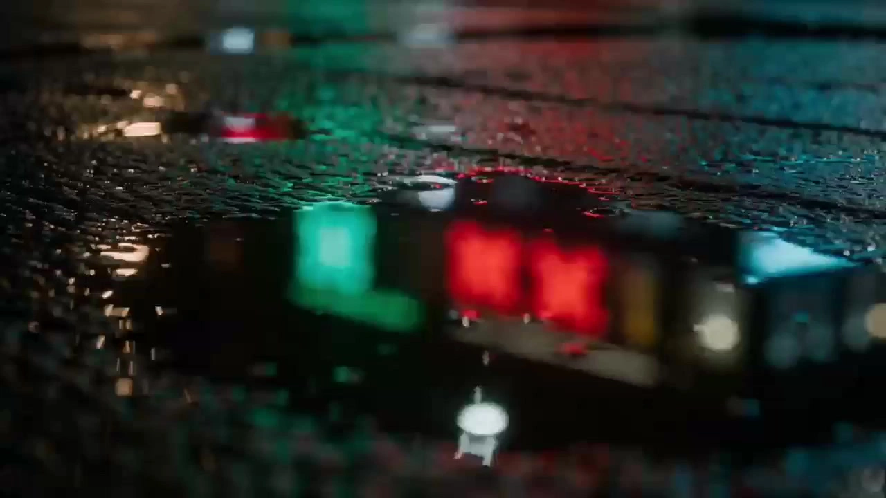

# Wong Kar Wai-Style Shorts

> **作者：** @黄鑫波

## Content

Process Planning:

Skill Definition:

This Skill focuses on restructuring plot requirements into cinematic videos with intense emotional tension, natural facial micro-expressions, multi-dimensional depth of field, and high-frequency "automatic shot cutting." We move away from stiff static frame interpolation or start/end frame generation, instead using multi-modal references for characters and scenes to achieve high fluidity, multiple perspectives, and an aesthetic deeply inspired by Wong Kar-wai (time philosophy, urban loneliness, frame dropping/low frame rate, frame-within-frame composition, poetic internal monologues).

Highest Execution Principles:

Reject Static PPT-style and Dull Silent Films: Strictly forbid designing static storyboards with no movement, slow motion, or simple PPT-style transitions. Generating silent, dialogue-free, pure mute content is prohibited. Characters must have vivid, delicate emotional expressions (especially melancholy and probing eyes). Characters can move freely, turn their heads, and interact; actions must be natural, vivid, and story-driven, without forcing them to face the camera.

Fully Unleash Model Cutting Potential: Utilize the "automatic shot cutting" capability of Seedance 2.0 / Seedance 2.0 Fast. Break long scripts into segments of 15-second videos, and plan 3-5 high-frequency shot slices within each 15-second segment (automatic shot cutting).

3D Spatial Depth and Light/Shadow Obstruction: Refuse to flatten or turn 3D scenes into 2D. The image must possess a clear [Foreground-Subject-Background] 3D depth of field. Use foreground obstructions like door frames, curtains, and glass to create a sense of "peeping" and spatial isolation.

Dual-Modal Multi-Character Reference Flow: Do not generate multi-grid references. Directly use multi-character sheet images (Character Sheet A/B) and scene setting images for MultiModalToVideo reference binding, maximizing the consistency of multiple characters and scenes while combining high-quality prompts to arrange physical movement.

Prompt Specifications: All prompts must be written exclusively and consistently in Chinese. No English words, English labels, or English characters are allowed. All image descriptions, style descriptions, action commands, and negative terms must be in pure Chinese.

Preliminary Selection and Specification Confirmation (Phase 1):

Before parsing any specific script, you must use reply_to_user to ask the user to make the following selections. Once confirmed, write them at the top of Final_Video_Spec.md:

Video Generation Model:

Seedance 2.0 (Highest quality, requires subscription)

Seedance 2.0 Fast (Faster speed, 720p, suitable for quick previews)

Output Resolution:

720p (Supported by both models, limit for non-subscribers)

1080p (Supported only by Seedance 2.0, requires subscription)

Single Segment Duration: Locked to 15 seconds by default (to maximize the release of automatic shot cutting and multi-shot continuity capabilities).

Aspect Ratio: 16:9 (Default), 9:16, 1:1.

Output Language and Dialect/Accent:

Mandarin (Default)

Cantonese (Classic recommendation for Wong Kar-wai films)

Shanghainese (Shanghainese urban nostalgia, same style as Blossoms Shanghai)

Hokkien (Romantic, smoky, and island retro style)

Northeastern Dialect (Strong life atmosphere and unique fatalistic tension)

Sichuan Dialect

Chongqing Dialect

Henan Dialect, etc. (Supports using Seedance 2.0 to directly generate authentic dialect dialogue accents)

After confirmation, record these five items at the top of Final_Video_Spec.md. All subsequent steps must strictly adhere to these, with no unauthorized changes.

Optimized Execution Process and Phase Logic:

Read Input and Confirm Specifications — [Mandatory Pause Point]

Read user input, communicate, and confirm preliminary video specifications (duration, aspect ratio, model selection, resolution selection, output language/dialect selection).

Write the confirmed specifications to Final_Video_Spec.md.

Story Framework and Storyboard Design — [Mandatory Pause Point]

General Screenwriter Logic and Faithfulness to Original Work: When processing story material or long plots, you must deeply act as a "Chief Screenwriter/Guardian of the Original Work." Strictly execute "thinking like a camera" (never write what the camera can't capture, eliminate subjective psychological narrative descriptions), "thinking like an editor" (streamline overly long everyday pleasantries and scenery descriptions, go straight to the thematic rhythm), and "thinking like the original author" (100% respect for original plots, character relationships, and core direction. Absolutely forbidden to add or remove plots arbitrarily for dramatic conflict or add baseless, dangerous disputes. Must follow the original work’s natural, smooth conclusion. Refuse to leave cheap, cliffhanger hooks intentionally).

Strict Spatial-Temporal Separation Mechanism: Whenever the location, space, or time of the plot shifts, even slightly, it must be divided into a new independent storyboard scene, crowned with a standardized scene title.

Check if user input contains a specific story:

If there is a story, use it directly and strictly follow the above principles for storyboard script design.

If there is no specific story, you must first communicate and confirm the story framework and core content with the user. Only after confirmation should you write a 15-second multi-slice storyboard script in storyboard_designer.

Multi-Character and Long-Form Narrative Design: Supports the introduction of multiple characters (Character A, Character B, etc.). When writing the storyboard script, you must first establish a "core suspense/storyline" that runs through the whole piece and introduce a "Visual State Ledger" mechanism. Establish "state anchors" (recording physical location, posture, prop status, and ambient light of Character A/B) at the connection points of each 15-second video segment to ensure that the preceding and succeeding materials correspond perfectly in action and visuals, maintaining coherence.

The written storyboard script must break down every 15-second video into 3-5 internal sub-shots (automatic shot cutting), including [Foreground-Subject-Background] spatial layers, vivid facial actions, natural and coherent multi-character dialogue/internal monologue, and environmental sound effects.

Pause and request user confirmation.

Multi-Character and Scene Setting Image Generation — [Ask and Pause]

Interaction Check: Before starting image generation, you must explicitly ask the user if they need/want to directly upload their own character reference images AND scene reference images. If the user chooses to upload, pause and wait for the user to upload assets, then bind them upon receipt. If the user chooses to generate, proceed with the following generation:

Multi-Character Reference Images: If the script contains multiple characters, use GPT Image 2 (2K) to generate separate "Multi-Angle Character Setting Sheets" for Character A and Character B (a single horizontal layout with four images arranged horizontally, including a half-body close-up, front full-body, side full-body, and back full-body, on a pure white background) to lock in the facial, body type, and clothing contours for each character.

Scene Reference Images: Use an image model to generate scene setting images with perspective, low-light shadows, and Wong Kar-wai-style aesthetic color palettes.

After generation, display the images, pause, and request user confirmation.

Character Setting Video Generation and Voice Extraction — [Mandatory Pause Point]

4.1 Generate Character Setting Video: Reference the generated Character A and Character B reference images respectively. Call media_generator's MultiModalToVideo, strictly locking in Seedance 2.0 Fast to generate a short 4-6s character setting/dialogue video (showing the character's initial speaking state and voice characteristics).

4.2 Return to Planner Top Layer to Extract Voice: After the character setting video generation is complete, the Planner must return to the top layer and then call resource_prepare_and_analyze to extract the audio timbre from the video respectively; do not delegate the task of "extracting voice from video" to media_generator.

4.3 Register and Bind Voice Assets: Once audio timbre extraction is successful, call media_generator's asset management capabilities to register and bind the extracted audio as key_element_audio_A and key_element_audio_B (serving as the voice reference for all subsequent dialogue, internal monologues, and video generation for the corresponding character, ensuring no silent or cross-talk issues occur with multiple characters).

4.4 Failure Handling: If resource_prepare_and_analyze cannot extract audio, the timbre is unavailable, or the dialect is significantly incorrect, you must pause and inform the user that the character voice extraction failed. Ask the user to choose to regenerate the character setting video or provide an audio reference. Do not silently use Seedaudio 1.0, text-to-narration, search_voice_id, generate_audio_resource, or other TTS/voice generation paths to impersonate "timbre extracted from the video."

Pause and report the success of voice extraction to the user.

Video Asset Generation — [Generate Step-by-Step and Pause for Confirmation]

Call media_generator's MultiModalToVideo (supports Seedance 2.0 / Fast), directly using Multi-Character Reference Images and Scene Reference Images as multi-modal input, and incorporate the corresponding key_element_audio_A/B reference audio.

After generating each 15-second video segment, you must pause and communicate/confirm with the user to ensure no teleportation or stiff expressions occur. You must strictly use the "Visual State Ledger" to verify that the start of the current segment and the end of the previous segment perfectly match in action, prop status, character position, and ambient lighting. Proceed to the next segment generation only after getting the green light.

BGM Direction Confirmation and Generation — [Mandatory Pause Point]

Communicate and confirm the music/BGM direction that fits the emotional trajectory of the case with the user. In this step, actively recommend exclusive characteristic instrument combinations and BGM styles based on the output language/dialect selected in the preliminary phase:

Cantonese (Classic HK style, neon melancholy): Recommend Cello pizzicato + slow saxophone + retro electric guitar (with heavy reverb) to create the psychedelic and lonely atmosphere of neon flickering, fateful entanglements, and unrequited love between urban men and women in 80s and 90s Hong Kong cinema.

Shanghainese (Jazz Shanghai style, decadent luxury): Recommend Jazz piano (slow keys) + lazy saxophone + double bass pizzicato to recreate the retro glamour, lazy sentiment, and old-era烟火 (smoke and fire/life) of old dance halls on Huanghe Road and deep alleyways, just like in Blossoms Shanghai.

Hokkien (Folk nostalgia, Minnan smoke and fire): Recommend Classical guitar (rustic plucking) + nostalgic accordion + melancholic violin or flute to show the sense of displacement in island rainy nights and old street houses, as well as the romantic warmth and yellowed texture of time.

Other Languages/General Wong Kar-wai Style: Default to a combination of cello pizzicato, melancholic violin, and retro tango accordion to establish the classic aesthetic tone of romance, ambiguity, repression, and loneliness.

After confirming the direction, call media_generator to use the text_to_instrumental tool (Suno 5 / Mureka 8) to generate pure instrumental background music based on the decided instruments and style.

Timeline Synthesis and Editing Import — [Mandatory Pause Point]

After all materials are generated and confirmed by the user, call video_assembler.

Import audio tracks (Foley sound effects, multi-character dialogue/internal monologues, BGM) and video tracks. Execute precise rhythm syncing and seamless hard cuts on the timeline.

Confirm synthesis quality, ensuring the visuals are vivid, the plot is coherent, and there is no PPT-like stiffness.

Wong Kar-wai Movie Poster Style Cover Design — [Step-by-Step Extension and Pause for Confirmation]

Call image generation tools (GPT Image 2 or Nano Banana Pro) to design a movie poster cover featuring Wong Kar-wai aesthetics, high-contrast low-light shadows, a unique retro color palette, and artistic typography (with poetic bilingual Chinese-English movie lines).

Steps:

First generate the 16:9 cover image, pause to display it to the user, and communicate/confirm.

After user confirmation, extend and generate cover images in 3:4 and 4:3 ratios to complete the full output package.

Dependencies:2→1; 3→2; 4→3; 5→4,3; 6→5; 7→6,5; 8→7.

When to Pause:Every user communication and confirmation point involved in each stage (1~8) is a hard pause point. It is strictly forbidden to run through everything at once. If the user requests changes, you must revert to the corresponding step and re-establish the plan.

Asset Analysis:

Multimodal Deconstruction Specification:

I. Deconstruction of Character Actions and PerformanceIt is imperative to deeply analyze the script or user-provided reference assets to extract the true performance potential of the characters:

Micro-facial Expressions: Identify emotional turning points in the script (e.g., repressed love, the desolation of rejection, the anxiety of time passing, the regret of letting go) and distill descriptions of muscle interactions. Pay special attention to the portrayal of the eyes (e.g., slightly moist eyes, gaze lowered to avoid eye contact, pupils slightly contracting, clenched jaw). Avoid blank expressions; ensure the character's demeanor is vivid, natural, and imbued with the subtle restraint of Eastern aesthetics.

Physical Interaction Feedback: Analyze the mechanics of how characters interact with environmental props (e.g., fingers gently grazing a mottled wall, a hand slightly shaking while holding a wine glass, the flicker of a lighter igniting a cigarette, gravity pulling down as rain soaks a trench coat).

Multi-character Interaction and Gaze: Plan the eye contact and body orientation between multiple characters (e.g., Character A passes Character B in a narrow hallway, eyes lifting slightly then quickly lowering; Character B slightly turns head in a cloud of smoke to watch the other's back), breaking the rigid pattern where characters are always facing the camera.

II. Deconstruction of 3D Space and Camera DepthAnalyze scene assets to establish clear 3D depth-of-field attributes:

Foreground Layer Identification (Framing Obstructions): Identify foreground obstructions that can be used as out-of-focus bokeh to create a sense of voyeurism (e.g., half-open shutters, fluttering red curtains, reflections of raindrops on glass windows, edges of stone pillars in a hallway).

Subject Layer Focus: Clearly define the physical position of the subject. Calculate the aperture blur range to ensure the subject is on an absolutely sharp focal plane, revealing skin texture and micro-expressions under low-light conditions.

Background Layer Depth: Extract perspective lines, depth layers, and diffuse light sources from the background (e.g., distant flickering neon lights, streaks of rain under dim streetlamps, warm yellow wall lamps in a hotel corridor) to guide the blur effect and the shape of bokeh in the prompt.

III. Acoustic Purity Deconstruction

Acoustic Environment for Dialogue and Monologue: Determine the sound field based on the scene (e.g., the physical reverb of an empty hotel room, the ambient noise and dry vocals at a narrow street food stall, the dissipation of sound on a rainy night street).

Physical Sound Effect Positioning (Foley): Extract subtle material collision sounds (e.g., the 'tap-tap' of high heels on wet tiles, the crisp 'click' of a lighter, the faint rustling of burning tobacco, the muffled sound of rain hitting an umbrella). Prohibit any direct text descriptions of background music (BGM) in the video prompts.

IV. Deconstruction of Textual Plot Adaptation (Core Engine for Script Mastery)When analyzing and adapting original story text, you must strictly deconstruct and translate purely literary, descriptive, or abstract text into expressions of visual and physical behavior:

'Visual Behavioral Translation' of Literary Emotion: It is strictly forbidden to retain psychological descriptions or subjective phrasings like 'seemingly,' 'apparently,' or 'feeling extremely...' When encountering abstract character emotions, follow physical common sense and behavioral logic to reverse-engineer them into actions and expressions that can be captured by a camera:

Hesitation is translated as: Pacing before the threshold, right hand lifting and hovering in mid-air, then slowly pulling back, gaze shifting downward.

Inner Sadness is translated as: Eyes reddening, tears slowly sliding down the face, lips trembling slightly, staring motionlessly at the extinguished cigarette butt in hand.

Intense Anger is translated as: Masseter muscles tensed, jawline tightened, chest heaving violently, slamming the table, causing ripples in the water glass, eyes locked onto the other person.

Sweltering Heat is translated as: Piercing sound of cicadas, clothing soaked with sweat and clinging to the back, fingers constantly tugging at the collar.

Deconstruction of Tedious Scenery and Daily Pleasantries:

Condense large amounts of vague, lengthy descriptions of natural scenery from the original work into one or two action descriptions with a strong emotional atmosphere (e.g., '△ Rain pours down, soaking the eaves, muddy puddles on the road reflect the dim lights').

Filter out filler text and ineffective social pleasantries so that every line of dialogue cuts straight to the theme, pushing the core events forward. Never delete any plot nodes from the original work, while using behavior and mannerisms to reinforce character attitudes.

Storyboard Design:

Wong Kar-wai Cinematic Aesthetics Storyboard Design Standards:

I. Core Elements Design (Elements)

Multi-Character Elements:

Character design must feature iconic, vividly colored, and period-appropriate clothing and accessories (e.g., Character A wears an exquisite, fitted vintage-patterned qipao, carrying a thermos for wonton noodles; Character B wears a crisp dark suit, slicked-back hair, or sunglasses with a worn leather jacket).

Performance style is designed to be "restrained and understated, with deep undercurrents." While body language remains elegant and orderly, microscopic details like eyes, mouth corners, and jawlines must show extremely vivid muscular interaction; avoid deadpan or frozen expressions.

Dialogue/monologue design must be natural, reasonable, coherent, and logical, clearly conveying plot information so the audience can easily understand the story's direction. Internal monologues should possess a Wong Kar-wai-esque literary and poetic quality (e.g., "One minute before 3:00 PM on April 16, 1960, you were with me..."). Dialogue and monologues should be written using the output language/dialect confirmed in Final_Video_Spec.md (e.g., directly using characteristic vocabulary and daily tone particles from Cantonese, Shanghainese, Hokkien, Northeastern, or Sichuanese dialects) to ensure more authentic and natural dialect/accent generation.

Scene & Prop Elements:

Each major scene must set a highly self-consistent aesthetic and color palette combination featuring low lighting and high saturation. In addition to neon cool tones, the following classic color palettes are highly recommended to enhance the image quality and story texture:

Neon Melancholy: Emerald Green and Neon Red/Cyan, combined with deep black shadows to create a psychedelic, ambiguous, and detached modern urban night.

Vintage Nostalgia: Crimson Red and Amber Yellow/Mustard, combined with a dark green base to showcase the nostalgia, repression, and surging desire of 1960s Hong Kong.

Golden Desolation: Ochre Gold and Deep Indigo to showcase a desolate, aloof, and time-worn martial arts world reminiscent of "Ashes of Time."

Highly recognizable props with geometric or vintage aesthetics must be planned (e.g., a green jukebox, a vintage large clock with ticking numbers, a cigarette with a faint glow, a golden door plate with "2046," yellowed stationery with handwritten text).

II. Shots & Storyboard Design (Shots)For every 15-second video, it must be strictly broken down into 3-5 high-frequency sub-shots, designed according to the following "Wong Kar-wai visual grammar":

Composition:

Frame-within-a-frame & Spatial Barrier: Frame-within-a-frame composition is recommended by default, using door frames, windows, shutters, or blowing curtains as foreground elements to "imprison" characters within a narrow visual frame, creating a strong sense of voyeurism and moral/emotional confinement.

Aesthetic Quota System:

Dutch Angle: Used to express inner turmoil, confusion, and loss of balance. The total quota for the entire piece is at most 1 time (or none at all).

Extremely Symmetrical Balanced Composition: The total quota for the entire piece is at most 1 time (or none at all).

For the remaining 90%+ shots, standard cinematic audiovisual language serving the narrative must be used (e.g., over-the-shoulder shots, side medium shots, natural rule of thirds), strictly prohibiting excessive showing off of techniques.

Camera Movement:

Handheld Camera (Sense of Breathing): Slight, emotional handheld shaking to create a "floating sense of reality" and "impromptu poetry," making the camera a participant in the emotion.

Step Printing: The total quota for step-printing motion blur shots in the entire long video is at most 1 time (or none at all). Use it only as a highlight condiment when expressing the passage of time or the alienation between characters and the environment (e.g., a character drinking soup slowly at a noodle stall while passersby in the background turn into fast-moving blurs).

Lateral Whip Pans: The total quota for the entire piece is at most 1 time (or none at all).

Extreme Close-up & Slow Motion: Capture micro-details like eyes, fingers, and cigarette smoke, extending time through slow motion to carry emotional weight.

III. Audio Tracks Design (Audio Tracks)

Background Music (BGM):

It is recommended to use deep, melancholic, and highly period-appropriate instrumental music (e.g., cello pizzicato, melancholic violin, tango accordion, jazz piano). The music should have strong melody and emotional tension for the later assembler to align beats.

Foley & Monologue:

Every sub-shot description must include extremely clean and precise physical Foley sounds (e.g., the "click-clack" of high heels on tiles, the crisp "click" of a lighter, the faint rustle of burning tobacco).

Monologue design should be concise, poetic, and literary; the sound environment (reverb, diffusion) must be perfectly consistent with the volume of the space in the frame.

IV. Coherence & Narrative Logic (Coherence & Narrative Logic)

Visual State Ledger Mechanism:

State Anchor Recording: At the end of every 15-second video, the current timeline's "end-state anchor" must be recorded:

Character physical state (e.g., Character A has a cigarette in their right hand, smoke rising faintly, body leaning against a stone pillar; Character B stands on the other side of the corridor, head slightly lowered).

Prop and environment state (e.g., the cigarette ember is faint; the environment is dimly lit by warm yellow wall lamps, main light source is in the upper left).

State Anchor Inheritance: When designing the next 15-second script, the aforementioned "end-state anchor" must be used as the "start-state" and strictly written into the first 3 seconds of the new segment to ensure absolute continuity of physical details, strictly forbidding continuity errors such as prop displacement, inconsistent clothing wetness/dryness, or character teleportation.

Match Cut: The last action of the character at the end of the previous 15-second segment (e.g., turning head to the right, reaching out to push a door) must be completed in the first 1 second of the next 15-second segment (e.g., finishing the turn, door being pushed open) to ensure seamless visual flow.

Logical Progression: Dialogue/monologue design must adhere to ordinary communication and psychological logic. Questions or suspense left by the monologue in the previous segment must have reasonable answers or psychological reactions in the next segment. Avoid disjointed, causally unrelated lines, ensuring the audience clearly understands the entire story content upon viewing.

V. Script Format Engine (Script Format Engine)

Standardized Visual Symbols and Formatting Control: Standardized symbols must be strictly applied to every scene and action in the storyboard script. Avoid messy formatting to achieve an industry-grade shootable script:

【※】Scene Marker: This symbol must be used at the beginning of a scene title whenever there is a change in location or time. Format example: ※ Scene [Number]: [Int/Ext] [Specific Location] [Time] (e.g., ※ Scene 1: Int Narrow Corridor Dusk).

【△】Action Description (Core flush left): All actions, frame compositions, and physical changes must start with this symbol and be written flush left. Write only objective entities that the camera can see and the microphone can hear (e.g., △ Su Lizhen (Character A) walks slowly past the mottled green wall, her high heels making a dull sound on the tiles). Prohibit literary or abstract words.

【 】Technical Annotation: Use Chinese 【 】 brackets to wrap instructions for special effects, background music, Foley sounds, or key text content appearing on the screen.

（ ）Tone and Micro-expression Control: Before the character's dialogue/monologue begins, use Chinese （ ） brackets to indicate the character's performance, emotional inflection, or vocal expression (e.g., (eyes desolate, gaze lowered)).

"Separated Cinematic Layout" for Action and Dialogue: Mixing action and dialogue within the same paragraph is strictly prohibited. The script body must strictly follow the standard paragraph structure: "Flush left for action (△) -> New line for character name -> New line for tone/expression brackets -> Then write dialogue -> New line for new action (△)," ensuring the entire storyboard has strong rhythm and directional cues.

Fusion of Dialogue Minimalism and Wong Kar-wai's Poetic Monologue:

Dialogue must be conversational, have a sense of breath, and conform to daily speech common sense, but the expression must incorporate Wong Kar-wai's unique restrained, fragmented, and time-philosophical subtext (e.g., "One minute before 3:00 PM on April 16, 1960, you were with me...").

Never modify the core attitudes or character designs of the original work for the sake of artistic effect.

Original Plot Consistency and Calm Conclusion Without Suspense (Double Red Line Review):

Plot Consistency (Never Rewrite): When adapting the original work, the plot integrity and fidelity to the original must reach 100%. Simplifying scenery, small talk, and lengthy filler to maintain high information density is allowed for audiovisual rhythm, but arbitrarily adding conflicts, fights, or deliberately dramatic accidents that do not exist in the original is strictly prohibited.

Natural Conclusion (No Suspense Hooks): The end of the story must land smoothly and conclude naturally, eliminating any crises, suspense, or "to be continued" hooks created solely for attention. The script should faithfully end where the original plot ends, presenting a sense of poetic relief and aesthetic regret.

Media Generation:

Multimodal Continuous Video Generation Specification:

I. Generation Path and Model Locking

Core Video Tool: Must use MultiModalToVideo exclusively (supported models are Seedance 2.0 or Seedance 2.0 Fast). Using FirstFrameToVideo or VideoInterp is strictly prohibited (as they rely on hard-coded start/end frames, leading to extremely stiff movement).

Core Image Tool: Use TextToImage / ImageToImage. It is recommended to use GPT Image 2 (2K) or Nano Banana Pro (2K).

Audio Generation Tool: Use text_to_instrumental (recommended model: Suno 5, alternative: Mureka 8) to generate instrumental BGM.

II. Image Asset Pre-generation and Binding SpecificationsBefore generating a 15-second video, ensure the following assets have been registered and bound to key_element:

Multi-Character Reference Sheets:

Use GPT Image 2 (2K) with a default photorealistic style. For both Character A and Character B, generate "Multi-view Character Sheets" containing four images arranged horizontally (from left to right: large half-body close-up, front full-body, side full-body, back full-body, using a solid white background and soft ambient lighting). This ensures precise positioning of facial features, body type, and clothing details for each character.

Register these as the corresponding character logical assets (e.g., character_sheet_A, character_sheet_B) to ensure high consistency in facial features, body shape, and clothing textures across shots.

Scene Reference Images:

Use the image generation model to create background/scene reference images that feature realistic physical perspective, low-light shadows, realistic details, and aesthetic color palettes.

III. Audio Asset Extraction and Character Video Pre-generation Specifications

Character Setup Video Generation: Reference the generated character A/B reference images, call MultiModalToVideo (locked to Seedance 2.0 Fast, 720p resolution, 4s-6s duration), and combine with a short Chinese prompt describing the character's lines/tone to generate a short video showcasing the character's initial speaking state and vocal characteristics.

Routing Boundaries for Audio Timbre Extraction: The media_generator is only responsible for generating character setup videos and executing asset registration and binding after the Planner returns the extracted audio; it must not directly call resource_prepare_and_analyze. If a task to "extract timbre from the just-generated video" is received, you must return a request for the Planner to call resource_prepare_and_analyze. Do not use Seedaudio 1.0, text to narration, search_voice_id, generate_audio_resource, or other TTS/audio generation paths to create substitute voice samples.

Audio Timbre Binding: Only after the Planner completes resource_prepare_and_analyze, extracts the audio, and returns it, should it be registered and named as the corresponding key_element_audio_A and key_element_audio_B assets. These serve as the audio reference for all subsequent dialogue and video generation for the corresponding character, completely eliminating silent clips or audio crosstalk.

IV. Multi-Shot Sliced Video Generation Logic

Multi-Parameter Injection: Call MultiModalToVideo (model: Seedance 2.0 or Seedance 2.0 Fast) to generate a 15-second primary video. You must simultaneously input the bound Multi-Character Reference Sheets (bound to their respective character element placeholders, e.g., <<<character_sheet_A>>>, <<<character_sheet_B>>>) and the Scene Reference Images (as the scene placeholder) for multimodal joint control. Do not use any multi-grid storyboards.

Multi-Character Audio Synchronization, Lip-Sync, and Dialect Driving: In audio_infos, you must accurately reference the corresponding key_element_audio_A or key_element_audio_B asset ID based on which character is speaking in the current shot. When calling MultiModalToVideo, you must input the corresponding audio asset as the lip-sync source (audio_prompt) to ensure that the generated character's mouth movements are highly synchronized (Lip-Sync) with the extracted timbre when delivering dialogue/internal monologues, presenting an extremely vivid speaking state. At the same time, based on the output language configuration in Final_Video_Spec.md, you must explicitly specify the required dialect/accent (e.g., Cantonese, Shanghainese, Minnan, Northeastern, Sichuanese, Chongqing, Henan) in the prompts and model parameters to leverage the excellent native dialect generation capabilities of Seedance 2.0.

Hard Parameter Constraints:

Seedance 2.0: Supports 720p / 1080p (1080p requires premium membership), 720p is recommended by default.

Seedance 2.0 Fast: Fixed support for 720p.

Single segment duration must be a physical integer (within the 4s-15s range; 15s is recommended to allow for cutting within the segment).

V. Wong Kar-wai Film Poster Style Cover Design Specification

Aesthetic Design Goals: Generate an artistic cover that aligns with the aesthetics of a Wong Kar-wai film poster (high-contrast, low-key lighting, strong color saturation, cold/warm contrast, handheld shaky motion or elegant stillness, artistic typography, and handwritten/bilingual Chinese-English caption accents, eye-level perspective, and an ambiguous, lonely atmosphere).

Multi-Size Output Control (Step-by-Step Execution):

Step 1: Use the image generation tool (GPT Image 2 or Nano Banana Pro) to first design and generate a 16:9 aspect ratio main cover image, then submit it to the user for visual review and confirmation.

Step 2: After user confirmation, use this 16:9 image and style as a reference basis to extend and generate cover images in both 3:4 and 4:3 aspect ratios to achieve full-platform and full-ratio coverage.

Prompt Writing:

**【Highest Priority: All Prompts must be written entirely and exclusively in Chinese. English words, English characters, or English symbols are strictly prohibited. All image descriptions, positive style words, negative prompts, and audio instrument prompts must be translated into pure Chinese descriptions.】**

I. Image Prompt and Reference Image Reverse Engineering Specification (GPT Image 2 / Nano Banana Pro)

Multimodal Visual Reverse Analysis LogicBefore writing image prompts, you must implicitly read and analyze the features of any multimodal reference images uploaded by the user, and replicate these visual clues in the prompts:

Character Reference Image: Extract facial proportions, bone structure features, makeup (e.g., retro red lips, delicate eyeliner), material textures of specific clothing (e.g., embroidery texture of heavy silk cheongsam, rough texture of wool overcoat), and styling characteristics.

Scene Reference Image: Extract architectural style, spatial geometric structure, primary low-light source direction, color temperature, environmental wear and tear (e.g., mottled wallpaper, damp and reflective stone floor), and atmospheric perspective.

Prop Reference Image: Extract surface material (e.g., green porcelain jukebox, brass ashtray), physical volume, and specular reflectivity.

Storyboard Reference Image: Extract camera positioning (e.g., low-angle upward shot, voyeuristic perspective), composition rules (e.g., framed composition, rule of thirds), and depth of field distortion characteristics.

Aesthetic Style Adaptive MechanismAutomatically map visual genre vocabulary based on the script theme or reference images:

Live-action Film Style: Subsurface scattering, pore details, realistic optical depth of field, physical-level ray tracing, 85mm prime lens, film grain, low light and high contrast.

2D Anime Style: Cel shading, lineart, anime-style exaggerated perspective (dynamic action shots), hand-painted watercolor background, non-photorealistic rendering (NPR).

3D Animation Style: Pixar style, soft global diffuse reflection, exaggerated material specular highlights (e.g., clay/plastic texture), cartoon proportion facial rigging.

Chinese Ink Wash Style: Rice paper bleeding effect, scorched ink dry brush, negative space composition, ink particle dissipation, low-saturation Chinese-style color palette.

Default Fallback: If there is no clear preference, force the use of [Live-action Film Style].

3D Spatial Depth of Field Resolution and Micro-Description

Spatial Depth: Prompts must explicitly specify a three-layer structure: [Foreground], [Subject], [Background]. Establish spatial order through physical-level focal plane descriptions (e.g., 85mm F1.2 large aperture, extremely shallow depth of field, out-of-focus circular bokeh, shutter light and shadow blockage).

Micro-details: Close-up shots must describe pupil reflections, subtle facial muscle expressions, skin subsurface scattering, pore structure, fabric fiber textures, and swirling cigarette smoke.

Emotion and Action: Refuse stiff states; describe vivid and emotionally tense dynamic expressions (e.g., jaw tightened, eyes moist, finger knuckles turning white from exertion, rapid eye scanning, gaze lowered to avoid eye contact).

Character Sheet Prompt Specification

Default Aesthetic Style: Default to live-action film style, emphasizing realistic skin pores, hair texture, and subsurface scattering, preventing 2D or 3D plastic-like looks.

Layout: Pure white background, four sub-images arranged horizontally, from left to right: ① Large half-body close-up on the left (occupying about 40% of the total width), ② Front full-body, ③ Side full-body, ④ Back full-body.

Perspective Detailed Division:

① Half-body Close-up: Face occupies the top 2/3 of the frame, gaze carries a hint of melancholy, not looking directly at the camera (or looking directly but with complex eyes), precisely presenting skin, hair, and facial feature details.

② Front Full-body: From top of the head to feet fully included in the frame, standard standing posture, restoring the front tailoring of the clothing.

③ Side Full-body: Complete left-side body silhouette, retaining the side outline and layers of the clothing.

④ Back Full-body: Full details of the back of the clothing, material texture clearly visible.

Environmental Light Control: Absolutely pure white background, soft and uniform environmental studio light, no hard directional shadows, face illuminated with soft fill light.

Visual Texture and Negative Filtering:

Positive Style Words: Hyper-realistic photography, photo-level realism, cinematic quality, 8K resolution, studio lighting, sharp focus.

Negative Exclusion Words: No text, no watermark, no logo, no extra people, no anime, no illustration, no colored background, no background props, no bed, no curtains, no smoke.

Wong Kar-wai Movie Poster Cover Prompt Specification

Aesthetic Core: High contrast, low-key lighting, strong contrast between cool and warm colors (e.g., green and red, blue and yellow), subject in a dim environment with hazy smoke or rain reflections.

Typography and Layout Description: Beautiful, clean, retro serif movie title at the bottom or top of the image, along with poetic bilingual (Chinese and English) movie tagline typography (artistic layout, clean movie credit text, poetic bilingual subtitles). Eye-level, ambiguous natural lighting, presenting a poster style with a nostalgic, exquisite, and lonely cinematic feel.

Negative Exclusion Words: No messy layout, no cluttered text, low quality, chaotic colors.

Cinematic Light and Exposure Fine-tuning Specification (Low-key Chiaroscuro and Specific Directional Diffuse Reflection)

Low-light Facial Soft Light: Facial lighting must avoid hard, high-contrast direct strong light. Force the use of low-light diffused soft light that feels enveloping with smooth transitions, softly outlining the subsurface scattering texture of skin and hair, highlighting facial contours in a dark background, smooth transition at the light-dark boundary, preventing loss of detail due to overexposure.

Specific Directional Diffuse Reflection and Neon Reflection: The scene and environment must establish a single, directionally clear, practical light source (e.g., wall lamp, table lamp, neon sign). Light presents directional diffuse reflection on non-smooth surfaces (e.g., retro wallpaper, fabric, matte wood), and mottled neon reflections on damp ground or glass. Clearly define the natural attenuation of light over distance (light decay) to ensure the hierarchy of light levels and the logic of light source direction among foreground, subject, and background are absolutely self-consistent.

II. Seedance 2.0 15s Multi-shot Segmented Prompt Template (Core Highlights)When generating prompts for a 15-second video, you must and can only strictly adopt the following [Four Markdown Modules] structure. The pure prompt text for a single output should be controlled between 1500 and 3000 characters to enrich the narrative coherence of spatial depth, material, micro-details, and transitions between paragraphs.

[Global Visual and Aesthetic Tone]

Aesthetic Style: [Clearly point out, e.g., Live-action film style, Wong Kar-wai-esque urban nostalgic aesthetic, emphasizing low-light high-contrast lighting, incorporating strong cool-warm color contrast and spatial blockage. Strictly adhere to the aesthetic quota system: Tilted framing, frame skipping/slow motion, extreme symmetry, and 90-degree panning shots are limited to at most 1 time each; all other shots use conventional cinematic audiovisual language]

Lens and Depth of Field: [Lens characteristics that fit the style, e.g., 35mm large aperture cinematic lens, T1.2 shallow depth of field, precise focal plane control and out-of-focus bokeh, framed composition]

Color and Lighting: [Global lighting and color space, e.g., Kodak Vision3 film color grading, contrast between warm orange primary tones and damp dark backgrounds, primary light source direction is clear and creates soft directional diffuse reflection on object surfaces, facial contours shaped with warm and enveloping natural diffused soft light, avoiding high-contrast exposure blowout or pitch black]

[Character and Scene Settings]

Character Assets: Reference <<<character_sheet_A>>>, <<<character_sheet_B>>> (placeholders for bound multi-character assets), specifying micro-expressions, pupil reflections, damp hair, and clothing materials (e.g., silk cheongsam, wool overcoat) for each character.

Scene Assets: Reference <<<scene_layout>>>, specifying the physical reflectivity and depth of narrow corridors, mottled wallpaper, and metal door handles.

[Script and Action Timeline]

[00.0s - 03.5s]

Camera Positioning: [Shot type and position, e.g., Medium shot, fixed camera, voyeuristic shot through blinds. Visual State Ledger Inheritance: Must precisely inherit the "State Anchor" at the end of the previous paragraph, ensuring that the initial positions, postures, props, and lighting of Character A and Character B correspond perfectly with the previous section, achieving a seamless hard cut]

Visual Scene:

[Foreground]: [Objects between the lens and the subject, often heavily out of focus, e.g., out-of-focus, half-open blinds, occupying 1/3 of the left side of the frame, creating a soft sense of obstruction]

[Subject]: [Visual center of the frame, where the focal plane is. Action description must pass the "Behavioral Logic Common Sense Firewall," refusing exaggerated actions, e.g., Su Lizhen (Character A) slowly walks into the center of the frame, eyes revealing forbearance and loneliness, lips slightly closed, the gravity of her movements and body tilt are realistic, and her clothing state is completely consistent with the end of the previous paragraph]

[Background]: [Environment behind the subject, blurred according to the shot type, e.g., a warm yellow wall lamp at the end of the corridor, forming a hazy halo in the smoke]

Audio Effects: [BGM description prohibited! Only write physical sound effects, e.g., "tap-tap" sound of high heels on damp tiles, faint sound of raindrops hitting the window]

[03.5s - 07.5s]

Camera Positioning: [Automatic cut: Close-up, accompanied by handheld-style micro-tremor]

Visual Scene:

[Foreground]: [e.g., No foreground]

[Subject]: [e.g., Focus shifts to Su Lizhen's right eye. Her gaze lowers, avoiding the camera, the corner of her eye slightly damp. Facial muscles quiver slightly, expression extremely vivid and natural, showing inner struggle and restraint]

[Background]: [e.g., Old clock on the wall completely out of focus, turning into round out-of-focus bokeh]

Audio Effects: [e.g., Muffled "tick, tock" sound of the clock's second hand, faint breathing sound]

[07.5s - 12.0s]

Camera Positioning: [Automatic cut: Over-the-shoulder medium shot, focus shifts from shoulder to the depth of the corridor]

Visual Scene:

[Foreground]: [e.g., The edge of Su Lizhen's exquisite cheongsam shoulder, initially clear, then quickly goes out of focus as the focus shifts]

[Subject]: [e.g., Chow Mo-wan (Character B) deep in the corridor tilts his head slightly, watching Su Lizhen's back with deep eyes, his face showing complex muscle movement, expression extremely vivid, holding a cigarette in his hand, smoke swirling]

[Background]: [e.g., Mottled green wallpaper, kept at medium blur]

Audio Effects: [e.g., Subtle rustling sound of tobacco burning. Inner monologue: "Cantonese{Chow Mo-wan: 'If there were one more ticket, would you go with me?'}" (Monologue must closely echo the context, follow logical progression; if dialect output is chosen, note the dialect name before the brackets like "Cantonese", and use dialect vocabulary for the lines, with the voice driver bound to key_element_audio_B)]

[12.0s - 15.0s]

Camera Positioning: [Automatic cut: Close-up, circling camera movement. Visual State Ledger Anchoring: Establish a clear "Terminal State Anchor" for the next paragraph]

Visual Scene:

[Foreground]: [e.g., Out-of-focus smoke sweeps past, forming a transition]

[Subject]: [e.g., Su Lizhen slowly lowers her head, eyelids droop, cheek muscles tighten. She slowly extends her right hand, fingers gently stroking the cold stone pillar (this posture of stroking the pillar, finger position, and the warm yellow wall lamp's slanted light on the left will be forcibly recorded as a state anchor for the start of the next paragraph)]

[Background]: [e.g., Damp ground reflects yellow light from the wall lamp, bokeh is soft]

Audio Effects: [e.g., Slight friction sound of high heels on the ground]

[Generation Constraints and Negative Prompts]

Absolute Prohibitions: Prohibit generating any form of background music (BGM), melody, or rhythmic tracks. Prohibit any UI parameter descriptions regarding resolution (4K/1080p), frame rate (60fps/24fps), or aspect ratio. Prohibit characters from having joint dislocation, teleportation, or anti-gravity floating. Prohibit the use of exaggerated actions (e.g., kicking the door, smashing the door). Prohibit the appearance of cartoonization, anime-style, or cheap 3D plastic textures (as this film is live-action style). Prohibit logical conflicts in lighting and shadows.

III. Voice and Sound Effect Packaging Symbols and Common Sense Firewall (Seedance 2.0 Execution Iron Law)

Environment and Physical Sound Effects (Foley): Use <...> to wrap. Must detail the physical properties of the sound effects (e.g., fabric friction, metal clanging, water splashing), and "background music," "BGM," or "melody" descriptions are strictly prohibited.

Multi-character Dialogue/Inner Monologue (Dialogue/Monologue): Use Dialect Prefix{Character Name: "Dialogue Text"} format for packaging (if Mandarin, the prefix can be omitted; if dialect, the prefix is mandatory, e.g., Cantonese{Character A: "Dialogue Text"}, Shanghainese{Character B: "Dialogue Text"}, Minnan{Character A: "Dialogue Text"}, Dongbei{Character B: "Dialogue Text"}, Sichuan{Character B: "Dialogue Text"}, Henan{Character A: "Dialogue Text"}). Dialogue text must completely comply with the Output Language of Final_Video_Spec.md, and strive to use the dialect's authentic characters, interjections, and special sentence structures. Character A's dialogue must be bound to key_element_audio_A, and Character B's dialogue must be bound to key_element_audio_B. The content of inner monologues must echo each other, be logically tight, and have a highly literary and poetic quality. Meaningless or jumpy lines are strictly prohibited.

Screen Text: Use 【...】 to wrap.

Behavioral Common Sense Firewall: Reject all illogical and exaggerated spectacles. Forced action descriptions must conform to physics common sense such as gravity, inertia, and friction (e.g., pushing a door requires describing the application of force, constant speed of opening, forward tilt of the center of gravity).

Negative Constraint Suffix: The end of every video description must carry pure Chinese negative words: 【无字幕，无音乐，无文字，无标识】 (ensure the video is pure and free of impurities, as music and subtitles will be synthesized later by the assembler).

IV. Pure Instrumental Background Music (BGM) Prompt and Instrument Library Specification (Suno 5 / Mureka 8)

Style & Mood Positioning:

Core Tone: Highlight ambiguous, lingering, lonely, and era-nostalgic acoustic instrumental ensembles. The rhythm must have strong melody and emotional tension (slow, melancholic, grand, romantic beats) to facilitate editing to the beat.

Style Tag Words: Acoustic, melancholic strings, retro tango, sexy saxophone, romantic, nostalgic, intimate ensemble, theater-level acoustic recording.

Prohibitions: Absolutely prohibit writing any famous musician, singer, or specific band name in the prompt to prevent failure of generation due to copyright blocking by underlying models like Suno 5.

Wong Kar-wai Signature Instrument Library: When writing prompts, you must combine and call at least 2-3 of the following characteristic instruments to create his signature deep, elegant, sorrowful, and retro symphonic feel:

Cello / Double Bass: Provides deep, melancholic, and highly rhythmic cello pizzicato as the melody of rhythm or emotion.

Violin / Viola: Provides continuous, plaintive string playing, rendering extreme sadness and repression.

Accordion: Injects ambiguity, lingering, passion, and sorrow like Argentine tango.

Saxophone: Used to accent the loneliness, laziness, and undercurrent of desire in the city late at night.

Classical Guitar: Provides rustic, lazy, and slightly wandering Spanish/Latin-style plucking.

Jazz Piano: Uses slow, restrained key strikes to create the claustrophobia and intimacy of a late-night bistro.

Dialect Aesthetic Characteristic Background Music (BGM) Prompt Formula: When a project selects a specific dialect, when writing pure instrumental BGM prompts, you must strictly follow the corresponding Chinese instrument and mood combinations to ensure the audiovisual aesthetics fit perfectly:

Cantonese (Classic Hong Kong Style) Formula: Pure instrumental, melancholic movie theme, slow low cello pizzicato, psychedelic lazy saxophone, retro electric guitar plucking, heavy reverb, 80s-90s Hong Kong film neon light mood, ambiguity, urban loneliness, slow tempo, theater-level dry sound studio recording

Shanghainese (Jazz Shanghai Style) Formula: Pure instrumental, jazz, slow and restrained jazz piano key strikes, sexy and lazy saxophone, double bass pizzicato, old Shanghai ballroom retro tonality, gorgeous, nightlife, ambiguous sentiment, theater-level acoustic recording

Minnan (Folk Nostalgic) Formula: Pure instrumental, folk guitar plucking, nostalgic retro accordion, melancholic violin, coastal town rainy night mood, romantic, lonely, firework atmosphere, warm, theater-level dry sound studio recording

Arrangement Control:

Must explicitly declare [Pure Instrumental] or [No Vocals] in the prompt to avoid the model randomly generating synthetic human voices.

Describe the sound field texture (e.g., intimate acoustic studio recording, warm vinyl record texture, dry mix, no heavy electronic synthesizers), avoiding large space reverb or modern electronic synthesizers.

Recommended Prompt Structure/Example: Pure instrumental, melancholic movie theme, slow plaintive violin, deep cello pizzicato, retro tango accordion, romantic and nostalgic, theater-level dry sound studio recording.

Video Editing:

Timeline Seamless Stitching and Narrative Continuity Quality Control

Timeline stitching must be performed in 15-second major video layer units.

Core Quality Control Indicators (Visual State Ledger Verification): From a viewer's perspective, conduct a full review of the stitched long-form video. Check whether the narrative flows, whether dialogue/inner monologues are consistent, and if there are logical gaps between segments. Strictly verify the seams between adjacent 15-second segments to ensure that the physical position, posture, clothing details, state of props in hand, and environmental light direction of characters A/B perfectly match the records in the state ledger. If any inconsistencies or logical gaps are found, you must pinpoint the exact segment and reject it for regeneration.

Inspect the seams between adjacent 15-second segments to ensure physical actions (e.g., a reaching gesture at the end of the previous segment must be completed as a touching action at the start of the next segment) are perfectly matched, achieving a visually seamless hard cut.

Multi-Camera Rhythm Control

Check the "automatic cut" nodes within each 15-second video to ensure畫面 transitions are natural.

Strictly prohibit rigid, long-duration videos without cuts that resemble PPT slideshows or slow-motion static images.

When dialogue/inner monologues occur, camera focus or shot scale changes must be synchronized with the speaker.

3D Space and Light/Shadow Occlusion Quality Indicators

Shot-by-shot inspection: Ensure foreground elements (blinds, curtains, stone pillars, etc.) achieve reasonable bokeh and a sense of peeking; the subject must be sharp and clear on the focal plane, and the background must have clear perspective depth and low-light blurring.

Any generated segments that appear flat, like 2D collages, or lack depth of field, must be rejected for regeneration.

Action and Expression Quality Control

Strictly prohibit rigid shots generated via static frame interpolation or start/end frame generation.

Characters must exhibit normal physical mass/inertia in movement and consistent, vivid micro-expressions, especially expressions of melancholy, downward gazes, and averted eyes; reject stiff, robotic facial performances.

Characters should not simply stand still or stare blankly at the camera; they must engage in physical interactions consistent with script motivations.

Multi-Track Audio Mixing and Foley Rendering

Dialogue/inner monologue and sound effects (Foley) inherent to the video track must be extracted losslessly and edited separately into the Dialogue track and SFX track.

Music track (BGM): Import pure background music generated via Suno 5 / Mureka 8 into the video_assembler. Musical edit points, heavy accents, and instrumental sections must be perfectly aligned with the beats of the internal automatic camera cuts.

The soundstage for dialogue and inner monologues must match the corresponding shot scale (close-ups should have dry, crisp sound; wide shots should include spatial reverb).

Transition and Output Management

Internal multi-camera slices should use natural hard cuts; transitions between 15-second segments may use action-match cuts, door openings/closings, camera pans, or other cinematic hard transitions.

Strictly prohibit the use of modern short-video style text overlays, flash whites, or transitions without physical justification.

Final output: A complete serialized video file, a list of internal shot slices, physical sound effect (Foley) alignment nodes, and an audio track hierarchy allocation list.
