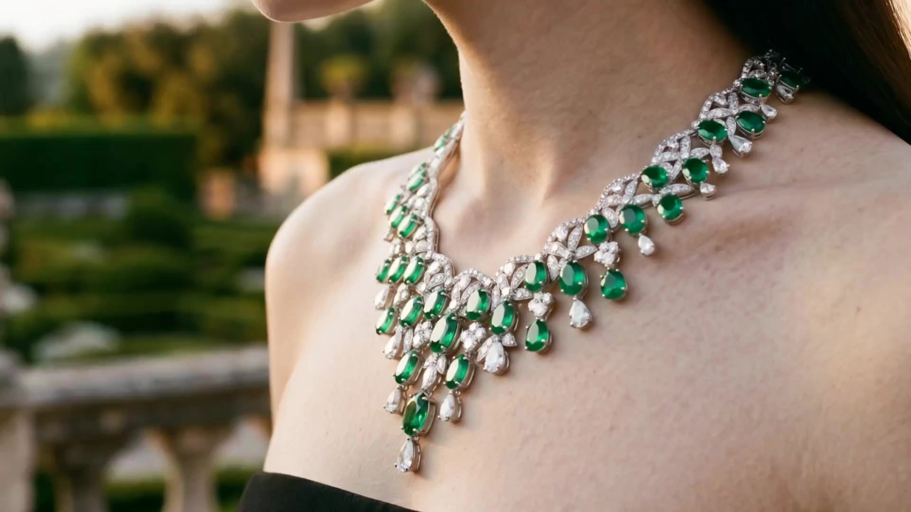

# 「Peripheral Vision 12-Shot」 Jewelry Ad Vlog

> **作者：** @Seast Zhu

## Content

Process Planning:

[planner]* Must ask the user upon startup (before executing any steps):*

*"What aspect ratio would you like for the output video? A. 9:16 Vertical (suitable for Xiaohongshu/TikTok/Reels) B. 16:9 Horizontal (suitable for YouTube/Brand Official Site)" After waiting for the user's response, write the ratio to Final_Video_Spec.md, and use it throughout the entire process.

Input Instructions:

Users can upload one or more reference images, grouped into the following categories. When a category is not provided, the corresponding element will be inferred and generated by AI based on the existing reference image style. Category Label Description[Character_Input]Model reference images (multiple allowed, including different angles/looks)[Jewelry_Input]Jewelry reference images (multiple allowed, including details/wearing status)[Environment_Input]Environment reference images (multiple allowed, including architecture/street views/interiors)[Brand_Input]Brand reference images (multiple allowed, including logo/slogan/visual tone)

Workflow Steps:

Ask the user for the following two configurations, write to Final_Video_Spec.md → text_editor

① Video Aspect Ratio:A. 9:16 Vertical (suitable for Xiaohongshu/TikTok/Reels) B. 16:9 Horizontal (suitable for YouTube/Brand Official Site) ② Number of candidate videos generated for each shot:A. According to the original Skill settings, generate 3 candidate versions per shot (filter shot-by-shot after generation for best results, consumes more credits) B. Generate 1 version per shot (saves credits, faster generation speed) Write the selection to Final_Video_Spec.md, field: shot_candidates (value is 3 or 1)

Analyze all input images by category and extract visual features for each category → multimodal_analyze_tool

Environment Condition Assessment*: If no [Environment_Input] is detected, ask immediately:*

"No environmental reference images detected. Please choose an environment design method: A. I will describe: Please enter your environment style requirements (style/city/lighting/tone, etc.) B. Flova Automatic Design: Automatically infer and expand the environment based on character and jewelry reference images" Wait for user response, write the result to Final_Video_Spec.md as the [Environment_Ref] source

Generate a storyboard according to a fixed 12-shot narrative logic; all content is extracted from input images, do not apply fixed scene descriptions → storyboard_designer

If [Brand_Input] is provided, synchronously ask for the 013 shot background plan (choose one of three):

A. Pure black background + centered logo B. Brand tone low-saturation solid color background (premium feel recommended) C. Creative closing frame with logo designed by Flova Write the selection to Final_Video_Spec.md

⏸ Pause, wait for user to confirm the storyboard and 013 plan (if applicable)

Elements image generation (Character three-view + Jewelry detail + Environment reference rendering) → media_generator

⏸ Pause, wait for user to confirm the fidelity of character, jewelry, and environment elements

A-type keyframe image generation (for each A-type shot, refer to step 4 elements image) → media_generator

⏸ Pause, wait for user confirmation

A-type shot video generation (1/3 candidate versions for each A-type shot) → media_generator

B-type shot image + video generation (006/007/008, based on step 4 environment elements; include 013 if applicable) → media_generator

⏸ Conditional Pause: If shot_candidates = 3, pause and wait for user to screen all candidate versions (A-type + B-type + 013) shot-by-shot (guide user to 'like' their favorites); if shot_candidates = 1, proceed directly to the next step, no screening required.

Background music generation → media_generator

Final video assembly → video_assembler

Dependencies: 1 has priority; 2→1; 3→2; 4→3; 5→4; 6→5; 7→4,3; 8→3; 9→6,7,8 Note: When the user has provided images for a certain category, bind them directly as the reference for that category; if not provided, the AI will infer based on existing references.

When [Brand_Input] is not provided, shot 013 is automatically skipped and will not enter the storyboard and generation process.*

Asset Analysis:

Input Image Analysis Specification

Analyze each category of reference images uploaded by the user separately. Subjective interpretation or embellishment is strictly prohibited; perform only objective feature extraction. The extraction results serve as the content basis for all subsequent sections.

[Character_Input] · Character Feature Extraction

Face: Face shape, facial feature proportions, eye shape, lip color, makeup style

Hairstyle: Length, color (under natural light), texture (straight/wavy/curly), hairline

Skin Tone: Color scale description (cool white/beige/wheat/dark)

Body Type: Shoulder width, neck proportions, overall build

Clothing (if visible in images): Color, style, fabric texture

If multiple images: Extract common features, record differences between different looks (e.g., Look 1 / Look 2)

[Jewelry_Input] · Jewelry Feature Extraction

Type: Necklace/Earrings/Ring/Bracelet/Other

Main Form: Pendant/Center stone shape, size (estimated relative to human proportions)

Material: Metal luster (silver/gold/rose gold), surface finish (mirror/matte/inlaid/engraved)

Chain/Structure: Chain type, chain length, clasp details

Wearing Status (if applicable): Position, coordination with clothing/skin tone

If multiple images: Extract details from different angles to build a complete jewelry visual archive

[Environment_Input] · Environment Visual Language Extraction

Architectural Style: Modern/Retro/Industrial/Tropical/Minimalist/Other

Space Type: Outdoor street/Interior commercial/Nature/Mixed

Color Tone: Main color palette, light color temperature (warm/cool/neutral)

Lighting Characteristics: Direct sunlight/diffused light/interior lighting/backlight

Depth: Does the space have obvious depth layers (foreground/midground/background relationship)

Identifiable Elements: Street signs, plants, material textures, window frames, ground details, etc.

If multiple images: Summarize common visual tone, record scene features applicable to different shot types

[Brand_Input] · Brand Visual Extraction

Brand Name/Slogan Text (extract accurately, do not rewrite)

Logo form and color

Brand color scheme

Overall tone keywords (Luxury/Affordable Luxury/Natural/Minimalist/etc.)

Brand visual elements usable for environmental shots (showcases/packaging/signage, etc.)

Output format: Output structured text for each of the four categories, with each item on a separate line. If a category is not provided, indicate "Not provided, will be inferred by AI based on existing references later."

Storyboard Design:

## Fixed 12-Shot Narrative Logic Template Core Principle: This template only specifies the shot size, narrative position, emotional function, and imaging technique for each shot. All content (character appearance, jewelry style, environment style, brand elements) is extracted from input images, and does not apply fixed scenes, clothing, or prop descriptions.

Key Elements Definition

After analyzing the input images, define the key elements for this project in the following format: [Character_Main]

Source: [Character_Input] Extracted Content: Facial features, hairstyle, skin tone, body type, styling (if multiple sets of styling, indicate Look 1/Look 2)

**[Jewelry_Hero]

Source: [Jewelry_Input] Extracted Content: Complete jewelry visual archive (form, material, details, wearing status)

**[Environment_Ref]

Source: [Environment_Input] Extracted Content: Project environmental tone, lighting characteristics, usable scene layers

**[Brand_Ref]

Source: [Brand_Input] (empty if not provided) Extracted Content: Brand text, Logo, brand visual elements*

12-Shot List

Narrative Structure: Local Suspense → Character Establishment → Emotional Eruption → Breathing Transition → Reiteration & Closing → Exit 001 — ECU · Jewelry Close-up (A-type)Shot Size: Extreme Close-Up, body part (collarbone/hand/ear-neck). Upper face (eyes, forehead) not in frame. Depending on jewelry type, only a small part of the face appears. For example, for a necklace, focus on the area from the lower face to the chest. Content: [Jewelry_Hero] as the core of the frame, [Character_Main] body part in frame to provide skin/clothing texture Composition: Character face orientation: Full Profile. Body angle: Three-Quarter turn; the torso has about a three-quarter rotation deflection relative to the lens, slightly angled/away from the lens, consistent with the side profile direction, forming a smooth diagonal composition from face to chest. When jewelry is rings or bracelets, only the hand is shown. Movement: The camera moves slowly laterally along an arc trajectory centered on the jewelry pendant, simulating a photographer holding a camera moving in an arc around the subject. Overall movement is restrained, a "micro-orbit," not a large-angle rotation. Depth of field remains stable: during movement, the subject (necklace pendant) remains in focus, shallow depth of field background remains continuously blurred. Function: Sensory introduction, suspense building, first exposure of product Extraction Basis: Jewelry form and wearing method from [Jewelry_Input] 002 — MS · Environment Standing Pose (A-type)Shot Size: Medium Shot, waist up, half-body. Character face: 3/4 Profile, face turned to one side of the frame, neither fully front nor fully side, somewhere in between, natural expression. Body torso is basically facing the lens, creating a slight sense of twisting with the face orientation, posture is relaxed and natural. Content: [Character_Main] standing or walking naturally in the environment corresponding to [Environment_Ref], [Jewelry_Hero] visible but not the focal point, creating a realistic sense of coexistence between character and environment. Composition: Character is placed on one side of the frame, not centered. The environment extends into the depth of the frame along Leading Lines, giving the frame a strong sense of spatial depth. Shallow depth of field, character is sharp, background in the distance is slightly blurred. Jewelry is clearly visible, visual layers are distinct. Lighting: Environmental side light enters from one side above the frame, creating a soft contour light on the character's hair and shoulders. Environmental light and shadow layers are rich, overall atmosphere is textured. Movement: The camera moves in a stable, uniform speed manner. When the character walks toward the lens (walking forward), the camera retreats synchronously, and the two speeds are basically matched. The character's forward speed and the camera's backward speed are nearly balanced, and the shot size is maintained in the relatively stable range of Medium Shot (MS) → Medium Close-Up (MCU) throughout the clip. Function: Character and scene establishment Extraction Basis: Background environment visual language from [Environment_Input] 003 — Low-Angle CU · Dynamic Detail (A-type)Shot Size: Ground or extreme low angle, [Character_Main] part (legs/feet/hands). When showing character legs and feet, frame crops from ground to lower calf area, only showing feet, shoes, and lower calf area of clothing, as an extreme close-up of a body part. Content: Environmental ground details (floor tiles/fallen flowers/grass/fallen leaves/environment/ground, depends on [Environment_Input]) In the same frame as [Character_Main] part dynamics, slight motion blur Movement: The camera moves backward (Dolly Out) from an extreme low angle (Worm's-Eye View) in a steady, rhythmic manner. The camera's backward speed is precisely matched to the speed of the character's forward footsteps, forming a dynamic balance of "footsteps approaching × camera retreating synchronously." Motion Blur, realistic sense of motion. Movement is stable, rhythmic, synchronized with the rhythm of the steps, with no obvious shaking. Function: Sense of movement, ground-level atmosphere Extraction Basis: Ground texture and environmental details from [Environment_Input] 004 — MCU · Halo Emotional Frame (A-type)Shot Size: Medium Close-Up, shoulder up, side view. Frame crops from shoulder to top of head, showing character's shoulder, neck, side face, and hair, as an upper-body close-up. Face orientation: Full Profile, character's face is oriented to the side of the frame, presenting a standard full side view—bridge of the nose, lips, chin side profile are clear, eyes slightly closed or half-closed, expression is ethereal and distant, not facing the lens directly. Body angle: 3/4 Rotation, torso has about a three-quarter rotation angle relative to the lens, consistent with the side profile orientation, neck extension line and shoulder curve are natural and smooth. Extremely shallow depth of field, character contour and hair are in focus, background is completely blurred, with faint blurred foreground obstructions. Content: [Character_Main] side profile, overlay of warm light halo (physical obstruction or light leak), slight motion blur Light and color tone refer to the lighting characteristics extension of [Environment_Input] Lighting: Light source comes from behind the character's side above, strong light creates clear hair contour light (Rim Light). Halo: A distinct halo forms around the light source, wrapping the character's head and shoulders, creating an almost dreamy visual atmosphere. Lens Flare: Backlight triggers horizontal or radial lens halos/flares, enhancing cinematic quality and natural feel. Light Leak: Faint light leak effect at the edge of the frame, further strengthening the physical reality of the light. Movement: Slight handheld shake Function: Emotional explosion, the most cinematic frame 005 — MS · Backlit Silhouette (A-type)Shot Size: Medium Shot, back to the lens. Character is Out-of-Focus Foreground, character body is presented as a blurred foreground silhouette, located on one edge of the frame. Out-of-focus processing makes the character recede into a "framing element" of the environmental narrative, rather than the visual subject, character posture is vaguely visible as standing, back or side back to the lens. Content: [Character_Main] back silhouette (facial features not needed), with [Environment_Ref] natural environmental elements (vegetation/sky/light source) forming bokeh background, backlight underexposed Composition: Uses Over-the-Shoulder logic, character out-of-focus foreground occupies one side or corner of the frame, visual focus is guided to the background in focus, strong sense of perspective depth. Lighting: Enters from the side/diagonally in front of the frame, forming light and shadow boundaries, enhancing dramatic tension, frame layers are rich. Movement: Micro-dynamics, cinematic camera movement, frame uses vegetation swaying and light beams to create a sense of "living stillness." Function: Emotional peak, de-individualization Extraction Basis: Color tone and vegetation type of background bokeh from [Environment_Input] 006 — ECU · Environmental Macro (B-type)Shot Size: Extreme Close-Up, pure environment details, no characters Content: Representative materials or natural elements extracted from [Environment_Input] (plants/textures/water surface/ glass/brick wall), extremely shallow depth of field, full frame blurred Movement: Cinematic camera movement, handheld texture, gives the frame a natural sense of breathing and presence. Function: Forced breathing, narrative deceleration Extraction Basis: Macro object from material features in [Environment_Input] 007 — LS · Pure Environment Empty Shot (B-type)Shot Size: Long Shot, pure scene, no characters Content: The most representative architectural or spatial overview extracted from [Environment_Input], highlighting the environmental depth and lighting characteristics Movement: Cinematic camera movement Function: Scene transition, narrative breathing Extraction Basis: Architectural style and spatial overview from [Environment_Input] 008 — MS · Character/Environment Narrative Frame (B-type)Shot Size: Composite Framing, frame uses foreground out-of-focus character × background in-focus long view composite structure—foreground character exists in close-up MCU, but background is presented as a Long Shot (LS) scale deep space, the two form a strong contrast in depth of field. Content: Space elements extracted from [Environment_Ref] as the main subject (can be showcase/arcade/courtyard/corridor/ any space with depth), [Character_Main] exists as out-of-focus foreground Composition: Character existence mode: Out-of-Focus Foreground, character located at one-third of one side of the frame, only head, neck, and upper shoulder area are presented, character details are blurred, serving "environmental narrative" rather than "character narrative." Character has a certain contour light, adding texture to the out-of-focus silhouette. Movement: Cinematic camera movement Function: Location anchoring, environmental narrative Extraction Basis: Space type and composition layers from [Environment_Input] 009 — FS · Full-Body Styling Frame (A-type)Shot Size: Full Shot, head to shoes. Character is located at the one-third line position of the frame, the other side leaves whitespace to show environmental depth. Content: [Character_Main] fully presented in the [Environment_Ref] scene, styling can be fully read, [Jewelry_Hero] clearly distinguishable Movement: Presents the dynamic of the character walking slowly, posture is light and natural, line of sight looks toward the light source on one side of the frame (avoiding the lens), cinematic camera movement. Function: Complete presentation of styling information, the most "readable" character frame of the whole film 010 — MCU · Jewelry + Face, focus on jewelry (A-type) ⭐ Core Ad FrameShot Size: Medium Close-Up, lower face to chest, face oriented to one side of the frame, presenting a standard full side view, line of sight directed outside the lens, not looking directly at the lens, expression calm and introverted. Body posture is also standing sideways, consistent with face orientation, center of gravity distributed naturally, no obvious leaning, standing posture relaxed and elegant. Content: [Jewelry_Hero] is the subject of focus, presenting craft details; [Character_Main] lower face visible within the focal plane; Side light forms highlight reflection points on the jewelry metal/gemstone surface Movement: Slow Dolly-in, Organic Handheld Micro-movement, gives the frame a natural sense of breathing. As the camera moves, the displacement of light and shadow dappled patterns on the character becomes more obvious, further strengthening the interactive narrative of light and skin. Function: Product information implantation, highest attention frame before face reveal 011 — CU · Face Front Close-up (A-type)Shot Size: Close-Up, above the chest, face as the core Content: [Character_Main] front view or slightly bowing head, hair slightly sweeping across face, [Jewelry_Hero] visible, eyes natural, not deliberately posing for the lens Movement: Slow Dolly-in / Push-in. The camera advances slowly at an extremely restrained, uniform speed, gradually approaching the character's face along the lens axis. As the process advances, the emotional tension of the "character reveal" continues to heat up, deepening the intimacy frame by frame. Camera dynamics include but are not limited to the character presenting natural "life-like" micro-dynamics, Hair Sway & Dappled Shadow Shift, Halo & Lens Flare Fluctuation, Jewelry Glint, subtle flickering of jewelry creating local specular reflections under strong directional light (Specular Glint), etc. Function: Character reveal, emotional climax, echoes 001 at the beginning and end 012 — LS · Back Departure (A-type)Shot Size: Long Shot, [Character_Main] out-of-focus foreground, background in focus. Full-body shot of the character (Full Shot / LS), depending on the environment, the character is located in the center or on one side of the lens. Content: [Character_Main] back to the lens walking into the depth of [Environment_Ref] scene, background environment elements (street signs/buildings/light sources) remain in focus Movement: Character walking, cinematic camera movement, Function: Open ending, echoes 001 at the beginning and end 013 — Brand Identifier Frame (Conditional · Only generated when [Brand_Input] is provided)Shot Size: Graphic composition, no perspective, no depth of field Content: [Brand_Ref] brand logo centered, background plan selected by the user when confirming the storyboard:*

Plan A · Pure Black*: Pure black background (#000000), logo presented in original color or white, extremely minimalist and cool*

Plan B · Brand Tone*: Extract main color from [Brand_Input] and reduce saturation (S ≤ 20%) as a solid color background; logo presented centered in high-contrast color value; premium low-saturation color scheme recommended*

Plan C · Flova Creative Design*: High-end brand closing frame with logo freely designed by Flova AI based on [Brand_Input]; generate 3 candidate versions for the user to choose; style refers to the tone of the whole film: cinematic, high-end jewelry brand, editorial* Movement: Still frame, or Fade in from black Duration: 3-4 seconds Function: Brand closing, reinforcing brand memory, rounding off the whole film Condition: Automatically skipped when [Brand_Input] is not provided, not included in the storyboard and generation process*

Audio Design

BGM_MainType: ambient cinematic, no lyrics Emotional Arc: Soothing at the beginning → 004-005 heating up → 006-008 calm → 011-012 fading Color tone matches music style based on the overall atmosphere of [Environment_Input] (warm/cool/tropical/urban)*

Media Generation:

## Generation Model and Reference Specifications

Elements Image Generation (Step 4 · Pre-generation for all shots)

Character Element [Character_Main]Tool: TextToImage → Nano Banana 2 (Gemini 3.1 Flash Image), 2K Directly use the reference image in [Character_Input] as the basis for generation Generate full-body three-view (head to shoes, Full Body): Front / Side / Back Verification: Facial features, hairstyle, skin tone, clothing, body type consistent with input image Jewelry Element [Jewelry_Hero]Tool: ImageToImage → Nano Banana 2 (Gemini 3.1 Flash Image), 2K Directly use the reference image in [Jewelry_Input] as the basis for generation Generate: Front close-up / Wearing on human state image Verification: Metal luster, pendant form, craft details exactly consistent with input image Environment Element [Environment_Ref]Tool: TextToImage → Nano Banana 2 (Gemini 3.1 Flash Image), 2K Source:*

If user provides [Environment_Input]: Directly use reference image as basis to generate representative scene rendering (empty scene + with character placeholder)

If user selects "A · I will describe": Generate with user's text description as prompt

If user selects "B · Flova Automatic Design": Automatically infer environmental atmosphere based on [Character_Main] and [Jewelry_Hero] style features, generate 3 candidate plans for user to choose Generate: Representative empty scene long shot / medium shot / deep composition (1 each, used as B-type shot and A-type background shared reference) Verification: Tone, light direction, architectural style match overall narrative tone

A-Type Keyframe Image Generation

Tool: ImageToImage → Nano Banana 2 (Gemini 3.1 Flash Image), 2K Reference images for each A-type shot simultaneously include:*

[Character_Main] element image (front or side, depending on shot angle)

[Jewelry_Hero] element image

Reference image from [Environment_Input] that best matches the shot scene

Keyframes from previous shots in the same scene (to maintain consistency)010 shot additional requirement: [Jewelry_Hero] in focus position, metal/gemstone surface has visible highlight points*

B-Type Shot Image Generation

Tool: TextToImage → Nano Banana 2, 2K Use [Environment_Input] and/or [Brand_Input] as direct reference:*

006: Based on material/plant detail reference image in [Environment_Input] to generate extremely shallow depth of field macro, handheld cinematic camera movement

007: Based on panoramic reference image of [Environment_Input] to generate empty scene without characters, cinematic camera movement

008: Based on spatial reference image of [Environment_Input] as subject, [Character_Main] as out-of-focus foreground (one-third position), background in-focus deep long shot, cinematic camera movement

B-type shots where the user has already provided satisfactory stock photos are directly bound, skipping generation.* 013 Shot Generation (Conditional, requires [Brand_Input])Execute according to the plan selected by the user when confirming the storyboard: Plan A · Pure BlackTool: text_editor output solid color layer specification Background: #000000, logo centered in original color or white, size is 30-40% of frame width Output: Static image frame, subsequently overlay fade-in effect in video_assembler Plan B · Brand ToneTool: TextToImage → Nano Banana 2, 2K Extract main color from [Brand_Input] and specify saturation S ≤ 20%, output solid color background Logo centered, presented in high-contrast color value (usually dark background with light logo, or light background with dark logo) Generate 1 version, if unsatisfied, adjust color value and retry Plan C · Flova Creative DesignTool: TextToImage → Nano Banana 2, 2K Directly refer to [Brand_Input] as reference, AI freely designs high-end brand closing frame with logo Style tags: cinematic, high-end jewelry brand, editorial, minimal, luxury Generate 3 candidate versions for user to choose*

⏸ Pause, wait for user to select from the 3 candidates

Video Generation

Tool: MultiModalToVideo → Kling 3.0 Omni, 1080p Ratio: According to user's selection in Final_Video_Spec.md (9:16 or 16:9) Each shot simultaneously refers to: [Character_Main] element image + keyframe image of that shot Number of candidate versions per shot: Read shot_candidates field in Final_Video_Spec.md:

shot_candidates = 3: Generate 3 candidate versions per shot, pause collectively after flow ends for user to screen shot-by-shot

shot_candidates = 1: Generate 1 version per shot, directly enter next step, no screening link required Duration setting:*

001 / 006 / 008 / 012: 3-4 seconds

002 / 003 / 005 / 007 / 009 / 011: 4-5 seconds

004 / 010: 3 seconds

Music Generation

Tool: text_to_instrumental → Suno 5 Style tags: Inferred based on environmental tone extracted from [Environment_Input], Benchmark is ambient cinematic, no lyrics, no percussion Duration: Matches final video total duration

Prompt Writing:

Visual Iron Laws and Prompt Specifications
Core Aesthetic Principle: Half-Hidden, Half-Revealed

The whole film consistently avoids direct representation—faces are obscured by hair, subjects are out-of-focus, characters are submerged in halos. This strategy creates a sense of viewing desire throughout, which is the core aesthetic of this Skill.

The whole film strictly prohibits:

Characters looking directly into the lens and posing obviously for advertisements

Artificial makeup or excessive skin smoothing

Background blurring so completely that the scene cannot be recognized

Subtitles, logo overlays, watermarks (no subtitles, no watermark, no text overlay)

Any background music/sound effects (no music, no sound effects)

Prompt Structure (Universal for image and video)

[Style Tags] + [Subject Description] + [Lens Language] + [Light & Color] + [Texture & Emotion] + [Negative Prompt]

Universal Style Tags for the whole film:cinematic film still, analog photography, 35mm film grain, editorial fashion photography, natural candid moment

Light & Color:Extract color temperature and light direction from [Environment_Input] and translate into prompt language. Benchmark description: natural side lighting, [Environment color temperature description], low contrast highlights, visible skin texture, no harsh flash, no studio lighting

Example: If [Environment_Input] is tropical noon strong light → harsh tropical noon side light, warm ivory and amber tones Example: If [Environment_Input] is interior soft light → soft diffused interior light, cool neutral tones, window-lit

Lens Language (by shot type)

001 / 010 · ECU Close-up type:macro lens, f/1.4 extreme shallow depth of field, soft bokeh, jewelry/accessory catchlight visible

002 / 007 / 009 · MS Medium Shot type:50mm lens, slight foreground obstruction, environmental context from reference, natural atmosphere

005 · Silhouette type:strong backlight, silhouette, underexposed -1.5 stops, swirly bokeh background, female figure outline only

003 · Low-angle type:ground level POV, extreme low angle, environmental ground details foreground, legs in slight motion blur

004 · Emotional type:anamorphic lens flare, warm light leak, slight motion blur, optical aberration, side profile, hand-held feel

012 · Back view Long Shot type:focus on background environment, subject defocused foreground, woman walking away, rear view, depth leading lines

010 Core Ad Frame Exclusive Supplement

jewelry/accessory in sharp focus as hero element, product as primary subject, face partially visible below chin, metal/stone surface catchlight, product structure clearly defined, skin softly lit, face not fully revealed

Texture Restoration Keywords (Selected based on [Jewelry_Input])

Silver: sterling silver, cool metallic sheen, mirror polish

Gold: 18k gold, warm metallic glow, polished surface

Rose Gold: rose gold, warm pink metallic tone

Gemstone Inlay: pavé setting, gemstone sparkle, point light reflections

Leather/Fabric: leather texture, fabric weave detail, matte surface

Kling 3.0 Omni Reference Image Citation Format

<<<image_1>>> [Character_Main Front Element Image] <<<image_2>>> [Keyframe image for this shot]

Motion Description Specification:

Still: camera static, subtle natural movement only (hair, breath, fabric)

Push-in: slow imperceptible dolly push in

Strictly prohibit using zoom, replace all with dolly or tracking shot

Video Editing:

Editing Specification
Shot Sequence (Fixed, non-interchangeable)

001 → 002 → 003 → 004 → 005 → 006 → 007 → 008 → 009 → 010 → 011 → 012 → 013 (Conditional)

Timeline Specifications

Total Duration: 60-75 seconds (extends to 63-79 seconds when 013 is included)

Aspect Ratio: Determined by user selection in Final_Video_Spec.md (9:16 or 16:9)

Frame Rate: 24fps

Transition Specifications

Connection Method Duration 001→002 Cut—002→003 Cut—003→004 Cut, align with beat—004→005 Dissolve 0.5s 005→006 Dissolve 0.8s 006→007 Cut—007→008 Cut—008→009 Cut—009→010 Cut, align with beat—010→011 Cut—011→012 Dissolve, fade out 1s 012→013 Fade to black 1.5s, only when 013 exists

013 end: Fade out, 0.8s

Principles: 001-004 tight rhythm; 004-008 dissolve slows down; 009-012 tightens again then fades out to end; 013 independently closes, leaves a black gap from the previous footage.

Audio Track Specification

Mute all video audio tracks (mute all video audio tracks)

BGM_Main placed on an independent audio track

BGM volume: -12dB, fade out for the last 3 seconds

Strictly prohibit overlaying other sound effects unless user explicitly requests voiceover

Output Specifications

Format: MP4, H.264

Resolution:

9:16 → 1080 × 1920

16:9 → 1920 × 1080

Bitrate: ≥ 8Mbps
