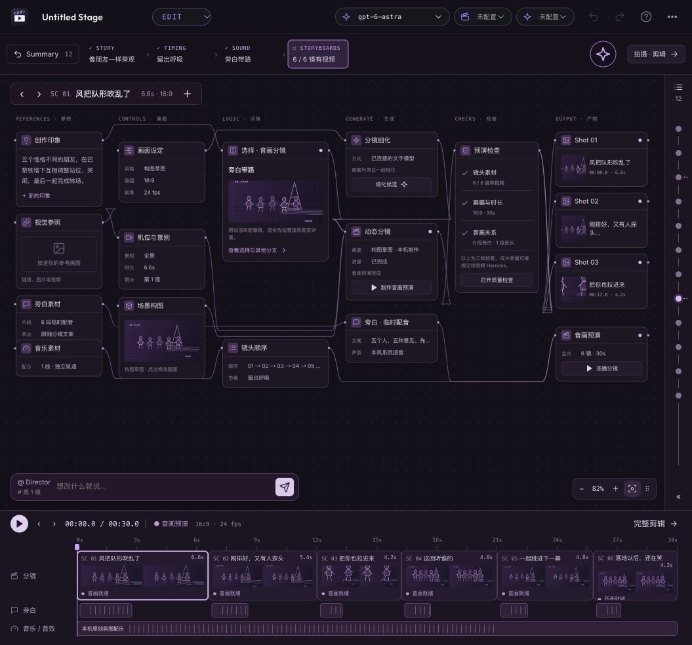

# 功能文档与源码导航

当前 0.9.19 的功能拆分从 [功能索引](docs/features/README.md) 开始：16 个功能文件夹，包含说明、流程、源码与测试入口。[目录迁移说明](docs/features/migration.md) 记录运行兼容性与验证。下文保留原产品介绍，其中旧版本独立画布入口以功能索引为准。

<p align="center">
  
</p>

<h1 align="center">导演台 · Director Console</h1>

<p align="center"><strong>Video Creation Harness</strong></p>
<p align="center">从模糊印象出发，通过可视化、可追溯的分支决策，创作音画一体的分镜视频成品。</p>
<p align="center">A visual, traceable workflow from a rough idea to a storyboard film with sound.</p>

<p align="center">
  <a href="#开始使用">开始使用</a> ·
  <a href="#如何工作">创作流程</a> ·
  <a href="#当前能力">当前能力</a> ·
  <a href="#接下来做什么">路线图</a> ·
  <a href="https://github.com/CristinaKepner/Director/releases">下载 macOS 客户端</a>
</p>

## 关于导演台

一个镜头的感觉、一段参考视频、几个还说不清的画面，都可以成为创作起点。导演台希望让用户在看得见的方案中逐步作出选择，并保留每一次选择的来路。

**Video Creation Harness 是连接导演规划、创作工具、模型执行和结果验收的工作层。** 前沿模型负责提出与细化方案，用户决定叙事、节奏和声音；工程保存分镜、素材、分支和运行证据，让修改可以落到具体镜头，也可以回到更早的创作方向。

产品围绕三个部分建设：

- **导演规划**：把模糊印象展开成可比较的创作方向，再细化为镜头、动作、时长、旁白和声音关系。
- **可追溯的创作画布**：呈现参照、画面、决策、生成、检查和产物之间的关系。选择形成分支，修改形成检查点，可以回看、对照和恢复。
- **音画执行与验收**：让视频模型、声音素材和代码渲染围绕同一个分镜工程协作，通过预演、检查、局部修复和明确采用，逐步完成作品。

目前已实现分支检查点、音画分镜预演、视频生成和有预算的检查／修复循环。**通用节点执行协议、完整 Code2Video 集成，以及基于数据组积累的场景优化仍在建设计划中。**



*同一工程中的创作画布与拍摄／剪辑模式。图中为本地构图草图和临时声音组成的 30 秒预演。*

## 开始使用

### macOS

在 [Releases](https://github.com/CristinaKepner/Director/releases) 下载已发布的 **v0.9.17**，按设备选择 Apple Silicon（arm64）或 Intel（x64）安装包。客户端包含本地后端与 FFmpeg。

打开工程，点击舞台工具栏的「创作画布」，输入一个印象，选择时长与画幅，再点击「展开方向」。例如：

> 五个性格不同的朋友，在巴黎铁塔下互相调整站位、打闹，最后一起完成转场。两分钟，前三秒先让人想看下去。

先选择叙事、节奏和声音方向，再修改具体分镜。可以先制作音画预演，确认后再使用模型生成或替换素材；「拍摄 · 剪辑」回到同一工程的舞台与完整时间线。

### 从源码运行

需要 **Node.js 18+**。前端依赖已随仓库提供，根目录无需先安装依赖。

```bash
git clone https://github.com/CristinaKepner/Director.git
cd Director
npm run dev
```

打开 [本地工作区](http://127.0.0.1:5175/web/)，或直接进入 [创作画布](http://127.0.0.1:5175/web/?noguide=1&journey=1)。

无需模型密钥即可体验本地创作方向、分镜编辑、分支恢复与 3D 舞台。音画预演和成片导出需要 FFmpeg；当前临时旁白使用 macOS 系统语音。真实模型生成、复杂导演规划和视觉检查需要配置相应服务与额度。

客户端从源码启动：

```bash
cd desktop
npm install
npm start
```

在同一目录运行 `npm run dist` 可构建 DMG；配置见[分发指南](docs/distribution.md)。

## 如何工作

```text
模糊印象 + 参考素材
    ↓
展开方向：叙事 / 节奏 / 声音
    ├─ 方案 A → 分镜 → 预演 → 修改
    └─ 方案 B → 分镜 → 预演 → 采用
                                ↓
                 逐镜生成 / 素材替换 + 声音编排
                                ↓
                    检查 → 局部修复 → 对比采用
                                ↓
                       音画合成与视频导出
```

1. **先把印象变成选择。** 输入文字或补充参照，确定画幅与目标时长。每次聚焦一个维度，逐步确定作品方向。
2. **先看分镜，再投入生成。** 编辑每镜的画面、景别、时长和旁白；连接规划模型后，可以预览并采用更具体的脚本候选。
3. **让画面和声音一起预演。** 播放构图草图、临时旁白与配乐，检查节奏。在时间线上修改镜头、字幕和声音片段。
4. **保留其他可能。** 从检查点重新选择；分支记录备选方案、选择理由、来源和工程快照。切换前自动保留尚未建立检查点的修改。
5. **按要求验收，按镜头修复。** 设置时长、片头、人物和动作要求，以及运行预算。查看证据，生成候选，复查后由用户采用，再导出成片。

例如「开场太慢」可以从节奏分支重选；「第 3 镜动作不对」可以只生成这一镜的候选；「旁白晚半秒」可以直接调整声音片段的开始时间。修改始终围绕当前工程展开。

## 当前能力

| 部分 | v0.9.17 已实现 |
| --- | --- |
| 导演规划 | 叙事、节奏、声音方向选择；文本模型细化脚本，预览后采用；规划、视频、图像模型分别配置。 |
| 创作画布 | 参照 → 画面 → 决策 → 生成 → 检查 → 产物的依赖视图，节点检查器、平移缩放、镜头与声音时间线。 |
| 分支决策 | 保存选择、备选、理由、来源、时间和工程快照；恢复镜头、字幕、声音与当前分支的导演对话。 |
| 拍摄与预演 | 3D 人物、机位、灯光与运镜；白模 Take；构图草图、临时配音和配乐组成的可播放分镜视频。 |
| 编辑与声音 | 镜头顺序、裁切、分割、速度、字幕与版本选择；旁白、音乐、音效独立片段的起点、长度、素材入点、音量与静音。 |
| 生成与导出 | 复用镜头和参照调用已连接的视频／图像模型；采用素材后通过 FFmpeg 合成音画成片。 |
| Video Harness | 持久化运行记录、验收要求、证据帧、生成与检查预算；检查 → 修复候选 → 复查 → 用户采用；支持暂停、恢复、停止。 |
| Agent 接口 | 界面、CLI 与外部 Agent 共用 Action 运行时；异步任务关联原分支和内容版本，过期结果不会覆盖当前编辑。 |

**当前边界：** 画布是现有工程依赖与操作的可视化，尚不支持任意连线执行。分支恢复依赖检查点快照，尚非完整事件重放。本地预演是示意构图与临时声音；最终画面需要生成或替换素材。视觉验收只覆盖抽样帧，证据不足会标为待确认；声音目前检查音轨与电平，尚不判断对白语义或口型同步。

详细机制见[创作路径](docs/creative-journey.md)与[视频 Agent Harness](docs/video-harness.md)。

## 接下来做什么

### 从特定场景与视频题材切入

计划以**数据组持续积累的素材与分析工作**为基础，逐步整理参考作品、镜头拆解、创作约束、备选方案、选择理由、失败样例和验收标准，把这些积累转成可复用的场景模板与评测集。

优先探索的方向：

| 场景／题材 | 需要重点优化的问题 |
| --- | --- |
| 产品介绍与功能宣传 | 把功能转成可理解的视觉演示；字幕、界面演示、旁白和节奏同步。 |
| 旅行 Vlog 与多人互动 | 人物关系与动作调度；从准备、打闹到最终转场的叙事；跨镜连续性。 |
| 品牌概念片与分镜提案 | 风格参照、产品一致性、镜头语言，以及不同方向的快速预演与比较。 |

积累的闭环是：**样例与拆解 → 场景模板 → 用户分支选择 → 成片与失败证据 → 评测与模板迭代**。模板应同时说明适用范围、必须保持的内容和可以变化的部分。后续用固定样例检验约束满足情况、局部修改的影响范围、创作耗时与生成成本；此处是建设方向，尚未发布相应数据集或效果指标。

### 有效定义的画布节点工作流

下一步把画布上的节点定义为可校验、可执行、可追溯的创作单元。每个节点需要明确：

| 节点契约 | 需要回答的问题 |
| --- | --- |
| 输入与输出 | 消费哪些参照、镜头、代码或音轨？产出什么类型、时长与版本的内容？ |
| 创作约束 | 必须保持什么？允许改什么？哪些选择需要用户决定？ |
| 执行方式 | 使用哪个模型或工具？依赖哪些节点？预算与停止条件是什么？ |
| 验收与证据 | 怎样判断结果可用？依据哪些画面、声音和规则？不确定时怎样反馈？ |
| 版本与恢复 | 输入改变后哪些结果失效？如何重试、形成分支或恢复已采用版本？ |

先围绕已验证的场景形成少量可组合节点，再扩展连接方式。目标是让画布中的每一步都有明确意义，并让用户能定位一次修改会影响哪些结果。

### 前沿模型的导演规划与 Code2Video

计划让导演规划模型根据题材与镜头需求，选择或组合视频生成、素材剪辑和 **Code2Video**。代码渲染优先用于文字动效、产品界面演示、图解与可控动画，让布局、时间和图层可以精确修改，并与旁白、音乐和音效共享时间基准。

项目已安装 [Lemo-Opuscar](https://github.com/lemomo-ai/lemo-opuscar) 创作 skill，作为 Agent 制作代码影片的入口。**它目前是项目级技能，尚未集成为导演台的通用渲染后端。** 下一步需要补齐代码片段与分镜工程的映射、确定性渲染、资产与字体检查、音画同步及局部重渲染，再纳入同一套 Harness 验收和分支记录。

## 模型与配置

顶部将 **Agent 规划、视频生成、图像生成** 分开选择。已接入 AIGW、MossHub 和火山 Ark 的相应适配器；实际可用模型、参考输入形式与额度以所配置服务为准。

macOS 客户端在「导演台 → 偏好设置（⌘,）」管理服务地址与密钥。从源码运行时可使用本地密钥文件：

```bash
npm run dev -- --ark-key-file ~/.ark-key --llm-key-file ~/.aigw-key
```

MossHub 可单独配置 `MOSSHUB_API_KEY` / `--mosshub-key-file`，规划网关沿用 `AIGW_API_KEY` / `--llm-key-file`。参照媒体发布、FFmpeg 与接口参数见[后端文档](docs/backend-api.md)。密钥与本机生成素材不提交到仓库。

## 示例与开发

[MAISON — 一线成形](docs/tvc/README.md) 记录了一条 60 秒、10 镜品牌概念短片，从创意 brief、白模预演到 Seedance 生成与 1080p 导出，也保留了失败重试和产品颜色漂移问题。

```text
core/       工程、镜头、分支检查点、Action 与 Harness 状态
web/        创作画布、3D 舞台、音画预览与时间线
server/     规划与模型适配、任务执行、检查、渲染与媒体合成
desktop/    macOS 客户端与打包配置
.agents/    项目级 Agent 技能
docs/       使用说明、机制设计与制作案例
```

```bash
npm run cli -- capabilities   # 查看统一 Action 接口
npm test                      # 核心运行时与工作区逻辑
npm run test:api               # 后端、模型适配与媒体流程
npm run test:harness           # 验收、预算、修复与恢复
npm run test:all               # 完整自动化测试
```

| 文档 | 内容 |
| --- | --- |
| [创作路径](docs/creative-journey.md) | 画布、分支恢复、音画预演与当前边界 |
| [Video Harness](docs/video-harness.md) | 要求、预算、证据、修复循环与 Action |
| [用户工作流](docs/user-flow.md) | 拍摄、生成与成片操作 |
| [技术参考](docs/technical-reference.md) · [后端接口](docs/backend-api.md) | 运行时、CLI、服务与媒体配置 |
| [局部修改](docs/revision.md) | 修改范围与版本机制 |
| [客户端分发](docs/distribution.md) | 构建、安装包与更新源 |

欢迎通过 [Issues](https://github.com/CristinaKepner/Director/issues) 提交具体题材、参考拆解、失败样例或工作流建议。描述预期结果、实际结果与复现步骤；分享素材时附上来源和使用许可。

## 参考与致谢

- [OpenFilm](https://github.com/openfilm/openfilm)：本 README 的组织方式，以及代码影片与可编辑工作流的参考。
- [Lemo-Opuscar](https://github.com/lemomo-ai/lemo-opuscar)：项目级代码影片创作 skill；随附其 [MIT 许可](docs/licenses/lemo-opuscar-MIT.txt)。
- [awesome-seedance](https://github.com/LearnPrompt/awesome-seedance)：提示词模板参考，来源与许可保留在同步生成的模板库中。

### 0.9.18 主页面画布与工作流

创作画布已融入主页面，素材、Director 对话与时间线保持共用。新增可保存的节点规划图、人设预处理模板与语义条件参数；规划图不会自动执行生成或视觉判断。项目包含 133 个 Flova skill 和 Moss 开发 skill。详见 [工作流边界与 Agent 接入](docs/workflow-canvas.md)。
